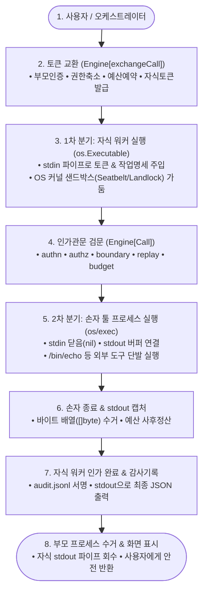

# 006. 파이프라인 엔진과 2단계 프로세스 실행 — 왜 엔진은 도메인을 모르고, 왜 부모는 자식에게 stdin으로 토큰을 쥐여주는가

> **모드**: `[문서작업]` — 소스코드 수정 없이 이번 대화 세션에서 다룬 제네릭 파이프라인 엔진(`pipeline.Engine[S]`), 상태봉투(`Call`), 토큰교환(`Exchange`)과 인가관문(`PEP Gateway`), 그리고 2단계 프로세스 생성 및 표준입출력 격리 통신의 작동원리와 Why를 해설합니다.  
> **기준일**: 2026-11-07 · **기준 커밋**: `bc178e5`  
> **다시 확인하는 법**:  
> ```bash
> git log -1 --format=%h -- cmd internal
> # 1. 파이프라인 범용 엔진 시험
> go test -v ./internal/pipeline/...
> # 2. PEP 인가관문 파이프라인 및 도구 실행 시험
> go test -v ./internal/authz/pep/... -run "TestGateway"
> # 3. 오케스트레이터 프로세스 스포너(stdin/stdout 격리) 시험
> go test -v ./internal/orchestrator/... -run "TestSpawner"
> ```

---

## 💡 사용자의 질문 (원문 보존)

> 1. `pipeline.Engine[Call]이 뭐야? Call이 상태봉투야? 그게 뭐야? Go문법을 잘모르는데 특별한 방식이야?`  
> 2. `인가관문과 토큰교환을 자세히 설명해줘. 무슨 차이이고 무슨 관계야? 순서가 어떻게 다른거야?`  
> 3. `var engine *pipeline.Engine[Call] 문법 좀 더 설명해줘. 제네릭은 알겠으니 생략. pipeline은 뭔가? 클래스이름이야? 왜 소문자야? 변수인가? Engine은 왜 대문자인가? Go 변수 선언 및 네이밍컨벤션 요약해줘. *는 뭐야?`  
> 4. `Tool실행 결과는 어떻게 리턴되나? 특히 shell 툴이면 어떻게? stdout이나 stderr로 받나?`  
> 5. `정리가 안된다는 점 감안해라. 내가 큰 그림이 부실하다. 부모프로세스가 자식을 생성하면서 표준입출력을 변경한다. 그를 통해 부모자식이 통신한다. 여기까지 알겠다. 그런데 자식이 툴을 실행하는데 그쪽은 어떻게 처리되는지 상세 설명해줘. 자식프로세스와 툴(쉘)의 통신 말이야. 통신이 없으면 없다고 해라. 자식 워커가 부모가 되어 툴을 자식프로세스로 실행시키나?`  
> 6. `2단계의 프로세스 생성과 통신처리 전체를 정리해서 더이상 질문이 안나오게 본질적으로 정리를 해줘. 너무 자세할 필요는 없다. "아하~ 그런 식이구나"하고 알게 만들면 된다. 부모는 자식을 만드는데 cli 명령을 쓴다. 그것도 자세히 설명해라. 즉 메인실행프로그램이 부모도 되고 자식도 된다. 옵션으로 맞나? 아무튼 자식의 입출력을 설정해서 설정이나 비밀키 같은 걸 전달하고 자식의 출력을 리다이렉션해서 부모쪽으로 가게 한다. 맞나? 틀린 점이나 보강할 점 지적해라. 그리고 툴 자식프로세스를 따로 설명한 뒤에 서로 비교해서 공통점과 차이점을 잘 알게 해라. 이런 식의 처리방식은 에이전트프로그래밍의 핵심구조이고 구현이므로 아주 중요하다. 아키텍쳐나 구현패턴 쪽으로 언급할 부분은 언급해서 강조해줘.`  
> 7. `파이프라인 엔진은 어떤 패턴인지 설명하고 그 비슷한 패턴도 소개하면서 비슷하지만 다른 점을 알려줘. 파이프라인은 인터셉터, 미들웨어, 명령체인 등이 있다. 우리 pep 파이프라인은 도메인역전구조라고 할수 있다. 순수엔진이고 내용은 모른다. 이런 것은 파이프라인이고 배울가치 있다. 어떤 패턴에 가깝나? 덧붙여서 gateway는 api게이트웨이가 아니라고 하는데 어떤 공통점과 차이점이 있나? 게이트웨이는 게이트웨이이고 공통점이 있다. 하나의 입구다. 우리 게이트웨이는 어떤 것이라고 생각하면 되나? 우리 게이트웨이는 처리를 파이프라인에 맡긴다. 단지 준비만 해준다. 그래서 준비용 게이트웨이인가? 보안 어떤 점에서 의미가 있는 구조인가?`  
> 8. `파이프라인이 두 종류로 쓰인다. 키교환은 어떻게 의도된 것이고 구현되었나? 키교환은 사용자인증이라고 볼 수 있나? 인증은 pep에서 하는데 그 전에 또 어떤 인증이 필요한가?`

---

## 0. 모든 설계 이전에 ‘사람’이 있다 — 자율 에이전트에게 내 컴퓨터를 맡길 때의 공포

자율 에이전트(LLM 또는 백그라운드 스크립트)에게 일을 맡길 때 개발자가 가장 두려워하는 상황은 두 가지입니다:
1. **권한 탈취**: 자식 일꾼이 부모의 전체 권한(마스터 토큰)을 쥐고 있다가, 악성 프롬프트나 버그로 인해 디스크 전체를 날리거나 외부로 비밀을 유출하는 참사.
2. **보안 우회(Bypass)**: 검문소 코드가 복잡한 `if-else` 분기문으로 얽혀 있다가, 개발자의 작은 조건문 실수 하나로 인가 절차를 건너뛰고 쉘 명령이 실행되어 버리는 취약점.

이 프로그램(`authz-harness`)은 이 불안을 해결하기 위해 **"절대로 권한을 통째로 넘겨주지 않는 2단계 출입증 발급(Token Exchange)"**, **"어떤 요청도 10개 검문소를 건너뛸 수 없는 순수 파이프라인 엔진(`pipeline.Engine[S]`)"**, 그리고 **"비밀값이 OS 프로세스 목록에 절대 노출되지 않도록 표준입출력 파이프로만 통신하는 2단계 프로세스 격리"**라는 안전장치를 만들었습니다.

이 문서는 코드를 일일이 뒤지지 않더라도, 이 장치들이 안에서 어떻게 물려 돌아가고 왜 이런 모양을 가지게 되었는지 그 본질을 밝힙니다.

---

## 1부. 이것은 무엇에 쓰는 장치이고, 왜 이런 모양인가 (용도와 Why)

### 1. 어디에 쓰는 물건인가 (자동차 운전석 시점)

* **파이프라인 엔진 (`pipeline.Engine[S]`)**: 
  자동차의 **"컨베이어 벨트 검사 라인"**입니다. 볼트나 엔진 부품이 무엇인지 모릅니다. 단지 올려진 물건(상태봉투 `S`)을 1번부터 10번 검사대까지 엄격하게 차례대로 통과시키며, 하나라도 불합격하면 즉시 비상 정지 버튼을 누르고 앞서 만진 부품들을 원래대로 롤백(보상 트랜잭션)합니다.
* **상태 봉투 (`Call` / `exchangeCall`)**:
  컨베이어 벨트에 올라가는 **"노란 서류 봉투"**입니다. 요청자가 넣은 주문서와, 각 검사대 직원들이 서명하고 채워 넣은 중간 검사 결과가 차곡차곡 누적됩니다.
* **토큰 교환 (`Token Exchange`)**:
  건물 로비의 **"임시 출입증 발급 창구"**입니다. 부모 매니저의 마스터 키를 검증한 뒤, 자식 에이전트에게 작업에 꼭 필요한 만큼만 깎아낸(Downscoping) 10분짜리 하위 출입증을 새로 찍어줍니다.
* **인가 관문 (`PEP Gateway`)**:
  실제 창고 문 앞의 **"보안 검색대"**입니다. 자식 일꾼이 가져온 하위 출입증을 검증하고, 격리 구역(`Jail`)을 벗어나지 않는지 확인한 뒤에만 창고 문(파일 I/O, 쉘 툴)을 열어줍니다.
* **2단계 프로세스 격리 (`Orchestrator` ➔ `Worker` ➔ `Tool`)**:
  부모가 직접 일하지 않고 **"방폭 격리실에 자식 일꾼을 넣고, 그 일꾼이 다시 집게(손자 툴)를 쥐고 작업하게 하는 격리 체계"**입니다.

---

### 2. 가장 밑바닥의 이유부터 (끝까지 되묻는 Why)

1. **왜 파이프라인 엔진은 토큰이나 보안 규칙을 전혀 모르게(도메인 역전) 만들었나?**
   * 검문 로직과 순서 제어 로직이 섞이면, "이 요청은 가벼우니까 감사 기록을 나중에 하자" 같은 개발자의 자의적 예외 처리가 발생해 보안 구멍(Fail-Open)이 생깁니다.
   * 엔진을 순수한 100줄짜리 제네릭 루프로 완전히 격리함으로써, **어떤 요청도 10개 검문소를 건너뛰거나 순서를 뒤바꿀 수 없음(Fail-Closed)**을 수학적으로 강제하기 위함입니다. (구현: [internal/pipeline/pipeline.go](../../internal/pipeline/pipeline.go))
2. **왜 PEP 검문소 전에 토큰 교환(Token Exchange)이라는 번거로운 단계를 또 두었나?**
   * 부모가 가진 권한을 자식 에이전트에게 그대로 넘겨주면, 자식 프로세스가 탈옥하거나 탈취당했을 때 시스템 전체가 위험해집니다.
   * 부모의 권한보다 절대 커질 수 없는 '단조 감소(Monotonic Downscoping)' 불변식을 적용해, 자식에게는 꼭 필요한 최소 권한(Least Privilege)만 떼어주기 위함입니다. (구현: [internal/authn/exchange/service.go](../../internal/authn/exchange/service.go))
3. **왜 부모는 자식에게 CLI 인자(`--token=...`)가 아니라 표준입력(`stdin`)으로 비밀값을 주나?**
   * 리눅스와 macOS에서는 터미널에서 `ps aux` 명령을 치면 다른 일반 사용자나 악성 프로세스가 실행 인자(argv)를 그대로 볼 수 있습니다.
   * OS 프로세스 테이블에 토큰 문자열이 단 1밀리초도 노출되지 않도록, 메모리 대 메모리로 직접 연결되는 `stdin` 파이프 단일 프레임을 통해 주입(Zero Leakage)하기 위함입니다. (구현: [internal/orchestrator/spawner.go](../../internal/orchestrator/spawner.go))
4. **왜 자식 워커가 직접 쉘 명령을 실행하지 않고 또 손자 프로세스(`exec.Command`)를 띄우나?**
   * 자식 워커 프로세스 안에서 쉘 스크립트를 직접 eval 하거나 메모리를 공유하면, 비정상 명령어 실행 시 워커 프로세스 자체가 오염되거나 크래시됩니다.
   * OS 커널 레벨에서 완벽히 격리된 독립 주소 공간을 갖는 손자 프로세스로 실행하고, 그 출력(`stdout`)만 버퍼로 긁어와야 시스템 안정성이 유지되기 때문입니다. (구현: [internal/execguard/guard.go](../../internal/execguard/guard.go))

---

### 3. 흔한 방식과 이 프로그램의 선택

| 구분 | 흔한 방식 (일반 웹/프레임워크) | 이 프로그램의 선택 |
|---|---|---|
| **파이프라인 구조** | 재귀 호출 미들웨어 (`next(ctx)` 양파 껍질) | **1차원 평면 배열 루프 + 상태봉투(`*S`) 전수 순회** |
| **실패 처리** | 예외 던지기 (`throw / catch`) | **Fail-Closed 즉시 중단 + 역순 보상(Saga Compensate)** |
| **게이트웨이** | 네트워크 L7 역방향 프록시 (API Gateway) | **비즈니스 도메인 인가 집행점 (PEP Gateway)** |
| **비밀값 전달** | 환경변수(`ENV`) 또는 명령행 인자(`-token`) | **표준입력(`stdin`) 1:1 파이프라인 단일 프레임 주입** |
| **프로세스 구성** | 별도 데몬(Server) 띄우고 HTTP 통신 | **단일 바이너리 멀티페르소나 (`self-re-exec`) + OS Pipe** |

---

## 2부. 처음부터 끝까지 따라가는 E2E 여정 (패킷 왕복 지도)

사용자가 하나의 안전한 쉘 작업을 요청했을 때, 시스템 전체에서 데이터와 제어권이 오가는 왕복 지도입니다.



### 단계별 데이터 변화와 검문 결과:
1. **토큰 교환 (`exchangeCall`)**: 부모 토큰의 권한(`file:read, file:write, exec:run`) 중 오직 `exec:run(echo)`만 깎아내어 자식 JWT를 찍어냅니다.
2. **워커 주입 (`stdin`)**: 부모는 `{"token": "ey...", "action": "exec:run", "data": "hello"}` 형태의 단일 JSON을 자식의 `stdin`에 꽂습니다.
3. **PEP 관문 검문 (`Call`)**: 자식 안에서 10단계 검사 라인이 가동됩니다. `authn`에서 서명을 확인하고, `boundary`에서 명령어가 허용 목록에 있는지 검사합니다.
4. **손자 툴 격리 실행 (`os/exec`)**: 자식이 `/bin/echo hello`를 자식 프로세스로 띄워 `stdout`으로 나온 `"hello\n"`을 바이트 배열로 긁어옵니다.
5. **부모 회수 (`stdout`)**: 자식은 이 결과를 담은 `Result` JSON을 자기 `stdout`에 찍고 종료하며, 부모가 이를 수거해 화면에 보여줍니다.

---

## 3부. 질문과 답변으로 파고드는 세부 동작 (Q&A)

### Q1. `pipeline.Engine[Call]`에서 대괄호 `[Call]`과 `*` 포인터는 무슨 뜻인가요? (Go 문법)
* **대괄호 `[Call]` (제네릭)**:  
  `pipeline.Engine`은 어떤 데이터든 나를 수 있는 택배 트럭입니다. `Engine[Call]`은 **"이 트럭은 오직 `Call`이라는 전용 상자만 싣고 달린다"**고 못 박아두는 Go 1.18+ 표준 제네릭 문법입니다. (구현: [internal/pipeline/pipeline.go](../../internal/pipeline/pipeline.go#L40))
* **별표 `*` (포인터)**:  
  `*pipeline.Engine[Call]`은 거대한 엔진 객체 실물을 메모리에서 매번 복사하지 않고, 그 엔진이 위치한 **8바이트 메모리 주소(참조)**만 가볍게 가리키겠다는 뜻입니다.
* **대소문자 규칙**:  
  Go 언어에는 `public`, `private` 키워드가 없습니다. 첫 글자가 대문자(`Engine`)이면 다른 패키지에 공개된 Public 타입이고, 소문자(`engine`, `pipeline`)이면 내부 전용 Private 패키지/변수입니다.

### Q2. 토큰 교환(`Exchange`)과 인가관문(`PEP`)은 무슨 차이이고 왜 인증이 2번 일어나나요?
* **역할의 차이**:  
  * **토큰 교환**: 권한을 깎아서 **임시 출입증을 만들어주는 발급소** (RFC 8693).
  * **PEP 게이트웨이**: 그 출입증을 들고 창고로 들어갈 때 **문을 열어주는 검문소** (NIST PEP).
* **왜 인증이 2번 일어나는가?**:  
  * 1차 인증(토큰 교환): *"너 진짜 회사 매니저 맞아? 맞으면 외주 직원용 10분짜리 하위 출입증을 새로 파줄게."* (부모 신원 증명)
  * 2차 인증(PEP 관문): *"너 방금 그 10분짜리 출입증 위조 안 하고 가져온 거 맞아?"* (발급된 토큰의 유효성 검증)  
  부모의 마스터 키를 위험한 자식 일꾼에게 그대로 쥐여주지 않기 위해 의도적으로 분리된 2단계 방어선입니다. (구현: [internal/authn/exchange/service.go](../../internal/authn/exchange/service.go#L143), [internal/authz/pep/gateway.go](../../internal/authz/pep/gateway.go#L148))

### Q3. 자식 워커와 손자 툴(쉘) 사이의 통신은 어떻게 일어나나요? 대화형인가요?
* **대화형(Interactive)이 아닙니다**:  
  자식 워커와 툴 사이에는 타이핑을 주고받는 쉘 세션이 없습니다.
* **단발성 배치(One-shot Batch) 실행**:  
  자식 워커는 툴을 띄울 때 `stdin`을 아예 닫아버리고(`cmd.Stdin = nil`), 명령행 인자로 실행할 커맨드를 전달합니다.
* **출력 수거**:  
  툴이 표준출력(`stdout`)에 뱉어낸 데이터만 `capWriter` 버퍼로 긁어모아 바이트 슬라이스(`[]byte`)로 반환합니다. 만약 에러(`stderr`)가 나거나 비정상 종료되면 즉시 Go의 `error`로 변환되어 인가관문이 닫힙니다(Fail-Closed). (구현: [internal/execguard/guard.go](../../internal/execguard/guard.go#L102-L121))

### Q4. 부모 프로세스는 자식 워커를 어떻게 띄우고 통신하나요?
* **자기 복제 (Self-Re-execution)**:  
  부모는 별도 프로그램을 찾지 않고 `os.Executable()`(자기 자신의 바이너리)에 `worker` 서브커맨드 인자를 붙여서 자식 프로세스를 띄웁니다.
* **입출력 리다이렉션 (Pipe Redirection)**:  
  * **부모 ➔ 자식**: 부모는 자식의 `cmd.Stdin`에 토큰과 요청이 담긴 단일 JSON 프레임을 밀어 넣습니다. (OS 프로세스 목록에 토큰 노출 차단)
  * **자식 ➔ 부모**: 자식이 콘솔 화면 대신 자기 `cmd.Stdout` 파이프로 뱉은 결과 JSON을 부모의 수거 버퍼로 흡수합니다. (구현: [internal/orchestrator/spawner.go](../../internal/orchestrator/spawner.go#L115-L126))

### Q5. 파이프라인 엔진은 미들웨어나 인터셉터와 무엇이 다른가요?
* **미들웨어/인터셉터**: `next(ctx)` 형태로 함수가 함수를 부르며 양파 껍질처럼 감싸는 재귀 구조입니다. 호출 스택이 깊어지고 중간에 흐름을 통제하기 어렵습니다.
* **우리 파이프라인 엔진**: 재귀가 없는 **1차원 평면 배열 루프(`for _, step := range steps`)**입니다. 각 검문소는 앞뒤를 호출하지 않고 오직 상태봉투(`*S`)만 검사합니다.
* **Saga 보상 롤백**: 중간에 8단계에서 실패하면, 앞서 7단계에서 성공했던 자원 차감(예: 예산 소비)을 역순으로 되돌리는 `Compensate` 보상 로직이 기계적으로 발동됩니다. (구현: [internal/pipeline/pipeline.go](../../internal/pipeline/pipeline.go#L118))

---

## 4부. 배척한 방식과 그 이유

### 1. 명령행 인자(`--token=...`)로 토큰 전달하는 방식 ➔ [전면 배척]
* **택했다면**: 코드는 몇 줄 줄어들고 간단해집니다.
* **발생하는 참사**: 리눅스/macOS 서버에서 `ps aux` 명령 한 번이면 제3자 프로세스나 다른 로그인 사용자가 인가 토큰 전체를 그대로 복사해 갈 수 있습니다(Zero Leakage 위반).
* **포기한 것**: 인자 파싱의 단순함을 포기하고, `stdin` 파이프라인 단일 프레임 주입 프로토콜을 구축했습니다.

### 2. 재귀적 미들웨어(`func(next)`) 방식 ➔ [전면 배척]
* **택했다면**: 웹 프레임워크(Gin, Echo)처럼 친숙한 방식으로 미들웨어를 걸 수 있습니다.
* **발생하는 참사**: 미들웨어 체인은 실행 흐름이 숨겨져 있어, 특정 단계가 누락되거나 에러 발생 시 앞선 자원 차감(예산, 승인서)을 역순으로 보상 롤백(Compensate)하기가 극도로 어렵습니다.
* **포기한 것**: 웹 스타일의 익숙함을 포기하고, 순서와 등급 하강이 컴파일/단위시험으로 검증되는 평면 선언적 파이프라인을 택했습니다.

### 3. 부모 프로세스 안에서 고루틴(Goroutine)으로 워커를 돌리는 방식 ➔ [전면 배척]
* **택했다면**: 프로세스를 매번 포크하지 않아도 되므로 속도가 빠르고 메모리를 덜 씁니다.
* **발생하는 참사**: 서브에이전트가 악성 코드를 실행해 메모리를 망가뜨리거나(CGO 패닉), 무한 루프를 돌며 CPU를 100% 점유하면 부모 메인 시스템 전체가 함께 다운됩니다.
* **포기한 것**: 수 밀리초의 프로세스 생성 비용을 감수하고, OS 커널 수준의 완전한 프로세스 격리와 강제 종료(`SIGKILL`) 제어권을 얻었습니다.

---

## 5부. 한눈에 보는 요약표와 코드 정본 색인

### 1. 핵심 컴포넌트 4대 비교 요약

| 컴포넌트 | 정체 및 역할 | 입력 통로 | 출력 통로 | 사용 패턴 |
|---|---|---|---|---|
| **토큰 교환 (`Exchange`)** | 자식용 임시 출입증 발급소 | 메모리 객체 (`ExchangeRequest`) | 축소 위임된 자식 토큰 문자열 | `Engine[exchangeCall]` 선언적 파이프라인 |
| **자식 워커 (`Worker`)** | 격리실에 갇힌 인가 집행 일꾼 | 부모가 꽂아준 `stdin` 파이프 | 부모가 낚아채는 `stdout` 파이프 | 단일 바이너리 멀티페르소나 (`self-re-exec`) |
| **인가 관문 (`PEP`)** | 창고 문 앞의 10단계 보안 검색대 | 상태봉투 `Call` (토큰, 동작, 자원) | `Result` (실행 데이터 및 감사 기록) | `Engine[Call]` + 도메인 역전 |
| **손자 툴 (`Tool Exec`)** | 실제 OS 쉘/바이너리 단발 실행 | 명령행 인자 (단발, `stdin=nil`) | 메모리 버퍼로 긁어오는 `stdout` | OS Subprocess (`os/exec`) 격리 |

### 2. 코드 정본 찾아보기

- **제네릭 파이프라인 순수 엔진**: [internal/pipeline/pipeline.go](../../internal/pipeline/pipeline.go) (`Engine[S]`, `Step[S]`, `Run`, `Compensate`)
- **PEP 인가관문 10단계 조립소**: [internal/authz/pep/gateway.go](../../internal/authz/pep/gateway.go) (`assemble`, `NewGateway`, `pipelineState`)
- **PEP 도구 인터페이스 및 상태봉투**: [internal/authz/pep/tool.go](../../internal/authz/pep/tool.go) (`Tool`, `Call`, `Output`)
- **쉘 도구 실행 및 stdout 버퍼 캡처**: [internal/authz/pep/tool_exec.go](../../internal/authz/pep/tool_exec.go), [internal/execguard/guard.go](../../internal/execguard/guard.go) (`Run`, `capWriter`)
- **토큰 교환 8단계 파이프라인**: [internal/authn/exchange/service.go](../../internal/authn/exchange/service.go) (`assemble`, `Exchange`, `exchangeCall`)
- **부모-자식 프로세스 스포너 및 stdin 주입**: [internal/orchestrator/spawner.go](../../internal/orchestrator/spawner.go) (`Spawn`, `configureProcessGroup`)
