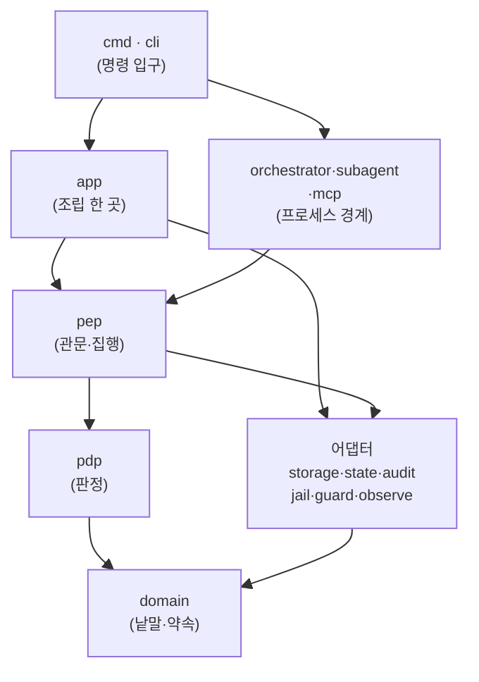
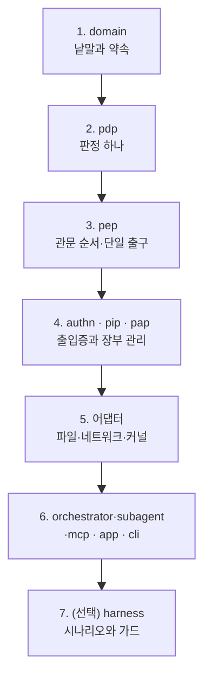

# 007. 코드를 읽는 순서와 의존 방향 — 처음 여는 사람은 어디부터 읽고, 판정 부품은 왜 파일을 모르게 만들었나

> **모드**: `[문서작업]` — 소스코드 수정 없이 현재 코드가 패키지를 어떻게 나누고, 어느 쪽이 어느 쪽을 가져다 쓰며(의존 방향), 그 방향을 무엇이 지키는지를 해설합니다.  
> **기준일**: 2026-11-05 · **기준 커밋**: `38fecfa` (이 문서가 설명하는 `cmd/`와 `internal/`을 마지막으로 바꾼 커밋)  
> **검증 범위**: 동작·순서·소유자·시점을 코드와 대조한 결과와 「미확인」은 5부 ③에 있습니다.  
> **이 문서는 구현된 것만 적는다.** 계획·제안·미래형 약속은 적지 않으며, 현재 코드가 하지 않는 것은 「지금은 없다」고만 씁니다.  
> **이 문서의 규칙**: 본문(0~4부, Q&A, 그림, 5부 ①)은 쉬운 개념·설계·이유가 중심입니다. 파일·타입 이름 같은 고유 이름은 첫 등장에 한마디 설명과 함께 쓰고, 구현의 어디인지는 문단 끝 `(구현: 파일 · 함수, 5부 ② 번호)` 귀띔으로 보조합니다. 기준은 [프로그램 설명서 README의 「설명의 기준」과 「이름의 3층」](README.md)입니다.  
> **겹치는 주제**: 001~006편은 「프로그램이 무엇을 하는가」를, 이 편은 「코드가 왜 이렇게 나뉘어 있고 어디부터 읽으면 되는가」를 다룹니다. 관문의 단계 순서와 단일 출구(`finalize`)는 [001편](001-전체요청여정과_5단계관문.md) Q6이, 감사 장부의 파일 잠금과 해시 사슬은 [003편](003-서브프로세스격리와_해시체인감사.md) Q3·Q4가, 도구 종류별 분기를 인터페이스로 바꾸지 않은 이유는 [005편](005-승인_예산과_도구확장.md) 4부 5번이, 관측 포트·격리 포트의 동작과 자식 요청 프레임의 엄격 해석은 [006편](006-OS격리_관측성과_감사체크포인트.md) Q1·Q7·Q12가 자세히 다룹니다.
>
> **다시 확인하는 법**
> ```bash
> git rev-parse --short HEAD
> git log -1 --format=%h -- cmd internal
> # 1. 판정 부품(pdp)이 이 저장소 안에서 기대는 패키지 (domain과 자기 자신만 나온다)
> go list -deps ./internal/authz/pdp | grep authz-harness
> # 2. 패키지마다 이 저장소 안의 어떤 패키지를 가져다 쓰는가 (의존 방향 전체)
> go list -f '{{.ImportPath}} => {{join .Imports " "}}' ./internal/... ./cmd/... | sed 's#authz-harness/##g'
> # 3. 아키텍처 가드 시험 (판정 부품의 파일·OS 무의존, 단일 출구, 합성 루트 등)
> go test -v ./internal/harness/ -run TestArchitectureGuardrails
> # 4. 패턴별 시험
> go test -v ./internal/authz/pdp/ ./internal/storage/ ./internal/observe/ ./internal/app/ ./internal/authz/pep/ \
>   -run "TrackA|StrictNoOSImports|Audit_FailClosed|AtomicFileStore|WrapSafe|BuildStack|Decorator|Finalize"
> # 5. 4부 「배척한 방식」의 과거 코드 (본문에는 옮기지 않는다)
> git show cef8fd5^:internal/authz/pdp/service.go | sed -n 1,12p                       # 판정 부품이 pip·audit를 직접 가져다 쓰던 모습
> git show 1cff084^:internal/authz/pep/gateway.go | grep -n -A12 "func tokenScopeAllows" # 관문이 권한 범위를 판정하고 "*"·"admin"을 통과시키던 모습
> git show 202d16d^:internal/subagent/worker.go | grep -n "stateStore"                  # 자식 워커가 허가 장부 저장소를 직접 쥐던 모습
> git show ba42aa7^:internal/cli/grant.go | grep -n "NewFileStore\|NewJSONLWriter"      # 명령마다 저장소·감사 기록기를 직접 만들던 모습
> git grep -n "syscall.Flock" 36a76bc^ -- internal/authn internal/authz/state           # 저장소마다 파일 잠금을 따로 구현하던 모습
> git grep -n "strings.Contains(err.Error()" af61fcd^ -- internal/authn/exchange/service.go  # 에러 문구로 사유를 가리던 모습
> git show 5b60275^:internal/authz/pep/gateway.go | grep -n "slog"                      # 관문이 로거(slog)를 직접 쥐던 모습
> # 6. 지금은 없는 것 확인
> go list ./... | grep -v /internal/                                   # 다른 모듈이 가져다 쓸 수 있는 패키지: 실행 파일 하나뿐
> grep -rn "net.Listen\|ListenAndServe\|grpc" internal cmd | grep -v _test.go   # 네트워크로 받는 코드: 시나리오 탐침 하나뿐
> grep -rn "ToolHandler" internal cmd                                  # 빈 출력
> grep -n "go vet\|TestArchitectureGuardrails" scripts/prepush_checks.sh   # 푸시 전에 가드와 go vet이 자동으로 돈다(커밋 단계는 아님)
> ls .github 2>/dev/null                                               # 자동 시험(CI) 설정: 빈 출력
> ```

---

## 💡 사용자의 질문 (원문 보존)

> 다음 진행해라

([18번 로드맵 `040`](../로드맵/18-아키텍처-패턴-교보재-및-코드리딩-가이드/instructions/040_설명서_007_코드읽는순서와_의존방향_편.md) 지시서에 따라 집필했습니다.)

---

## 0. 모든 설계 이전에 ‘사람’이 있다 — 오랜만에 코드를 열었는데 어디부터 봐야 하나

몇 달 만에 이 저장소를 다시 연 사람을 생각해 봅니다. `internal/` 아래에 폴더가 서른 개 있고, 이름만 봐서는 무엇이 중심이고 무엇이 곁가지인지 알 수 없습니다. 이 사람이 실제로 품는 질문은 이렇습니다.

- 「어디부터 읽어야 앞에서 본 것만으로 다음 것이 읽히나?」
- 「허락할지 말지를 정하는 코드는 어디이고, 그 코드는 정말 파일이나 네트워크에 손대지 않나? 손대지 않는다는 걸 무엇이 보장하나?」
- 「`Observer`, `Confiner`, `BuildStack` 같은 이름이 왜 있나? 그냥 직접 부르면 안 되나?」
- 「여기에 있는 구조는 일부러 그렇게 만든 것인가, 어쩌다 그렇게 된 것인가? 예전에는 어땠나?」

이 문서는 읽는 순서를 한 줄로 제시하고, 각 단계에서 무엇을 알게 되는지 적습니다. 그다음 패키지 사이의 의존 방향이 왜 그렇게 정해졌는지, 그 방향을 지키는 시험이 무엇이고 그 시험이 무엇을 못 잡는지를 적습니다. 마지막으로 코드에 실제로 있는 구조 패턴과 버린 방식을 적습니다. 패턴의 개수는 미리 정하지 않았고, 코드에 없는 패턴은 적지 않았습니다.

---

## 1부. 왜 코드를 이렇게 나누었고, 왜 이런 방향인가

### 가장 밑바닥의 이유부터

1. **왜 패키지를 나누고 방향을 정하나?** 이 프로그램이 하는 일은 「허락할지 정하기(판정)」와 「정한 대로 실제로 하거나 막기(집행)」, 그리고 「그 사이에 파일·네트워크·커널과 닿기」로 나뉩니다. 셋이 한데 섞이면 판정 규칙 한 줄을 읽으려 해도 파일 잠금과 로그 코드를 같이 읽어야 하고, 판정이 무엇을 보고 내려졌는지 말할 수 없게 됩니다.
2. **그건 왜 문제인가?** 이 저장소의 목적은 「허락되지 않은 요청이 정해진 사유와 종료 코드로 정확히 실패한다」를 증명하는 것입니다. 증명하려면 판정이 무엇을 입력으로 받아 무엇을 내놓는지가 닫혀 있어야 합니다. 판정이 스스로 파일을 읽으면 같은 요청이라도 디스크 상태와 읽는 시점에 따라 답이 달라질 수 있어 「이 입력이면 이 답」을 표로 적어 시험할 수 없습니다.
3. **그래서 방향을 어떻게 정했나?** 가운데에 낱말과 약속만 담은 `internal/domain`(행동·권한·사유·감사 기록 모양과, 바깥이 지켜야 할 인터페이스를 모은 패키지)을 두고, 판정 부품 `internal/authz/pdp`는 이것 하나만 가져다 씁니다. 파일·네트워크·커널에 닿는 코드(어댑터)는 바깥에 두고, 바깥이 `domain`의 약속을 따르게 합니다. 바깥이 안을 알고, 안은 바깥을 모릅니다.
4. **약속을 왜 쓰는 쪽(`domain`)이 가지나?** 판정 부품이 필요로 하는 「주체의 장부 사본을 달라」는 약속을 장부 읽는 패키지가 가지면, 판정 부품은 그 약속을 쓰려고 장부 패키지를 가져다 써야 하고, 장부 패키지는 파일 저장소를, 파일 저장소는 운영체제 호출을 가져다 씁니다. 판정 부품이 파일을 직접 읽지 않아도 파일 코드에 묶입니다. 약속을 `domain`이 가지면 이 사슬이 끊깁니다.
5. **그 방향이 저절로 지켜지나?** 아닙니다. 누군가 편하다고 한 줄 `import`를 넣으면 깨집니다. 그래서 가져다 쓰는 관계를 소스코드에서 읽어 검사하는 시험(`TestArchitectureGuardrails`)을 두었습니다. 이 시험은 사람이 `go test`를 돌릴 때, 그리고 푸시 직전에 Git 훅이 자동으로 돌릴 때 실행됩니다. 원격 자동 시험(CI)은 없고, 커밋 단계에서는 돌지 않습니다(Q4).
6. **더 내려가면?** 「사람이 판정을 직접 확인하고 싶다」는 요구에 닿습니다. 그 이상은 되물을 수 없습니다.



화살표는 「가져다 쓴다(import)」입니다. 판정(`pdp`)에서 나가는 화살표는 `domain` 하나뿐입니다. 관문(`pep`)은 판정과 어댑터를 모두 가져다 쓰는 껍데기입니다(Q5). 운영체제 격리 어댑터(`confinement`)는 그림의 어댑터 상자에 넣지 않았습니다. 이것은 `app`이 아니라 `orchestrator`와 시험 하네스가 가져다 씁니다. (구현: 5부 ② 1·2·3·9번)

### 흔한 방식과 이 프로그램의 선택

| 구분 | 흔한 방식 (일반론, 이 저장소에서 확인하지 않음) | 이 프로그램의 선택 |
|---|---|---|
| 모양 | 서비스 코드가 저장소·로거·설정 객체를 직접 만들거나 가져다 쓰고, 위에서 아래로 층을 쌓는다. 의존성 주입 프레임워크가 조립을 맡기도 한다 | 낱말과 약속은 `domain`에, 판정은 `domain`만 쓰는 순수 함수로, 파일·네트워크는 약속을 따르는 어댑터로, 조립은 손으로 쓴 함수 한 곳(`app.BuildStack`)에 둔다. 외부 프레임워크는 쓰지 않는다 |
| 얻는 것 | 처음 쓰기가 빠르고 파일 수가 적다 | 판정을 파일 없이 표로 시험할 수 있다. 「판정이 파일을 모른다」를 소스 검사 시험으로 확인할 수 있다. 조립 순서를 한 함수에서 읽을 수 있다 |
| 포기하는 것 | 판정 규칙만 떼어 시험하기 어렵고, 경계가 깨져도 알아차리기 어렵다 | 패키지와 인터페이스가 늘어 처음 읽는 사람이 따라갈 이름이 많다. 옛 이름을 살리려고 둔 타입 별칭(`audit.Writer = domain.AuditWriter` 등) 때문에 같은 타입이 두 이름으로 보인다. 조립 함수 하나가 여러 경우(검증 전용·부분 경로)를 다 맡아 길어졌다 |

---

## 2부. 질문과 답변으로 풀어보는 핵심 동작 (Q&A)

### Q1. 처음 코드를 열면 어디부터 읽어야 하나?

- **무슨 일이 일어나는가**: 안쪽(남이 가져다 쓰는 쪽)에서 바깥쪽(남을 가져다 쓰는 쪽)으로 읽습니다. 각 단계에서 알게 되는 것을 한 문장씩 적습니다.
  1. **`internal/domain` — 낱말과 약속.** 이 프로그램이 다루는 모든 말(행동 `Action`, 권한 `Grant`, 세대 번호 `Epoch`, 거부 사유 `Reason`과 종료 코드, 감사 기록 한 줄의 모양 `AuditEvent`)과, 바깥이 지켜야 할 약속(장부 사본 공급 `SnapshotProvider`, 감사 기록 `AuditWriter`, 시계 `Clock`)을 알게 됩니다. 이 패키지는 저장소 안의 어떤 패키지도 가져다 쓰지 않습니다. (구현: 5부 ② 1번)
  2. **`internal/authz/pdp` — 판정 하나.** 허락·질문·거부(`allow`/`ask`/`deny`)가 요청과 장부 사본 두 가지만으로 어떻게 정해지는지 전부 알게 됩니다. 판정 함수 `Evaluate`와 그것을 감싼 `Decide`가 한 파일에 있습니다. (구현: [`service.go`](../../internal/authz/pdp/service.go) · `Evaluate`, `pdpService.Decide`, 5부 ② 3번)
  3. **`internal/authz/pep` — 관문.** 요청 하나가 어떤 순서로 검사되고 어디서 끝나는지 알게 됩니다. 단계 순서와 이유는 [001편](001-전체요청여정과_5단계관문.md)이 자세히 다룹니다. (구현: [`gateway.go`](../../internal/authz/pep/gateway.go) · `gateway.Execute`, 5부 ② 4번)
  4. **관문이 부르는 인증·권한 관리 서비스** — `internal/authn/token`(출입증 발급·검증·재사용 원장), `internal/authn/keys`(서명 키), `internal/authn/exchange`(축소 위임), `internal/authz/pip`(장부 사본 공급), `internal/authz/pap`(권한 부여·취소). 출입증이 어떻게 만들어지고 검증되며 장부가 어떻게 바뀌는지 알게 됩니다. 자세히는 [002편](002-토큰발급_축소위임과_서명키회전.md)입니다.
  5. **어댑터** — `internal/storage`(원자적 파일 저장), `internal/authz/state`(허가 장부 파일), `internal/authn/budget`(예산 원장), `internal/audit`(감사 장부), `internal/observe`(운영 로그 포트), `internal/jail`(작업 폴더 울타리), `internal/netguard`(네트워크 조회 가드), `internal/execguard`(등록 명령 실행기), `internal/confinement`(커널 격리). 파일·네트워크·명령·커널과 실제로 닿는 곳이 어디이고, 거기서 생긴 실패가 어떻게 거부로 바뀌는지 알게 됩니다.
  6. **프로세스 경계와 조립** — `internal/orchestrator`(자식 프로세스 띄우기), `internal/subagent`(자식 안의 일꾼), `internal/mcp`(외부 AI 도구 호출 입구), `internal/app`(조립 한 곳), `internal/cli`와 [`cmd/authz-harness/main.go`](../../cmd/authz-harness/main.go)(명령줄 입구), `internal/ui`(명령줄 출력과 위임 계보 나무 그리기). 부품이 어떻게 하나로 묶이고 어떤 명령과 프로세스로 세상에 나오는지 알게 됩니다. (구현: 5부 ② 9·12번)
  7. **(선택) `internal/harness`** — 시나리오 실행기와 아키텍처 가드 시험. 위의 약속들이 어떻게 시험되는지 알게 됩니다. (구현: 5부 ② 11번)
- **왜 이 순서인가**: 안쪽은 바깥을 모르므로, 안쪽부터 읽으면 각 단계가 앞에서 읽은 이름만으로 대부분 읽힙니다. 다만 완전하지는 않습니다. 관문(3단계)은 5단계 어댑터의 이름(`jail.Jail`, `*netguard.Guard` 등)과 예산 원장의 포트(`domain.BudgetLedger`)를 씁니다. 관문을 읽을 때는 그 어댑터가 「무엇을 해 주는가」만 알면 되고, 속은 5단계에서 봐도 됩니다.
- **근거**: 5부 ② 항목 1~4, 9, 11, 12번

### Q2. 판정 부품(`pdp`)은 왜 파일을 읽는 코드를 가져다 쓰지 않나?

- **무슨 일이 일어나는가**:
  1. 판정 함수 `pdp.Evaluate`는 요청(`pdp.Request`)과 장부 사본(`domain.SubjectSnapshot`, 한 주체의 세대 번호·살아 있는 권한·승인을 한 번에 읽어 둔 값) 두 가지만 받아 결과(`pdp.Decision`)를 돌려줍니다. 파일을 열지도, 시계를 읽지도, 기록을 남기지도 않습니다. 「지금 몇 시인가」도 요청에 담긴 시각이나 사본을 뜬 시각을 씁니다.
  2. 사본을 얻고 결과를 감사 장부에 적는 일은 같은 파일의 껍데기 `pdpService.Decide`가 합니다. 껍데기는 사본 공급자에게 사본을 달라고 하고, 실패하면 판정 없이 에러를 돌려줍니다(관문은 이를 거부로 마감합니다). 사본을 받으면 `Evaluate`를 부르고, 결과를 감사 장부에 적고, 적기에 실패하면 결과를 버리고 에러를 돌려줍니다. (구현: [`service.go`](../../internal/authz/pdp/service.go) · `Evaluate`, `pdpService.Decide`, 5부 ② 3번)
- **왜 그렇게 하나**:
  - 판정이 무엇을 보고 나왔는지를 **인자 두 개로 전부** 말할 수 있게 하려고입니다. 그래야 「이 입력이면 이 답」을 표로 적어 파일 없이 시험할 수 있습니다(`TestTrackA_PureDomainDecisionTable`).
  - 판정이 파일을 직접 읽으면 같은 요청이라도 읽는 시점과 디스크 상태에 따라 답이 달라질 수 있고, 읽기 실패를 어떤 답으로 바꿀지가 판정 규칙 사이사이에 섞입니다. 지금은 읽기 실패가 판정 규칙에 들어오지 않고 껍데기에서 에러로 끝납니다.
  - 시계도 같은 이유로 바깥에서 넣습니다. 판정이 운영체제 시계를 직접 읽으면 만료 같은 시간 판정을 시험에서 재현할 수 없습니다.
- **근거**: 5부 ② 항목 1, 3번

### Q3. 그러면 판정에 필요한 장부 사본은 누가, 어떻게 넣어 주나?

- **무슨 일이 일어나는가**:
  1. 「주체 이름을 주면 장부 사본을 돌려준다」는 약속 `domain.SnapshotProvider`는 `domain`에 있습니다. 「감사 기록 한 줄을 적는다」는 약속 `domain.AuditWriter`도 `domain`에 있습니다. 판정 껍데기를 만드는 `pdp.NewService`는 이 두 약속만 받습니다.
  2. 실제로 장부 파일을 읽는 것은 `internal/authz/pip`의 `pipService`입니다. 이 타입은 허가 장부 저장소(`state.Store`)에서 한 번에 읽어 사본을 만듭니다. Go 언어는 「같은 모양의 함수를 가지면 그 약속을 따르는 것」으로 보기 때문에, `pip` 쪽에 「나는 이 약속을 따른다」는 선언은 없습니다. 맞는지 확인은 조립 함수 `app.BuildStack`이 `pip.NewService(...)`의 결과를 `pdp.NewService`에 넘기는 줄이 컴파일될 때 이루어집니다.
  3. 감사 장부 쪽은 `internal/audit`의 `JSONLWriter`가 `AuditWriter` 약속을 따릅니다. `audit.Writer`와 `audit.Event`, `pip.SubjectSnapshot`은 새 타입이 아니라 `domain` 타입의 **다른 이름(타입 별칭)** 입니다. 이 이름들을 쓰던 기존 코드를 한 줄도 고치지 않고 같은 타입으로 통하게 하려고 별칭으로 남겼습니다. (구현: [`snapshot.go`](../../internal/domain/snapshot.go) · `SnapshotProvider`, [`audit.go`](../../internal/domain/audit.go) · `AuditWriter`, [`pip/service.go`](../../internal/authz/pip/service.go) · `pipService.GetSubjectSnapshot`, [`builder.go`](../../internal/app/builder.go) · `BuildStack`, 5부 ② 1·2·9번)
- **왜 약속을 `domain`이 가지나**: 1부 4번과 같습니다. 약속이 `pip`에 있으면 판정 부품이 `pip`를 가져다 쓰게 되고, `pip` → `state` → `storage` → 운영체제 호출로 이어지는 사슬에 묶입니다. 감사 쪽도 같습니다. `internal/audit`은 파일 잠금과 운영체제 호출을 쓰는 패키지라서, 약속이 거기 있으면 판정 부품이 그것에 묶입니다.
- **근거**: 5부 ② 항목 1, 2, 3, 9번

### Q4. 「판정 부품은 파일을 모른다」는 규칙은 무엇이 지키고, 무엇을 못 잡나?

- **무슨 일이 일어나는가**: `go test`를 돌리면 `TestArchitectureGuardrails`(소스코드를 읽어 가져다 쓰는 관계를 검사하는 시험)가 아래를 확인합니다. 이 시험은 프로그램을 실행하지 않고 `.go` 파일의 `import` 줄과 함수 호출 모양만 봅니다. (구현: [`architecture_test.go`](../../internal/harness/architecture_test.go) · `TestArchitectureGuardrails`, 5부 ② 11번)
  1. **직접 가져다 쓰기 (`TC-060-01`)**: `pdp`의 시험 아닌 파일이 `os`, `path/filepath`, `io/fs`, `internal/jail`을 가져다 쓰면 실패합니다. `pdp` 안의 `TestPDP_StrictNoOSImports`도 같은 목록을 `service.go` 한 파일에 대해 검사합니다.
  2. **건너서 가져다 쓰기 (`TC-170-01`)**: `domain`과 `pdp`에서 출발해 저장소 안의 `import` 관계를 끝까지 따라가며, 그 길 어디에서든 금지 목록(`storage`, `authz/state`, `authz/pip`, `audit`, `audit/checkpoint`, `jail`, `netguard`, `execguard`, `confinement`, `os`, `syscall`, `os/exec`, `net`, `net/http`, `path/filepath`, `io/fs`)에 닿으면 그 길을 보여 주며 실패합니다.
  3. **허용 목록 (`TC-170-04`)**: `pdp`가 직접 가져다 쓰는 패키지는 `context`·`fmt`·`strings`·`time`·`domain`, `domain`은 표준 패키지 10개(`context`, `crypto/ed25519`, `crypto/sha256`, `encoding/hex`, `errors`, `fmt`, `regexp`, `strings`, `sync`, `time`)뿐이라고 못 박아 두고, 이 밖의 패키지를 가져다 쓰면(예: `io/ioutil`) 실패합니다. 금지 목록에 없는 새 패키지도 잡으려는 시험입니다. 목록을 넓히는 일 자체가 리뷰 대상이 되도록 목록 위에 「추가 시 이 편 Q4 갱신」이라고 적어 두었습니다.
  4. **관문 허용 목록 (`TC-170-06`)**: 관문(`pep`)이 직접 가져다 쓰는 패키지는 표준 `context`·`fmt`·`strings`·`time`과 내부 `audit`·`authn/token`·`authz/pdp`·`domain`·`execguard`·`jail`·`netguard`·`observe`·`pipeline`뿐이라고 못 박아 두고, 이 밖의 패키지(예: `os`, `authz/state`)를 가져다 쓰면 실패합니다. 목록 위에 「추가 시 이 편 Q4·Q5 갱신」이라고 적어 두었습니다.
  5. **가드가 정말 잡는지 (`TC-170-03`, `TC-170-05`, `TC-170-07`)**: 일부러 `pdp → pip → state → storage → os` 길을 가짜로 만들어 넣고 검사 함수가 잡는지, 깨끗한 길에서는 잡지 않는지 확인합니다. `TC-170-05`는 가짜 그래프에 `io/ioutil`을 넣어 허용 목록 가드가 잡는지 확인하고, `TC-170-07`은 관문 목록에 `os`나 `authz/state`를 넣으면 잡고 현재 집합 그대로면 잡지 않는지 확인합니다. 가드가 아무것도 못 잡으면서 통과하는 경우를 막으려는 시험입니다.
  6. **관련 가드**: 판정·인증·감사 등 핵심 패키지가 운영체제 시계(`time.Now`)를 직접 읽지 않는지(`TC-130-01`), 로그 라이브러리(`log/slog`)를 가져다 쓰지 않는지(`TC-140-01`), 커널 격리 어댑터를 가져다 쓰지 않는지(`TC-110-01`)도 같은 시험이 봅니다.
- **무엇을 못 잡나**:
  - `TC-060-01`·`TC-170-01`은 금지 **목록** 방식이라 목록에 없는 패키지는 지나칩니다. 이 틈은 `pdp`·`domain`의 **직접** `import`에 한해 `TC-170-04`가 막습니다. 직접 `import`가 아닌 건너서 닿는 길은 여전히 금지 목록만 봅니다.
  - 표준 라이브러리 안쪽의 연결(`time`이 내부에서 `os`를 쓰는 것 등)은 따라가지 않습니다.
  - 푸시 직전에는 Git 훅(`scripts/githooks/pre-push`)이 `scripts/prepush_checks.sh`를 불러 `go vet`과 이 가드를 자동으로 돌립니다(약 2초). 그러나 커밋 단계(`pre-commit`)는 비밀값 검사만 하고, `git push --no-verify`로 건너뛸 수 있으며, 원격 자동 시험(CI)은 없습니다. 전체 `go test ./...`(약 50초)는 훅에 넣지 않았습니다.
- **근거**: 5부 ② 항목 3, 11번

### Q5. 관문(`pep`)도 판정 부품처럼 파일을 모르나?

- **무슨 일이 일어나는가**: 아닙니다. 관문은 판정과 바깥 세계 사이의 껍데기라서, 출입증 검증(`token`), 예산 원장 포트(`domain.BudgetLedger`), 감사 장부(`audit`), 작업 폴더 울타리(`jail`), 네트워크 가드(`netguard`), 명령 실행기(`execguard`), 운영 로그(`observe`)를 모두 가져다 씁니다. 이 가운데 검증기(`token.TokenVerifier`)·울타리(`jail.Jail`)·예산 원장(`domain.BudgetLedger`, 구현체 `authn/budget`은 가져다 쓰지 않음)·승인 소비기(`pep.ApprovalConsumer`)는 인터페이스로 받지만, 네트워크 가드와 명령 실행기는 구체 타입의 포인터(`*netguard.Guard`, `*execguard.Runner`)로 받습니다. (구현: [`gateway.go`](../../internal/authz/pep/gateway.go) · `Config`, 5부 ② 4·8번)
- **왜 그렇게 되어 있나**: 판정을 순수하게 만든 대가로, 파일·네트워크와 닿는 일은 누군가 해야 하고 그 자리가 관문입니다. 다만 관문이 직접 만지는 것은 없습니다. 접촉은 어댑터 패키지가 맡고, 관문은 아래 세 규칙을 따릅니다.
  1. 표준 패키지 가운데 `context`, `fmt`, `strings`, `time`만 직접 가져다 씁니다. 파일·네트워크·프로세스 접촉은 어댑터 패키지(`jail`, `netguard`, `execguard`, `audit`)를 거칩니다.
  2. 가져다 쓰는 내부 패키지는 9개(`audit`, `authn/token`, `authz/pdp`, `domain`, `execguard`, `jail`, `netguard`, `observe`, `pipeline`)로 고정합니다. 새로 들어온 `pipeline`(단계를 순서대로 돌리는 엔진)은 표준 `context`·`errors`·`fmt`만 쓰고 저장소 안의 다른 패키지를 가져다 쓰지 못합니다(`pipelineAllowedImports`). 장부 원본(`authz/state`, `pap`, `pip`, `storage`, `keys`), 조립(`app`, `cli`), 프로세스 경계(`orchestrator`, `subagent`, `mcp`), 격리(`confinement`)는 가져다 쓰지 않습니다. 이 규칙은 `TC-170-06`이 지킵니다(Q4).
  3. 의존은 교체할 구현이 둘 이상일 때(실제와 시험 대역, 운영체제별 구현 등)만 인터페이스로 받습니다. 구현이 하나뿐이고 관문 시험도 실제 구현으로 돌아가는 네트워크 가드와 명령 실행기는 구체 타입으로 받습니다. 구현이 하나뿐인 인터페이스는 「구조를 위한 구조」라고 본 [015번 보고서](../보고서/015-지속적_수정발생_근본원인_진단_및_과잉설계_제거_구조단순화_보고서.md) 1.2절의 판단을 따랐습니다.
- **건너서 닿는 길은 검사하지 않습니다**: 관문은 어댑터를 거쳐 `os`·`net/http`에 닿는 것이 정상이라 `TC-170-06`은 직접 `import`만 봅니다.
- **근거**: 5부 ② 항목 4, 8번

### Q6. 코드에 실제로 있는 구조 패턴은 무엇이고, 각각 왜 있나?

코드에 실제로 있는 것만 적습니다. 각 패턴의 위치와 그것을 지키는 시험은 5부 ②의 「패턴별 위치와 지키는 시험」 표에 모았습니다.

1. **관문의 단일 출구**: 관문의 실행 함수는 파이프라인 엔진(`pipeline.Engine`)으로 모든 단계를 순서대로 돌리며 단계마다 계측 훅(`stageHook`, 시작·끝을 운영 로그에 알리는 부품)이 불리고, 성공이든 어느 단계의 거부든 마지막에 `finalize` 한 곳을 지나서만 나갑니다. 거부도 반드시 감사 장부에 남기려면 「나가는 길이 하나」여야 그 한 곳만 보고 확인할 수 있기 때문입니다. 자세한 순서는 [001편](001-전체요청여정과_5단계관문.md) Q6입니다. 관문을 바깥에서 감싸 따로 결과를 내보내는 출구는 없습니다([006편](006-OS격리_관측성과_감사체크포인트.md) Q12). (구현: [`gateway.go`](../../internal/authz/pep/gateway.go) · `gateway.Execute`, `stageHook`, `gateway.finalize`, 5부 ② 4번)
2. **순수한 판정과 그것을 감싼 껍데기**: Q2입니다. 판정(`Evaluate`)은 입력만 보고, 읽기·기록은 껍데기(`Decide`)가 합니다. (구현: 5부 ② 3번)
3. **하나의 원자적 파일 저장소를 모든 장부가 같이 씀**: 허가 장부, 출입증 재사용 원장, 서명 키 파일, 예산 원장은 모두 `storage.AtomicFileStore[T]`(「파일 잠금 → 임시 파일에 통째로 쓰기 → 이름 바꿔 교체」를 한 번 구현해 두고, 담을 내용의 타입 `T`만 바꿔 쓰는 저장소)를 씁니다. 여러 프로세스가 같은 장부를 동시에 고쳐도 반쯤 쓴 파일이나 사라진 변경이 생기지 않아야 하는데, 이 성질은 장부마다 똑같아야 합니다. 같은 코드를 여러 벌 두면 한 벌만 고쳐지고 나머지가 어긋납니다. 감사 장부(`audit.JSONLWriter`)는 이 저장소를 쓰지 않고 파일 잠금을 직접 겁니다. 감사 장부는 통째로 바꿔 쓰는 파일이 아니라 끝에 한 줄씩 덧붙이는 파일이기 때문이며, 원자 교체·디렉터리 `fsync`와 감사 잘린 꼬리 복구(`audit recover`)의 자세한 동작은 [010편](010-파일잠금_원자교체와_도중종료.md)에서 다룹니다. (구현: [`atomic.go`](../../internal/storage/atomic.go) · `AtomicFileStore`, `AtomicFileStore.Update`, 5부 ② 5번)
4. **포트와 어댑터**: 핵심 코드는 인터페이스(포트, 「이런 일을 해 달라」는 약속)만 알고, 실제로 그 일을 하는 구현(어댑터)은 바깥에서 끼웁니다. 대표가 둘입니다.
   - 운영 로그: 관문은 `observe.Observer`라는 약속에 「단계 시작·끝·실행 끝·오류」 네 가지를 알릴 뿐이고, 실제로 `stderr`에 쓰는 것은 `slogadapter`입니다. 관문은 받은 어댑터를 항상 `observe.WrapSafe`로 감싸 어댑터의 `panic`이 판정을 멈추지 못하게 합니다. 로그 방식이 판정에 끼어들지 못하게 하려는 것이고, 자세히는 [006편](006-OS격리_관측성과_감사체크포인트.md) Q7입니다.
   - 커널 격리: 자식을 띄우는 스포너는 `confinement.Confiner`라는 약속만 알고, macOS(`SeatbeltConfiner`)·Linux(`LandlockConfiner`)·그 밖(`NoopConfiner`) 구현은 빌드할 때 운영체제별 파일로 골라집니다. 운영체제마다 다른 코드를 핵심 코드 밖에 두려는 것이고, 자세히는 [006편](006-OS격리_관측성과_감사체크포인트.md) Q1입니다.
   - 같은 모양이 그 밖에도 있습니다: 사본 공급(`domain.SnapshotProvider`), 감사 기록(`domain.AuditWriter`), 시계(`domain.Clock`), 울타리(`jail.Jail`), 승인 소비(`pep.ApprovalConsumer`), 자식 띄우기(`orchestrator.Spawner`), MCP 도구 실행(`mcp.Executor`). (구현: 5부 ② 6·7·8번)
   - **약속은 어디에 두고, 화살표는 어느 쪽을 가리키나 (시계와 로그 창구)**: 가져다 쓰는 화살표는 구현에서 약속으로, 약속을 쓰는 쪽에서 약속으로 향하고, 약속에서 구현으로 향하는 화살표는 없습니다. 이 규칙이 두 곳에서 모양이 다르게 나타납니다.
     - **시계(`domain.Clock`, 「지금 몇 시인가」를 돌려주는 약속)** 는 `domain`에 있고, 진짜 시계(`RealClock`)도 같은 파일에 있습니다. 출입증·감사·예산·판정·관문 같은 열다섯 개 패키지가 이 약속을 받으므로, 약속을 어느 한 구현 패키지에 두면 나머지 열네 곳이 그 패키지를 가져다 써야 합니다. 이 약속을 `domain`에 둔 이유를 직접 적은 문서는 찾지 못했고, 위 Q3과 같은 논리가 적용된다는 것은 코드의 가져다 쓰기 관계에서 읽은 설명입니다.
     - **로그 창구(`observe.Observer`)** 는 `domain`이 아니라 별도 패키지 `internal/observe`에 있습니다. 이 패키지가 가져다 쓰는 내부 패키지는 `domain` 하나뿐이고, 구현인 `slogadapter`가 `observe`와 `domain`을 가져다 씁니다. 반대로 `observe`는 `slogadapter`를 모르고, 관문(`pep`)은 `slogadapter`가 아니라 `observe`를 가져다 씁니다. `slogadapter`를 가져다 쓰는 곳은 조립하는 쪽(`cmd/authz-harness`, `internal/app`, `internal/cli`)뿐입니다. 약속의 네 메서드는 관문이 알리고 싶은 사건(단계 시작·끝·실행 끝·오류)에 맞춰 정해졌고 `slog` 타입이 한 글자도 나오지 않아서, 로그 도구를 바꿔도 관문은 고치지 않습니다([ADR 0002](../adr/0002-관측성-포트-분리-및-오픈텔레메트리-전환.md) B-1·B-3). `domain`이 아니라 `observe`에 둔 것은 같은 ADR(B-2)이 정했지만, `domain`에 두지 않은 이유를 직접 적은 문장은 찾지 못했습니다.
     - **`domain`은 어느 쪽도 가져다 쓰지 않습니다.** `domain`이 다른 내부 패키지를 가져다 쓰는 줄은 0건입니다. 그래서 「약속이 `domain` 바깥에 있으면 `domain`이 그것에 의존하는 것 아닌가」라는 걱정은 해당하지 않습니다. 약속이 `observe`에 있어도 `observe`가 `domain`을 가져다 쓸 뿐입니다.
   - **플러그인과 다른 점**: 일반적으로 플러그인은 프로그램이 실행되는 도중에 바깥 부품을 찾아 끼우는 방식이고, 포트와 어댑터는 안쪽이 약속을 정하고 구현이 그 약속을 따라오는 방식입니다. 이 프로그램은 실행 중에 부품을 찾지 않습니다. 시작할 때 조립 함수가 구현을 정해 꽂습니다(`app.BuildStack`은 로그 창구를 받지 못하면 `slogadapter.New(slog.Default())`를 쓰고, 자식 일꾼 명령(`subagent`)은 `-verbose`를 줄 때만 자기 `stderr`로 만든 디버그 수준 어댑터를 넘깁니다). Go 표준의 `plugin` 패키지를 쓰는 코드도 없습니다. (구현: [`token.go`](../../internal/domain/token.go) · `Clock`, `RealClock`, [`port.go`](../../internal/observe/port.go) · `Observer`, [`adapter.go`](../../internal/observe/slogadapter/adapter.go) · `New`, [`builder.go`](../../internal/app/builder.go) · `BuildStack`, [`subagent.go`](../../internal/cli/subagent.go), 5부 ② 1·6·9번)
5. **조립은 한 곳에서**: 저장소·감사 기록기·출입증 검증기·판정·관문을 만들고 서로 잇는 일은 `app.BuildStack`(조립 함수) 한 곳이 합니다. 명령줄 명령(`grant`, `pdp`, `pep`, `token`, `subagent` 등)은 필요한 파일 경로와 「검증만 할 것인가(`VerifyOnly`, 서명 비밀키에 손대지 않음)」만 넘기고, 다 쓰면 `Close`로 감사 파일을 닫습니다. 조립 순서와 선택(서명 비밀키를 읽을지, 감사 기록기가 반드시 있는지)이 그 자체로 보안 조건인데, 명령마다 따로 조립하면 한 곳에서 빠뜨린 것이 구멍이 되기 때문입니다. 다만 「한 곳」의 범위는 인가 부품 묶음까지입니다. 자식 프로세스를 띄우는 스포너(`orchestrator.NewSubprocessSpawner`)와 커널 격리 어댑터는 `BuildStack` 바깥(`cli/orchestrate.go`, `cli/mcp.go`, 시험 하네스)에서 만듭니다. (구현: [`builder.go`](../../internal/app/builder.go) · `BuildStack`, `AppStack.Close`, 5부 ② 9번)
6. **사유를 담은 에러**: 거부·실패는 문자열이 아니라 사유(`Reason`)와 단계를 담은 `domain.Error`로 돌려주고, 받는 쪽은 `domain.ReasonFromError`로 사유를 꺼냅니다. 에러 문구를 검색해 사유를 가리면 문구 한 글자만 바뀌어도 거부 사유와 종료 코드가 달라지기 때문입니다. (구현: [`error.go`](../../internal/domain/error.go) · `NewError`, `ReasonFromError`, `ExitCodeForReason`, 5부 ② 1번)
7. **프로세스 경계 입력의 엄격 해석**: 자식 일꾼은 부모가 보낸 요청 프레임을 읽을 때 모르는 필드가 있으면 관문을 부르지 않고 `ExitBadInput`(`14`)으로 거부합니다. 경계를 넘어온 입력 가운데 이 프로그램이 뜻을 정하지 않은 부분을 조용히 무시하면, 보낸 쪽은 효과 없는 요청을 정상 처리로 착각하기 때문입니다. 관문을 바깥에서 감싸는 껍데기(데코레이터)는 없고, 시험용 결함 주입은 실제 실행 경로에 두지 않습니다([006편](006-OS격리_관측성과_감사체크포인트.md) Q12). (구현: [`worker.go`](../../internal/subagent/worker.go) · `SubagentWorker.ExecuteStream`, 5부 ② 10번)
8. **아키텍처 가드 시험**: 위 패턴들 가운데 일부는 소스코드 검사 시험이 지킵니다(Q4, 5부 ② 표). 가드마다 「일부러 위반을 넣으면 정말 잡는가」를 보는 시험(`TC-170-03`, `TC-020-04`)을 같이 둡니다. 가드가 검사 대상을 잘못 찾아 아무것도 안 보면서 통과하는 경우를 막으려는 것입니다. (구현: 5부 ② 11번)

- **근거**: 5부 ② 항목 1, 3~11번

### Q7. 이 코드를 다른 Go 프로그램에서 가져다 쓸 수 있나?

- **무슨 일이 일어나는가**: 지금은 할 수 없습니다. 판정·관문·감사를 포함한 핵심 코드가 모두 `internal/` 아래에 있고, Go 언어 규칙상 `internal/` 아래 패키지는 같은 모듈(`authz-harness`) 안에서만 가져다 쓸 수 있습니다. 모듈 바깥에서 가져다 쓸 수 있는 패키지는 지금 없습니다(`go list ./... | grep -v /internal/`의 결과는 실행 파일 `cmd/authz-harness` 하나뿐입니다).
- 판정·감사·저장을 네트워크로 받아 주는 원격 어댑터도 지금 없습니다. 외부 AI 도구 입구(`mcp serve`)는 표준 입출력으로만 말합니다. 저장소 안에서 네트워크 연결을 받는 코드는 시험 시나리오의 루프백 탐침(`g10_os_confinement.go`) 하나뿐입니다.
- **근거**: 5부 ② 항목 12번

---

## 3부. 내부 지도 — 한 번 읽어 내려가는 길과 직접 확인하는 법



각 단계에서 알게 되는 것은 Q1에 적었습니다. 단계마다 [001편](001-전체요청여정과_5단계관문.md)(3단계), [002편](002-토큰발급_축소위임과_서명키회전.md)(4단계), [003편](003-서브프로세스격리와_해시체인감사.md)·[006편](006-OS격리_관측성과_감사체크포인트.md)(5·6단계), [004편](004-다단계위임과_MCP도구게이트웨이.md)(6단계의 `mcp`), [005편](005-승인_예산과_도구확장.md)(3·5단계의 승인·예산·도구)을 함께 읽으면 됩니다.

### 어디에 무엇이 남나

이 편의 주제는 실행 중에 생기는 기록이 아니라 코드의 구조라서, 「남는 것」은 명령으로 다시 뽑아 보는 결과입니다.

| 무엇 | 어디에 | 언제 | 사람이 직접 여는 법 |
|---|---|---|---|
| 패키지 사이 가져다 쓰기 관계 | 각 `.go` 파일의 `import` 줄 | 늘 (코드 자체) | `go list -deps`, `go list -f` (머리 1·2번) |
| 가드 시험 결과 | `go test` 출력 (`stdout`) | `go test`를 돌릴 때만 | 머리 3번. 위반이면 어느 파일이 무엇을 가져다 썼는지, 건너서라면 그 길 전체가 출력된다 |
| 버린 방식의 과거 코드 | Git 이력 | 늘 | 머리 5번 `git show` (본문에는 옮기지 않는다) |

### 이상이 생기면

| 상황 | 일어나는 일 |
|---|---|
| 누군가 `pdp`에 `os`를 직접 가져다 쓴다 | `go test`를 돌리면 `TC-060-01`과 `TestPDP_StrictNoOSImports`가 실패한다 |
| 누군가 `pdp`에서 `pip`나 `audit`를 가져다 쓴다 | `TC-170-01`이 `pdp -> … -> storage` 같은 길을 보여 주며 실패한다 |
| 누군가 `pep`에 `os`나 장부 패키지(`authz/state` 등)를 직접 가져다 쓴다 | `TC-170-06`이 실패한다. 건너서 닿는 길은 보지 않는다 |
| 누군가 `pdp`·`domain`에서 허용 목록에 없는 패키지(예: `io/ioutil`)를 직접 가져다 쓴다 | `TC-170-04`가 실패한다. 직접 `import`가 아닌 건너서 닿는 길은 금지 목록만 본다 |
| 누군가 관문 실행 함수(`Execute`)에 `return`을 하나 더 넣는다 | `TC-060-04`가 실패한다. 이 시험은 `Execute`와 토큰 교환의 `Exchange`(`return` 1개, 조립 실패 분기와 `finalize` 호출 필수, `TC-060-04-E`)만 보므로, 이 둘을 바깥에서 감싸 따로 결과를 돌려주는 코드를 새로 만들면 잡지 못한다(지금 그런 코드는 없다) |
| 누군가 명령줄 코드에서 저장소나 감사 기록기를 직접 만든다 | `TC-170-02`가 실패한다. 다만 검사 대상은 정해진 생성 함수 여섯 개(`state.NewFileStore`, `keys.NewFileStore`, `token.NewFileReplayLedger`, `budget.NewFileLedger`, `audit.NewJSONLWriter`, `exchange.NewExchangeService`)뿐이다. 이 중 `exchange.NewExchangeService`만은 `TC-170-08`이 `cli`뿐 아니라 `internal/` 전체(합성 루트 `app`과 `exchange` 패키지 제외)에서 따로 막는다 |
| 누군가 핵심 패키지에 `log/slog`나 `internal/confinement`를 가져다 쓴다 | `TC-140-01` 또는 `TC-110-01`이 실패한다 |
| 누군가 `strings.Contains(err.Error(), …)`로 사유를 가린다 | `TC-060-03`이 실패한다. `HasPrefix`·`HasSuffix`·`Index`·`EqualFold` 등 다른 문자열 함수와, 같은 함수 안에서 `.Error()` 결과를 변수에 담아 검사하는 우회도 잡는다. 함수 경계를 넘겨 전달한 문자열은 잡지 못한다 |
| 아무도 `go test`를 돌리지 않고 커밋한다 | 커밋 단계에서는 막지 못한다. 푸시할 때 `pre-push` 훅이 가드와 `go vet`을 돌려 막는다. 다만 `--no-verify`로 건너뛸 수 있고 원격 자동 시험(CI)은 없다 |

---

## 4부. 배척한 방식과 그 이유

과거 코드는 본문에 옮기지 않았습니다. 머리의 「다시 확인하는 법」 5번 명령으로 볼 수 있습니다.

1. **판정 부품이 장부 읽기·감사 패키지를 직접 가져다 쓰는 방식** (`cef8fd5^`의 `pdp/service.go`):
   - **택했다면 무슨 일이 생기는가**: 판정 함수 자체는 파일을 읽지 않아도, 판정 패키지가 `pip` → `state` → `storage` → 운영체제 호출에 묶입니다. 판정 패키지를 시험하거나 다른 곳에서 쓰려면 이 사슬이 따라옵니다. 「판정은 파일을 모른다」를 가드로 확인할 수도 없습니다.
   - **그 대신 포기한 것**: 약속과 감사 기록 모양을 `domain`으로 옮기고 옛 이름을 별칭으로 남겼습니다. 같은 타입이 `domain.AuditWriter`와 `audit.Writer` 두 이름으로 보여, 처음 읽는 사람은 둘이 같은 것인지 확인해야 합니다.
2. **관문이 권한 범위를 직접 판정하고 `*`·`admin`을 무조건 통과시키는 방식** (`1cff084^`의 `pep/gateway.go`, `tokenScopeAllows`):
   - **택했다면 무슨 일이 생기는가**: 허락 여부가 판정 부품과 관문 두 곳에서 정해집니다. 판정 부품을 아무리 시험해도 관문에 있는 지름길(`*`·`admin`)이 시험 밖에서 허락을 냅니다.
   - **그 대신 포기한 것**: 관문은 권한 범위를 스스로 보지 않고 판정 결과만 따릅니다. 관문 쪽에서 빠르게 걸러 내는 지름길은 없습니다. 근거는 [001번 보고서](../보고서/001-엔터프라이즈_도메인보호_및_12대안티패턴_정밀진단보고서.md)의 AP-01입니다.
3. **자식 일꾼이 허가 장부 저장소를 직접 받아 결함을 주입하는 방식** (`202d16d^`의 `subagent/worker.go`, `stateStore`):
   - **택했다면 무슨 일이 생기는가**: 믿지 않는 자식 프로세스 쪽 코드가 공유 허가 장부를 고칠 수 있는 손잡이를 쥡니다. 시험용 기능이 신뢰 경계를 넘습니다.
   - **그 대신 포기한 것**: 자식 쪽에는 결함 주입 손잡이를 두지 않습니다. 관문을 바깥에서 감싸 주입하는 껍데기(`5e33be1^`의 `pep/decorator.go`, `WithBeforeIOHook`)도 단일 출구 바깥으로 나가는 길을 만들기 때문에 두지 않습니다. 그래서 회수 경합은 실제 자식 경로가 아니라 관문 단위 시험(`StageObserver`)에서만 재현합니다(Q6 7번, [006편](006-OS격리_관측성과_감사체크포인트.md) Q12). 자식 일꾼 패키지가 장부·권한 관리·키 패키지를 가져다 쓰지 않는지는 `TC-060-02`가 봅니다.
4. **명령마다 저장소·감사 기록기를 직접 만들어 잇는 방식** (`ba42aa7^`의 `cli/grant.go` 등):
   - **택했다면 무슨 일이 생기는가**: 같은 조립 코드가 명령 수만큼 복제되고, 한 벌에서 감사 파일 닫기나 「서명 비밀키를 읽지 않음」 같은 선택을 빠뜨려도 드러나지 않습니다. 실제로 감사 파일 핸들 누수가 지적되었습니다([001번 보고서](../보고서/001-엔터프라이즈_도메인보호_및_12대안티패턴_정밀진단보고서.md) AP-11).
   - **그 대신 포기한 것**: `BuildStack` 하나가 모든 경우(검증 전용, 경로 일부만 있는 경우, 키 자동 회전 여부)를 맡아 길고 분기가 많아졌습니다.
5. **저장소마다 파일 잠금·원자적 교체를 따로 구현하는 방식** (`36a76bc^`의 `authn/keys`, `authn/token`, `authz/state`):
   - **택했다면 무슨 일이 생기는가**: 잠금 순서나 임시 파일 처리 같은 세부가 저장소마다 조금씩 달라지고, 한 곳의 결함을 고쳐도 다른 곳에 남습니다.
   - **그 대신 포기한 것**: 모든 장부가 「통째로 읽고 통째로 다시 쓰는」 한 가지 방식을 씁니다. 장부의 일부만 고치는 방식은 지금 없습니다. `authn`과 `authz/state` 안에서 잠금을 직접 거는 코드는 `TC-081-01`이 막습니다.
6. **에러 문구를 검색해 거부 사유를 가리는 방식** (`af61fcd^`의 `authn/exchange/service.go`):
   - **택했다면 무슨 일이 생기는가**: 에러 문구를 다듬기만 해도 사유와 종료 코드가 바뀝니다. 이 저장소는 「정해진 사유와 종료 코드로 실패함」을 증명하려는 것이라, 이 흔들림은 증명 자체를 무너뜨립니다.
   - **그 대신 포기한 것**: 모든 거부 경로가 `domain.NewError`로 사유를 담아야 해서, 에러를 만드는 코드가 길어졌습니다.
7. **관문이 로그 라이브러리(`slog`)를 직접 쥐는 방식** (`5b60275^`의 `pep/gateway.go`):
   - **택했다면 무슨 일이 생기는가**: 로그 방식을 바꾸려면 핵심 코드를 고쳐야 하고, 로거에서 난 문제(`panic` 등)가 판정 도중에 그대로 퍼집니다.
   - **그 대신 포기한 것**: 관측 포트(`observe.Observer`)와 어댑터, 안전 포장(`WrapSafe`)이라는 층이 하나 늘었습니다. 근거는 [ADR 0002](../adr/0002-관측성-포트-분리-및-오픈텔레메트리-전환.md)입니다.
8. **도구마다 인터페이스(`ToolHandler`)를 두고 구현을 끼워 넣는 방식**: 코드에 들어온 적이 없는 설계안입니다. 도구가 네 개로 고정된 지금은 인터페이스만 늘고 도구별 관문 위치는 결국 관문이 다시 나눠야 해서 버렸고, 관문 안의 도구 종류별 분기를 유지했습니다. 자세히는 [005편](005-승인_예산과_도구확장.md) 4부 5번입니다.

---

## 5부. 한눈에 보는 대조표와 코드 정본

### ① 행동별 안에서 일어나는 일과 지금은 없는 것

| 행동 | 안에서 일어나는 일 | 지금은 없는 것 | 근거 |
|---|---|---|---|
| **코드를 처음 읽기** | `domain` → `pdp` → `pep` → 인증·장부 관리 → 어댑터 → 프로세스 경계·조립 → (선택) 시험 하네스 순으로 읽으면, 앞에서 읽은 이름으로 대부분 다음 단계가 읽힌다. | 관문이 어댑터 이름을 쓰므로 순서가 완전히 닫혀 있지는 않다. | 5부 ② 1~4, 9, 11, 12번 |
| **판정 규칙 바꾸기** | `pdp/service.go`의 `Evaluate`만 고치면 된다. 입력은 요청과 장부 사본뿐이고, 가드가 파일·운영체제 쪽 가져다 쓰기를 막는다. | 허용 목록은 `pdp`·`domain`의 직접 `import`에만 있다(건너서 닿는 길은 금지 목록). 원격 자동 시험(CI)은 지금 없고, 푸시 전 훅이 가드와 `go vet`만 돌린다(`--no-verify`로 우회 가능). | 5부 ② 3, 11번 |
| **장부(파일 저장) 하나 더 두기** | `storage.AtomicFileStore[T]`에 담을 타입을 정해 쓴다. | 장부의 일부만 고치는 저장 방식은 지금 없다. | 5부 ② 5번 |
| **명령 하나 더 두기** | `app.BuildStack`에 경로와 `VerifyOnly`를 넘겨 조립된 묶음을 받고, 끝나면 `Close`한다. | 스포너·커널 격리 어댑터를 조립하는 한 곳은 지금 없다(`cli`와 시험 하네스에서 따로 만든다). | 5부 ② 9번 |
| **로그·격리 방식 바꾸기** | `observe.Observer`나 `confinement.Confiner`를 따르는 어댑터를 새로 만든다. 핵심 코드는 고치지 않는다. | 외부 추적 시스템(OpenTelemetry 등) 어댑터는 지금 없다. | 5부 ② 6, 7번 |
| **다른 Go 프로그램에서 가져다 쓰기** | 할 수 없다. 핵심 코드가 모두 `internal/` 아래에 있다. | 모듈 바깥에 공개된 패키지는 지금 없다. 판정·감사·저장을 네트워크로 받는 원격 어댑터는 지금 없다. | 5부 ② 12번 |

### ② 어디서 하나 (코드 정본 색인)

1. **낱말과 약속 (`domain`)**: [`internal/domain/snapshot.go`](../../internal/domain/snapshot.go) (`SubjectSnapshot`, `SnapshotProvider`), [`internal/domain/audit.go`](../../internal/domain/audit.go) (`AuditEvent`, `AuditWriter`), [`internal/domain/token.go`](../../internal/domain/token.go) (`Clock`, `RealClock`), [`internal/domain/error.go`](../../internal/domain/error.go) (`Error`, `NewError`, `ReasonFromError`, `ExitCodeForReason`) — 구현: 포트 이동 P17-010 (`cef8fd5`), 사유 에러 P07-010 (`af61fcd`)
2. **약속을 따르는 쪽과 별칭**: [`internal/authz/pip/service.go`](../../internal/authz/pip/service.go) (`SubjectSnapshot` 별칭, `Service`, `NewService`, `pipService.GetSubjectSnapshot`), [`internal/audit/audit.go`](../../internal/audit/audit.go) (`Event`·`Writer` 별칭, `JSONLWriter`, `NewJSONLWriter`) — 구현: P17-010 (`cef8fd5`)
3. **순수한 판정과 껍데기**: [`internal/authz/pdp/service.go`](../../internal/authz/pdp/service.go) (`Request`, `Decision`, `Evaluate`, `Service`, `NewService`, `pdpService.Decide`) — 구현: 권한 범위 판정 일원화 P07-020 (`1cff084`)
4. **관문과 단일 출구**: [`internal/authz/pep/gateway.go`](../../internal/authz/pep/gateway.go) (`Gateway`, `Config`, `NewGateway`, `ApprovalConsumer`, `gateway.Execute`, `gateway.assemble`, `stageHook`, `gateway.finalize`) — 구현: 계획002-S1 (`519005c`)
5. **원자적 파일 저장소**: [`internal/storage/atomic.go`](../../internal/storage/atomic.go) (`AtomicFileStore`, `NewAtomicFileStore`, `AtomicFileStore.Update`), [`internal/storage/file.go`](../../internal/storage/file.go) (`WithFileLock`, `AtomicWriteFile`). 쓰는 곳: [`authz/state/store.go`](../../internal/authz/state/store.go), [`authn/token/replay.go`](../../internal/authn/token/replay.go), [`authn/keys/store.go`](../../internal/authn/keys/store.go), [`authn/budget/ledger.go`](../../internal/authn/budget/ledger.go). 쓰지 않는 곳: [`audit/audit.go`](../../internal/audit/audit.go) (`JSONLWriter.Log`가 `syscall.Flock` 직접 사용) — 구현: `36a76bc`
6. **관측 포트와 어댑터**: [`internal/observe/port.go`](../../internal/observe/port.go) (`Observer`, `NoopObserver`, `WrapSafe`), [`internal/observe/slogadapter/adapter.go`](../../internal/observe/slogadapter/adapter.go) (`New`) — 구현: P14-010 (`5b60275`) (자세히는 [006편](006-OS격리_관측성과_감사체크포인트.md) 5부 ② 7·8번)
7. **격리 포트와 어댑터**: [`internal/confinement/port.go`](../../internal/confinement/port.go) (`Confiner`, `NoopConfiner`), [`seatbelt_darwin.go`](../../internal/confinement/seatbelt_darwin.go) (`SeatbeltConfiner`, `Platform`), [`landlock_linux.go`](../../internal/confinement/landlock_linux.go) (`LandlockConfiner`), [`platform_noop.go`](../../internal/confinement/platform_noop.go) (`Platform`) — 구현: P11 (자세히는 [006편](006-OS격리_관측성과_감사체크포인트.md) 5부 ② 1~3번)
8. **그 밖의 약속(인터페이스)**: [`internal/jail/jail.go`](../../internal/jail/jail.go) (`Jail`, `New`), [`internal/authz/state/approval.go`](../../internal/authz/state/approval.go) (`ApprovalConsumer`, `NewApprovalConsumer`), [`internal/authn/token/verifier.go`](../../internal/authn/token/verifier.go) (`TokenVerifier`), [`internal/authn/budget/ledger.go`](../../internal/authn/budget/ledger.go) (`Ledger`), [`internal/orchestrator/spawner.go`](../../internal/orchestrator/spawner.go) (`Spawner`, `SubprocessSpawner`), [`internal/mcp/server.go`](../../internal/mcp/server.go) (`Executor`), [`internal/mcp/executor.go`](../../internal/mcp/executor.go) (`SubprocessExecutor`). 구체 타입으로 받는 것: [`internal/netguard/guard.go`](../../internal/netguard/guard.go) (`Guard`), [`internal/execguard/guard.go`](../../internal/execguard/guard.go) (`Runner`)
9. **조립 한 곳**: [`internal/app/builder.go`](../../internal/app/builder.go) (`AppConfig`, `AppStack`, `BuildStack`, `AppStack.Close`). 부르는 곳: [`internal/cli/`](../../internal/cli/)의 `grant.go`·`approval.go`·`pdp.go`·`keys.go`·`token.go`·`pep.go`·`subagent.go`·`orchestrate.go`·`mcp.go`. 바깥에서 따로 만드는 것: [`internal/cli/orchestrate.go`](../../internal/cli/orchestrate.go)·[`internal/cli/mcp.go`](../../internal/cli/mcp.go) (`orchestrator.NewSubprocessSpawner`) — 구현: P07-040 (`202d16d`), 명령 일원화 P17-030 (`ba42aa7`)
10. **프로세스 경계 입력의 엄격 해석**: [`internal/subagent/worker.go`](../../internal/subagent/worker.go) (`SubagentWorker.ExecuteStream`), 시험 [`internal/subagent/worker_test.go`](../../internal/subagent/worker_test.go) (`TestSubagentWorker_StrictFrameDecoding`) — 구현: 계획 005 S2 (`33f0adf`) (사실관계는 [006편](006-OS격리_관측성과_감사체크포인트.md) 5부 ② 14번)
11. **아키텍처 가드**: [`internal/harness/architecture_test.go`](../../internal/harness/architecture_test.go) (`TestArchitectureGuardrails`, `transitiveForbidden`, `loadInternalImportGraph`, `findTransitiveViolations`, `cliForbiddenCalls`, `findDirectConstructionViolations`, `pdpAllowedImports`, `domainAllowedImports`, `pepAllowedImports`, `findDisallowedImports`) 및 푸시 전 실행 [`scripts/prepush_checks.sh`](../../scripts/prepush_checks.sh) — 구현: TC-170 P17-050 (`846282d`), TC-170-04·05 계획 004 (`5e77c45`), 푸시 전 실행 계획 004 (`5da35a7`), TC-170-06·07 계획 006 (`38fecfa`)
12. **입구와 프로세스 경계**: [`cmd/authz-harness/main.go`](../../cmd/authz-harness/main.go) (`main`), [`internal/subagent/worker.go`](../../internal/subagent/worker.go) (`SubagentWorker`, `NewWorker`), [`internal/orchestrator/spawner.go`](../../internal/orchestrator/spawner.go) (`SubprocessSpawner.Spawn`), [`internal/mcp/server.go`](../../internal/mcp/server.go) (`Server`), [`go.mod`](../../go.mod) (모듈 이름 `authz-harness`)
13. **시험**: [`internal/authz/pdp/pdp_test.go`](../../internal/authz/pdp/pdp_test.go)의 `TestPDP_StrictNoOSImports`·`TestTrackA_PureDomainDecisionTable`·`TestPDP_Service_Audit_FailClosed`, [`internal/storage/atomic_test.go`](../../internal/storage/atomic_test.go)의 `TestAtomicFileStore_Concurrent_Update`·`TestAtomicFileStore_Update_ErrorRollback`, [`internal/observe/port_test.go`](../../internal/observe/port_test.go)의 `TestWrapSafe_SwallowsPanics`, [`internal/authz/pep/observer_test.go`](../../internal/authz/pep/observer_test.go)의 `TestObserver_PanicDoesNotStopVerdict`·`TestFinalize_BlockAuditFailureReports15`, [`internal/confinement/policy_test.go`](../../internal/confinement/policy_test.go)의 `TestNoopConfiner`, [`internal/app/builder_test.go`](../../internal/app/builder_test.go)의 `TestBuildStack_VerifyOnlyMode`·`TestBuildStack_PartialPaths_NoStrayFiles`, 11번의 `TestArchitectureGuardrails` (개수는 `go test ./...`로 확인)

**패턴별 위치와 지키는 시험**

| 패턴 (Q6) | 코드 위치 (② 번호) | 지키는 시험 | 시험이 보지 않는 것 |
|---|---|---|---|
| 1. 관문의 단일 출구 | 4번 | `TC-060-04` (`Execute`의 `return`이 하나인지 정적 검사), `TC-060-04-E` (`Exchange`의 `return` 1개 구조 검사), `TestFinalize_BlockAuditFailureReports15` | 관문·토큰 교환을 바깥에서 감싸는 코드의 출구 (지금 그런 코드는 없다) |
| 2. 순수한 판정과 껍데기 | 3번 | `TC-060-01`, `TC-170-01`, `TC-170-04`, `TC-170-03`, `TC-130-01`, `TestPDP_StrictNoOSImports`, `TestTrackA_PureDomainDecisionTable`, `TestPDP_Service_Audit_FailClosed` | 건너서 닿는 길의 금지 목록 밖 패키지 |
| 3. 원자적 파일 저장소 | 5번 | `TC-081-01` (`authn`·`authz/state`의 직접 잠금 금지), `TestAtomicFileStore_*` | `audit`·`audit/checkpoint`의 직접 잠금(검사 대상 밖) |
| 4. 포트와 어댑터 (관측) | 6번 | `TC-140-01` (핵심 패키지의 `log/slog` 금지), `TestWrapSafe_SwallowsPanics`, `TestObserver_PanicDoesNotStopVerdict` | 없음 |
| 4. 포트와 어댑터 (격리) | 7번 | `TC-110-01` (핵심 패키지의 `confinement` 금지), `TestNoopConfiner` | 없음 |
| 4. 포트와 어댑터 (그 밖) | 1·2·8번 | 별도 가드 없다 (컴파일이 약속 모양만 확인) | 관문이 구체 타입으로 받는 것(`Guard`, `Runner`) |
| 5. 조립 한 곳 | 9번 | `TC-170-02` (명령줄 코드의 금지 생성 함수 여섯 개, `cli/subagent.go`의 `authz/state` 가져다 쓰기), `TC-170-03`, `TC-170-08` (`exchange.NewExchangeService`를 `internal/` 전체에서 금지), `TestBuildStack_*` | 금지 목록에 없는 생성 함수, `cli` 밖의 조립(교환 서비스만 예외로 막힘) |
| 6. 사유를 담은 에러 | 1번 | `TC-060-03` (`strings.Contains`·`HasPrefix` 등으로 `err.Error()` 검사 금지, 변수 우회 포함) | 함수 경계를 넘겨 전달한 에러 문구를 검사하는 경우 |
| 7. 프로세스 경계 입력의 엄격 해석 | 10번 | `TestSubagentWorker_StrictFrameDecoding` | 자식 요청 프레임 밖의 경계 입력(MCP 요청 등)에서 모르는 필드를 다루는 방식 |
| 8. 아키텍처 가드 자체 | 11번 | `TC-170-03`, `TC-170-05`, `TC-170-07`, `TC-020-04` (위반을 넣어 정말 잡는지) | 커밋 단계, `--no-verify` 푸시, 원격 CI 부재 |

### ③ 검증 범위와 「미확인」

검증 방법: 5부 ②의 파일을 기준 커밋 `38fecfa`에서 직접 읽고 인용한 파일·타입·함수를 `grep -rn "<이름>" internal cmd`로 모두 확인했습니다. 의존 방향은 `go list -f '{{join .Imports " "}}'`와 `go list -deps ./internal/authz/pdp`(저장소 안에서는 `domain`과 `pdp` 자신만 나옴)로 확인했습니다. macOS(darwin)에서 `go test ./internal/harness/ -run TestArchitectureGuardrails`와 `go test ./internal/authz/pdp/... ./internal/storage/... ./internal/observe/... ./internal/app/... ./internal/authz/pep/... ./internal/confinement/...`를 실행해 모두 통과했습니다. 기준 커밋 `34ad499`→`5e77c45` 사이 `cmd internal` 변경은 `architecture_test.go`(시험 코드 66줄 추가) 하나뿐이라 001~006편 본문 서술은 달라지지 않았습니다(`git diff 34ad499 5e77c45 --stat -- cmd internal`). 4부의 과거 코드는 머리 5번 명령으로 해당 커밋에서 확인했습니다. 「지금은 없다」 항목은 `go list ./... | grep -v /internal/`(`cmd/authz-harness` 하나), `grep -rn "net.Listen\|ListenAndServe\|grpc" internal cmd`(시험 시나리오 `g10_os_confinement.go` 하나), `grep -rn "ToolHandler" internal cmd`(0건), `ls internal/confine`(없음), `ls .github`(없음), `sh scripts/prepush_checks.sh`(통과), `grep -rn "var _ domain\." internal`(0건, 약속을 따른다는 컴파일 단언 없음)로 확인했습니다. 2026-11-06에 더한 Q6 4번의 「시계와 로그 창구」 보강은 코드 커밋 `3d2bcb7`에서 `go list`로 `observe`·`slogadapter`·`domain`의 가져다 쓰는 패키지와 `slogadapter`를 가져다 쓰는 패키지(`cmd/authz-harness`, `app`, `cli`)를, `grep -rl "domain\.Clock" internal cmd`(시험 제외 15개 패키지)와 `grep -rn "slogadapter\.New" internal cmd`(`app/builder.go`, `cli/subagent.go`), `grep -rniE "plugin\.Open" .`(0건)로 확인했습니다. 이 편의 나머지 서술은 기준 커밋 `38fecfa` 이후 다시 대조하지 않았습니다. 2026-11-06 재검증([계획 016](../계획/016-설명서_본편_재대조_및_DEMO_GUIDE_재검증.md), 기준 코드 커밋 `64ae8db`): 본문의 식별자·링크, `TC-170-06` 허용 목록 14개(`go list`), `pdp`의 의존(`go list -deps`, `domain`과 자기 자신뿐), 4부의 과거 코드 확인 명령 6개(`git show`·`git grep`)를 다시 실행해 같은 결과를 확인했습니다. 기준 커밋 `38fecfa` 이후 서술은 이 대조 범위에서만 다시 확인했고, Q1~Q3·Q7 이후 본문의 의미는 줄 단위로 읽지 않았습니다. 위 확인으로 본문에서 고친 곳은 없습니다. 확인하지 못한 범위: 「왜」 서술과 일반론 비교표는 코드로 증명할 수 없어 대조하지 않았습니다.

| 항목 | 동작 | 순서 | 소유자 | 시점 | 미확인 사항 |
|---|---|---|---|---|---|
| Q1 (읽는 순서, ② 1~4·9·11·12번) | 확인 (`go list`로 각 패키지의 가져다 쓰기 관계) | 확인 | 확인 | 해당 없음 | 없음 |
| Q2 (순수 판정과 껍데기, ② 1·3번) | 확인 | 확인 (사본 조회 → `Evaluate` → 감사 기록) | 확인 (`Evaluate`, `pdpService.Decide`) | 확인 | 없음 |
| Q3 (약속의 소유와 별칭, ② 1·2·9번) | 확인 | 확인 | 확인 (`domain`이 약속 소유, `pipService`·`JSONLWriter`가 따름) | 확인 (`BuildStack`의 `pdp.NewService(pipSvc, …)`에서 컴파일 시 확인) | 없음 |
| Q4 (가드와 못 잡는 것, ② 11번) | 확인 (시험 실행·코드 읽기) | 해당 없음 | 확인 | 확인 (`go test` 실행 시에만) | 임시 작업 트리에서 `pdp`에 `io/ioutil`·`os`를 넣어 `TC-170-04`와 `prepush_checks.sh`가 실패함을 확인했다 |
| Q5 (관문의 가져다 쓰기, ② 4·8번) | 확인 | 해당 없음 | 확인 | 해당 없음 | 건너서 닿는 길은 `TC-170-06` 검사 대상 밖(어댑터를 거쳐 `os`에 닿는 것이 정상). 임시 복사본에서 `pep`에 `net/http`를 넣어 `TC-170-06`과 `prepush_checks.sh`가 실패함을 확인했다 |
| Q6 1 (단일 출구, ② 4번) | 확인 | 확인 | 확인 | 확인 | 없음 |
| Q6 3 (원자적 저장소, ② 5번) | 확인 | 확인 | 확인 | 확인 | 감사 장부가 이 저장소를 쓰지 않는 이유를 적은 주석·문서 |
| Q6 4 (포트와 어댑터, ② 6·7·8번) | 확인 (관측), 격리는 macOS 확인·Linux **미확인** | 확인 | 확인 | 확인 | Linux에서 `LandlockConfiner`의 실제 동작([006편](006-OS격리_관측성과_감사체크포인트.md) 5부 ③과 같음) |
| Q6 4 보강 (시계·로그 창구의 약속 위치와 화살표 방향, ② 1·6·9번) | 확인 | 해당 없음 | 확인 (`Clock`은 `domain`, `Observer`는 `observe`) | 확인 (어댑터는 시작할 때 조립 함수가 꽂음) | `Clock`을 `domain`에, `Observer`를 `domain`이 아닌 `observe`에 둔 **이유**를 직접 적은 문서는 없음(ADR 0002 B-2는 위치만 정함). 플러그인과의 차이 중 「일반적으로 플러그인은…」은 이 저장소에서 확인한 사실이 아니라 일반론 |
| Q6 5 (조립 한 곳, ② 9번) | 확인 | 확인 | 확인 (`BuildStack`, 스포너는 `cli`) | 확인 | 스포너·격리 어댑터를 `BuildStack`에 넣지 않은 이유 |
| Q6 6 (사유 에러, ② 1번) | 확인 | 해당 없음 | 확인 | 해당 없음 | 없음 |
| Q6 7 (경계 입력의 엄격 해석, ② 10번) | 확인 ([006편](006-OS격리_관측성과_감사체크포인트.md) Q12와 같은 사실) | 확인 | 확인 | 확인 | 없음 |
| Q7 (다른 모듈에서 쓰기, ② 12번) | 확인 (`go list`, `grep`) | 해당 없음 | 해당 없음 | 해당 없음 | 없음 |
| 4부 (과거 코드 7건) | 확인 (해당 커밋의 `git show`·`git grep`) | 해당 없음 | 해당 없음 | 해당 없음 | 8번(`ToolHandler`)은 코드에 들어온 적이 없어 과거 코드가 없다 |
