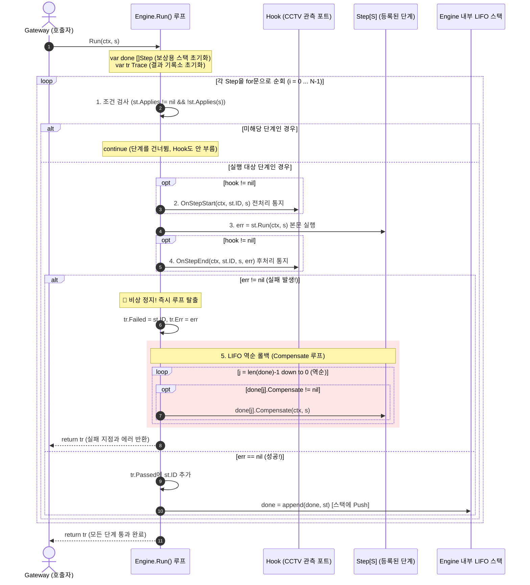
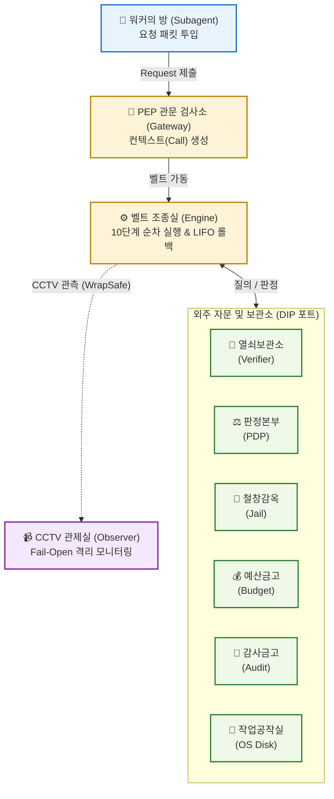
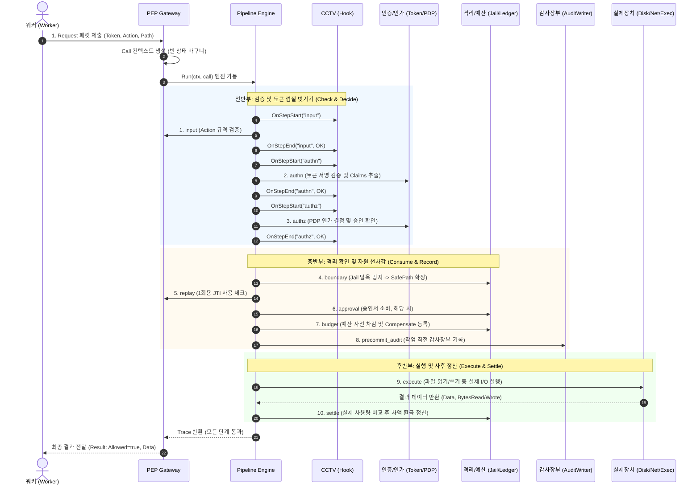
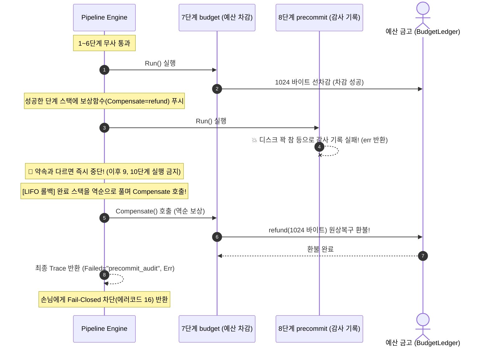

# 007. 파이프라인 컨베이어 벨트, 단계별 순차 처리, 그리고 DIP와 안전 관측의 모든 것

> **모드**: `[문서작업]` — 소스코드 수정 없이 이번 대화 세션에서 다룬 PEP 파이프라인 엔진(`pipeline.Engine[Call]`)의 컨베이어 벨트 동작, 요청 패킷(`Request`, `Call`, `pipelineState`)의 단계별 순차 검증 및 필드 누적 흐름, DIP(의존성 역전)와 훅(`Hook`), LIFO 스택 롤백(`Compensate`), 그리고 안전 래퍼(`WrapSafe`) 기반의 관측 격리 전체를 시퀀스 다이어그램과 상세 도해로 해설합니다.  
> **기준일**: 2026-11-07 · **기준 커밋**: `3630a4a`  
> **다시 확인하는 법**:  
> ```bash
> # 1. 파이프라인 범용 엔진 순차 실행 및 LIFO 보상 단위 시험
> go test -v ./internal/pipeline/...
> # 2. PEP 인가관문 10단계 파이프라인 및 단계 순서 불변식 시험
> go test -v ./internal/authz/pep/... -run "TestGateway|TestStageOrder"
> # 3. 안전 관측(WrapSafe 패닉 격리) 시험
> go test -v ./internal/observe/...
> ```

---

## 1. PEP 파이프라인의 본질과 DIP

### Q. 그러니까 PEP 파이프라인은 10단계를 순서대로 넣고 for문 돌리는 거지? 약속과 다르면 즉시 실패처리다. 파이프라인은 DIP이고 단지 stack처리 방법만 알고 있나?

#### 1) 10단계를 순서대로 넣고 for문 돌리는가? 약속과 다르면 즉시 실패인가?
**네, 정확히 맞습니다.**

- **조립 단계 (10단계)**:
  `assemble()` 함수에서 정해진 10개 단계(Step)를 순서대로 슬라이스로 묶어 파이프라인 엔진에 넘깁니다. (구현: `internal/authz/pep/gateway.go` · `assemble`)
  ```text
  1. input (검사) ➡️ 2. authn (검사) ➡️ 3. authz (결정) ➡️ 4. boundary (검사) ➡️ 5. replay (소비) 
  ➡️ 6. approval (소비) ➡️ 7. budget (소비) ➡️ 8. precommit_audit (기록) ➡️ 9. execute (실행) ➡️ 10. settle (정산)
  ```
- **약속과 다르면 즉시 실패 (Fail-Closed & Early Exit)**:
  - 엔진의 `Run()` 루프(`internal/pipeline/pipeline.go`)에서 각 단계를 `for`문으로 순회합니다.
  - 어느 한 단계라도 에러(`err != nil`)를 반환하면 **그 즉시 루프를 탈출하고 실패 처리**합니다.
  - 이후 단계는 절대 실행되지 않습니다.

#### 2) 파이프라인은 DIP이고 단지 Stack 처리 방법만 알고 있나?
**네, 맞습니다.**

`pipeline.Engine[S]`는 **토큰, 권한, 파일, 네트워크, 감사 같은 도메인 지식을 전혀 모르는 순수 제네릭 엔진**입니다.

1. **완벽한 DIP (의존성 역전 & 분리)**:
   - 파이프라인 패키지는 표준 라이브러리(`context`, `errors`, `fmt`) 외에는 어떤 도메인 패키지도 import하지 않습니다.
   - PEP가 `Step[Call]`과 `Run` 콜백 함수들을 파이프라인 엔진에 주입해 줄 뿐입니다.
2. **단지 순서 보장과 '역순 보상(Stack/LIFO)'만 수행**:
   - 실행할 때는 큐(Queue/FIFO)처럼 순서대로 돌립니다.
   - **실패 시 보상(Compensate)**: 이미 성공적으로 지나온 단계들을 `done` 슬라이스에 쌓아두었다가(Stack), 실패가 발생하면 **역순(LIFO, `len(done)-1`부터 `0`까지)**으로 `Compensate()`를 호출합니다.
     *(예: 7단계 `budget`에서 토큰 예산이 차감되었는데 8단계 `precommit_audit`이 실패하면, 스택을 거꾸로 풀면서 `refund()`를 실행해 차감했던 예산을 즉시 환불/복구합니다).*
3. **엄격한 불변식(Invariant) 검증**:
   - 엔진 생성 시(`pipeline.New`), 단계의 성격 등급(`Check/Decide` $\le$ `Consume` $\le$ `Record` $\le$ `Execute` $\le$ `Settle`)이 역전되거나 하강하는 조립 오류가 있으면 생성 자체를 거부합니다.

---

## 2. 파이프라인 처리법 규약 (인터페이스와 시그니처)

### Q. 그래도 특정 인터페이스 같은 걸로 처리법은 정해놓고 있을 거 아닌가? 그게 뭔가?

파이프라인 엔진이 도메인은 몰라도 **"단계(Step)가 엔진과 소통하기 위한 엄격한 인터페이스 규약"**은 정해져 있습니다.
파이프라인이 요구하는 규약은 **`Step[S]` 구조체(함수 시그니처 포트)**와 **`Hook[S]` 인터페이스** 두 가지입니다.

#### 1) 단계별 실행·보상 규약: `Step[S]`의 함수 시그니처
엔진은 인터페이스 타입 대신, Go에서 흔히 쓰는 **단일 책임 함수형 인터페이스 규약**으로 각 단계를 정의합니다 (`internal/pipeline/pipeline.go`):

```go
type Step[S any] struct {
    ID         string                                   // 단계 식별자 (예: "authn", "authz")
    Kind       Kind                                     // 성격/등급 (check, decide, consume, record, execute, settle)
    Applies    func(s *S) bool                          // [선택] 조건부 실행 판정 규약
    Run        func(ctx context.Context, s *S) error    // [필수] 핵심 실행 규약 (성공 시 nil, 실패 시 error)
    Compensate func(ctx context.Context, s *S)          // [선택] 실패 시 롤백/보상 규약
}
```

- **`Run(ctx, s) error` 규약**:
  - 모든 10단계는 반드시 이 시그니처를 지켜야 합니다.
  - 상태 객체 `s`(`*pep.Call`)를 받아 필요한 작업을 수행하고, **통과면 `nil`**, **약속과 다르면 즉시 `error`**를 반환해야 합니다.
- **`Compensate(ctx, s)` 규약**:
  - 상태를 변경(소비)하는 단계가 실패 시 원복해야 할 때 등록하는 보상 함수 규약입니다.
- **`Applies(s) bool` 규약**:
  - 이 요청에 해당 단계가 필요한지(예: 승인이 필요한 요청인가? 예산이 있는 토큰인가?)를 판정하는 규약입니다.

#### 2) 단계 전/후 관측 규약: `Hook[S]` 인터페이스
엔진이 단계를 실행할 때 외부(로깅, 메트릭, 시간 측정 등)와 소통하는 정식 인터페이스입니다 (`internal/pipeline/pipeline.go`):

```go
type Hook[S any] interface {
    OnStepStart(ctx context.Context, id string, s *S)
    OnStepEnd(ctx context.Context, id string, s *S, err error)
}
```

- **`OnStepStart`**: 단계 진입 직전에 호출됩니다. (시작 시각 기록 등)
- **`OnStepEnd`**: 단계가 끝나고 성공(`err == nil`)했는지, 실패(`err != nil`)했는지 통지받습니다.

#### 3) 공유 컨텍스트 규약: 상태 캡슐화 (`Call` 구조체)
엔진은 제네릭 타입 `S`로만 알고 있지만, PEP에서는 이 자리에 `*pep.Call`이라는 **상태 객체**를 전달합니다.
- 1단계(`input`)가 검증한 결과는 `s`에 채워지고,
- 2단계(`authn`)는 그 `s`를 읽어 토큰을 까서 다시 `s.claims`에 채우며,
- 3단계(`authz`)는 채워진 `s.claims`를 보고 인가를 판정합니다.

---

## 3. 설계자 관점: 미들웨어·책임연쇄(CoR)와의 구조적 차이

### Q. 미들웨어나 책임연쇄(Chain of Responsibility) 패턴과 이 파이프라인의 차이는 뭔가? 왜 이런 구조를 택했나?

일반적인 웹 프레임워크의 미들웨어나 전통적인 디자인 패턴과 본 파이프라인(`pipeline.Engine[S]`)의 결정적 차이입니다.

| 비교 항목 | 1. 미들웨어 (Onion / Koa 스타일) | 2. 책임 연쇄 (Chain of Responsibility) | 3. 이 파이프라인 (`pipeline.Engine`) |
|---|---|---|---|
| **호출 구조** | 재귀적 중첩 (`next()` 호출) | 포인터 링크 (`next.Handle()`) | **평면 루프 (`for st := range steps`)** |
| **제어권** | 각 핸들러가 다음 호출 여부 결정 | 핸들러가 처리하거나 넘김 | **엔진이 100% 중앙 통제** |
| **콜스택 깊이**| 단계 수만큼 스택 프레임 증가 ($O(N)$) | 단계 수만큼 스택 증가 ($O(N)$) | **상수 스택 ($O(1)$) — 스택 오버플로 없음** |
| **전/후처리** | `next()` 앞/뒤에 코드를 둠 | 별도 체인 구성 필요 | **엔진이 `Hook` 포트로 분리 호출** |
| **실패 시 롤백**| `catch` 블록으로 unwind | 롤백 메커니즘 자체 부재 | **엔진이 내부 스택을 LIFO로 역순 해제** |

> **설계자의 핵심 통찰**:
> 미들웨어 방식은 각 단계가 `next()`를 깜빡 잊고 안 부르면 전체가 먹통이 되며, 에러 발생 시 어느 단계까지 실행되었는지 추적하기 어렵습니다.
> 반면 이 파이프라인은 **"각 단계는 오직 자기 일(`Run`)만 하고, 순서 진행과 훅 호출, LIFO 롤백은 엔진이 독점 통제"**하는 **Flat Loop + Saga 보상 패턴**의 결합입니다.

---

## 4. `Engine.Run(ctx, s)` 내부 알고리즘과 실행 생애주기

### Q. pipeline 안에서 Run이 실행되면 안에서 도는 순수한 알고리즘과 처리 순서가 궁금하다. 훅을 언제 실행하고 그 전에 뭘 하는가?

파이프라인 엔진 안에서 **한 단계(Step)가 실행될 때 내부 포인터와 제어가 움직이는 마이크로 생애주기**입니다.



#### 1) 실제 `Run` 알고리즘 소스코드 (`internal/pipeline/pipeline.go`)
```go
func (e *Engine[S]) Run(ctx context.Context, s *S) Trace {
    var tr Trace
    var done []Step[S] // 👈 성공한 단계들을 쌓아두는 LIFO 스택

    for _, st := range e.steps {
        // [규약 1] 조건부 스킵: 필요 없는 단계는 통과
        if st.Applies != nil && !st.Applies(s) {
            continue
        }

        // [규약 2] 전처리 훅: 단계 진입을 외부에 통지
        if e.hook != nil {
            e.hook.OnStepStart(ctx, st.ID, s)
        }

        // [규약 3] 본문 실행: 순수 비즈니스 로직 1개 수행
        err := st.Run(ctx, s)

        // [규약 4] 후처리 훅: 성공/실패 여부를 외부에 통지 (시간 측정, 메트릭)
        if e.hook != nil {
            e.hook.OnStepEnd(ctx, st.ID, s, err)
        }

        // [규약 5] Fail-Closed & LIFO 보상(Rollback)
        if err != nil {
            tr.Failed, tr.Err = st.ID, err
            // 🚨 핵심: 방금 실패한 '자신(st)'은 보상하지 않고,
            // 이전에 성공했던 단계들만 역순(LIFO)으로 보상한다!
            for i := len(done) - 1; i >= 0; i-- {
                if done[i].Compensate != nil {
                    done[i].Compensate(ctx, s)
                }
            }
            return tr // 즉시 중단 탈출
        }

        // [규약 6] 성공 단계 축적
        tr.Passed = append(tr.Passed, st.ID)
        done = append(done, st)
    }

    return tr
}
```

#### 2) 설계자가 주목해야 할 4가지 정밀한 디테일
1. **`Hook`은 왜 `Run` 안에서 안 부르고 엔진이 부르는가?**:
   - 각 단계 구현자가 로깅이나 메트릭 코드를 작성할 필요가 없습니다.
   - `st.Applies`로 스킵된 단계는 `Hook`이 아예 불리지 않으므로, **"실제로 실행된 단계"만 정확하게 시간/성공 여부가 계측**됩니다.
2. **실패한 단계 자신은 왜 `Compensate`하지 않는가?**:
   - `done`에 넣기 전에 에러 검사를 하므로, 실패한 단계는 `done`에 들어가지 않습니다.
   - 실패한 함수(`Run`)는 실행 도중 에러를 뿜고 상태를 온전히 바꾸지 못했을 확률이 높기 때문에, 자기 자신을 롤백하면 2차 에러(이중 환불 등)가 날 수 있어 **성공한 이전 단계들만 역순 롤백**합니다.
3. **불변 상태 객체 vs 가변 컨텍스트 포인터**:
   - 엔진은 제네릭 `*S` 포인터만 들고 단계를 관통시킵니다.
   - 미들웨어처럼 객체를 복사(`clone`)해서 새로 만들지 않고, **동일한 메모리 주소(`*Call`)에 포인터를 넘기므로 힙 할당과 GC 압력이 극도로 낮습니다**.
4. **조립 시점의 정적 검증 (`pipeline.New`)**:
   - 런타임에 에러가 터지는 것을 막기 위해, 엔진 빌드 시점에 단계들의 성격(`Check` $\le$ `Consume` $\le$ `Record` $\le$ `Execute`) 등급 역전이 있는지 검사해 **잘못 조립된 파이프라인은 컴파일/부팅 시점에 즉시 기동 실패**시킵니다.

---

## 5. 컨텍스트의 실체

### Q. 컨텍스트는 대체 뭔가?

여기서 말하는 **"컨텍스트"**는 Go 언어의 `context.Context`와 헷갈리기 쉽지만, 이 파이프라인 아키텍처에서는 **"한 번의 요청이 처리되는 동안 단계들이 함께 돌려쓰는 공유 장부(메모리 바구니)"**를 뜻합니다.

실제 코드로는 `Call`(`internal/authz/pep/tool.go`)과 그 안에 들어있는 `pipelineState`(`internal/authz/pep/gateway.go`)가 바로 그 컨텍스트입니다.

#### 1) 컨텍스트가 왜 필요한가?
파이프라인 안의 10개 검문소(함수)들은 서로를 직접 호출하지 않습니다.
- 1단계(`input`)는 2단계(`authn`)를 모르고,
- 2단계는 3단계(`authz`)를 모릅니다.

그렇다면 **"앞 단계가 알아낸 정보(토큰 깐 내용, 검증된 주체, 격리된 안전 경로 등)"를 뒷단계에 어떻게 전달할까요?**  
바로 **`Call`이라는 컨텍스트 바구니**에 담아서 옆으로 전달(Toss)하는 것입니다.

#### 2) 실제 코드 구조: 컨텍스트의 실체
실제 코드를 보면 딱 이렇게 생겼습니다:

```go
// internal/authz/pep/tool.go
type Call struct {
    cfg *Config         // 시스템 전역 설정 (검증기, 원장 등)
    req Request         // 손님이 처음 보낸 원본 요청 (토큰 문자열, 파일명 등)
    st  *pipelineState  // 바로 이것! 단계들이 채워나가는 빈 메모장
}
```

그리고 메모장인 `pipelineState`(`internal/authz/pep/gateway.go`) 안에는 이런 빈칸들이 있습니다:
```go
type pipelineState struct {
    traceID    string                 // 추적 번호
    subject    string                 // 토큰 주인 이름 (2단계가 채움)
    claims     *domain.VerifiedClaims // 까서 검증된 클레임 (2단계가 채움)
    safePath   string                 // Jail을 통과한 안전한 절대경로 (4단계가 채움)
    approvalID string                 // 승인 번호 (3단계가 채움)
    out        Output                 // 읽어낸 파일 데이터 결과 (9단계가 채움)
    ...
}
```

#### 3) 그림으로 보는 컨텍스트의 역할
컨텍스트는 **단계들 사이를 이동하는 '작업 지시서(Clip board)'**입니다. 처음엔 거의 비어있다가 단계를 지날 때마다 도장이 찍히고 내용이 채워집니다.

```text
[요청 도착] ──▶ 빈 컨텍스트(Call) 생성
                  │
                  ▼
┌────────────────────────────────────────────────────────┐
│  1단계 (input)    : req 확인 후 "Action 정규화" 기록      │
│  2단계 (authn)    : 토큰 까서 "주체(sub)", "claims" 기록 │
│  3단계 (authz)    : claims 보고 "권한 승인 여부" 기록    │
│  4단계 (boundary) : Jail 확인 후 "safePath" 기록       │
│  5단계 (replay)   : 1회용 JTI 검증 도장 찍음            │
│  ...                                                   │
│  9단계 (execute)  : safePath로 파일 읽어서 "out"에 담음 │
└────────────────────────────────────────────────────────┘
                  │
                  ▼
[완료] ◀── 컨텍스트의 "out"과 상태를 꺼내 손님에게 최종 반환(Result)
```

#### 4) 두 종류의 '컨텍스트' 구분
1. **Go 표준 `context.Context`**:
   - "취소 신호(Cancel), 타임아웃(Timeout) 전파용 파이프"입니다.
   - `ctx.Done()`이 울리면 즉시 작업을 멈추는 용도입니다.
2. **파이프라인의 컨텍스트 (`Call`)**:
   - "이 요청 하나에 대한 모든 데이터와 중간 진행 상태를 담고 있는 가방"입니다.
   - 파이프라인의 모든 단계 시그니처 `func(ctx context.Context, c *Call) error`에서 바로 뒤에 있는 `c *Call`이 그것입니다.

---

## 6. 단계별 요청 검증 흐름과 실제 코드 구조 (`Request` vs `Call`)

### Q. 복잡한 은유나 비유 빼고, 실제로 돌아다니는 `Request`와 `Call` 구조체가 왜 이렇게 생겼는지 코드로 직접 보여줘. 각각의 필드가 왜 필요하고 설계자의 의도가 무엇인가?

#### 1) `pep.Request`: 외부 클라이언트가 제출하는 '불변의 작업 의뢰서'
- **정의 위치**: [`internal/authz/pep/gateway.go#L21-L32`](../../internal/authz/pep/gateway.go#L21-L32)
- **설계 의도**: 외부 호출자(Worker 에이전트 등)가 게이트웨이에게 작업을 요청할 때 전달하는 순수 입력 DTO(Data Transfer Object)입니다. 게이트웨이는 이 요청서를 읽기만 할 뿐 내부를 변경하지 않습니다.

```go
type Request struct {
    // 1. 보안 인가 핵심 입력
    Token    string        // 손님이 목에 걸고 온 Bearer Access Token (RFC 9068 표준 JWT)
    Action   domain.Action // 하고자 하는 행위 ("file:read", "file:write", "net:fetch", "exec:run")
    Resource string        // 접근하려는 대상 경로 (예: "notes.txt", 상대 경로 권장)
    Data     []byte        // 파일 쓰기("file:write") 시 저장할 실제 바이트 데이터 (읽기 시엔 nil)

    // 2. 분산 트랜잭션 추적성 (Audit Trail)
    TraceID        string // 요청 전 구간(E2E)을 관통하며 로그와 감사장부를 엮는 고유 식별자
    RequireTraceID bool   // true이면 TraceID 누락 시 input 1단계에서 즉시 차단 (Fail-Closed)

    // 3. 기대값 검증 (Audience / Subject Restriction)
    ExpectedAudience string // 토큰의 대상 서버가 나("authz-harness")인지 검증하기 위한 기준값
    ExpectedSubject  string // 특정 워커 ID에게만 발급된 토큰인지 대조하기 위한 선택적 기대값

    // 4. 테스트 하네스 및 결함 주입 (Fault Injection)
    ClockOffset        time.Duration // 가상 시계를 앞당겨 토큰 만료 상황을 시뮬레이션하기 위한 오프셋
    InjectAuditFailure bool          // precommit_audit 단계에서 강제로 디스크 장애를 일으키는 결함 주입 스위치
}
```

---

#### 2) `pep.Call`: 파이프라인 단계를 관통하며 상태를 누적하는 '통합 작업 컨텍스트'
- **정의 위치**: [`internal/authz/pep/tool.go#L37-L42`](../../internal/authz/pep/tool.go#L37-L42)
- **설계 의도와 트레이드오프**:
  - **왜 `Request`를 그대로 단계를 통과시키지 않고 `Call`로 감싸는가?**  
    `Request`는 외부 손님의 입력값일 뿐입니다. 하지만 파이프라인 단계들을 거치면서 **"까서 검증한 토큰 클레임", "Jail이 확정한 안전 절대경로", "PDP가 발급한 승인 번호", "최종 실행 결과 바이트"** 등 수많은 **중간 검증 결과(상태)**가 계속 생겨납니다.
  - 이 중간 상태들을 단계마다 함수의 리턴값으로 주고받으면 시그니처가 지저분해지고 파이프라인 엔진의 범용 규약(`Step[S]`)에 맞출 수 없습니다.
  - 따라서 **[불변 인프라(`cfg`)] + [원본 요청(`req`)] + [가변 작업일지(`st`)]**를 한데 묶은 단 하나의 통합 객체 `Call`을 만들어 그 메모리 주소(`*Call`)만 단계 사이로 전달합니다.

```go
type Call struct {
    // 1. 불변 인프라 및 엔진 설정 (읽기 전용 의존성 주입)
    cfg *Config 
    // -> Verifier(토큰검증기), PDP(정책판정소), Jail(격리경계), AuditWriter(감사장부) 등
    // -> 각 단계(Step)가 외부 서비스를 조회할 때 이 포트들을 사용합니다.

    // 2. 손님이 보낸 원본 의뢰서 (불변 데이터)
    req Request 
    // -> 1단계 input, 2단계 authn 등에서 손님이 보낸 원래 Token과 Resource를 확인할 때 읽습니다.

    // 3. 단계들이 순서대로 채워 넣는 작업일지 (가변 상태 포인터)
    st *pipelineState 
    // -> 10개 검문소가 검증한 결과(Claims, SafePath, ApprovalID, Output)를 여기에 누적합니다.

    // 4. 네트워크 도구 정규화 전용 필드
    fetchTarget netguard.Target 
    // -> net:fetch 액션인 경우 URL 파싱 및 허용 목록 검증 결과를 보관합니다.
}
```

---

#### 3) `pipelineState`: 검문소들이 단계별로 채워 넣는 작업일지의 실제 코드
- **정의 위치**: [`internal/authz/pep/gateway.go#L117-L137`](../../internal/authz/pep/gateway.go#L117-L137)
- **설계 의도**: 각 단계는 앞 단계가 이 일지에 적어둔 내용을 바탕으로 다음 판정을 내립니다.

```go
type pipelineState struct {
    // [1단계: input 단계가 채움]
    normAction domain.Action // "file:read" 등 표준 열거형으로 정규화된 액션
    tool       Tool          // 액션에 맞춰 배정된 실제 실행 공구 (fileReadTool 등)
    resource   string        // 정규화된 대상 리소스 문자열
    argHash    string        // 요청 데이터의 암호학적 지문(SHA-256) -> 감사 장부용 (원문은 기록 안 함)

    // [2단계: authn 토큰 검증 단계가 채움]
    subject  string                 // 신분증 주인 이름 (예: "worker-1")
    tokenJTI string                 // 토큰 고유 식별자 (재사용 방지용 UUID)
    claims   *domain.VerifiedClaims // 위변조 검증이 끝난 토큰 내부 클레임 (스코프, 만료시각 등)
    budgeted bool                   // 이 토큰이 예산(할당량) 제한이 걸려있는 계정인지 여부

    // [3단계: authz 인가 판정 단계가 채움]
    approvalID string    // PDP가 특별 승인이 필요하다고 허가했을 때 소비할 승인 번호
    evalNow    time.Time // PDP 판정 시각과 승인 소비 시각을 일치시키기 위한 결정론적 기준 시각

    // [4단계: boundary 경계 검사 단계가 채움]
    safePath string // Jail 철창 감옥을 통과하여 상위 디렉터리 탈옥(../)이 불가능한 안전 절대경로

    // [7단계: budget 예산 차감 단계가 채움]
    consumed         bool  // 7단계에서 호출 횟수와 바이트가 사전 차감되었는지 여부
    refundWriteBytes int64 // 쓰기 작업 실패 시 되돌려줘야 할 환불 바이트 수

    // [9단계: execute 실행 단계가 채움]
    out Output // OS 프로세스 격리 실행을 통해 실제로 읽어낸 파일 데이터와 바이트 수
}
```

---

#### 4) 아키텍처 관점에서의 종합 트레이드오프 요약

| 구조체 | 역할 | 가변성(Mutability) | 설계 철학과 트레이드오프 |
| :--- | :--- | :--- | :--- |
| **`Request`** | 외부 클라이언트 $\to$ PEP 입구 | **완전 불변 (Immutable)** | 손님의 원본 의도를 왜곡 없이 보존합니다. |
| **`pipelineState`** | 내부 1단계 $\to$ 10단계 공유 메모장 | **점진적 누적 (Mutable)** | 함수 인자를 매번 늘리지 않고, 동일 메모리 주소 포인터 하나로 10단계를 관통시켜 메모리 할당($O(1)$)과 GC 부하를 최소화합니다. |
| **`Call`** | 파이프라인 엔진의 제네릭 상태 `S` | **컨테이너 (Aggregate)** | `Engine[Call]`에 주입되어, 각 단계의 작업자(`Step.Run(ctx, *Call)`)가 인프라(`cfg`), 원본(`req`), 작업일지(`st`)를 단 하나의 파라미터로 즉시 접근할 수 있게 만듭니다. |

---

## 7. 컨베이어 벨트 비유와 시퀀스 다이어그램

### Q. 모든 구조를 다 그려줘. 파이프라인도 그려줘. 컨베이어벨트이면 그걸 그려주면 되잖아. 자기 방 구조도 그리듯이 그려도 되고. 시퀀스를 활용해라.

#### 1) 전체 방 구조도 (공장 평면도: 누가 어디서 일하는가?)
이 시스템은 방(패키지)들이 벽으로 엄격하게 격리되어 있고, 오직 정해진 복도(인터페이스)로만 통신합니다.

| 작업 공간 (방) | 담당 역할 | 실제 코드 및 컴포넌트 | 통신 규약 (복도) |
|---|---|---|---|
| **🏢 1. 워커의 방** | 격리 샌드박스 안에서 작업 요청을 생성해 관문으로 밀어넣는 자식 프로세스 | `subagent.Worker` | `pep.Request` 상자 제출 |
| **🚪 2. PEP 관문 검사소** | 요청을 `Call` 바구니에 담고 10단계 파이프라인 벨트를 총괄 기동 | `pep.Gateway` | `Gateway.Execute()` 진입점 |
| **⚙️ 3. 벨트 조종실** | 도메인은 모른 채 오직 10단계 순차 진행과 LIFO 스택 롤백만 수행 | `pipeline.Engine[Call]` | `Run(ctx, *Call)` 순수 루프 |
| **🔑 4. 열쇠 보관소** | 토큰의 서명 무결성과 만료 여부를 검증하고 클레임을 까줌 | `token.Verifier` | `TokenVerifier` 인터페이스 |
| **⚖️ 5. 판정 본부** | 클레임과 자원을 보고 허용/거부/승인필요 정책을 순수하게 결정 | `pdp.Service` | `PDP.Decide()` 순수 인가 |
| **🏰 6. 철창 감옥** | 상대경로 탈옥을 막고 격리된 안전 절대경로 확정 | `jail.Jail` | `Jail.SafePath()` 경계 검사 |
| **💰 7. 예산 금고** | 토큰에 할당된 잔여 바이트를 선차감하고 사후 정산/환불 | `domain.BudgetLedger` | `Consume` / `Refund` |
| **📜 8. 감사 금고** | I/O 직전 위변조 불가 해시체인과 Ed25519 서명 기록 | `audit.Writer` | `Record()` 사전 감사 (Fail-Closed) |
| **💾 9. 실제 작업 공작실** | 검증이 끝난 안전 경로로 OS 디스크/네트워크/프로세스 실행 | `Tool` (`file`, `net`, `exec`) | OS 디스크 및 커널 시스템콜 |
| **📹 10. CCTV 관제실** | 단계별 시간·결과를 모니터링하되 본선에 영향 주지 않는 격리 관측 | `observe.Observer` | `WrapSafe` (Fail-Open 보호막) |



#### 2) 정상 흐름 시퀀스 다이어그램 (순차 검문과 데이터 주입)
패킷(상자)이 10개 검문소를 순서대로 지나며 검증받고 최종 알맹이(I/O)를 실행하는 전체 흐름입니다.



#### 3) 이상 발생 및 LIFO 역순 롤백(스택 보상) 시퀀스 다이어그램
예산(7단계)을 먼저 차감했는데, 감사 기록(8단계)에서 오류가 났을 때 즉시 중단하고 스택을 거꾸로 풀며 복구하는 흐름입니다.



#### 4) 상자 속 패킷의 변천사 (점검표가 채워지는 순서)
컨베이어 벨트를 지날 때마다 상자 옆에 붙은 **점검표(`Call.st`)**에 내용이 채워지는 과정입니다:

```text
[처음 투입 시]
상자 겉면: Token = "eyJh...", Action = "file:read", Resource = "notes.txt"
점검표   : (완전 백지 상태)

   ▼ ① input 통과 후
점검표   : Action = "file:read", Tool = [파일읽기 도구]

   ▼ ② authn 통과 후 (출입증 껍질 벗김)
점검표   : 작업자 = "subagent-A", 토큰번호 = "uuid-9999", Claims = [인증완료]

   ▼ ③ authz 통과 후
점검표   : 인가여부 = "허용(Allow)"

   ▼ ④ boundary 통과 후
점검표   : 접근경로 = "/jail/root/workspace/notes.txt" (탈옥 불가능한 안전경로)

   ▼ ⑦ budget 통과 후
점검표   : 차감완료 = true (1024 바이트 사전 확보)

   ▼ ⑨ execute 통과 후 (실제 물건 담김)
상자 안쪽: Data = [ "안녕, 파일 내용이다!" ] (실제 데이터 획득)

   ▼ ⑩ settle 통과 후
점검표   : 최종 정산 완료 ➔ 손님에게 배달!
```

#### 5) CCTV 관제실 (Hook & WrapSafe)이 지켜보는 법
컨베이어 벨트 양옆에는 **CCTV(`Hook`)**가 서 있어서 모든 검사대를 지켜봅니다:

```text
[검사대 입장 직전] ➔ Hook: "CCTV OnStepStart! 타이머 스타트!"
       │
   (검사 수행)
       │
[검사대 통과 직후] ➔ Hook: "CCTV OnStepEnd! 통과 여부 및 걸린 시간(ms) 기록!"
```

- **보호막(`WrapSafe`)**: 만약 CCTV 카메라 모니터가 고장 나서 폭발(`panic`)하더라도, **안전 래퍼(`WrapSafe`)가 그 폭발을 삼켜버리기 때문에(`defer func() { _ = recover() }()`)** 벨트 위의 검사 작업은 아무런 영향을 받지 않고 계속 돌아갑니다(Fail-Open). (구현: `internal/observe/port.go` · `WrapSafe`)

---

## 8. 세션 질의응답 심층 해설: 초보자를 위한 Go 문법과 파이프라인 내부 메커니즘

> 본 장은 파이프라인 엔진과 PEP 게이트웨이를 처음 접하는 개발자 및 Go 입문자를 위해, 코드의 줄 단위 의미·메모리 공유 구조·보안 토큰 생애주기를 질의응답 형식으로 상세히 보강한 심층 해설입니다.

### 8.1 Go 초보자를 위한 3대 핵심 문법 사전

1. **함수 시그니처 (Function Signature)**:
   - "함수의 이름표와 입출력 명세서"입니다.
   - `func 함수이름(입력받을 변수들) (돌려줄 결과들)` 형태로 생겼습니다.
   - 예: `func Add(a int, b int) int` $\rightarrow$ "이름은 Add이고, 숫자 a와 b를 받아서, 숫자 하나를 돌려준다."
2. **슬라이스 (`[]타입`, Slice)**:
   - "크기가 마음대로 늘어나는 동적 배열(기차 칸)"입니다.
   - C나 일반 배열은 처음에 크기 5개로 정하면 못 늘리지만, Go의 **슬라이스**는 `append(기차, 새칸)`를 쓰면 뒤에 칸이 쑥쑥 늘어납니다.
   - `[]string`: 문자열들을 담는 기차칸들
   - `[]Step[S]`: 단계(Step) 객체들을 담는 기차칸들
3. **메서드 리시버 (Method Receiver, 앞의 `(e *Engine[S])`)**:
   - 다른 언어(Java, Python)에서는 클래스 안에 함수를 넣고 `this`나 `self`를 씁니다.
   - Go는 클래스가 없는 대신, 일반 함수 앞에 **`(변수명 *구조체이름)`**을 붙여서 **"이 함수는 이 구조체에 장착된 전용 기능(메서드)이다!"**라고 선언합니다. 여기서 붙어있는 구조체를 리시버라고 부릅니다.

---

### 8.2 문법 주석을 곁들인 `Engine.Run` 줄 단위 정밀 해석

[`internal/pipeline/pipeline.go`](../../internal/pipeline/pipeline.go#L99-L126)의 실제 구현 코드입니다:

```go
// [함수 시그니처 해석]
// func: "지금부터 함수를 정의합니다."
// (e *Engine[S]): [메서드 리시버] "이 Run 함수는 e라는 Engine 기계에 장착된 전용 기능입니다."
// Run: 함수의 이름.
// (ctx context.Context, s *S): [입력 파라미터 2개]
//    1) ctx: 작업을 취소할지 말지 알려주는 '신호등(컨텍스트)'
//    2) s: 데이터가 들어있는 '메모장 주소(포인터 *S)'
// Trace: [반환 타입] "함수가 끝나면 최종 성적표인 Trace 구조체를 통째로 돌려줍니다."
func (e *Engine[S]) Run(ctx context.Context, s *S) Trace {

    // [문법: var tr Trace]
    // Trace 타입의 변수 tr을 만듭니다. 처음에는 텅 비어있습니다. (빈 성적표)
    var tr Trace

    // [문법: 슬라이스 선언]
    // Step[S] 들을 담을 수 있는 동적 배열(슬라이스) done을 만듭니다.
    // 성공한 단계들을 차곡차곡 쌓아둘 스택(바구니)입니다.
    var done []Step[S]

    // [문법: for _, st := range e.steps]
    // e.steps(기차)에 들어있는 단계들을 0번 칸부터 맨 끝 칸까지 차례대로 꺼냅니다.
    // _(밑줄)은 몇 번째 칸인지 나타내는 번호(인덱스)인데, 안 쓸 거라서 버린다는 뜻입니다.
    // st는 이번 차례에 꺼낸 '단계(Step 하나)'입니다.
    for _, st := range e.steps {

        // [문법: if 조건문 & 함수 포인터 검사]
        // Applies 함수가 등록되어 있고, 그 함수를 실행한 결과(!st.Applies(s))가 거짓이면
        // continue(이번 단계는 패스하고 다음 칸으로 넘어가라!)를 실행합니다.
        if st.Applies != nil && !st.Applies(s) {
            continue
        }

        // Hook(CCTV 카메라)이 설치되어 있다면, "지금 st.ID 단계 시작합니다!" 하고 방송합니다.
        if e.hook != nil {
            e.hook.OnStepStart(ctx, st.ID, s)
        }

        // [문법: 함수 호출 및 에러 변수 err 대입]
        // 이번 단계의 실제 작업(Run)을 실행합니다. 메모장(s)을 건네주어 내용을 채우거나 검사하게 합니다.
        // Go에서는 실패했을 때 에러 객체(err)를 반환하는 것이 표준 관례입니다.
        err := st.Run(ctx, s)

        // Hook(CCTV 카메라)에게 "st.ID 단계 끝났고, 결과 에러는 err입니다" 하고 방송합니다.
        if e.hook != nil {
            e.hook.OnStepEnd(ctx, st.ID, s, err)
        }

        // [문법: err != nil (에러가 비어있지 않다 = 사고가 났다!)]
        if err != nil {
            // 성적표(tr)에 실패한 단계 이름(st.ID)과 에러 원인(err)을 적습니다.
            // (차단은 한 번에 하나만 일어나므로 단일 변수입니다!)
            tr.Failed, tr.Err = st.ID, err

            // [문법: 역순 for 루프 (LIFO 되감기)]
            // len(done)-1은 기차의 맨 마지막 칸 번호입니다.
            // 0번 칸까지 거꾸로 하나씩 줄어들면서(i--) 되감기(Compensate, 롤백)를 실행합니다.
            for i := len(done) - 1; i >= 0; i-- {
                if done[i].Compensate != nil {
                    done[i].Compensate(ctx, s) // 예: 깎았던 예산 환불
                }
            }

            // [문법: 즉시 반환]
            // 사고가 났으니 뒤쪽 단계는 거들떠보지도 않고 바로 성적표를 들고 탈출합니다!
            return tr
        }

        // [문법: append 함수 (슬라이스에 새 데이터 이어붙이기)]
        // 에러 없이 성공했으므로 통과 목록(tr.Passed)에 단계 이름을 적고,
        // 성공 바구니(done)에 현재 단계(st)를 추가합니다.
        tr.Passed = append(tr.Passed, st.ID)
        done = append(done, st)
    }

    // 모든 단계를 무사히 다 통과하면, 에러가 없는 깨끗한 성적표(tr)를 반환합니다.
    return tr
}
```

---

### 8.3 변수와 구조체의 정체: `e`, `s`, `st`, `ctx`

| 변수명 | 정체 및 타입 | 비유와 역할 |
| :--- | :--- | :--- |
| **`e`** | `*Engine[S]` (수신자/Receiver) | **공장의 컨베이어 벨트 기계** 본체. 불변 단계 목록(`steps`)과 관측 도구(`hook`)를 들고 순서를 통제합니다. |
| **`s`** | `*S` (상태 포인터, State) | 벨트 위를 지나가는 **작업 바구니 (메모장)**. PEP에서는 `Call` 및 `pipelineState`가 되며, 모든 단계가 동일 메모리 주소를 공유합니다. |
| **`st`** | `Step[S]` (개별 단계) | 컨베이어 벨트 옆에 서 있는 **개별 작업대(검문소)**. `st.ID`, `st.Run`, `st.Compensate`, `st.Applies`를 가집니다. |
| **`ctx`** | `context.Context` | 외부에서 들어오는 **신호등(취소·타임아웃 감시)**. 비즈니스 데이터는 담지 않고 작업 중단 시그널만 전파합니다. |

#### 포인터 전달인가 복사인가?
- **상태 객체 `s` (`*S`)**: **포인터 전달 (동일 메모리 주소 공유)**. 복사본(Clone)을 만들지 않고 메모리 주소 하나만 넘기므로 1단계의 결과가 9단계까지 그대로 이어지며 GC 부하가 $O(1)$로 극도로 낮습니다.
- **단계 목록 `done`과 `st`**: **`Step[S]` 구조체 값 복사**. 슬라이스에 `append`될 때 복사되지만, 내부 필드가 문자열과 함수 포인터(클로저 참조 주소)뿐이므로 수십 바이트 수준의 매우 가벼운 복사만 일어납니다.

---

### 8.4 `Trace` 성적표의 비밀: 왜 실패 기록(`Failed`)은 배열이 아닌 단일 문자열인가?

```go
type Trace struct {
    Passed []string // 통과한 여러 단계의 ID 목록
    Failed string   // 단 하나의 실패 단계 ID
    Err    error    // 에러 원인
}
```

- **이유 (Fail-Closed 즉시 차단)**:
  - 폼 유효성 검사기(Form Validator)는 "이메일 누락", "비밀번호 짧음" 등 여러 에러를 모아서 한 번에 보여주려고 배열을 씁니다.
  - 하지만 보안 파이프라인(PEP)은 **"단 하나의 위반이라도 감지되면 그 즉시 비상 정지하고 문을 닫는 Fail-Closed"** 원칙을 따릅니다.
  - 2단계 토큰 검증이 실패했는데 3단계 권한 검사나 5단계 OS 격리를 계속 실행하면 치명적인 보안 사고가 납니다.
  - 에러가 나는 순간 `return tr`로 즉시 탈출하므로, **어떤 요청도 한 번의 실행에서 실패 단계를 2개 이상 겪을 수 없습니다**. 따라서 `Failed`는 언제나 단 하나(`string`)입니다.

---

### 8.5 `Run` 이전과 이후: 요청은 어디서 와서 어디로 가는가?

```text
[클라이언트 요청]
       │
       ▼
 1. [Run 이전: 게이트웨이 준비]
    - gateway.Execute(call) 호출
    - 작업 메모장(pipelineState) 생성: traceID, 토큰, 파일경로 등을 담음
    - 컨베이어 벨트 엔진(Engine)에 메모장을 얹음
       │
       ▼
 2. [Run 도중: 파이프라인 엔진]
    - Engine.Run(ctx, state) 실행
    - 1단계(input) -> 2단계(authn) -> 3단계(authz) -> ...
    - 성공할 때마다 state 메모장에 데이터가 채워짐 (토큰 까서 주인이름 적고 등등)
    - 마침내 Trace(Passed 목록, Failed, Err) 성적표 완성!
       │
       ▼
 3. [Run 이후: finalize 단일 출구] (internal/authz/pep/gateway.go)
    - gateway.finalize(ctx, state, tr) 호출
    - 🚨 만약 tr.Err != nil (실패했다면?):
        a. tr.Err를 분석해 종료 코드(예: 13번 PERMISSION_DENIED) 결정
        b. "감사장부(audit.jsonl)" 파일에 '누가 왜 차단당했는지' 영구 기록
        c. 운영자 로그(stderr)에 에러 출력
        d. 클라이언트에게 거부 응답(Allowed: false) 반환
    - 🎉 만약 tr.Err == nil (모두 성공했다면?):
        a. state 메모장에서 9단계가 읽어온 실제 파일 내용(out)을 꺼냄
        b. "감사장부"에 '정상 실행 완료' 기록
        c. 클라이언트에게 성공 응답(Allowed: true, 데이터 내용) 반환
```

---

### 8.6 핵심 어휘 정리: `Call` vs `Step`, `input`, `Applies`, `domain`, `Bearer`

#### 1) `Call`과 `Step`의 차이와 관계, 그리고 `Call`의 생애주기
- **`pep.Call` (화물/가방, 명사)**: 클라이언트가 보낸 요청 데이터 묶음(`RawToken`, `Path`, `CallerID` 등). 요청마다 1개씩 생성되고 끝나면 사라집니다.
- **`pipeline.Step` (검색대/작업자, 동사)**: 컨베이어 벨트 옆에 고정 배치된 검문 로직(`Run`, `Compensate`, `Applies`). 엔진에 미리 조립되어 영구 재사용됩니다.
- **관계**: `Call` 가방이 벨트 위를 지나갈 때, 여러 `Step` 작업대들이 순서대로 가방을 열어 검사하고 채워 넣습니다.

##### `Call` 객체의 생애주기와 4대 핵심 질문 (누가 만들고, 어디를 거쳐, 어디로 가며, 무슨 역할을 하는가?)

###### [1] 누가 만드는가? (생성자)
PEP 게이트웨이의 [`Execute()`](../../internal/authz/pep/gateway.go#L170-L182) 메서드가 외부 클라이언트 요청(`Request`)을 받는 즉시 힙(Heap) 메모리에 생성합니다:

```go
// [Go 문법 해설 1: 메서드 리시버 (Method Receiver)]
// func (g *gateway) Execute(...) 는 g 라는 *gateway 포인터를 수신자로 받는 메서드 정의입니다.
// 구조체에 종속된 동작을 정의할 때 사용합니다.
func (g *gateway) Execute(ctx context.Context, req Request) (*Result, error) {
    traceID := req.TraceID

    // [Go 문법 해설 2: 표준 라이브러리 strings 와 삼항 연산자 부재]
    // Go 에는 삼항 연산자(? :)가 없으므로 if 조건문으로 기본값을 채웁니다.
    // strings.TrimSpace 로 앞뒤 공백을 안전하게 제거합니다.
    if strings.TrimSpace(traceID) == "" {
        // fmt.Sprintf 로 고유한 트레이스 식별자 문자열 생성 (UnixNano 타임스탬프 결합)
        traceID = fmt.Sprintf("pep-%d", g.clock.Now().UnixNano())
    }

    // [Go 문법 해설 3: 구조체 복합 리터럴(Composite Literal)과 포인터 주소 연산자(&)]
    // &Call{ ... } 은 Call 구조체를 힙 메모리에 인스턴스화하고 그 시작 주소(*Call 포인터)를 c 에 대입합니다.
    // 내부의 st: &pipelineState{ ... } 역시 중첩 구조체 포인터를 동시에 인라인으로 생성하는 관용구입니다.
    c := &Call{
        cfg: &g.cfg, // 게이트웨이의 불변 설정 포인터 참조 공유 (메모리 절약)
        req: req,    // 클라이언트가 보낸 원본 요청 복사본 보존
        st: &pipelineState{
            traceID:  traceID,
            resource: strings.TrimSpace(req.Resource),
            argHash:  domain.DataDigest(req.Data), // SHA-256 단방향 해시로 원본 보호
        },
    }

    // [Go 문법 해설 4: 제네릭 엔진 호출과 포인터 전달]
    // c(*Call)의 주소값을 파이프라인 엔진에 전달합니다. 복사본이 아닌 동일 인스턴스가 단계를 거치게 됩니다.
    tr := g.engine.Run(ctx, c)

    // 마감 함수로 이동하여 최종 클라이언트 반환용 *Result 로 변환
    return g.finalize(ctx, c.st, tr)
}
```

###### [2] 어디를 거치는가? (여정 / 이동 경로)
생성된 `*Call` 포인터는 파이프라인 엔진에 의해 **고정된 10개의 검문 단계(Step)**를 순서대로 거쳐 지나갑니다:

$$\text{입구} \rightarrow \text{input} \rightarrow \text{authn} \rightarrow \text{authz} \rightarrow \text{boundary} \rightarrow \text{replay} \xrightarrow{\text{조건부}} \text{approval} \xrightarrow{\text{조건부}} \text{budget} \rightarrow \text{precommit} \rightarrow \text{execute} \xrightarrow{\text{조건부}} \text{settle}$$

1. **`input`**: 요청 데이터 기본 검증 및 도구(`c.st.tool`) 배정
2. **`authn`**: JWT 토큰 위변조 검증, 만료 확인 $\rightarrow$ 토큰 클레임(`c.st.claims`, `subject`, `tokenJTI`, `budgeted`) 기록
3. **`authz`**: PDP에 인가 질의 $\rightarrow$ 권한 허용 여부 판정, 승인 필요 시 `approvalID` 기록
4. **`boundary`**: OS 파일 격리 경계(Jail) 검사 $\rightarrow$ 안전한 실제 절대 경로(`c.st.safePath`) 기록
5. **`replay`**: 토큰 재사용/재전송 공격 방지 검사
6. **`approval`** *(조건부)*: 관리자 승인 토큰 소비
7. **`budget`** *(조건부)*: 토큰의 잔여 예산 차감
8. **`precommit_audit`**: 실제 실행 전 감사 로그 원장에 불변 기록 작성
9. **`execute`**: Jail 격리 환경에서 실제 파일 읽기/쓰기 또는 명령 실행 $\rightarrow$ 결과(`c.st.out`) 기록
10. **`settle`** *(조건부)*: 작업 후 추가 발생한 비용 후불 정산

###### [3] 어디로 가며 어떻게 끝나는가? (소멸)
10단계를 모두 거치거나 중간에 에러로 멈추면:
1. **`finalize()`로 이동**: [`gateway.finalize(ctx, c.st, tr)`](../../internal/authz/pep/gateway.go#L181)로 들어가서, `c.st`에 적힌 내용(`safePath`, 읽은 바이트 수, 통과한 단계 목록 등)을 꺼내 클라이언트에게 줄 최종 응답 객체 **`*pep.Result`**를 조립합니다.
2. **소멸 (GC)**: `Execute()` 함수가 `Result`를 리턴하고 끝나면, `Call` 객체는 더 이상 참조되지 않고 Go의 가비지 컬렉터(GC)에 의해 메모리에서 **완전히 소멸**합니다. (영구 보관되어야 할 정보는 이미 8단계 `precommit_audit`에서 `audit.jsonl` 파일에 기록되었습니다.)

###### [4] 어떤 역할을 하는가? (핵심 역할)
1. **검문소 간의 "공동 메모장 (State Carrier)"**:
   - 단계 함수들(`input`, `authn`, `authz` 등)은 서로를 전혀 모르는 독립된 모듈입니다.
   - 대신 **동일한 `*Call` 포인터 메모리 주소를 공유**하며 앞 단계가 검사한 결과를 적어두고, 뒷 단계는 그 메모를 읽어 판단합니다. (예: `authn`이 `c.st.subject = "bob"` 기록 $\rightarrow$ `authz`가 이를 읽고 인가 심사)
2. **원본 요청(`req`)과 환경 설정(`cfg`)을 안전하게 전달**:
   - 클라이언트가 처음 보낸 원본 데이터(`req.Token`, `req.Resource`, `req.Data`)를 변조 없이 각 단계에 전달합니다.
   - 각 단계가 필요한 외부 컴포넌트(서명 검증기 `Verifier`, 정책 엔진 `PDP`, 파일 격리소 `Jail` 등)를 꺼내 쓸 수 있도록 주입된 설정(`c.cfg`)을 운반합니다.

---

##### `Call` 구조체 정의와 Go 문법 해설 ([`internal/authz/pep/tool.go`](../../internal/authz/pep/tool.go#L36-L42))

```go
// [Go 문법 해설 5: 구조체(Struct) 선언과 캡슐화(소문자 필드 패키지 비공개)]
// Call 구조체명은 대문자로 시작하여 외부 패키지(예: pipeline)에서 타입으로 참조 가능합니다.
// 그러나 내부 필드들(cfg, req, st, fetchTarget)은 소문자로 시작하므로 'pep' 패키지 외부에서는 직접 접근할 수 없습니다 (Zero Leakage 및 캡슐화 원칙).
type Call struct {
    cfg         *Config          // 게이트웨이에 주입된 의존성 포인터 (불변)
    req         Request          // 클라이언트의 최초 원본 요청 (값 복사본)
    st          *pipelineState   // 👈 단계를 거치며 내용이 누적 변경되는 가변 상태 포인터
    fetchTarget netguard.Target  // net:fetch 대상 정규화 결과
}
```

#### 2) `input` 함수: 입구 안내/접수 창구
- 주민센터 입구의 안내 데스크와 같습니다.
- 토큰을 까보거나 권한을 심사하기 전에, **"신청서에 필수 항목(`trace_id`)이 누락되었는가?", "지원하지 않는 이상한 명령인가?", "접근하려는 자원 경로가 비어있는가?"**를 1차로 걸러내어 비정상 요청을 즉시 반려(`ReasonInvalidArguments`)합니다.

#### 3) `Applies` 함수: 특수 검사실 스위치
- 해당 단계가 이번 요청에 **"적용되는가?"**를 묻는 조건 판정 함수입니다.
- `nil`이면 모든 요청에 대해 무조건 실행합니다.
- 함수가 등록되어 있으면(예: `approval` 단계의 `approved`, `budget` 단계의 `budgeted`), 해당 조건을 만족하는 요청에만 실행하고 **일반 요청은 `continue`로 건너뛰어(Skip)** 불필요한 연산과 에러를 방지합니다.

#### 4) `domain`: 핵심 보안 비즈니스 규칙
- DDD(도메인 주도 설계) 관점에서 시스템의 핵심 본질을 담은 패키지([`internal/domain/`](../../internal/domain/))입니다.
- 외부 라이브러리나 OS 세부사항에 의존하지 않는 순수한 보안 표준 용어들(종료 코드 `ExitCode`, 거부 사유 `Reason`, 검문소 이름 `Stage`, 검증된 클레임 `VerifiedClaims`)이 선언되어 있습니다.

#### 5) Bearer 토큰과 발급 생애주기
- **Bearer(소지자) 토큰**: "이 출입증을 손에 쥐고 있는 자(소지자)에게 권한을 부여한다"는 무기명 전자 티켓(JWT)입니다.
- **발급 주체와 축소 위임(Downscoping)**:
  - 부모 프로세스가 직접 비밀키로 서명하여 조작하지 못합니다.
  - 부모(팀장)는 중앙의 **`ExchangeService` (토큰 교환소)**에 자기 토큰을 제시하며 자식용 토큰 교환을 신청합니다.
  - 교환소는 **"자식에게 주려는 권한이 부모 권한을 넘어서지 않는가(Downscoping)?"**를 엄격히 심사한 뒤, 중앙의 비밀키로 서명된 새 자식 토큰(`child_token`)을 발급합니다.
  - 자식 프로세스는 실행될 때 이 토큰을 건네받아, PEP 게이트웨이의 `authn` 검문소에 제시하게 됩니다.

---

### 8.7 심화 문법과 런타임 제어: `!st.Applies(s)`와 DIP(의존성 역전)의 본질

#### 1) `!st.Applies(s)` 코드 분해와 논리 흐름
[`internal/pipeline/pipeline.go`](../../internal/pipeline/pipeline.go#L103-L105):
```go
// [Engine.Run 내부의 단계 순회 루프]
for _, st := range e.steps {
    // [규약 1: 조건부 스킵 검사]
    // st.Applies 가 등록되어 있고, 판정 결과가 거짓(!st.Applies(s))이면 건너뛴다.
    if st.Applies != nil && !st.Applies(s) {
        continue // 👈 이번 단계는 패스하고 다음 단계로 즉시 이동
    }

    // 통과한 단계만 계측 및 실행
    if e.hook != nil {
        e.hook.OnStepStart(ctx, st.ID, s)
    }
    err := st.Run(ctx, s)
    ...
```

- **`st.Applies`**: 이번 단계 작업대(`st`)가 들고 있는 조건 질문지(함수 포인터 `func(s *S) bool`)입니다.
- **`(s)`**: 작업대에게 현재 작업 메모장(`s`)을 보여주며 "너 이 일 해야 돼?"라고 묻습니다. 작업대가 `s`를 보고 `true`("응, 해야 돼") 또는 `false`("아니, 안 해도 돼")를 반환합니다.
- **느낌표 `!` (NOT 연산자)**: 결과를 뒤집습니다.
  - `st.Applies(s)`가 `false`면 $\rightarrow$ `!false`는 **`true`**가 되어 `if` 문 안으로 들어갑니다.
  - 따라서 `continue`(이번 단계는 패스하고 다음 단계로 즉시 이동)가 실행됩니다.
  - 반대로 `true`면 $\rightarrow$ `!true`는 `false`가 되어 `continue`를 타지 않고 아래로 내려가 `st.Run(ctx, s)`을 실행합니다.

#### 2) 스텝은 이미 할 일을 아는데, 왜 매번 현재 상태 `s`를 체크해야 하는가?
- **스텝은 "고정된 기계", `s`는 "매번 바뀌는 손님"**:
  - 스텝(`st`)은 서버가 켜질 때 딱 한 번 조립되어 영원히 고정된 불변의 작업대입니다. (예: `approval` 단계)
  - 반면 상태(`s`)는 초당 수백 개씩 벨트 위로 들어오는 각양각색의 손님들입니다. (공개 파일 읽는 손님 vs 시스템 파일 수정하는 손님)
- **앞선 단계들이 `s`에 써놓은 "중간 판정 결과"를 확인해야 하기 때문**:
  - 어떤 스텝을 실행할지 말지는, 앞선 스텝들이 `s`를 검사하고 남긴 결과에 따라 실시간으로 결정됩니다.
  - 예를 들어 3단계(`authz`)에서 정책 서버(PDP)가 "이 작업은 위험하니 관리자 승인 번호(`approvalID`)를 소비해야만 통과된다"고 메모장 `s`에 적어두었을 때만 6단계(`approval`)가 비로소 `true`가 되어 일하게 됩니다.

#### 3) 단순 `if`문 상수 스파게티 vs `Applies` 일급 함수의 감각 (설계 미학)
초보 개발자가 파이프라인 엔진을 만들면 흔히 엔진 내부에 다음과 같은 **"상수 스파게티"**를 작성하기 쉽습니다:

```go
// ❌ 나쁜 설계: 엔진 내부에 온갖 비즈니스 if 문과 도메인 상수가 뒤엉킨 스파게티
func (e *Engine) Run(ctx context.Context, s *State) Trace {
    for _, st := range e.steps {
        // 엔진이 PEP의 세부 비즈니스(approval, budget, settle)를 시시콜콜 다 알아야 함!
        if st.ID == "approval" && s.approvalID == "" {
            continue
        }
        if st.ID == "budget" && !s.budgeted {
            continue
        }
        if st.ID == "settle" && (!s.budgeted || !s.tool.PostCharge) {
            continue
        }
        err := st.Run(ctx, s)
        ...
```
이 방식의 치명적인 문제점:
1. 엔진이 `approval`, `budget` 같은 특정 업무에 종속되어 **재사용이 불가능**해집니다. (DIP 위반)
2. 새로운 단계가 추가되거나 건너뛰기 조건이 바뀔 때마다 **엔진 코드(`pipeline.go`)를 계속 수정**해야 합니다. (OCP 개방-폐쇄 원칙 위반)

반면, 우리 시스템은 건너뛰기 조건을 **함수(`func(s *S) bool`)로 캡슐화하여 `Step` 자체에 장착**합니다:

```go
// ⭕ 우아한 설계: PEP 조립소(internal/authz/pep/gateway.go)에서 단계별로 Applies 주입
func (g *gateway) assemble() []pipeline.Step[Call] {
    // 조건 없이 무조건 실행되는 단계는 nil 주입
    input   := step(domain.StageInput,   domain.KindCheck,   nil,        g.input)
    authn   := step(domain.StageAuthn,   domain.KindCheck,   nil,        g.authn)
    authz   := step(domain.StageAuthz,   domain.KindDecide,  nil,        g.authz)

    // 조건부 실행 단계는 전용 술어(Predicate) 함수를 일급 객체로 주입!
    approval := step(domain.StageApproval, domain.KindConsume, approved,   g.approval)
    budget   := step(domain.StageBudget,   domain.KindConsume, budgeted,   g.budget)
    settle   := step(domain.StageSettle,   domain.KindSettle,  postCharged, g.settle)
    ...
}

// 각 조건은 단 1~3줄짜리 순수 단일책임 함수로 격리됨!
func approved(c *Call) bool { 
    return c.st.approvalID != "" 
}

func budgeted(c *Call) bool { 
    return c.st.budgeted 
}

func postCharged(c *Call) bool {
    return c.st.budgeted && c.st.tool.BudgetPlan(c).PostCharge
}
```
- **효과**: 엔진은 `st.Applies != nil && !st.Applies(s)`라는 **단 3줄의 추상적 규칙**만 실행할 뿐, 자기가 승인 번호를 보는지 예산을 보는지 전혀 몰라도 됩니다.

#### 4) 왜 `s`를 넣는 것이 DIP(의존성 역전)의 극치인가?
질문하신 말씀 그대로입니다:
> **"파이프라인뿐 아니라 그 안의 Step 단위로 만들어진 단계. 그것과 그 안의 것들 역시 DIP로서 순수하게 규칙으로 유지되고 나머지는 gateway같은 오케스트레이터에서 알기 쉽게 단일처리되어 구현복잡성이 주입된다."**

이 아키텍처의 계층적 DIP 구조를 분해하면 다음과 같습니다:

1. **최하위 엔진 계층 (`internal/pipeline`) — 순수 추상 규칙 ($O(1)$ 상태 비저장)**:
   - `Engine[S]`과 `Step[S]`은 토큰, 인가, 감사, OS 격리라는 단어를 코드에 단 한 글자도 적지 않습니다.
   - 단지 *"단계 목록을 순서대로 돌리되, `Applies(s)`가 거짓이면 넘기고, 에러가 나면 성공한 단계를 `Compensate`로 역순 되감기한다"*라는 **수학적 실행 규칙**만 보장합니다.
2. **제네릭 상태 `s (*S)` — 결합을 끊는 추상 인터페이스 역할**:
   - 엔진은 구체적인 데이터 구조를 몰라도 제네릭 타입 파라미터 `S`를 통해 포인터 주소만 넘겨줍니다.
3. **최상위 게이트웨이 계층 (`internal/authz/pep/gateway.go`) — 조립과 오케스트레이션**:
   - 게이트웨이가 비로소 `S` 자리에 구체적인 작업 가방인 `Call`과 `pipelineState`를 대입합니다.
   - 각 `Step`에 구체적인 검사 함수(`g.input`, `g.authn`, `g.authz`, `approved`, `budgeted`)를 끼워 넣어 **구현 복잡성을 조립 시점에 한 번에 주입**합니다.

결과적으로, **엔진과 스텝은 완벽히 독립된 불변의 레고 블록 규칙으로 유지**되고, 비즈니스의 모든 복잡한 살(구현)은 바깥의 오케스트레이터(게이트웨이)가 주입하므로, 시스템 전체가 극도로 단단하면서도 유연하게 변경될 수 있는 것입니다.

---

### 8.8 사람 개입 승인(`approvalID`)과 보안 식별자 설계(Identity Engineering)

#### 1) `approvalID`의 본질과 인간 개입 인가 (Human-in-the-Loop, HITL)
- **개념**: 관리자나 상급자가 "이 위험한 작업 1번만 딱 실행해도 좋아"라고 허락해 준 **1회용 특별 승인 티켓 번호(인감도장/OTP)**입니다.
- **시점 (사전 승인)**: 파이프라인 작동 **전**에 미리 받아두는 허가입니다. (파이프라인 실행 중에 하염없이 사람 입력을 대기하면 타임아웃 및 자원 낭비 발생)
- **사람 개입 방식**:
  - CLI 터미널 창에서 위험 작업 감지 시 `[y/N]` 확인 창을 띄워 승인을 받거나, 백그라운드 작업의 경우 슬랙 알림/웹 승인 대시보드를 통해 승인 버튼을 누르는 방식으로 발급됩니다.
- **승인 부재 시 동작 (Decision: ASK)**:
  - 사람이 아직 승인하지 않은 상태에서 요청이 들어오면, 3단계(`authz`)의 PDP가 `Decision: ASK`를 내리며 파이프라인을 즉시 차단(`ExitApprovalRequired = 18번`, `ReasonApprovalRequired`)하여 안전하게 거부합니다.
- **승인 보관 및 소비(소멸)**:
  - 승인 내역은 **승인 원장(PIP / Storage)**에 보관되며, 기본 유효기간(`DefaultApprovalTTL = 5분`)이 지나면 자동 폐기됩니다.
  - PDP가 승인 원장을 대조하여 통과시키면 `ApprovalID`를 전달하고, 파이프라인 6단계(`approval`)에서 이 번호를 **영구 삭제(소비, Consume)**하여 재사용(Replay 공격)을 원천 차단합니다.

#### 2) 시스템의 4대 핵심 식별자(ID) 체계

| 식별자 명칭 | 코드 속 변수명 | 형식 예시 | 생성 주체와 방식 | 용도 |
| :--- | :--- | :--- | :--- | :--- |
| **토큰 고유 ID** | `jti` (JWT ID) | `a3f8c1...` (32자리 Hex) | `TokenService`가 `crypto/rand` 16바이트 생성 | **1회용 토큰 재사용(Replay 공격) 방지** 및 감사 추적 |
| **사람 승인 ID** | `ApprovalID` | `ap-1`, `appr-xxxx` | 승인 시스템/관리자가 생성하여 등록 | **위험 작업 1회용 소비(Consume)** 키 |
| **요청 추적 ID** | `TraceID` | `trace-1731...`, `req-xxx` | 클라이언트/게이트웨이가 생성 (타임스탬프+난수) | **로그 및 감사 장부(audit.jsonl)의 E2E 추적** |
| **권한 부여 ID** | `GrantID` | `g1`, `grant-write` | 정책 서버(PDP)가 관리자가 부여한 룰에 할당 | **어떤 관리자 규칙에 의해 허가되었는지 증명** |

#### 3) 직접 구현 시 표준 규칙과 Go 언어 구현 패턴
보안 식별자는 순차 번호(`1, 2, 3...`)를 쓰면 공격자가 유추할 수 있으므로, **암호학적 난수(`crypto/rand`)**와 **용도별 접두사(Type Prefix)**를 사용합니다.

```go
package identity

import (
    "crypto/rand"
    "encoding/hex"
    "fmt"
)

// GenerateApprovalID: 사람 승인 번호 생성 ("appr_3f8a9b2c...")
func GenerateApprovalID() (string, error) {
    b := make([]byte, 16) // 128비트 암호학적 엔트로피
    if _, err := rand.Read(b); err != nil {
        return "", fmt.Errorf("난수 생성 실패: %w", err)
    }
    return "appr_" + hex.EncodeToString(b), nil
}
```

#### 4) 실무 표준 ID 방식 4가지와 트레이드오프 비교
- **Auto Increment (DB 시퀀스)**: 용량 작고 정렬 빠르나, **보안상 유추 가능**하여 외부에 노출되는 보안 키로 사용 불가.
- **UUID v4 (순수 무작위)**: 완전 무작위라 추측 불가하지만, DB 인덱스 파편화(B-Tree Page Split)로 쓰기 성능 저하. $\rightarrow$ **토큰 JTI, 보안 OTP에 최적**.
- **UUID v7 / ULID (시간 정렬형 ID)**: `[밀리초 타임스탬프] + [무작위 난수]` 조합으로 시간순 정렬 가능. $\rightarrow$ **현대 백엔드 DB PK 및 감사 장부(Audit Log)의 최고 표준**.
- **Stripe 스타일 Prefix ID (`appr_xxx`, `tok_xxx`)**: 엔지니어가 로그만 보고도 데이터 타입을 식별할 수 있어 실무 운영상 디버깅 효율 극대화.

#### 5) 승인 바인딩(Approval Binding) 원칙
승인 번호 하나만 단독으로 저장하면 가로채기 공격에 취약하므로, 우리 시스템([`internal/domain/approval.go`](../../internal/domain/approval.go#L30))은 **승인 번호가 [누구(Subject), 어떤 작업(Action), 어떤 자원(Resource), 어떤 토큰(TokenJTI), 어떤 내용(ArgHash)]에 묶여있는지**를 함께 검증하는 바인딩 검증을 필수로 수행합니다.

---

## 9. 결론 요약

1. **단계별 순차 처리**: 복잡한 양파 껍질이 아니라, 손님의 원본 `Request`를 담은 `Call` 바구니가 컨베이어 벨트를 따라 `input` $\to$ `authn` $\to$ `authz` $\dots$ 순으로 이동하며 작업일지(`pipelineState`)에 검증된 데이터를 순서대로 누적해 나가는 직렬 공정입니다.
2. **파이프라인 규약**: 미들웨어 체인(재귀)이나 책임연쇄(CoR)가 아니라 **"중앙 엔진이 상수 스택($O(1)$) 평면 루프로 통제하며, 앞으로는 순차 실행(Queue), 뒤로는 역순 롤백(Stack)"**을 수행하는 상태 비저장 루프 엔진입니다.
3. **훅과 보상**: 전처리/후처리는 `Hook(OnStepStart/OnStepEnd)`이 관측하고, 보상(`Compensate`)은 `Step` 구조체 안에 묶여 전달되어 실패 시 LIFO로 역호출됩니다. (실패한 본인은 보상하지 않음)
4. **로깅 격리**: `WrapSafe` 래퍼를 통해 로그에서 패닉이 터져도 보안 판정 본선은 끄떡없는 Fail-Open 구조입니다.
