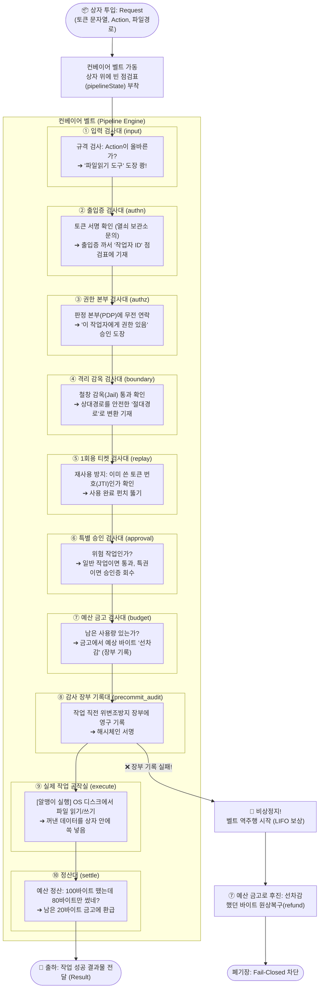

# 007. 파이프라인 컨베이어 벨트, 양파 껍질 패킷, 그리고 DIP와 안전 관측의 모든 것

> **모드**: `[문서작업]` — 소스코드 수정 없이 이번 대화 세션에서 다룬 PEP 파이프라인 엔진(`pipeline.Engine[Call]`)의 컨베이어 벨트 동작, 양파 껍질(Onion) 모델의 패킷(`Request`, `Call`, `pipelineState`), DIP(의존성 역전)와 훅(`Hook`), LIFO 스택 롤백(`Compensate`), 그리고 안전 래퍼(`WrapSafe`) 기반의 관측 격리 전체를 질문·대답 원문 그대로 해설합니다.  
> **기준일**: 2026-11-07 · **기준 커밋**: `34b8b77`  
> **다시 확인하는 법**:  
> ```bash
> # 1. 파이프라인 범용 엔진 순차 실행 및 LIFO 보상 단위 시험
> go test -v ./internal/pipeline/...
> # 2. PEP 인가관문 10단계 파이프라인 및 단계 순서 불변식 시험
> go test -v ./internal/authz/pep/... -run "TestGateway|TestStageOrder"
> # 3. 안전 관측(WrapSafe 패닉 격리) 시험
> go test -v ./internal/observe/...
> ```

---

## 1. PEP 파이프라인의 본질과 DIP

### Q. 그러니까 PEP 파이프라인은 10단계를 순서대로 넣고 for문 돌리는 거지? 약속과 다르면 즉시 실패처리다. 파이프라인은 DIP이고 단지 stack처리 방법만 알고 있나?

#### 1) 10단계를 순서대로 넣고 for문 돌리는가? 약속과 다르면 즉시 실패인가?
**네, 정확히 맞습니다.**

- **조립 단계 (10단계)**:
  `assemble()` 함수에서 정해진 10개 단계(Step)를 순서대로 슬라이스로 묶어 파이프라인 엔진에 넘깁니다. (구현: `internal/authz/pep/gateway.go` · `assemble`)
  ```text
  1. input (검사) ➡️ 2. authn (검사) ➡️ 3. authz (결정) ➡️ 4. boundary (검사) ➡️ 5. replay (소비) 
  ➡️ 6. approval (소비) ➡️ 7. budget (소비) ➡️ 8. precommit_audit (기록) ➡️ 9. execute (실행) ➡️ 10. settle (정산)
  ```
- **약속과 다르면 즉시 실패 (Fail-Closed & Early Exit)**:
  - 엔진의 `Run()` 루프(`internal/pipeline/pipeline.go`)에서 각 단계를 `for`문으로 순회합니다.
  - 어느 한 단계라도 에러(`err != nil`)를 반환하면 **그 즉시 루프를 탈출하고 실패 처리**합니다.
  - 이후 단계는 절대 실행되지 않습니다.

#### 2) 파이프라인은 DIP이고 단지 Stack 처리 방법만 알고 있나?
**네, 맞습니다.**

`pipeline.Engine[S]`는 **토큰, 권한, 파일, 네트워크, 감사 같은 도메인 지식을 전혀 모르는 순수 제네릭 엔진**입니다.

1. **완벽한 DIP (의존성 역전 & 분리)**:
   - 파이프라인 패키지는 표준 라이브러리(`context`, `errors`, `fmt`) 외에는 어떤 도메인 패키지도 import하지 않습니다.
   - PEP가 `Step[Call]`과 `Run` 콜백 함수들을 파이프라인 엔진에 주입해 줄 뿐입니다.
2. **단지 순서 보장과 '역순 보상(Stack/LIFO)'만 수행**:
   - 실행할 때는 큐(Queue/FIFO)처럼 순서대로 돌립니다.
   - **실패 시 보상(Compensate)**: 이미 성공적으로 지나온 단계들을 `done` 슬라이스에 쌓아두었다가(Stack), 실패가 발생하면 **역순(LIFO, `len(done)-1`부터 `0`까지)**으로 `Compensate()`를 호출합니다.
     *(예: 7단계 `budget`에서 토큰 예산이 차감되었는데 8단계 `precommit_audit`이 실패하면, 스택을 거꾸로 풀면서 `refund()`를 실행해 차감했던 예산을 즉시 환불/복구합니다).*
3. **엄격한 불변식(Invariant) 검증**:
   - 엔진 생성 시(`pipeline.New`), 단계의 성격 등급(`Check/Decide` $\le$ `Consume` $\le$ `Record` $\le$ `Execute` $\le$ `Settle`)이 역전되거나 하강하는 조립 오류가 있으면 생성 자체를 거부합니다.

---

## 2. 파이프라인 처리법 규약 (인터페이스와 시그니처)

### Q. 그래도 특정 인터페이스 같은 걸로 처리법은 정해놓고 있을 거 아닌가? 그게 뭔가?

파이프라인 엔진이 도메인은 몰라도 **"단계(Step)가 엔진과 소통하기 위한 엄격한 인터페이스 규약"**은 정해져 있습니다.
파이프라인이 요구하는 규약은 **`Step[S]` 구조체(함수 시그니처 포트)**와 **`Hook[S]` 인터페이스** 두 가지입니다.

#### 1) 단계별 실행·보상 규약: `Step[S]`의 함수 시그니처
엔진은 인터페이스 타입 대신, Go에서 흔히 쓰는 **단일 책임 함수형 인터페이스 규약**으로 각 단계를 정의합니다 (`internal/pipeline/pipeline.go`):

```go
type Step[S any] struct {
    ID         string                                   // 단계 식별자 (예: "authn", "authz")
    Kind       Kind                                     // 성격/등급 (check, decide, consume, record, execute, settle)
    Applies    func(s *S) bool                          // [선택] 조건부 실행 판정 규약
    Run        func(ctx context.Context, s *S) error    // [필수] 핵심 실행 규약 (성공 시 nil, 실패 시 error)
    Compensate func(ctx context.Context, s *S)          // [선택] 실패 시 롤백/보상 규약
}
```

- **`Run(ctx, s) error` 규약**:
  - 모든 10단계는 반드시 이 시그니처를 지켜야 합니다.
  - 상태 객체 `s`(`*pep.Call`)를 받아 필요한 작업을 수행하고, **통과면 `nil`**, **약속과 다르면 즉시 `error`**를 반환해야 합니다.
- **`Compensate(ctx, s)` 규약**:
  - 상태를 변경(소비)하는 단계가 실패 시 원복해야 할 때 등록하는 보상 함수 규약입니다.
- **`Applies(s) bool` 규약**:
  - 이 요청에 해당 단계가 필요한지(예: 승인이 필요한 요청인가? 예산이 있는 토큰인가?)를 판정하는 규약입니다.

#### 2) 단계 전/후 관측 규약: `Hook[S]` 인터페이스
엔진이 단계를 실행할 때 외부(로깅, 메트릭, 시간 측정 등)와 소통하는 정식 인터페이스입니다 (`internal/pipeline/pipeline.go`):

```go
type Hook[S any] interface {
    OnStepStart(ctx context.Context, id string, s *S)
    OnStepEnd(ctx context.Context, id string, s *S, err error)
}
```

- **`OnStepStart`**: 단계 진입 직전에 호출됩니다. (시작 시각 기록 등)
- **`OnStepEnd`**: 단계가 끝나고 성공(`err == nil`)했는지, 실패(`err != nil`)했는지 통지받습니다.

#### 3) 공유 컨텍스트 규약: 상태 캡슐화 (`Call` 구조체)
엔진은 제네릭 타입 `S`로만 알고 있지만, PEP에서는 이 자리에 `*pep.Call`이라는 **상태 객체**를 전달합니다.
- 1단계(`input`)가 검증한 결과는 `s`에 채워지고,
- 2단계(`authn`)는 그 `s`를 읽어 토큰을 까서 다시 `s.claims`에 채우며,
- 3단계(`authz`)는 채워진 `s.claims`를 보고 인가를 판정합니다.

---

## 3. 컨텍스트의 실체

### Q. 컨텍스트는 대체 뭔가?

여기서 말하는 **"컨텍스트"**는 Go 언어의 `context.Context`와 헷갈리기 쉽지만, 이 파이프라인 아키텍처에서는 **"한 번의 요청이 처리되는 동안 단계들이 함께 돌려쓰는 공유 장부(메모리 바구니)"**를 뜻합니다.

실제 코드로는 `Call`(`internal/authz/pep/tool.go`)과 그 안에 들어있는 `pipelineState`(`internal/authz/pep/gateway.go`)가 바로 그 컨텍스트입니다.

#### 1) 컨텍스트가 왜 필요한가?
파이프라인 안의 10개 검문소(함수)들은 서로를 직접 호출하지 않습니다.
- 1단계(`input`)는 2단계(`authn`)를 모르고,
- 2단계는 3단계(`authz`)를 모릅니다.

그렇다면 **"앞 단계가 알아낸 정보(토큰 깐 내용, 검증된 주체, 격리된 안전 경로 등)"를 뒷단계에 어떻게 전달할까요?**  
바로 **`Call`이라는 컨텍스트 바구니**에 담아서 옆으로 전달(Toss)하는 것입니다.

#### 2) 실제 코드 구조: 컨텍스트의 실체
실제 코드를 보면 딱 이렇게 생겼습니다:

```go
// internal/authz/pep/tool.go
type Call struct {
    cfg *Config         // 시스템 전역 설정 (검증기, 원장 등)
    req Request         // 손님이 처음 보낸 원본 요청 (토큰 문자열, 파일명 등)
    st  *pipelineState  // 바로 이것! 단계들이 채워나가는 빈 메모장
}
```

그리고 메모장인 `pipelineState`(`internal/authz/pep/gateway.go`) 안에는 이런 빈칸들이 있습니다:
```go
type pipelineState struct {
    traceID    string                 // 추적 번호
    subject    string                 // 토큰 주인 이름 (2단계가 채움)
    claims     *domain.VerifiedClaims // 까서 검증된 클레임 (2단계가 채움)
    safePath   string                 // Jail을 통과한 안전한 절대경로 (4단계가 채움)
    approvalID string                 // 승인 번호 (3단계가 채움)
    out        Output                 // 읽어낸 파일 데이터 결과 (9단계가 채움)
    ...
}
```

#### 3) 그림으로 보는 컨텍스트의 역할
컨텍스트는 **단계들 사이를 이동하는 '작업 지시서(Clip board)'**입니다. 처음엔 거의 비어있다가 단계를 지날 때마다 도장이 찍히고 내용이 채워집니다.

```text
[요청 도착] ──▶ 빈 컨텍스트(Call) 생성
                  │
                  ▼
┌────────────────────────────────────────────────────────┐
│  1단계 (input)    : req 확인 후 "Action 정규화" 기록      │
│  2단계 (authn)    : 토큰 까서 "주체(sub)", "claims" 기록 │
│  3단계 (authz)    : claims 보고 "권한 승인 여부" 기록    │
│  4단계 (boundary) : Jail 확인 후 "safePath" 기록       │
│  5단계 (replay)   : 1회용 JTI 검증 도장 찍음            │
│  ...                                                   │
│  9단계 (execute)  : safePath로 파일 읽어서 "out"에 담음 │
└────────────────────────────────────────────────────────┘
                  │
                  ▼
[완료] ◀── 컨텍스트의 "out"과 상태를 꺼내 손님에게 최종 반환(Result)
```

#### 4) 두 종류의 '컨텍스트' 구분
1. **Go 표준 `context.Context`**:
   - "취소 신호(Cancel), 타임아웃(Timeout) 전파용 파이프"입니다.
   - `ctx.Done()`이 울리면 즉시 작업을 멈추는 용도입니다.
2. **파이프라인의 컨텍스트 (`Call`)**:
   - "이 요청 하나에 대한 모든 데이터와 중간 진행 상태를 담고 있는 가방"입니다.
   - 파이프라인의 모든 단계 시그니처 `func(ctx context.Context, c *Call) error`에서 바로 뒤에 있는 `c *Call`이 그것입니다.

---

## 4. 양파 껍질 모델과 데이터 구조도

### Q. 파이프라인을 그림으로 그려줄 수 있나? 그리고 그 안에 있는, 그 안에서 사용되는 구조체나 데이터를 패킷처럼 구조도를 그려줘. 양파이면 양파모양으로 그려주면 이해가 쉽잖아.

#### 1) 양파 패킷 구조도: 밖에서 안으로 껍질을 벗겨가는 데이터
손님이 보낸 **원시 패킷(`Request`)**이 들어오면, PEP는 이것을 감싸는 **컨텍스트(`Call`)**를 만들고 단계별로 껍질을 하나씩 벗겨서 알맹이를 꺼냅니다.

```text
       [ 가장 바깥 껍질: 손님의 날것(Raw) 요청 ]
   ┌────────────────────────────────────────────────────────┐
   │ 🧅 Request (Token 문자열, Action, Resource 경로)         │
   │   ┌────────────────────────────────────────────────┐   │
   │   │ 2단계: 토큰 껍질 벗김 (authn)                     │   │
   │   │  ➔ domain.VerifiedClaims (sub, scopes, jti)    │   │
   │   │   ┌────────────────────────────────────────┐   │   │
   │   │   │ 3단계: 권한 결정 (authz)                 │   │   │
   │   │   │  ➔ Decision: Allow / ApprovalID        │   │   │
   │   │   │   ┌────────────────────────────────┐   │   │   │
   │   │   │   │ 4단계: 경로 탈옥 검사 (boundary) │   │   │   │
   │   │   │   │  ➔ SafePath (Jail 통과 절대경로)  │   │   │   │
   │   │   │   │   ┌────────────────────────┐   │   │   │   │
   │   │   │   │   │ 7단계: 예산 검사 (budget) │   │   │   │   │
   │   │   │   │   │  ➔ Remaining Bytes 확인 │   │   │   │   │
   │   │   │   │   │   ┌────────────────┐   │   │   │   │   │
   │   │   │   │   │   │ 🌰 [핵심 알맹이]│   │   │   │   │   │
   │   │   │   │   │   │ 9단계: execute │   │   │   │   │   │
   │   │   │   │   │   │ 실제 OS 디스크/ │   │   │   │   │   │
   │   │   │   │   │   │ 네트워크 I/O 실행│   │   │   │   │   │
   │   │   │   │   │   │ ➔ Output Data  │   │   │   │   │   │
   │   │   │   │   │   └────────────────┘   │   │   │   │   │
   │   │   │   │   └────────────────────────┘   │   │   │   │
   │   │   │   └────────────────────────────────┘   │   │   │
   │   │   └────────────────────────────────────────┘   │   │
   │   └────────────────────────────────────────────────┘   │
   └────────────────────────────────────────────────────────┘
```

#### 2) 컨텍스트(`Call`) 구조체의 실제 메모리 패킷 배치도
코드베이스에서 실제로 돌아다니는 구조체 `Call`(`internal/authz/pep/tool.go`)의 메모리 구조입니다:

```text
+-----------------------------------------------------------------------------------+
| struct Call (전체 컨텍스트)                                                        |
+-----------------------------------------------------------------------------------+
|  *cfg     --> [ 불변 인프라: Verifier, PDP, Jail, AuditWriter, Clock ]            |
|-----------------------------------------------------------------------------------|
|  req      --> [ 입력 패킷: Token (Bearer ...), Action ("file:read"), Resource ]   |
|-----------------------------------------------------------------------------------|
|  *st      --> struct pipelineState (단계들이 벗겨서 채워넣는 공유 칠판)             |
|               +-----------------------------------------------------------------+ |
|  (1. input)   |  normAction : domain.ActionFileRead                             | |
|               |  tool       : fileReadTool{}                                    | |
|  (2. authn)   |  claims     : *VerifiedClaims { Subject: "worker-1", JTI: ".." }| |
|               |  tokenJTI   : "urn:uuid:1111-2222"                              | |
|  (3. authz)   |  approvalID : "appr-xyz" (승인 필요 시)                          | |
|  (4. boundary)|  safePath   : "/tmp/jail/root/workspace/data.txt"               | |
|  (7. budget)  |  consumed   : true (사전 차감됨)                                 | |
|  (9. execute) |  out        : Output { BytesRead: 1024, Data: [ ... ] }         | |
+---------------+-----------------------------------------------------------------+-+
```

---

## 5. 컨베이어 벨트 비유와 전체 방 구조도

### Q. 모든 구조를 다 그려줘. 파이프라인도 그려줘. 컨베이어벨트이면 그걸 그려주면 되잖아. 자기 방 구조도 그리듯이 그려도 되고. 액티비티 다이어그램도 있고 그냥 순서도도 좋고. 뭐든 최고로 쉬운 표현으로.

#### 1) 전체 방 구조도 (공장 평면도: 누가 어디서 일하는가?)
이 시스템은 방(패키지)들이 벽으로 엄격하게 격리되어 있고, 오직 정해진 복도(인터페이스)로만 통신합니다.

```text
┌─────────────────────────────────────────────────────────────────────────────┐
│ 🏭 전체 공장 평면도                                                           │
│                                                                             │
│  [ 워커의 방 (Subagent) ]                                                    │
│  - 자식 프로세스. 샌드박스에 갇혀 있음.                                            │
│  - 할 일: "이 상자 좀 배달해주세요!" ──(상자 투입)──┐                          │
│                                                     │                       │
│                                                     ▼                       │
│  ┌───────────────────────────────────────────────────────────────────────┐  │
│  │ 🚪 관문 검사소: PEP Gateway                                            │  │
│  │                                                                       │  │
│  │   [ 벨트 조종실: Pipeline Engine ]                                    │  │
│  │   - 10개 검사대를 순서대로 돌리는 범용 엔진 (도메인은 모름, 벨트만 돌림)   │  │
│  │                                                                       │  │
│  │   [ 벨트 위 검품 라인 (10개 검사대) ] ══════════════════════════════   │  │
│  │    ①입력 ➔ ②토큰 ➔ ③인가 ➔ ④격리 ➔ ⑤중복 ➔ ⑥승인 ➔ ⑦예산 ➔ ⑧장부 ➔ ⑨실행 ➔ ⑩정산 │  │
│  └───────┬────────────┬─────────────┬─────────────┬─────────────┬────────┘  │
│          │            │             │             │             │           │
│   (외주 자문)  (외주 자문)    (외주 자문)   (외주 자문)   (장부 보관) (OS 디스크)  │
│          ▼            ▼             ▼             ▼             ▼           │
│     [열쇠 보관소]  [판정 본부]    [철창 감옥]   [예산 금고]   [감사 금고] [격리 폴더]│
│       Verifier       PDP          Jail        Budget Ledger  AuditWriter OS Disk│
│     (토큰 서명)    (권한 정책)   (탈옥 방지)   (남은 바이트)  (위변조 방지)         │
│                                                                             │
│  ┌───────────────────────────────────────────────────────────────────────┐  │
│  │ 📹 CCTV 관제실: Observer (WrapSafe)                                    │  │
│  │ - 각 검사대 통과 시간과 성공/실패를 모니터링함.                              │  │
│  │ - CCTV 카메라가 고장(panic)나도 벨트는 절대 멈추지 않음 (Fail-Open)        │  │
│  └───────────────────────────────────────────────────────────────────────┘  │
└─────────────────────────────────────────────────────────────────────────────┘
```

#### 2) 파이프라인 컨베이어 벨트 액티비티 다이어그램
상자(`Call` 컨텍스트)가 컨베이어 벨트에 올라가서 10개 검사대를 통과하고, 실패 시 후진(롤백)하는 전체 흐름입니다.



#### 3) 상자 속 패킷의 변천사 (점검표가 채워지는 순서)
컨베이어 벨트를 지날 때마다 상자 옆에 붙은 **점검표(`Call.st`)**에 내용이 채워지는 과정입니다:

```text
[처음 투입 시]
상자 겉면: Token = "eyJh...", Action = "file:read", Resource = "notes.txt"
점검표   : (완전 백지 상태)

   ▼ ① input 통과 후
점검표   : Action = "file:read", Tool = [파일읽기 도구]

   ▼ ② authn 통과 후 (출입증 껍질 벗김)
점검표   : 작업자 = "subagent-A", 토큰번호 = "uuid-9999", Claims = [인증완료]

   ▼ ③ authz 통과 후
점검표   : 인가여부 = "허용(Allow)"

   ▼ ④ boundary 통과 후
점검표   : 접근경로 = "/jail/root/workspace/notes.txt" (탈옥 불가능한 안전경로)

   ▼ ⑦ budget 통과 후
점검표   : 차감완료 = true (1024 바이트 사전 확보)

   ▼ ⑨ execute 통과 후 (실제 물건 담김)
상자 안쪽: Data = [ "안녕, 파일 내용이다!" ] (실제 데이터 획득)

   ▼ ⑩ settle 통과 후
점검표   : 최종 정산 완료 ➔ 손님에게 배달!
```

#### 4) CCTV 관제실 (Hook & WrapSafe)이 지켜보는 법
컨베이어 벨트 양옆에는 **CCTV(`Hook`)**가 서 있어서 모든 검사대를 지켜봅니다:

```text
[검사대 입장 직전] ➔ Hook: "CCTV OnStepStart! 타이머 스타트!"
       │
   (검사 수행)
       │
[검사대 통과 직후] ➔ Hook: "CCTV OnStepEnd! 통과 여부 및 걸린 시간(ms) 기록!"
```

- **보호막(`WrapSafe`)**: 만약 CCTV 카메라 모니터가 고장 나서 폭발(`panic`)하더라도, **안전 래퍼(`WrapSafe`)가 그 폭발을 삼켜버리기 때문에(`defer func() { _ = recover() }()`)** 벨트 위의 검사 작업은 아무런 영향을 받지 않고 계속 돌아갑니다(Fail-Open). (구현: `internal/observe/port.go` · `WrapSafe`)

---

## 6. 결론 요약

1. **양파 껍질**: `Request` 패킷이 들어오면 `Call` 바구니에 담겨 `input` $\to$ `authn` $\to$ `authz` $\dots$ 순으로 껍질을 하나씩 벗겨 데이터를 채워나갑니다.
2. **파이프라인 규약**: 미들웨어 체인이 아니라 **"앞으로는 순차 실행(Queue), 뒤로는 역순 롤백(Stack)"**을 수행하는 상태 비저장 루프 엔진입니다.
3. **훅과 보상**: 전처리/후처리는 `Hook(OnStepStart/OnStepEnd)`이 감시하고, 보상(`Compensate`)은 `Step` 구조체 안에 묶여 전달되어 실패 시 LIFO로 역호출됩니다.
4. **로깅 격리**: `WrapSafe` 래퍼를 통해 로그에서 패닉이 터져도 보안 판정 본선은 끄떡없는 구조입니다.
