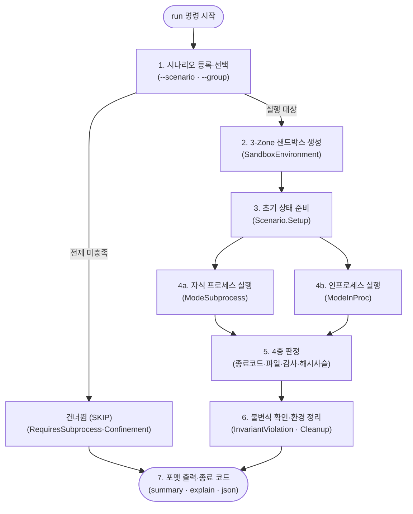

# 008. 시나리오 하네스와 4중 판정 — `run --scenario all`이 전부 PASS라는데, 종료 코드만 맞으면 PASS인가

> **모드**: `[문서작업]` — 소스코드 수정 없이 현재 구현된 시나리오 실행기(`harness`)와 4중 판정(`Quad-Assertion`), 불변식 검증, 출력 형식(`summary`·`explain`·`json`)의 실제 동작과 이유(Why)를 해설합니다.  
> **기준일**: 2026-11-06 · **기준 커밋**: `bf00fca` (이 문서가 설명하는 `cmd/`와 `internal/`을 마지막으로 바꾼 커밋)  
> **검증 범위**: 동작·순서·소유자·시점을 코드와 대조한 결과와 「미확인」은 5부 ③에 있습니다.  
> **이 문서는 구현된 것만 적는다.** 계획·제안·미래형 약속은 적지 않으며, 현재 코드가 하지 않는 것은 「지금은 없다」고만 씁니다.  
> **이 문서의 규칙**: 본문(0~4부, Q&A, 그림, 5부 ①)은 쉬운 개념·설계·이유가 중심입니다. 파일·타입 이름 같은 고유 이름은 첫 등장에 한마디 설명과 함께 쓰고, 구현의 어디인지는 문단 끝 `(구현: 파일 · 함수, 5부 ② 번호)` 귀띔으로 보조합니다. 기준은 [프로그램 설명서 README의 「설명의 기준」과 「이름의 3층」](README.md)입니다.  
> **겹치는 주제**: 001~006편은 「무엇이 요청을 막는가」를, 이 편은 「그렇게 막힌다는 것을 이 프로그램이 어떻게 시험하고 판정하는가」를 다룹니다. 부모가 자식 프로세스를 띄우고 환경변수를 솎아 내는 원리와 감사 해시 사슬 구조는 [003편](003-서브프로세스격리와_해시체인감사.md)이, 커널 격리(`Seatbelt`·`Landlock`)와 악의 워커 대조군·실험군 설계는 [006편](006-OS격리_관측성과_감사체크포인트.md) Q1~Q4가, 정적 소스코드 검사(`TestArchitectureGuardrails`)는 [007편](007-코드읽는순서와_의존방향.md) Q4가, 장기 실행 세션 도우미(`SessionDriver`)는 [009편](009-권한회수_Epoch_시간과_TOCTOU창.md)이 자세히 다룹니다.
>
> **다시 확인하는 법**
> ```bash
> git rev-parse --short HEAD
> git log -1 --format=%h -- cmd internal
> # 1. 시나리오 하네스 코어 및 4중 판정·불변식 시험 실행
> go test -v ./internal/harness/ -run "TestSandboxEnvironment|TestQuadAssertion|TestHarnessRunner|TestTC_050|TestRunner_|TestCachedBinaryProvider|TestFaultWorker"
> # 2. 카탈로그 등록·메타데이터 검사 및 변이 시험 실행
> go test -v ./internal/harness/catalog/ -run "TestCatalog_ScenarioCount|TestCatalog_RegisterAll|TestCatalog_Group_G1|TestG9_Mutation|TestG10_Skipped"
> # 3. 단일 시나리오를 explain / summary / json 형식으로 직접 실행해 보기
> go run ./cmd/authz-harness run --scenario E2E-22 --output-format explain
> go run ./cmd/authz-harness run --group G1 --output-format summary
> go run ./cmd/authz-harness run --scenario E2E-01 --output-format json
> # 4. 결함 워커(faultworker)가 프로덕션 패키지를 가져다 쓰지 않는지 확인하는 가드 시험
> go test -v ./internal/harness/ -run "TestArchitectureGuardrails/TC-040-AG"
> # 5. 핵심 코드 위치 확인
> grep -n "func " internal/cli/run.go internal/harness/runner.go internal/harness/assertion.go internal/harness/sandbox.go
> # 6. 4부 「배척한 방식」의 과거 코드 (본문에는 옮기지 않는다)
> git show 6361f8b^:internal/harness/assertion.go | sed -n '200,235p'
> git show 6361f8b^:internal/harness/assertion.go | sed -n '264,304p'
> git show d670f7e^:internal/harness/runner.go | tail -n 25
> ```

---

## 💡 사용자의 질문 (원문 보존)

> 설명서에 남기면 좋을 부분 있나? 프로그램의 주요 부분 말이야. 내가 잘 이해해야 하는 부분이나 특징적인 부분 제안해라.

> 다른 에이전트로 설명서 작성할테니 니가 계획서만 써줘. 3개 모두.

([계획 007 S1](../계획/007-설명서_008_009_신설_및_001편_부록_집필계획.md) 지시서에 따라 집필했습니다.)

---

## 0. 모든 설계 이전에 ‘사람’이 있다 — 전부 PASS라는데 무엇을 믿어야 하나

터미널에서 `authz-harness run --scenario all`을 치면 표가 주르륵 올라오고 맨 끝에 `ALL SCENARIOS PASSED`라는 줄이 찍힙니다. 이 화면을 처음 본 사람은 자연스럽게 이런 의문을 품습니다.

- 「공격 시나리오는 원래 실패(거부)해야 정상인데, 왜 결과 칸에는 `PASS`라고 찍히나?」
- 「프로그램이 거부 종료 코드(`12`, `13` 같은 숫자)만 내뱉으면 무조건 `PASS`로 쳐 주는 것 아닌가? 죽기 직전에 파일을 이미 건드렸거나 감사 장부를 빼먹었으면 어쩌나?」
- 「앞 시나리오에서 열어 둔 권한이나 임시 파일이 다음 시나리오에 남아서 우연히 통과한 것은 아닌가?」
- 「같은 시나리오를 메모리 안에서 바로 돌리는 것(`inproc`)과 실제 자식 프로세스를 띄워 돌리는 것(`subprocess`)은 무엇이 다르고, 왜 굳이 두 가지를 두었나?」

이 문서는 `run` 명령 한 줄이 안에서 어떤 순서로 시나리오를 고르고 빈 방(샌드박스)을 차리는지, 왜 종료 코드 하나가 아니라 네 가지 증거(4중 판정)와 부가 불변식까지 맞물려야 통과로 인정하는지, 그리고 그 결과를 사람이 어떻게 직접 열어보고 검증할 수 있는지를 차례대로 펼칩니다.

---

## 1부. 왜 시나리오 하네스가 필요하고, 왜 4중 판정인가

### 가장 밑바닥의 이유부터

1. **왜 시나리오 하네스가 따로 필요한가?** 출입증 검증기, 판정 부품, 작업 폴더 울타리, 감사 기록기를 각각 잘 만들었다고 해서, 그 부품들을 한데 묶어 실제 자식 프로세스를 띄웠을 때도 공격이 막힌다고 장담할 수 없습니다. 보안 장치가 실제로 작동한다는 말은 「정상 요청은 통과하고, 허용되지 않은 요청은 의도한 단계에서 의도한 사유와 종료 코드로 실패한다」는 것을 직접 실행해 보여 줄 수 있을 때만 성립합니다.
2. **그냥 단위 시험(`go test`)만 돌리면 되지 않나?** 개별 함수 시험만으로는 명령줄에서 전체 공격 목록을 한 번에 돌려 종합 성적표를 뽑거나, 처음 보는 사람에게 「어느 관문에서 왜 막혔는가」를 한 화면(`--output-format explain`)으로 풀어 보여 주기 어렵습니다. 그래서 시나리오 목록을 실행 파일 안에 함께 묶어 `run` 명령으로도 돌리고 `go test` 안에서도 똑같은 실행기로 돌립니다.
3. **그러면 공격을 보냈을 때 거부 종료 코드(`11`~`18`)가 나오면 방어에 성공한 것 아닌가?** 그렇지 않습니다. 종료 코드 하나만 보면 세 가지 구멍이 뚫립니다.
   - 첫째, 자식이 거부 코드(`12`)를 내고 끝나기 전에 작업 폴더의 파일에 이미 1바이트라도 써 버렸다면 방어는 실패한 것입니다.
   - 둘째, 위조된 출입증을 보냈는데 출입증 위조(`TOKEN_INVALID_SIGNATURE`)를 잡은 것이 아니라 시나리오 설정 실수로 권한이 없어서(`NO_ACTIVE_GRANT`) 거부되었다면, 출입증 검증기가 고장 나도 종료 코드는 똑같이 비정상 코드라 통과로 둔갑합니다.
   - 셋째, 요청은 막았지만 감사 장부(`audit.jsonl`)에 기록을 남기지 못했거나 해시 사슬이 깨졌다면 사후에 무엇이 막혔는지 증명할 수 없습니다.
4. **그래서 어떻게 판정하나?** 시나리오 하나가 끝날 때마다 ① **종료 코드**, ② **파일 상태(거부 시 0바이트 무변화 / 허용 시 내용 일치)**, ③ **감사 장부의 결정과 사유 코드**, ④ **감사 해시 사슬 무결성과 원시 토큰 비노출** 네 가지를 동시에 대조합니다(`Quad-Assertion`). 네 가지 가운데 하나라도 어긋나면 실패(`FAIL`)입니다.
5. **네 가지만 맞으면 충분한가?** 손자 프로세스가 살아남았는지, 오류 응답 본문에 토큰이 섞여 나갔는지 같은 증거는 위 네 군데에 남지 않습니다. 그래서 시나리오가 직접 확인한 부가 조건이 깨지면 전용 에러(`InvariantViolation`)로 판정을 뒤집는 길을 하나 더 두었습니다(Q5).
6. **왜 시나리오마다 환경을 새로 만드나?** 앞 시나리오가 등록한 권한이나 파일이 남아 있으면 뒤 시나리오가 무엇 덕분에 통과했는지 알 수 없기 때문입니다. 시나리오마다 빈 임시 폴더를 새로 만들고 끝나자마자 지웁니다(Q3).
7. **더 내려가면?** 「말로만 막힌다고 하지 말고, 막힌 뒤의 파일·장부·프로세스 상태를 전부 확인해 보여 달라」는 요구에 닿습니다. 그 이상은 되물을 수 없습니다.

### 흔한 방식과 이 프로그램의 선택

| 구분 | 흔한 방식 (일반론, 이 저장소에서 확인하지 않음) | 이 프로그램의 선택 |
|---|---|---|
| 모양 | 외부 셸 스크립트로 명령을 실행해 종료 코드(`$?`)나 출력 문자열 일부만 비교하거나, 여러 시험이 하나의 설정 폴더를 공유한다 | Go 코드 안에 시나리오 규약(`harness.Scenario`)과 실행기(`harness.DefaultRunner`), 4중 판정기(`harness.DefaultEvaluator`)를 내장하고 시나리오마다 독립된 3-Zone 임시 폴더(`harness.SandboxEnvironment`)를 새로 만든다 |
| 얻는 것 | 스크립트 작성이 간단하고 기대값을 적을 항목이 적다 | 종료 코드가 맞아도 파일이 1바이트라도 바뀌었거나 감사 사유·해시 사슬·부가 불변식이 어긋나면 즉시 실패로 잡는다. `run` 명령과 `go test`가 똑같은 시나리오와 판정기를 쓴다 |
| 포기하는 것 | 잘못된 사유로 실패하거나 부작용이 남아도 통과로 지나칠 수 있다 | 시나리오 하나를 적을 때마다 기대 종료 코드·파일 상태·감사 사유·해시 사슬 명세(`harness.ExpectedAssertion`)를 모두 채워야 하고, 시나리오마다 임시 폴더를 만들고 지우는 비용이 든다 |

---

## 2부. 질문과 답변으로 풀어보는 핵심 동작 (Q&A)

### Q1. `run --scenario`를 실행하면 안에서 무슨 순서로 도나?

- **무슨 일이 일어나는가**:
  1. 명령줄에서 `authz-harness run`을 부르면 `cli.RunRunner`(하네스 실행 명령을 조립하고 결과를 출력하는 러너)의 `Run` 함수가 플래그(`--scenario`, `--group`, `--execution-mode`, `--output-format`, `--fail-fast`, `--verbose`)를 읽습니다.
  2. 먼저 `--output-format` 값에 따라 결과를 그릴 출력기(`ui.Formatter` 인터페이스를 따르는 `ui.SummaryFormatter`, `ui.ExplainFormatter`, `ui.JSONFormatter` 중 하나)를 고릅니다. 세 형식 밖의 값이 들어오면 시나리오를 돌리지 않고 `ExitBadInput`(`14`)으로 끝납니다.
  3. 이어서 시나리오 실행기 `harness.DefaultRunner`(`harness.Runner` 인터페이스의 기본 구현체)를 만듭니다(`harness.NewDefaultRunner`). 이때 임시 폴더 기준 경로(`harness.WithBaseDir`), 실행 모드(`harness.WithExecutionMode` — 기본값은 자식 프로세스를 띄우는 `harness.ModeSubprocess`, `--execution-mode inproc`이면 메모리 안에서 바로 부르는 `harness.ModeInProc`), 4중 판정기(`harness.WithEvaluator` — `harness.NewDefaultEvaluator`)를 끼워 넣습니다.
  4. `catalog.RegisterAll`을 불러 `catalog.AllScenarios()`가 돌려주는 전체 시나리오 목록(`g1Scenarios`~`g15Scenarios`)을 실행기에 순서대로 등록(`DefaultRunner.Register`)합니다.
  5. 실행할 대상 시나리오 ID 목록을 추립니다. `--scenario`에 `"all"`이 아닌 특정 ID(예: `E2E-22`)를 주면 `DefaultRunner.Get`으로 그 시나리오 하나만 찾고, `--group`에 그룹 이름(예: `G1`)을 주면 `DefaultRunner.List`에서 그룹이 일치하는 시나리오들을 추리며, 둘 다 기본값이면 등록된 전체 시나리오를 순서대로 넣습니다. 없는 ID나 빈 그룹을 지정하면 `ExitBadInput`(`14`)으로 거부합니다.
  6. 추려진 ID마다 `DefaultRunner.RunScenario`를 차례로 불러 실행 결과(`harness.ScenarioResult`)를 모읍니다. 건너뛴 시나리오(`Skipped: true`)가 아닌데 통과하지 못한 결과(`!res.Passed && !res.Skipped`)가 나오면 실패가 있었다고 표시해 두고, `--fail-fast` 플래그가 켜져 있으면 그 즉시 반복문을 빠져나옵니다.
  7. 모아 둔 결과 슬라이스를 2단계에서 골라 둔 출력기(`formatter.Format`)에 넘겨 표준 출력에 찍습니다.
  8. 실패한 시나리오가 하나라도 있었으면 `ExitAuthzDenied`(`12`)를, 모두 통과했거나 건너뛰었으면 `ExitSuccess`(`0`)를 돌려줍니다. 카탈로그 등록 실패나 출력 실패 같은 내부 오류는 `ExitInternalError`(`16`)를 돌려줍니다. (구현: [`run.go`](../../internal/cli/run.go) · `RunConfig`, `RunRunner`, `NewRunRunner`, `RunRunner.Run`, [`runner.go`](../../internal/harness/runner.go) · `DefaultRunner.Register`, `DefaultRunner.Get`, `DefaultRunner.List`, `DefaultRunner.RunScenario`, [`catalog.go`](../../internal/harness/catalog/catalog.go) · `AllScenarios`, `RegisterAll`, 5부 ② 1·2·8번)
- **근거**: 5부 ② 항목 1, 2, 8번

### Q2. 시나리오 하나는 무엇으로 이루어지나? 공격 유형(`AttackClass`)과 해설(`ParadoxExplanation`)은 왜 있나?

- **무슨 일이 일어나는가**:
  1. 모든 시나리오는 `harness.Scenario` 인터페이스 약속을 따르며, 세 가지 함수를 가집니다.
     - `Metadata() ScenarioMetadata`: 시나리오의 정적 명세표(`harness.ScenarioMetadata`)를 돌려줍니다. 여기에는 고유 번호(`ID`), 그룹(`Group`), 이름(`Name`), 설명(`Description`), 공격 분류(`AttackClass`), 초보자용 역설 해설(`ParadoxExplanation`), 4중 판정 기대값(`Expected`, 타입은 `harness.ExpectedAssertion`), 서브프로세스 필수 여부(`RequiresSubprocess`), 커널 격리 필수 여부(`RequiresConfinement`)가 들어 있습니다.
     - `Setup(ctx, env)`: 공격이나 요청을 실행하기 전에 서명 키 생성, 권한(`Grant`) 부여, 초기 대상 파일 작성, 출입증 발급 같은 사전 준비를 수행합니다.
     - `Execute(ctx, env)`: 검증하려는 실제 요청이나 공격을 수행하고 종료 코드(`domain.ExitCode`)와 에러(`error`)를 돌려줍니다.
  2. `DefaultRunner.RunScenario`는 먼저 `Setup`을 부르고, 여기서 에러가 나면 `Execute`나 4중 판정으로 가지 않고 곧바로 실패(`setup failed`)와 에러를 반환합니다. `Setup`이 성공했을 때만 `Execute`를 부릅니다. (구현: [`scenario.go`](../../internal/harness/scenario.go) · `ScenarioMetadata`, `Scenario`, [`runner.go`](../../internal/harness/runner.go) · `DefaultRunner.RunScenario`, 5부 ② 2·3번)
- **왜 준비(`Setup`)와 실행(`Execute`)을 나누고, `AttackClass`·`ParadoxExplanation`을 적나**:
  - 준비 과정의 파일 쓰기나 토큰 발급이 실패한 것은 「공격이 차단된 것」이 아니라 「시험 환경 준비가 실패한 것」입니다. 둘을 한 함수에 섞어 두면 준비 단계에서 난 실패 코드가 공격 차단 코드와 섞여 오판할 수 있어서 단계를 갈랐습니다.
  - 또한 보안 시험에서는 공격 요청이 거부 코드(`11`~`18`)로 실패해야 방어 성공(`PASS`)입니다. 이 「부정 테스트의 역설」을 데이터로 남겨 두기 위해 각 시나리오의 `ScenarioMetadata`에 공격 분류(`AttackClass`)와 한 줄 해설(`ParadoxExplanation`)을 적고, `TestCatalog_ScenarioCount` 시험이 모든 시나리오에 `ParadoxExplanation`이 채워져 있는지 검사합니다.
  - **코드에서 확인한 사실**: `--output-format json`은 각 시나리오의 `AttackClass`와 `ParadoxExplanation` 필드를 그대로 JSON에 내보내지만, `--output-format explain` 화면(`ui.ExplainFormatter`)은 `ScenarioMetadata.ParadoxExplanation` 필드를 읽지 않고 `generateExplanation` 함수가 그룹·종료 코드·감사 사유를 보고 해설 문장을 따로 만들어 찍습니다(Q8). 왜 `ExplainFormatter`가 `ParadoxExplanation` 필드를 직접 쓰지 않는지는 코드와 문서에서 확인하지 못했습니다(5부 ③).
- **근거**: 5부 ② 항목 2, 3, 9, 11번

### Q3. 시나리오마다 따로 만드는 환경(`SandboxEnvironment`)에는 무엇이 들어 있고, 시계(`fixedClock`)는 어떻게 쓰나?

- **무슨 일이 일어나는가**:
  1. `DefaultRunner.RunScenario`는 시나리오 하나를 시작할 때마다 `harness.NewSandboxEnvironment`를 불러 운영체제 임시 폴더 아래에 `authz-harness-sandbox-*`(기준 폴더 `BaseDir`이 주어지면 그 아래 `scenario-sandbox-*`) 폴더를 새로 만들고, 함수가 끝날 때 `defer env.Cleanup()`으로 그 폴더 전체를 지웁니다.
  2. 새로 만든 `harness.SandboxEnvironment` 안에는 세 구역(Zone A·B·C)과 감사 장부가 분리되어 만들어집니다.
     - **Zone A (`zone_a/private_keys.json`)**: 출입증 서명용 비밀키가 저장될 경로(`PrivKeyPath`)입니다. 자식 일꾼 프로세스에게는 이 경로를 넘기지 않습니다([003편](003-서브프로세스격리와_해시체인감사.md) Q2).
     - **Zone B (`zone_b/`)**: 공개 검증키(`jwks.json`, `PubJWKSPath`), 허가 장부(`grants_state.json`, `StatePath`), 재사용 방지 원장(`replay_ledger.json`, `ReplayPath`) 경로가 잡힙니다. 예산 원장(`budget_ledger.json`)도 조립 함수(`app.BuildStack`)가 `ReplayPath`와 같은 `zone_b/` 폴더에 만듭니다.
     - **Zone C (`workspace/`)**: 일꾼이 읽고 쓸 작업 폴더(`WorkspaceDir`)입니다.
     - **감사 장부 (`audit.jsonl`)**: 루트 폴더 바로 아래에 권한 `0600`인 빈 파일로 미리 만들어 두는 감사 기록 경로(`AuditPath`)입니다.
  3. `SandboxConfig.ClockTime`에 시각을 넣어 부르면 항상 그 고정 시각만 돌려주는 `fixedClock`이 `env.MockClock`에 들어가고, 비워 두면 실제 시계(`domain.RealClock`)가 들어갑니다. `DefaultRunner.RunScenario`는 `ClockTime`을 비워 둔 채 `NewSandboxEnvironment`를 부르므로 기본 `env.MockClock`은 `RealClock`이며, 시간을 앞당겨야 하는 시나리오는 실제로 기다리는(`time.Sleep`) 대신 요청에 시계 오프셋(`ActionRequest.ClockOffset`)을 실어 보내거나 `setupHarnessStackWithClock`으로 시계를 끼워 넣습니다(자세히는 [009편](009-권한회수_Epoch_시간과_TOCTOU창.md)). (구현: [`sandbox.go`](../../internal/harness/sandbox.go) · `SandboxConfig`, `SandboxEnvironment`, `fixedClock`, `NewSandboxEnvironment`, `SandboxEnvironment.Cleanup`, [`helpers.go`](../../internal/harness/catalog/helpers.go) · `setupHarnessStack`, `setupHarnessStackWithClock`, 5부 ② 4·8번)
- **왜 시나리오마다 방을 새로 만들고 고정·가상 시계를 쓰나**:
  - 앞 시나리오가 남긴 파일이나 권한이 뒤 시나리오에 보이지 않게 격리하기 위해서입니다(`TestHarnessRunner_NoCrossContamination`).
  - 출입증 만료(수분~수십 분)를 실제 시간 대기로 시험하면 전체 시나리오 실행이 느려져 자주 돌릴 수 없으므로, 대기 없이 시각 차이만으로 만료를 재현하기 위해서입니다.
- **근거**: 5부 ② 항목 2, 4, 8, 11번

### Q4. 4중 판정(`Quad-Assertion`)은 각각 무엇을 어떤 순서로 보나?

- **무슨 일이 일어나는가**: 시나리오의 `Execute`가 끝나면 `harness.DefaultEvaluator`(`harness.Evaluator` 인터페이스 구현체)의 `Evaluate`가 실행 환경(`env`), 실제 종료 코드(`actualExitCode`), 기대 명세(`harness.ExpectedAssertion`)를 받아 아래 네 가지를 순서대로 검사하고 `harness.AssertionResult`를 돌려줍니다.
  1. **첫째, 종료 코드(`ExitCode`) 비교**: `actualExitCode == exp.ExitCode`인지 확인합니다. 다르면 `ExitCodePassed = false`와 함께 기대값·실제값을 `FailureReasons`에 적습니다.
  2. **둘째, 작업 폴더 파일 상태(`harness.FileExpectation`) 비교**: `SandboxEnvironment.WorkspaceFileExists`와 `GetWorkspaceFileSize`, `ReadWorkspaceFile`로 Zone C(`workspace/`) 안의 `RelPath` 파일을 직접 확인합니다.
     - 거부 시 무변화(`ExpectZeroMutation: true`): 파일이 없거나 크기가 `0`바이트여야 통과입니다. 파일이 있으면서 `0`바이트보다 크면 거부 코드가 맞았더라도 실패(`zero mutation violation`)로 처리합니다(`TestQuadAssertion_FileZeroMutationViolation`).
     - 허용 시 파일 확인(`ExpectExist: true`): 파일이 실제로 존재해야 하고, `ExpectedContent`가 비어 있지 않으면 파일 내용까지 글자 그대로 같아야 통과입니다.
  3. **셋째, 감사 결정과 사유(`harness.AuditExpectation`) 비교**: `SandboxEnvironment.ReadAuditEvents`로 `audit.jsonl`의 모든 줄을 읽은 뒤 **맨 마지막 줄부터 첫 줄 쪽으로(역순으로)** 훑으며 첫 일치 이벤트를 찾습니다.
     - 이때 `ExpectedTraceID`가 지정되어 있으면 `TraceID`가 다른 줄은 건너뛰고, `ExpectedAction`(예: `"pep.allow"`, `"pep.deny"`, `"orchestrator.limit_exceeded"`)이 지정되어 있으면 `Action`이 다른 줄도 건너뜁니다.
     - 조건에 맞는 줄이 하나도 없으면 다른 줄로 대체(폴백)하지 않고 즉시 실패(`no audit event matched`)시킵니다(`TestTC_050_02_ActionMismatchNoFallback`, `TestTC_050_03_TraceIDMismatchFails`).
     - 찾은 줄의 결정(`Decision`)과 사유(`Reason`)가 `ExpectedDecision`·`ExpectedReason`과 일치하는지 확인합니다(`TestQuadAssertion_AuditReasonMismatch`).
  4. **넷째, 감사 해시 사슬 무결성과 원시 토큰 비노출(`harness.HashChainExpectation`) 비교**:
     - 원시 토큰 유출 검사(`NoRawTokenLeak: true`): 모든 감사 이벤트를 JSON으로 직렬화해 서명된 JWT 모양(`domain.ContainsRawToken`, `eyJ...` 정규식)이 들어 있으면 실패(`raw token leak detected`)로 처리합니다(`TestQuadAssertion_RawTokenLeakDetection`).
     - 해시 사슬 검사(`RequireValidChain: true`): 감사 이벤트가 0건이면 빈 통과를 허용하지 않고 실패로 잡습니다. 이어서 파일 전체에 대해 `audit.VerifyHashChain(env.AuditPath)`를 한 번 부릅니다. 이 함수가 `curr_hash`가 비어 있지 않은지(`TestTC_050_01_MissingHashFails`), 각 줄의 `prev_hash`가 직전 줄의 `curr_hash`와 같은지, 다시 계산한 해시가 `curr_hash`와 일치하는지를 한 번에 확인합니다(`TestQuadAssertion_HashChainBroken`, 계획 021 S3에서 하네스 쪽 중복 검사를 없앴습니다). (구현: [`assertion.go`](../../internal/harness/assertion.go) · `ExpectedAssertion`, `FileExpectation`, `AuditExpectation`, `HashChainExpectation`, `AssertionResult`, `DefaultEvaluator.Evaluate`, [`sandbox.go`](../../internal/harness/sandbox.go) · `SandboxEnvironment.ReadAuditEvents`, 5부 ② 4·5번)
- **왜 감사 장부를 뒤에서부터 찾되 `ExpectedAction`·`ExpectedTraceID`로 거르나**:
  - 한 시나리오 안에서 준비 단계나 앞선 호출의 감사 줄이 먼저 적히고, 실제로 검증할 요청의 결과는 뒤에 적히기 때문에 역순으로 찾습니다.
  - 그러나 자식 프로세스가 끝난 뒤 부모가 사후 기록을 한 줄 더 남기거나 여러 흐름이 섞일 때 무조건 맨 끝 줄만 보면, 실제 차단 기록이 가려져 엉뚱한 줄과 비교하게 됩니다. 그래서 `ExpectedAction`과 `ExpectedTraceID`가 정확히 맞는 줄만 고르고, 없으면 실패로 처리합니다.
- **근거**: 5부 ② 항목 4, 5, 11번

### Q5. 종료 코드와 감사로는 안 보이는 증거(`InvariantViolation`)는 어떻게 잡나?

- **무슨 일이 일어나는가**:
  1. `DefaultRunner.RunScenario`가 시나리오의 최종 통과 여부(`overallPassed`)를 정하는 식은 다음과 같습니다:
     `overallPassed := assertionRes.Passed && !invariantBroken && (execErr == nil || actualExitCode != domain.ExitSuccess)`
  2. 거부 시나리오에서는 하위 호출이 도메인 에러(`execErr != nil`)와 함께 `0`이 아닌 종료 코드(`actualExitCode != domain.ExitSuccess`)를 돌려주는 것이 정상이므로, 일반 에러(`execErr`)는 종료 코드가 `0`이 아닐 때 최종 판정을 실패로 바꾸지 않습니다.
  3. 대신 종료 코드·작업 폴더 파일·감사 장부·해시 사슬 네 가지 밖의 증거(예: 강제 종료된 워커가 남긴 손자 프로세스가 실제로 소멸했는가, 출력 바이트가 상한 이하로 잘렸는가, MCP 오류 응답 본문에 원시 토큰이 없는가, 커널 격리 대조군·실험군의 카나리 파일 유출 여부가 기대와 맞는가)가 깨졌을 때 시나리오는 `harness.Invariantf`를 불러 `harness.InvariantViolation` 에러를 반환합니다.
  4. 손자 프로세스 소멸 확인에는 `harness.WaitForProcessGone(pid, timeout)`을 씁니다. 이 함수는 10ms 간격으로 `syscall.Kill(pid, 0)`을 보내 커널에서 프로세스가 사라졌다는 응답(`syscall.ESRCH`)이 올 때까지 기다립니다.
  5. `DefaultRunner.RunScenario`는 `errors.As(execErr, &iv)`로 `InvariantViolation`이 감지되면 `FailureReasons`에 `"invariant violation: ..."`을 추가하고, 4중 판정이 모두 통과했더라도 `overallPassed`를 `false`로 뒤집습니다. (구현: [`invariant.go`](../../internal/harness/invariant.go) · `InvariantViolation`, `Invariantf`, [`process.go`](../../internal/harness/process.go) · `WaitForProcessGone`, [`runner.go`](../../internal/harness/runner.go) · `DefaultRunner.RunScenario`, [`g9_resource_limits.go`](../../internal/harness/catalog/g9_resource_limits.go) · `g9FaultScenario.Execute`, 5부 ② 2·6·8번)
- **왜 일반 에러와 `InvariantViolation`을 구분했나**:
  - 거부 시나리오에서 일반 에러를 무조건 실패로 치면 정상적인 인가 거부 에러까지 모두 실패가 되고, 반대로 비0 종료 코드일 때 모든 에러를 무시하면 손자 프로세스가 살아남아도 종료 코드(`17`)만 같아서 가짜 통과(`PASS`)가 되기 때문입니다(`TestRunner_InvariantViolationJudgement`, `TestG9_MutationLivePIDFailsByInvariant`).
- **근거**: 5부 ② 항목 2, 6, 8, 11번

### Q6. 같은 시나리오가 인프로세스(`inproc`)와 자식 프로세스(`subprocess`)에서 어떻게 갈리나?

- **무슨 일이 일어나는가**:
  1. `NewDefaultRunner`는 실행 모드가 기본값인 `ModeSubprocess`일 때 `harness.NewCachedBinaryProvider`(`./cmd/authz-harness` 대상)와 `harness.NewFaultWorkerProvider`(`./internal/harness/faultworker` 대상)를 준비합니다.
  2. `harness.CachedBinaryProvider`(`harness.BinaryProvider` 인터페이스 구현체)의 `GetBinaryPath`는 `locateRepoRoot`로 `go.mod`가 있는 저장소 루트를 찾은 뒤, `sync.Once`로 **처음 호출될 때 딱 한 번만** 임시 폴더에 `go build`를 수행하고 그 경로를 캐시해 돌려줍니다(`env.BinaryPath`). `RequiresSubprocess: true`인 시나리오에는 결함 워커 실행 파일 경로(`env.FaultWorkerPath`)도 함께 넣어 줍니다(`TestRunner_InjectsFaultWorkerPath`). 반면 `ModeInProc`일 때는 두 경로를 모두 비워 둡니다.
  3. 시나리오들이 공통으로 부르는 `executeHarnessAction` 도우미 함수는 `env.BinaryPath != ""`이고 `!req.InjectAuditFailure`이면 `orchestrator.NewSubprocessSpawner`로 `authz-harness subagent worker` 자식 프로세스를 실제로 띄워 요청을 보내고, 그렇지 않으면 같은 프로세스 메모리 안의 `stack.PEP.Execute`를 바로 부릅니다.
  4. 실제 운영체제 프로세스 제어(G9 시간·출력 상한과 프로세스 그룹 소멸)나 커널 격리(G10, G15 일부)처럼 자식 프로세스 없이는 성립하지 않는 시나리오는 `ScenarioMetadata`에 `RequiresSubprocess: true`를 선언합니다. `DefaultRunner.RunScenario`는 `ModeInProc`에서 이 시나리오들을 만나면 샌드박스를 만들지 않고 `Skipped: true, Passed: false, Error: "requires subprocess mode"`로 건너뜁니다(`TestRunner_RequiresSubprocessSkippedInProc`).
  5. 커널 격리(`Seatbelt`·`Landlock`)가 필요한 시나리오는 `RequiresConfinement: true`도 함께 선언합니다. `DefaultRunner.RunScenario`는 `confinementProbe()`(기본값 `confinement.Platform().Available`, 시험에서는 `WithConfinementProbe`로 주입 가능)가 `false`를 돌려주면 폴백 실행 없이 `Skipped: true, Passed: false, Error: "requires kernel confinement"`로 건너뜁니다(`TestG10_SkippedWhenProbeFalse`). (구현: [`runner.go`](../../internal/harness/runner.go) · `ExecutionMode`, `ModeSubprocess`, `ModeInProc`, `WithExecutionMode`, `WithBinaryProvider`, `WithFaultWorkerProvider`, `WithConfinementProbe`, `NewDefaultRunner`, `DefaultRunner.RunScenario`, [`binary.go`](../../internal/harness/binary.go) · `BinaryProvider`, `CachedBinaryProvider`, `NewCachedBinaryProvider`, `NewFaultWorkerProvider`, `locateRepoRoot`, `CachedBinaryProvider.GetBinaryPath`, [`helpers.go`](../../internal/harness/catalog/helpers.go) · `ActionRequest`, `executeHarnessAction`, 5부 ② 2·7·8번)
- **확인한 사실 (`!req.InjectAuditFailure` 분기)**:
  - `executeHarnessAction`에는 `req.InjectAuditFailure`가 참이면 `env.BinaryPath`가 있어도 서브프로세스를 띄우지 않고 인프로세스(`stack.PEP.Execute`)로 가는 조건이 있습니다. 자식 워커가 표준 입력으로 받는 `subagent.SubagentRequest`에는 `InjectAuditFailure` 필드가 없고 모르는 필드는 거부되기 때문인데, 현재 카탈로그 시나리오 가운데 `executeHarnessAction`에 `InjectAuditFailure: true`를 넘기는 곳은 없습니다(사전 감사 실패를 검증하는 `E2E-29`는 `executeHarnessAction`을 쓰지 않고 `e2e29Scenario.Execute`에서 `stack.PEP.Execute`를 직접 호출합니다). 왜 `executeHarnessAction`에 이 분기를 남겨 두었는지는 코드 주석 외에 문서 근거를 확인하지 못했습니다(5부 ③).
- **근거**: 5부 ② 항목 2, 7, 8, 11번

### Q7. 일부러 관문을 우회하는 결함 워커(`faultworker`)는 무엇이고, 왜 프로덕션 패키지를 하나도 가져다 쓰지 않나?

- **무슨 일이 일어나는가**:
  1. [`internal/harness/faultworker/main.go`](../../internal/harness/faultworker/main.go)는 정상 워커(`subagent worker`)와 별도로 빌드되는 시험 전용 프로그램입니다. `-mode` 플래그에 따라 세 가지 자원 고갈 행동(`hang` 1시간 멈춤, `flood` 8KB씩 무한 출력, `spawn_child_hang` 자식 `sleep 60`을 띄워 `CHILD_PID=<pid>`를 찍고 멈춤)과 네 가지 관문 우회 행동(`bypass_read_zone_a`, `bypass_write_outside`, `bypass_open_socket`, `bypass_child_read_zone_a`)을 수행합니다.
  2. 이 프로그램은 부모 스포너가 표준 입력(`stdin`)으로 보내는 요청 프레임(토큰 포함)을 읽지도 않고, 관문(`pep.Gateway`)이나 울타리(`WorkspaceJail`)를 거치지도 않으며, 곧바로 운영체제 시스템 호출(`os.ReadFile`, `os.WriteFile`, `net.DialTimeout`, `os.Chmod`)을 직접 부릅니다.
  3. `bypass_*` 모드는 공격이 성공하든 커널에 막히든 `report` 함수를 통해 표준 출력에 `RESULT=ok|err errno=<이름> DATA=<내용>` 한 줄만 찍고 항상 종료 코드 `0`으로 끝납니다.
  4. 아키텍처 가드 시험 `TC-040-AG`는 `internal/harness/faultworker` 폴더의 모든 `.go` 파일을 읽어 `"authz-harness/"`로 시작하는 내부 패키지를 단 하나라도 가져다 쓰면 즉시 실패시킵니다. (구현: [`faultworker/main.go`](../../internal/harness/faultworker/main.go) · `main`, `report`, [`architecture_test.go`](../../internal/harness/architecture_test.go) · `TestArchitectureGuardrails` (`TC-040-AG`), 5부 ② 10·11번)
- **왜 프로덕션 패키지를 하나도 가져다 쓰지 않고, 종료 코드 `0`으로 끝나나**:
  - 관문을 통째로 무시하는 침해된 워커를 시험하려는 것인데 프로덕션 패키지를 가져다 쓰면 내부 설정이나 코드와 얽히고, 반대로 시험용 우회 코드가 프로덕션 바이너리에 섞일 위험을 끊기 위해서입니다.
  - 악의적인 워커가 공격 실패를 종료 코드로 정직하게 보고할 리 없으므로, 항상 `0`으로 끝나게 만들어 판정기가 워커의 종료 코드가 아니라 **부모가 바깥에서 관찰한 물리적 결과**(카나리 유출 여부, 파일 생성 여부, 소켓 연결 횟수)로만 판정하게 강제합니다. 커널 격리 대조군·실험군의 자세한 동작은 [006편](006-OS격리_관측성과_감사체크포인트.md) Q3·Q4에서 다룹니다.
- **근거**: 5부 ② 항목 10, 11번

### Q8. 출력 형식 `summary`·`explain`·`json`은 각각 누구를 위한 것이고, 무엇이 보이나?

- **무슨 일이 일어나는가**:
  1. **`summary` (`ui.SummaryFormatter`, 기본값)**: 전체 실행 결과를 한눈에 비교하는 요약표(`ui.RenderSummaryTable`)입니다. 각 시나리오의 `ID`, `GROUP`, 이름, 기대 코드, 실제 코드, 4중 판정 네 칸(`[ V / V / V / V ]` 또는 `X`), 판정(`PASS`/`SKIP`/`FAIL`), 소요 시간(ms)을 한 줄씩 찍고, 마지막에 전체·통과·실패·건너뜀 건수를 집계합니다.
  2. **`explain` (`ui.ExplainFormatter`)**: 보안 판정 과정을 처음 읽는 사람을 위한 상세 해설 뷰(`ui.RenderScenarioExplain`)입니다. 시나리오마다 세 가지를 출력합니다.
     - 기본 정보와 4중 판정 요약(`[종료코드] [파일상태] [감사사유] [해시체인]`, 실패 시 `FailureReasons`).
     - **단계 칸 화면(`ui.BuildStageView` → `ui.RenderStageView`)**: 시나리오 번호나 기대값으로 짐작하지 않고, 감사 장부에서 관측한 사실(`Assertion.Observed`, 마지막 단계 `AuditActualStage`)만으로 PEP의 열 단계(`domain.PEPStages()`)를 칸마다 `통과`·`차단`·`건너뜀`·`해당 없음`·`미진입`·`판단 불가` 중 하나로 그립니다. 앞 칸은 감사에 남지 않으므로 근거 있는 규칙으로만 그리고, 근거가 없으면 `판단 불가`로 둡니다(v3 이하 기록에는 단계가 없어 모두 `판단 불가`). 부모 스포너가 시간·출력 상한(`RESOURCE_TIMEOUT`, `RESOURCE_OUTPUT_LIMIT`)으로 종료한 시나리오(G9)처럼 PEP에 닿지 않은 경우는 칸을 모두 `미진입`으로 그리고 아래 `실행 감독: 차단` 줄에 사유를 표시합니다. 토큰 교환에서 막힌 시나리오도 PEP 칸은 `미진입`이고, 교환 단계 이름과 사유를 아래 줄에 적습니다.
     - **초보자용 해설(`generateExplanation`)**: 왜 거부 종료 코드가 나왔는데 하네스 판정은 `PASS`인지 그룹과 사유에 따라 풀어 줍니다.
     - **확인한 한계**: 칸 판정은 감사 장부에 남은 마지막 단계와 `approval.consumed`·`budget.consumed` 기록에만 기댑니다. `budget` 칸은 `budget.consumed`가 있으면 `통과`, 없으면 `해당 없음`입니다(예산 토큰이 아니거나 차감 전에 막힌 경우). 한계 둘: ① 이 기록이 생기기 전에 쓰인 v4 기록 속 예산 토큰 요청은 `해당 없음`으로 그려집니다. ② `budget.consumed`는 「그 시점에 차감이 있었다」는 뜻이라, 뒤 단계가 실패해 환급되어도 남습니다(그 뒤 거부는 `pep.deny`가 적습니다). 차감량은 기록에 없으므로 `budget_ledger.json`을 봅니다(5부 ①·③).
  3. **`json` (`ui.JSONFormatter`)**: 자동화 도구와 기계 판독을 위한 출력입니다. `ui.JSONReport` 구조체(`version`, `total`, `passed`, `skipped`, `failed`, `total_duration`, `results`)를 JSON으로 직렬화해 내보냅니다. (구현: [`ui.go`](../../internal/ui/ui.go) · `OutputFormat`, `Formatter`, `SummaryFormatter`, `ExplainFormatter`, `JSONFormatter`, [`summary.go`](../../internal/ui/summary.go) · `RenderSummaryTable`, [`explain.go`](../../internal/ui/explain.go) · `RenderScenarioExplain`, `generateExplanation`, [`pipeline.go`](../../internal/ui/pipeline.go) · `BuildStageView`, `RenderStageView`, [`json.go`](../../internal/ui/json.go) · `JSONReport`, `JSONFormatter.Format`, 5부 ② 9번)
- **근거**: 5부 ② 항목 9번

### Q9. 시나리오 그룹(`G1`~`G15`)은 무엇을 기준으로 나뉘나?

- **무슨 일이 일어나는가**: `catalog.AllScenarios()`는 검증하려는 방어 경계와 위협 종류에 따라 시나리오를 `G1`부터 `G15`까지 열다섯 그룹으로 묶습니다. 시나리오 개수는 코드에 따라 달라질 수 있으므로 숫자로 적지 않으며, 머리의 「다시 확인하는 법」 2·3번 명령으로 확인할 수 있습니다.

| 그룹 | 검증하는 방어 경계와 주제 (한 줄 지도) | 다루는 설명서 |
|:---:|---|---|
| **G1** | 정상 파일 읽기·쓰기와 권한(`Grant`) 부여 후 실시간 회수 | [001편](001-전체요청여정과_5단계관문.md), [009편](009-권한회수_Epoch_시간과_TOCTOU창.md) |
| **G2** | 클라이언트 신원 인증(`AuthN`) 거부(미등록 클라이언트, 잘못된 비밀값, 정지된 클라이언트) | [002편](002-토큰발급_축소위임과_서명키회전.md) |
| **G3** | 출입증 형식·Ed25519 서명 무결성과 서명 키 회전(`rotate`)·폐기(`revoke`) | [002편](002-토큰발급_축소위임과_서명키회전.md) |
| **G4** | 출입증 클레임(`exp`·`nbf`·`iss`·`aud`·`sub`) 검증과 1회용 `jti` 재사용(`Replay`) 차단 | [001편](001-전체요청여정과_5단계관문.md), [002편](002-토큰발급_축소위임과_서명키회전.md) |
| **G5** | 축소 위임(`Exchange`) 한계(범위·수명·깊이·2단계 연쇄 위임)와 판정(`PDP`) 정책·세대 번호(`Epoch`) 철회 | [002편](002-토큰발급_축소위임과_서명키회전.md), [004편](004-다단계위임과_MCP도구게이트웨이.md), [009편](009-권한회수_Epoch_시간과_TOCTOU창.md) |
| **G6** | 작업 폴더 울타리(`WorkspaceJail`) 경로 탈출(`..`, 접두사 착시, 심볼릭 링크) 차단 | [001편](001-전체요청여정과_5단계관문.md) |
| **G7** | `trace_id` 누락 차단, 사전 감사 실패 시 실행 중단(`Fail-Closed`), 사후 감사 장부 변조 적발 | [001편](001-전체요청여정과_5단계관문.md), [003편](003-서브프로세스격리와_해시체인감사.md) |
| **G8** | 외부 AI 도구 호출 입구(`MCP` 게이트웨이) 프로토콜 검증·격리 대리 실행·원시 토큰 마스킹 | [004편](004-다단계위임과_MCP도구게이트웨이.md) |
| **G9** | 자식 프로세스 실행 시간·출력 바이트 상한 감독과 손자 프로세스 그룹 일괄 소멸 | [003편](003-서브프로세스격리와_해시체인감사.md), 이 편 Q5·Q7 |
| **G10** | 관문을 건너뛰는 악의 워커에 대한 운영체제 커널 격리(대조군·실험군 쌍 대조)와 격리 불가 시 기동 거부 | [006편](006-OS격리_관측성과_감사체크포인트.md) |
| **G11** | 출입증별 호출 횟수·쓰기 바이트 예산 축소 위임, 차감·환급, 동시 호출 경합 | [005편](005-승인_예산과_도구확장.md) |
| **G12** | 장기 실행 세션(`SessionDriver`) 안에서의 시간 경과, 중간 회수·키 폐기, 만료 후 재교환 | [009편](009-권한회수_Epoch_시간과_TOCTOU창.md) |
| **G13** | Ed25519 서명 감사 체크포인트, 인자·결과 SHA-256 지문, 운영 로그 장애 격리, 스키마 버전(v1/v2) 호환 | [006편](006-OS격리_관측성과_감사체크포인트.md) |
| **G14** | 사람의 1회용 승인(`ask` 판정, `jti`·인자 지문 바인딩, 승인 만료·불일치·재사용 차단) | [005편](005-승인_예산과_도구확장.md) |
| **G15** | 네트워크 조회(`net:fetch` 루프백 허용 목록·우회 차단)와 등록 명령 실행(`exec:run` 허용 ID·인자 검증) | [005편](005-승인_예산과_도구확장.md) |

- 개별 시나리오의 공격 분류(`AttackClass`)별로 무엇을 막고 어떤 한계가 남는지 한눈에 대조한 전체 색인은 [011편](011-위협지도_막는것과_못막는것.md)에 있습니다.
- **확인한 사실 (주석과 플래그 설명 문구)**: `internal/cli/run.go`의 `RunConfig` 주석·플래그 설명 문구와 `internal/harness/scenario.go`의 `ScenarioMetadata` 주석에는 초기 범위였던 `"E2E-01" ~ "E2E-30"`, `"G1" ~ "G7"`이 적혀 있으나, 실제 실행 코드는 `catalog.AllScenarios()`에 등록된 전체 ID와 그룹(`G1`~`G15`)을 제한 없이 조회하고 실행합니다(5부 ③). (구현: [`catalog.go`](../../internal/harness/catalog/catalog.go) · `AllScenarios`, `RegisterAll`, [`catalog_test.go`](../../internal/harness/catalog/catalog_test.go) · `TestCatalog_ScenarioCount`, 5부 ② 1·3·8·11번)
- **근거**: 5부 ② 항목 1, 3, 8, 11번

---

## 3부. 내부 지도 — 한 번의 여정과 직접 확인하는 법



시나리오마다 2단계에서 만든 임시 샌드박스는 6단계가 끝날 때 지워지므로, 다음 시나리오는 늘 깨끗한 2단계에서 다시 시작합니다. (구현: `run.go` · `RunRunner.Run`, `runner.go` · `DefaultRunner.RunScenario`, `assertion.go` · `DefaultEvaluator.Evaluate`, 5부 ② 1·2·4·5·6·9번)

### 어디에 무엇이 남나

| 무엇 | 어디에 | 언제 | 사람이 직접 여는 법 |
|---|---|---|---|
| 시나리오별 판정 요약표·해설·JSON | 표준 출력 (`stdout`) | `authz-harness run`이 끝날 때 | 머리 3번 명령 (`--output-format summary\|explain\|json`) |
| 3-Zone 샌드박스와 시나리오별 `audit.jsonl` | 운영체제 임시 폴더 아래 `authz-harness-sandbox-*` (또는 `BaseDir` 아래 `scenario-sandbox-*`) | 각 시나리오가 도는 동안만 존재하고 `RunScenario` 종료 시 `Cleanup()`으로 삭제됨 | 실행이 끝나면 지워진다. 내용을 남기려면 시나리오 실행 중 읽거나 `--output-format json`·`explain`으로 판정 결과를 본다 |
| 서브프로세스용 임시 빌드 바이너리 | 운영체제 임시 폴더 아래 `authz-harness-bin-*` | `ModeSubprocess`에서 첫 시나리오가 돌 때 1회 생성 | `CachedBinaryProvider.GetBinaryPath`가 만들며, 러너가 살아 있는 동안 캐시로 재사용되고 `DefaultRunner.Close()`가 지운다(`run` 명령은 종료 때 부르고, 정리 실패는 stderr 경고뿐이다. 계획 021 S4) |

### 이상이 생기면

| 상황 | 일어나는 일 |
|---|---|
| 없는 시나리오 ID나 없는 그룹 이름을 넘긴다 | 시나리오를 돌리지 않고 `stderr`에 오류를 찍은 뒤 `ExitBadInput`(`14`)을 돌려준다 |
| `inproc` 모드에서 `RequiresSubprocess: true` 시나리오를 만난다 | 샌드박스를 만들지 않고 `Skipped: true, Passed: false`로 건너뛴다(`SKIP`). 전체 종료 코드는 실패로 바뀌지 않는다 |
| 커널 격리가 안 되는 환경에서 `RequiresConfinement: true` 시나리오를 만난다 | 폴백 실행 없이 `Skipped: true, Passed: false`로 건너뛴다(`SKIP`) |
| 시나리오의 `Setup`에서 에러가 난다 | `Execute`와 4중 판정을 건너뛰고 `RunScenario`가 에러를 반환하며, `RunRunner.Run`은 `ExitInternalError`(`16`)로 멈춘다 |
| 거부 시나리오에서 종료 코드는 맞았으나 작업 폴더 파일에 1바이트라도 쓰였다 | 4중 판정의 2단계(`ExpectZeroMutation`)가 `FilePassed = false`로 잡아 시나리오가 `FAIL`이 된다 |
| 감사 장부에 기록이 있으나 기대한 `ExpectedAction`이나 `ExpectedTraceID`, `ExpectedReason`과 다르다 | 다른 줄로 대체하지 않고 4중 판정의 3단계가 `AuditPassed = false`로 잡아 `FAIL`이 된다 |
| 감사 장부에 원시 JWT(`eyJ...`)가 찍혔거나 `curr_hash` 누락·해시 불일치가 있다 | 4중 판정의 4단계가 `HashChainPassed = false`로 잡아 `FAIL`이 된다 |
| 4중 판정은 모두 맞았으나 손자 프로세스가 살아남았거나 부가 조건이 깨졌다 | 시나리오가 반환한 `InvariantViolation`을 `RunScenario`가 감지해 `overallPassed = false`(`FAIL`)로 뒤집는다 |
| 시나리오가 부가 조건 위반을 `InvariantViolation`이 아닌 일반 `error`로 반환하고 종료 코드가 비0이다 | **잡지 못한다.** `RunScenario`는 비0 종료 코드에서 일반 `execErr`를 허용하므로, 시나리오 작성자는 부가 불변식 실패 시 반드시 `harness.Invariantf`를 써야 한다 |

---

## 4부. 배척한 방식과 그 이유

과거 코드는 본문에 옮기지 않았습니다. 머리의 「다시 확인하는 법」 6번 명령으로 볼 수 있습니다.

1. **종료 코드만 보고 통과 여부를 판정하는 방식** ([05번 로드맵 `WHY.md`](../로드맵/05-자동-시나리오-테스트-하네스/WHY.md) 2절):
   - **택했다면 무슨 일이 생기는가**: 거부 종료 코드(`12`)가 나오기 직전에 파일이 고쳐졌거나, 위조 토큰이 토큰 검증이 아닌 엉뚱한 사유로 거부되었거나, 감사 장부가 비어 있어도 시험이 통과(`PASS`)합니다.
   - **그 대신 포기한 것**: 모든 시나리오에 종료 코드·파일 상태·감사 사유·해시 사슬 네 가지 기대값(`ExpectedAssertion`)을 모두 적어야 합니다.
2. **`ExpectedAction`이 맞는 감사 줄이 없을 때 마지막 결정 줄로 대체(폴백)하거나, `curr_hash`가 빈 줄을 해시 검사에서 건너뛰는 방식** (`6361f8b^`의 `internal/harness/assertion.go`):
   - **택했다면 무슨 일이 생기는가**: 기대한 행동(`ExpectedAction`)과 다른 감사 줄이 우연히 같은 사유를 가졌다고 통과하거나, 해시를 찍지 않은 감사 기록이 해시 사슬 검사를 빈 통과(vacuous pass)합니다(근거: [001번 보고서](../보고서/001-엔터프라이즈_도메인보호_및_12대안티패턴_정밀진단보고서.md) AP-07·AP-08).
   - **그 대신 포기한 것**: `ExpectedAction`과 `ExpectedTraceID`가 맞는 줄이 없으면 폴백 없이 실패하며, `RequireValidChain: true`일 때는 모든 줄에 `curr_hash`가 있어야 하고 `audit.VerifyHashChain`까지 통과해야 합니다.
3. **종료 코드가 `0`이 아니면 `Execute`가 돌려준 모든 에러(`execErr`)를 무시하는 방식** (`d670f7e^`의 `internal/harness/runner.go`):
   - **택했다면 무슨 일이 생기는가**: 기대 종료 코드가 비0(`12`, `13`, `17` 등)인 거부 시나리오에서 손자 프로세스 미소멸이나 응답 포맷 파손 같은 부가 조건 실패가 일반 에러로 반환되어도, 종료 코드가 비0이라서 실행기가 에러를 무시하고 가짜 통과(`PASS`)를 냅니다(근거: [017번 보고서](../보고서/017-10번로드맵_반복결함_원인분석_및_검토방법론_메타위험_진단보고서.md) 차원 4).
   - **그 대신 포기한 것**: 부가 증거를 검사하는 시나리오는 일반 에러 대신 `harness.Invariantf`(`InvariantViolation`)를 써서 반환해야 합니다.
4. **시나리오들이 하나의 상태 폴더를 공유하거나 실제 시간 대기(`time.Sleep`)로 만료를 시험하는 방식** ([05번 로드맵 `WHY.md`](../로드맵/05-자동-시나리오-테스트-하네스/WHY.md) 3절, [`ROADMAP.md`](../로드맵/05-자동-시나리오-테스트-하네스/ROADMAP.md) 7절):
   - **택했다면 무슨 일이 생기는가**: 앞 시나리오가 만든 권한이나 파일이 뒤 시나리오 판정에 섞이고, 만료 시험마다 수초씩 기다리느라 전체 실행 시간이 길어집니다.
   - **그 대신 포기한 것**: 시나리오마다 3-Zone 임시 폴더를 새로 만들고 지우며(`NewSandboxEnvironment` / `Cleanup`), 시계 인터페이스(`domain.Clock`)와 시간 전진 값(`ClockOffset`)을 전달합니다.
5. **모든 시나리오를 메모리 안(`inproc`)에서만 돌리거나, 전제 조건이 없는 환경에서 폴백으로 통과시키는 방식** (`9a072c2^`의 `internal/harness/runner.go`, `0955b68`, `41954cb`):
   - **택했다면 무슨 일이 생기는가**: 인프로세스로만 돌리면 실제 자식 프로세스 기동·환경변수 정제·프로세스 그룹 강제 종료·커널 격리를 시험하지 못하고, 반대로 격리가 안 되는 환경에서 `RequiresConfinement` 시나리오를 격리 없이 돌리면 가짜 통과나 오탐 실패가 납니다.
   - **그 대신 포기한 것**: 기본 모드를 `ModeSubprocess`로 두고 최초 1회 바이너리 빌드(`CachedBinaryProvider`) 비용을 감수하며, 전제 조건이 맞지 않으면 통과가 아니라 건너뜀(`Skipped: true, Passed: false`)으로 처리합니다.

---

## 5부. 한눈에 보는 대조표와 코드 정본

### ① 행동별 안에서 일어나는 일과 지금은 없는 것

| 행동 | 안에서 일어나는 일 | 지금은 없는 것 | 근거 |
|---|---|---|---|
| **시나리오 선택 및 실행 (`run`)** | `catalog.RegisterAll`로 전체 시나리오를 등록하고 `--scenario`·`--group`으로 대상을 추린 뒤 시나리오마다 `RunScenario`를 순차 실행한다. 하나라도 실패하면 종료 코드 `12`를 돌려준다. | 여러 시나리오를 동시에 병렬로 돌리는 실행 모드는 지금 없다. `RunRunner.Run`이 끝날 때 `CachedBinaryProvider.Cleanup`을 불러 임시 바이너리 폴더를 지우는 호출은 지금 없다. | 5부 ② 1, 2, 7, 8번 |
| **시나리오별 환경 격리 (`SandboxEnvironment`)** | 매 시나리오마다 임시 폴더에 Zone A(`zone_a`), Zone B(`zone_b`), Zone C(`workspace`), `audit.jsonl`을 새로 만들고 끝나면 `Cleanup`으로 통째로 지운다. | 시나리오가 끝난 뒤에도 샌드박스 폴더를 지우지 않고 남겨 두는 보존 플래그는 지금 없다. | 5부 ② 2, 4번 |
| **4중 판정 (`DefaultEvaluator.Evaluate`)** | ① 종료 코드 일치, ② 작업 폴더 파일 상태(거부 시 0바이트 무변화 / 허용 시 내용 일치), ③ 감사 장부 역순 탐색(`ExpectedAction`·`ExpectedTraceID` 일치 필수) 후 결정·사유 대조, ④ 원시 토큰 비노출 및 SHA-256 해시 사슬(`VerifyHashChain` 포함)을 모두 통과해야 `Passed = true`가 된다. | Zone B 원장(`grants_state.json`, `budget_ledger.json`)의 수치나 자식 프로세스 소멸 여부를 `DefaultEvaluator`가 직접 읽는 기능은 지금 없다(시나리오가 `Invariantf`로 검사한다). | 5부 ② 5, 6번 |
| **부가 불변식 판정 (`InvariantViolation`)** | 시나리오의 `Execute`가 `harness.Invariantf`를 돌려주면 4중 판정이 통과했더라도 `overallPassed = false`로 뒤집고 `FailureReasons`에 기록한다. | 시나리오가 `InvariantViolation` 대신 일반 `error`를 반환하고 종료 코드가 비0이면 실패로 잡지 못한다. | 5부 ② 2, 6번 |
| **서브프로세스 / 인프로세스 분기** | `ModeSubprocess`에서는 `CachedBinaryProvider`가 최초 1회 빌드한 바이너리로 자식 워커를 띄우고, `ModeInProc`에서는 `stack.PEP.Execute`를 직접 부른다. `RequiresSubprocess`·`RequiresConfinement`가 충족되지 않으면 `Skipped: true`로 건너뛴다. | `ActionRequest.InjectAuditFailure`가 참이면 서브프로세스 경로를 타지 않고 인프로세스로 간다(자식 요청 프레임에 해당 필드가 없음). | 5부 ② 2, 7, 8번 |
| **결과 출력 (`summary`·`explain`·`json`)** | 요약표, 감사 기록 기반 단계 칸 화면·실행 감독 줄·역설 해설, 또는 기계 판독용 JSON을 출력한다. | `ExplainFormatter`는 `ScenarioMetadata.ParadoxExplanation` 필드를 직접 찍지 않고 `generateExplanation`으로 문구를 새로 만들며, 단계 칸은 감사 장부에 남은 마지막 단계와 승인·예산 차감 기록만 근거로 그리므로, 그 밖에 기록에 없는 앞 칸은 `판단 불가`로 그려진다. | 5부 ② 3, 9번 |

### ② 어디서 하나 (코드 정본 색인)

1. **`run` 명령 입구**: [`internal/cli/run.go`](../../internal/cli/run.go) (`RunConfig`, `RunRunner`, `NewRunRunner`, `RunRunner.Run`) — 구현: P05-030 (`c97dd80`)
2. **시나리오 실행기 (`Runner`)**: [`internal/harness/runner.go`](../../internal/harness/runner.go) (`ExecutionMode`, `ModeSubprocess`, `ModeInProc`, `ScenarioResult`, `Runner`, `DefaultRunner`, `RunnerOption`, `WithExecutionMode`, `WithBinaryProvider`, `WithFaultWorkerProvider`, `WithConfinementProbe`, `WithEvaluator`, `WithBaseDir`, `NewDefaultRunner`, `DefaultRunner.Register`, `DefaultRunner.Get`, `DefaultRunner.List`, `DefaultRunner.RunScenario`, `DefaultRunner.RunAll`) — 구현: P05-010 (`c11be4c`), 서브프로세스 모드 P08-020 (`9a072c2`), `RequiresSubprocess` P10-040 (`0955b68`), `RequiresConfinement` P11-050 (`41954cb`)
3. **시나리오 명세와 규약**: [`internal/harness/scenario.go`](../../internal/harness/scenario.go) (`ScenarioMetadata`, `Scenario`) — 구현: P05-010 (`c11be4c`)
4. **3-Zone 격리 샌드박스와 가상 시계**: [`internal/harness/sandbox.go`](../../internal/harness/sandbox.go) (`SandboxConfig`, `SandboxEnvironment`, `fixedClock`, `NewSandboxEnvironment`, `SandboxEnvironment.Cleanup`, `SandboxEnvironment.ReadWorkspaceFile`, `SandboxEnvironment.WorkspaceFileExists`, `SandboxEnvironment.GetWorkspaceFileSize`, `SandboxEnvironment.ReadAuditEvents`) — 구현: P05-010 (`c11be4c`)
5. **4중 판정기 (`Evaluator`)**: [`internal/harness/assertion.go`](../../internal/harness/assertion.go) (`FileExpectation`, `AuditExpectation`, `HashChainExpectation`, `ExpectedAssertion`, `AssertionResult`, `Evaluator`, `DefaultEvaluator`, `NewDefaultEvaluator`, `DefaultEvaluator.Evaluate`), [`internal/audit/audit.go`](../../internal/audit/audit.go) (`ComputeEventHash`, `VerifyHashChain`) — 구현: P05-010 (`c11be4c`), 해시·액션 엄격화 P07-050 (`6361f8b`)
6. **부가 불변식 위반과 프로세스 소멸 확인**: [`internal/harness/invariant.go`](../../internal/harness/invariant.go) (`InvariantViolation`, `Invariantf`), [`internal/harness/process.go`](../../internal/harness/process.go) (`WaitForProcessGone`) — 구현: P10-010 (`d670f7e`), P10-040 (`0955b68`)
7. **실행 파일 1회 빌드 캐시 (`BinaryProvider`)**: [`internal/harness/binary.go`](../../internal/harness/binary.go) (`BinaryProvider`, `CachedBinaryProvider`, `NewCachedBinaryProvider`, `NewFaultWorkerProvider`, `locateRepoRoot`, `CachedBinaryProvider.GetBinaryPath`, `CachedBinaryProvider.Cleanup`) — 구현: P08-020 (`9a072c2`), 결함 워커 빌더 P10-040 (`0955b68`)
8. **시나리오 카탈로그와 실행 도우미**: [`internal/harness/catalog/catalog.go`](../../internal/harness/catalog/catalog.go) (`AllScenarios`, `RegisterAll`), [`internal/harness/catalog/helpers.go`](../../internal/harness/catalog/helpers.go) (`harnessStack`, `harnessStack.Close`, `setupHarnessStack`, `setupHarnessStackWithClock`, `setupHarnessStackWithObserver`, `grantPermission`, `issueTestToken`, `ActionRequest`, `executeHarnessAction`), 그룹별 정의 [`internal/harness/catalog/`](../../internal/harness/catalog/) (`g1Scenarios`~`g15Scenarios`, [`g7_observability_audit.go`](../../internal/harness/catalog/g7_observability_audit.go)의 `e2e29Scenario.Execute`, [`g9_resource_limits.go`](../../internal/harness/catalog/g9_resource_limits.go)의 `g9FaultScenario.Execute`) — 구현: P05-020 (`e3d4fba`), 서브프로세스 분기 P08-020 (`9a072c2`)
9. **결과 출력 포매터 (`summary`·`explain`·`json`)**: [`internal/ui/ui.go`](../../internal/ui/ui.go) (`OutputFormat`, `FormatSummary`, `FormatExplain`, `FormatJSON`, `Formatter`, `SummaryFormatter`, `NewSummaryFormatter`, `ExplainFormatter`, `NewExplainFormatter`, `JSONFormatter`, `NewJSONFormatter`), [`internal/ui/summary.go`](../../internal/ui/summary.go) (`SummaryFormatter.Format`, `RenderSummaryTable`), [`internal/ui/explain.go`](../../internal/ui/explain.go) (`ExplainFormatter.Format`, `RenderScenarioExplain`, `generateExplanation`), [`internal/ui/pipeline.go`](../../internal/ui/pipeline.go) (`CellState`, `StageCell`, `StageView`, `BuildStageView`, `RenderStageView`), [`internal/ui/json.go`](../../internal/ui/json.go) (`JSONReport`, `JSONFormatter.Format`) — 구현: P05-030 (`c97dd80`), 로드맵 19 지시서 070
10. **시험 전용 결함·악의 워커 (`faultworker`)**: [`internal/harness/faultworker/main.go`](../../internal/harness/faultworker/main.go) (`main`, `report`) — 구현: P10-040 (`0955b68`), 우회 모드 P11-050 (`41954cb`)
11. **시험과 아키텍처 가드**: [`internal/harness/harness_test.go`](../../internal/harness/harness_test.go)의 `TestSandboxEnvironment_CreateAndLayout`·`TestSandboxEnvironment_Cleanup`·`TestQuadAssertion_SuccessCase`·`TestQuadAssertion_ExitCodeMismatch`·`TestQuadAssertion_FileZeroMutationViolation`·`TestQuadAssertion_AuditReasonMismatch`·`TestQuadAssertion_HashChainBroken`·`TestQuadAssertion_RawTokenLeakDetection`·`TestHarnessRunner_LifecycleSmoke`·`TestHarnessRunner_NoCrossContamination`·`TestTC_050_01_MissingHashFails`·`TestTC_050_02_ActionMismatchNoFallback`·`TestTC_050_03_TraceIDMismatchFails`·`TestRunner_InvariantViolationJudgement`·`TestRunner_RequiresSubprocessSkippedInProc`·`TestRunner_InjectsFaultWorkerPath`, [`internal/harness/binary_test.go`](../../internal/harness/binary_test.go)의 `TestCachedBinaryProvider`·`TestFaultWorker_BogusModeExits2`·`TestFaultWorker_SpawnChildHang`·`TestFaultWorker_FloodKeepsWriting`, [`internal/harness/catalog/catalog_test.go`](../../internal/harness/catalog/catalog_test.go)의 `TestCatalog_ScenarioCount`·`TestCatalog_RegisterAll`·`TestCatalog_RunAll_QuadAssertion`·`TestG9_MutationExpectedExitCodeFails`·`TestG9_MutationLivePIDFailsByInvariant`·`TestG9_SkippedInProc`·`TestG10_SkippedWhenProbeFalse`·`TestG10_SkippedInProc`, [`internal/harness/architecture_test.go`](../../internal/harness/architecture_test.go)의 `TestArchitectureGuardrails` (`TC-040-AG`) (개수는 `go test ./...`로 확인)

### ③ 검증 범위와 「미확인」

검증 방법: 5부 ②의 파일을 기준 커밋 `38fecfa`에서 직접 읽고 인용한 파일·타입·함수를 `grep -rn "<이름>" internal cmd`로 모두 확인했습니다. macOS(darwin)에서 머리의 「다시 확인하는 법」 1~4번 명령을 실제로 실행하여 통과와 출력을 확인했습니다. 4부의 과거 코드는 머리 6번 명령(`git show`)으로 해당 커밋에서 확인했습니다.

| 항목 | 동작 | 순서 | 소유자 | 시점 | 미확인 사항 |
|---|---|---|---|---|---|
| Q1 (`run` 실행 순서, ② 1·2·8번) | 확인 (`go run` 및 시험 실행) | 확인 (포매터 선택 → 러너 생성 → 등록 → 대상 산출 → 순차 실행 → 출력 → 종료 코드) | 확인 (`RunRunner.Run`, `DefaultRunner.RunScenario`) | 확인 | `DefaultRunner`가 만든 `CachedBinaryProvider`의 `Cleanup()`을 `RunRunner.Run` 종료 시 부르지 않는 이유 |
| Q2 (시나리오 구조와 메타데이터, ② 2·3·9·11번) | 확인 | 확인 (`Setup` → `Execute` → `Evaluate`) | 확인 (`Scenario`, `DefaultRunner`) | 확인 | `ExplainFormatter`가 `ScenarioMetadata.ParadoxExplanation` 필드를 직접 출력하지 않고 `generateExplanation`으로 문구를 따로 만드는 이유 |
| Q3 (`SandboxEnvironment`와 `fixedClock`, ② 2·4·8·11번) | 확인 (`TestSandboxEnvironment_*`, `TestHarnessRunner_NoCrossContamination`) | 확인 (샌드박스 생성 → 실행 → `defer env.Cleanup()`) | 확인 (`NewSandboxEnvironment`) | 확인 | 없음 |
| Q4 (4중 판정 순서와 조건, ② 4·5·11번) | 확인 (`TestQuadAssertion_*`, `TestTC_050_*`) | 확인 (종료 코드 → 파일 상태 → 감사 역순 탐색 → 토큰 유출·해시 사슬·`VerifyHashChain`) | 확인 (`DefaultEvaluator.Evaluate`) | 확인 (`Execute` 직후, `Cleanup` 직전) | 없음 |
| Q5 (`InvariantViolation`과 `WaitForProcessGone`, ② 2·6·8·11번) | 확인 (`TestRunner_InvariantViolationJudgement`, `TestG9_MutationLivePIDFailsByInvariant`) | 확인 (`Evaluate` 직후 `errors.As(execErr, &iv)` 검사) | 확인 (`DefaultRunner.RunScenario`, 각 시나리오 `Execute`) | 확인 | 없음 |
| Q6 (`inproc`/`subprocess` 분기, `RequiresSubprocess`·`RequiresConfinement`, ② 2·7·8·11번) | 확인 (`TestRunner_RequiresSubprocessSkippedInProc`, `TestG10_SkippedWhenProbeFalse`, `TestCachedBinaryProvider`) | 확인 (`RequiresSubprocess`·`RequiresConfinement` 검사가 샌드박스 생성보다 먼저 실행됨) | 확인 (`DefaultRunner.RunScenario`, `executeHarnessAction`, `CachedBinaryProvider`) | 확인 | 카탈로그에서 `executeHarnessAction`에 `InjectAuditFailure: true`를 넘기는 시나리오가 없는데(`E2E-29`는 `stack.PEP.Execute` 직접 호출) `executeHarnessAction`에 `!req.InjectAuditFailure` 인프로세스 분기를 둔 이유 |
| Q7 (`faultworker`와 `TC-040-AG`, ② 10·11번) | 확인 (`TestFaultWorker_*`, `TC-040-AG`) | 확인 | 확인 (`faultworker/main.go`, `architecture_test.go`) | 확인 | 없음 |
| Q8 (`summary`·`explain`·`json` 포매터, ② 9번) | 확인 (머리 3번 명령 실행) | 확인 | 확인 (`SummaryFormatter`, `ExplainFormatter`, `JSONFormatter`) | 확인 (`RunScenario` 루프 종료 직후) | 감사 기록에 남지 않는 앞 칸을 더 남기지 않는 이유(예산 차감은 `budget.consumed`로 남김) |
| Q9 (`G1`~`G15` 그룹 지도와 주석 범위, ② 1·3·8·11번) | 확인 (`AllScenarios`, `TestCatalog_ScenarioCount`) | 확인 (`g1Scenarios`~`g15Scenarios` 등록 순서) | 확인 (`catalog.AllScenarios`) | 해당 없음 | `cli/run.go`와 `harness/scenario.go`의 주석·플래그 설명에는 초기 범위(`E2E-01~E2E-30`, `G1~G7`)가 남아 있으나 실제 코드는 `G1`~`G15` 전체를 실행함(문서 작업 범위 밖이므로 코드는 고치지 않고 보고) |
| 4부 (배척한 방식 5건) | 확인 (`git show`, 05번 로드맵·보고서 대조) | 해당 없음 | 해당 없음 | 해당 없음 | 없음 |
