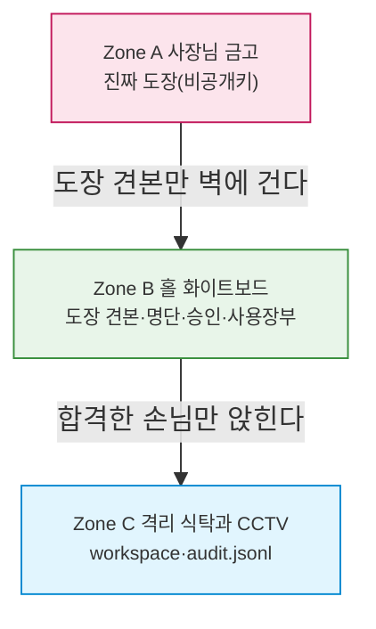
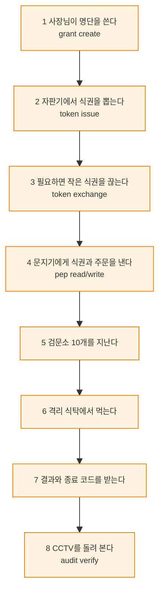
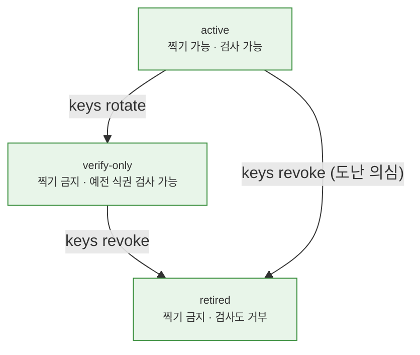

# 008. 식권 자판기 식당으로 보는 시스템 전체 — 배선과 권한의 설계·검증, 그리고 표준과의 선택점

> **모드**: `[문서작업]` — 소스코드를 고치지 않고, 이 프로그램 전체를 "일본 식권 자판기 식당"을 이해의 틀로 삼아 설명합니다.  
> **기준일**: 2026-11-09 · **기준 커밋**: `14a34c4`  
> **출발점**: [007번 문서](007-파이프라인_컨베이어벨트_양파패킷_DIP_관측_해설.md)와 [발췌문서](발췌_2026-11-09_세션_추가설명_모음.md), 그리고 [2026-11-09 대화록](../대화록/2026-11-09/2026-11-09_8ad7e4a3.md)에서 실제로 나온 질문들  
> **다시 확인하는 법**:
> ```bash
> # 토큰 발급·검증·키 수명주기·교환 시험
> go test ./internal/authn/...
> # 인가 판정·승인 소비·관문 시험
> go test ./internal/authz/...
> # 공격 시나리오 전체를 실제로 돌려 본다
> go run ./cmd/authz-harness run --scenario all
> ```

---

## 0장. 모든 설계 이전에 '사람'이 있다

### 이 문서가 태어난 질문

이 문서는 아래 질문 하나 때문에 생겼습니다. 고치지 않고 그대로 옮깁니다.

> 정리가 안된다 정보가 파편화되어 잇다 탑다운설명이 필요하다 이게 다들 어떻개 맞물려돌아가고 잇나? pap pip pdp 같은 것들부터 존123부터 설명해라 온갖 키와 아이디가 여기저기 난무한다 jwt가 무엇인가? 그 안에 클레임이 잇나? 키만 보고 어떤 용도인지 누가 주인인지 유효기간 등 알 수 잇나? 알수 잇는 것과 없는 것이 잇나? appr로 시작하는 승인키고 같은 것인가? 키를 누가 만들어서 어디에 어떻게 저장하고 누가 어디서 어떻게 접근하고 누가 어디서 어떻개 파기하나? 일본 식당시스템을 예로 들자면 쿠폰을 사서 식당에 주면 번호를 불러주는데 받아서 먹고 식기는 직접 반납한다 쿠폰은 자판기가 잇는데 선탹해서 현금을 지불하면 무기명 쿠폰이 나온다 하는 식으로 아이도 알 수 잇는 수준의 설명이 본질울 아는 설명이다 여기서 자판기 원리로 들어갈 필요는 없다 그러나 자판기원리 설명도 마찬가지다. 구분을 하라는 말이다 자판기는 돈 넣고 선택하고 받으면 되는 거다 그게 자판기의 목적이다 그 설명 없이 돈통원리가 안전하다는 강조만 하면 정보가 파편화잉 것이다. 이게 대체 왜 잇고 어떻게 동작하는지 전채가 그려지지 않는다

이 질문에 이 문서의 작성 원칙이 다 들어 있습니다.

첫째, **자판기는 돈 넣고, 고르고, 받는 물건입니다.** 그게 목적입니다. 그래서 이 문서는 1부와 2부에서 식당을 한 바퀴 다 돌 때까지 돈통 원리를 꺼내지 않습니다. 손님이 어디로 들어와서 무엇을 내고 무엇을 먹고 어디로 나가는지가 먼저입니다.

둘째, **돈통 원리도 궁금하면 따로 열어 봅니다.** 구분을 하라는 말씀이었으니, 3부를 돈통을 여는 곳으로 정했습니다. 키와 JSON은 3부에서 끝까지 파고듭니다.

셋째, **비교를 해 줘야 파악됩니다.** 여기 적힌 게 다 정답이라도, 원래 표준이 뭔지 말을 안 해 주면 읽는 사람은 모릅니다. 트레이드오프의 액기스는 "원래는 이런데, 우리는 이런 이유로 이렇게 했다"에 있습니다. 그 이야기가 4부입니다.

### 이 시스템의 목적: 배선과 권한의 설계, 그리고 검증

먼저 이 프로그램이 무엇을 하려는 것인지 분명히 합니다. **이 시스템의 목적은 배선과 권한을 설계하고, 그 설계가 실제로 작동함을 검증하는 것입니다.** 주문을 받거나 결제를 하는 등의 업무 기능을 제공하지 않습니다. 구체적으로 하는 일이 없는 인프라이고, 권한과 배선의 PoC이자 학습용 프로그램입니다.

세 낱말로 풀면 이렇습니다.

| 낱말 | 뜻 | 이 프로그램에서 |
|---|---|---|
| **배선** | 부품들이 서로를 직접 알지 않고 정해진 이음새로만 연결되는 구조 | 단일 조립소, 인터페이스로 끊은 저장소·감사·관측, 범용 파이프라인 엔진 |
| **권한 설계** | 누가 무엇을 어디까지, 언제까지, 누구의 위임으로 할 수 있는가 | 토큰, 축소 위임, 판정과 집행의 분리, 사람 승인, 예산, 즉시 회수 |
| **검증** | 될 것이라고 믿지 않고, 안 되어야 할 때 정확히 안 됨을 증명 | 공격 시나리오 하네스, 검문소별 사유와 종료 코드, 해시 사슬 감사 |

이 시스템이 특히 잘한 것은 세 가지입니다. **막혔다는 사실이 아니라 어디서 왜 막혔는지를 증명합니다.** 판정이 파일도 시계도 건드리지 않는 순수 함수라 **설계를 시험할 수 있습니다.** 그리고 경계가 인터페이스로 끊겨 있고 의존 방향을 시험이 강제하므로 **다른 것으로 갈아 끼울 자리가 이미 있습니다.** 축소 위임, 계보를 타고 번지는 회수, 내용 지문에 묶인 1회 승인, 호출 예산의 조합은 에이전트 권한에서 실제로 풀어야 하는 문제를 겨냥합니다.

**목표가 분명하면 한계도 분명합니다.** 그리고 여기서의 한계는 못 하는 것이 아니라 **고르지 않은 것**입니다. 네트워크 서버 대신 함수 호출을, DB 대신 눈으로 열어 볼 수 있는 파일을, 정책 언어 대신 정확 일치를 골랐습니다. 무엇을 얻으려고 무엇을 내주었는가, 그 선택점이 곧 설계이고 트레이드오프입니다. 그래서 이 문서는 표준이 무엇인지, 우리는 왜 그렇게 했는지 또는 왜 그렇게 하지 않았는지를 가장 중요하게 다룹니다(4부).

**식당은 이해를 돕는 틀입니다.** 전체를 머리에 넣기 쉽게 해 주므로 1~3부에서 계속 쓰지만, 시스템을 식당에 끼워 맞추지는 않습니다. 비유가 맞지 않는 곳에서는 실제 이름으로 말합니다.

### 이 문서를 읽는 법

| 궁금한 것 | 가는 곳 |
|---|---|
| 이 시스템의 목적은 무엇인가 | 0장 |
| 이게 대체 뭐 하는 식당이고 누가 일하나 | 1부 |
| 손님이 들어와서 나갈 때까지 무슨 일이 일어나나 | 2부 |
| 공개키·서명·Base64가 초보자 눈높이로 뭔가 | 3부 1장 |
| 온갖 키와 아이디가 다 뭔가, 누가 만들고 누가 버리나 | 3부 2장 |
| `client_id`와 `sub`, 자판기, 워커, 비밀번호의 관계 | 3부 2장 「식권을 둘러싼 프로그램과 이름들」 |
| JSON이 어떻게 생겼고 Go 코드와 어떻게 이어지나 | 3부 3장 |
| 실제 코드를 한 줄씩 | 3부 4장 |
| 원래 표준은 뭐고, 우리는 왜 그렇게 했나 | 4부 |
| 이 구조로 어디까지 넓힐 수 있나 (원격 워커, 부서·직급 권한, 주문결제) | 4부 「이 설계가 열어 둔 자리」 |
| 한 장으로 보기, 코드 찾아가기 | 5부 |

---

## 1부. 이 식당은 어떤 식당인가

### 1. 큰 그림 한 문단

일본 라멘집을 떠올려 봅니다. 입구에 자판기가 있습니다. 돈을 넣고 메뉴를 누르면 식권이 나옵니다. 식권을 카운터에 내면 음식이 나오고, 다 먹으면 나갑니다. 주인이 손님 한 명 한 명과 흥정하지 않아도 가게가 돌아갑니다.

우리 식당의 손님은 **AI 에이전트**이고, 주방은 **내 컴퓨터의 파일과 프로그램**입니다. 이 손님들은 지치지 않고, 가끔 엉뚱하고, 남이 시킨 말에 속기도 합니다. 그래서 이 식당은 평범한 라멘집보다 까다롭습니다. 식권에 손님 이름과 메뉴가 찍혀 있고, 주방 문 앞까지 검문소가 10개 있고, 천장에는 CCTV가 있습니다.

이 식당이 파는 것은 라면이 아닙니다. 이 식당의 진짜 상품은 **"안 되는 손님은 정확히 그 이유로, 정확히 그 검문소에서 막혔다"는 증거**입니다. 이 저장소가 검증 하네스인 이유입니다.

### 2. 식당의 세 구역

식당은 세 구역으로 나뉩니다.



**Zone A — 사장님 개인 금고.** 식권에 찍는 **진짜 도장**이 들어 있습니다. 사장님 방에 있고, 자판기만 쓸 수 있습니다. 손님도 주방 직원도 문 앞에 못 옵니다. 실제로는 `.authz-state/private/signing_keys.priv.json` 파일이고, 파일 권한은 `0600`(주인만 읽고 쓰기)입니다. 담긴 폴더는 `0700`입니다. 이미 있는 폴더가 더 열려 있으면 조립할 때 `0700`으로 좁힙니다. (구현: [`keys/store.go`](../../internal/authn/keys/store.go) · `NewFileStore`) 심부름꾼이 뜰 때는 이 금고를 아예 열 수 없는 모드(`VerifyOnly`)로 조립됩니다.

**Zone B — 홀 화이트보드.** 검사하는 사람들이 올려다보는 보드입니다. 여기에 걸린 것은 이렇습니다.

| 벽에 걸린 것 | 식당의 말 | 실제 파일 |
|---|---|---|
| 도장 견본 | 사장님 도장이 이렇게 생겼다 | `.authz-state/public/jwks.pub.json` |
| 먹어도 되는 사람 명단 | 철수는 라면 가능 (`Grant`) | `.authz-state/public/grants_state.json` |
| 세대 번호판 | 철수의 지금 회차는 3회차 (`Epoch`) | 같은 파일 |
| 사람 승인 메모 | 철수가 이 식권으로 이 메뉴 1번 가능 (`Approvals`) | 같은 파일 |
| 이미 쓴 식권 번호 목록 | 008492번은 찢었음 | `.authz-state/public/replay_ledger.json` |
| 쿠폰북 잔량표 | 이 쿠폰북은 3장 남음 (`Budget`) | `.authz-state/public/budget_ledger.json` |

한 가지 주의할 게 있습니다. 화이트보드를 누구나 볼 수 있다는 것은 **비밀이 아니라는 뜻**이지, **아무나 고쳐도 된다는 뜻**이 아닙니다. 다만 이 프로그램은 악의를 품은 심부름꾼이 Zone B를 직접 고치는 경우를 정면으로 막지 않는다고 스스로 적어 두었습니다([ADR 0005](../adr/0005-pdp-3값-결정-및-일회성-승인-바인딩.md) 4장 "한계").

**Zone C — 격리 식탁과 CCTV.** 손님이 실제로 먹는 칸막이 식탁(`workspace` 안에 가둔 Jail)과, 모든 행동을 적는 CCTV 장부(`audit.jsonl`)입니다.

### 3. 등장인물을 전부 소개합니다

핵심은 PAP·PIP·PDP·PEP 넷이지만, 식당을 돌리는 사람은 더 있습니다.

| 식당 역할 | 하는 일 | 시스템 이름 | 코드 위치 |
|---|---|---|---|
| **사장님** | 화이트보드에 규칙을 씁니다. "철수는 라면 가능", "영희 출입금지", "이번 한 번은 허락" | PAP | [`internal/authz/pap`](../../internal/authz/pap/) |
| **장부 알바** | 보드를 보고 "지금 규칙은 이렇습니다" 하고 복사해 옵니다 | PIP | [`internal/authz/pip`](../../internal/authz/pip/) |
| **카운터 점장** | 복사본과 식권을 보고 먹어도 되는지 **판정만** 합니다. 음식은 안 줍니다 | PDP | [`internal/authz/pdp`](../../internal/authz/pdp/) |
| **주방 문지기** | 10개 검문소를 돌리고 실제로 문을 엽니다. 식권도 찢고 쿠폰도 뜯습니다 | PEP | [`internal/authz/pep`](../../internal/authz/pep/) |
| **자판기** | 신분을 확인하고 도장 찍힌 식권을 뱉습니다 | 토큰 발급기 | [`issuer.go`](../../internal/authn/token/issuer.go) |
| **도장 감별사** | 식권의 도장이 진짜인지, 기한이 남았는지 봅니다 | 토큰 검증기 | [`verifier.go`](../../internal/authn/token/verifier.go) |
| **식권 재발행 창구** | 팀장 식권을 받고, 더 작은 식권을 심부름꾼 몫으로 끊어 줍니다 | Token Exchange | [`exchange/service.go`](../../internal/authn/exchange/service.go) |
| **금고지기** | 도장을 새로 파고, 교체하고, 폐기합니다 | KeyManager | [`keys/manager.go`](../../internal/authn/keys/manager.go) |
| **총무 알바** | 볼펜과 지우개를 쥐고 보드에 실제로 글씨를 씁니다 | `state.FileStore` | [`state/store.go`](../../internal/authz/state/store.go) |
| **총무 업무 지침** | "읽어 주기, 고쳐 쓰기만 하면 누구든 총무다" | `state.Store` 인터페이스 | 같은 파일 |
| **팀장 손님** | 일을 받아 심부름꾼을 부리는 손님 | Orchestrator | [`internal/orchestrator`](../../internal/orchestrator/) |
| **심부름꾼 손님** | 작은 식권을 받아 실제 일을 하는 별도 프로세스 | Subagent Worker | [`internal/subagent`](../../internal/subagent/) |
| **칸막이 식탁** | 정해진 칸 밖으로 팔을 못 뻗게 합니다 | Jail | [`internal/jail`](../../internal/jail/) |
| **CCTV** | 앞 장면과 뒷 장면을 사슬로 묶어 적습니다 | Audit Writer | [`internal/audit`](../../internal/audit/) |

"state store도 의존성역전 아냐? 안에 아무것도 없는데 뭐가 메모장이야?"라는 질문의 답도 이 표 안에 있습니다. `state.Store`는 **총무 업무 지침서**입니다. 지침서에는 글씨가 적혀 있지 않습니다. 글씨는 화이트보드(`grants_state.json`)에 있고, 그 글씨의 서식이 `GrantsState` 구조체이고, 손을 움직이는 사람이 `FileStore`입니다. 점장과 문지기는 지침서만 보고 일을 시키므로, 다음 달에 총무가 바뀌어(파일 대신 DB) 전자칠판을 들여와도 자기 일을 바꾸지 않습니다. 맞습니다, 의존성 역전입니다.

### 4. 왜 직원을 넷으로 쪼갰는가

사장님 혼자 다 하면 안 될까요? 작은 식당에서는 그렇게 합니다. 코드로 치면 `if user.isAdmin { ... }`를 함수 곳곳에 뿌리는 것입니다.

**국룰은 이렇습니다.** PAP·PIP·PDP·PEP라는 네 글자는 우리가 지은 이름이 아닙니다. XACML이라는 OASIS 표준과 NIST SP 800-162(ABAC 가이드)에서 쓰는 역할 이름이고, 지금도 인가 시스템을 설명할 때 표준 어휘로 씁니다. 왜 쪼개느냐 하면, 규칙을 쓰는 사람, 사실을 가져오는 사람, 판단하는 사람, 실행하는 사람이 붙어 있으면 다음 일이 벌어지기 때문입니다.

- 규칙을 바꾸려면 실행 코드를 고쳐야 합니다.
- 판단 로직을 시험하려면 진짜 파일과 진짜 시계가 필요합니다.
- 어디서 막았는지 설명할 수 없습니다.

**OPA와 비교하면 차이가 선명합니다.** OPA는 이 넷 중 **점장(PDP)만 파는 회사**입니다. 판결문은 잘 쓰는데, 문을 여닫는 것은 Envoy 같은 앞단이나 애플리케이션이 맡습니다.

| | 흔한 웹앱 | OPA를 쓰는 구성 | 우리 식당 |
|---|---|---|---|
| 사장님(PAP) | 관리자 화면 | 정책 번들 배포 | `grant` CLI |
| 장부 알바(PIP) | 그때그때 DB 조회 | OPA에 데이터 적재 | 스냅샷 공급자 |
| 점장(PDP) | 곳곳의 `if`문 | **OPA 본체** | 순수 함수 `Evaluate` |
| 문지기(PEP) | 미들웨어 | Envoy, 앱 코드 | 10단계 파이프라인 |

**우리는 왜 넷을 다 넣었나.** 이 저장소의 존재 이유가 "결정과 집행이 분리돼 있어도 실제로 정확히 막힌다"는 증명이기 때문입니다. 점장은 파일도 시계도 건드리지 않는 순수 판단만 합니다. 그래서 수많은 부정 시험을 빠르고 똑같이 돌릴 수 있습니다.

**대신 포기한 것.** OPA의 Rego처럼 사장님이 코드 수정 없이 복잡한 규칙을 새로 쓰는 능력입니다. 지금 점장이 볼 줄 아는 규칙은 "주체·행위·자원이 정확히 일치하는 명단이 있는가"뿐입니다. 와일드카드 정책도, 시간대 조건도 없습니다. 필요하면 `WithEvaluator` 옵션으로 다른 점장을 앉힐 수 있게 자리만 비워 뒀습니다. (구현: [`pdp/service.go`](../../internal/authz/pdp/service.go) · `Evaluate`, `WithEvaluator`)

---
## 2부. 손님의 식사, 처음부터 끝까지

자판기 원리는 아직 꺼내지 않습니다. 돈 넣고, 고르고, 받고, 먹고, 나갑니다.

### 1. 전체 동선



### 2. 준비: 사장님이 보드에 씁니다

손님이 오기 전에 사장님이 보드에 적어 둡니다. "worker-01은 `workspace/out.txt`에 쓰기 가능. 단, 쓸 때마다 나에게 물어볼 것."

```bash
go run ./cmd/authz-harness grant create \
  --sub worker-01 --action file:write --resource workspace/out.txt \
  --requires-approval
```

명단에 없는 손님은 식권이 아무리 진짜여도 못 먹습니다. **식권은 "누구인가와 무엇을 주장하는가"이고, 명단은 "오늘 실제로 허용되는가"입니다.** 이 프로그램은 둘 다 봅니다. 왜 둘인가는 4부에서 다룹니다.

### 3. 식권 뽑기: 돈 넣고 고르고 받습니다

손님(정확히는 손님을 데려온 프로그램)이 자판기에 "클라이언트 번호 + 비밀번호"를 넣고 "worker-01 앞으로, 쓰기 메뉴로, 1시간짜리" 하고 누릅니다.

```bash
go run ./cmd/authz-harness token issue \
  --client-id client-subagent --client-secret '<비밀값>' \
  --sub worker-01 --scope file:write --ttl 1h
```

자판기는 네 가지를 합니다. 돈이 진짜인지(클라이언트 인증), 이 클라이언트가 이 손님 이름으로 뽑아도 되는지, 금고의 현재 도장을 꺼내고, 식권을 찍어서 내줍니다. CCTV에는 "식권 번호 ○○ 발행"만 적고 **식권 원본은 적지 않습니다.** 식권은 **어디에도 저장되지 않고 손님 손에만 있습니다.** (구현: [`issuer.go`](../../internal/authn/token/issuer.go) · `issueToken`)

일본 자판기 식권은 무기명이지만, 우리 식권은 **기명 식권**입니다. 손님 이름(`sub`)이 찍혀 있습니다. 다만 표준 용어로 Bearer, 곧 "소지자" 토큰이라 **주운 사람도 쓸 수 있다**는 무기명의 약점은 그대로입니다. 이 점은 4부 10번에서 이어 갑니다.

### 4. 팀장이 심부름꾼에게 식권을 끊어 줄 때

팀장 손님이 심부름꾼을 부릴 때, 자기 식권을 통째로 주면 어떻게 될까요? [003번 문서](003-출입증_축소위임과_실시간_권한통제.md)의 비유대로라면 고등학생 자녀에게 한도 3천만 원 카드를 주는 일입니다.

그래서 재발행 창구로 갑니다. 팀장 식권을 보여 주고 "이 아이 몫으로 더 작게 끊어 주세요" 합니다. 창구는 8단계를 봅니다.

| 순서 | 창구의 검사 | 식당의 말 |
|---|---|---|
| `client_auth` | 클라이언트 인증 | 창구에 온 사람 신분 확인 |
| `delegation_subject` | 자식 이름 허용 여부 | 이 아이 이름으로 끊어도 되나 |
| `parent_token` | 부모 토큰 검증 | 팀장 식권 도장이 진짜인가 |
| `lineage_epoch` | 조상 세대 대조 (조건부) | 팀장과 그 윗사람들이 쫓겨나지 않았나 |
| `downscope` | 축소 검사 | 메뉴가 팀장보다 많지 않나, 기한이 더 길지 않나, 3다리를 넘지 않나, 자기 자신에게 주지 않나 |
| `budget_downscope` | 예산 축소 (조건부) | 쿠폰북 장수가 팀장 몫을 넘지 않나 |
| `token_issue` | 자식 토큰 발급 | 도장을 찍는다. 뒷면에 "○○의 심부름"이라고 적는다 |
| `budget_reserve` | 원장 예약 (조건부) | 팀장 쿠폰북에서 그만큼 떼어 둔다 |

"뒷면에 적는다"가 `act` 클레임입니다. 심부름꾼의 심부름꾼이 생기면 뒷면 안에 또 뒷면이 생기는 러시아 인형이 됩니다. 위임 깊이는 최대 3입니다. (구현: [`exchange/service.go`](../../internal/authn/exchange/service.go) · `assemble`, [`validator.go`](../../internal/authn/exchange/validator.go) · `MaxDelegationDepth`)

심부름꾼은 별도 프로세스로 뜨고, 식권은 명령줄이 아니라 `stdin` 파이프로 받습니다. 명령줄 인자는 `ps`로 남이 볼 수 있기 때문입니다. ([006번 문서](006-파이프라인_엔진_토큰교환_2단계프로세스_실행_해설.md)에서 자세히 다룹니다.)

### 5. 검문소 10개

손님이 문지기에게 식권과 주문서를 내면 문지기가 바구니(`Call`)를 하나 꺼내 벨트에 올립니다. 007번 문서의 그 컨베이어 벨트입니다. 바구니는 요청 한 번마다 새로 만들어지고 끝나면 사라집니다.

| 번호 | 검문소 | 식당에서 일어나는 일 | 바구니에 적는 것 | 막히면 (종료 코드) |
|:--:|---|---|---|---|
| 1 | `input` | 주문서가 제대로 쓰였나, 없는 메뉴는 아닌가 | 도구, 정돈된 행위 | 14 |
| 2 | `authn` | 도장 감별사가 벽의 견본과 대조. 기한·수신처·이미 찢긴 번호인지 **읽기만** | 검증된 클레임, 손님 이름, 식권 번호, 쿠폰북 여부 | 11 |
| 3 | `authz` | 점장이 장부 복사본으로 판정. 승인이 필요하면 맞는 승인을 찾아 둠 (**1차 서류심사**) | 승인 ID, 판정 시각 | 12, 18 |
| 4 | `boundary` | 칸막이 밖 자리를 달라는 건 아닌가 (`../../` 탈옥) | 안전한 실제 경로 | 13 |
| 5 | `replay` | **여기서 식권을 찢습니다.** 번호를 "쓴 식권 목록"에 기록 | | 11 |
| 6 | `approval`\* | 보드에 자물쇠를 걸고 승인 메모를 다시 대조, **지우개로 지움** (**2차 소비**) | | 18 |
| 7 | `budget`\* | 쿠폰 1장과 쓰기 바이트를 미리 뜯음 | 차감 표시 | 12 |
| 8 | `precommit_audit` | "지금부터 먹입니다"를 CCTV에 **먼저** 적음. 못 적으면 안 먹임 | | 15 |
| 9 | `execute` | 칸막이 식탁에서 실제로 먹음 (파일 읽기·쓰기, 외부 호출, 프로그램 실행) | 결과 | 도구별 |
| 10 | `settle`\* | 먹고 나서야 아는 양을 후불 정산 (읽은 바이트 등) | | 12 |

\* 표시는 해당 손님에게만 켜지는 조건부 검문소입니다(승인이 있을 때, 쿠폰북일 때, 후불 메뉴일 때).

검문소 순서에는 까닭이 있습니다. "왜 식권을 5번에서야 찢느냐"가 대표적입니다. 2번에서 찢어 버리면, 점장이 "사장님께 여쭤 봐야 합니다"(`ask`) 하고 돌려보낸 손님이 승인을 받고 돌아왔을 때 식권이 이미 찢겨 있어 **같은 식권으로 다시 올 수가 없습니다.** 그래서 2번은 "찢긴 번호인가"를 읽기만 하고, 모든 검사를 통과한 5번에서 찢습니다([ADR 0005](../adr/0005-pdp-3값-결정-및-일회성-승인-바인딩.md), [ADR 0008](../adr/0008-범용-파이프라인-엔진과-도구-전략.md)).

쿠폰북(예산 토큰)은 예외입니다. 여러 번 쓰라고 만든 식권이므로 찢지 않고, 대신 잔량표에서 한 장씩 뜯습니다. (구현: [`gateway.go`](../../internal/authz/pep/gateway.go) · `assemble`, [`verifier.go`](../../internal/authn/token/verifier.go) · `ConsumeReplay`)

### 6. "사장님 승인"이 필요한 메뉴의 왕복

승인은 손님이 들고 오는 쿠폰이 아닙니다. 실제 순서는 이렇습니다.

```text
① 손님: 식권 내고 "out.txt에 hello 써 주세요"
② 3번 점장: 명단에 있긴 한데 '사장님께 물어볼 것'이네.
            장부에 이 손님·이 메뉴·이 자리·이 식권·이 내용에 맞는 승인 메모가 없음
   → 돌려보냄. 종료 코드 18 (APPROVAL_REQUIRED). 파일은 그대로, 식권도 안 찢김
③ 사장님(사람): 내용을 확인하고 보드에 메모를 쓴다
     approval grant --subject worker-01 --action file:write \
       --resource workspace/out.txt --jti <식권 번호> --arg-hash sha256:<내용 지문>
   → 보드에 메모 생성. 기본 5분, 최대 1시간
④ 손님: **같은 식권, 같은 주문**으로 다시 온다. 승인 번호는 내지 않는다
⑤ 3번 점장: 다섯 가지가 다 맞는 메모를 찾았다. 그 메모의 번호를 바구니에 적는다
⑥ 5번: 식권을 찢는다
⑦ 6번 문지기: 보드에 자물쇠를 걸고, 메모를 다시 대조하고, 지운다
⑧ 8번 CCTV 기록 → 9번 실행
```

그러니까 일본 식당으로 치면, 승인 메모는 손님 손에 들려 주는 쿠폰이 아니라 **사장님이 카운터 뒤 칠판에 적어 둔 "철수 라면 곱빼기 OK, 1번만"**입니다. 손님은 그 메모의 존재를 몰라도 됩니다. 점장이 알아서 찾습니다.

"1차 2차가 어디야?"의 답도 이것입니다. 1차는 3번째 검문소, 2차는 6번째 검문소입니다. 왜 두 번 보느냐면, 3번은 **복사본**을 보았기 때문입니다. 복사본을 보고 6번까지 걸어오는 사이에 진짜 보드의 메모를 다른 사람이 먼저 써 버렸을 수 있습니다. 그래서 6번은 자물쇠(`flock`)를 잡은 채로 진짜 보드를 다시 봅니다. 두 프로세스가 동시에 와도 한쪽만 성공합니다.

한 번 지운 승인은 뒤의 실행이 실패해도 되살리지 않습니다. 대신 쿠폰은 실행 **전** 단계에서 실패하면 돌려줍니다. 승인은 "한 번 허락"이고 쿠폰은 "돈"이어서 다르게 다룹니다. (구현: [`pdp/service.go`](../../internal/authz/pdp/service.go) · `Evaluate`, [`state/approval.go`](../../internal/authz/state/approval.go) · `ConsumeApproval`)

### 7. 나갈 때: 결과와 CCTV

벨트가 끝나면 문지기가 단 하나의 출구(`finalize`)에서 영수증(`Result`)을 끊습니다. 어디서 막혔든 출구는 하나입니다. 영수증에는 합격 여부, 종료 코드, 막힌 검문소, 사유, 지나온 검문소 목록이 적힙니다. 이 영수증이 "정확히 그 이유로 정확히 거기서 막혔다"의 증거입니다.

일본 식당에서 식기를 직접 반납하듯, 이 식당에서 손님이 마지막에 반납하는 것이 **종료 코드**입니다. 부모 프로세스는 자식이 남긴 숫자만 보고 왜 끝났는지 압니다.

| 코드 | 뜻 | 대표 사유 |
|:--:|---|---|
| 0 | 잘 먹고 나감 | `AUTHORIZED` |
| 11 | 식권이 잘못됨 | 위조, 만료, 폐기된 도장, 이미 찢긴 번호 |
| 12 | 식권은 진짜인데 권한이 없음 | 명단에 없음, 세대 회수, 메뉴 초과, 쿠폰 소진, 외부 호출 금지 |
| 13 | 칸막이 탈출 시도 | `../`, 심볼릭 링크 |
| 14 | 주문서가 잘못됨 | 인자 오류 |
| 15 | CCTV가 고장 | 감사 기록 실패 |
| 16 | 식당 내부 사고 | 내부 오류 |
| 17 | 너무 오래 먹거나 너무 많이 먹음 | 시간·출력 한도 초과 |
| 18 | 사장님 승인 필요 | 승인 없음, 만료, 불일치 |

(구현: [`domain/error.go`](../../internal/domain/error.go) · `ExitCodeForReason`)

### 8. 내 컴퓨터에서 직접 봅니다

```bash
# 도장 목록을 본다 (비공개 값은 출력되지 않는다)
go run ./cmd/authz-harness keys list

# 받은 식권의 비닐만 뜯어 본다 (도장 검사 안 함)
go run ./cmd/authz-harness token inspect --token "$TOKEN"

# 벽의 명단과 메모를 본다
go run ./cmd/authz-harness grant list --sub worker-01
go run ./cmd/authz-harness approval list --subject worker-01

# 쫓아낸다: 이 손님의 세대를 올린다
go run ./cmd/authz-harness grant bump-epoch --sub worker-01

# CCTV 사슬이 끊기지 않았는지 검사한다
go run ./cmd/authz-harness audit verify
```

| 무엇을 하면 | 디스크에 무엇이 생기나 |
|---|---|
| 키를 쓰는 명령을 처음 실행 (`keys`, `token issue` 등) | 첫 도장 자동 생성: `signing_keys.priv.json`(0600), `jwks.pub.json`(0644) |
| `grant create`, `approval grant` | `grants_state.json` 갱신 |
| 일반 식권 사용 | `replay_ledger.json`에 번호 추가 |
| 쿠폰북 사용 | `budget_ledger.json` 잔량 감소 |
| 뭐든 | `audit.jsonl`에 한 줄씩 추가 |

`.authz-state/`와 `audit.jsonl`은 `.gitignore`에 들어 있어 저장소에 올라가지 않습니다.

---
## 3부. 돈통을 엽니다 — 키와 ID, 그리고 JSON

이제 돈통 원리입니다. 처음 보는 분을 기준으로 씁니다.

### 1장. 처음 배우는 분을 위한 기초 다섯 가지

#### ① 비밀번호, 대칭키, 비대칭키

**비밀번호**: 사람이 외우는 것. 자판기 회원 비밀번호입니다.

**대칭키**: 잠그는 열쇠와 여는 열쇠가 **같습니다.** JWT에서는 HS256이 이 방식입니다. 식권을 찍는 사람과 검사하는 사람이 같은 도장을 나눠 가지는 것과 같습니다. 그러면 **검사원도 식권을 찍어 낼 수 있습니다.** 검사원이 한 명 털리면 끝입니다.

**비대칭키**: 쌍으로 만들어지는 두 개입니다. 비공개키로 찍은 것은 공개키로 **검사만** 할 수 있습니다. 공개키를 아무리 들여다봐도 도장을 찍을 수는 없습니다. 그래서 견본을 벽에 걸어도 안전합니다.

우리 식당은 문지기와 심부름꾼 쪽에 견본만 줍니다. **문지기가 해킹당해도 식권을 찍어 내지는 못합니다.** 이것이 Zone A와 B를 나눈 이유입니다.

#### ② 서명과 암호화는 다른 말입니다

가장 많이 헷갈리는 부분입니다.

| | 암호화 | 서명 |
|---|---|---|
| 목적 | **못 읽게** | **못 고치게, 누가 썼는지 알게** |
| 식당의 말 | 불투명 금고에 넣기 | 투명 비닐 위에 도장 |
| JWT에서 | JWE라는 다른 규격 | **JWS. 우리가 쓰는 것** |

우리 식권은 **서명만 했고 암호화는 안 했습니다.** 그러니 `eyJ...`는 암호문이 아닙니다. 비닐만 뜯으면 누구나 읽습니다. **토큰에 비밀을 넣으면 안 되는 이유**입니다.

#### ③ 해시

아무 길이의 내용을 넣으면 고정 길이 지문이 나옵니다. 지문에서 원문으로 되돌릴 수 없고, 한 글자만 달라도 완전히 달라집니다. 우리는 승인에 묶을 내용 지문과 CCTV 사슬에 SHA-256을 씁니다. "원문을 남기지 않고 같은 내용임을 증명"하려는 것입니다.

#### ④ Base64URL은 포장지입니다

컴퓨터의 바이트에는 눈에 안 보이는 값이 섞여 있어 URL이나 헤더에 그냥 못 넣습니다. 그래서 **안전한 글자 64개로 옮겨 적습니다.** 3바이트를 4글자로 바꾸는 단순한 치환이라 **비밀번호도 키도 없습니다.** 누구나 되돌립니다.

일반 Base64의 `+`, `/`는 URL에서 특별한 뜻이 있어서, URL용은 `-`, `_`로 바꾸고 끝의 `=` 패딩을 뺍니다. JWT는 이 URL용을 쓰도록 표준에 정해져 있고, Go에서는 `base64.RawURLEncoding`입니다.

#### ⑤ 왜 JWT는 다 `eyJ`로 시작하나

JWT의 헤더는 JSON이니 반드시 `{"`로 시작합니다. `{"`를 Base64URL로 옮기면 앞머리가 항상 `eyJ`가 됩니다. **로그에서 `eyJ`가 보이면 JWT를 의심하라**는 말이 그래서 나왔고, 비밀 스캐너도 이 글자를 찾습니다.

---

### 2장. 난무하는 이름표 전수 조사

"온갖 키와 아이디가 여기저기 난무한다"는 말씀이 정확합니다. 이름에 "키"가 붙었다고 다 같은 키가 아닙니다. 식당에 있는 **이름표는 모두 열한 종류**이고, 성격은 네 가지입니다.

- **비밀 도구**: 알면 사고가 나는 것 — 비공개키, 클라이언트 시크릿
- **증명서**: 들고 있으면 효력이 있는 것 — JWT
- **공개 도구**: 모두가 봐도 되는 것 — 공개키
- **번호표**: 그냥 이름일 뿐, 알아도 권한이 안 생기는 것 — `kid`, `jti`, 승인 ID, `client_id`, `TraceID`, `GrantID`, 그리고 숫자인 `Epoch`

#### 전수표

| 이름표 | 식당의 말 | 누가 만드나 | 어디에 저장 | 누가 읽나 | 어떻게 버리나 |
|---|---|---|---|---|---|
| **비공개키** | 진짜 도장 | 금고지기 (`crypto/rand`) | Zone A 파일, 0600 | 자판기 | `retired` 표시. 값은 파일에 남음 |
| **공개키** | 도장 견본 | 비공개키에서 자동으로 나옴 | Zone B `jwks.pub.json` | 도장 감별사 | `retired` 표시로 사용 금지 |
| **`kid`** | 도장 번호 | 금고지기 (시각 + 순번) | 식권 헤더, 키 파일 | 감별사 | 키와 함께 |
| **JWT** | 도장 찍힌 식권 | 자판기, 재발행 창구 | **저장 안 함.** 손님 손에만 | 문지기 | 시간이 지나면 휴지. 일반 식권은 첫 사용 때 번호로 찢음 |
| **`jti`** | 식권 일련번호 | 자판기 (`crypto/rand` 16바이트, hex) | 식권 안, 쓴 뒤 `replay_ledger.json`, 감사 기록 | 문지기, 승인 대조 | 만료 뒤 원장에서 정리 |
| **승인 ID** | 칠판 메모 번호 | 사장님 CLI (`approval-` + 나노초) | Zone B `grants_state.json` | 점장, 문지기 | 소비 시 메모 삭제, 만료 시 정리. 이력은 감사에 남음 |
| **`client_id`와 시크릿** | 자판기 회원번호와 비밀번호 | 코드에 미리 등록 | **메모리 레지스트리(코드에 고정)** | 자판기, 재발행 창구 | 현재 폐기 절차 없음 |
| **`TraceID`** | 이번 방문 접수번호 | 호출자 또는 문지기 | 감사 기록 | 감사 도구 | 영구 기록 |
| **`GrantID`** | 명단 줄 번호 | 사장님 | `grants_state.json` | 점장 | `revoked` 상태로 표시 |
| **`Epoch`** | 손님 회차 번호 | 사장님 (`bump-epoch`) | 식권 안과 보드 양쪽 | 점장, 재발행 창구 | 올리는 것 자체가 회수 |

#### "키만 보고 용도, 주인, 유효기간을 알 수 있나?"

여기가 질문의 핵심이었습니다. **알 수 있는 것과 없는 것이 있습니다.** 표로 답합니다.

| 이것만 들고 있을 때 | 용도 | 주인 | 유효기간 | 권한 |
|---|---|---|---|---|
| JWT 식권 | ○ (`typ`, `scope`) | ○ (`sub`) | ○ (`exp`) | ○ 적혀 있음 (단, 실제 허용은 명단이 결정) |
| 비공개키 | ✕ 그냥 32바이트 | ✕ | ✕ | 전권 |
| 공개키 | ✕ (JWK로 감싸야 `use: sig`가 보임) | ✕ | ✕ (`status`는 파일에) | 없음 |
| `kid` | ✕ | ✕ | ✕ (우리 형식은 만든 시각만 보임) | 없음 |
| `jti` | ✕ 무작위 32글자 | ✕ | ✕ | 없음 |
| 승인 ID | △ 접두사로 승인인 줄만 앎 | ✕ | ✕ (만든 시각만 추정) | 없음 |
| `client_id` | △ 이름에서 추측 | △ | ✕ | 시크릿 없으면 없음 |

정리하면, **JWT는 글씨가 적힌 식권이고(자기완결형), 나머지는 번호표입니다(참조형).** 번호표의 뜻은 장부를 봐야 압니다. 이 구분은 업계에서 **자기완결형 토큰(self-contained)**과 **불투명 토큰(opaque)**이라고 부르는 오래된 구분이고, 4부 9번의 핵심입니다.

#### "appr로 시작하는 승인키도 같은 것인가?"

**다릅니다.** JWT는 내용과 도장이 그 안에 다 있고, 승인은 번호와 내용이 보드에 있습니다. 게다가 실제 코드에서 승인 ID는 `appr_...`이 아니고, 손님이 제시하지도 않습니다.

그렇다면 승인 번호를 가로채는 공격은 어떻게 될까요? **애초에 승인 ID는 내밀 곳이 없습니다.** 이 번호를 안다고 할 수 있는 일이 없습니다. 공격자에게 필요한 것은 번호가 아니라 **같은 손님, 같은 메뉴, 같은 자리, 같은 식권 번호, 같은 내용의 요청을 진짜 도장 찍힌 식권으로 내는 것**입니다. 결국 진짜 위험은 **그 식권 자체를 훔치는 것**이고, 식권을 훔쳐도 내용을 바꾸면 지문(`ArgHash`)이 달라 막힙니다. 승인 바인딩의 진짜 가치는 여기에 있습니다.

한계도 코드 주석이 솔직히 적어 두었습니다. 지문에는 솔트가 없어 짧은 내용은 추측으로 복원될 수 있고, 내용이 빈 요청은 지문이 `""`이어서 내용 묶기가 걸리지 않습니다. (구현: [`digest.go`](../../internal/domain/digest.go) · `DataDigest`)

#### "JWT는 열어보면 내용이 있고 읽을 수도 있나? jti와 차이는 뭔가?"

- **JWT는 열어보면 내용이 훤히 다 보이고 누구나 읽을 수 있습니다.**
  많은 이들이 JWT(JSON Web Token)를 "암호화되어 있어서 비밀이 숨겨져 있다"고 오해합니다. 하지만 **JWT는 암호화(Encryption)가 아니라 서명(Signature)** 기술입니다. 점(`.`)으로 구분된 3개 덩어리 중 가운데 페이로드는 그냥 Base64URL로 옮겨 적은 일반 JSON 글자입니다. 누구나 메모장이나 디코더로 열어보면 손님 이름(`sub`), 메뉴(`scope`), 유효시간(`exp`), 일련번호(`jti`)를 즉시 읽을 수 있습니다. 보안은 "내용을 감추는 것"에서 오는 것이 아니라, 맨 뒤에 찍힌 **"사장님 도장(서명) 때문에 단 1글자도 위조할 수 없다"**는 무결성에서 옵니다.
- **JWT와 JTI의 차이**:
  - **JWT (JSON Web Token)**: 손님 이름, 메뉴, 유효기간, 사장님 도장까지 전부 합쳐진 **"수백 글자짜리 종이 식권 전체 문자열"**입니다.
  - **JTI (`jti` 클레임, JWT ID)**: 그 종이 식권 맨 밑에 찍힌 **"No. 008492" 같은 식권 고유 일련번호(주민번호)**입니다.
  - **차이를 두는 이유**: 식권을 복사기에 복사해서 다시 내미는 재사용 공격(Replay)을 막기 위해 문지기가 일련번호(`jti`)를 장부에 적어 찢어버리고, 사람 승인이나 사용량 예산 장부도 무거운 식권 전체 대신 가벼운 번호표(`jti`)만 꼬리표로 달아 추적합니다.

서명과 암호화의 차이는 1장 ②에서, 식권 한 장을 실제로 뜯어 보는 것은 3장 3-3에서 이어 갑니다.

#### "Zone B에서 Epoch가 왜 블랙리스트인가? 현재 버전 정도의 의미 아닌가?"

**정확한 통찰입니다. 본질은 "현재 버전(세대 번호)"이 맞습니다.**

그런데 시스템이 이것을 **"초강력 즉시 블랙리스트(킬스위치)"**라고 부르는 까닭은 분산 인가 토큰의 태생적 한계 때문입니다.
1. **무상태(Stateless) 토큰의 한계**: 1시간짜리 식권을 손님 손에 쥐여주었는데, 1분 만에 그 손님이 해킹된 악의적 에이전트로 판명 났습니다. 이미 손님 손에 들어간 식권을 원격에서 뺏어올 방법이 없습니다.
2. **개별 토큰 취소(차단 목록)의 비용**: 탈취된 수백 장의 식권 번호(`jti`)를 일일이 블랙리스트에 등록하면, 장부가 끝없이 불어나 시스템이 느려집니다.
3. **버전(Epoch) 비교를 통한 대량 일괄 무효화**:
   - 보드(Zone B)에 적힌 철수의 세대: `1`
   - 철수가 쥐고 있는 식권 속 세대: `1` $\rightarrow$ 일치하므로 통과.
   - **비상사태 발생! 사장님이 `bump-epoch`로 보드의 철수 세대를 `2`로 올림!**
   - 이제 철수가 과거 세대(`1`)로 찍힌 식권을 내밀면, 점장(PDP)은 *"보드 세대는 2인데 네 식권은 1이네?"* 하고 즉시 거부(`ReasonSubjectEpochRevoked`)합니다.
- **결론**: 데이터 형태는 단지 `1, 2, 3...` 올라가는 **"현재 버전 숫자"**이지만, 그 숫자를 1 올리는 순간 **"과거 버전(1)으로 찍혀서 밖으로 유출된 토큰들을 일일이 찾을 필요 없이 다음 판정부터 일괄 무효화(블랙리스트) 처리하는 킬스위치"**로 작동하기 때문에 블랙리스트의 본질을 갖습니다.

**`Epoch`를 바꿀 때 새로운 아이디를 또 만드는가?**

- **새로운 아이디를 만드는 것이 절대 아닙니다.** `grant bump-epoch`는 사장님이 칠판(Zone B 화이트보드)으로 가서, 이미 적혀 있던 손님 이름(`worker-01`) 옆의 **"회차 숫자(1 $\to$ 2)"를 지우개로 지우고 1 올리는 것**이 전부입니다. 이렇게 숫자만 2로 올려두면, `worker-01`이 예전에 발급받은 옛날 식권(식권에는 1번이라 인쇄됨)을 들고 왔을 때 점장(PDP)이 즉시 거부합니다.

업계의 다른 해법(짧은 수명, 인트로스펙션, 차단 목록)과 비교한 이야기는 4부 9번에 있습니다.

#### 식권을 둘러싼 프로그램과 이름들: 누가 뽑고, 누구 이름으로 나가고, 누가 쓰나

궁금증이 하나씩 생길 때마다 물었던 질문들을 흐름대로 모았습니다. 순서는 **뽑으러 온 프로그램(`client_id`) → 찍어 주는 자판기 → 두 종류의 인증 → 식권에 적히는 이름(`sub`) → 식권이 워커 손에 들어가는 길 → 워커의 정체 → 비밀번호**입니다.

##### "client_id가 대체 무슨 말인가? 내 아이디인가, 자판기 일련번호인가?"

자판기 번호도 아니고 손님 개인 아이디도 아닙니다. **`client_id`는 「식권을 뽑으러 온 프로그램(소프트웨어/앱)의 등록 아이디」입니다.**

IT/보안 세계(OAuth 2.0/2.1)에서는 **"어떤 프로그램(앱)을 통해서 요청이 왔는가?"**와 **"그 프로그램을 조작하는 실제 손님(에이전트)이 누구인가?"**를 엄격히 둘로 분리합니다.

| 용어 | 실제 뜻 | 식당 비유 | 현실 예시 (카카오 로그인) |
|---|---|---|---|
| **`client_id`** | **식권을 요청한 프로그램(앱/소프트웨어)의 아이디** | 창구에 식권 뽑으러 온 **"배달의민족 앱"** | 배달의민족이 카카오 서버에 등록한 **앱 식별 번호** |
| **`sub` (Subject)** | **그 프로그램을 조작하는 실제 손님(에이전트)의 이름** | 배달의민족 앱으로 주문 넣은 **"철수(손님)"** | 배달의민족을 켜서 로그인한 **"진짜 사용자 카카오 계정 ID"** |

- **왜 굳이 둘을 나누나?**: 카카오 서버가 "진짜 배달의민족 앱"에서 온 요청인지 먼저 앱 비밀번호(`client_secret`)로 검증한 뒤, 인증이 통과되면 그제야 손님 철수(`sub`)에게 식권을 주기 때문입니다.
- **우리 코드([`client.go`](../../internal/authn/token/client.go))의 3대 프로그램**:
  1. `client-orchestrator`: 오케스트레이터(팀장) 프로그램 (`orchestrator-secret-key-01`)
  2. `client-subagent`: 작업자 워커 프로그램 (`subagent-secret-key-02`)
  3. `client-admin` (`admin-secret-key-00`): 관리자 워크로드로 등록돼 있으나 현재 운영 코드에서 쓰는 곳은 없습니다. 사장님 명령(`grant`, `approval`, `keys`)은 클라이언트 인증 없이 로컬 CLI로 실행됩니다

- **한 줄 요약**:
  - **`client_id`**: "어떤 **소프트웨어(프로그램/앱)**가 식권을 뽑으러 왔는가?" (예: `client-orchestrator`)
  - **`sub`**: "그 식권을 손에 쥐고 주방에 들어가서 실제로 일할 **작업자(에이전트/손님)**가 누구인가?" (예: `worker-01`)

##### "JWT 생성은 누가 하나? 자판기는 누가 어디서 만들고, 서버인가?"

- **식당의 "식권 자판기(AuthN `TokenIssuer`)"**가 만듭니다 ([`issuer.go`](../../internal/authn/token/issuer.go)).
- 아무나 인쇄할 수 없고, 프로그램을 식별하는 클라이언트 아이디(`client_id`)와 비밀번호(`client_secret`)로 먼저 인증해야 합니다. 인증에 성공하면 자판기가 **사장님 금고(Zone A)의 비밀 도장(Active Ed25519 Private Key)**을 꺼내와서 식권에 진짜 도장을 쾅 찍어 손님 손에 쥐여줍니다.

**자판기는 누가 어디서 만드나.** 명령이 실행될 때 조립 공장장인 **`app.BuildStack`**([`builder.go`](../../internal/app/builder.go))이 조립합니다. 단, 주방이나 워커 환경인 `VerifyOnly` 모드에서는 자판기를 아예 조립하지 않고(`nil`), 금고(Zone A)를 쓸 수 있는 스택에서만 실체(`tokenIssuer`)를 생성합니다.

**자판기는 서버인가.**

- **개념상(역할)**: OAuth로 치면 토큰을 발급하는 **인가 서버(Authorization Server)의 역할**입니다. 다만 표준의 `/token` 같은 HTTP 엔드포인트는 없으므로, 외부 OAuth 클라이언트가 그대로 붙을 수 있는 인가 서버는 아닙니다.
- **물리적(실체)**: 웹 포트(`http.ListenAndServe`)를 열고 대기하는 별도 네트워크 데몬이 아니라, 단일 바이너리 내부에서 함수 호출(`IssueToken`)로 즉각 반응하는 **내장형 엔진(In-Process Engine)**입니다. 상주하지도 않습니다. `token issue` 같은 명령이 실행되는 동안에만 조립되어 있다가 명령이 끝나면 사라집니다.

##### "`AuthN`은 팀장 전용 인증 함수인가? PEP 내의 authn과 팀장용 AuthN은 완전히 다른 것인가?"

**팀장 전용이 아닙니다.** `AuthN`은 Authentication(인증)의 약자이며 두 곳에서 쓰입니다. **하는 일은 완전히 다릅니다.** 대상과 도구가 다릅니다.

- **식권 뽑을 때의 AuthN**: 식권 발급 자판기 창구에서 일어납니다. 식권을 뽑으러 온 프로그램이 **비밀번호(`client_secret`)**를 대고 신원을 증명하면, 사장님 **비공개키(Zone A)**로 진짜 도장을 쾅 찍어 새 식권(JWT)을 발행합니다. 팀장뿐 아니라 등록된 프로그램이면 누구든 이 창구를 씁니다. (구현: [`issuer.go`](../../internal/authn/token/issuer.go) · `issueToken`)
- **밥 먹으러 들어갈 때의 authn (`StageAuthn`)**: 주방 입구 2번 검문소에서 일어납니다. 식권을 들고 온 손님에게 비밀번호를 묻지 않고, 오직 손님이 내민 **식권의 서명 도장**이 진짜 사장님 도장인지 홀 벽의 **공개키(Zone B)**와 수학적으로 대조하고 유효기간을 확인합니다. (구현: [`gateway.go`](../../internal/authz/pep/gateway.go) · `authn`)

코드 위치는 오히려 가깝습니다. 2번 검문소는 `internal/authn` 패키지의 도장 감별사([`verifier.go`](../../internal/authn/token/verifier.go))를 불러 씁니다. 즉 `internal/authn`에는 찍는 쪽과 검사하는 쪽이 함께 있고, 재발행 창구도 부모 식권을 확인할 때 같은 감별사를 씁니다.

##### "sub 내용은 어떤 규칙으로 넣나? agent-worker-1은 누가 정하나? 이름을 미리 정해두는가?"

**`sub` 내용은 어떤 규칙으로 넣나.**

- `sub`는 **"이 식권을 쥐고 일할 주체(손님/워커)의 신원 식별자"**입니다.
- **규칙 1 (필수값 검사)**: 빈 문자열(`""`)이나 공백은 절대 허용되지 않습니다 (`subject is required`, 14번 거부).
- **규칙 2 (프로그램의 대리 발급 권한 검사 - `AllowedSubs`)**: 각 프로그램(`client_id`)마다 대리 발급할 수 있는 손님 명단([`client.go`](../../internal/authn/token/client.go))이 엄격히 정해져 있습니다. 예를 들어 `client-subagent`는 `["worker-01", "worker-02", "worker-03"]` 명의로만 식권을 뽑을 수 있으며, 임의로 `sub: admin`을 요구하면 자판기가 즉시 거부합니다.

**`agent-worker-1` 같은 이름은 누가 정하나.**

- **코드가 정해 주는 이름은 없습니다.** `token issue --sub worker-01`을 실행하는 사람이나, 교환을 요청하는 호출자(`ChildSubject`)가 정합니다.

**자식 워커의 모든 이름을 미리 정해두는가.**

- **발급 쪽에서는 아닙니다.** `client-orchestrator`는 와일드카드(`AllowedSubs: ["*"]`)라 이름을 즉석에서 지어 식권을 받을 수 있습니다. **그러나 실제로 일을 시키려면 그 이름이 명단(`Grant`)에 미리 올라 있어야 합니다.** 명단에 없으면 식권이 진짜여도 12번으로 거부됩니다. `client-subagent`로 뽑을 때는 `worker-01`~`worker-03`으로 제한됩니다.

명단 검사는 3번째 검문소에서 일어납니다.

**이름 짓는 룰(네이밍 규칙)이 있나.**

- **형식을 강제하는 코드는 없습니다.** 비어 있지만 않으면 됩니다. `worker-01`, `orchestrator-main` 같은 이름은 시험과 예제에서 쓰는 관례일 뿐입니다.
- `client-XXX`는 `sub`가 아니라 요청 프로그램을 식별하는 아이디(`client_id`)입니다.
- **`sub`가 실제로 쓰이는 곳**: 명단(`Grant`) 대조, 세대(`Epoch`) 조회, 승인 대조, 감사 기록입니다. 칸막이 폴더는 `sub`로 나뉘지 않습니다. `boundary`는 손님과 상관없이 실행 시 지정된 `workspace` 하나 안에 경로가 있는지만 봅니다.

##### "식권은 팀장이 자판기에서 대신 뽑아주는가? 워커가 식권을 직접 뽑을 수 있는가?"

- **경로에 따라 다릅니다.** 자식 워커는 스스로 식권을 뽑지 않는 것은 맞습니다. `orchestrate spawn`에서는 부모가 뽑는 것도 아닙니다. 사용자나 호출자가 미리 `token issue` / `token exchange`로 만든 식권을 `--token`으로 받아, 자식의 주머니(표준입력 `stdin`)에 넣어 주기만 합니다. 다단계 위임 경로(`MultiHopSpawner`)에서는 부모 프로세스가 재발행 창구에서 교환을 직접 수행한 뒤 넣어 줍니다.

**워커가 직접 뽑을 수 있는가.**

- **현재 워커 코드에는 자판기도 재발행 창구도 없습니다.** 다단계 위임에서 "중간 관리자가 `client-subagent`로 교환한다"는 단계도, 실제로는 **부모 프로세스가 중간 관리자 몫을 대신 수행**합니다. 중간 관리자 프로세스가 따로 뜨지는 않고, 말단 워커만 서브프로세스로 뜹니다.

##### "`subagent.Worker`는 서버에 등록 안 된 존재인가?"

- **자판기 회원으로는 등록되어 있지 않은 것이 맞습니다.** 워커 프로세스에 `client_id`가 주어지지 않습니다. 하지만 "100% 무등록"은 지나친 말입니다. 워커가 쓰는 `sub` 이름은 명단(`Grant`)에 있어야 일을 할 수 있습니다.
- 코드([`worker.go`](../../internal/subagent/worker.go))의 워커 구조체가 가진 필드는 `gateway` 하나뿐입니다. 워커는 `stdin`으로 식권과 주문이 담긴 JSON 프레임 하나를 받아 문지기에게 내밀고, 결과를 `stdout`에 찍고 종료 코드를 남기고 끝납니다.
- 주의할 점: **문지기는 워커와 같은 프로세스 안에서 돕니다.** 그래서 워커 코드가 장부를 직접 들고 있지 않아도, 그 프로세스는 문지기를 통해 Zone B(명단, 쓴 식권 목록, 승인)를 읽고 고칩니다. 열 수 없는 것은 Zone A 금고입니다(`VerifyOnly`).

##### "서버에 등록할 때 비밀번호는 누가 만들고 누가 들고 있나?"

- **누가 만드나**: 개발자가 코드([`client.go`](../../internal/authn/token/client.go))에 상수로 적어 두었습니다 (`orchestrator-secret-key-01`, `subagent-secret-key-02`, `admin-secret-key-00`). 학습용 프로그램의 고정값이라 그대로 보여 줍니다.
- **누가 들고 있나**: 실행 중에 비밀번호를 받아 쓰는 쪽은 `token issue` / `token exchange`를 실행하는 호출자와 다단계 위임을 수행하는 부모 프로세스([`multi_hop.go`](../../internal/orchestrator/multi_hop.go)에 고정)입니다. 워커에게 비밀번호를 전달하는 경로는 없고, 워커 쪽 조립은 `VerifyOnly`라 자판기와 회원 목록을 만들지 않습니다.
- **은닉은 아닙니다.** 부모와 자식은 같은 실행 파일이므로 비밀번호 문자열은 그 파일 안에 들어 있고, 저장소를 볼 수 있으면 누구나 봅니다. 환경변수 정리(`SanitizeEnv`)는 부모 환경의 다른 비밀이 자식에게 새는 것을 막는 장치이며, 이 비밀번호를 지켜 주는 장치가 아닙니다. (4부 12번)

---

### 3장. JSON 표현법 해부

#### 3-1. JSON 문법은 여섯 가지가 전부입니다

```json
{
  "문자열": "큰따옴표만 됩니다",
  "숫자": 1793797200,
  "참거짓": true,
  "없음": null,
  "배열": ["file:read", "file:write"],
  "객체": { "sub": "bob", "act": { "sub": "alice" } }
}
```

주석을 달 수 없고, 마지막 항목 뒤에 쉼표를 찍을 수 없고, 키에는 반드시 큰따옴표를 씁니다. 이것이 초보자가 가장 자주 만나는 오류 세 가지입니다. 그리고 표준상 **객체 안의 순서에는 뜻이 없습니다.** 이 사실이 뒤에 나올 서명 이야기의 복선입니다.

#### 3-2. Go 구조체와 JSON을 잇는 꼬리표

Go에서 뒤에 붙는 백틱 글자가 **구조체 태그**입니다. 컴파일러가 문법으로 처리하는 대신 `encoding/json` 패키지가 실행 중에 읽어 씁니다.

```go
// [예시] 설명을 위해 만든 구조체다.
type 식권 struct {
    // 1) 이름 바꾸기: Go에서는 Subject, JSON에서는 "sub"
    Subject string `json:"sub"`

    // 2) omitempty: 값이 비어 있으면(빈 문자열, 0, nil) JSON에서 칸 자체를 뺀다
    Actor *ActorClaim `json:"act,omitempty"`

    // 3) "-": 이 칸은 JSON으로 절대 내보내지 않는다 (실행 중 처리, 컴파일 검사가 아니다)
    PrivateKey []byte `json:"-"`

    // 4) 소문자로 시작하는 필드는 태그가 있어도 JSON에 안 나간다 (패키지 비공개)
    secret string
}
```

`Actor`가 `ActorClaim`이 아니라 **`*ActorClaim` 포인터**인 이유가 있습니다. 포인터는 `nil`, 곧 "없음"을 표현할 수 있어서 `omitempty`로 칸째 사라집니다. 값 타입이면 `{"sub":""}` 같은 빈 껍데기가 찍힙니다. "위임받지 않았다"와 "빈 이름에게 위임받았다"는 뜻이 다르니 포인터를 쓰는 것이 맞습니다.

변환은 두 함수가 합니다.

```go
// [예시] 구조체 ↔ JSON 왕복
b, err := json.Marshal(claims)        // 구조체 → JSON 바이트 (Marshal: 줄 세워 내보낸다)
err = json.Unmarshal(b, &claims)      // JSON 바이트 → 구조체 (주소를 넘겨야 채워 넣을 수 있다)
```

**국룰과 비교할 지점 하나.** `json.Unmarshal`은 구조체에 없는 칸을 조용히 버립니다. 그래서 공격자가 식권에 이상한 칸을 더 넣어도 에러가 나지 않습니다. 도장이 맞다면 발급자가 넣은 것이니 문제가 되지 않고, 표준(RFC 7519)도 모르는 클레임은 무시하라고 합니다. `Validate()`가 필수 칸을 따로 검사하는 이유는, 없는 칸도 조용히 0이나 빈 문자열로 채워지기 때문입니다.

#### 3-3. 식권 한 장을 손으로 분해합니다

아래는 **이 문서용으로 만든 가짜 키**로 실제 계산한 식권입니다. 세 덩어리를 점으로 이어 붙이면 토큰이 됩니다. (비밀값 스캐너가 놀라지 않도록 세 줄로 나눠 적었습니다.)

```text
eyJ0eXAiOiJhdCtqd3QiLCJhbGciOiJFZERTQSIsImtpZCI6ImtleS0yMDI2MTEwMTA5MDAwMC0wMSJ9
.
eyJpc3MiOiJhdXRoei1oYXJuZXNzIiwic3ViIjoid29ya2VyLTAxIiwiYXVkIjoiYXV0aHotaGFybmVzcyIsImNsaWVudF9pZCI6ImNsaWVudC1zdWJhZ2VudCIsImV4cCI6MTc5MzgwMDgwMCwiaWF0IjoxNzkzNzk3MjAwLCJuYmYiOjE3OTM3OTcyMDAsImp0aSI6ImEzZjhjMWQyOWI3ZTRmNjBhMWIyYzNkNGU1ZjYwNzE4Iiwic2NvcGUiOiJmaWxlOnJlYWQiLCJlcG9jaCI6MX0
.
CUTUwAbt3FMYENq_dpR76o-wUBSh0zqiXWo-132zlYO7vfOMFU3qy2zN3whY_N_tegFWLTu-Pj3jolSM3uP5CQ
```

**첫째 덩어리, 헤더 — 식권 머리말.** Base64URL만 풀면 이렇습니다.

```json
{
  "typ": "at+jwt",
  "alg": "EdDSA",
  "kid": "key-20261101090000-01"
}
```

`typ`은 "이건 액세스 토큰이다", `alg`는 "이 방식으로 찍었다", `kid`는 "몇 번 도장으로 찍었다"입니다. 감별사는 `kid`를 보고 벽에서 어느 견본을 꺼낼지 정합니다.

`typ`을 왜 굳이 보느냐면, 같은 키로 서명된 **다른 종류의 JWT**(예: 로그인용 ID 토큰)를 액세스 토큰인 척 내미는 혼동 공격을 막기 위해서입니다. RFC 9068이 `at+jwt`를 요구하는 이유입니다.

**둘째 덩어리, 클레임 — 식권의 내용.** 표시만 줄바꿈했습니다.

```json
{
  "iss": "authz-harness",
  "sub": "worker-01",
  "aud": "authz-harness",
  "client_id": "client-subagent",
  "exp": 1793800800,
  "iat": 1793797200,
  "nbf": 1793797200,
  "jti": "a3f8c1d29b7e4f60a1b2c3d4e5f60718",
  "scope": "file:read",
  "epoch": 1
}
```

| 칸 | 풀어 쓰면 | 식당의 말 | 어디 표준 | 없으면 |
|---|---|---|---|---|
| `iss` | Issuer | 어느 가게 식권인가 | RFC 7519 | 거부 |
| `sub` | Subject | 손님 이름 | RFC 7519 | 거부 |
| `aud` | Audience | 어느 가게에서 쓰나 | RFC 7519 | 거부 |
| `client_id` | | 어느 회원이 뽑았나 | RFC 8693 §4.3, RFC 9068 | 거부 |
| `exp` | Expiration | 언제까지 | RFC 7519 | 거부 |
| `iat` | Issued At | 언제 뽑았나 | RFC 7519 | 거부 |
| `nbf` | Not Before | 언제부터 | RFC 7519 | 있을 때만 검사 |
| `jti` | JWT ID | 일련번호 | RFC 7519 | 거부 |
| `scope` | | 고른 메뉴 | RFC 8693 §4.2, RFC 9068 | 점장이 거부 |
| `epoch` | | 손님 회차 | **우리 자체** | 거부 (1 이상) |
| `act` | Actor | 누구의 심부름인가 | RFC 8693 §4.1 + 우리 확장 | 칸째 없음 |
| `delegation_depth` | | 몇 다리째 | **우리 자체** | 칸째 없음 |
| `budget` | | 쿠폰북 한도 | **우리 자체** | 칸째 없음 |

`exp: 1793800800`이 낯선 숫자로 보일 텐데, **1970년 1월 1일 0시 UTC부터 흐른 초**입니다. 표준 이름은 NumericDate, 흔히 Unix 시간입니다. 위 예시는 2026-11-04 13:00 UTC에 뽑아 14:00에 끝납니다. 문자열 날짜 대신 숫자를 쓰는 까닭은 시간대와 형식 혼동이 없고, 대소 비교가 그대로 되기 때문입니다.

`scope`는 배열이 아니라 **공백으로 구분한 문자열**입니다. 처음 보면 이상합니다. OAuth 2.0이 HTTP 폼 필드에서 시작해서 그렇게 정해졌고 JWT 안에서도 그 형식을 물려받았습니다. 우리 프로그램은 `file:read`처럼 행위만 쓰는 형식과, `file:read:docs/plan.txt`처럼 자원까지 묶는 형식을 모두 받습니다. `*`와 `admin`은 일부러 인정하지 않습니다. (구현: [`scope.go`](../../internal/domain/scope.go) · `ScopeMatches`)

**셋째 덩어리, 서명 — 도장.** 64바이트 Ed25519 서명을 Base64URL로 쓴 것입니다.

#### 3-4. 무엇에 도장을 찍는가: 이게 제일 중요합니다

Ed25519는 다음 **글자열 그대로**에 도장을 찍습니다.

```text
<헤더의 Base64URL> . <클레임의 Base64URL>
```

JSON 내용이 아니라 **인코딩된 글자 자체**입니다. 왜일까요? 앞에서 JSON은 순서에 뜻이 없다고 했습니다. `{"a":1,"b":2}`와 `{"b":2,"a":1}`은 뜻은 같은데 바이트가 다릅니다. 내용을 다시 JSON으로 만들어 서명을 맞춰 보면 언어와 라이브러리마다 결과가 달라 검증이 깨집니다. 그래서 JWT는 **받은 글자 그대로 검사하고, 도장이 맞으면 그제야 JSON을 뜯습니다.** 우리 코드도 그 순서입니다.

실제로 계산해 봤습니다. 위 식권의 `scope`를 `file:read`에서 `file:write`로 고치고 원래 도장을 그대로 붙이면 검증 결과가 `false`로 바뀝니다. 볼펜으로 "라면"을 "스테이크"로 고치면 들통난다는 말의 수학적인 뜻이 이것입니다.

#### 3-5. `act` 러시아 인형

심부름꾼의 심부름꾼 식권은 이런 모양입니다 (가짜 값).

```json
{
  "sub": "worker-02",
  "scope": "file:read",
  "epoch": 1,
  "delegation_depth": 2,
  "act": {
    "sub": "worker-01",
    "jti": "bbbb0000000000000000000000000002",
    "epoch": 1,
    "act": {
      "sub": "orchestrator",
      "jti": "aaaa0000000000000000000000000001",
      "epoch": 4
    }
  }
}
```

바깥의 `act`가 바로 위 상급자이고, 안으로 들어갈수록 더 윗사람입니다. Go 구조체에 자기 자신을 가리키는 `*ActorClaim`이 들어 있어서 이런 재귀가 표현됩니다. 포인터 없이 값으로 넣으면 구조체 크기가 무한이 되어 컴파일조차 되지 않습니다.

#### 3-6. 키 파일 두 개를 나란히 (가짜 값)

**Zone B `jwks.pub.json` — 벽에 건 견본.**

```json
{
  "version": 3,
  "updated_at": "2026-11-01T09:00:00Z",
  "keys": [
    {
      "kid": "key-20261101090000-01",
      "kty": "OKP",
      "crv": "Ed25519",
      "alg": "EdDSA",
      "use": "sig",
      "status": "active",
      "x": "6kpsY-KcUgq-9VB7Ey7F-ZVHdq6-vnuSQh7qaRRG0iw",
      "created_at": "2026-11-01T09:00:00Z"
    }
  ]
}
```

| 칸 | 뜻 | 표준인가 |
|---|---|---|
| `keys` | 키 배열 | 표준 (RFC 7517) |
| `kid` | 키 이름 | 표준 |
| `kty` | 키 종류. `OKP`는 Octet Key Pair | 표준 (RFC 8037) |
| `crv` | 곡선 이름 | 표준 (RFC 8037) |
| `x` | 공개키 바이트 | 표준 (RFC 8037) |
| `alg` | 이 키로 쓸 알고리즘 | 표준 (선택 항목) |
| `use` | `sig`는 서명용 | 표준 (선택 항목) |
| `status` | active/verify-only/retired | **우리 자체** |
| `created_at`, `rotated_at`, `retired_at` | 수명주기 시각 | **우리 자체** |
| `version`, `updated_at` | 파일 관리용 | **우리 자체** |

RFC 7517은 모르는 칸을 무시하라고 하므로 우리 자체 칸이 있어도 규격을 어기는 것은 아닙니다.

**Zone A `signing_keys.priv.json` — 금고.**

```json
{
  "version": 3,
  "updated_at": "2026-11-01T09:00:00Z",
  "active_kid": "key-20261101090000-01",
  "keys": [
    {
      "kid": "key-20261101090000-01",
      "kty": "OKP",
      "crv": "Ed25519",
      "alg": "EdDSA",
      "status": "active",
      "pub": "6kpsY-KcUgq-9VB7Ey7F-ZVHdq6-vnuSQh7qaRRG0iw",
      "priv": "<32바이트 시드의 Base64URL. 실제 값은 어떤 문서에도 적지 않습니다>",
      "created_at": "2026-11-01T09:00:00Z"
    }
  ]
}
```

두 파일의 차이는 `priv`가 있고 없고입니다. Zone B 파일은 Zone A 파일에서 **투영**해서 만들 뿐이며, Go 타입 `JWK`에는 애초에 비공개 칸이 없습니다. "실수로 비밀 칸을 공개 파일에 쓰는 일"이 타입 수준에서 불가능합니다.

#### 3-7. 보드와 장부의 JSON (가짜 값)

```json
{
  "version": 1,
  "updated_at": "2026-11-09T03:00:00Z",
  "grants": [
    {
      "id": "grant-write-out",
      "subject": "worker-01",
      "action": "file:write",
      "resource": "workspace/out.txt",
      "status": "active",
      "created_at": "2026-11-09T02:59:00Z",
      "requires_approval": true
    }
  ],
  "approvals": [
    {
      "id": "approval-1794196800000000000",
      "subject": "worker-01",
      "action": "file:write",
      "resource": "workspace/out.txt",
      "token_jti": "<묶을 식권의 jti 32글자>",
      "arg_hash": "sha256:<내용의 지문 64글자>",
      "created_at": "2026-11-09T03:00:00Z",
      "expires_at": "2026-11-09T03:05:00Z"
    }
  ]
}
```

식권은 Unix 초인데 여기서는 왜 `"2026-11-09T03:00:00Z"` 같은 문자열일까요? 식권의 `exp`는 표준이 숫자로 정했지만, 이 장부는 우리 파일이고 Go의 `time.Time`이 JSON으로 나갈 때 기본으로 RFC 3339 문자열을 씁니다. 사람이 파일을 열어 볼 때도 이쪽이 읽기 쉽습니다.

쓴 식권 번호 목록은 더 단순합니다.

```json
{
  "version": 1,
  "updated_at": "2026-11-09T03:01:00Z",
  "entries": [
    {
      "jti": "a3f8c1d29b7e4f60a1b2c3d4e5f60718",
      "consumed_at": "2026-11-09T03:01:00Z",
      "expires_at": "2026-11-09T04:00:00Z"
    }
  ]
}
```

여기 `expires_at`이 왜 있을까요? 만료된 식권은 어차피 2번 검문소에서 막히므로 번호를 영원히 기억할 필요가 없습니다. 기한까지만 기억하고 버립니다. 이 목록이 끝없이 커지지 않게 하는 칸입니다.

---

### 4장. 코드를 한 줄씩

코드는 실제 소스 그대로이고, `//` 주석만 덧붙였습니다.

#### 4-1. 도장 파기 — `GenerateEd25519Entry`

[`internal/authn/keys/store.go`](../../internal/authn/keys/store.go)

```go
// 반환값이 포인터와 error 두 개다. Go의 표준 오류 처리 형태다.
func GenerateEd25519Entry(kid string, now time.Time) (*ZoneAPrivateKeyEntry, error) {
	// rand.Reader 는 운영체제가 주는 암호학적 난수다. math/rand 를 쓰면 예측 가능해 사고가 난다.
	// pub 은 32바이트 공개키, priv 는 64바이트 비공개키(시드 32 + 공개키 32)다.
	pub, priv, err := ed25519.GenerateKey(rand.Reader)
	if err != nil {
		// %w 는 원래 오류를 감싸 errors.Is 로 찾아낼 수 있게 한다.
		return nil, fmt.Errorf("failed to generate ed25519 key: %w", err)
	}

	// Seed() 는 32바이트 비공개 시드 반환
	// 시드 32바이트만 있으면 비공개키와 공개키를 언제든 다시 계산할 수 있어 시드만 저장한다.
	seed := priv.Seed()

	return &ZoneAPrivateKeyEntry{
		KID:       kid,
		KType:     "OKP",     // JWK 표준의 키 종류
		Curve:     "Ed25519", // JWK 표준의 곡선
		Algorithm: "EdDSA",   // JWS 헤더에 적을 알고리즘
		// 태어나자마자 활성 상태다.
		Status:    domain.KeyStatusActive,
		// RawURLEncoding: URL 안전 글자, 끝의 = 없음. JWK 표준이 요구하는 포장지다.
		PubKey:    base64.RawURLEncoding.EncodeToString(pub),
		PrivSeed:  base64.RawURLEncoding.EncodeToString(seed),
		CreatedAt: now,
	}, nil
}
```

#### 4-2. 금고에서 견본 뽑기 — `ToJWKS`

```go
// 리시버 s 는 금고 전체 상태다. 결과는 벽에 걸 견본 묶음이다.
func (s *ZoneAPrivateState) ToJWKS() *domain.JWKS {
	// 크기를 미리 잡은 슬라이스를 만든다.
	jwkList := make([]domain.JWK, len(s.Keys))
	for i, k := range s.Keys {
		// 칸을 하나씩 손으로 옮긴다. k.PrivSeed 를 옮기는 줄은 없다. 옮기고 싶어도 JWK 에 그 칸이 없다.
		jwkList[i] = domain.JWK{
			KID:       k.KID,
			KType:     k.KType,
			Curve:     k.Curve,
			Algorithm: k.Algorithm,
			Use:       "sig", // 서명 전용이라고 못 박는다
			Status:    k.Status,
			PublicKey: k.PubKey,
			CreatedAt: k.CreatedAt,
			RotatedAt: k.RotatedAt,
			RetiredAt: k.RetiredAt,
		}
	}

	return &domain.JWKS{
		Version:   s.Version,
		UpdatedAt: s.UpdatedAt,
		Keys:      jwkList,
	}
}
```

#### 4-3. 금고와 벽을 한 번에 — `FileStore.Update`

금고만 바뀌고 견본이 안 바뀌면, 새 도장으로 찍은 식권을 감별사가 모릅니다. 그래서 같은 자물쇠 안에서 둘 다 씁니다.

```go
// fn 은 "금고 내용을 이렇게 고쳐라"는 함수다. 호출자가 내용을 정하고 잠금은 여기서 책임진다.
func (fs *FileStore) Update(fn func(priv *ZoneAPrivateState) error) error {
	// 검증 전용 모드에는 금고가 없다. 심부름꾼 쪽이 여기서 막힌다.
	if fs.privStore == nil {
		return ErrVerifyOnlyStore
	}
	if fn == nil {
		return errors.New("keys store: update function must not be nil")
	}

	// privStore.Update 가 배타 잠금 → 읽기 → 아래 함수 실행 → 임시 파일 쓰기 → rename 교체를 맡는다.
	return fs.privStore.Update(func(priv *ZoneAPrivateState) error {
		if err := fn(priv); err != nil {
			return err
		}

		// Zone A 가 갱신된 동일 배타 락 구간 내에서 Zone B 공개 JWKS 를 원자적으로 동기화 (0644, Zero Leakage)
		pubJWKS := priv.ToJWKS()
		// Unlocked 는 "잠그지 말라"는 뜻이다. 이미 잠겨 있어 또 잠그면 스스로 멈춘다.
		if err := fs.pubStore.WriteUnlocked(pubJWKS); err != nil {
			return fmt.Errorf("keys store: write public error: %w", err)
		}

		return nil
	})
}
```

엄밀히는 파일 두 개를 동시에 바꾸는 트랜잭션은 아닙니다. 공개 파일을 쓴 뒤 금고 파일을 교체하기 직전에 전원이 꺼지면 둘이 어긋날 수 있습니다. 잠금 덕분에 **동시 실행**끼리는 어긋나지 않는다는 뜻으로 읽어야 합니다.

#### 4-4. 식권 찍기 — `issueToken`의 핵심부

[`internal/authn/token/issuer.go`](../../internal/authn/token/issuer.go)

```go
	// 자판기 돈 확인. 클라이언트 번호와 시크릿을 대조한다.
	clientInfo, err := s.clients.AuthenticateClient(req.ClientID, req.ClientSecret)
	// ... (생략: 오류 처리, 손님 이름 허용 검사)

	// 금고에서 현재 도장을 꺼낸다.
	signingKey, err := s.keyMgr.GetActiveSigningKey()
	// ... (생략: 오류 처리, 기본값 채우기)

	// 식권 일련번호. crypto/rand 16바이트를 hex 로 쓴 32글자다.
	jti, err := generateJTI()
	// ... (생략: 오류 처리)

	claims := domain.TokenClaims{
		Issuer:          domain.DefaultIssuer,
		Subject:         req.Subject,
		Audience:        aud,
		ClientID:        req.ClientID,
		// Unix() 는 Go 시각을 1970년 기준 초로 바꾼다.
		ExpiresAt:       now.Add(ttl).Unix(),
		IssuedAt:        now.Unix(),
		NotBefore:       now.Unix(),
		JWTID:           jti,
		Scope:           req.Scope,
		Epoch:           epoch,
		Actor:           req.Actor,
		DelegationDepth: req.DelegationDepth,
	}
	// ... (생략: 예산 복사, 결함 주입, 검증)

	header := JWTHeader{
		Type:      "at+jwt", // RFC 9068 표준
		Algorithm: "EdDSA",
		KeyID:     signingKey.KID,
	}
	// ... (생략: 시험용 결함 주입)

	// 구조체 → JSON 바이트
	headerJSON, err := json.Marshal(header)
	// ... (생략)
	claimsJSON, err := json.Marshal(claims)
	// ... (생략)

	// JSON → 포장지. 여기까지 비밀은 하나도 쓰지 않았다. 누구나 만들 수 있는 부분이다.
	headerB64 := base64.RawURLEncoding.EncodeToString(headerJSON)
	claimsB64 := base64.RawURLEncoding.EncodeToString(claimsJSON)
	// 도장을 찍을 원문이다. JSON 이 아니라 포장된 글자열이다.
	signingInput := headerB64 + "." + claimsB64

	// ... (생략: 시험용 alg none 분기)
		// 비공개키가 쓰이는 유일한 줄이다.
		sig := ed25519.Sign(signingKey.PrivateKey, []byte(signingInput))
	// ... (생략: 시험용 서명 변조)
		signatureB64 = base64.RawURLEncoding.EncodeToString(sig)

	// 세 덩어리를 점으로 이으면 식권 완성이다.
	tokenString := signingInput + "." + signatureB64
```

생략한 곳에 `TamperSignature`, `TamperAlgNone` 같은 옵션이 있습니다. 일부러 망가진 식권을 만들어 정말 막히는지 시험하는 **결함 주입** 스위치입니다. 일반 서비스라면 발급 코드에 넣지 않을 물건이고, 이 프로그램이 하네스라서 있는 코드입니다.

#### 4-5. 식권 검사 — `VerifyToken`의 순서

[`internal/authn/token/verifier.go`](../../internal/authn/token/verifier.go). 코드가 길어 핵심 줄만 보입니다.

```go
	// 1단계: 점으로 세 덩어리인가
	parts := strings.Split(tokenStr, ".")
	// ... (생략)
	// 받은 글자 그대로를 서명 원문으로 삼는다. 다시 JSON 으로 만들지 않는다.
	headerB64, claimsB64, sigB64 := parts[0], parts[1], parts[2]
	signingInput := headerB64 + "." + claimsB64

	// 2단계: 헤더를 풀어 액세스 토큰이 맞는지 본다
	if strings.ToLower(header.Type) != "at+jwt" {
	// ... (생략)

	// 3단계: 알고리즘을 화이트리스트로 고정한다. 공격자가 쓴 값을 믿지 않는다.
	if header.Algorithm != "EdDSA" {
	// ... (생략)

	// 4단계: kid 로 벽의 견본을 찾는다. retired 면 여기서 거부된다.
	jwk, err := v.keyMgr.GetVerificationKey(header.KeyID)
	// ... (생략)

	// 5단계: 공개키 크기를 먼저 확인하고 서명을 검사한다.
	if len(pubKeyBytes) != ed25519.PublicKeySize || !ed25519.Verify(ed25519.PublicKey(pubKeyBytes), []byte(signingInput), sigBytes) {
	// ... (생략)

	// 6단계: 도장이 맞은 다음에야 내용을 JSON 으로 푼다.
	if err := json.Unmarshal(claimsBytes, &claims); err != nil {
	// ... (생략)

	// 7단계: 발급자·수신자·주체 대조
	if claims.Issuer != v.expectedIss {
	// ... (생략)

	// 8단계: 시간. 같은 초도 만료로 친다(>=).
	if nowUnix >= claims.ExpiresAt {
	// ... (생략)

	// 9b단계: 찢긴 번호인지 읽기만 한다. 쿠폰북(Budget)은 건너뛴다.
	if opts.CheckReplay && !opts.RecordReplay && v.replayLedger != nil && claims.Budget == nil {
```

3단계가 왜 중요한지 초보자용으로 풀면 이렇습니다. 예전 JWT 라이브러리들은 헤더의 `alg`를 믿고 그대로 따랐습니다. 공격자가 `alg: none`이라 쓰면 "서명 없음"을 받아 주었고, RS256 공개키를 HS256 비밀키로 착각하게 만드는 공격도 있었습니다. 공개키는 누구나 아니까 누구나 식권을 찍을 수 있게 됩니다. RFC 8725(JWT 모범 사례)가 **허용 알고리즘을 받는 쪽이 고정하라**고 하는 이유이고, 우리 3단계가 정확히 그것입니다.

#### 4-6. 승인 대조와 소비

[`internal/domain/approval.go`](../../internal/domain/approval.go)

```go
// 값 리시버 a. 승인 한 건과 요청 하나를 비교하는 순수 함수다. 파일도 시계도 건드리지 않는다.
func (a Approval) Matches(b ApprovalBinding, now time.Time) Reason {
	// 네 가지는 무조건 일치해야 한다.
	if a.Subject != b.Subject || a.Action != b.Action || a.Resource != b.Resource || a.TokenJTI != b.TokenJTI {
		return ReasonApprovalMismatch
	}
	// 내용 지문은 승인에 적혀 있을 때만 비교한다. "5대 바인딩" 중 이것만 선택이다.
	if a.ArgHash != "" && a.ArgHash != b.ArgHash {
		return ReasonApprovalMismatch
	}
	// !now.Before 는 now >= 만료시각 이다. 경계값은 만료로 친다.
	if !now.Before(a.ExpiresAt) {
		return ReasonApprovalExpired
	}
	return ReasonAuthorized
}
```

[`internal/authz/state/approval.go`](../../internal/authz/state/approval.go)

```go
func ConsumeApproval(s Store, id string, b domain.ApprovalBinding, now time.Time) error {
	// 판정 결과를 담아 둘 변수다. Update 의 반환값과 구분하기 위해 따로 둔다.
	var outcome error
	// 이 함수 전체가 배타 잠금 안에서 돈다.
	err := s.Update(func(st *GrantsState) error {
		pruneExpired(st, now)
		idx := -1
		for i, a := range st.Approvals {
			if a.ID == id {
				idx = i
				break
			}
		}
		if idx < 0 {
			outcome = domain.NewError(domain.ReasonApprovalRequired, "approval not found or already consumed", nil)
			// nil 을 반환해 저장은 진행시킨다. 위의 만료 정리를 남기기 위해서다.
			return nil
		}
		if r := st.Approvals[idx].Matches(b, now); r != domain.ReasonAuthorized {
			outcome = domain.NewError(r, "approval does not match request", nil)
			return nil
		}
		// 슬라이스에서 idx 번째를 빼는 Go 관용구다. 이것이 "지우개"다.
		st.Approvals = append(st.Approvals[:idx], st.Approvals[idx+1:]...)
		return nil
	})
	if err != nil {
		return err
	}
	return outcome
}
```

코드 쪽 이름이 `Consumed` 플래그가 아니라 **삭제**인 까닭은 ADR 0005에 적혀 있습니다. "삭제가 더 단순하고 이력은 감사가 맡는다."

#### 4-7. 점장의 판정 — `Evaluate`

[`internal/authz/pdp/service.go`](../../internal/authz/pdp/service.go). 파일도 시계도 건드리지 않고, 받은 인자만으로 결론을 냅니다. 그래서 시험할 수 있습니다.

```go
func Evaluate(req Request, snapshot *domain.SubjectSnapshot) Decision {
	// ... (생략: 입력 정리, 빈 값과 스냅샷 없음은 거부)

	// 회차 검사가 맨 앞이다. 손님 본인과 위임 조상 전원의 회차를 본다.
	if reason := snapshot.ValidateLineageEpoch(cleanSub, req.Epoch, req.Actor); reason != "" {
	// ... (생략: 거부 사유 조립)
	}

	// 식권에 적힌 메뉴가 이 주문을 허용하는가. 식권이 허락해도 다음의 명단이 없으면 안 된다.
	if req.RequireScope || strings.TrimSpace(req.TokenScope) != "" {
		if !domain.ScopeMatches(req.TokenScope, req.Action, cleanRes) {
	// ... (생략: 거부)
		}
	}

	var matched *domain.Grant
	needsApproval := false
	for i := range snapshot.ActiveGrants {
		g := &snapshot.ActiveGrants[i]
		// 주체·행위·자원의 정확 일치다. 이 줄이 이번 목적에서 고른 권한 모델의 전부다.
		if g.Subject == cleanSub && g.Action == req.Action && g.Resource == cleanRes && g.IsActive() {
			// 맞는 줄이 여럿이면 가장 엄격한 쪽(승인 필요)을 따른다.
			if matched == nil || (g.RequiresApproval && !matched.RequiresApproval) {
				matched = g
			}
			if g.RequiresApproval {
				needsApproval = true
			}
		}
	}
	// ... (생략: 승인 불필요면 허용, 필요하면 SelectApproval 로 찾아 허용 또는 ASK)

	// 어디에도 해당하지 않으면 거부. 허용은 명시되어야만 나온다.
	return Decision{
		Decision: DecisionDeny,
		Reason:   domain.ReasonNoActiveGrant,
		Details:  "일치하는 활성 권한을 찾을 수 없습니다.",
	}
}
```

순서도 설계입니다. 식권이 주장하는 것(`scope`)과 사장님이 지금 허용하는 것(`Grant`)을 **둘 다** 요구하므로, 권한은 항상 두 집합의 교집합입니다.

#### 4-8. 재발행 창구의 축소 규칙 — `ValidateDownscope`

[`internal/authn/exchange/validator.go`](../../internal/authn/exchange/validator.go). 자식의 권한이 부모보다 커질 수 없게 하는 곳입니다.

```go
	// 자식이 요청한 메뉴가 모두 부모 메뉴 안에 있는가 (부분집합 검사)
	parentScopes := ParseScopes(parentClaims.Scope)
	parentSet := make(map[string]bool, len(parentScopes))
	for _, s := range parentScopes {
		parentSet[s] = true
	}

	var exceededScopes []string
	for _, cs := range childScopes {
		if !parentSet[cs] {
			exceededScopes = append(exceededScopes, cs)
		}
	}
	// ... (생략: 초과가 있으면 거부)

	// 자식의 기한은 부모의 기한을 넘을 수 없다.
	childExp := now.Add(childTTL).Unix()
	if childExp > parentClaims.ExpiresAt {
	// ... (생략: 거부)
	}

	// 위임 깊이 상한 (MaxDelegationDepth = 3)
	nextDepth := parentClaims.DelegationDepth + 1
	if nextDepth > v.maxDepth {
	// ... (생략: 거부)
	}

	// 자기 자신이나 이미 계보에 있는 이름에게는 위임할 수 없다 (순환 차단).
	currActor := parentClaims.Actor
	for currActor != nil {
		if currActor.Subject == cleanChildSub {
	// ... (생략: 거부)
		}
		currActor = currActor.Actor
	}
```

#### 4-9. 식권 뒷면 쓰기 — `tokenIssue`

[`internal/authn/exchange/service.go`](../../internal/authn/exchange/service.go)

```go
	p := &c.parentClaims
	// 부모를 다음 고리로 만든다. 부모의 act 를 안에 넣으므로 러시아 인형이 한 겹 늘어난다.
	// 부모의 Epoch 를 함께 찍어 두기 때문에, 부모가 쫓겨나면 이 자식 식권도 무효가 된다.
	childActor := &domain.ActorClaim{Subject: p.Subject, JWTID: p.JWTID, Epoch: p.Epoch, Actor: p.Actor}
	c.childDepth = p.DelegationDepth + 1
```

---

### 5장. 도장의 일생



**탄생.** 맨 처음 실행할 때 금고가 비어 있으면 금고지기가 도장을 자동으로 하나 팝니다. 동시에 두 프로세스가 켜져도 잠금 안에서 "이미 있으면 안 만든다"를 확인합니다.

**교체(`keys rotate`).** 도장을 오래 쓰면 위험하니 새 도장을 팝니다. 그런데 어제 찍어 나간 식권이 아직 손님 손에 있습니다. 그래서 옛 도장은 바로 버리지 않고 **"찍지는 말되, 예전 식권 검사에는 계속 쓴다"**(`verify-only`)로 내립니다. 식권 헤더에 `kid`가 필요한 이유가 이것입니다. 벽에 견본이 여러 개 걸려 있어 몇 번 도장인지 적혀 있어야 찾습니다.

**폐기(`keys revoke`).** 도장을 도둑맞았다면 그 도장으로 찍힌 식권은 기한이 남았어도 전부 무효여야 합니다. `retired`로 바꾸면 감별사가 4단계에서 거부합니다. 활성 도장을 폐기하면 그 순간 자판기는 식권을 못 찍습니다. `keys rotate`로 새 도장을 파야 다시 돌아갑니다.

한 가지 알아 둘 점이 있습니다. `retired`는 표시일 뿐, **비공개 시드는 금고 파일에 그대로 남습니다.** 코드에 시드를 지우는 줄이 없습니다. 도장을 "더는 인정하지 않는" 것이지, 도장을 불태우는 것은 아닙니다. (구현: [`keys/manager.go`](../../internal/authn/keys/manager.go) · `rotateKey`, `revokeKey`)

---
## 4부. 표준과 우리의 선택점 — 원래는 이런데, 우리는

이 부가 문서의 중심입니다. 트레이드오프가 곧 설계이기 때문입니다. 각 항목은 같은 순서로 씁니다. **국룰**이 무엇이고 왜 그런가, **우리**는 어떻게 했나, **왜** 그렇게 했나, **얻은 것과 내준 것**, **목적이 달라지면(실서비스라면)** 어떻게 고르는가. 우리와 표준이 같은 곳도 비교합니다. 말해 주지 않으면 원래 표준이 무엇인지 모르기 때문입니다.

"왜"는 저장소에 근거가 있을 때만 근거로 씁니다. 기록이 없으면 **기록이 없다**고 적고, 코드에서 읽히는 추정은 추정이라고 밝힙니다.

먼저 큰 틀입니다. [MASTER_ROADMAP](../로드맵/MASTER_ROADMAP.md) 25장의 제약이 뒤의 많은 선택을 설명합니다. "Go로 작성하며 외부 클라우드 IdP, 외부 DB 서버, Docker 데몬에 의존하지 않는다", 그리고 "클론 직후 단일 빌드와 단일 명령으로 전 과정을 실행·검증"할 수 있어야 합니다. 즉 **이 식당은 전국 체인점이 아니라 시험 주방입니다.**

### 1. 서명 알고리즘

**국룰.** 지금 현장의 액세스 토큰은 RS256과 ES256이 대부분입니다. RFC 9068은 "RS256을 지원 목록에 반드시 포함하라"고 합니다(§2.1). 상호운용을 위한 조항입니다. Ed25519를 JOSE에서 쓰는 방법은 RFC 8037이 정했고 식별자는 `EdDSA`입니다.

**우리.** `EdDSA` 하나만 받습니다. 다른 값은 3단계에서 거부합니다.

**왜.** 로드맵 02 지시서에는 "Go 표준 라이브러리 `crypto/ed25519` 활용"까지만 적혀 있고, RS256 대신 Ed25519를 고른 비교 기록은 없습니다. 추정하자면 표준 라이브러리로 바로 쓸 수 있고, 키와 서명이 짧고(32/64바이트), 파라미터 선택 실수의 여지가 적습니다.

**얻은 것.** 알고리즘이 하나이므로 알고리즘 혼동 공격의 면적이 사실상 사라집니다.

**포기한 것.** RFC 9068의 RS256 필수 지원은 **엄밀히 말해 지키지 않았습니다.** 이 식권을 외부 RS256 전용 시스템에 내면 읽지 못합니다. 단일 저장소 안에서 발급과 검증을 다 하므로 지금은 영향이 없습니다.

**더 알아 둘 동향.** 2025년 10월에 나온 RFC 9864는 곡선을 특정하지 못하는 `EdDSA` 같은 식별자를 폐기 대상으로 정하고, 곡선까지 지정하는 `Ed25519` 식별자를 새로 만들었습니다. 새로 설계한다면 `alg: Ed25519`가 앞으로의 방향입니다. 다만 세상의 라이브러리가 따라오는 데는 시간이 걸립니다.

### 2. JWT를 직접 구현했다

**국룰.** "암호 코드를 직접 짜지 마라"는 업계의 제일 오래된 교훈입니다. JWT 처리는 `golang-jwt`, `go-jose`, `lestrrat-go/jwx` 같은 검증된 라이브러리를 씁니다.

**우리.** 외부 의존성이 0개입니다. 다만 짠 것은 **봉투뿐**입니다. 실제 수학은 Go 표준 라이브러리 `crypto/ed25519`가 합니다.

**왜.** 기록이 있습니다. 로드맵 14는 "외부 서드파티 의존성 0개 원칙(`go.mod` 순수 표준 라이브러리 유지)과 오프라인 샌드박스 빌드 호환성"을 명시합니다.

**얻은 것.** 공급망 위험 없음. 그리고 이 프로그램의 목적상 큰 장점인, **검증 단계 하나하나가 코드로 보이고, 단계마다 정확한 거부 사유를 낼 수 있다**는 점입니다. 라이브러리를 쓰면 "invalid token" 하나로 뭉뚱그려지기 쉽습니다.

**포기한 것.** 수많은 사람이 두들겨 본 코드의 안전성. 표준의 구석(복수 `aud`, `crit` 헤더 등)을 처리하지 않습니다. 참고로 RFC 7515의 `crit` 헤더는 모르면 거부해야 하는데, 지금 검증기는 헤더를 세 칸만 읽고 나머지를 무시합니다. 발급자가 우리뿐이고 도장 검사를 먼저 하므로 실제 위험은 낮습니다.

**실서비스라면.** 라이브러리를 씁니다.

### 3. 공개키를 어떻게 배포하나

**국룰.** 발급 서버가 `https://인증서버/.well-known/jwks.json`으로 내걸고, 받는 쪽이 HTTP로 받아 캐시합니다. 발급자 메타데이터는 RFC 8414가 정합니다.

**우리.** 같은 컴퓨터의 파일 `jwks.pub.json`을 읽습니다.

**왜.** 위에서 말한 제약 그대로, 네트워크 서버 없이 단일 머신에서 재현 가능해야 합니다.

**얻은 것.** 서버도, 캐시 무효화도, 네트워크 실패 분기도 없습니다. 검증할 때마다 파일을 읽으므로 폐기가 **다음 요청부터 즉시** 반영됩니다. 현장에서 JWKS 캐시 때문에 폐기가 몇 분씩 늦는 문제가 여기엔 없습니다.

**포기한 것.** 다른 기계의 서비스가 쓸 수 없습니다. 그리고 HTTPS가 주는 "견본이 바꿔치기되지 않았다"는 보장 대신 파일 권한에 의지합니다. 벽의 견본을 바꿀 수 있는 자는 식권을 위조할 수 있습니다. Zone B 쓰기 권한이 곧 신뢰의 경계입니다. 악의 워커는 OS 격리 쪽에서 막습니다([004번 문서](004-프로세스_커널격리와_위변조방지_감사장부.md)).

### 4. 폐기된 키를 어떻게 표현하나

**국룰.** RFC 7517에는 상태 칸이 없습니다. 쓰지 않을 키는 **JWKS에서 뺍니다.** 안 보이면 못 쓰는 것입니다.

**우리.** 빼지 않고 `status: "retired"`를 적어 남겨 둡니다.

**왜.** 로드맵 02가 `active → verify-only → retired` 3단계 상태 머신으로 설계했습니다. 표준 대신 상태 칸을 택한 비교 기록은 없습니다. 코드에서 읽히는 효과는 분명합니다.

**얻은 것.** 거부 사유를 구별합니다. 없는 키는 `TOKEN_KEY_NOT_FOUND`, 폐기된 키는 `TOKEN_KEY_RETIRED`입니다. 표준 방식이면 둘이 똑같이 "모르는 키"가 됩니다. 정확한 사유로 실패함을 증명하는 하네스에 잘 맞습니다.

**포기한 것.** 표준 소비자는 `status`를 모르고 무시합니다. 외부 시스템이 우리 JWKS를 읽으면 **폐기된 키를 유효로 착각합니다.** 공개로 내보낸다면 retired는 빼야 합니다.

### 5. 비공개키의 보관

**국룰.** 비공개 JWK는 `d` 칸에 비공개 값을 담습니다(RFC 8037). 그리고 진지한 서비스는 비공개키를 파일로 두지 않고 **AWS KMS, GCP KMS, Vault, HSM**에 넣습니다. 키가 그 장비 밖으로 나오지 않고 "이걸 서명해 줘"만 요청합니다.

**우리.** 자체 칸 이름 `priv`에 32바이트 시드를 Base64URL로 담아 `0600` 파일에 평문으로 둡니다.

**왜.** 외부 클라우드와 외부 서버 금지 제약 때문입니다. 칸 이름을 `d`가 아닌 `priv`로 한 이유는 기록이 없습니다. 이 구조체는 JWK로 내보낼 일이 없는 내부 저장 형식입니다.

**얻은 것.** 혼자서 끝까지 돌아갑니다. 분리의 **구조**는 진짜입니다. 심부름꾼 쪽은 `VerifyOnly`로 조립되어 금고를 아예 열지 않습니다.

**포기한 것.** 같은 OS 사용자로 도는 프로세스, 백업, 디스크 탈취 앞에서 키는 평문입니다. `KeyManager`가 `GetActiveSigningKey`로 **키 값 자체를 돌려주는 설계**라서 KMS로 옮기려면 인터페이스도 바꿔야 합니다. "서명해 줘" 형태가 아니기 때문입니다.

**실서비스라면.** `Sign(data) → signature` 형태의 포트로 바꾸고 KMS 어댑터를 붙입니다.

### 6. `aud`의 형식

**국룰.** RFC 7519상 문자열 하나일 수도, 문자열 배열일 수도 있습니다. 받는 쪽은 둘 다 처리해야 합니다.

**우리.** Go 타입이 `string`입니다. 배열이 오면 JSON 풀기에서 실패해 `TOKEN_MALFORMED`가 됩니다.

**왜.** 기록은 없습니다. 수신처가 `authz-harness` 하나뿐인 구조에서 나온 단순화로 읽힙니다.

**포기한 것.** 다수 수신처 식권. Fail-Closed로 실패하므로 안전 쪽 단순화입니다.

### 7. `act` 클레임: 여기는 표준을 넘어서 있습니다

**국룰.** RFC 8693 §4.1의 `act`는 위임 사슬을 표현합니다. 그런데 표준은 이렇게 못 박습니다. **"중첩된 `act`로 식별되는 이전 행위자는 정보 제공용일 뿐이다"**, 접근 제어에서는 최상위 클레임과 현재 행위자만 고려하라는 것입니다. 또 `exp`, `nbf`, `aud` 같은 비식별 클레임은 `act` 안에서 의미가 없다고 합니다.

**우리.** 두 가지가 다릅니다. `act` 안에 `jti`와 자체 `epoch`을 넣었고, 중첩된 **과거 행위자들을 전부 실제 접근 제어에 씁니다.** 조상 중 한 명이라도 세대 번호가 어긋나면 거부합니다.

`act`는 **형식은 표준이고 집행 방식은 표준을 넘어선 자체 확장**입니다. `epoch`을 `act`에 넣는 것 자체는 "추가 정보"로 허용될 여지가 있지만, RFC가 정보용이라 한 것을 집행에 쓰는 것은 우리의 설계 결정입니다.

**왜.** 부모가 쫓겨나면 자손 식권까지 즉시 무효가 되어야 한다는 요구([003번 문서](003-출입증_축소위임과_실시간_권한통제.md))가 있었기 때문입니다. 정보용으로만 두면 팀장을 쫓아내도 심부름꾼은 기한까지 일합니다.

**얻은 것.** 연쇄 회수. **이 프로그램의 가장 독특한 부분**입니다.

**포기한 것.** 다른 RFC 8693 구현체가 이 의미를 따라 주지 않습니다. 우리 시스템 안에서만 뜻이 있습니다.

### 8. 식권을 몇 번 쓸 수 있나

**국룰.** Bearer 액세스 토큰은 **만료까지 몇 번이고 재사용합니다.** 그게 정상이고, 그래서 수명을 짧게 합니다. RFC 7519의 `jti`는 재사용 방지에 쓸 수 있다고 하지만, 모든 액세스 토큰의 `jti`를 기록하는 곳은 드뭅니다. 검증이 상태를 가지게 되어 JWT를 쓰는 이유가 줄어들기 때문입니다.

**우리.** 일반 토큰은 **1회용**입니다. 관문 5번째 검문소에서 찢습니다. 여러 번 쓰려면 쿠폰북(예산 토큰)을 씁니다. 토큰 교환 때 부모 식권은 찢지 않습니다.

**왜.** 에이전트의 호출 한 번 한 번을 재전송 공격에 대해 증명하려는 것이 목적이고, 다회 사용은 ADR 0004의 예산 모델로 명시적으로 풀었습니다.

**얻은 것.** 탈취한 식권이 이미 쓰였다면 재사용이 막힙니다. 한 번의 허가가 한 번의 행동과 1:1로 대응되어 감사가 깔끔합니다.

**포기한 것.** 매 요청 파일 잠금과 쓰기 비용. 웹 서비스 규모에서는 성능 병목이 됩니다. 현장이라면 Redis 같은 공유 저장소가 필요합니다.

### 9. 쫓아내기: 이 문제가 JWT의 영원한 숙제입니다

**국룰.** JWT의 장점은 **장부를 안 봐도 된다**는 것이고, 단점은 똑같은 이유로 **발급 뒤 취소할 수 없다**는 것입니다. 현장의 해법은 네 가지입니다.

| 해법 | 원리 | 대가 |
|---|---|---|
| 짧은 수명 + Refresh Token | 5~15분이면 알아서 죽음 | 그 몇 분은 뚫려 있음 |
| 토큰 인트로스펙션 (RFC 7662) | 매번 인증 서버에 물어봄 | 매 요청 네트워크 |
| 차단 목록 | 폐기된 `jti` 공유 | 분산 캐시 |
| 불투명 토큰 | 번호표만 주고 서버 장부를 봄 | JWT의 장점 포기 |

**우리.** 손님마다 세대 번호를 둡니다. 식권에 찍힌 회차와 보드의 현재 회차가 다르면 무효입니다. 사장님이 `bump-epoch`를 치면 그 손님의 기존 식권 전부가 그 즉시 휴지가 됩니다. 식권 번호를 일일이 적을 필요가 없습니다.

**왜.** 내 컴퓨터에서 도는 에이전트를 **지금 당장** 멈춰야 하는 상황이 요구사항이었습니다. 보드가 같은 컴퓨터에 있어서 매번 봐도 쌉니다.

**얻은 것.** 차단 목록 없이 손님 단위 즉시 회수. 계보를 타고 번지는 연쇄 회수.

**포기한 것.** 식권 한 장만 콕 집어 취소하는 기능은 없습니다. 그 손님 전체가 무효가 됩니다. 그리고 **매 요청마다 장부를 읽으므로 "JWT는 무상태"의 이점은 우리에게 없습니다.** 장부 확인이 어차피 있다면 왜 JWT를 쓰느냐는 질문은 정당합니다. 답은 이렇습니다. 식권은 **누가 무엇을 주장하는지를 위조 불가능하게 운반**하는 일을 맡고, 장부는 **지금도 유효한지**를 맡습니다. 회수의 공백이 완전히 0인 것은 아닙니다. 판정 순간과 실행 순간 사이에 회수되면 그 호출은 지나갑니다. 이 경계를 [003번 문서](003-출입증_축소위임과_실시간_권한통제.md)의 Window 설명이 다룹니다.

### 10. 식권을 훔쳐 가면

**국룰.** Bearer는 소지자가 곧 권리자입니다. 그래서 최근 표준은 **토큰을 특정 키에 묶습니다.** DPoP(RFC 9449)는 요청마다 클라이언트 키로 증명을 붙이고, mTLS 바인딩(RFC 8705)은 인증서에 묶습니다. OAuth 2.1도 이런 발신자 제약을 권장하는 방향입니다.

**우리.** 적용하지 않았습니다. 식권을 그대로 훔치면 그 식권이 찢기기 전까지 그대로 쓸 수 있습니다. 대신 `stdin`으로만 전달하고, 로그와 감사에 원문을 남기지 않고, 1회 소비합니다.

**왜.** DPoP를 뺀 결정의 기록은 찾지 못했습니다. 프로세스 간 전달만 있는 구조에서 HTTP 전제의 DPoP는 그대로 맞지 않는다는 점은 코드 구조에서 읽힙니다.

**실서비스라면.** 프로세스 경계를 넘어 네트워크로 나가는 순간 가장 먼저 추가해야 할 것입니다.

### 11. 세밀한 승인

**국룰.** `scope`만으로는 "이 계좌에서 이 금액 송금"을 표현하지 못합니다. RFC 9396(RAR)은 토큰에 구조화된 `authorization_details`를 담습니다. 사용자 승인을 별도 경로로 받는 방식은 OpenID의 CIBA가 있습니다. 은행의 **거래 연동 서명**이 같은 발상입니다.

**우리.** 승인을 토큰에 넣지 않고 Zone B 장부에 둡니다. 손님, 행위, 자원, 토큰 `jti`, 내용 지문에 묶어 1회 소비합니다.

**왜.** [ADR 0005](../adr/0005-pdp-3값-결정-및-일회성-승인-바인딩.md)가 재사용·도용·인자 바꿔치기·만료·회수 뒤 사용에 견디는지 증명하려는 것이라고 밝힙니다. 토큰을 다시 발급하지 않고 같은 토큰으로 재시도할 수 있게 하려면 승인은 토큰 밖에 있어야 합니다.

**얻은 것.** 발상은 거래 연동 서명과 같은데 재발급이 없어 간단합니다. 사람이 **식권 번호와 내용 지문을 직접 넣어야 하므로** 운영 편의는 낮습니다.

**포기한 것.** 승인 자체에 사장님의 서명이 없습니다. Zone B를 고칠 수 있으면 승인을 지어낼 수 있습니다. ADR 0005가 한계로 인정합니다.

### 12. 자판기 회원 비밀번호

**국룰.** 클라이언트 시크릿은 해시로 DB에 저장하고, 코드에 넣지 않습니다. 더 나은 방법은 시크릿을 없애는 것(`private_key_jwt`, mTLS, 워크로드 신원)입니다.

**우리.** [`client.go`](../../internal/authn/token/client.go)의 메모리 레지스트리에 클라이언트 세 개와 시크릿이 **코드로 고정**되어 있습니다. 비교는 `crypto/subtle`을 씁니다.

**왜, 그리고 문서와의 차이.** [MASTER_ROADMAP](../로드맵/MASTER_ROADMAP.md)은 Zone A에 "클라이언트 시크릿 해시 레지스트리"가 있다고 적지만 **실제 코드에는 없습니다.** 시험용 고정값으로 읽히며, 해시로 옮기지 않은 이유의 기록은 찾지 못했습니다.

**얻은 것.** 단일 명령 재현.

**포기한 것.** 저장소를 볼 수 있는 사람은 자판기에 돈을 넣을 수 있습니다. 단일 명령 재현과 학습을 위해 **일부러 코드에 드러낸 고정값**이며, 실서비스로 간다면 가장 먼저 바꿀 곳입니다.

### 13. 보안 ID를 어떻게 만드나

**국룰.** 추측되면 안 되는 값은 `crypto/rand`로 만듭니다. UUIDv4, 정렬이 필요하면 UUIDv7이나 ULID, 사람이 보기 좋게 Stripe식 접두사(`tok_`, `appr_`)를 붙입니다.

**우리.** `jti`는 `crypto/rand` 16바이트로 국룰대로입니다. 승인 ID는 나노초 시각입니다. `kid`도 시각에 순번입니다.

**왜 이래도 되는가.** 시각 기반 ID는 얼핏 약점처럼 보입니다. 그러나 **승인 ID는 비밀이 아닙니다.** 손님이 내는 값이 아니고, 맞혀도 얻는 것이 없습니다. `kid`도 원래 공개되는 값입니다. 그러니 시각 기반이어도 보안 구멍이 아닙니다. 같은 나노초 충돌은 저장 시 중복 ID 검사로 거부됩니다. 다만 ID가 비밀이 아니라는 전제가 깨지는 날, 예컨대 승인 번호를 손님이 제시하는 방식으로 바꾸면 곧바로 난수로 바꿔야 합니다.

**배울 점.** **"이 값을 알면 뭘 할 수 있는가"가 ID 설계의 출발점**입니다. 알아도 아무것도 못 하는 값은 추측돼도 됩니다.

### 14. 저장소

**국룰.** PostgreSQL 같은 DB의 트랜잭션, 재전송 방지와 예산에는 Redis의 원자 연산을 씁니다.

**우리.** JSON 파일 + `flock` 잠금 + 임시 파일에 쓰고 `fsync` 후 `rename` 교체.

**왜.** 외부 DB 서버 금지 제약이 명시되어 있습니다.

**얻은 것.** 파일을 열어 눈으로 볼 수 있습니다. 이 문서의 3장이 가능한 이유입니다. `rename`이 원자적이어서 쓰다가 전원이 꺼져도 반쪽 파일이 없습니다.

**포기한 것.** 수평 확장. 매번 전체를 읽고 전체를 씁니다. NFS에서는 `flock` 동작을 믿기 어렵습니다. 다만 `state.Store`라는 지침서 덕분에 총무를 DB로 교체할 자리는 있습니다.

### 15. 정책 엔진

**국룰.** OPA/Rego, AWS의 Cedar, Google Zanzibar 계열(OpenFGA, SpiceDB).

**우리.** 정확히 일치하는 주체·행위·자원을 찾는 순수 Go 함수.

**얻은 것.** 결정론. 판정 경로마다 구체적 사유. 시험이 쉽습니다.

**포기한 것.** 표현력. 관계 기반 권한, 조건식, 그룹이 없습니다. 앞의 1부에서 말한 대로 `WithEvaluator` 자리만 있습니다.

### 그런데 우리가 표준을 그대로 따른 곳

다르다는 이야기만 하면 균형이 깨지니, 표준대로인 곳도 적습니다. 코드와 RFC 원문을 대조해 확인했습니다.

| 항목 | 표준 | 우리 |
|---|---|---|
| `typ: at+jwt` 요구, `alg: none` 거부 | RFC 9068 §2.1, §4 | 그대로 |
| 필수 클레임 `iss exp aud sub client_id iat jti` | RFC 9068 §2.2 | `Validate`로 전부 강제 |
| 받는 쪽의 알고리즘 고정 | RFC 8725 | 그대로 |
| Base64URL 패딩 없음, 서명 대상 | RFC 7515 | 그대로 |
| 서명 뒤 내용 처리 | | 그대로 |
| 스코프 부분집합 축소 | RFC 8693 정신 | 그대로이며 기한·깊이까지 추가 |
| 역할 이름 PAP·PIP·PDP·PEP | XACML, NIST SP 800-162 | 그대로 |

### 배척한 방식과 그 이유

저장소에 기록이 있는 것만 적습니다.

| 택하지 않은 방식 | 택했다면 | 대신 포기한 것 | 근거 |
|---|---|---|---|
| 승인에 `Consumed` 표시 | 지운 것과 안 지운 것을 계속 걸러야 함 | 장부에서 바로 이력 보기 (감사로 봄) | [ADR 0005](../adr/0005-pdp-3값-결정-및-일회성-승인-바인딩.md) 5장 |
| 점장이 진짜 장부를 직접 봄 | 점장이 파일에 묶여 순수성 깨짐 | 판정 시 최신성 (그래서 2차 대조가 필요) | ADR 0005 5장 |
| 입구(2번)에서 식권 찢기 | 승인 뒤 같은 식권으로 재시도 불가 | 찢기까지의 짧은 틈 (원자 소비로 처리) | ADR 0005 5장, [ADR 0008](../adr/0008-범용-파이프라인-엔진과-도구-전략.md) |
| 공식 MCP SDK 등 외부 라이브러리 | 의존성 증가 | 라이브러리의 완성도 | [ADR 0001](../adr/0001-mcp-tool-call-어댑터-범위-및-프로토콜.md) |
| 토큰 자동 갱신(Refresh Token 회전) | 장기 비밀이 하나 더 생김 | 편의성 (부모 기반 재교환으로 대체) | [MASTER_ROADMAP](../로드맵/MASTER_ROADMAP.md) 4장 |

### 목표가 정한 경계: 무엇을 골랐고 무엇을 고르지 않았나

위의 15가지 선택을 목적에 비추어 묶으면 이렇습니다.

- **표준을 그대로 따라 익힌 부분**: 검증 순서, 키 수명주기, 스코프 축소 위임, 원자적 저장. 권한 시스템의 뼈대를 정석대로 세웠습니다.
- **표준보다 더 나아간 부분**: 연쇄 세대 회수, 내용 지문에 묶인 1회 승인, 호출 예산. 에이전트 위임이라는 문제에 맞춰 자체로 설계한 부분이며, 이 시스템 안에서 의미를 가집니다.
- **목적 밖이라 고르지 않은 부분**: 네트워크 인가 서버, DB, KMS, 발신자 제약, 정책 언어, 조직 속성. 단일 머신에서 배선과 권한을 재현·검증한다는 목적에는 필요 없는 것들입니다. 못 하는 것이 아니라 **이번 목적에서 값을 치르지 않기로 한 것**이고, 치를 자리는 다음 절처럼 비워 두었습니다.

### 이 설계가 열어 둔 자리

배선이 인터페이스로 끊겨 있으므로, 고르지 않은 것들은 구조를 뒤엎지 않고 끼워 넣을 수 있습니다. 파이프라인과 배선은 이미 있고, 목적에 따라 채울 것만 달라집니다. 아래는 코드를 읽고 판단한 설계 방향이며, 실제로 구현해 시험한 내용은 아닙니다.

#### 워커를 gRPC 원격 프로세스로

| 이음새 | 원격화할 때 |
|---|---|
| `Spawner.Spawn(ctx, SubagentRequest)` | gRPC 구현체만 추가합니다. MCP 쪽은 이 인터페이스만 압니다 |
| `SubagentRequest` / `SubagentResponse` | 버전 필드가 있는 평범한 단일 프레임이라 proto로 거의 그대로 옮겨집니다 |
| `NewWorker(gateway)` | 워커가 가진 것은 `pep.Gateway` 하나뿐이라 원격 클라이언트를 주입하면 됩니다 |
| `Gateway.Execute(ctx, Request)` | 입출력이 순수 데이터이고, `ctx`가 취소와 마감 시간을 전달합니다 |
| `ReplayLedger`, `budget.Ledger` | `CheckAndConsume`, `Consume`처럼 이미 RPC 모양입니다 |

가장 큰 결정은 **문지기를 어디에 둘 것인가**입니다. 문지기를 중앙 서버에 두면 장부가 한곳에 모이고, 파일 경로 인자가 사라지고, 워커와 문지기가 같은 프로세스라는 조건도 함께 바뀝니다. 대신 파일 도구처럼 작업 공간에 묶인 도구는 판정과 실행을 나눠야 합니다. 프로세스 종료와 OS 격리(`Confiner`)는 `exec.Cmd`에 묶여 있어 원격 노드 쪽으로 옮기고, 감사 해시 사슬은 기록자를 한 줄로 세웁니다. 시험용 입력인 `ClockOffset`, `InjectAuditFailure`는 원격 API에 열지 않으며, 토큰이 네트워크를 타므로 mTLS나 DPoP를 더합니다.

#### 부서·직급·역할: 평가기를 채운다

지금 점장은 "이 주체가, 이 행위를, 정확히 이 자원에"만 봅니다. Rego 같은 정책 언어는 없고, 부서·직급·역할·소유자 같은 속성을 담는 칸도 없습니다. 권한 구분이 작동하는지 확인하는 데 필요한 만큼만 골랐기 때문입니다. 채우는 순서는 이렇습니다.

| 할 일 | 위치 |
|---|---|
| 주체 속성(부서·직급·역할) 추가 | `SubjectSnapshot`에 칸 추가, PIP가 DB나 IdP에서 채움 |
| 자원 속성(소유자·소속) 추가 | `pdp.Request`에 칸 추가. 토큰 검증 뒤인 `authz` 단계에서 조회 |
| 판정 규칙 교체 | `WithEvaluator`로 주입. Go 함수로 RBAC·ABAC, 또는 OPA·Cedar 어댑터 |
| 역할 변경 즉시 반영 | 기존 `bump-epoch` 그대로 |

```go
// [예시] 설명을 위한 스케치다. 실제 코드가 아니다. "사업자는 자기 가게 주문만 환불, 고액이면 사람 승인"
func orderPolicy(req pdp.Request, s *domain.SubjectSnapshot) pdp.Decision {
    // 주입한 평가기는 기존 Evaluate 전체를 대체한다.
    // 세대 회수와 스코프 검사도 Evaluate 안에 있으므로 빠뜨리면 즉시 회수가 조용히 꺼진다.
    if r := s.ValidateLineageEpoch(req.Subject, req.Epoch, req.Actor); r != "" { return deny(r) }
    if !domain.ScopeMatches(req.TokenScope, req.Action, req.Resource) { return deny(scopeReason) }

    if req.Action == ActionOrderRefund {
        switch s.Attrs["role"] {
        case "admin": // 통과
        case "merchant":
            if s.Attrs["store_id"] != req.ResourceAttrs["store_id"] { return deny(notOwner) }
        default:
            return deny(domain.ReasonNoActiveGrant)
        }
        // 고액이면 기존 승인 체계를 그대로 쓴다 (SelectApproval)
        if highValue(req) { return askOrAllow(req, s) }
    }
    return allow()
}
```

코드보다 품이 드는 쪽은 데이터입니다. 조직도 동기화, 겸직과 대결, 조직 개편의 표현이 그것입니다. 또 지금 점장은 "이 한 건 되나?"를 답하므로, "우리 부서 주문 목록" 같은 조회는 권한을 DB 조건으로 바꾸는 경로가 필요합니다. SaaS라면 주체와 자원에 테넌트를 더합니다.

#### 액션을 `Tool`로 넣는다

`Tool`의 메서드 4개가 그대로 업무 단계가 됩니다. 환불을 예로 듭니다.

| 메서드 | 환불에서 하는 일 |
|---|---|
| `Prepare` | 요청 JSON 파싱, 금액 정규화 |
| `CheckBoundary` | 환불 가능한 상태인가, 금액이 결제액 이하인가 |
| `BudgetPlan` | 어떤 한도를 차감할지 |
| `Execute` | 한 DB 트랜잭션으로 주문 상태 변경과 아웃박스 기록 |

나머지는 파이프라인이 줍니다. 요청 내용 지문이 자동으로 계산되므로 승인받은 뒤 금액을 바꾸면 승인이 맞지 않아 막히고, 실행 전 기록과 단일 출구도 그대로입니다. 프레임워크로 열려면 `tools` 고정 표를 등록 방식으로, `IsValidAction`·`ParseAction`의 4종 고정을 등록된 행위 검증으로 바꾸고, `NewGateway`의 `Jail` 필수를 선택으로, `NetGuard`·`ExecRunner`·`fetchTarget`은 각 도구 안으로 옮기고, `internal`을 공개 패키지로 정리합니다.

#### 저장소를 DB로

| 포트 | DB 구현 |
|---|---|
| `SnapshotProvider` | 주체 하나만 조회 |
| `ApprovalConsumer` | `DELETE ... WHERE id=? AND 바인딩 일치`, 삭제 행 수로 판정 |
| `ReplayLedger` | `INSERT ... ON CONFLICT DO NOTHING` 또는 Redis `SET NX` |
| `budget.Ledger` | `UPDATE ... SET 잔량=잔량-? WHERE 잔량>=?`, 0행이면 소진 |
| `pap.Service` | 일반 CRUD + 감사 |
| `keys.Store` | 공개키는 DB나 JWKS, 비공개키는 KMS |
| `audit.Writer` | 중앙 기록기 또는 파티션별 해시 사슬 |

`state.Store`를 DB로 그대로 옮기기보다 그 위의 포트를 구현하는 편이 낫습니다. `Load`와 `Update(fn)`은 장부 전체를 메모리로 올리는 모양이라, 사용자가 많아지면 건별 쿼리가 유리합니다. 바꿀 곳은 조립소 `BuildStack`의 생성 줄들이고, 파이프라인과 점장, 문지기 코드는 그대로입니다. 기존 공격 시나리오를 DB 구현체에 그대로 돌리면 재전송·경합·회수가 똑같이 막히는지 바로 검증됩니다.

#### 주문결제, ERP, SaaS

주문결제에서 권한 구분은 절반입니다. 관리자·사업자·사용자의 구분은 평가기로 채우고, 나머지는 액션입니다. 주문결제인지 ERP인지 SaaS인지에 따라 달라지는 것은 도메인 단계뿐입니다.

| 지금 있는 것 | 주문결제에서 |
|---|---|
| 단계 성격 (`check`·`decide`·`consume`·`record`·`execute`·`settle`) | 검증 → 권한 → 재고 예약 → 기록 → 실행 → 정산 |
| `precommit_audit` (못 적으면 실행 안 함) | 아웃박스와 같은 발상 |
| 내용 지문에 묶인 1회 승인 | 고액 결제 승인, 금액 바꿔치기 방지 |
| 예산의 차감·환급 | 포인트, 한도, 쿠폰 |
| 해시 사슬 감사 | 대사와 분쟁의 증거 |
| 축소 위임과 `act` | 서비스 간 호출 계보 |

실패를 전제로 합니다. 의도를 DB에 먼저 기록하고(아웃박스), saga가 재시도·조회·보상을 끝까지 수행하고, 대사가 외부 내역과 맞춰 확정하면 어떤 실패든 수렴합니다. 보상은 파이프라인 밖에 따로 달면 됩니다. `Compensate`는 보상 요청을 영속 기록하는 일만 맡으면 됩니다. 도메인을 넣을 때 채울 작업 목록은 멱등 키와 첫 결과 재반환(지금의 재전송 방지는 두 번째 요청을 거부하므로 일반 API에서는 끕니다), 주문 상태 기계, 고객 세션을 맡는 IdP 연동, 주문 소유권 평가기입니다.

---

## 5부. 한눈에 보는 표와 코드 색인

### 식당 ↔ 시스템 대응표

| 식당 | 시스템 | 한 줄 |
|---|---|---|
| 손님 | AI 에이전트, 서브에이전트 | 주문하는 쪽 |
| 주방 | 파일, 네트워크, 외부 프로그램 | 보호 대상 |
| 자판기 | 토큰 발급기 | 식권을 찍는다 |
| 회원번호·비밀번호 | `client_id`·시크릿 | 자판기 사용 자격 |
| 식권 | JWT 액세스 토큰 | 위조 불가, 비밀 아님 |
| 식권의 글씨 | 클레임 | 주장하는 사실 |
| 식권 일련번호 | `jti` | 찢는 기준 |
| 식권 찢기 | 재전송 원장 소비 | 일반 식권 1회용 |
| 쿠폰북 | 예산 토큰 | 여러 번, 잔량 차감 |
| 식권 뒷면의 "○○의 심부름" | `act` | 위임 계보 |
| 재발행 창구 | Token Exchange | 더 작게만 끊어 줌 |
| 진짜 도장 | Ed25519 비공개키 | Zone A |
| 도장 견본 | JWK 공개키 | Zone B |
| 도장 번호 | `kid` | 어느 견본인가 |
| 비닐 포장 | Base64URL | 비밀 아님 |
| 사장님 | PAP | 규칙을 쓴다 |
| 장부 알바 | PIP | 복사해 온다 |
| 카운터 점장 | PDP | 판정만 한다 |
| 주방 문지기 | PEP (`Gateway`) | 실제로 막고 연다 |
| 화이트보드 본체 | `grants_state.json` | 진짜 파일 |
| 보드 위의 글씨 서식 | `GrantsState` | 데이터 모양 |
| 총무 알바 | `FileStore` | 손을 움직임 |
| 총무 업무 지침 | `state.Store` | 의존성 역전 |
| 볼펜 쥔 사람만 쓰기 | `flock` | 동시성 |
| 명단 | Grant | 지금 허용되는가 |
| 회차 번호 | Epoch | 올리면 일괄 무효 |
| 칠판의 "이번 한 번 OK" | Approval | 사람 승인 1회 |
| 내용 지문 | `ArgHash` | 승인 뒤 바꿔치기 방지 |
| 바구니 | `Call` | 요청 1회의 공동 메모 |
| 칸막이 식탁 | Jail, OS 격리 | 팔이 못 나감 |
| CCTV | `audit.jsonl` | 해시 사슬 |
| 영수증 | `Result` | 어디서 왜 |
| 반납하는 식기 | 종료 코드 | 부모가 읽음 |

### 코드 정본 찾아보기

| 궁금한 것 | 파일 | 함수·타입 |
|---|---|---|
| 키 생성과 파일 형식 | [`keys/store.go`](../../internal/authn/keys/store.go) | `GenerateEd25519Entry`, `ToJWKS`, `Update` |
| 키 수명주기 | [`keys/manager.go`](../../internal/authn/keys/manager.go) | `rotateKey`, `revokeKey`, `GetVerificationKey` |
| JWK 모양 | [`domain/key.go`](../../internal/domain/key.go) | `JWK`, `JWKS`, `SigningKey` |
| 클레임 모양 | [`domain/token.go`](../../internal/domain/token.go) | `TokenClaims`, `ActorClaim`, `Validate` |
| 식권 찍기 | [`token/issuer.go`](../../internal/authn/token/issuer.go) | `issueToken`, `generateJTI` |
| 식권 검사 | [`token/verifier.go`](../../internal/authn/token/verifier.go) | `VerifyToken`, `ConsumeReplay` |
| 자판기 회원 | [`token/client.go`](../../internal/authn/token/client.go) | `NewInMemoryClientRegistry` |
| 찢은 번호 | [`token/replay.go`](../../internal/authn/token/replay.go) | `ReplayLedger` |
| 재발행 창구 | [`exchange/service.go`](../../internal/authn/exchange/service.go) | `assemble`, `tokenIssue` |
| 축소 규칙 | [`exchange/validator.go`](../../internal/authn/exchange/validator.go) | `ValidateDownscope` |
| 점장 | [`pdp/service.go`](../../internal/authz/pdp/service.go) | `Evaluate`, `WithEvaluator` |
| 문지기 | [`pep/gateway.go`](../../internal/authz/pep/gateway.go) | `assemble`, `Execute`, `finalize` |
| 사장님 | [`pap/service.go`](../../internal/authz/pap/service.go) | `createApproval` |
| 승인 규칙 | [`domain/approval.go`](../../internal/domain/approval.go) | `Matches`, `SelectApproval` |
| 승인 소비 | [`state/approval.go`](../../internal/authz/state/approval.go) | `ConsumeApproval` |
| 보드 | [`state/store.go`](../../internal/authz/state/store.go) | `Store`, `GrantsState` |
| 세대·계보 | [`domain/snapshot.go`](../../internal/domain/snapshot.go) | `ValidateLineageEpoch` |
| 메뉴 해석 | [`domain/scope.go`](../../internal/domain/scope.go) | `ScopeMatches` |
| 내용 지문 | [`domain/digest.go`](../../internal/domain/digest.go) | `DataDigest` |
| 종료 코드 | [`domain/error.go`](../../internal/domain/error.go) | `ExitCodeForReason` |
| 파일 기본 경로 | [`cmd/authz-harness/main.go`](../../cmd/authz-harness/main.go) | 플래그 정의 |

### 표준 문서

| 번호 | 무엇 |
|---|---|
| [RFC 7515](https://www.rfc-editor.org/rfc/rfc7515) | JWS, 서명 형식 |
| [RFC 7517](https://www.rfc-editor.org/rfc/rfc7517) | JWK, 키 표현 |
| [RFC 7519](https://www.rfc-editor.org/rfc/rfc7519) | JWT |
| [RFC 8037](https://www.rfc-editor.org/rfc/rfc8037) | JOSE의 Ed25519 |
| [RFC 8693](https://www.rfc-editor.org/rfc/rfc8693) | Token Exchange, `act` |
| [RFC 8725](https://www.rfc-editor.org/rfc/rfc8725) | JWT 모범 사례 |
| [RFC 9068](https://www.rfc-editor.org/rfc/rfc9068) | JWT 액세스 토큰 프로파일 |
| [RFC 7662](https://www.rfc-editor.org/rfc/rfc7662) | 토큰 인트로스펙션 |
| [RFC 8705](https://www.rfc-editor.org/rfc/rfc8705) | mTLS 바인딩 |
| [RFC 9396](https://www.rfc-editor.org/rfc/rfc9396) | RAR |
| [RFC 9449](https://www.rfc-editor.org/rfc/rfc9449) | DPoP |
| [RFC 9864](https://www.rfc-editor.org/rfc/rfc9864) | 완전 지정 알고리즘 식별자 |
