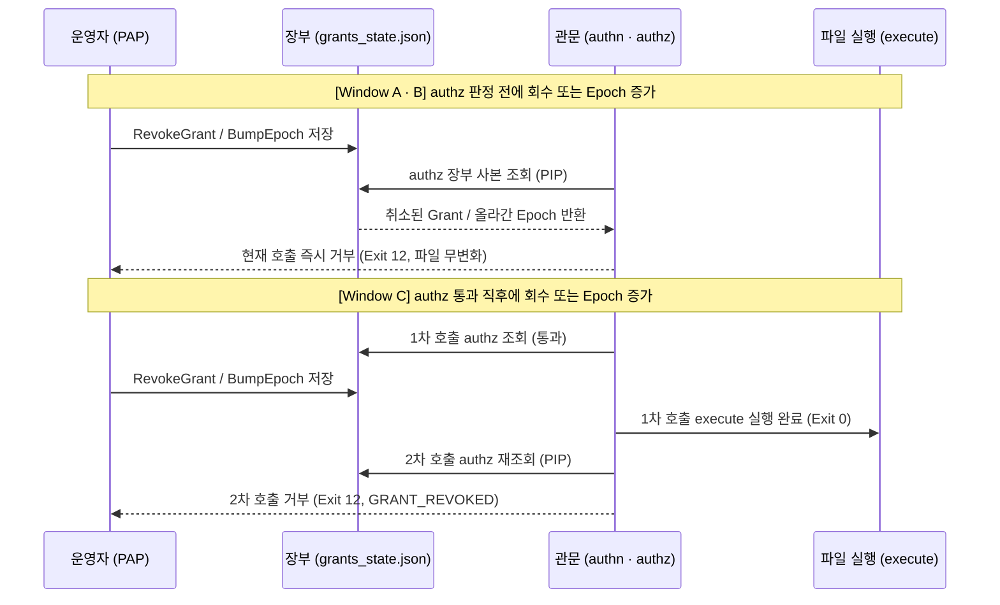

# 009. 권한이 사라지는 순간: 회수·Epoch·만료와 TOCTOU 창 — 일하는 도중에 권한을 취소하면 지금 하던 일도 멈추나

> **모드**: `[문서작업]` — 소스코드 수정 없이 현재 구현된 권한 회수(`RevokeGrant`), 세대 번호 일괄 무효화(`BumpEpoch`), 위임 계보 연쇄 회수, 가상 시계(`Clock`·`ClockOffset`), 호출 시점별 회수 경계(`Window A`·`B`·`C`), 장기 세션 구동(`SessionDriver`)의 실제 동작과 이유(Why)를 해설합니다.  
> **기준일**: 2026-11-06 · **기준 커밋**: `bf00fca` (이 문서가 설명하는 `cmd/`와 `internal/`을 마지막으로 바꾼 커밋)  
> **검증 범위**: 동작·순서·소유자·시점을 코드와 대조한 결과와 「미확인」은 5부 ③에 있습니다.  
> **이 문서는 구현된 것만 적는다.** 계획·제안·미래형 약속은 적지 않으며, 현재 코드가 하지 않는 것은 「지금은 없다」고만 씁니다.  
> **이 문서의 규칙**: 본문(0~4부, Q&A, 그림, 5부 ①)은 쉬운 개념·설계·이유가 중심입니다. 파일·타입 이름 같은 고유 이름은 첫 등장에 한마디 설명과 함께 쓰고, 구현의 어디인지는 문단 끝 `(구현: 파일 · 함수, 5부 ② 번호)` 귀띔으로 보조합니다. 기준은 [프로그램 설명서 README의 「설명의 기준」과 「이름의 3층」](README.md)입니다.  
> **겹치는 주제**: 관문이 매 호출마다 장부를 다시 보는 기본 구조는 [001편](001-전체요청여정과_5단계관문.md) Q3이, 출입증 축소 발급(`Exchange`)과 서명 키 회전·폐기 절차는 [002편](002-토큰발급_축소위임과_서명키회전.md)이, 2단계 위임 사슬(`act`) 구조는 [004편](004-다단계위임과_MCP도구게이트웨이.md)이, 사람의 1회용 승인 만료와 예산 차감은 [005편](005-승인_예산과_도구확장.md)이, 자식 실행 경로에 결함 주입 장치가 없다는 사실은 [006편](006-OS격리_관측성과_감사체크포인트.md) Q12가, 원자적 파일 저장(`AtomicFileStore`)은 [007편](007-코드읽는순서와_의존방향.md) Q6 3번이, 시나리오 하네스와 4중 판정은 [008편](008-시나리오하네스와_4중판정.md)이 자세히 다룹니다.
>
> **다시 확인하는 법**
> ```bash
> git rev-parse --short HEAD
> git log -1 --format=%h -- cmd internal
> # 1. TOCTOU 창(Window A/B/C)과 위임 계보 연쇄 회수 단위 시험 실행
> go test -v ./internal/authz/pep/ -run "TestTOCTOUWindow|TestLineageRevocation"
> # 2. 장기 실행 세션(SessionDriver, G12)과 시계 오프셋 브리지 시험 실행
> go test -v ./internal/harness/catalog/ -run "TestG12|TestSessionDriver|TestInProcBridgeClockOffset"
> # 3. G12 시나리오 그룹을 explain / summary 형식으로 직접 실행해 보기
> go run ./cmd/authz-harness run --group G12 --output-format explain
> go run ./cmd/authz-harness run --group G12 --output-format summary
> # 4. 코어 패키지의 time.Now 직접 호출 금지 가드 시험
> go test -v ./internal/harness/ -run "TestArchitectureGuardrails/TC-130-01"
> # 5. 핵심 코드 위치 확인
> grep -n "func " internal/authz/pap/service.go internal/authz/pdp/service.go internal/authz/pip/service.go internal/harness/catalog/session_helper.go
> # 6. 4부 「배척한 방식」의 과거 코드 (본문에는 옮기지 않는다)
> git show 8cb9630^:internal/authn/exchange/service.go | sed -n '158,186p'
> git show f70aafa^:internal/authz/pdp/service.go | sed -n '60,72p'
> git show 6a9741f^:internal/authz/pip/service.go | sed -n '70,82p'
> ```

---

## 💡 사용자의 질문 (원문 보존)

> 설명서에 남기면 좋을 부분 있나? 프로그램의 주요 부분 말이야. 내가 잘 이해해야 하는 부분이나 특징적인 부분 제안해라.

> 다른 에이전트로 설명서 작성할테니 니가 계획서만 써줘. 3개 모두.

([계획 007 S2](../계획/007-설명서_008_009_신설_및_001편_부록_집필계획.md) 지시서에 따라 집필했습니다.)

---

## 0. 모든 설계 이전에 ‘사람’이 있다 — 지금 일하는 일꾼의 권한을 뺏으면 어디서부터 멈추나

일꾼에게 10분짜리 출입증을 내주고 일을 시켰는데, 2분 만에 이상한 낌새가 보여 권한을 취소(`revoke`)했다고 해 봅니다. 이때 사람이 실제로 궁금한 것은 이렇습니다.

- 「출입증은 이미 일꾼 손에 넘어갔고 만료 시간도 8분이나 남았는데, 내가 취소 명령을 내리면 어떻게 막히나?」
- 「일꾼이 가진 권한 하나만 취소하는 것과, 그 일꾼의 모든 출입증을 한꺼번에 무효로 만드는 것(`bump-epoch`)은 무엇이 다른가?」
- 「중간 팀장이 일꾼에게 권한을 나눠 준 뒤 팀장의 권한을 끊으면, 일꾼이 들고 있는 출입증도 같이 막히나?」
- 「내가 취소 명령을 누른 바로 그 순간 일꾼이 이미 관문 검사를 통과해 파일을 쓰러 들어가고 있었다면, 그 일도 멈추나, 아니면 다음 일부터 막히나?」

이 문서는 권한과 출입증이 효력을 잃는 다섯 가지 길(개별 권한 회수, 세대 번호 증가, 위임 조상 세대 번호 증가, 시간 만료, 서명 키 폐기)이 안에서 어떻게 작동하는지, 그리고 진행 중인 호출과 다음 호출 사이의 경계(`Window A`·`B`·`C`)가 어디에 그어져 있는지를 코드 그대로 밝힙니다.

---

## 1부. 왜 장부를 매번 다시 보고, 왜 세대 번호(`Epoch`)까지 두었나

### 가장 밑바닥의 이유부터

1. **출입증에 유효 시간이 적혀 있는데 왜 장부를 또 보나?** 한 번 발급해 건네준 출입증(서명된 JWT 문자열)은 일꾼이 쥐고 있어서 밖에서 글자를 지우거나 뺏을 수 없습니다. 만약 문 앞 경비원(`pep.Gateway`)이 출입증의 서명과 만료 시각만 보고 문을 열어 주면, 만료 시각이 될 때까지는 권한을 취소할 방법이 없습니다. 그래서 경비원은 문을 열기 직전마다 중앙 허가 장부(`grants_state.json`)를 다시 읽습니다([001편](001-전체요청여정과_5단계관문.md) Q3).
2. **권한 하나만 지우면 되지, 왜 세대 번호(`Epoch`)라는 숫자를 따로 두나?** 일꾼 하나에게 열어 준 파일이 여러 개이거나, 그 일꾼 이름으로 발급된 출입증이 여러 장 퍼져 있을 때 권한 ID를 하나씩 찾아 지우면 빠뜨리는 것이 생깁니다. 주체마다 세대 번호(`Epoch`, 기본값 `1`)를 하나 두고 출입증을 발급할 때 그 숫자를 박아 두면, 장부에서 그 주체의 숫자를 `2`로 올리는 것(`BumpEpoch`)만으로 이전에 발급된(`Epoch: 1`) 모든 출입증을 한 번에 막을 수 있습니다.
3. **주체 본인의 세대 번호만 보면 충분한가?** 총괄(`lead-01`)이 팀장(`mid-01`)에게, 팀장이 일꾼(`worker-01`)에게 출입증을 줄여서 넘겨주었을 때, 사고를 친 쪽이 중간의 팀장이나 총괄일 수 있습니다. 일꾼 본인의 세대 번호만 검사하면, 총괄이나 팀장의 세대 번호를 올려도 이미 일꾼 손에 넘어간 자식 출입증은 그대로 통과합니다. 그래서 자식 출입증을 만들 때 위임 사슬(`act`)의 각 조상 고리마다 그 당시 조상의 세대 번호(`ActorClaim.Epoch`)를 함께 적어 두고, 판정할 때 본인뿐 아니라 조상 전부의 세대 번호가 지금 장부와 똑같은지 확인합니다(Q3).
4. **그러면 취소하는 즉시 모든 일이 멈추나?** 장부를 읽고 판정하는 단계(`authz`)보다 **앞**에 취소가 끝났으면(`Window A`·`Window B`) 지금 들어온 호출부터 즉시 막힙니다. 하지만 이미 `authz` 판정을 통과한 **뒤**(`boundary` 울타리 검사 ~ `execute` 파일 실행 사이, `Window C`)에 취소가 일어나면, 이미 판정을 마친 그 호출 한 건은 끝까지 실행되고 **다음 호출부터** 막힙니다(Q6).
5. **왜 파일 쓰기 직전(`execute` 앞)에 장부를 한 번 더 읽어 그 틈(`Window C`)을 닫지 않았나?** 현재 코드는 `authz` 판정 뒤에 장부를 다시 읽는 단계를 두지 않습니다. 왜 실행 직전에 장부를 한 번 더 읽는 이중 확인을 택하지 않았는지는 코드와 문서에서 확인하지 못했습니다(4부 5번, 5부 ③).
6. **더 내려가면?** 「돌려받을 수 없는 출입증을 쓰면서도 취소 효력을 다음 판정마다 강제하고, 그 판정과 실제 실행 사이에 남는 틈이 어디까지인지 숨기지 않고 측정한다」는 요구에 닿습니다. 그 이상은 되물을 수 없습니다.

### 흔한 방식과 이 프로그램의 선택

| 구분 | 흔한 방식 (일반론, 이 저장소에서 확인하지 않음) | 이 프로그램의 선택 |
|---|---|---|
| 모양 | 토큰 만료 시각까지만 서명으로 검증하고 장부는 다시 보지 않거나, 만료가 가까워지면 갱신 전용 토큰(`Refresh Token`)으로 새 토큰을 받아 연장한다 | 매 호출마다 `authn`(서명·만료·키 상태)과 `authz`(장부의 개별 권한·본인 및 조상 `Epoch`)를 다시 확인한다. 갱신 전용 토큰은 두지 않고 살아 있는 부모 토큰으로 다시 교환(`re-exchange`)한다 |
| 얻는 것 | 호출마다 장부를 읽지 않아 빠르고, 부모 토큰 없이도 세션을 계속 연장할 수 있다 | 권한 회수·`Epoch` 증가·키 폐기가 다음 호출의 관문에서 즉시 거부로 반영된다. 위임받은 자식이 부모 수명을 넘겨 살아남지 못한다 |
| 포기하는 것 | 만료 전에는 권한 회수나 위임 조상 차단이 즉시 반영되지 않는다 | 매 호출마다 장부 파일을 읽어야 하고, `authz` 통과 직후(`Window C`)에 일어난 회수는 현재 호출을 막지 못하며 다음 호출부터 막는다 |

---

## 2부. 질문과 답변으로 풀어보는 핵심 동작 (Q&A)

### Q1. 권한(`Grant`)은 어떻게 만들고 회수하나? 장부 `grants_state.json`에는 무엇이 들어 있나?

- **무슨 일이 일어나는가**:
  1. 명령줄에서 `authz-harness grant create --sub <주체> --action <행동> --resource <경로>`를 실행하면 `cli.GrantRunner`(`grant` 하위 명령을 실행하는 러너)의 `Run` → `runCreate`가 `pap.Service`의 구현체인 `papService.CreateGrant`를 부릅니다.
  2. `papService.CreateGrant`는 시계(`clock.Now()`)로 만든 ID(`grant-<나노초>`)와 `Status: GrantStatusActive`(`"active"`)를 가진 `domain.Grant`를 만든 뒤, `Grant.Validate`로 필수 값과 경로에 `..`가 없는지 검사합니다. 통과하면 상태 저장소(`state.FileStore.Update`)의 배타 잠금 안에서 장부(`state.GrantsState.Grants`)에 추가하고 감사 장부에 `grant.create`를 기록합니다.
  3. 권한을 취소할 때는 `authz-harness grant revoke --id <권한ID>`를 실행합니다. `GrantRunner.runRevoke` → `papService.RevokeGrant`가 `state.FileStore.Update` 안에서 해당 ID의 권한을 찾아 `Grant.Revoke(now)`를 부릅니다. 이때 장부에서 그 줄을 지워 버리지 않고, `Status`를 `GrantStatusRevoked`(`"revoked"`)로 바꾸고 `RevokedAt`에 취소 시각을 적은 뒤 감사 장부에 `grant.revoke`를 남깁니다.
  4. Zone B에 놓이는 `grants_state.json`(`state.GrantsState`) 파일 한 벌에는 다섯 필드가 함께 들어 있습니다: 스키마 판 번호 `Version`(`int`), 마지막 갱신 시각 `UpdatedAt`(`time.Time`), 권한 목록 `Grants`(`[]domain.Grant`), 주체별 세대 번호 맵 `Epochs`(`domain.SecurityEpochs`), 사람의 1회용 승인 목록 `Approvals`(`[]domain.Approval`). 파일 저장과 잠금은 `storage.AtomicFileStore[GrantsState]`가 맡으며, 그 원리는 [007편](007-코드읽는순서와_의존방향.md) Q6 3번에서 다룹니다. (구현: [`grant.go`](../../internal/cli/grant.go) · `GrantRunner`, `NewGrantRunner`, `GrantRunner.Run`, `GrantRunner.runCreate`, `GrantRunner.runRevoke`, [`pap/service.go`](../../internal/authz/pap/service.go) · `CreateGrantRequest`, `Service`, `papService.CreateGrant`, `papService.RevokeGrant`, [`domain/grant.go`](../../internal/domain/grant.go) · `Grant`, `GrantStatusActive`, `GrantStatusRevoked`, `Grant.Validate`, `Grant.IsActive`, `Grant.Revoke`, [`state/store.go`](../../internal/authz/state/store.go) · `GrantsState`, `NewEmptyGrantsState`, `FileStore.Update`, 5부 ② 1·2·3·4번)
- **왜 취소된 권한을 장부에서 지우지 않고 `revoked` 상태로 남겨 두나**:
  - 아예 지워 버리면 나중에 그 권한으로 요청이 들어왔을 때 「원래부터 권한이 없었던 것(`NO_ACTIVE_GRANT`)」인지 「있던 권한이 취소된 것(`GRANT_REVOKED`)」인지 구분할 수 없기 때문입니다. `pipService.GetSubjectSnapshot`은 장부를 읽을 때 살아 있는 권한(`ActiveGrants`, `Grant.IsActive() == true`)과 취소된 권한(`RevokedGrants`, `Status == GrantStatusRevoked`)을 따로 추려 판정 부품(`pdp.Evaluate`)에 넘기고, `pdp.Evaluate`는 살아 있는 권한이 없을 때 취소된 권한 이력을 뒤져 일치하면 `ReasonGrantRevoked`(`12`)를 돌려줍니다.
- **확인한 사실 (`StateVersion`과 `GrantsState.Version`)**:
  - 일부 로드맵 문서에는 `StateVersion` 단조 증가라는 표현이 등장하나, 실제 코드에 `StateVersion`이라는 식별자는 없습니다([022번 보고서](../보고서/022-13번로드맵_구조결함_및_진행가능성_검증보고서.md) T-7에서 읽는 곳이 없는 필드로 제외됨). 또한 `state.GrantsState.Version`은 `NewEmptyGrantsState`와 `FileStore.normalizeState`에서 `0`일 때 `1`로 채워질 뿐, `Save`나 `Update`마다 `1`씩 올라가는 단조 증가 카운터가 아니라 고정 값 `1`입니다(5부 ③).
- **근거**: 5부 ② 항목 1, 2, 3, 4, 6, 7번

### Q2. 세대 번호(`Epoch`)는 무엇이고, 올리면(`BumpEpoch`) 무엇이 막히나?

- **무슨 일이 일어나는가**:
  1. 주체마다 붙는 세대 번호 `domain.Epoch`(`int64`)는 장부의 `Epochs`(`domain.SecurityEpochs`, `map[string]Epoch`)에 저장됩니다. 아직 한 번도 등록되지 않은 주체나 값이 `1`보다 작은 주체에 대해 `SecurityEpochs.Get`을 부르면 기본값 `1`을 돌려줍니다.
  2. 운영자가 `authz-harness grant bump-epoch --sub <주체>`를 실행하면 `GrantRunner.runBumpEpoch` → `papService.BumpEpoch`가 장부를 잠그고 `SecurityEpochs.Bump(subject)`를 불러 현재 값에 `1`을 더한 새 세대 번호를 저장한 뒤 감사 장부에 `epoch.bump`를 기록합니다.
  3. 요청이 관문(`pep.Gateway`)의 `authz`에 도착하면, `pipService.GetSubjectSnapshot`이 장부에서 그 주체의 최신 세대 번호(`CurrentEpoch`)를 읽어 오고, `pdp.Evaluate`가 가장 먼저(권한 범위나 `Grant` 목록을 보기도 전에) **요청 토큰에 찍힌 `req.Epoch`와 장부의 `snapshot.CurrentEpoch`가 똑같은지(`req.Epoch != snapshot.CurrentEpoch`)** 비교합니다.
  4. 두 숫자가 같지 않으면 그 자리에서 `DecisionDeny`와 `ReasonSubjectEpochRevoked`(종료 코드 `12`)를 돌려줍니다. (구현: [`epoch.go`](../../internal/domain/epoch.go) · `Epoch`, `SecurityEpochs`, `SecurityEpochs.Get`, `SecurityEpochs.Bump`, [`pap/service.go`](../../internal/authz/pap/service.go) · `papService.BumpEpoch`, [`pip/service.go`](../../internal/authz/pip/service.go) · `pipService.GetSubjectSnapshot`, [`pdp/service.go`](../../internal/authz/pdp/service.go) · `Evaluate`, `pdpService.Decide`, [`grant.go`](../../internal/cli/grant.go) · `GrantRunner.runBumpEpoch`, 5부 ② 1·2·5·6·7번)
- **확인한 사실 (크거나 같음이 아니라 동등 비교)**:
  - `pdp.Evaluate`는 `req.Epoch < snapshot.CurrentEpoch`가 아니라 `req.Epoch != snapshot.CurrentEpoch`로 **동등 비교**합니다. 따라서 장부보다 작은 옛 세대 토큰뿐 아니라, 장부보다 큰 세대 번호가 잘못 찍힌 토큰(예: 자식 교환 시 `ChildEpoch`를 잘못 넘긴 경우)도 똑같이 `SUBJECT_EPOCH_REVOKED`(`12`)로 거부됩니다.
- **근거**: 5부 ② 항목 1, 2, 5, 6, 7번

### Q3. 위임 사슬(`act`)의 조상 세대 번호는 어떻게 검사하나?

- **무슨 일이 일어나는가**:
  1. 부모 출입증으로 자식 출입증을 교환(`exchange.ExchangeService.Exchange`)할 때, 자식 출입증 본체의 `Epoch`에는 자식의 세대 번호(`ExchangeRequest.ChildEpoch`, `0`이면 기본값 `1`)를 적고, 위임 계보 클레임 `domain.ActorClaim`(`act`)에는 **부모의 주체 이름(`Subject`), 부모 토큰 ID(`JWTID`), 그리고 부모 토큰에 찍혀 있던 세대 번호(`Epoch: parentClaims.Epoch`)**를 적어 기존 조상 사슬(`parentClaims.Actor`) 위에 포갭니다. 위임 사슬 구조 자체는 [004편](004-다단계위임과_MCP도구게이트웨이.md)에서 다룹니다.
  2. 장부 사본을 뜨는 `pipService.GetSubjectSnapshot`은 한 번의 `store.Load()`에서 요청 주체 본인의 `CurrentEpoch`뿐 아니라 모든 주체의 세대 번호 맵 사본(`SubjectEpochs`)을 함께 담아 돌려줍니다.
  3. `pdp.Evaluate`는 주체 본인의 `Epoch`가 맞는지 확인한 바로 다음 단계(2b단계)에서 `for a := req.Actor; a != nil; a = a.Actor`로 위임 사슬의 모든 조상 고리를 끝까지 따라갑니다.
  4. 어느 한 고리라도 `a.Epoch < 1`이거나 장부의 `snapshot.SubjectEpochs.Get(a.Subject) != a.Epoch`이면(또는 `req.Actor != nil`인데 `snapshot.SubjectEpochs == nil`이면), 즉시 `ReasonSubjectEpochRevoked`(`12`)로 거부합니다. (구현: [`token.go`](../../internal/domain/token.go) · `ActorClaim`, `TokenClaims`, [`exchange/service.go`](../../internal/authn/exchange/service.go) · `ExchangeRequest`, `ExchangeService.Exchange`, [`pip/service.go`](../../internal/authz/pip/service.go) · `pipService.GetSubjectSnapshot`, [`pdp/service.go`](../../internal/authz/pdp/service.go) · `Evaluate`, 5부 ② 6·7·8·9번)
- **왜 본인과 조상의 `Epoch`를 나누어 적고 사슬 전체를 동등 비교하나**:
  - 부모(`lead-01`)의 세대 번호가 `2`이고 자식(`worker-01`)의 세대 번호가 `1`일 때, 자식 토큰에 부모의 세대 번호(`2`)를 그대로 복사하면 자식이 자기 장부(`Epoch: 1`)와 맞지 않아 정상 위임조차 거부됩니다. 반대로 조상 세대 번호를 `act`에 적어 검사하지 않으면, 상위 위임자(`lead-01`이나 `mid-01`)의 `Epoch`를 올려도 이미 발급된 말단 일꾼(`worker-01`)의 토큰이 살아남기 때문입니다(`TestLineageRevocation`, `E2E-56`).
- **확인한 경계**: 합성 루트(`app.BuildStack`)로 조립된 `ExchangeService.Exchange`는 `exchange.WithSnapshotProvider(pipSvc)`를 통해 `lineage_epoch` 단계에서 직계 부모와 모든 `act` 조상의 `Epoch`를 장부와 즉시 대조해 불일치 시 `SUBJECT_EPOCH_REVOKED`(`12`)로 조기 거부합니다([015편](015-4차원단조축소위임과_예산원장불변식.md) Q2). 설령 `WithSnapshotProvider` 없이 단독 생성된 교환기에서 자식 토큰이 발급되더라도, 관문(`pep.Gateway`)에 넣으면 `authz`에서 부모 고리의 `Epoch` 불일치로 거부됩니다.
- **근거**: 5부 ② 항목 6, 7, 8, 9, 13번

### Q4. 출입증 만료와 서명 키 폐기는 언제 효력이 생기나?

- **무슨 일이 일어나는가**:
  1. 관문(`pep.Gateway`)은 매 호출마다 `authn`에서 `token.Verifier.VerifyToken`을 부릅니다.
  2. **서명 키 상태 확인(4단계)**: 토큰 헤더의 키 번호(`kid`)로 Zone B 공개키 목록(`jwks.json`)을 조회합니다(`keys.Manager.GetVerificationKey`). 키를 회전(`RotateKey`)만 한 경우에는 이전 키가 검증 전용(`verify-only`) 상태로 남아 있어 기존 토큰이 계속 통과하지만, 키를 폐기(`RevokeKey`)해 `retired` 상태가 되면 `ErrKeyRetired`가 반환되어 만료 시각이 남았더라도 즉시 `ReasonTokenKeyRetired`(종료 코드 `11`)로 거부됩니다(`E2E-57`). 키 회전·폐기 절차는 [002편](002-토큰발급_축소위임과_서명키회전.md)에서 다룹니다.
  3. **시간 유효성 확인(8단계)**: 현재 시각(`now.Unix()`)이 토큰의 `NotBefore`(`nbf`)보다 작으면 `ReasonTokenNotYetValid`(`11`), `ExpiresAt`(`exp`) 이상이면(`nowUnix >= claims.ExpiresAt`) 즉시 `ReasonTokenExpired`(`11`)로 거부됩니다(`E2E-55`).
  4. **1회성 토큰 재사용 확인**: 예산(`Budget`)이 없는 일반 토큰은 첫 호출이 `authz` 허용(`DecisionAllow`)과 `boundary` 통과를 거친 뒤 `replay`에서 `Verifier.ConsumeReplay`가 `jti`를 재사용 원장(`replay_ledger.json`)에 기록합니다. 같은 토큰으로 두 번째 호출을 보내면 `authn`(9b단계 `IsConsumed`) 또는 `replay`에서 `ReasonTokenReplayDetected`(`11`)로 거부됩니다(`E2E-58`). (구현: [`verifier.go`](../../internal/authn/token/verifier.go) · `VerifyOptions`, `Verifier.VerifyToken`, `Verifier.ConsumeReplay`, [`keys/manager.go`](../../internal/authn/keys/manager.go) · `Manager.GetVerificationKey`, `Manager.RotateKey`, `Manager.RevokeKey`, 5부 ② 10·11번)
- **근거**: 5부 ② 항목 10, 11, 13번

### Q5. 프로그램의 「지금」은 누가 정하나? 왜 시계를 앞으로만 돌릴 수 있게 했나?

- **무슨 일이 일어나는가**:
  1. 핵심 패키지(`pdp`, `pip`, `pap`, `state`, `authn`, `audit`, `pep`)는 운영체제 시계(`time.Now()`)를 직접 부르지 않고, `domain.Clock` 인터페이스(`Now() time.Time`)를 주입받아 씁니다. 기본 구현은 UTC 현재 시각을 돌려주는 `domain.RealClock`이고, 기준 시계에 시간 차이(`Offset`)를 더하는 구현은 `domain.OffsetClock`(`domain.NewOffsetClock`)입니다. 핵심 패키지가 `time.Now()`를 직접 부르지 않는지는 아키텍처 가드 `TC-130-01`이 검사합니다(검사 대상에는 `storage`·`observe`·`netguard`·`execguard`·`subagent`·`mcp`도 포함됩니다)([007편](007-코드읽는순서와_의존방향.md) Q4).
  2. 요청 단위로 시간을 건너뛰어 시험할 때는 `pep.Request.ClockOffset`(자식 프로세스 요청 프레임에서는 `subagent.SubagentRequest.ClockOffsetSeconds`)을 전달합니다. 관문은 `authn` 토큰 검증(`VerifyOptions.ClockOffset`)과 `authz` 승인 만료 판정(`state.evalNow = g.clock.Now().UTC().Add(req.ClockOffset)`)에 이 오프셋을 더한 시각을 씁니다.
  3. 이때 자식 일꾼 `subagent.SubagentWorker.Execute`(그리고 인프로세스 브리지 `inProcSpawnerBridge.Spawn`과 세션 드라이버 `SessionDriver.AdvanceClock`)는 **오프셋이 음수(`ClockOffsetSeconds < 0` 또는 `delta < 0`)이면 관문을 부르기도 전에 `ExitBadInput`(`14`, `ReasonInvalidArguments`)이나 에러로 즉시 거부**합니다. (구현: [`token.go`](../../internal/domain/token.go) · `Clock`, `RealClock`, `OffsetClock`, `NewOffsetClock`, [`worker.go`](../../internal/subagent/worker.go) · `SubagentWorker.Execute`, [`gateway.go`](../../internal/authz/pep/gateway.go) · `Request`, `gateway.Execute`, [`session_helper.go`](../../internal/harness/catalog/session_helper.go) · `SessionDriver.AdvanceClock`, 5부 ② 4·8·12·13번)
- **왜 시계를 앞으로만 돌릴 수 있게 하고 음수 오프셋을 막았나**:
  - 토큰 발급기는 항상 발급 시각과 활성 시작 시각을 같은 현재 시각(`nbf = iat = now`)으로 찍어 서명합니다. 따라서 시계를 과거로 돌리는 음수 오프셋을 허용하면, **이미 만료된 토큰의 시각을 과거로 되돌려 다시 살아나게 만드는 부활 손잡이**가 되기 때문입니다(`TestInProcBridgeClockOffset`, `TestSessionDriver/TC-020-04`).
- **근거**: 5부 ② 항목 8, 10, 12, 13, 14번

### Q6. 회수가 호출의 어느 시점에 일어나면 어떻게 되나? (`Window A`·`B`·`C`)

- **무슨 일이 일어나는가**: 관문(`pep.Gateway.Execute`)은 각 단계(`Stage`)를 통과할 때마다 `pep.Config.StageObserver` 함수(단위 시험 전용 관찰 콜백, 프로덕션 조립 함수 `app.BuildStack`은 연결하지 않음)가 있으면 호출합니다. `TestTOCTOUWindow` 시험은 이 콜백을 이용해 권한 회수(`RevokeGrant`)나 세대 번호 증가(`BumpEpoch`)가 일어나는 시점을 세 구간으로 나누어 결과를 확인합니다.

| 구간 | 회수·Epoch 증가가 일어나는 시점 | 진행 중인 1차 호출 | 같은 예산 토큰으로 보낸 2차 호출 | 이유 |
|---|---|:---:|:---:|---|
| **Window A** | 관문 진입(`Execute`) 전 | **`12` 거부** (`file` 미생성) | — | `authz`가 이미 바뀐 장부를 읽음 |
| **Window B** | `authn` 단계(신원 확인) 통과 직후 | **`12` 거부** (`file` 미생성) | — | `authn`은 통과했으나 직후 `authz`에서 `pipService.GetSubjectSnapshot`이 바뀐 장부를 읽음 |
| **Window C** | `authz` 단계(권한 판정) 통과 직후 (`boundary`·`replay`·`approval`·`budget`·`precommit_audit`·`execute` 앞) | **`0` 완료** (`file` 기록됨) | **`12` 거부** (`GRANT_REVOKED`, 추가 기록 없음) | 1차 호출은 이미 `authz` 판정을 마쳤고 그 뒤에는 장부 재검사가 없으므로 끝까지 실행됨. 2차 호출은 다시 `authz`를 거치며 거부됨 |

- **왜 Window C 시험에서는 다회용 예산 토큰을 쓰나**:
  - 예산이 없는 1회성 토큰으로 1차 호출이 완료(`0`)되면 `replay`에서 이미 토큰의 `jti`가 소비됩니다. 그러면 2차 호출을 보냈을 때 `authz`의 권한 회수(`GRANT_REVOKED`, `12`)까지 가기도 전에 `authn`에서 재사용 감지(`TOKEN_REPLAY_DETECTED`, `11`)로 먼저 막혀 버려 회수 효과를 관찰할 수 없기 때문입니다.
- **실제 자식 프로세스 경로에는 시험용 훅이 없습니다**: `StageObserver`는 인메모리 단위 시험(`toctou_window_test.go`)에서만 주입하며, 실제 명령줄이나 자식 프로세스(`subagent worker`) 경로에는 단계 사이에 끼어들어 장부를 바꾸는 결함 주입 장치가 없습니다([006편](006-OS격리_관측성과_감사체크포인트.md) Q12). (구현: [`gateway.go`](../../internal/authz/pep/gateway.go) · `Config`, `stageHook`, `gateway.assemble`, [`toctou_window_test.go`](../../internal/authz/pep/toctou_window_test.go) · `TestLineageRevocation`, `TestTOCTOUWindow`, 5부 ② 4·14번)
- **근거**: 5부 ② 항목 4, 14번

### Q7. 오래 사는 세션(장기 실행)에서는 시간 경과와 회수를 어떻게 시험하나? (`SessionDriver`)

- **무슨 일이 일어나는가**:
  1. 일반 시나리오는 도구 호출을 한 번 보내고 끝나지만, `G12` 그룹(`E2E-55`~`E2E-60`)은 `catalog.NewSessionDriver`로 하나의 MCP 서버(`mcp.NewServer`)를 메모리 파이프(`io.Pipe`)에 연결해 띄워 두고, 세션이 닫힐(`SessionDriver.Close`) 때까지 여러 번의 `tools/call` 요청(`SessionDriver.CallTool`)을 연속으로 보냅니다.
  2. `SessionDriver` 안에는 누적 시간 오프셋(`offset`)이 하나 들어 있습니다. `SessionDriver.AdvanceClock(delta)`을 부르면 실제로 기다리지 않고 이 누적 오프셋만 앞으로 더해집니다(음수는 거부).
  3. 서버 아래에서 자식 워커를 띄우는 스포너는 `offsetSpawner`로 감싸져 있어서, `CallTool`이 불릴 때마다 현재 누적된 `offset`을 초 단위로 바꾸어 자식 요청 프레임(`SubagentRequest.ClockOffsetSeconds`)에 자동으로 실어 보냅니다.
  4. 호출과 호출 사이에는 `SessionDriver`의 메서드인 `AdvanceClock`(시간 경과, `E2E-55`), `RevokeGrant`(권한 회수), `BumpEpoch`(상위 위임자 `lead-01`의 세대 번호 증가, `E2E-56`), `RotateKey`·`RevokeKey`(서명 키 회전 후 폐기, `E2E-57`)를 끼워 넣어, **바로 앞 호출에서는 통과(`0`)했던 똑같은 토큰이 상태 변화 직후의 다음 호출에서는 정확한 사유(`11` 또는 `12`)로 거부되는지** 검증합니다. 중간 호출의 기대 코드가 어긋나면 `g12Call`이 `harness.Invariantf`를 돌려주어 시나리오를 즉시 실패시킵니다([008편](008-시나리오하네스와_4중판정.md) Q5). (구현: [`session_helper.go`](../../internal/harness/catalog/session_helper.go) · `offsetSpawner`, `SessionDriver`, `NewSessionDriver`, `SessionDriver.Offset`, `SessionDriver.CallTool`, `SessionDriver.AdvanceClock`, `SessionDriver.RevokeGrant`, `SessionDriver.BumpEpoch`, `SessionDriver.RotateKey`, `SessionDriver.RevokeKey`, `SessionDriver.Stack`, `SessionDriver.Close`, [`g12_long_running_session.go`](../../internal/harness/catalog/g12_long_running_session.go) · `g12Scenarios`, `g12Call`, `newG12E2E55`, `newG12E2E56`, `newG12E2E57`, `newG12E2E58`, 5부 ② 12·13번)
- **근거**: 5부 ② 항목 12, 13, 14번

### Q8. 부모 출입증으로 자식 출입증을 다시 교환(`re-exchange`)할 때, 부모가 살아 있을 때와 만료되었을 때는 어떻게 다른가?

- **무슨 일이 일어나는가**:
  1. 이 프로그램에는 만료된 출입증을 스스로 연장하는 갱신 토큰(`Refresh Token`)이 없습니다. 대신 유효 시간이 긴 부모 출입증(예: 30분)에서 유효 시간이 짧은 자식 출입증(예: 5분)을 떼어 주어 일을 시킵니다([002편](002-토큰발급_축소위임과_서명키회전.md)).
  2. **부모가 아직 살아 있을 때 (`E2E-59`, `ReExchange`)**: 시계를 6분 앞으로 돌리면(`AdvanceClock(6m)`) 5분짜리 첫 번째 자식 출입증은 만료(`ExitTokenInvalid`, `11`)되어 막힙니다. 이때 `SessionDriver.Stack()`을 부르면 현재 누적 오프셋(+6분)이 적용된 시계(`domain.NewOffsetClock`)로 조립된 스택(`setupHarnessStackWithClock`)을 돌려줍니다. 이 오프셋 스택의 `ExchangeService.Exchange`에 아직 24분이 남은 부모 출입증을 넣어 새 5분짜리 자식 출입증을 다시 발급받으면(이때 부모 토큰 검증은 `RecordReplay: false`로 동작해 부모의 `jti`를 소진하지 않음), 같은 세션이 새 자식 출입증으로 파일 쓰기를 정상 완료(`0`)합니다.
  3. **부모까지 만료되었을 때 (`E2E-60`, `ReExchangeParentExpired`)**: 부모 출입증 수명이 10분인데 시계를 15분 앞으로 돌린 뒤(`AdvanceClock(15m)`) `SessionDriver.Stack()`으로 재교환을 요청하면, `ExchangeService.Exchange`의 `parent_token` 단계(부모 토큰 검증)에서 부모 출입증 자체가 `ReasonTokenExpired`(`11`)로 거부되고 감사 장부에 `token.exchange.deny`가 남습니다. 만약 재교환이 잘못 성공하면 시나리오가 `harness.Invariantf`로 실패 처리합니다(`TestG12_MutationShortAdvanceFails`). (구현: [`exchange/service.go`](../../internal/authn/exchange/service.go) · `ExchangeService.Exchange`, [`session_helper.go`](../../internal/harness/catalog/session_helper.go) · `SessionDriver.Stack`, [`g12_long_running_session.go`](../../internal/harness/catalog/g12_long_running_session.go) · `newG12E2E59`, `newG12E2E60`, 5부 ② 9·12·13번)
- **왜 갱신 토큰 대신 부모를 통한 재교환만 두나**:
  - 일꾼 스스로 자기 출입증을 무한정 연장할 수 있게 하면 처음 정한 위임 수명 상한이 무너지지만, 부모 출입증을 통한 재교환만 허용하면 자식을 아무리 여러 번 새로 받아도 **위임 사슬 전체의 수명이 부모 출입증의 남은 수명 안에 묶이기** 때문입니다.
- **근거**: 5부 ② 항목 9, 12, 13, 14번

---

## 3부. 내부 지도 — 회수 시점별 결과와 직접 확인하는 법



참여자는 네 곳이고, `authz`에서 장부 사본(`pipService.GetSubjectSnapshot`)을 읽는 순간이 현재 호출 차단과 다음 호출 차단을 가르는 경계입니다. (구현: `pap/service.go` · `papService.RevokeGrant`, `papService.BumpEpoch`, `pip/service.go` · `pipService.GetSubjectSnapshot`, `pdp/service.go` · `Evaluate`, `gateway.go` · `gateway.assemble`, 5부 ② 2·4·6·7번)

### 어디에 무엇이 남나

| 무엇 | 어디에 | 언제 | 사람이 직접 여는 법 |
|---|---|---|---|
| 권한 상태(`active` / `revoked`, `revoked_at`)와 주체별 `epochs` | Zone B `grants_state.json` | `grant create`, `grant revoke`, `grant bump-epoch` 실행 시 | `cat .authz-state/public/grants_state.json` 또는 `authz-harness grant list` |
| 서명 키 상태(`active` / `verify-only` / `retired`) | Zone A `private_keys.json` 및 Zone B `jwks.pub.json` | `keys rotate`, `keys revoke` 실행 시 | `authz-harness keys list` ([002편](002-토큰발급_축소위임과_서명키회전.md)) |
| 1회성 토큰 소비 기록(`jti`) | Zone B `replay_ledger.json` | 모든 검사(`authn`~`boundary`)를 통과한 뒤 `replay`(`ConsumeReplay`) 통과 시 | `cat .authz-state/public/replay_ledger.json` |
| 회수·세대 증가·거부 감사 기록 (`grant.revoke`, `epoch.bump`, `pdp.decide`, `pep.deny`, `token.exchange.deny`) | `audit.jsonl` | 관리 명령 및 관문·교환 실행 시마다 즉시 기록 | `cat audit.jsonl` 또는 머리 1~3번 시험 실행 |

### 이상이 생기면

| 상황 | 일어나는 일 |
|---|---|
| 없는 권한 ID로 `grant revoke`를 실행한다 | 장부를 바꾸지 않고 `ErrGrantNotFound` → `ReasonInvalidArguments`(`ExitBadInput`, `14`)를 돌려준다 |
| 권한이 취소된 뒤 같은 리소스에 요청을 보낸다 (`Window A`·`B` 또는 `Window C`의 다음 호출) | `authz`에서 `ReasonGrantRevoked`(`ExitAuthzDenied`, `12`)로 거부되고 파일은 바뀌지 않는다 |
| 주체 본인 또는 위임 조상(`act`)의 `Epoch`가 올라간 뒤 요청을 보낸다 | `authz`에서 가장 먼저 `ReasonSubjectEpochRevoked`(`ExitAuthzDenied`, `12`)로 거부된다 |
| `authz` 통과 직후(`Window C`)에 권한이 회수된다 | **진행 중인 그 호출 한 건은 막지 못하고 완료(`0`)된다.** 그 뒤의 다음 호출부터 `authz`에서 `12`로 거부된다 |
| `Epoch`가 올라간 부모 토큰으로 자식 토큰 교환(`Exchange`)을 요청한다 | `WithSnapshotProvider`가 배선된 기본 스택에서는 교환의 `lineage_epoch` 단계에서 즉시 `SUBJECT_EPOCH_REVOKED`(`12`)로 거부되며, 스냅샷 공급자가 없는 단독 교환기라도 관문(`pep.Gateway`) `authz`에서 조상 `Epoch` 불일치(`12`)로 막힌다 |
| 서명 키를 회전(`rotate`)만 한 뒤 기존 토큰으로 요청한다 | 이전 키가 `verify-only`로 남아 있어 정상 통과(`0`)한다 |
| 서명 키를 폐기(`revoke`)한 뒤 그 키로 서명된 토큰으로 요청한다 | `authn`에서 `ReasonTokenKeyRetired`(`ExitTokenInvalid`, `11`)로 즉시 거부된다 |
| 자식 워커나 세션 드라이버에 음수 시계 오프셋(`clock_offset_sec < 0`)을 넣는다 | 만료 토큰 부활을 막기 위해 관문 진입 전에 `ExitBadInput`(`14`) 또는 에러로 거부된다 |
| 부모 토큰까지 만료된 뒤 자식 토큰 재교환(`Exchange`)을 요청한다 | `ExchangeService.Exchange`가 `parent_token` 단계의 부모 토큰 검증에서 `ReasonTokenExpired`(`11`)로 거부하고 자식 토큰을 발급하지 않는다 |

---

## 4부. 배척한 방식과 그 이유

과거 코드는 본문에 옮기지 않았습니다. 머리의 「다시 확인하는 법」 6번 명령으로 볼 수 있습니다.

1. **출입증(토큰)의 서명과 만료 시각만 믿고 호출마다 장부를 다시 보지 않는 방식**:
   - **택했다면 무슨 일이 생기는가**: 출입증 만료 시각이 남아 있는 동안에는 권한을 취소(`RevokeGrant`)하거나 세대 번호를 올려도(`BumpEpoch`) 일꾼의 작업을 막을 수 없습니다.
   - **그 대신 포기한 것**: 매 호출마다 `authz`에서 `pipService.GetSubjectSnapshot`이 장부 파일을 읽어 확인하는 비용을 감수합니다([001편](001-전체요청여정과_5단계관문.md) Q3).
2. **자식 출입증에 부모의 `Epoch`를 그대로 복사하고 위임 사슬(`act`) 조상의 `Epoch`는 검사하지 않는 방식** (`8cb9630^`의 `internal/authn/exchange/service.go`, `f70aafa^`의 `internal/authz/pdp/service.go`):
   - **택했다면 무슨 일이 생기는가**: 부모(`Epoch: 2`)와 자식(`Epoch: 1`)의 세대 번호가 다를 때 자식이 부모 숫자를 물려받아 자기 장부 숫자와 어긋나 정상 위임이 거부되고, 반대로 상위 위임자(`lead-01`)의 `Epoch`를 올려도 이미 발급된 하위 일꾼(`worker-01`)의 토큰은 `act` 고리를 검사하지 않아 그대로 통과합니다(근거: [13번 로드맵 `ROADMAP.md`](../로드맵/13-장기-실행-및-토큰-수명-검증/ROADMAP.md) 1·4절).
   - **그 대신 포기한 것**: 교환 시 자식의 세대 번호(`ChildEpoch`)와 부모 고리의 세대 번호(`ActorClaim.Epoch`)를 따로 기록하고, `pipService.GetSubjectSnapshot`이 전체 주체의 `SubjectEpochs` 사본을 떠서 `pdp.Evaluate`가 모든 `act` 고리를 동등 비교합니다.
3. **핵심 패키지가 운영체제 시계(`time.Now()`)를 직접 부르거나 음수 시계 오프셋을 허용하는 방식** (`6a9741f^`의 `internal/authz/pip/service.go` 등):
   - **택했다면 무슨 일이 생기는가**: 시계를 밖에서 주입해도 내부가 실제 시계를 읽어 시간 경과 시험을 대기 없이 재현할 수 없고, 음수 오프셋을 허용하면 만료된 토큰을 과거 시각으로 되살려 통과시킬 수 있습니다.
   - **그 대신 포기한 것**: 코어 패키지에 `domain.Clock`을 일원화하고 `TC-130-01` 가드로 `time.Now()` 호출을 금지했으며, 워커와 브리지·세션 드라이버에서 음수 오프셋을 거부합니다.
4. **만료된 자식 출입증을 스스로 연장하는 갱신 전용 토큰(`Refresh Token`)을 두는 방식** ([13번 로드맵 `WHY.md`](../로드맵/13-장기-실행-및-토큰-수명-검증/WHY.md), [`ROADMAP.md`](../로드맵/13-장기-실행-및-토큰-수명-검증/ROADMAP.md) 1절):
   - **택했다면 무슨 일이 생기는가**: 하위 일꾼이 부모의 남은 수명과 상관없이 스스로 출입증을 연장할 수 있게 되어 축소 위임의 수명 상한이 무너지고 별도 갱신 원장 관리가 늘어납니다.
   - **그 대신 포기한 것**: 자식이 만료되면 아직 살아 있는 부모 토큰을 제시해 새로 교환(`Exchange`)받아야 하며, 부모 토큰이 만료되면 더 이상 세션을 이어갈 수 없습니다(`E2E-59`, `E2E-60`).
5. **파일 실행 직전(`execute` 앞)에 장부를 한 번 더 읽어 `Window C`를 닫는 이중 확인 방식**:
   - **택했다면 무슨 일이 생기는가**: `authz` 통과 뒤 `execute` 진입 직전에 일어난 회수도 한 번 더 잡을 수 있지만, 장부 재조회와 실제 운영체제 파일 호출(`os.OpenFile` 등) 사이에는 여전히 미세한 시간차가 남고 호출마다 장부를 두 번 읽게 됩니다.
   - **그 대신 포기한 것**: 현재 코드는 `authz` 판정 한 곳에서만 장부를 읽고, `authz` 통과 직후(`Window C`)에 일어난 회수는 현재 호출을 막지 못하며 다음 호출부터 막는다는 경계를 `TestTOCTOUWindow`로 명시해 검증합니다. 다만 왜 실행 직전 이중 확인을 두지 않았는지에 대한 명시적 설계 문서는 확인하지 못했습니다(5부 ③).

---

## 5부. 한눈에 보는 대조표와 코드 정본

### ① 행동별 안에서 일어나는 일과 지금은 없는 것

| 행동 | 안에서 일어나는 일 | 지금은 없는 것 | 근거 |
|---|---|---|---|
| **개별 권한 부여·회수 (`grant create` / `revoke`)** | `papService.CreateGrant`가 `active` 권한을 추가하고, `RevokeGrant`가 해당 ID를 `revoked` 상태로 바꾸며 `RevokedAt`과 감사 로그를 남긴다. | 취소된 권한을 장부 배열에서 물리적으로 삭제(Purge/GC)하는 기능은 지금 없다. `GrantsState.Version`을 갱신마다 1씩 올리는 단조 증가 버전 관리는 지금 없다(`1` 고정). | 5부 ② 1, 2, 3, 4번 |
| **주체 및 위임 계보 일괄 무효화 (`grant bump-epoch`)** | `papService.BumpEpoch`가 장부의 주체 `Epoch`를 1 올리고, 교환(`ExchangeService.Exchange` + `WithSnapshotProvider`)과 판정(`pdp.Evaluate`)이 요청 주체 및 `act` 사슬 모든 조상의 `Epoch`를 장부(`CurrentEpoch`, `SubjectEpochs`)와 동등 비교해 다르면 `SUBJECT_EPOCH_REVOKED`(`12`)로 거부한다. | `WithSnapshotProvider` 없이 단독 생성된 `ExchangeService`에서는 교환 시점 `Epoch` 조회를 생략한다(관문 `authz`에서 차단). | 5부 ② 1, 2, 5, 6, 7, 9번 |
| **출입증 만료 및 키 폐기 (`authn`)** | `Verifier.VerifyToken`이 매 호출마다 `nowUnix >= ExpiresAt`이면 `TOKEN_EXPIRED`(`11`), 서명 키가 `retired`이면 `TOKEN_KEY_RETIRED`(`11`), 소비된 1회성 `jti`이면 `TOKEN_REPLAY_DETECTED`(`11`)로 거부한다. | 만료된 토큰을 부모 토큰 없이 연장하는 `Refresh Token`은 지금 없다. | 5부 ② 10, 11번 |
| **가상 시계와 오프셋 전파 (`Clock` / `ClockOffset`)** | 코어 패키지는 `domain.Clock`을 쓰고, 시험 오프셋(`ClockOffset`·`ClockOffsetSeconds`·`AdvanceClock`)은 0 이상만 허용하며 음수는 `ExitBadInput`(`14`) 또는 에러로 거부한다. | 실제 운영체제 시계를 기다리지 않고 토큰 만료를 시험하며, 음수 오프셋으로 시간을 되돌리는 기능은 금지되어 있다. | 5부 ② 8, 10, 12, 13번 |
| **진행 중 호출과 회수 시점 경계 (`Window A`·`B`·`C`)** | `authz` 판정 전(`Window A`·`B`) 회수는 현재 호출을 `12`로 막고, `authz` 통과 직후(`Window C`) 회수는 현재 호출을 완료(`0`)시킨 뒤 다음 호출부터 `12`(`GRANT_REVOKED`)로 막는다. | `authz` 통과 뒤 `execute` 파일 실행 직전에 장부를 다시 읽는 이중 확인이나, 이미 `execute`에 진입한 파일 쓰기를 중간에 취소·롤백하는 기능은 지금 없다. | 5부 ② 4, 7, 14번 |
| **장기 실행 세션 시험 (`SessionDriver` · `G12`)** | `io.Pipe`로 연결된 단일 MCP 세션 안에서 `AdvanceClock`·`RevokeGrant`·`BumpEpoch`·`RotateKey`·`RevokeKey`와 부모 토큰 재교환(`SessionDriver.Stack`)을 구동한다. | 상주 워커 데몬은 지금 없다(세션은 유지되나 각 `tools/call`은 스포너를 통해 실행된다). | 5부 ② 9, 12, 13번 |

### ② 어디서 하나 (코드 정본 색인)

1. **`grant` 명령 입구**: [`internal/cli/grant.go`](../../internal/cli/grant.go) (`GrantRunner`, `NewGrantRunner`, `GrantRunner.Close`, `GrantRunner.Run`, `GrantRunner.runCreate`, `GrantRunner.runRevoke`, `GrantRunner.runBumpEpoch`, `GrantRunner.runList`) — 구현: P01-030, 합성 루트 일원화 P17-030 (`ba42aa7`)
2. **권한·세대 번호 관리 (`PAP`)**: [`internal/authz/pap/service.go`](../../internal/authz/pap/service.go) (`ErrGrantNotFound`, `CreateGrantRequest`, `GrantFilter`, `Service`, `papService`, `ServiceOption`, `WithClock`, `NewService`, `papService.CreateGrant`, `papService.RevokeGrant`, `papService.BumpEpoch`, `papService.ListGrants`) — 구현: P01-020, 시계 주입 `6a9741f`
3. **허가 장부 상태 모델과 저장소 (`state`)**: [`internal/authz/state/store.go`](../../internal/authz/state/store.go) (`GrantsState`, `NewEmptyGrantsState`, `Store`, `FileStore`, `Option`, `WithClock`, `NewFileStore`, `FileStore.Load`, `FileStore.Save`, `FileStore.Update`, `ensureStateFields`, `FileStore.normalizeState`), [`internal/domain/grant.go`](../../internal/domain/grant.go) (`GrantStatus`, `GrantStatusActive`, `GrantStatusRevoked`, `Grant`, `Grant.Validate`, `Grant.IsActive`, `Grant.Revoke`) — 구현: 원자 저장소 교체 `36a76bc`, 시계 주입 P13-010 (`6a9741f`)
4. **관문 단계와 `StageObserver` (`PEP`)**: [`internal/domain/stage.go`](../../internal/domain/stage.go) (`Stage`, `PEPStages`, `StageInput`, `StageAuthn`, `StageAuthz`, `StageBoundary`, `replay`, `approval`, `budget`, `StagePrecommitAudit`, `StageExecute`, `StageSettle`), [`internal/pipeline/pipeline.go`](../../internal/pipeline/pipeline.go) (`Engine.Run`, `Hook`), [`internal/authz/pep/gateway.go`](../../internal/authz/pep/gateway.go) (`Request`, `Result`, `Config`, `NewGateway`, `gateway.Execute`, `gateway.assemble`, `stageHook`), [`internal/subagent/worker.go`](../../internal/subagent/worker.go) (`SubagentWorker.Execute`) — 구현: 계획 005 S2 (`33f0adf`), 로드맵 19 지시서 010·020·040
5. **세대 번호 도메인 (`Epoch`)**: [`internal/domain/epoch.go`](../../internal/domain/epoch.go) (`Epoch`, `SecurityEpochs`, `SecurityEpochs.Get`, `SecurityEpochs.Bump`) — 구현: P01-010
6. **장부 사본과 세대 번호 공급 (`PIP`)**: [`internal/authz/pip/service.go`](../../internal/authz/pip/service.go) (`SubjectSnapshot`, `Service`, `pipService`, `Option`, `WithClock`, `NewService`, `pipService.GetSubjectSnapshot`, `pipService.GetActiveGrants`, `pipService.GetCurrentEpoch`), [`internal/domain/snapshot.go`](../../internal/domain/snapshot.go) (`SubjectSnapshot`, `SnapshotProvider`) — 구현: `SubjectEpochs` 사본 공급 P13-040 (`f70aafa`), 도메인 포트 이동 P17-010 (`cef8fd5`)
7. **세대 번호·위임 계보·회수 이력 판정 (`PDP`)**: [`internal/authz/pdp/service.go`](../../internal/authz/pdp/service.go) (`DecisionType`, `DecisionAllow`, `DecisionDeny`, `DecisionAsk`, `Request`, `Decision`, `Evaluate`, `Service`, `pdpService`, `WithClock`, `NewService`, `pdpService.Decide`) — 구현: `act` 사슬 동등 비교 P13-040 (`f70aafa`)
8. **시계 인터페이스와 위임 클레임 (`domain`)**: [`internal/domain/token.go`](../../internal/domain/token.go) (`Clock`, `RealClock`, `OffsetClock`, `NewOffsetClock`, `OffsetClock.Now`, `ActorClaim`, `TokenClaims`, `TokenClaims.Validate`, `VerifiedClaims`) — 구현: `ActorClaim.Epoch` P13-030 (`8cb9630`)
9. **축소 위임 교환과 재교환 (`exchange`)**: [`internal/authn/exchange/service.go`](../../internal/authn/exchange/service.go) (`ExchangeRequest`, `ExchangeResult`, `Service`, `ExchangeService`, `NewExchangeService`, `ExchangeService.Exchange`) — 구현: `ChildEpoch`·`ActorClaim.Epoch` 분리 P13-030 (`8cb9630`)
10. **토큰 만료·키 상태·재사용 검증 (`token`)**: [`internal/authn/token/verifier.go`](../../internal/authn/token/verifier.go) (`VerifyOptions`, `TokenVerifier`, `Verifier`, `NewVerifier`, `Verifier.VerifyToken`, `Verifier.ConsumeReplay`) — 구현: `ConsumeReplay` 분리 P15-040 (`e13aab3`)
11. **서명 키 회전과 폐기 (`keys`)**: [`internal/authn/keys/manager.go`](../../internal/authn/keys/manager.go) (`KeyManager`, `Manager`, `WithClock`, `NewManager`, `Manager.GetVerificationKey`, `Manager.RotateKey`, `Manager.RevokeKey`) — 구현: P02-010
12. **장기 실행 세션 드라이버 (`SessionDriver`)**: [`internal/harness/catalog/session_helper.go`](../../internal/harness/catalog/session_helper.go) (`offsetSpawner`, `offsetSpawner.Spawn`, `SessionDriver`, `NewSessionDriver`, `SessionDriver.Offset`, `SessionDriver.CallTool`, `SessionDriver.AdvanceClock`, `SessionDriver.RevokeGrant`, `SessionDriver.BumpEpoch`, `SessionDriver.RotateKey`, `SessionDriver.RevokeKey`, `SessionDriver.Stack`, `SessionDriver.Close`), [`internal/harness/catalog/g8_mcp_adapter.go`](../../internal/harness/catalog/g8_mcp_adapter.go) (`inProcSpawnerBridge.Spawn`) — 구현: P13-020 (`6a637dd`)
13. **G12 장기 세션 시나리오 카탈로그**: [`internal/harness/catalog/g12_long_running_session.go`](../../internal/harness/catalog/g12_long_running_session.go) (`g12Scenarios`, `g12Scenario`, `g12Scenario.Setup`, `g12Scenario.Execute`, `g12Expect`, `g12Call`, `exchangeReq`, `g12Child`, `newG12E2E55`, `newG12E2E56`, `newG12E2E57`, `newG12E2E58`, `newG12E2E59`, `newG12E2E60`) — 구현: P13-050 (`45d29fa`)
14. **시험과 아키텍처 가드**: [`internal/authz/pep/toctou_window_test.go`](../../internal/authz/pep/toctou_window_test.go)의 `TestLineageRevocation`·`TestTOCTOUWindow`, [`internal/harness/catalog/g12_test.go`](../../internal/harness/catalog/g12_test.go)의 `TestG12`·`TestG12_MutationNoBumpFails`·`TestG12_MutationShortAdvanceFails`, [`internal/harness/catalog/session_helper_test.go`](../../internal/harness/catalog/session_helper_test.go)의 `TestSessionDriver`, [`internal/harness/catalog/bridge_clock_test.go`](../../internal/harness/catalog/bridge_clock_test.go)의 `TestInProcBridgeClockOffset`, [`internal/harness/architecture_test.go`](../../internal/harness/architecture_test.go)의 `TestArchitectureGuardrails` (`TC-130-01`) (개수는 `go test ./...`로 확인)

### ③ 검증 범위와 「미확인」

검증 방법: 2026-11-06 개정(로드맵 19, 지시서 100-3)에서는 관문 단계 서술(Q1, Q4, Q6, 그림, 표, 5부 ②의 4번)을 `bf00fca`의 `gateway.go`·`pipeline.go`·`toctou_window_test.go`와 다시 대조했고, 그 밖은 아래 기존 대조 그대로입니다. 5부 ②의 파일을 기준 커밋 `38fecfa`에서 직접 읽고 인용한 파일·타입·함수를 `grep -rn "<이름>" internal cmd`로 모두 확인했습니다. macOS(darwin)에서 머리의 「다시 확인하는 법」 1~4번 명령을 실제로 실행하여 통과와 출력을 확인했습니다. 4부의 과거 코드는 머리 6번 명령(`git show`)으로 해당 커밋에서 확인했습니다. 2026-11-06 재대조: Q3·Q4·Q8의 `Exchange`·`Verifier` 서술을 `exchange/service.go`·`verifier.go`와 읽어 대조해, 교환이 파이프라인 단계(`lineage_epoch`, `parent_token`)로 바뀐 뒤 남은 「3-1단계」「3단계」 표현을 고쳤습니다. 그 밖은 식별자 일괄 대조만 했습니다. 2026-11-06 재검증([계획 016](../계획/016-설명서_본편_재대조_및_DEMO_GUIDE_재검증.md), 기준 코드 커밋 `64ae8db`): 본문의 식별자·링크(`StateVersion`은 본문이 코드에 없다고 밝힌 이름), Window A·B·C 표를 `go test -race ./internal/authz/pep/ -run "TestTOCTOUWindow|TestLineageRevocation"`(통과)와 `StageObserver`가 시험 전용이라는 코드 서술로 확인했습니다. 위 확인으로 본문에서 고친 곳은 없습니다. 확인하지 못한 범위: 「왜」 서술과 일반론 비교표는 코드로 증명할 수 없어 대조하지 않았습니다. `SessionDriver`·`ClockOffset`의 동작은 식별자 실재와 시험 통과까지만 확인했습니다.

| 항목 | 동작 | 순서 | 소유자 | 시점 | 미확인 사항 |
|---|---|---|---|---|---|
| Q1 (`CreateGrant`·`RevokeGrant`와 `GrantsState`, ② 1·2·3·4·6·7번) | 확인 (`grep -rn "StateVersion" internal cmd` 0건, `FileStore.normalizeState` 확인) | 확인 (배타 잠금 내 장부 갱신 → 잠금 해제 후 감사 기록) | 확인 (`papService`, `FileStore`) | 확인 | 로드맵 색인에 적힌 `StateVersion` 식별자는 코드에 없으며([022번 보고서](../보고서/022-13번로드맵_구조결함_및_진행가능성_검증보고서.md) T-7에서 제외), `GrantsState.Version`은 갱신마다 증가하지 않고 `1`로 유지됨 |
| Q2 (`BumpEpoch`와 동등 비교, ② 1·2·5·6·7번) | 확인 (`pdp.Evaluate` 53행 `req.Epoch != snapshot.CurrentEpoch`) | 확인 (`Evaluate`의 2단계에서 Scope·Grant보다 먼저 검사) | 확인 (`papService.BumpEpoch`, `pdp.Evaluate`) | 확인 | 없음 |
| Q3 (위임 사슬 `act` 조상 `Epoch` 동등 비교, ② 6·7·8·9·13번) | 확인 (`TestLineageRevocation`, `E2E-56`, `TestG12_MutationNoBumpFails`) | 확인 (본인 `Epoch` 검사 직후 2b단계에서 `req.Actor` 사슬 순회) | 확인 (`ExchangeService.Exchange`, `pipService.GetSubjectSnapshot`, `pdp.Evaluate`) | 확인 (교환 시점이 아니라 관문 `authz`에서 차단) | 없음 |
| Q4 (만료·키 폐기·1회성 재사용 차단, ② 10·11·13번) | 확인 (`E2E-55`, `E2E-57`, `E2E-58`) | 확인 (`authn` 4단계 키 상태 → 8단계 만료 → `replay` 소비) | 확인 (`Verifier.VerifyToken`, `Verifier.ConsumeReplay`, `Manager.RevokeKey`) | 확인 | 없음 |
| Q5 (`domain.Clock`과 음수 오프셋 거부, ② 8·10·12·13·14번) | 확인 (`TestInProcBridgeClockOffset`, `TestSessionDriver/TC-020-04`, `TC-130-01`) | 확인 (`SubagentWorker.Execute`가 관문 호출 전에 음수 거부) | 확인 (`SubagentWorker`, `SessionDriver`, `inProcSpawnerBridge`) | 확인 | 없음 |
| Q6 (`Window A`·`B`·`C`와 `StageObserver`, ② 4·14번) | 확인 (`TestTOCTOUWindow` 실행: `Window C` 1차 `0` 완료 후 2차 `12` `GRANT_REVOKED`) | 확인 (`input` → `authn` → `authz` → `boundary` → `replay` → `approval` → `budget` → `precommit_audit` → `execute` → `settle`, `domain.PEPStages()`) | 확인 (`stageHook`, `toctou_window_test.go`) | 확인 (`StageObserver`는 각 단계가 `nil`을 반환한 직후 `OnStepEnd`에서 호출됨) | `authz` 통과 뒤 `execute` 직전에 장부를 한 번 더 읽는 이중 확인으로 `Window C`를 닫지 않은 이유를 적은 문서 |
| Q7 (`SessionDriver`와 `G12`, ② 12·13·14번) | 확인 (`TestSessionDriver`, `TestG12`, `run --group G12`) | 확인 | 확인 (`SessionDriver`, `offsetSpawner`) | 확인 | 없음 |
| Q8 (재교환 `ReExchange`와 부모 만료 거부, ② 9·12·13·14번) | 확인 (`E2E-59`, `E2E-60`, `TestG12_MutationShortAdvanceFails`) | 확인 (`AdvanceClock` → `SessionDriver.Stack()` 오프셋 스택 생성 → `Exchange`) | 확인 (`SessionDriver.Stack`, `ExchangeService.Exchange`) | 확인 | 없음 |
| 4부 (배척한 방식 5건) | 확인 (`git show`, 13번 로드맵·022번 보고서 대조) | 해당 없음 | 해당 없음 | 해당 없음 | 5번(`Window C` 실행 직전 이중 확인 미채택 이유)은 문서에서 확인하지 못함 |
