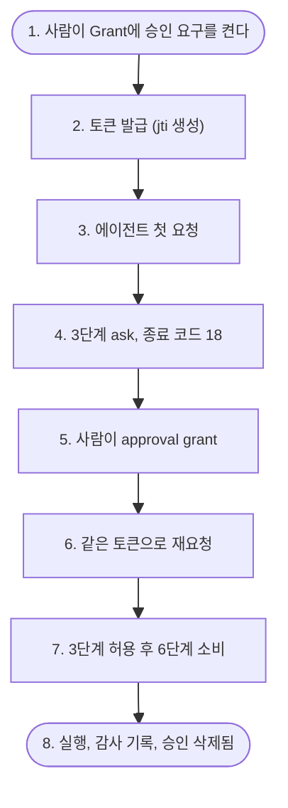
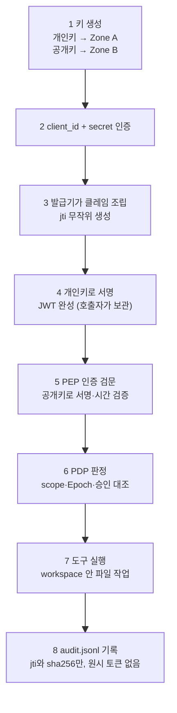

# 009. 키·토큰·ID·클레임과 승인 티켓 — 이 문자열들은 각각 누가 만들고 어디서 검사하며, 승인은 왜 두 번 확인하나

> **모드**: `[문서작업]` — 소스코드 수정 없이 현재 구현된 키·토큰·ID·클레임·승인 티켓의 실제 동작과 이유(Why)를 해설합니다.  
> **기준일**: 2026-11-10 · **기준 커밋**: `b68e866` (이 문서가 설명하는 `cmd/`와 `internal/`을 마지막으로 바꾼 커밋)  
> **출발점**: 2026-11-10 세션의 질의응답 (임시 발췌본 [발췌_2026-11-10_키_토큰_ID_클레임_JSON_정리.md](발췌_2026-11-10_키_토큰_ID_클레임_JSON_정리.md)를 정식 문서로 승격)  
> **관련 문서**: [008-식권자판기_식당으로_보는_시스템_전체_해설.md](008-식권자판기_식당으로_보는_시스템_전체_해설.md) (식당 모델로 푼 시스템 전체. 이 문서는 키·ID·클레임·승인만 질문 순서대로 좁게 파고듭니다), [003-출입증_축소위임과_실시간_권한통제.md](003-출입증_축소위임과_실시간_권한통제.md)  
> **다시 확인하는 법**:
> ```bash
> git rev-parse --short HEAD
> git log -1 --format=%h -- cmd internal
> # 승인이 앞 단계에서 거부될 때 소비되지 않는지, 동시 소비 때 1건만 성공하는지, 감사 실패 때 닫히는지
> go test -v ./internal/authz/... -run "TestConsumeAfterCheck_ApprovalSurvivesBoundaryViolation|TestPEPJailViolationKeepsApproval|TestApprovalConsumeConcurrent|TestPEPApprovalAuditFailure|TestPEPBudgetTokenApprovalSingleUse"
> # 직접 실행해서 ask(종료 코드 18)와 승인 뒤 재시도를 눈으로 본다
> ./authz-harness grant --help
> ./authz-harness approval grant --help
> ```

---

## 💡 사용자의 질문 (원문 보존)

> 나는 키 토큰 등이 너무 헷갈린다 초보 입장에서는 키와 아이디도 토큰처럼 보인다 뭐가 어디서 만들어져서 쓰이고 체크되는지 정리가 안된다 도메인 패키지쪽에서 정리해보면 좋겟다. 작동원리 폴더 발췌문서 후반부에 보면 내가 뭘 굼금해하는지 알수 잇다 니가 아예 새로운 문서를 만들어봐라. 저장형식이 json인 것도 자주 보이는데 초보 입장에서 기존룰을 모르니 맥락이 없어서 이해가 어렵다 json은 안 어렵다 이게 누가 만들어서 어떤 규칙으로 읽고 왜 그렇게 되는 건지 모른다 업계룰인지 여기서 그런 건지 설명이 없다 토큰은 내부에 정보가 다 잇다 jwt. 겉으로 보면 그냥 암호다 아는 사람만 안다 addr로 시작하는 키는 그냥 키인데 접두사를 붙여서 쓴단다. 알려줘야 안다 디코딩해도 안에 아무 정도 없다 그냥 키다. 클레임은 또 뭔가? 요청이라고 한국식으로 해석하면 미궁에 빠진다. 초보는 어렵다. 클레임이 jwt애 내장되나? 국룰인가? 그런 식이면 다방면에 활용될듯한데.  토큰클레임도 잇고 액터클레임도 잇다 go언어 네이밍규약이라는데 정신이 없다 우리 코드에 13대 토큰클레임이 잇는데 이건 http메서드처럼 표준요소인가? 토큰클레임은 json으로 표시해서 토큰 내에 인코딩해서 넣나? jwt의 활용방안도 소개해줘 특히 승인바인딩이 궁금하다 구조체를 보면 토큰클레임과 흡사하다. json은 표준이야? json형식으로 인코딩한다는 거지? zone abc를 뺄수 없다 통합해서 알려줘 ai특유의 압축요약은 금지한다 발췌문서 수준이면 된다. 전채문서의 통합성보다는 내가 질문한 것을 해결해주면 된다

> addr은 착각. approval이다 승인관련해서 그리고 승인은 pep 3,6단계 이중이라는데 왜 이런 거고 어떤 이유이고 결과인지 알려줘. 여러 질문을 압축요약할 필요 없다 그러니 이게 다 뭐하는 짓인지 어떻개 유기적으로 작동하는 것인지 알고 싶다. 결국 보안때문이고 신원확인 때문이다 그래서 토큰이나 키가 필요하다 허가자와 주체 리소스 액션 ttl등이다 쉽게 한번 정리할 필요가 잇다 식당을 예로 드는 것도 시도해봐라 식당비유는 부록형식으로 추가해라

---

## 0. 모든 설계 이전에 ‘사람’이 있다 — 이 긴 문자열들이 다 같아 보인다

이 프로그램을 처음 여는 사람은 화면과 파일에서 이런 것들을 줄줄이 만납니다.

```
eyJ0eXAiOiJhdCtqd3QiLCJhbGciOiJFZERTQSIs...        ← 이게 토큰인가?
key-20261110093015-01                               ← 이게 키인가?
approval-1731234567890123456                         ← 이건 승인 "키"인가?
sha256:3b4c...                                       ← 이건 또 뭔가?
a3f8c1d29b7e4f10                                     ← 이건?
worker-01, client-orchestrator                       ← 이름? 아이디?
```

모양이 전부 길고 의미 없어 보입니다. 그래서 질문은 이렇게 나옵니다.

- 이것들 중 **비밀**은 어느 것이고, **그냥 이름표**는 어느 것인가?
- 누가 **만들고**, 어디에 **놓이고**, 누가 어디서 **검사**하는가?
- "클레임"은 무슨 뜻이고, JSON은 누가 어떤 규칙으로 읽고 쓰는가? 업계 규칙인가, 여기서 정한 규칙인가?
- 승인은 왜 파이프라인에 **두 번** 나오는가?

이 문서는 위 질문에 코드를 읽지 않고도 답을 얻도록 만든 것입니다. 답은 **「모든 것은 보안과 신원 확인 때문이고, 키와 토큰은 그 신원 확인의 도구」**라는 한 줄에서 시작합니다. 1부에서 그 이유를 끝까지 내려가고, 2부에서 승인이 필요한 요청 한 건이 처음부터 끝까지 가는 길을 보이고, 3부(Q1~Q12)에서 질문별로 파고듭니다. 모든 내용은 `docs/adr/`와 실제 코드로 확인했고, 확인하지 못한 것은 해당 자리와 맨 끝에 적었습니다.

---

## 1부. 이것은 무엇에 쓰는 장치이고, 왜 이런 모양인가 (용도와 Why)

### 1. 어디에 쓰는 물건인가

이 프로그램은 자식 프로세스(에이전트)가 파일을 읽고 쓰려 할 때 **세 가지 질문**에 차례로 답합니다. 키, 토큰, ID, 클레임, 승인은 모두 이 질문 중 하나에 쓰이는 재료입니다.

| 질문 | 무엇으로 답하나 | 어느 단계 |
|---|---|---|
| ① **너는 누구냐** (신원 확인) | 서명된 토큰을 공개키로 검증 | 2단계 `authn` |
| ② **네가 이걸 해도 되는 부류냐** (권한 확인) | 권한 장부(Grant)·scope·Epoch 대조 | 3단계 `authz` |
| ③ **이번 한 번은 사람이 허락했느냐** (고위험 작업 확인) | 사람이 미리 발행한 1회용 승인 티켓 | 3단계(있는지 읽어서 판정) + 6단계(쓰고 없앰) |

### 2. 가장 밑바닥의 이유부터

1. **왜 필요한가?** 에이전트는 내가 일일이 감시할 수 없는 프로세스입니다. 에이전트가 "나는 worker-01이고 이 파일을 써도 된다"고 **말하는 것만으로** 통과시키면 아무 권한 통제도 없는 것과 같습니다.
2. **그건 왜?** 말은 누구나 지어낼 수 있기 때문입니다. 그러니 "이 사람이 이렇게 말해도 된다고 **발급자가 보증했다**"를 확인할 수단이 필요합니다.
3. **왜 서명인가?** 보증을 확인하려면 위조할 수 없는 표시가 필요하고, 그것이 **디지털 서명**입니다. 서명을 만드는 키(개인키)와 확인하는 키(공개키)를 나누면, 확인만 하는 쪽(워커 프로세스)이 뚫려도 위조 토큰을 만들 수 없습니다.
4. **왜 토큰 안에 내용을 다 넣나?** 서버가 "이 토큰의 주인이 누구인가"를 매번 DB에서 찾아볼 필요가 없게 하려는 것입니다(무상태). 코드 주석은 RFC 9068(JWT 액세스 토큰 표준)을 따르는 것으로 적고 있습니다. 다른 방식과의 비교를 ADR에서 찾지는 못했습니다.
5. **왜 승인을 따로 두나?** [ADR 0005](../adr/0005-pdp-3값-결정-및-일회성-승인-바인딩.md) 배경에 따르면 고위험 작업은 "자동 허용도 무조건 거부도 아닌 사람 승인 후 1회 실행"이 필요하기 때문입니다. 승인이 재사용, 도용, 인자 바꿔치기, 만료, 회수 뒤 사용에 견디는지 증명해야 합니다.
6. **왜 승인에 이름·행위·대상·토큰·내용을 다 묶나?** 승인 번호가 새어 나가도 **다른 작업**에 쓰지 못하게 하려는 것입니다(Confused Deputy 방지).
7. 설계자가 이 선택들 사이에서 어떤 대안을 놓고 고민했는지는 ADR 0005의 5절(기각한 대안)에 있는 세 가지만 확인했습니다. 4부에 적었습니다.

### 3. 흔한 방식과 이 프로그램의 선택

아래 「흔한 방식」은 일반 지식이며, 「이 프로그램의 선택」은 코드와 ADR로 확인한 것입니다.

| 구분 | 흔한 방식 (일반론) | 이 프로그램의 선택 |
|---|---|---|
| **신원 증표** | 서버가 세션 번호를 발급해 DB에서 조회 | 서명된 JWT에 내용을 넣고 공개키로 검증 |
| **얻는 것** | 즉시 폐기가 쉬움 | 조회 없이 검증, 위조 방지 |
| **포기한 것** | 매 요청 DB 조회 | 발급된 토큰을 중간에 거둘 수 없어서 `Epoch`(세대 번호)로 한 번에 무효화하는 장치를 더 둠 |
| **승인** | "유효한 승인 번호인가"만 확인 | 주체·행위·대상·토큰·(내용)에 묶어 확인하고 1회 소비 후 삭제 |
| **얻는 것** | 구현이 단순 | 가로챈 승인 번호가 다른 작업에 쓸모없음 |
| **포기한 것** | — | 발행할 때 값을 정확히 지정해야 하는 번거로움 |

---

## 2부. 처음부터 끝까지 따라가는 E2E 여정 (패킷 왕복 지도)

승인이 필요한 파일 쓰기 한 건이 **처음 거절되고, 승인을 받은 뒤 같은 토큰으로 다시 성공하는** 전체 여정입니다. 승인 구조의 모든 부분이 이 한 번에 등장합니다.



### 단계별 상세 여정과 데이터 변화

1. **[준비] 사람이 승인 요구를 켠다**: `authz-harness grant --requires-approval --sub worker-01 --action file:write --resource tasks.txt`. 권한 장부(`grants_state.json`)의 해당 Grant에 `requires_approval: true`가 기록됩니다. 승인이 필요한지는 요청마다가 아니라 **Grant에 켜 둔 표시**가 정합니다.
2. **[발급] 토큰이 만들어진다**: 발급기가 `client_id`와 비밀을 확인하고, 개인키(Zone A)로 서명해 JWT를 줍니다. 이때 무작위 `jti`가 생깁니다. 이 `jti`가 뒤에서 승인을 묶는 이름표가 됩니다.
3. **[첫 요청] 에이전트가 토큰과 함께 요청**: 2단계 `authn`이 공개키로 서명을 확인하고, 3단계 `authz`가 Grant를 찾습니다. 이 Grant는 승인을 요구하는데 장부에 승인이 없으므로 `ask`가 나옵니다.
4. **[거절] 종료 코드 18**: 요청은 `APPROVAL_REQUIRED`(종료 코드 18)로 끝납니다. 파일은 바뀌지 않고, 예산은 차감되지 않고, **`jti`도 소비되지 않습니다**([ADR 0005](../adr/0005-pdp-3값-결정-및-일회성-승인-바인딩.md) 결정 5, 6).
5. **[승인] 사람이 승인 티켓을 발행**: `authz-harness approval grant --subject worker-01 --action file:write --resource tasks.txt --jti <토큰의 jti> [--arg-hash sha256:...] [--ttl 5m]`. 발행 서비스는 **감사 기록을 먼저 남기고**(`approval.granted`) 그다음 장부에 저장합니다. 감사 기록이 실패하면 저장하지 않습니다([ADR 0010](../adr/0010-관리-변경의-감사-실패-처리.md)).
6. **[재요청] 같은 토큰으로 다시 요청**: `jti`가 소비되지 않았으므로 같은 토큰을 그대로 쓸 수 있습니다.
7. **[판정과 소비] 3단계에서 읽고, 6단계에서 쓴다**: 3단계는 장부의 승인 목록에서 주체·행위·대상·`jti`·(내용 지문)이 모두 맞는 유효 승인을 찾고, 그 승인 ID를 메모한 채 `allow`를 냅니다. 4단계 경계 검사, 5단계 `jti` 소비를 지난 뒤, 6단계가 장부를 잠그고 그 승인을 다시 대조한 뒤 **삭제**합니다(`approval.consumed` 기록).
8. **[도착] 실행과 마감**: 7~10단계(예산 차감, 사전 감사, 파일 쓰기, 정산)가 이어지고 결과가 화면에 찍힙니다. 승인은 이미 장부에 없으므로 같은 승인으로 다시 쓸 수 없습니다.

### 어디에 무엇이 남나 (사람이 직접 열어보는 법)

| 무엇 | 어디에 | 언제 | 사람이 직접 확인하는 법 |
|---|---|---|---|
| 승인 요구 표시 | `.authz-state/public/grants_state.json` 의 Grant `requires_approval` | 1단계 | `cat .authz-state/public/grants_state.json` |
| 승인 티켓 | 같은 파일의 승인 목록 | 5단계 후 ~ 6단계 전 | `authz-harness approval list` |
| 승인 발행 기록 | `audit.jsonl` 의 `approval.granted` | 5단계 | `grep approval.granted audit.jsonl` |
| 승인 소비 기록 | `audit.jsonl` 의 `approval.consumed` | 7단계 | `grep approval.consumed audit.jsonl` |
| 토큰 원문 | 어디에도 저장되지 않음 (호출자만 가짐) | — | 감사 장부에는 `jti`와 요약만 있음 |

### 이상이 생기면 (어디서 멈추고 무엇이 찍히나)

| 상황 | 일어나는 일 (어느 단계에서 멈추나) | 승인은? |
|---|---|---|
| 승인이 아예 없음 | 3단계에서 `ask` → `APPROVAL_REQUIRED`(18) | 해당 없음 |
| 승인은 있지만 만료됨 | 3단계에서 `ask` → `APPROVAL_EXPIRED`(18) | 만료 정리 대상 |
| 같은 주체의 승인이 있으나 행위·대상·`jti`·지문이 다름 | 3단계에서 `ask` → `APPROVAL_MISMATCH`(18) | 남음 |
| 승인 유효, 4단계 경로 탈출로 거부 | 4단계 거부 | **소비되지 않음** |
| 승인 유효, 5단계 `jti` 재사용으로 거부 | 5단계 거부 | **소비되지 않음** |
| 3단계 통과 후 다른 요청이 먼저 같은 승인을 소비 | 6단계 "없음/이미 소비됨" → `APPROVAL_REQUIRED` | 이미 없음 |
| 6단계 통과 후 7단계 예산 부족 등으로 실패 | 요청 거부 | **소비된 채 돌려주지 않음**, 예산만 환불 |
| 6단계 소비 후 감사 기록 실패 | `AUDIT_LOG_FAILED` | 소비된 채 |

---

## 3부. 질문과 답변으로 파고드는 세부 동작 (Q&A)

2부의 여정을 읽은 사람이 품는 질문을 순서대로 답합니다. 아래 Q1~Q12는 2026-11-10 세션의 질의응답을 **요약하지 않고 그대로** 옮긴 것입니다. 본문에서 「N절」「N-M절」이라고 쓴 곳은 이 문서의 **QN**, **QN-M**을 뜻합니다.

### Q1. 한 장 지도: 이 프로그램에 나오는 비밀·이름·증표 전부

#### 왜 헷갈리는가

키, 토큰, 아이디, 해시가 모두 `a3f8c1d2...`처럼 길고 의미 없어 보이는 문자열이기 때문입니다. 겉모양이 같아서 구분이 안 됩니다. 구분하는 기준은 모양이 아니라 **세 가지 질문**입니다.

1. **비밀인가?** 남이 알면 안 되는가.
2. **누가 만드는가?** 사람이 정하는가, 프로그램이 무작위로 만드는가, 계산으로 나오는가.
3. **어디서 검사하는가?** 누가 이 값을 받아 무엇과 비교하는가.

#### 전체 표

| 종류 | 이름 | 예시 모양 | 비밀인가 | 누가 만드나 | 어디에 놓이나 | 누가 검사하나 |
|---|---|---|---|---|---|---|
| **비밀 키** | 서명 개인키 (Ed25519 Private Key) | 바이트 덩어리 (64바이트) | **비밀** | 키 관리자가 생성 | Zone A `signing_keys.priv.json` (0600) | 토큰 발급기만 꺼내 씀 |
| **비밀 키** | `client_secret` | `orchestrator-secret-key-01` | 비밀 (단, 이 레포의 3개는 학습용 고정값) | 코드에 미리 등록 | 메모리 안 레지스트리 | 발급기가 `client_id`와 짝으로 대조 |
| **공개 키** | 공개키 (JWK) | Base64URL 32바이트 (`x` 필드) | 공개해도 됨 | 개인키에서 계산됨 | Zone B `jwks.pub.json` (0644) | 검증기가 서명 확인에 사용 |
| **이름표** | `sub` (Subject) | `worker-01` | 아님 | 요청하는 쪽이 정함 | 토큰 안, 권한 장부 | PDP가 명단(Grant)과 대조 |
| **이름표** | `client_id` | `client-orchestrator` | 아님 | 코드에 미리 등록 | 토큰 안 | 발급기가 등록부와 대조 |
| **이름표** | `kid` (Key ID) | `key-20261110093015-01` | 아님 | 키 생성 시 시각으로 조립 | JWT 헤더, JWK | 검증기가 "어느 공개키로 검증할까" 찾는 용도 |
| **이름표** | `jti` (JWT ID) | 무작위 hex | 아님 | 발급기가 무작위 생성 | 토큰 안, 예산·승인 장부 | 리플레이 방지, 승인·예산 장부의 꼬리표 |
| **이름표** | 승인 ID | `approval-1731234567890123456` | 아님 | 승인 발행 서비스(PAP) | Zone B 원장 | 승인 소비 시 대조 |
| **이름표** | `trace_id` | `pap-approval-...` 등 | 아님 | 각 진입점 | `audit.jsonl` | 감사 추적 시 상관관계 연결 |
| **증표** | **JWT** (Bearer 토큰) | `eyJ....eyJ....서명` | **유출 금지** (제시하면 권한 행사) | 토큰 발급기(비밀키로 서명) | 호출자가 들고 다님 | PEP의 인증 검문소 |
| **증표** | 승인 티켓 (`Approval`) | JSON 한 건 | 아님 | 사람(운영자)이 PAP로 발행 | Zone B 원장 | PDP 판정, PEP 소비 후 삭제 |
| **지문** | `ArgHash`·`ResultHash` | `sha256:<64자리 hex>` | 아님 | 계산 (`DataDigest`) | 승인 티켓, `audit.jsonl` | 승인 바인딩 대조, 감사 증명 |

> 표에서 **비밀은 "개인키"와 "토큰(제시용)"과 "client_secret"** 셋이 핵심이고, 나머지는 이름표와 지문입니다. 이름표와 지문은 유출돼도 그 자체로 권한이 되지 않습니다.

(구현: [`internal/domain/key.go`](../../internal/domain/key.go) · `SigningKey`, `JWK` / [`internal/authn/token/client.go`](../../internal/authn/token/client.go) · `InMemoryClientRegistry` / [`internal/authn/keys/manager.go`](../../internal/authn/keys/manager.go) · `kid` 조립 / [`internal/authn/token/issuer.go`](../../internal/authn/token/issuer.go) · `generateJTI` / [`internal/authz/pap/service.go`](../../internal/authz/pap/service.go) · 승인 ID 조립 / [`internal/domain/digest.go`](../../internal/domain/digest.go) · `DataDigest`)


### Q2. "키"와 "토큰"은 완전히 다른 물건이다

#### 질문: 키와 아이디도 토큰처럼 보인다. 디코딩해도 안에 아무 정보가 없는 "그냥 키"는 뭔가?

**키는 정보를 담는 물건이 아니라 계산에 쓰는 도구입니다.** 반면 **토큰은 정보(클레임)를 담은 내용물에 도장을 찍은 물건**입니다.

| | 키 (Key) | 토큰 (Token) |
|---|---|---|
| 한마디 | 도장을 찍고(서명) 도장을 확인하는(검증) **도구** | 도장이 찍힌 **서류** |
| 안에 의미 있는 글자가 있나 | **없음** (그냥 난수처럼 생긴 바이트) | **있음** (`sub`, `scope`, `exp` 등) |
| 디코딩하면 | 의미 없는 바이트가 나옴 | JSON이 읽힘 |
| 보안이 오는 곳 | 비밀로 지켜서 | 서명을 검증해서 (내용은 숨기지 않음) |
| 이 프로젝트 파일 | `signing_keys.priv.json`, `jwks.pub.json` | 호출자가 들고 다니는 `eyJ...` 문자열 |

#### 이 프로젝트가 쓰는 키: 한 쌍의 열쇠 (Ed25519)

Ed25519는 **비대칭 서명 알고리즘**입니다. 키가 한 쌍입니다.

- **개인키(Private Key)**: 서명할 때만 씁니다. 발급기만 가지고 있어야 합니다. Zone A에 둡니다.
- **공개키(Public Key)**: 서명이 진짜인지 확인할 때 씁니다. 퍼뜨려도 됩니다. Zone B에 둡니다.

핵심 성질은 **공개키로는 서명을 확인만 할 수 있고, 새 서명은 만들 수 없다**는 점입니다. 그래서 검증하는 쪽(PEP, 워커 프로세스)에는 공개키만 주고, 개인키는 발급기만 가집니다. 워커가 탈취당해도 위조 토큰을 만들 수 없게 하려는 구조입니다.

#### `kid`는 키가 아니다

`kid`(Key ID)는 **키의 이름표**입니다. 키가 여러 세대로 회전되면(`active` → `verify-only` → `retired`) 장부에 공개키가 여러 개 있는데, 토큰 헤더에 `kid`가 적혀 있어야 검증기가 "이 토큰은 그중 몇 번 공개키로 확인하라"고 찾을 수 있습니다. `kid`를 알아도 서명을 만들 수 없습니다.

#### 키의 3단계 수명 (프로젝트 자체 + RFC 7517 기반)

```
active ──[회전]──▶ verify-only ──[폐기]──▶ retired
(서명·검증 가능)   (검증만 가능)           (서명·검증 모두 거부)
```

- `active`: 새 토큰 서명과 검증 모두 가능. 키 링 안에 하나만 둡니다.
- `verify-only`: 회전 뒤에도 **이미 발급된 토큰이 한꺼번에 죽지 않도록** 검증만 허용하는 전환기입니다. 새 서명은 불가.
- `retired`: 명시적으로 폐기되어 이 키로 서명된 토큰이 들어오면 즉시 거부(Fail-Closed).

#### 왜 개인키 필드에 `json:"-"`가 붙어 있나

`SigningKey`의 개인키·공개키 바이트에는 `json:"-"` 태그가 있습니다. Go에서 이 태그는 "JSON으로 바꿀 때 이 필드를 빼라"는 뜻입니다. 실수로 구조체를 로그나 응답으로 JSON 직렬화해도 **개인키 바이트가 새어 나가지 않도록 타입 정의 단계에서 막은 것**입니다. 한편 공개 배포용 구조체 `JWK`에는 아예 개인키 필드를 만들지 않았습니다. 필드가 없으니 실수로 넣을 수도 없습니다. (프로젝트가 택한 방어 방식이며, 코드 주석에 근거가 적혀 있습니다.)

(구현: [`internal/domain/key.go`](../../internal/domain/key.go) · `KeyStatus`, `SigningKey`, `JWK`, `JWKS` / [`internal/authn/keys/manager.go`](../../internal/authn/keys/manager.go) · `RotateKey`, `RevokeKey`)


### Q3. 문자열 앞에 붙는 접두사의 정체

#### 질문: 접두사를 붙여서 쓴다고 한다. 알려줘야 안다. 업계 룰인가, 여기서 정한 건가?

코드에서 직접 확인한 접두사를 **누가 정한 규칙인지**로 분류합니다.

| 접두사 | 어디서 보이나 | 누가 정한 규칙인가 | 이유 |
|---|---|---|---|
| `eyJ` | JWT의 헤더·페이로드 덩어리 시작 | **자연 발생 (Base64 계산 결과)** | 아래 설명 |
| `sha256:` | `ArgHash`, `ResultHash` | **이 프로젝트 자체 표기** | 어떤 해시 알고리즘의 값인지 값 안에 적어두려고 |
| `approval-` | 승인 ID | **이 프로젝트 자체 규칙** | 이름만 보고 승인 티켓 ID임을 알아보려고 |
| `key-<시각>-NN` | `kid` | **이 프로젝트 자체 규칙** | 이름만 보고 키 ID이며 언제 만들었는지 알아보려고 |
| `client-` | `client_id` (`client-orchestrator` 등) | **이 프로젝트 관례** (코드가 강제하지 않음) | 프로그램 아이디임을 알아보려고 |
| `worker-`, `agent-` | `sub` | **관례일 뿐, 강제하는 코드 없음** | 비어 있지만 않으면 됨 |

#### `eyJ`는 왜 항상 `eyJ`로 시작하는가 (업계 규칙이 아니라 계산 결과)

JWT의 헤더와 페이로드는 JSON이고, JSON 객체는 `{"` 로 시작합니다. 그 뒤에는 필드 이름(`alg`, `typ`, `kid`, `sub`, `iss` 등 소문자 알파벳)이 옵니다. 이 바이트들을 Base64로 바꾸면 정해진 계산에 따라 거의 항상 `eyJ`가 나옵니다.

- `{` = `0x7B`, `"` = `0x22`, 소문자 알파벳 = `0x61`~`0x7A`
- Base64는 3바이트를 4글자로 바꾸므로, 처음 3바이트(`{"a` 같은 것)가 첫 4글자 `eyJh`... 의 앞 3글자 `eyJ`를 결정합니다.

그래서 **`eyJ`는 누가 붙인 접두사가 아니라 "JSON을 Base64로 바꾸면 자연히 생기는 모양"**입니다. 이 성질 덕분에 이 프로젝트는 로그에 JWT가 섞여 들어갔는지를 `eyJ[A-Za-z0-9_.-]{10,}` 정규식으로 찾아냅니다. 찾으면 `[REDACTED_TOKEN]`으로 가립니다. (Zero Leakage 원칙)

한계도 있습니다. 이 정규식은 "`eyJ`로 시작하고 10자 이상 이어지는 문자열"이라는 **모양**만 봅니다. JWT가 아닌데 우연히 같은 모양이면 같이 가려지고, 모양이 다른 비밀(예: `client_secret`)은 이 규칙으로는 잡히지 않습니다.

#### `sha256:`는 왜 붙이는가

`DataDigest`는 입력 원문 대신 SHA-256 해시를 `sha256:` + 64자리 소문자 hex로 만듭니다. 접두사로 알고리즘 이름을 적어두면 나중에 해시 알고리즘을 바꾸더라도 **값만 보고 어떤 방식으로 만든 지문인지** 알 수 있습니다. 이 표기는 업계에서 흔히 쓰는 `알고리즘:값` 꼴이지만, 정확히 이 형식을 강제하는 것은 이 프로젝트의 정규식(`^sha256:[0-9a-f]{64}$`)입니다. 빈 입력은 빈 문자열을 돌려줍니다("지문 없음"을 뜻함).

주의할 점이 코드 주석에도 적혀 있습니다. 소금(salt)이 없는 순수 해시라서, 입력이 아주 짧거나 추측하기 쉬우면 사전 대입으로 원문이 복원될 수 있습니다. 즉 "원문을 직접 노출하지 않는다"가 "수학적으로 추측 불가능하다"는 뜻은 아닙니다.

#### 사용자가 "접두사를 붙인 키"로 기억하던 것은 `approval-`이었다

이전에 "`addr`로 시작하는 키"라고 적었던 것은 착오였고, 실제로 본 것은 **승인 ID의 `approval-` 접두사**였습니다(사용자 정정). 이 접두사는 승인 발행 서비스가 `approval-` + 발행 시각의 나노초 숫자로 조립합니다(`approval-1731234567890123456`). 암호학적으로 무작위인 값이 아니라 **시각 기반 이름표**입니다. 승인은 아래 Q12에서 따로 길게 풉니다. 여기서 알아 둘 것은 두 가지입니다.

- `approval-...`는 **키도 토큰도 아니고 승인 티켓 한 장의 이름표**입니다. 이 ID만 알아도 승인을 쓸 수 없습니다. 쓰려면 주체·행위·대상·토큰 ID가 모두 맞아야 하기 때문입니다(Q9, Q12).
- 같은 시각(나노초)에 두 번 발행되면 ID가 겹칠 수 있고, 저장소가 `approval id ... already exists`로 거부합니다.

(구현: [`internal/domain/rawtoken.go`](../../internal/domain/rawtoken.go) · `rawTokenPattern`, `RedactRawTokens` / [`internal/domain/digest.go`](../../internal/domain/digest.go) · `DataDigest` / [`internal/domain/approval.go`](../../internal/domain/approval.go) · `argHashPattern` / [`internal/authz/pap/service.go`](../../internal/authz/pap/service.go) · `createApproval`의 ID 조립 / [`internal/authz/state/approval.go`](../../internal/authz/state/approval.go) · 중복 ID 거부)


### Q4. JSON은 표준인가? 누가 어떤 규칙으로 읽고 쓰나

#### 질문: JSON은 표준이야? JSON 형식으로 인코딩한다는 거지? 누가 만들어서 어떤 규칙으로 읽고 왜 그렇게 되는 건지 모른다.

**JSON 자체는 표준입니다.** 텍스트로 `{"이름": 값}` 꼴의 데이터를 적는 형식이며 RFC 8259, ECMA-404로 정해져 있습니다. 어느 언어에서든 읽고 쓸 수 있다는 것이 장점입니다. (일반 지식)

하지만 **JSON 표준은 "문법"만 정합니다.** `{"sub": "worker-01"}`이 문법상 맞다는 것은 JSON이 정하지만, **`sub`가 무슨 뜻이고 어떤 값이 와야 하는가**는 JSON이 정하지 않습니다. 그 "필드 이름과 의미"는 사용하는 쪽이 따로 정한 규약입니다. 초보자가 헷갈리는 이유가 여기입니다. JSON은 쉬운데, 그 안의 **필드 규약이 어디서 온 것인지** 안 보이기 때문입니다.

#### 이 프로젝트에서 JSON이 쓰이는 곳 4가지와 규칙의 출처

| # | 무엇 | 누가 쓰나 | 누가 읽나 | 필드 규칙은 누가 정했나 |
|---|---|---|---|---|
| ① | **JWT 페이로드** (토큰 가운데 덩어리) | 토큰 발급기 | 토큰 검증기, PEP | **업계 표준** RFC 7519(JWT), RFC 9068(액세스 토큰), RFC 8693(`act`) + 프로젝트 확장 3개 |
| ② | **공개키 모음** `jwks.pub.json` | 키 관리자 | 검증기 | **업계 표준** RFC 7517(JWK/JWKS), RFC 8037(`x` 파라미터) |
| ③ | **상태 원장** `grants_state.json`, 예산·리플레이 원장 | 권한/예산 서비스 (`state.Store`) | PDP, PEP | **이 프로젝트 자체** (표준 없음) |
| ④ | **감사 장부** `audit.jsonl` | `audit.Writer` | 사람, 감사 검증 도구 | **이 프로젝트 자체** (해시 체인 형식) |

> `.jsonl`은 JSON Lines라고 부르는 관례로, **한 줄이 JSON 하나**입니다. 줄 단위로 덧붙이기만 하면 되므로 장부(append-only)에 알맞습니다. (일반 지식)

#### 규칙을 코드에 박는 방식: `json:"..."` 태그

Go에서는 구조체 필드에 `json:"iss"` 같은 **태그**를 붙여 "이 필드는 JSON에서 `iss`라는 이름이다"를 코드에 직접 적습니다.

```go
type TokenClaims struct {
    Issuer  string `json:"iss"`   // Go 필드 이름은 Issuer, JSON 이름은 iss
    Subject string `json:"sub"`
    ...
}
```

이 태그가 있어서 Go의 JSON 변환기가 구조체 ↔ JSON 텍스트를 서로 자동 변환합니다. 즉 **"누가 어떤 규칙으로 읽는가"의 답은 "Go의 `encoding/json`이 이 태그를 보고 읽는다"**입니다. 태그의 `omitempty`는 "값이 비어 있으면 JSON에서 아예 뺀다"는 뜻입니다(예: `act`, `budget`은 위임·예산이 없으면 토큰에 나타나지 않음).

#### 왜 이렇게 JSON을 많이 쓰나

1. **JWT와 JWKS는 표준이 JSON을 요구**합니다. 안 쓸 수가 없습니다.
2. **사람이 열어 볼 수 있습니다.** 이 프로젝트의 목적은 "안에서 무슨 일이 일어나는지 직접 열어 확인하는 것"이라 텍스트 형식이 목적에 맞습니다.
3. **디버깅·테스트가 쉽습니다.** 원장이든 장부든 열어서 바로 읽을 수 있습니다.

트레이드오프는 있습니다. JSON은 바이너리보다 크고, **필드 이름이 문자열이라 오타가 컴파일 단계에서 안 걸립니다**(태그에 `"sub"` 대신 `"su"`를 써도 컴파일은 됨). 그래서 이 프로젝트는 테스트와 골든 파일(`testdata/*_golden.json`)로 직렬화 결과를 고정해 점검하는 방식을 씁니다.

(구현: [`internal/domain/token.go`](../../internal/domain/token.go) · `TokenClaims` 태그 / [`internal/domain/key.go`](../../internal/domain/key.go) · `JWK`, `JWKS` / [`internal/domain/audit.go`](../../internal/domain/audit.go) · `AuditEvent` 태그와 `prev_hash`·`curr_hash` / [`internal/authn/keys/doc.go`](../../internal/authn/keys/doc.go) · 파일 경로·권한 설명)


### Q5. JWT 해부

#### 질문: 토큰은 내부에 정보가 다 있다(JWT). 겉으로 보면 그냥 암호다. 아는 사람만 안다.

**맞습니다. 겉모양은 암호처럼 보이지만 암호화된 것이 아닙니다.** 읽을 수 있는 JSON을 Base64URL이라는 **글자 변환**으로 바꿔 놓았을 뿐입니다. Base64URL은 비밀이 아니라 "특수문자가 섞인 데이터를 URL이나 HTTP 헤더에 안전하게 실을 수 있는 글자(영문자·숫자·`-`·`_`)로 바꾸는 변환"입니다. 누구든 되돌릴 수 있습니다.

#### 3덩어리 구조

점(`.`) 두 개로 나뉜 세 덩어리입니다. 이름이 `JWT`(JSON Web Token)인 이유가 이 구조입니다.

```
eyJ0eXAiOiJhdCtqd3QiLC...  .  eyJpc3MiOiJhdXRoei1oYXJuZXNz...  .  Zk3d...(서명)
└── 1. 헤더 (Header) ──────┘   └── 2. 페이로드 (Payload=Claims) ──┘   └── 3. 서명 (Signature) ┘
```

| 덩어리 | 디코딩하면 | 역할 |
|---|---|---|
| ① 헤더 | `{"typ":"at+jwt","alg":"EdDSA","kid":"key-..."}` | "이 토큰은 어떤 종류이고, 어떤 알고리즘·어떤 키로 서명됐는가" |
| ② 페이로드 | 클레임 JSON (아래 예시) | **실제 내용물**: 누구에게 어떤 권한을 언제까지 |
| ③ 서명 | 바이트 덩어리 | `①.②` 전체를 개인키로 서명한 값. 한 글자라도 바뀌면 검증 실패 |

#### 페이로드 실제 모양 (값은 설명용 가짜 값)

```json
{
  "iss": "authz-harness",
  "sub": "worker-01",
  "aud": "authz-harness",
  "client_id": "client-subagent",
  "exp": 1794212400,
  "iat": 1794208800,
  "nbf": 1794208800,
  "jti": "a3f8c1d29b7e4f10",
  "scope": "file:read:docs/plan.txt",
  "epoch": 1,
  "act": { "sub": "orchestrator-main", "epoch": 1 },
  "delegation_depth": 1,
  "budget": { "max_calls": 5, "max_read_bytes": 4096 }
}
```

이 JSON 텍스트를 Base64URL로 바꾸면 위 ②번 덩어리가 됩니다. 그래서 **토큰 안에 정보가 다 들어 있다**는 말이 정확합니다. 서버가 "이 토큰의 주인이 누구인가"를 DB에서 찾아볼 필요 없이, 토큰만 보고도 알 수 있습니다. 이 성질을 **무상태(stateless)**라고 부릅니다.

#### 안전은 어디서 오는가

내용은 숨기지 않습니다. 안전은 **서명**에서 옵니다.

- 누군가 `scope`를 `file:write:/etc/passwd`로 바꿔서 다시 Base64URL로 만들면 ②번 덩어리가 바뀝니다. ③번 서명은 원래의 ①.②로 계산된 값이므로 **더 이상 맞지 않아** 검증에서 걸립니다.
- 서명을 새로 만들려면 개인키가 필요합니다. 개인키는 Zone A에만 있습니다.

이 프로젝트의 검증기는 9단계로 확인합니다(코드 주석 정본).

1. `헤더.페이로드.서명` 3덩어리 형식인가
2. 헤더 `typ`이 `at+jwt`인가 (다른 종류의 토큰을 액세스 토큰으로 속이는 혼동 공격 방어)
3. 알고리즘이 `EdDSA` 하나뿐인가 (`alg:none` 차단)
4. `kid`로 공개키를 찾고 상태가 `retired`가 아닌가
5. Ed25519 서명 검증
6. 필수 클레임이 있는가
7. `iss`, `aud`, `sub`가 기대값과 맞는가
8. `nbf`(아직 아님), `exp`(만료)를 지났는가
9. 단회용 토큰이면 `jti`가 이미 쓰였는가 (리플레이 원장, 예산 토큰은 예외)

#### JWT의 활용 방안 (일반 지식)

JWT는 **「서명된 JSON 서류」를 주고받는 표준 포맷**이어서 쓰임이 넓습니다.

| 활용 | 설명 |
|---|---|
| 웹 로그인 세션 | 로그인 후 서버가 JWT를 주고, 브라우저가 `Authorization: Bearer <JWT>` 헤더로 계속 제시 |
| OAuth 2.0/2.1 액세스 토큰 | "이 앱이 이 사용자의 이 범위(scope)를 쓸 수 있다"를 담음. **이 프로젝트가 쓰는 방식 (RFC 9068)** |
| 서비스 간(마이크로서비스) 호출 | 서비스 A가 서비스 B에게 "내가 이 사용자 대신 부르는 것"을 증명 |
| OpenID Connect ID 토큰 | "이 사람이 방금 로그인했다"는 신원 증명 |
| 이메일 인증·비밀번호 재설정 링크 | 짧은 수명의 서명된 링크 토큰 |
| 토큰 교환 (RFC 8693) | 토큰 A를 내고 더 좁은 토큰 B를 받음. **이 프로젝트의 축소 위임** |

이 프로젝트가 일반 웹 JWT와 다른 점은 같은 포맷에 **파일 쓰기 범위(`scope`), 사용량 상한(`budget`), 즉시 회수 세대(`epoch`), 위임 계보(`act`)** 같은 통제 정보를 얹었다는 것입니다. 포맷(RFC 7519)은 같고, 담는 내용이 더 많습니다.

(구현: [`internal/authn/token/issuer.go`](../../internal/authn/token/issuer.go) · `JWTHeader`, `IssueToken` / [`internal/authn/token/verifier.go`](../../internal/authn/token/verifier.go) · 상단 9단계 설명 / [`internal/domain/token.go`](../../internal/domain/token.go) · `TokenClaims`)


### Q6. 클레임(Claim)이란 무엇인가

#### 질문: 클레임은 또 뭔가? 요청이라고 한국식으로 해석하면 미궁에 빠진다. JWT에 내장되나? 국룰인가?

**한국어 "클레임"(고객 불만, 보상 요청)은 이 문맥과 아무 관계가 없습니다.** 여기서의 claim은 영어 본뜻 그대로 **"~라고 주장하는 한 줄의 사실"**입니다. 「신분증에 적힌 한 줄 한 줄」에 가깝습니다. 이름, 생년월일, 주소가 각각 하나의 claim입니다.

#### 왜 "사실"이 아니라 "주장"이라고 부르는가

토큰을 받는 서버 입장에서는 그 안의 `"sub": "worker-01"`이 진짜인지 아직 모릅니다. **토큰을 들고 온 쪽이 그렇다고 주장하고 있을 뿐**입니다. 서명을 검증해서 "발급자가 진짜로 이렇게 보증했다"가 확인된 순간부터 그 주장은 신뢰할 수 있는 사실이 됩니다. 그래서 **"검증되기 전까지는 주장, 검증된 뒤에는 사실"**이라는 점을 이름에 담았습니다.

#### JWT에 내장되는가?

네. JWT의 **가운데 덩어리(페이로드)가 곧 Claims Set(클레임 묶음)**입니다. Q5의 JSON이 그것입니다.

#### 국룰(업계 표준)인가?

- **"claim"이라는 용어와 JWT 안에 클레임을 넣는 방식은 업계 표준입니다.** RFC 7519(JWT)가 정의합니다. (일반 지식)
- 클레임이라는 말은 JWT 전용이 아닙니다. OAuth, OpenID Connect, SAML 같은 **신원·인가 분야 전반**에서 쓰는 용어이므로 다방면에 활용됩니다. 질문에서 짐작하신 대로입니다.
- 단 **어떤 클레임 이름을 쓰는가는 표준 이름 + 자체 이름이 섞여 있습니다.** 다음 절에서 구분합니다.

#### 한 줄 정리

| 용어 | 뜻 |
|---|---|
| Claim | 토큰 안의 한 항목 (`"sub": "worker-01"`) |
| Claims Set | 클레임들의 묶음 = JWT 페이로드 |
| Token | 헤더 + 클레임 묶음 + 서명 전체 |
| Verified Claims | 서명 검증을 통과해 신뢰하게 된 클레임 묶음 |

이 프로젝트의 PEP 검문소들은 클라이언트가 보낸 원시 토큰을 직접 해석하지 않고, 2단계 인증 검문소가 서명을 확인해 만든 `VerifiedClaims`만 읽습니다. 서명이 확인되지 않은 클레임을 뒤쪽 단계가 쓸 수 없게 하려는 설계입니다.

(구현: [`internal/domain/token.go`](../../internal/domain/token.go) · `TokenClaims`, `Validate` / [`internal/authz/pep/gateway.go`](../../internal/authz/pep/gateway.go) · `VerifiedClaims` 사용 지점)


### Q7. 13대 클레임은 HTTP 메서드처럼 표준인가

#### 질문: 우리 코드에 13대 토큰클레임이 있는데, 이건 HTTP 메서드처럼 표준 요소인가?

**13개 전부가 표준은 아닙니다.** 표준 클레임 10개 위에 이 프로젝트가 3개를 확장했습니다. HTTP 메서드(`GET`, `POST`)는 목록이 정해져 있지만, JWT 클레임은 **표준 이름은 정해 두되 자기 이름을 더 추가하는 것을 허용**하는 구조입니다.

#### 13개 분류표 (`TokenClaims` 필드 순서 그대로)

| # | JSON 이름 | 뜻 | 누가 정한 이름인가 | 출처 |
|---|---|---|---|---|
| 1 | `iss` | 발급자 | **표준 등록 클레임** | RFC 7519 |
| 2 | `sub` | 주체(주인) | **표준 등록 클레임** | RFC 7519 |
| 3 | `aud` | 수신 대상 | **표준 등록 클레임** | RFC 7519 |
| 4 | `exp` | 만료 시각 | **표준 등록 클레임** | RFC 7519 |
| 5 | `nbf` | 이 시각 전엔 무효 | **표준 등록 클레임** | RFC 7519 |
| 6 | `iat` | 발급 시각 | **표준 등록 클레임** | RFC 7519 |
| 7 | `jti` | 토큰 고유 ID | **표준 등록 클레임** | RFC 7519 |
| 8 | `client_id` | 요청한 프로그램 ID | 표준(액세스 토큰 프로파일) | RFC 9068 |
| 9 | `scope` | 권한 범위 | 표준(액세스 토큰 프로파일) | RFC 9068 |
| 10 | `act` | 위임 계보 | 표준(토큰 교환) | RFC 8693 |
| 11 | `epoch` | 즉시 회수용 세대 번호 | **이 프로젝트 자체 (비표준)** | 이 프로젝트 |
| 12 | `delegation_depth` | 위임 허용 잔여 깊이 | **이 프로젝트 자체 (비표준)** | 이 프로젝트 |
| 13 | `budget` | 호출 횟수·바이트 상한 | **이 프로젝트 자체 (비표준)** | 이 프로젝트 |

> 코드 주석(`token.go`)이 "RFC 9068 표준 Bearer Access Token 클레임 세트"라고 밝히는 부분은 1~10번이며, 11~13번이 확장입니다. 위 표의 RFC 번호 일부(8, 9번의 출처)는 일반 지식에 기반하며, 코드는 `TokenClaims` 문서 주석에서 RFC 9068을 언급합니다.

#### 표준 이름 vs 자체 이름: 어떻게 구분하나

JWT 표준(RFC 7519)은 다음 세 종류로 나눕니다. (일반 지식)

1. **등록 클레임(Registered)**: 이름과 의미가 미리 약속됨. `iss sub aud exp nbf iat jti`. 쓰면 누구나 같은 뜻으로 이해함.
2. **공개 클레임(Public)**: 충돌을 피하려고 IANA 레지스트리에 등록하거나 URI 같은 충돌 없는 이름을 씀.
3. **비공개(Private) 클레임**: 주고받는 양쪽이 합의한 자체 이름. **`epoch`, `delegation_depth`, `budget`이 여기 해당**합니다. 이 프로젝트 밖의 다른 시스템은 이 이름의 의미를 모릅니다.

따라서 외부 시스템과 토큰을 주고받으려면 11~13번은 별도 합의가 필요하고, 모르는 쪽은 무시합니다.

#### 토큰 안에서 JSON으로 인코딩되는가

네. Q5에서 보인 것처럼 이 구조체를 JSON으로 만들고, 그 JSON 텍스트를 Base64URL로 바꿔 JWT의 가운데 덩어리에 넣습니다. 구조체의 `json:"..."` 태그가 JSON 이름을 정합니다.

(구현: [`internal/domain/token.go`](../../internal/domain/token.go) · `TokenClaims`, `Validate` / [`internal/authn/exchange/validator.go`](../../internal/authn/exchange/validator.go) · `ValidateDownscope`에서 `exp`, `scope`, `act`, `delegation_depth` 사용)


### Q8. `TokenClaims`와 `ActorClaim` — 왜 이름이 둘인가

#### 질문: 토큰클레임도 있고 액터클레임도 있다. Go 네이밍 규약이라는데 정신이 없다.

**클레임이라는 이름은 Go 규약이 아니라 JWT 용어에서 왔고, 이름을 이렇게 나눈 것은 Go 코드를 읽기 쉽게 하려는 이 프로젝트의 선택입니다.** 두 구조체가 가리키는 대상이 다릅니다.

| 구조체 | 가리키는 것 | JSON에서의 위치 |
|---|---|---|
| `TokenClaims` | 토큰 **전체**의 클레임 묶음 (13개) | JWT 페이로드 전체 |
| `ActorClaim` | 그중 `act` **한 항목 안에 중첩되는** 위임 계보 한 고리 | `"act": { ... }` 안쪽 |

`ActorClaim`은 자기 자신을 가리키는 필드(`Actor *ActorClaim`)를 가진 구조라서, 위임이 여러 단계면 `act` 안에 `act`가 또 들어갑니다(C가 B에게서, B가 A에게서 위임받은 경우 `act.sub=B`, `act.act.sub=A`). 한 토큰 안의 **같은 모양 고리가 여러 번 나오는 것**이어서 별도 타입이 필요하고, 그 타입 이름을 `ActorClaim`으로 붙였습니다.

#### Go 네이밍 관례와 이 프로젝트의 선택 (구분해서)

- **Go 관례**: 타입 이름은 짧고 대문자로 시작하면 외부에 공개됩니다. 패키지 이름과 타입 이름이 같은 단어를 반복하지 않도록(`domain.DomainToken` 같은 것) 권장합니다. 이것이 Go 쪽 규약입니다. (일반 지식)
- **이 프로젝트의 선택**: 그냥 `Claims`라고만 하지 않고 `TokenClaims`로 한 이유는, "토큰 안에 실려 오는 클레임"이라는 출처를 이름에 드러내고, 같은 패키지에 있는 `ActorClaim`과 구분되게 하려는 것입니다. 외부 JWT 라이브러리와의 이름 충돌을 피하려는 것은 아닙니다. 이 프로젝트는 외부 JWT 라이브러리를 쓰지 않습니다(기존 발췌 §11 [5]).

#### 정신이 없는 느낌을 줄이는 읽는 법

```
Token            ← 문자열 전체 (헤더.페이로드.서명)
 └ TokenClaims   ← 그 가운데 페이로드의 클레임 묶음 (13개)
     └ ActorClaim ← 그중 act 항목 (위임 계보, 중첩 가능)
```

(구현: [`internal/domain/token.go`](../../internal/domain/token.go) · `ActorClaim`(76행 부근), `TokenClaims`)


### Q9. 승인 바인딩(Approval Binding)

#### 질문: 승인 바인딩이 궁금하다. 구조체를 보면 토큰클레임과 흡사하다.

#### 왜 흡사한가

둘 다 **"누가·무엇을·어디에·어떤 토큰으로"를 적은 기록**이기 때문입니다. 그러나 목적과 위조 방지 방식이 다릅니다.

| | `TokenClaims` (토큰) | `Approval` (승인 티켓) |
|---|---|---|
| 목적 | 호출자가 가진 **권한 증표** | 사람이 **한 번의 위험 작업을 허락**한 기록 |
| 누가 만드나 | 토큰 발급기 | 사람(운영자)이 PAP로 발행 |
| 어디에 있나 | **호출자가 들고 다님** | **서버(Zone B 원장)에 보관** |
| 위조 방지 | **서명** (내용은 읽을 수 있음) | 서버가 저장하므로 서명이 필요 없음 |
| 몇 번 쓰나 | 만료 전까지 여러 번 | **1회용** (소비되면 삭제) |
| 주 식별자 | `jti` | `ID` |

승인 티켓은 `jti`를 **필드로 가지고** 있습니다(`TokenJTI`). 즉 **승인이 특정 토큰 하나에 붙어 있습니다.**

#### 승인 바인딩이란

사람이 "이 작업은 허락한다"고 하는 승인을 **"유효한 승인 번호이기만 하면 통과"**로 처리하면 위험합니다. 승인 번호가 로그나 메모리에서 새어 나가면, 그 번호로 **전혀 다른 작업**(예: 엉뚱한 파일 쓰기)을 허가받을 수 있기 때문입니다.

그래서 승인을 **다섯 가지 사실에 묶어서(Binding)** 저장합니다.

| 묶는 값 | 필드 | 막는 것 |
|---|---|---|
| 누가 | `Subject` | 다른 주체가 가로채 쓰는 것 |
| 어떤 행위 | `Action` (`file:write` 등) | 허락된 것과 다른 행위로 쓰는 것 |
| 어떤 대상 | `Resource` (경로) | 다른 파일에 쓰는 것 |
| 어떤 토큰 | `TokenJTI` | 같은 주체의 **다른 토큰**으로 쓰는 것 |
| 어떤 내용 | `ArgHash` (선택) | **같은 파일이라도 다른 내용**을 쓰는 것 |

`ArgHash`가 비어 있으면 내용 바인딩 없이 앞 네 가지만 일치하면 통과합니다. 내용까지 묶으려면 도구 입력의 `sha256:` 지문을 채웁니다.

#### 판정은 어떻게 하나 (`Matches`)

```
1. Subject, Action, Resource, TokenJTI 중 하나라도 다르면 → APPROVAL_MISMATCH
2. ArgHash가 채워져 있고 요청의 ArgHash와 다르면        → APPROVAL_MISMATCH
3. 현재 시각이 ExpiresAt 이상이면                       → APPROVAL_EXPIRED
4. 모두 통과                                             → AUTHORIZED
```

일치 여부를 판정하는 함수(`Matches`)는 **하나뿐이고 PDP 판단 경로와 PEP 소비 경로가 같은 함수를 부릅니다.** 두 곳이 서로 다른 규칙으로 판정해서 어긋나는 일을 구조로 막으려는 것입니다(코드 주석의 "단일 진실 규칙").

#### 후보가 여러 개일 때 (`SelectApproval`)

활성 승인 목록에서 요청에 맞는 것을 고릅니다. 맞는 것이 없으면 **왜 없는지** 더 구체적인 사유로 보고합니다.

| 상황 | 결과 사유 |
|---|---|
| 일치하는 유효 승인이 있음 | 해당 승인 ID와 `AUTHORIZED` |
| 같은 주체의 승인이 있지만 만료됨 | `APPROVAL_EXPIRED` |
| 같은 주체의 승인이 있지만 값이 다름 | `APPROVAL_MISMATCH` |
| 관련 승인이 하나도 없음 | `APPROVAL_REQUIRED` (사람 승인이 필요) |

#### 1회용과 만료

- 승인이 집행(PEP 승인 단계)되면 원장에서 티켓이 **물리적으로 삭제**됩니다. 그래서 구조체에 "사용됨(`consumed`)" 필드가 필요 없습니다. 같은 승인을 두 번 쓸 수 없습니다.
- 유효 기간은 기본 5분, 최대 1시간입니다(`ValidateApprovalTTL`). 0이면 기본값, 음수이거나 1시간을 넘으면 거부합니다.

#### 바인딩이 없는 방식과의 비교 (택하지 않은 방식)

| 방식 | 얻는 것 | 포기하는 것 / 문제 |
|---|---|---|
| 승인 번호만 유효하면 통과 | 구현이 단순 | 가로챈 번호로 **다른 작업**을 허가받을 수 있음 |
| 주체·행위·대상까지만 바인딩 | 비교적 단순 | 같은 토큰이 아닌 **복제된 세션**에서 쓸 수 있음 |
| **5요소 바인딩 (이 프로젝트)** | 가로챈 승인이 거의 쓸모없음 | 승인 발행 시 값을 정확히 지정해야 하는 번거로움 |

(구현: [`internal/domain/approval.go`](../../internal/domain/approval.go) · `Approval`, `ApprovalBinding`, `Matches`, `SelectApproval`, `ValidateApprovalTTL`, `ValidateArgHash` / [`internal/authz/pap/service.go`](../../internal/authz/pap/service.go) · `CreateApproval` / [`internal/authz/pdp/service.go`](../../internal/authz/pdp/service.go) · 승인 대조 / [`internal/authz/pep/gateway.go`](../../internal/authz/pep/gateway.go) · `ApprovalConsumer.ConsumeApproval`, `StageApproval` 단계)


### Q10. Zone A / B / C: 어느 것이 어느 칸에 놓이는가

#### 질문: Zone ABC를 뺄 수 없다.

Zone은 **"무엇이 어느 신뢰 수준의 공간에 놓이는가"**를 가르는 이 프로젝트의 영역 구분입니다. Q1의 표 항목들이 각각 어느 칸에 놓이는지 연결하면, "키/토큰/ID가 어디서 만들어져 어디에 놓이는가"가 완결됩니다.

| Zone | 실제 경로 | 성격 | 놓이는 것 | 접근 |
|---|---|---|---|---|
| **A** | `.authz-state/private/` (폴더 0700, 파일 0600) | 비밀 | 서명 **개인키** (`signing_keys.priv.json`) | 토큰 발급기만. 워커 프로세스는 열 수 없음 |
| **B** | `.authz-state/public/` | 공개 검증·공증 | **공개키**(`jwks.pub.json`), 권한 장부·Epoch(`grants_state.json`), 예산 원장, 리플레이 원장(`replay_ledger.json`), 승인 티켓 | 읽기·검증은 넓게, 쓰기는 `state.Store`가 잠금과 원자성으로 통제 |
| **C** | `workspace/` + `audit.jsonl` | 격리 실행·증거 | 에이전트가 실제로 읽고 쓰는 **파일**, 감사 장부 | PEP의 경계 검사(`jail`)가 경로 탈출을 차단 |

> 하네스 시험용 샌드박스(`harness/sandbox.go`)는 Zone A/B/C 경로를 필드로 명시하며, B의 공개키 파일 이름은 `jwks.json`, 운영 키 저장소의 이름은 `jwks.pub.json`입니다. 시험용과 운영용에서 파일 이름이 조금 다를 수 있습니다. 위 표는 운영 키 저장소(`keys/doc.go`)를 기준으로 했습니다.

#### Q1의 항목을 Zone에 놓으면

```
Zone A  : 서명 개인키
Zone B  : 공개키(JWK), 권한 장부+Epoch, 예산 원장(jti별), 리플레이 원장(jti), 승인 티켓(jti에 묶임)
Zone C  : workspace 파일, audit.jsonl (jti·sha256 지문이 기록됨, 원시 토큰은 기록 안 됨)
이동중  : JWT (호출자가 들고 다님, Zone 어디에도 저장되지 않음)
```

#### 왜 이렇게 나누었나

1. **개인키와 검증 수단을 분리**: 검증은 공개키(Zone B)만으로 가능하므로, 검증하는 프로세스가 개인키(Zone A)에 접근할 이유가 없습니다. 접근 자체를 막아 두면 워커가 뚫려도 토큰을 위조할 수 없습니다.
2. **판정 근거와 실행 영역을 분리**: 권한 장부(B)와 실제 파일 작업(C)을 다른 공간에 두어, 에이전트가 파일 작업 영역에서 판정 근거를 건드릴 수 없게 합니다.
3. **증거를 분리**: 감사 장부는 별도 파일에 이어 붙이고(append-only), 앞 레코드의 해시(`prev_hash`)를 다음 레코드에 포함해 사슬로 묶어 변조를 탐지합니다.

(구현: [`internal/harness/sandbox.go`](../../internal/harness/sandbox.go) · `SandboxEnvironment` 필드 / [`internal/authn/keys/doc.go`](../../internal/authn/keys/doc.go) · 파일 경로·권한 / [`internal/authz/state`](../../internal/authz/state) · `state.Store` / [`README.md`](../../README.md) · 3-Zone 상태 토폴로지 / 관련 해설: [001-프로그램_정체성과_전체_생애주기.md](001-프로그램_정체성과_전체_생애주기.md) 「디스크 4대 공간」)


### Q11. 한 장 흐름: 만들어지고, 쓰이고, 검사되는 순서



| 단계 | 무엇이 만들어지나 | 누가 | 어디서 검사되나 |
|---|---|---|---|
| 1 | 개인키·공개키, `kid` | 키 관리자 | (생성 시 감사 기록) |
| 2 | (인증 결과) | 발급기 | `client_id`+`client_secret` 대조, `AllowedSubs`로 요청 `sub` 허용 여부 |
| 3 | 클레임 묶음(`jti` 포함) | 발급기 | 필수 클레임 유효성(`Validate`) |
| 4 | JWT | 발급기 | — |
| 5 | `VerifiedClaims` | 검증기 | 9단계(서명, `typ`, `alg`, `kid` 상태, 시간, 리플레이) |
| 6 | 허용/거부 판정 | PDP | `ScopeMatches`, Epoch, 승인 `Matches`, 예산 |
| 7 | 파일 변경 | 도구 | `jail`/`boundary`로 경로 탈출 차단 |
| 8 | 감사 레코드 | 감사 기록기 | 해시 사슬(`prev_hash`→`curr_hash`) |

이 흐름에서 **비밀(개인키, `client_secret`)은 1~4단계에만 쓰이고, 5단계부터는 공개키와 서명만으로 검증**합니다. 키·토큰·ID가 섞여 보여도, 각자 어느 단계에서 만들어져 어느 단계에서 확인되는지 이 표를 기준으로 되짚으면 구분됩니다.

(구현: [`internal/authn/keys/manager.go`](../../internal/authn/keys/manager.go) · [`internal/authn/token/issuer.go`](../../internal/authn/token/issuer.go) · [`internal/authn/token/verifier.go`](../../internal/authn/token/verifier.go) · [`internal/authz/pdp/service.go`](../../internal/authz/pdp/service.go) · [`internal/authz/pep/gateway.go`](../../internal/authz/pep/gateway.go) · [`internal/audit/audit.go`](../../internal/audit/audit.go))


### Q12. 승인은 왜 PEP 3단계와 6단계, 두 번 나오는가

#### 질문: 승인은 PEP 3, 6단계에서 이중이라는데 왜 이런 것이고, 어떤 이유이고, 결과는 무엇인가? 이게 다 뭐 하는 짓이고 어떻게 유기적으로 작동하는가?

답을 먼저 한 줄로 쓰면 이렇습니다. **3단계는 "승인이 있는지 읽어서 판정"하고, 6단계는 "그 승인을 실제로 써서 없앤다".** 같은 승인을 보지만 하는 일의 성격이 다릅니다. 하나는 읽기(판정), 하나는 쓰기(소비)입니다. 코드도 두 단계의 성격을 다르게 선언합니다(3단계 `KindDecide`, 6단계 `KindConsume`).

이 두 단계가 왜 필요한지는 먼저 **이 프로그램 전체가 무엇을 하는 짓인지**에서 출발해야 보입니다.

#### 12-1. 전체가 하는 일: 세 가지 질문에 차례로 답하기

이 하네스는 결국 에이전트가 파일을 읽고 쓰려고 할 때 **세 가지 질문**에 답하는 장치입니다. 키와 토큰, ID는 이 질문 하나하나에 쓰이는 재료입니다.

| 질문 | 무엇으로 답하나 | 어느 단계 | 쓰이는 재료 |
|---|---|---|---|
| ① **너는 누구냐** (신원 확인) | 서명된 토큰을 공개키로 검증 | 2단계 `authn` | 개인키(발급 때), 공개키, JWT, `sub`, `jti` |
| ② **네가 이걸 해도 되는 사람이냐** (권한 확인) | 권한 장부(Grant)·scope·Epoch를 대조 | 3단계 `authz` | `sub`, `scope`, `epoch`, Grant |
| ③ **이번 한 번은 사람이 허락했느냐** (고위험 작업 확인) | 사람이 미리 발행한 1회용 승인 티켓 | 3단계(있는지 판정) + 6단계(쓰고 없앰) | 승인 티켓(`Approval`), `jti` |

①에서 "너는 누구냐"가 틀리면 ②와 ③은 의미가 없습니다. 이름을 사칭할 수 있는 시스템에서 "이 이름의 사람이 허락받았는가"를 묻는 것은 소용이 없기 때문입니다. **그래서 서명된 토큰과 키가 가장 앞에 필요합니다.** 키와 토큰은 목적이 아니라 신원 확인의 도구이고, 신원 확인은 그 뒤 모든 판정의 전제입니다.

특히 승인에서 이것이 중요합니다. 승인 티켓은 `TokenJTI`로 **특정 토큰 하나에 묶여** 있습니다. `jti`가 위조 불가능한 서명 안에 들어 있기 때문에, 승인에 적힌 `jti`가 곧 "이 서명된 토큰"을 가리키는 믿을 수 있는 이름표가 됩니다. 토큰에 서명이 없다면 아무 `jti`나 지어내 남의 승인을 쓸 수 있어서 바인딩이 의미를 잃습니다.

#### 12-2. 승인 티켓에 무엇이 적혀 있나 (허가자·주체·리소스·액션·TTL)

사용자가 정리하고 싶다고 한 항목을 코드의 실제 필드에 맞춰 놓으면 이렇습니다.

| 개념 | 승인 티켓의 실제 필드 | 설명 |
|---|---|---|
| **허가자** | (필드 없음) | 사람(운영자)이 CLI `approval grant`로 발행합니다. **`Approval` 구조체에는 허가자 필드가 없고**, 발행 사실은 감사 장부에 `Actor: "admin"`, 행위 `approval.granted`로 남습니다. 즉 "누가 허락했는가"는 티켓이 아니라 감사 기록에 있습니다. |
| **주체** | `Subject` | 이 승인을 쓸 수 있는 에이전트 이름 (예: `worker-01`) |
| **액션** | `Action` | 허락된 행위 (`file:write` 등 4종 중 하나, 아니면 발행 거부) |
| **리소스** | `Resource` | 허락된 대상 (예: `tasks.txt`) |
| **토큰** | `TokenJTI` | 이 승인이 귀속된 토큰의 `jti`. 다른 토큰으로는 못 씀 |
| **내용** | `ArgHash` | (선택) 쓸 내용의 `sha256:` 지문. 채워 두면 같은 파일에 **다른 내용**을 쓰는 것도 막음 |
| **TTL** | `CreatedAt`, `ExpiresAt` | 발행 시각과 만료 시각. 기본 5분, 최대 1시간 (`ValidateApprovalTTL`) |
| **이름표** | `ID` | `approval-<발행 시각 나노초>` |

발행 때 `subject`, `action`, `resource`, `jti`가 하나라도 비어 있으면 거부(`INVALID_ARGUMENTS`)하고, 액션이 4종이 아니거나 TTL이 범위 밖이어도 거부합니다. 또한 **감사 기록을 먼저 남기고, 기록이 실패하면 승인을 저장하지 않습니다**(ADR 0010). 증거 없이 허락만 존재하는 상태를 만들지 않으려는 순서입니다.

#### 12-3. 승인이 필요한지는 누가 정하나

승인이 필요한 요청은 사람이 요청마다 지정하는 것이 아니라, **권한 장부(Grant)에 `requires_approval`을 켜 둔 항목**이 정합니다(`grant` 명령의 `--requires-approval` 옵션). 이 Grant에 걸리는 요청은 3단계에서 곧바로 허용되지 않고 `ask`(승인 필요) 판정이 나옵니다. Grant가 여러 개 겹쳐 있으면 **하나라도 승인을 요구하면 가장 엄격한 쪽을 따릅니다.**

#### 12-4. 3단계(`authz`): 승인이 "있는지" 읽어서 판정한다

3단계는 PDP(판정 엔진)를 불러 이 순서로 판정합니다. (구현은 `pdp.Decide`)

```
1. 입력 검사 (주체·액션·리소스·Epoch 비어 있으면 거부)
2. Epoch·위임 계보 검사 (회수된 세대면 거부)
3. scope 검사 (토큰 scope가 이 요청을 허용하는가)
4. 맞는 활성 Grant 찾기
     └ Grant가 승인을 요구하지 않으면 → ALLOW
     └ 승인을 요구하면 → 장부의 승인 목록에서 맞는 것을 고른다 (SelectApproval)
          └ 맞는 유효 승인이 있으면 → ALLOW + 그 승인의 ID를 결과에 실어 보냄
          └ 없으면              → ASK + 이유 (REQUIRED / EXPIRED / MISMATCH)
5. 이미 회수된 Grant면 → DENY
6. 어디에도 해당 없으면 → DENY (기본 거부)
```

이 단계의 핵심은 **아무것도 지우거나 바꾸지 않는다**는 점입니다. 승인 목록을 읽어 "이 요청에 맞는 승인이 있다"를 확인하고, 그 승인의 ID를 "다음 단계에서 쓸 것"으로 메모(`approvalID`)할 뿐입니다. 승인이 없거나 맞지 않으면 `ask`로 끝나고, PEP는 이를 거부 사유 `APPROVAL_REQUIRED`/`APPROVAL_EXPIRED`/`APPROVAL_MISMATCH`와 함께 돌려줍니다. 사람에게 "승인을 발행해 달라"고 요청하는 신호가 되는 지점입니다.

#### 12-5. 6단계(`approval`): 승인을 "써서 없앤다"

3단계에서 `ALLOW`가 났고 승인 ID가 메모되어 있을 때만 6단계가 실행됩니다(`approved` 조건). 6단계는 이렇게 합니다.

```
1. 장부 파일을 잠그고 (flock)
2. 만료된 승인을 정리하고
3. 메모된 ID의 승인을 찾는다 → 없으면 "이미 소비됨/없음" → APPROVAL_REQUIRED 로 거부
4. 그 승인을 다시 한번 요청과 대조한다 (Matches: 주체·액션·리소스·jti·ArgHash·만료)
5. 맞으면 장부에서 삭제하고 잠금을 푼다
6. 소비 사실을 감사 장부에 기록한다 (행위 이름 `approval.consumed`, 발행 때는 `approval.granted`)
   → 기록이 실패하면 Fail-Closed (AUDIT_LOG_FAILED)
```

중요한 규칙이 두 가지 있습니다.

- **한 번 소비된 승인은 이후 단계가 실패해도 되돌리지 않습니다.** 코드 주석에 "소비된 승인은 이후 단계가 실패하더라도 되돌리지 않는다 (소멸)"로 적혀 있습니다. 예산(7단계)은 실패하면 환불되지만 승인은 환불되지 않습니다.
- **소비 도중 감사 기록이 실패해도 거부**합니다. 승인은 이미 지워진 뒤이므로 "승인만 없어지고 아무 흔적도 없는" 상태는 막지만, 승인 자체는 돌려놓지 않습니다.

#### 12-6. 그래서 왜 이중인가: 코드에서 확인된 이유와 그 해석

"읽기 한 번, 쓰기 한 번"으로 나눈 이유를 정리합니다. 근거는 [ADR 0005](../adr/0005-pdp-3값-결정-및-일회성-승인-바인딩.md)(PDP 3값 결정과 일회성 승인 바인딩)와 [ADR 0007](../adr/0007-파이프라인-단계-분류-기준.md)(파이프라인 단계 분류 기준), 그리고 코드 주석입니다. 근거가 ADR인 것, 코드 주석인 것, 제가 덧붙인 해석인 것을 각각 표시합니다.

**⓪ 승인을 받은 뒤 같은 토큰으로 다시 시도할 수 있어야 한다 (ADR 0005 결정 6, 기각한 대안 3)**

가장 직접적인 이유입니다. 승인이 필요한 요청은 처음에는 3단계에서 `ask`로 돌려보내집니다. 사람이 승인을 발행한 뒤 에이전트가 **같은 토큰으로 다시 요청**해야 합니다. 만약 앞 단계(3단계 판정 시점)에서 토큰의 `jti`나 승인을 미리 소비해 버리면, `ask`로 돌려보내진 순간 토큰이 이미 쓰인 것이 되어 승인을 받아도 재시도할 수 없습니다. ADR 0005는 이 대안("Gate 1에서 `jti` 선소비")을 **"ask 뒤 재시도가 불가능해진다"**는 이유로 기각했습니다. 그래서 3단계는 읽기만 하고, `ask`나 `deny`에서는 `jti`도 승인도 소비되지 않은 채 남습니다.

참고로 `jti` 소비 시점은 처음에는 "PDP allow 직후"였으나, ADR 0008이 "**모든 검사(`boundary`까지) 통과 직후**"로 개정했습니다. 그래서 5단계 `replay`가 4단계 `boundary` 뒤에 있습니다.

**① 동시에 들어온 두 요청이 같은 승인을 쓰려는 경우 (코드 주석 + ADR 0005 결정 7)**

3단계는 장부를 읽기만 하므로 두 요청이 **동시에** 같은 승인을 보고 둘 다 `ALLOW`를 받을 수 있습니다. 그러나 승인은 1회용이어야 합니다. 이때 6단계가 필요합니다. `ConsumeApproval`은 장부 파일을 잠근(flock) 상태에서 "찾고 → 대조하고 → 지우는" 것을 한 덩어리로 하므로, 코드 주석에 적힌 대로 **두 프로세스가 같은 ID를 동시에 소비해도 직렬화되어 1건만 성공**합니다. 늦은 쪽은 "없음/이미 소비됨"으로 거부됩니다. 읽기만 하는 3단계가 이 보장을 줄 수는 없습니다.

**② 판정 시점과 소비 시점이 다르고, 3단계(PDP)는 순수해야 한다 (ADR 0005 결정 2 + ADR 0007 + 코드)**

ADR 0005 결정 2는 PDP가 **파일·원장·OS 시계를 직접 쓰지 않는 순수한 판정기**여야 한다고 정합니다. 승인 목록은 PIP가 같은 `Load`에서 공급해 줄 뿐입니다. ADR 0007도 `authz`를 상태를 바꾸지 않는 `판정`(등급 0)으로 분류합니다. 그래서 3단계는 승인을 지울 수 없는 구조이고, 지우는 일은 PEP의 6단계가 맡아야 합니다. 바로 이 점이 두 단계로 나뉘는 구조적 이유입니다.

3단계와 6단계 사이에는 4단계(경계 검사)와 5단계(리플레이)가 끼어 있습니다. 그 사이에 장부가 바뀔 수 있으므로 6단계는 **ID로 다시 찾고 `Matches`로 다시 대조**합니다. 한 가지 사실을 같이 적습니다. 이 재대조는 3단계에서 정한 평가 시각(`evalNow`)을 그대로 씁니다. 그래서 6단계의 재대조가 잡는 것은 "그 사이 시간이 흘러 만료됨"보다 **"그 사이 장부에서 승인이 사라지거나 소비됨"**입니다.

**③ 검사를 다 끝낸 뒤에야 소비한다 (ADR 0007 규칙 3 + 규칙 5)**

ADR 0007 규칙 3은 "**등급은 내려가지 않는다**"이고, 이 규칙 하나가 "검사를 다 끝낸 뒤 소비한다"를 강제한다고 적습니다. 검사·판정은 등급 0, 소비는 등급 1이므로 소비 단계(5 `replay`, 6 `approval`, 7 `budget`)는 검사 단계(2 `authn`, 3 `authz`, 4 `boundary`) 뒤에만 올 수 있습니다. 그 결과 **경로 탈출로 4단계에서 거부되거나 이미 쓰인 토큰으로 5단계에서 거부될 요청은 승인을 태우지 않습니다.** 5단계 리플레이 주석에도 "이전 단계 실패 시에는 소비하지 않아 동일 토큰으로 안전하게 재시도할 수 있다"로 같은 원칙이 적혀 있습니다.

> 해석 표시: 앞 버전 문서에 쓴 "승인은 사람이 직접 발행한 귀한 자원이라서"는 ADR에 없는 **제 해석**이었습니다. ADR이 밝힌 이유는 위의 분류 규칙(등급이 내려가지 않는다)입니다.

**④ 그러면서도 실행 앞에서 소비한다 (ADR 0007 규칙 3 + 규칙 5 표)**

같은 등급 규칙에 따라 소비(등급 1)는 기록(2), 실행(3), 정산(4)보다 앞에 와야 합니다. 그래서 승인 소비는 실행(9단계) **앞인 6단계**에 있습니다. ADR 0007 규칙 5의 표는 6단계 `approval`의 "이후 단계가 실패하면"을 **"되돌리지 않음"**으로 명시합니다(7단계 `budget`만 "보상(환급)"). 승인은 이미 지워졌으므로 재사용 가능성이 없고, 그 대신 실패한 요청의 승인은 돌려받지 못합니다. ADR 0005 결정 7도 "이후 단계가 실패해도 되돌리지 않는다"고 적고, 이력은 감사 기록으로 남깁니다. ADR 0005 기각한 대안 1("승인에 `Consumed` 플래그")도 "**삭제가 더 단순하고 이력은 감사가 맡는다**"는 이유로 물리 삭제를 택한 것입니다.

#### 12-7. 결과: 상황별로 어떻게 끝나는가

| 상황 | 일어나는 일 | 승인은? |
|---|---|---|
| 승인이 아예 없음 | 3단계에서 `ask` → `APPROVAL_REQUIRED` | 해당 없음 |
| 승인은 있지만 만료됨 | 3단계에서 `ask` → `APPROVAL_EXPIRED` | 만료 정리 대상 |
| 같은 주체의 승인이 있으나 액션·대상·`jti`·`ArgHash`가 다름 | 3단계에서 `ask` → `APPROVAL_MISMATCH` | 남음 |
| 승인 유효, 그러나 4단계에서 경로 탈출로 거부 | 4단계 거부 | **소비되지 않음** (6단계 전이므로) |
| 승인 유효, 5단계에서 `jti` 재사용으로 거부 | 5단계 거부 | **소비되지 않음** |
| 승인 유효, 정상 통과 | 6단계에서 장부에서 삭제 후 실행 | **소비됨(삭제)** |
| 3단계 통과 후 다른 요청이 먼저 같은 승인을 소비 | 6단계에서 "없음/이미 소비됨" → `APPROVAL_REQUIRED` | 이미 없음 |
| 6단계 통과 후 7단계 예산 부족 등으로 실패 | 요청 거부 | **소비된 채 돌려주지 않음**, 예산만 환불 |
| 6단계 소비 후 감사 기록 실패 | `AUDIT_LOG_FAILED` | 소비된 채 |

#### 12-8. 한 장으로 본 유기적 작동

```
[사람] approval grant ──▶ 승인 티켓 저장 (감사 먼저, 실패하면 저장 안 함)
                          주체·액션·리소스·jti·(내용지문)·TTL 에 묶임
                                │
[에이전트] 서명된 토큰 제시       ▼
  2단계 authn  : 공개키로 서명 검증  ── "너는 누구냐"
  3단계 authz  : Grant·scope·Epoch 대조 + 맞는 승인이 있는지 읽어서 판정 ── "해도 되냐, 이번엔 허락됐냐"
  4단계 boundary: 경로 탈출 차단
  5단계 replay : jti 재사용 차단
  6단계 approval: 승인을 잠금 걸고 다시 대조 후 삭제 ── "이 한 번을 지금 확정해서 쓴다"
  7~10단계     : 예산 차감, 사전 감사, 실행, 정산
```

요약하면, 키·토큰은 "누구냐"를 믿게 하고, Grant는 "해도 되는 부류냐"를 정하고, 승인은 "그 부류 중 위험한 것을 이번 한 번만, 정확히 이 내용으로 사람이 허락했느냐"를 확인하며, 3단계와 6단계의 이중 구조는 **판정(읽기)과 확정(쓰기)을 분리해 동시성과 낭비를 막는 장치**입니다.

(구현: [`internal/authz/pep/gateway.go`](../../internal/authz/pep/gateway.go) · `assemble`, `authz`(3단계), `approval`(6단계), `approved` / [`internal/authz/pdp/service.go`](../../internal/authz/pdp/service.go) · `SelectApproval` 호출부, `DecisionAsk` / [`internal/authz/state/approval.go`](../../internal/authz/state/approval.go) · `ConsumeApproval`, `pruneExpired` / [`internal/domain/approval.go`](../../internal/domain/approval.go) · `Matches`, `SelectApproval` / [`internal/domain/stage.go`](../../internal/domain/stage.go) · `StageAuthz`, `StageApproval`, `KindDecide`, `KindConsume` / [`internal/authz/pap/service.go`](../../internal/authz/pap/service.go) · `createApproval` / [`internal/cli/approval.go`](../../internal/cli/approval.go) · `approval grant\|list` / [`internal/domain/grant.go`](../../internal/domain/grant.go) · `RequiresApproval`)


---

## 4부. 배척한 방식과 그 이유

[ADR 0005](../adr/0005-pdp-3값-결정-및-일회성-승인-바인딩.md) 5절(기각한 대안)에서 확인한 세 가지와, 3부에서 비교한 한 가지입니다.

1. **승인에 `Consumed` 플래그를 두는 방식**:
   - **택했다면 무슨 일이 생기는가**: 승인이 장부에 남아 있고 "사용됨" 표시만 바뀝니다. 표시를 확인하는 코드가 빠지면 재사용 구멍이 됩니다.
   - **그 대신 포기한 것**: 장부에서 이력을 바로 볼 수 있는 편의. 이 프로그램은 **삭제가 더 단순하고 이력은 감사가 맡는다**는 이유로 물리 삭제를 택했습니다.
2. **PDP가 원장을 직접 읽는 방식**:
   - **택했다면 무슨 일이 생기는가**: 판정기가 파일을 직접 열게 되어 "PDP는 순수하다"는 구조 검사(`TC-060-01`)가 깨집니다.
   - **그 대신 포기한 것**: PDP 코드가 짧아지는 단순함. 대신 PIP가 같은 `Load`에서 승인을 공급합니다.
3. **판정 단계(Gate 1)에서 `jti`를 미리 소비하는 방식**:
   - **택했다면 무슨 일이 생기는가**: `ask`로 돌려보낸 순간 토큰이 이미 쓰인 것이 되어, 승인을 받아도 같은 토큰으로 재시도할 수 없습니다.
   - **그 대신 포기한 것**: 판정 직후 `jti`를 바로 소비하는 단순함. 이후 [ADR 0008](../adr/0008-범용-파이프라인-엔진과-도구-전략.md)이 소비 시점을 「모든 검사(`boundary`까지) 통과 직후」로 개정했습니다.
4. **승인 번호만 유효하면 통과시키는 방식** (3부 Q9의 비교표):
   - **택했다면 무슨 일이 생기는가**: 승인 번호가 새어 나가면 전혀 다른 작업에 쓸 수 있습니다.
   - **그 대신 포기한 것**: 발행 때 값을 정확히 지정하는 번거로움을 피하는 편의.

---

## 5부. 한눈에 보는 요약표와 코드 정본 색인

### ① 핵심 요약 대조표

| 행동 / 단계 | 안에서 일어나는 일 | 지금은 없는 것 (한계) | 근거 (구현 위치) |
|---|---|---|---|
| 승인 발행 | 값 검증 → 감사 기록 → 저장. 감사 실패 시 저장 안 함 | `Approval`에 허가자 필드 없음 (발행자는 감사 기록의 `Actor: "admin"`) | 5부 ② 1번 |
| 3단계 판정 | 장부를 읽어 맞는 승인이 있는지 보고 `allow`/`ask`. 아무것도 바꾸지 않음 | — | 5부 ② 2번 |
| 6단계 소비 | 장부를 잠그고 다시 대조 후 삭제, 감사 기록 | 6단계 재대조는 3단계의 평가 시각을 그대로 써서, 그 사이 만료는 이 재대조로 잡히지 않음 | 5부 ② 3번 |
| 소비 뒤 실패 | 승인은 돌려주지 않음 (예산만 환불) | 승인 환급 없음 (설계) | 5부 ② 3번, ADR 0007 |
| 키 | 개인키는 Zone A, 공개키는 Zone B | 설계자가 JWT를 택한 이유를 직접 밝힌 문장은 확인 못 함 | 5부 ② 4번 |
| 토큰 클레임 | 13개 중 표준 10개, 이 프로젝트 확장 3개(`epoch`, `delegation_depth`, `budget`) | RFC 번호 일부는 일반 지식 | 5부 ② 5번 |

### ② 어디서 하나 (코드 정본 색인)

1. **승인 발행**: [`internal/authz/pap/service.go`](../../internal/authz/pap/service.go) (`createApproval`, `CreateApproval`), CLI [`internal/cli/approval.go`](../../internal/cli/approval.go)
2. **승인 판정(3단계)**: [`internal/authz/pdp/service.go`](../../internal/authz/pdp/service.go) (`SelectApproval` 호출부, `DecisionAsk`), [`internal/domain/approval.go`](../../internal/domain/approval.go) (`Matches`, `SelectApproval`)
3. **승인 소비(6단계)**: [`internal/authz/pep/gateway.go`](../../internal/authz/pep/gateway.go) (`approval`, `assemble`), [`internal/authz/state/approval.go`](../../internal/authz/state/approval.go) (`ConsumeApproval`)
4. **키 수명주기**: [`internal/domain/key.go`](../../internal/domain/key.go) (`SigningKey`, `JWK`), [`internal/authn/keys/manager.go`](../../internal/authn/keys/manager.go)
5. **토큰 클레임과 검증**: [`internal/domain/token.go`](../../internal/domain/token.go) (`TokenClaims`, `ActorClaim`), [`internal/authn/token/issuer.go`](../../internal/authn/token/issuer.go), [`internal/authn/token/verifier.go`](../../internal/authn/token/verifier.go)
6. **단계 분류**: [`internal/domain/stage.go`](../../internal/domain/stage.go) (`KindDecide`, `KindConsume`), [ADR 0007](../adr/0007-파이프라인-단계-분류-기준.md)
7. **시험**: [`internal/authz/pep/consume_after_check_test.go`](../../internal/authz/pep/consume_after_check_test.go)의 `TestConsumeAfterCheck_ApprovalSurvivesBoundaryViolation`, [`internal/authz/pep/approval_test.go`](../../internal/authz/pep/approval_test.go)의 `TestPEPJailViolationKeepsApproval`·`TestPEPApprovalAuditFailure`·`TestPEPBudgetTokenApprovalSingleUse`, [`internal/authz/state/approval_test.go`](../../internal/authz/state/approval_test.go)의 `TestApprovalConsumeConcurrent`, [`internal/authz/pap/audit_before_store_test.go`](../../internal/authz/pap/audit_before_store_test.go)의 `TestOrder_O2_ApprovalAuditedBeforeStore`

---

## 부록 A. 식당으로 다시 보는 키·토큰·승인

> 이 부록은 본문의 내용을 **식당 장면에 옮겨 놓은 이해용 보조 자료**입니다. 기존 해설서의 식권 자판기 식당 모델([발췌_2026-11-09 §10](발췌_2026-11-09_세션_추가설명_모음.md), [008-식권자판기_식당으로_보는_시스템_전체_해설.md](008-식권자판기_식당으로_보는_시스템_전체_해설.md))과 같은 설정을 씁니다. 비유로 맞지 않는 곳은 마지막에 따로 적었습니다. 정확한 동작은 본문이 기준입니다.

### A-1. 배역표

| 식당 | 이 프로그램 | 본문 |
|---|---|---|
| 사장님 금고 속 **비밀 도장** | 서명 개인키 (Zone A) | Q2 |
| 식당 입구에 걸어 둔 **도장 견본** | 공개키 (Zone B) | Q2 |
| **식권 자판기** | 토큰 발급기 | Q5 |
| 자판기 이용 **회원 아이디**(어느 앱이 뽑으러 왔나) | `client_id` | Q1 |
| 식권에 적힌 **손님 이름** | `sub` | Q1 |
| **식권 번호** | `jti` | Q1 |
| 식권 전체 (이름·메뉴·유효기간·도장) | JWT | Q5 |
| 식권에 적힌 "이 손님은 이 메뉴 가능" | `scope` | Q7 |
| **점장의 허용 메뉴 장부** | 권한 장부 (Grant) | 12-3 |
| 장부에서 "이 메뉴는 사장님 승인 필요"로 표시된 **고가 메뉴** | `requires_approval` Grant | 12-3 |
| 사장님이 직접 써 준 **1회용 특별 쿠폰** | 승인 티켓 (`Approval`) | 9, 12 |
| 쿠폰에 적힌 손님 이름·메뉴·식권 번호·수량 | `Subject`, `Action/Resource`, `TokenJTI`, `ArgHash` | 12-2 |
| 쿠폰 유효 시간 | TTL (`ExpiresAt`) | 12-2 |
| **홀 점장**(주문을 보고 가능 여부 판정) | PDP | 12-4 |
| **주방 입구 문지기**(실제로 요리를 내보내는 곳) | PEP | 12-8 |
| 주방에서 허용된 구역만 쓰게 하는 **칸막이** | 경계 검사 (`jail`) | Q10 |
| 영수증 장부 | `audit.jsonl` | Q10 |

### A-2. 식권과 도장: 키와 토큰이 왜 필요한가

손님이 주방에 "라면 하나요" 하고 말만 해서는 점장이 이 사람이 진짜 그 손님인지 알 수 없습니다. 그래서 **자판기가 사장님의 비밀 도장을 찍어 식권을 내줍니다.** 식권에는 손님 이름, 가능한 메뉴, 유효 시간, 식권 번호가 모두 읽히게 적혀 있습니다(JWT는 암호가 아니라 읽을 수 있는 서류라는 Q5의 내용). 안전은 내용을 숨겨서가 아니라 **도장**에서 옵니다. 손님이 메뉴 칸을 직접 고쳐 쓰면 도장이 맞지 않아 입구에서 걸러집니다. 도장 견본(공개키)은 입구에 걸려 있어 누구나 대조할 수 있지만, 견본으로는 도장을 새로 찍을 수 없습니다. 비밀 도장은 사장님 금고에만 있습니다.

### A-3. 고가 메뉴와 특별 쿠폰: 승인은 왜 필요한가

점장 장부에 "한우 정식은 사장님이 직접 허락해야 나감"이라고 표시된 메뉴가 있다고 합시다. 손님이 식권을 갖고 있고 메뉴도 장부상 가능하더라도, 이 메뉴만큼은 **사장님이 그 손님 몫으로 쿠폰을 써 줘야** 나갑니다. 쿠폰에는 이렇게 적힙니다.

- 누구에게: 철수 (`Subject`)
- 무슨 메뉴를: 한우 정식 (`Action`, `Resource`)
- 어느 식권으로: 식권 번호 008492 (`TokenJTI`)
- (선택) 어떤 구성으로: 곁들임까지 정확히 이 구성 (`ArgHash`)
- 언제까지: 5분 (`TTL`)

쿠폰이 이렇게 여러 항목에 묶여 있어서, 누가 쿠폰을 주워도 **자기 식권 번호, 자기 이름, 같은 메뉴, 같은 구성이 모두 맞아야** 쓸 수 있습니다. 쿠폰 번호(`approval-...`)만 알아서는 소용이 없습니다.

### A-4. 점장이 한 번 보고, 문지기가 한 번 찢는다: 이중 구조

손님이 주문하면 일이 두 번에 나뉘어 일어납니다.

**3단계, 홀 점장의 확인.** 점장은 장부를 펴서 "한우 정식은 쿠폰이 필요하고, 철수 몫으로 008492번 식권에 묶인 유효한 쿠폰이 서랍에 있다"를 **보기만** 합니다. 쿠폰을 서랍에서 빼지 않습니다. 쿠폰이 없으면 "사장님께 쿠폰 받아 오세요"(`ask`)라고 돌려보냅니다. 쿠폰이 있으면 "쿠폰 번호 approval-123이 맞다"고 메모해 주방으로 넘깁니다.

**4~5단계, 주방 쪽 확인.** 주방 입구에서 허용된 칸막이 밖으로 나가는 주문이 아닌지, 이 식권 번호가 이미 쓰인 식권이 아닌지 봅니다. 여기서 걸리면 쿠폰은 **아직 서랍에 그대로 있습니다.** 사장님이 써 준 귀한 쿠폰이 잘못된 주문 때문에 소모되지 않게 하려는 순서입니다.

**6단계, 문지기가 쿠폰을 찢는다.** 모든 확인이 끝나면 문지기가 서랍을 **잠그고**, 메모된 번호의 쿠폰을 꺼내 한 번 더 대조한 뒤 **찢어서 없앱니다.** 이 순간에 쿠폰이 확정적으로 사용됩니다.

### A-5. 왜 점장이 보고 끝내지 않고 문지기가 또 찢는가

점장이 서랍 속 쿠폰을 확인한 바로 그 순간, **옆 창구에서도 다른 직원이 같은 쿠폰을 확인했을 수 있습니다.** 둘 다 "쿠폰 있음"을 확인하고 각자 주방으로 주문을 넘겼다고 합시다. 쿠폰은 1회용이므로 한 쪽만 나가야 합니다. 그래서 **서랍을 잠그고 찢는 일을 단 한 곳(6단계)에서만** 합니다. 먼저 찢은 쪽은 성공하고, 늦은 쪽은 서랍을 열어 보니 쿠폰이 없어서 "이미 사용된 쿠폰입니다"로 거절당합니다.

점장이 확인하는 일과 문지기가 찢는 일을 합치지 않은 이유는 또 있습니다. 점장 단계에서 바로 찢으면 그 뒤 칸막이 확인이나 식권 번호 확인에서 거절당한 주문의 쿠폰도 이미 없어져 버립니다. **확인은 앞에서 일찍, 소모는 뒤에서 늦게** 하려는 배치입니다.

### A-6. 쿠폰이 없다고 돌려보내도, 쿠폰을 받아 오면 같은 식권으로 다시 주문한다

손님이 처음 주문했을 때 서랍에 쿠폰이 없으면 점장은 "사장님께 쿠폰 받아 오세요"라고 돌려보냅니다(`ask`). 이때 **식권은 쓰인 것으로 처리되지 않고 그대로 손님 손에 남습니다.** 손님이 사장님께 쿠폰을 받아 오면 **같은 식권(같은 식권 번호)** 으로 다시 주문할 수 있습니다. 쿠폰이 식권 번호에 묶여 있으므로, 새 식권을 뽑으면 오히려 쿠폰이 맞지 않습니다.

만약 점장이 주문을 받는 순간 식권 번호를 미리 "사용 완료"로 도장 찍어 버린다면, 쿠폰이 없어 돌려보내진 손님은 쿠폰을 받아 와도 이미 쓰인 식권이라 다시 주문할 수 없습니다. 이 프로그램이 식권 번호 사용 처리(5단계)를 쿠폰 확인(3단계)과 칸막이 확인(4단계) **뒤로** 미룬 이유가 이것입니다(ADR 0005, 본문 Q12-6 ⓪).

### A-7. 쿠폰은 찢으면 돌려주지 않는다

문지기가 쿠폰을 찢은 뒤에 주방 사정으로 주문이 실패해도(예산 부족, 영수증 장부 기록 실패 등) **쿠폰은 다시 붙여 주지 않습니다.** 반면 식권의 잔액(예산)은 실패하면 환불됩니다. 쿠폰을 되돌리면 "찢었다가 되돌려 다시 쓰는" 길이 생기므로, 식당은 쿠폰의 재사용 가능성을 없애는 쪽을 택하고 실패한 주문의 쿠폰 비용은 감수합니다.

### A-8. 비유가 맞지 않는 곳

- 실제 식당 쿠폰은 위조 방지를 위해 도장이나 홀로그램을 넣지만, **승인 티켓에는 서명이 없습니다.** 승인은 서버 장부(Zone B)에 저장되어 있고 "장부에 있는 것만 유효"합니다. 위조 방지가 서명이 아니라 서버의 장부에서 옵니다.
- 쿠폰에는 **발행한 사장님 이름 칸이 없습니다.** 누가 발행했는지는 쿠폰이 아니라 영수증 장부(`audit.jsonl`)에 기록됩니다.
- 식당에서는 점장과 문지기가 다른 사람이지만, 이 프로그램에서는 **PDP와 PEP가 같은 프로세스 안에서 순서대로 호출**되는 별도 모듈입니다. 비유의 "사람이 둘"이 아니라 "역할이 둘"입니다.

---

## 확인하지 못한 점 (정직한 표기)

- Q7 표의 8~10번(`client_id`, `scope`, `act`)의 RFC 출처 번호는 일반 지식에 근거한 것이며, 코드 주석에서는 `act`가 RFC 8693, 토큰이 RFC 9068 계열이라고만 확인했습니다.
- 운영 환경의 파일 이름(`jwks.pub.json`)과 시험 샌드박스의 이름(`jwks.json`)이 다른 이유는 확인하지 않았습니다.
