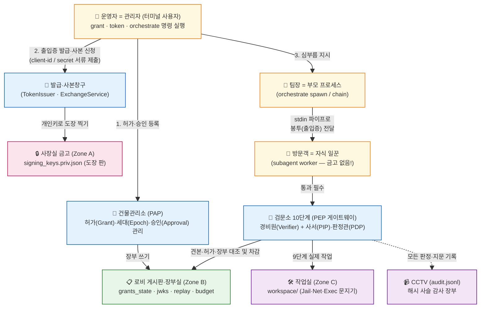
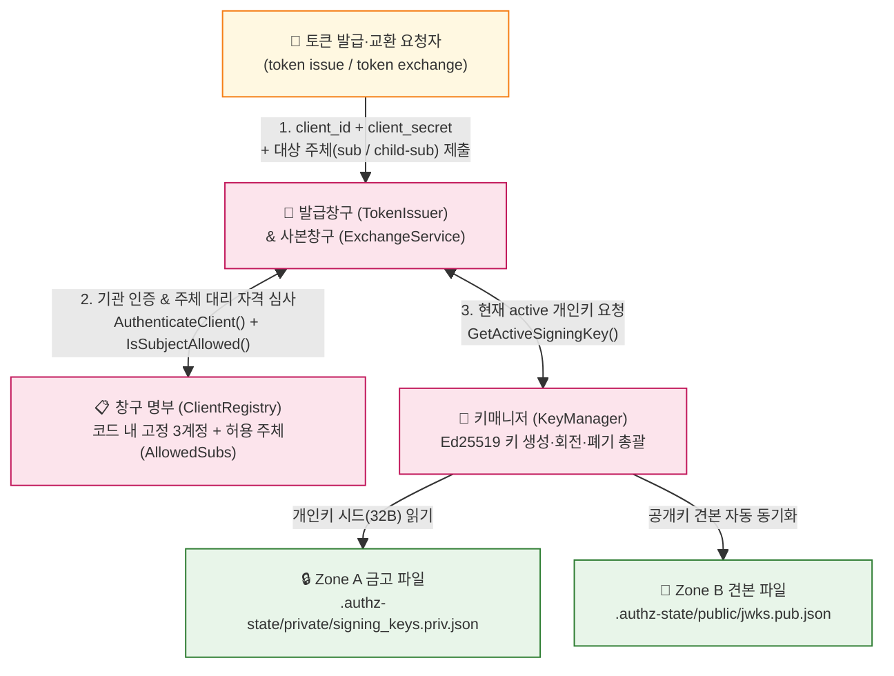
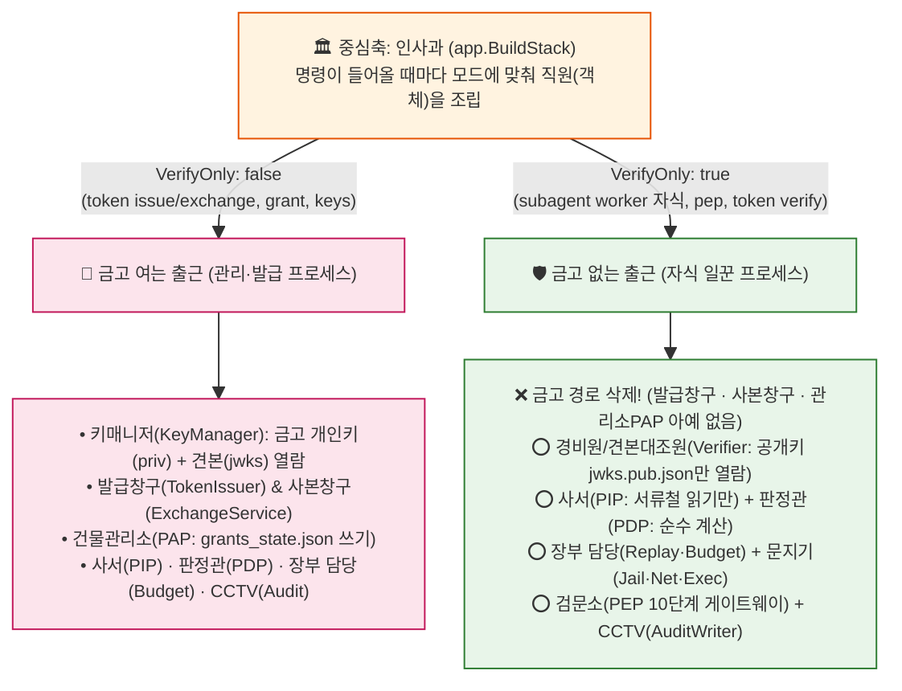
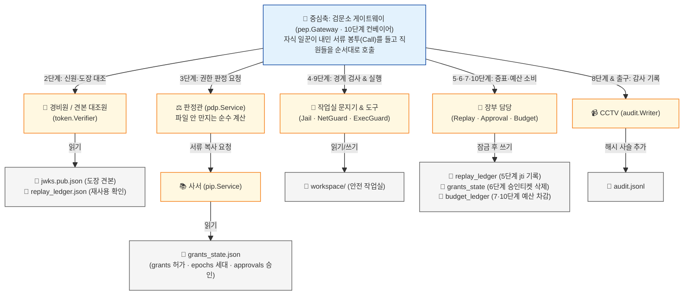

# 010. 요청 하나의 일생 — 건물 방문기로 보는 전체 지도 (누가 보냈고, 어디로 들어가, 누구를 만나, 무엇을 남기나)

> **이 문서의 자리**: 001~009가 부품을 하나씩 깊게 판 책이라면, 이 문서는 그 부품들을 **요청 하나의 일생이라는 한 줄기** 위에 올려놓는 지도입니다. 처음 읽는 사람은 이 문서를 먼저 읽고, 궁금한 직원(부품)이 생기면 3부 끝의 「더 깊이」 링크로 해당 권으로 넘어가면 됩니다.  
> **그림과 표기 규칙**: 중심축(사람·인사과·검문소)을 기준으로 전체 가족 관계를 한눈에 보여주는 **핵심 관계도(Mermaid)**를 먼저 제시하고, 세부 계층은 **들여쓰기 목록**으로, 상호작용은 **표**로 보입니다. 또한 비유어가 나올 때마다 **`비유(실제 코드·파일 정체)`**를 괄호로 병기하여 길을 잃지 않게 합니다.  
> **기준 시점**: 2026-11-10의 코드. 사실의 정본은 언제나 코드입니다.

---

## 💡 사용자의 질문 (원문 요지 보존)

> 하나의 요청이 시작되어 결론까지 이르는 과정을 설명하면 된다. 패킷의 생애와 같다. 패킷은 저절로 생기지 않는다. 왜 생길까? 누구에 의해서? (…) zone abc가 있는데 그게 어디에 저장되는지 말을 안 한다. zone에 저장된 파일을 누가 읽고 쓰는지 알려주지 않고, 알려주더라도 맥락 없이 부분만 알려준다.  
> 내가 어떤 회사에 볼일 보러 간다면 누가 나를 보냈고 볼일이 무엇인가? 어디를 통해 들어가서 어디서 체크인을 하고 무엇을 검사받고 어디를 통해서 누구를 어떻게 찾는가? (…) 무엇이 소지 가능하고 안 되는가? 맡기면 그건 어디에 보관되고 나중에 어떻게 찾을 수 있는가?  
> 이것은 주인공 시점, 즉 부모 프로세스나 자식, Request나 Call 객체의 시점이다. 이게 먼저이고 그다음은 안내데스크 입장에서, 경비원 입장에서, 엘리베이터 입장에서 설명하면 된다. 키매니저가 무엇인지 알려면 키매니저 입장에서, 그리고 그 건물관리소에서 키매니저를 왜 어떻게 어디에 배치했고 누가 오면 어떻게 대응하는지 (…) 둘 다 파악해야 한다.  
> jwt 토큰이 어떻게 생긴지는 알겠는데 이걸 누가 어디서 만들고 어디서 어떻게 받는지 아직도 모른다.

---

## 0장. 모든 설계 이전에 ‘사람’이 있다

> ### 🧭 먼저 알고 읽는 등장인물 3대 전제 (누가 누구인가?)
> 본문에서 비유가 나올 때 헷갈리지 않도록 가장 중요한 사실 세 가지를 먼저 못 박고 출발합니다.
> 1. **「운영자 = 관리자 = 사용자」는 모두 같은 사람입니다**: 이 프로그램에는 별도의 관리자 서버나 운영자 로그인 계정이 없습니다. **지금 내 컴퓨터 터미널 앞에 앉아 `authz-harness ...` 명령어를 직접 치는 사람(OS 사용자 본인) 또는 상위 자동화 스크립트**가 곧 운영자이자 관리자입니다. 규칙을 등록할 때는 `관리자`, 일꾼에게 심부름을 시킬 때는 `운영자`라고 부를 뿐입니다.
> 2. **「창구 기관(`client-orchestrator` 등)」은 실행 중인 프로세스가 아니라 서류상 아이디/비밀번호입니다**: 출입증을 발급받을 때 적는 `-client-id client-orchestrator -client-secret ...`은 내 컴퓨터에 그런 이름의 프로세스가 떠 있어야 한다는 뜻이 전혀 아닙니다. 관공서 창구에 제출하는 **사전 등록된 법인 사업자번호와 비밀번호(코드 안 명부에 적힌 3개 계정)**일 뿐입니다.
> 3. **「허가 규정(`Grant`)」과 「출입증(`Token`)」은 다릅니다**: `grant create`로 만드는 **허가 규정(`Grant`)**은 경비실 컴퓨터 장부(`grants_state.json`)에 *"앞으로 `worker-01`은 `plan.txt`를 읽어도 좋다"*고 한 줄 적어 두는 **장부 등록**이고, `token issue`로 만드는 **출입증(`Token`)**은 일꾼 손에 실제로 쥐여 보내는 **암호화 서명 신분증(JWT 문자열)**입니다. 장부에만 등록(`grant create`)해 두고 손에 출입증(`token issue`)이 없으면 아무 일도 할 수 없으며, 반대로 출입증이 있어도 장부에 허가가 없으면 검문소에서 쫓겨납니다.

### 이 요청은 왜 태어나는가

요청은 저절로 생기지 않습니다. 출발점은 언제나 **사람(운영자 = 터미널 사용자)**입니다. 운영자는 AI 에이전트(또는 자동화 스크립트)에게 일을 맡기고 싶습니다. 예를 들어 「`worker-01`이라는 일꾼에게 `workspace/docs/plan.txt`를 읽혀서 내용을 가져와라」입니다.

그런데 운영자는 일꾼을 믿지 못합니다. 일꾼은 내 컴퓨터에서 도는 별도 프로세스이고, 내가 한 줄씩 감시할 수 없습니다. 그래서 운영자는 일꾼에게 **「이 파일 하나만 읽어도 된다」는 증명서(출입증 = 서명된 JWT 액세스 토큰)**만 들려 보내고, 건물 안의 직원들이 그 증명서를 **매번 검사**하게 만듭니다. 그리고 그 모든 과정이 **CCTV(감사 장부 = `audit.jsonl`)**에 찍히게 합니다.

이 문서는 그 요청 하나를 주인공으로 삼아, 다음 순서로 따라갑니다.

1. **누가 보냈나**: 운영자(터미널 사용자)가 미리 **관리소(`PAP` · `grants_state.json` 서류철)**에 「worker-01은 plan.txt를 읽어도 된다」고 **허가 규정(`Grant`)**을 등록해 둡니다(`grant create`).
2. **출입증을 어디서 받나**: **발급창구(`TokenIssuer` · `token issue`)**에 서류상 기관 아이디·비밀번호(`client-id`/`client-secret`)를 내고 전자서명된 **원본(루트) 출입증(JWT 토큰)**을 받고, 필요하면 **사본 발급창구(`ExchangeService` · `token exchange`)**에서 권한을 깎은 **더 작은 사본 출입증(축소 위임 JWT)**을 만듭니다.
3. **어떤 통로로 들어가나**: **팀장(부모 프로세스 · `orchestrate spawn`)**이 **방문객(자식 프로세스 · `subagent worker`)**을 띄우고, 출입증이 든 서류 봉투(JSON)를 **문 아래 틈(`stdin` 파이프)**으로 한 장 밀어 넣습니다.
4. **어디서 체크인하고 무엇을 검사받나**: 자식 프로세스 안의 **검문소 10개(`PEP` 게이트웨이 · `pep.Gateway`)**를 차례로 지납니다.
5. **누구를 어떻게 만나나**: **작업실(`workspace/` 폴더 + `jail.Jail` 문지기)**에서 실제로 파일을 읽습니다.
6. **무엇을 맡기고 어디에 기록되나**: 한 번 쓴 출입증 고유 일련번호(`jti`)는 **「사용 완료 장부(`.authz-state/public/replay_ledger.json`)」**에, 깎인 호출·바이트 예산은 **「예산 장부(`.authz-state/public/budget_ledger.json`)」**에, 모든 통과·거부 판정은 **CCTV(`audit.jsonl`)**에 남습니다.
7. **어떻게 돌아오나**: 결과를 **문 아래 틈(`stdout` 파이프)**으로 돌려주고, 부모 프로세스가 받아 내 터미널 화면에 찍습니다.

### 이 문서를 읽는 법

- **2부(주인공 시점)**를 먼저 끝까지 읽으십시오. 장면마다 똑같은 네 꼬리표가 붙습니다: **누가 / 어느 파일을 읽고 쓰나 / 어떤 키·토큰을 건드리나 / 화면·CCTV에 무엇이 남나**.
- 그다음 **3부(직원 시점)**에서 같은 사건을 관리소(`PAP`)·키매니저(`KeyManager`)·경비원(`Verifier`) 입장에서 다시 봅니다.
- 길을 잃으면 **1부-2의 전체 가족 관계도**와 **5부의 지도**(파일 계층도, 코드 계층도, 읽기/쓰기 표)로 돌아오십시오.

---

## 1부. 이 건물은 무엇이고, 왜 이렇게 생겼나

### 1. 건물 하나 = 내 컴퓨터의 레포 폴더 하나 (데몬 서버가 없는 단일 CLI 바이너리 구조)

> **[개발자 시점 실제 동작]**
> - 이 프로젝트는 백그라운드 데몬이나 DB 서버 없이, CLI 명령(`authz-harness ...`)을 실행할 때마다 **단일 의존성 조립 함수(`app.BuildStack`, Composition Root)**가 필요한 Go 구조체 그래프(`AppStack`)만 메모리에 초기화(비유: **출근**)하고, 명령 실행이 끝나면 프로세스가 즉시 종료되어 메모리에서 사라지는(비유: **퇴근**) **Stateless 프로세스 + 파일 기반 상태 저장소(`.authz-state/*.json`, `audit.jsonl`)** 아키텍처입니다.
> - 따라서 이 문서에서 **「인사과가 직원을 출근시키고 퇴근한다」**는 표현은 **`app.BuildStack()`이 해당 CLI 서브커맨드에 필요한 컴포넌트 객체만 생성·주입하여 실행한 뒤 프로세스를 종료한다**는 뜻입니다.

이 프로그램에는 **늘 켜져 있는 서버가 없습니다.** `authz-harness`라는 실행 파일 하나가 있고, 명령을 칠 때마다 켜졌다가 일을 마치면 꺼집니다. 건물로 말하면 **상주 직원이 없는 건물**입니다. 명령 한 번이 들어올 때마다 필요한 직원(Go 객체)만 **출근(메모리에 `AppStack` 객체 초기화·조립)**해서 자리를 잡고, 일이 끝나면 **퇴근(CLI 프로세스 종료 및 메모리 해제)**합니다. 직원이 퇴근해도 사라지지 않는 것은 **벽에 붙은 게시판과 서랍 속 장부(디스크 JSON/JSONL 파일)**뿐입니다. 그래서 「누가 무엇을 기억하나」의 답은 언제나 「디스크 어느 파일에 적혀 있나」입니다.

직원을 출근시키는 곳은 한 군데입니다. 명령마다 **인사과(단일 의존성 조립 함수 · `app.BuildStack`)**가 「오늘은 어떤 직원이 필요한가」를 보고 직원들을 정해진 순서대로 앉힙니다:
① **장부 서랍 준비**(`.authz-state/` 폴더 생성) → ② **CCTV 켜기**(`audit.Writer` · `audit.jsonl`) → ③ **키매니저**(`keys.Manager` · 도장 관리) → ④ **관리소**(`pap.Service` · 허가 등록)·**사서**(`pip.Service` · 서류 복사)·**판정관**(`pdp.Service` · 가부 결정) → ⑤ **발급창구**(`token.Issuer` / `exchange.Service`)·**장부 담당**(`ReplayLedger` / `BudgetLedger`) → ⑥ **작업실 문지기**(`jail.Jail` / `netguard.Guard` / `execguard.Guard`)·**검문소**(`pep.Gateway` 10단계). (구현: [internal/app/builder.go](../../internal/app/builder.go) · `BuildStack`)

### 2. 한눈에 보는 건물 전체 가족 관계도와 비유 대응표 (이 문서 전체에서 고정)

십수 개의 직원과 장부를 글자로만 읽으면 누가 중심이고 어떻게 연결되는지 파악하기 어렵습니다. 먼저 **운영자(사람)**를 중심으로 **창구(관리소·발급창구)**, **팀장(부모) → 방문객(자식) → 검문소(`PEP`)**, 그리고 **3대 구역(Zone A 금고 · Zone B 장부실 · Zone C 작업실/CCTV)**이 어떻게 맞물려 돌아가는지 전체 가족 관계도를 한눈에 보십시오.



억지 비유를 피하려고 대응을 처음에 한 번만 정하고 끝까지 바꾸지 않습니다. 대응이 없는 것은 비유 없이 그냥 부릅니다. 한눈에 찾기 쉽도록 **① 사람과 프로세스**, **② 건물 안 직원(컴포넌트)**, **③ 서류·증표와 디스크 장부** 세 표로 나누어 정리합니다.

#### ① 사람과 프로세스

| 건물에서 (비유) | 이 프로그램에서 (실제 정체) | 앉는 곳 (패키지 / 파일) |
|---|---|---|
| **방문객을 보내는 사람 (운영자 = 관리자)** | 터미널에서 명령어를 치는 OS 사용자 본인 (별도 로그인 계정 없음) | `cmd/authz-harness`, `internal/cli` |
| **심부름을 시키는 팀장** | 부모 프로세스 (`orchestrate spawn`, `orchestrate chain`, `mcp serve`) | `internal/cli`, `internal/orchestrator` |
| **실제 방문객 (심부름꾼·일꾼)** | 자식 프로세스 (`subagent worker`) — 금고(Zone A) 경로 없이 깨어남 | `internal/subagent` |
| **엘리베이터·통로** | 자식 프로세스 생성, `stdin`/`stdout` 파이프, OS 커널 격리(Seatbelt/Landlock) | `internal/orchestrator`, `internal/confinement` |

#### ② 건물 안 직원 (컴포넌트)

| 건물에서 (비유) | 이 프로그램에서 (실제 정체) | 앉는 곳 (패키지 / 파일) |
|---|---|---|
| **인사과 (단일 조립소)** | 명령마다 필요한 직원만 출근시키고 자식에게는 금고를 차단하는 빌더 (`BuildStack`) | `internal/app/builder.go` |
| **건물관리소 (출입 허가 등록·승인 접수)** | **PAP** (`pap.Service` — 허가 등록·회수, 세대 올리기, 1회용 승인 티켓 (Approval)발급) | `internal/authz/pap` |
| **관리소 서류철을 꺼내 주는 사서** | **PIP** (`pip.Service` — 서류철에서 해당 주체 몫만 읽어 스냅샷 복사본 생성) | `internal/authz/pip` |
| **판정관 (서류만 보고 허가/불가/사람 확인 판정)** | **PDP** (`pdp.Service` — 파일·시계를 안 만지고 스냅샷과 토큰만 대조하는 순수 함수) | `internal/authz/pdp` |
| **키매니저 (도장 만들기·교체·폐기)** | **KeyManager** (`keys.Manager` — Ed25519 서명키 생성·회전·폐기 및 금고·견본 동기화) | `internal/authn/keys` |
| **출입증 발급창구 / 사본 발급창구** | **TokenIssuer** (`token issue`) / **ExchangeService** (`token exchange` 8단계 축소 위임) | `internal/authn/token`, `internal/authn/exchange` |
| **창구 명부 & 창구 기관** | **ClientRegistry** — 실행 중인 프로세스가 아니라 코드에 고정된 3개 기관 계정(`client-orchestrator`, `client-subagent`, `client-admin`)과 비밀번호 명부 | `internal/authn/token/client.go` |
| **경비원 / 견본 대조원** | **Verifier** (`token.Verifier` — 공개키 견본으로 출입증 전자서명·만료·재사용 대조) | `internal/authn/token/verifier.go` |
| **안내데스크·검문소 10개** | **PEP 게이트웨이** (`pep.Gateway` — 입구 1개·출구 1개의 10단계 컨베이어 벨트) | `internal/authz/pep` |
| **작업실과 문지기 3총사** | `workspace/` 폴더 + 파일 문지기(`jail.Jail`), 네트워크 문지기(`netguard.Guard`), 실행 문지기(`execguard.Guard`) | `internal/jail`, `internal/netguard`, `internal/execguard` |

#### ③ 서류·증표와 디스크 장부

| 건물에서 (비유) | 이 프로그램에서 (실제 정체) | 앉는 곳 (패키지 / 파일) |
|---|---|---|
| **방문객이 들고 다니는 서류 봉투** | 요청 한 건 (`stdin`으로 들어온 `SubagentRequest` JSON → 검문소 안의 `pep.Call` 상태 봉투) | `internal/subagent/protocol.go`, `internal/authz/pep` |
| **관리소 허가 규정 (`Grant`)** | **손에 쥐는 출입증이 아님!** 서류철(`grants_state.json`)에 등록된 상시 허용 규칙 한 줄 | `internal/domain/grant.go` |
| **원본(루트) 출입증 vs 사본 출입증** | **서명된 JWT 액세스 토큰** (`token issue`로 처음 뽑은 원본 vs `token exchange`로 권한을 줄이고 `act` 계보를 박은 사본) | `internal/authn/token`, `internal/domain/token.go` |
| **1회용 승인 티켓 (`Approval`)** | 위험 작업(`-requires-approval`) 통과를 위해 서류철(`grants_state.json`)에 넣어두는 1회용 허락 쪽지 (검문소 6단계에서 즉시 삭제) | `internal/domain/approval.go`, `internal/authz/state/approval.go` |
| **사장실 금고 (Zone A)** | `.authz-state/private/` 폴더 (`0700`) — ① 출입증 도장 판(`signing_keys.priv.json`) + ② CCTV 봉인 도장 판(`audit_signing_key.priv.json`) | `internal/authn/keys`, `internal/audit/checkpoint` |
| **로비 게시판·장부실 (Zone B)** | `.authz-state/public/` 폴더 (`0755`) — 아래 4종의 공개 견본과 장부 파일이 놓이는 곳 | 여러 직원이 공유 |
| **도장 견본 게시판 (Zone B-①)** | `.authz-state/public/jwks.pub.json` (출입증 공개키 목록) & `audit_verification_key.pub.json` (CCTV 봉인 공개키) | `internal/authn/keys`, `internal/audit/checkpoint` |
| **관리소 서류철 (Zone B-②, 3칸짜리)** | `.authz-state/public/grants_state.json` — 한 파일 안에 **`grants`(허가 규정)**, **`epochs`(세대 번호)**, **`approvals`(1회용 승인 티켓)** 세 칸이 들어 있음 | `internal/authz/state/store.go` |
| **사용 완료 장부 (Zone B-③)** | `.authz-state/public/replay_ledger.json` — 한 번 통과한 출입증 일련번호(`jti`)를 적어 재사용을 막는 원장 | `internal/authn/token/replay.go` |
| **예산 장부 (Zone B-④)** | `.authz-state/public/budget_ledger.json` — 예산 출입증(`jti`)별 총량·남은 호출 횟수·바이트를 적는 원장 | `internal/authn/budget/ledger.go` |
| **서랍 자물쇠** | `flock` 파일 잠금(`.lock`) + 임시파일 쓰기(`*.tmp.*`) → `fsync` → 원자적 이름 바꿔치기(`rename`) | `internal/storage` |
| **CCTV 녹화본 (Zone C)** | `audit.jsonl` (해시 사슬 감사 장부) & `.authz-state/public/audit_checkpoint.json` (봉인 서명본) | `internal/audit` |
| **건물 공용 어휘집 (서식 양식)** | 도메인 모델 (모든 직원이 공통으로 쓰는 구조체·상수·에러 사전) | `internal/domain` |

### 3. 레포지토리 전체 폴더 구조와 `.authz-state/` 숨김 폴더의 정체 · 파일 조작 전수 지도

#### (가) 이 레포지토리에는 어떤 폴더들이 있고, `.authz-state/`는 대체 무엇인가?

처음 레포지토리(`authz-harness/`)를 열었을 때 보이는 일반 폴더들과, 프로그램을 실행할 때 생기는 숨김 폴더(`.authz-state/`)의 역할을 먼저 구분해야 전체 그림이 잡힙니다.

1. **소스 코드와 문서 폴더 (`cmd/`, `internal/`, `docs/`, `scenarios/`)**:
   - `cmd/authz-harness/`와 `internal/`은 Go 프로그램 소스 코드입니다. `go build`로 컴파일하면 **`authz-harness`라는 단일 실행 파일(바이너리) 1개**가 됩니다. 실행 중에는 이 소스 폴더들의 파일을 읽거나 고치지 않습니다.
   - `docs/`는 설계·보고서·작동원리 문서이고, `scenarios/`는 자동 검증(`authz-harness run`)용 시나리오 정의 폴더입니다.
2. **작업 샌드박스 폴더 (`workspace/` — Zone C 작업실)**:
   - 자식 워커 프로세스(`subagent worker`)가 `file:read`, `file:write` 명령을 수행할 때 **유일하게 접근이 허락된 일반 폴더**입니다(예: `workspace/docs/plan.txt`). 워커는 이 폴더 바깥의 어떤 파일도 읽거나 쓸 수 없도록 경로 감옥(`jail.Jail`)에 갇힙니다.
3. **감사 녹화본 파일 (`audit.jsonl` — 레포 루트)**:
   - 모든 명령과 인가 판정 결과가 한 줄씩 끝에 추가(Append)되는 SHA-256 해시 체인 로그 파일입니다.
4. **숨김 상태 폴더 (`.authz-state/` — 데몬 없는 CLI의 로컬 상태 데이터베이스)**:
   - **정체와 존재 이유**: 이 프로그램은 뒤에서 계속 떠 있는 서버(데몬)나 외부 데이터베이스(MySQL, Redis 등)가 없습니다. 명령을 한 번 치면 프로세스가 켜졌다가 0.01초 만에 꺼집니다. 그렇다면 방금 등록한 출입허가(`Grant`), 방금 만든 암호화 서명키(`Ed25519`), 이미 사용한 토큰 일련번호(`jti`), 남은 예산(`Budget`)을 **다음 명령이 실행될 때 어떻게 기억할까요?**
   - 바로 그 기억을 보관하기 위해 프로그램이 작업 디렉터리 밑에 자동으로 만드는 **로컬 파일 데이터베이스 폴더가 `.authz-state/`**입니다. 일반 작업 파일(`workspace/`)과 섞이지 않고 실수로 건드리지 않도록 폴더 이름을 점(`.`)으로 시작하는 숨김 폴더로 만들었으며, 보안 등급에 따라 그 안을 두 구역으로 엄격히 쪼개 두었습니다:
     - **`.authz-state/private/` (Zone A 금고, 폴더 권한 `0700`)**: 토큰과 감사 체크포인트에 전자서명(도장)을 찍는 **비공개 개인키(`*.priv.json`)**만 보관하는 특권 구역입니다. 자식 워커에게는 이 폴더 경로조차 알려주지 않으며 OS 커널 샌드박스(`-confine`)로 접근을 원천 봉쇄합니다.
     - **`.authz-state/public/` (Zone B 장부실, 폴더 권한 `0755`)**: 서명 검증용 **공개키 견본(`jwks.pub.json`)**과 **인가 정책·세대·승인 상태(`grants_state.json`)**, **재사용 방지 장부(`replay_ledger.json`)**, **예산 장부(`budget_ledger.json`)**를 보관하는 공유 원장 구역입니다.

2부에서 *"서류철에 적는다, 금고에서 꺼낸다, 잠금을 걸고 임시 파일로 바꿔치기한다"*는 설명을 읽기 전에, **내 컴퓨터 작업 디렉터리 안에 실제로 어떤 폴더와 파일들이 언제 만들어지고 언제 지워지는지** 전체 계층도를 펼쳐 보겠습니다.

```text
authz-harness/ (레포지토리 루트 — 명령어를 실행하는 작업 디렉터리)
│
├── cmd/ , internal/                    [Go 소스 코드] 컴파일되어 `authz-harness` 단일 실행 파일이 됨 (런타임에 조작 안 함)
├── docs/ , scenarios/                  [문서 및 E2E 시나리오]
│
├── .authz-state/                       [숨김 폴더: 로컬 상태 DB] 점(.)으로 시작해 일반 ls에는 안 보임 (ls -la로 확인)
│   │                                   처음엔 없다가 첫 명령 실행 시 BuildStack이 자동 생성
│   │
│   ├── private/                        [Zone A: 비공개 특권 구역] (폴더 권한 0700 — 소유자만 접근)
│   │   │                               워커(자식 프로세스)에게는 경로조차 전달되지 않고 커널 격리(Seatbelt/Landlock)로 차단됨
│   │   ├── signing_keys.priv.json      [키 파일, 0600] JWT 토큰 서명용 Ed25519 개인키 시드(32B)와 키 상태(active/verify-only/retired)
│   │   │                               • 생성: 첫 발급/키 명령 시 EnsureDefaultKey()가 자동 생성 (영구 보존)
│   │   ├── signing_keys.priv.json.lock [잠금 파일, 0600] 개인키+공개키 동시 갱신 시 flock 배타 잠금용 0바이트 빈 파일 (WithFileLock이 생성)
│   │   └── audit_signing_key.priv.json [키 파일, 0600] 감사 로그 체크포인트 서명 전용 Ed25519 개인키 (토큰 서명키와 별개)
│   │                                   • 생성: `audit checkpoint` 첫 실행 시 자동 생성 (영구 보존)
│   │
│   └── public/                         [Zone B: 공개 검증·상태 원장 구역] (폴더 권한 0755)
│       ├── jwks.pub.json               [키 파일, 0644] 토큰 서명 검증용 Ed25519 공개키 목록 (개인키 바이트 없음)
│       │                               • 생성/갱신: signing_keys.priv.json이 바뀔 때마다 같은 락 안에서 자동 재계산·덮어쓰기
│       ├── jwks.pub.json.lock          [잠금 파일, 0600] 검증 전용 프로세스(워커 등)가 공개키를 읽을 때 쓰는 flock 잠금 파일
│       │
│       ├── grants_state.json           [JSON 원장, 0644] 인가 정책 상태 파일 — 한 파일 안에 3개 JSON 필드가 들어 있음:
│       │                               ① "grants": 상시 권한 허가 목록 (`grant create/revoke`)
│       │                               ② "epochs": 주체별 보안 세대 번호 (`grant bump-epoch`)
│       │                               ③ "approvals": 1회용 사람 승인 티켓 목록 (`approval grant`로 추가 → PEP 6단계에서 즉시 삭제)
│       ├── grants_state.json.lock      [잠금 파일, 0600] grants_state.json 읽기(공유락)/쓰기(배타락) 동기화 파일
│       │
│       ├── replay_ledger.json          [JSON 원장, 0644] 이미 사용된 토큰 일련번호(jti)와 만료 시각 기록 (재전송 공격 차단)
│       │                               • 생성/삭제: PEP 5단계 통과 시 jti 추가, 만료 시각(exp) 지난 항목은 다음 쓰기 때 자동 청소(GC)
│       ├── replay_ledger.json.lock     [잠금 파일, 0600] replay_ledger.json 동기화 파일
│       │
│       ├── budget_ledger.json          [JSON 원장, 0644] 예산 토큰(jti)별 초기 한도·남은 호출 횟수·읽기/쓰기 바이트 잔액
│       │                               • 생성/갱신: 예산 토큰 발급/교환 시 등록, PEP 7·10단계에서 차감
│       ├── budget_ledger.json.lock     [잠금 파일, 0600] budget_ledger.json 동기화 파일
│       │
│       ├── audit_verification_key.pub.json [키 파일, 0644] 감사 체크포인트 검증용 공개키 (`audit checkpoint` 첫 실행 시 생성)
│       ├── audit_checkpoint.json       [JSON 서명본, 0644] 특정 시점의 audit.jsonl 줄 수·마지막 해시에 서명한 봉인 파일
│       │
│       └── *.json.tmp.<난수>           [임시 파일 — 생성 직후 즉시 사라짐!] (예: grants_state.json.tmp.3819204)
│                                       • 정체: AtomicWriteFile()이 JSON 파일을 수정할 때 원본을 직접 덮어쓰지 않고
│                                         같은 폴더에 임시 파일로 먼저 쓴 뒤 fsync → os.Rename(원자적 교체)할 때 잠깐 생기는 파일.
│                                       • 수명: Rename 성공 즉시 원본 파일명으로 흡수되어 사라지고, 실패해도 defer os.Remove로 즉시 삭제됨.
│
├── audit.jsonl                         [JSONL 감사 로그, 0644] 모든 명령·인가 판정·실행 결과가 한 줄씩 추가(Append)되는 SHA-256 해시 체인 로그
├── audit.jsonl.lock                    [잠금 파일, 0600] 여러 프로세스가 동시에 audit.jsonl에 쓸 때 줄이 섞이지 않게 막는 배타 잠금 파일
├── audit.jsonl.partial-<시각>          [복구 보관 파일 — 평시엔 없음] 프로세스 강제 종료로 audit.jsonl 마지막 줄이 반쯤 쓰여 깨졌을 때,
│                                       `audit recover` 명령이 깨진 꼬리 조각을 버리지 않고 별도 파일로 잘라내 보존한 흔적
│
└── workspace/                          [Zone C: 작업 샌드박스 폴더] 워커의 파일 읽기/쓰기 도구(file:read, file:write)가 접근 허용된 유일한 폴더
    └── docs/plan.txt                   에이전트가 실제로 읽거나 쓰는 대상 파일 (역시 쓸 때는 plan.txt.tmp.<난수> 생성 후 원자적 교체)
```

#### (나) 누가 `.authz-state/` 안의 어느 파일을 어떻게 조작(생성·읽기·수정·삭제)하나?

각 명령과 컴포넌트가 `.authz-state/` 안의 어떤 파일을 언제 만들고 어떻게 바꾸는지 한눈에 보는 조작 명세표입니다.

| 파일 경로 | 담당 컴포넌트 | 언제 생성·수정·삭제(조작)하나? | 누가 읽어가나? |
|---|---|---|---|
| `.authz-state/private/signing_keys.priv.json` | `keys.Manager` ([keys/store.go](../../internal/authn/keys/store.go)) | ① **자동 생성**: 첫 명령(`VerifyOnly: false`) 실행 시 첫 Ed25519 키쌍(`active`) 생성 / ② **수정(추가·상태변경)**: `keys rotate` 실행 시 새 `active` 키 추가 + 기존 키 `verify-only`로 변경, `keys revoke` 실행 시 해당 키 `retired`로 변경 | `TokenIssuer` (`token issue`), `ExchangeService` (`token exchange` 7단계) *(자식 워커는 접근 불가)* |
| `.authz-state/public/jwks.pub.json` | `keys.Manager` ([keys/store.go](../../internal/authn/keys/store.go)) | **자동 투영(덮어쓰기)**: `signing_keys.priv.json`이 생성·회전·폐기될 때마다 **같은 락(`signing_keys.priv.json.lock`) 안에서** 개인키(`priv`) 필드만 제거한 공개키 목록으로 즉시 덮어씀 | `token.Verifier` (PEP 2단계, `token verify`), `ExchangeService` (3단계 부모 토큰 검증), `keys list` |
| `.authz-state/public/grants_state.json` *(내부 3칸: `grants`, `epochs`, `approvals`)* | `pap.Service` & `pep.Gateway` ([state/store.go](../../internal/authz/state/store.go)) | ① **`grants` 칸 조작**: `grant create` 시 새 허가 객체 추가(`active`), `grant revoke` 시 상태를 `revoked`로 수정(삭제 안 함) / ② **`epochs` 칸 조작**: `grant bump-epoch -sub <주체>` 시 해당 주체의 세대 번호를 `+1` 증가 / ③ **`approvals` 칸 조작**: `approval grant` 시 1회용 승인 티켓 추가(만료 티켓 청소 포함) → **PEP 6단계 통과 시 해당 티켓을 파일에서 즉시 삭제(찢음)** | `pip.Service` (사서)가 읽어서 PEP 3단계 `pdp.Service`에 스냅샷 전달 및 `ExchangeService` 4단계에 부모·조상 `epochs` 전달, `grant list`, `approval list` |
| `.authz-state/public/replay_ledger.json` | `token.FileReplayLedger` ([token/replay.go](../../internal/authn/token/replay.go)) | **추가 및 만료 삭제(GC)**: PEP 5단계(`05_replay_consume`)에서 일반(비예산) 토큰이 통과할 때 `{jti, consumed_at, expires_at}`를 기록하고, 이미 만료 시각(`expires_at`)이 지난 옛날 `jti` 항목들은 파일에서 자동 삭제 | `token.Verifier` (PEP 2단계에서 이미 사용된 `jti`인지 읽기 확인만 수행; `token exchange` 3단계는 소비 안 함) |
| `.authz-state/public/budget_ledger.json` | `budget.FileLedger` ([budget/ledger.go](../../internal/authn/budget/ledger.go)) | ① **초기 등록**: 예산 옵션(`-max-calls` 등)이 붙은 `token issue` 시 루트 토큰 `jti`의 초기 한도 등록 / ② **예약(차감)**: `token exchange` 8단계에서 부모 `jti`의 잔액을 깎아 자식 `jti` 예산 항목을 신설 / ③ **소비·환급**: PEP 7단계에서 호출수·쓰기 바이트 선차감(9단계 실패 시 환급), 10단계에서 읽기 바이트 사후 차감 | `ExchangeService` (8단계 예약 시 확인), `pep.Gateway` (7·10단계 차감 시 확인) |
| `.authz-state/private/audit_signing_key.priv.json` & `public/audit_verification_key.pub.json` | `checkpoint.EnsureKeyPair` ([checkpoint.go](../../internal/audit/checkpoint/checkpoint.go)) | **생성**: `audit checkpoint` 명령을 맨 처음 실행할 때 두 파일이 모두 없으면 Ed25519 키쌍 자동 생성 (영구 보존) | `audit checkpoint` (개인키로 서명), `audit verify -checkpoint` (공개키로 검증) |
| `.authz-state/public/audit_checkpoint.json` | `checkpoint.Create` ([checkpoint.go](../../internal/audit/checkpoint/checkpoint.go)) | **생성·덮어쓰기**: `audit checkpoint` 실행 시 현재 `audit.jsonl`의 줄 수와 마지막 해시에 서명하여 저장 | `audit verify -checkpoint` |

- **① 왜 사용자가 설정 파일을 미리 안 만들어도 되나 (`BuildStack` 자동 부트스트랩)**: 첫 명령이 실행될 때 `BuildStack`이 `.authz-state/public`(`0755`)과 `.authz-state/private`(`0700`) 폴더를 자동으로 만들고, 키가 하나도 없으면 `NewManager`가 첫 Ed25519 키쌍을 만들어 `signing_keys.priv.json`과 `jwks.pub.json`에 저장합니다. 상태 파일(`grants_state.json`, `replay_ledger.json`, `budget_ledger.json`)도 파일이 없으면 빈 상태로 취급했다가 첫 쓰기 시점에 생성합니다.
- **② 왜 임시 파일(`*.tmp.*`)은 `ls`를 해봐도 안 보이나 (`AtomicWriteFile` 원자적 교체)**: JSON 파일을 직접 열고 덮어쓰다가 프로세스가 죽으면 파일이 반만 쓰여 깨집니다. 그래서 [internal/storage/file.go](../../internal/storage/file.go)의 `AtomicWriteFile`은 무조건 같은 폴더에 `<원본이름>.tmp.<난수>` 임시 파일을 만들어 내용을 다 쓰고 디스크에 밀어 넣은(`fsync`) 뒤, OS의 원자적 이름 바꾸기(`os.Rename`)로 원본 파일 위에 한 번에 덮어씁니다. 덮어쓰는 순간 `.tmp.*` 파일은 원본 파일 자체가 되어 사라지고, 도중에 에러가 나도 `defer os.Remove`가 즉시 지우므로 평소에는 보이지 않습니다.
- **③ 왜 `*.lock` 파일은 지워지지 않고 0바이트로 남아 있나 (`WithFileLock`)**: [internal/storage/file.go](../../internal/storage/file.go)의 `WithFileLock`은 대상 파일 옆에 `<원본이름>.lock`이라는 0바이트짜리 빈 파일을 만들고 OS 커널의 `syscall.Flock` 잠금을 겁니다. 작업이 끝나면 잠금(`LOCK_UN`)만 풀고 `.lock` 파일 자체는 다음 프로세스도 잠금 손잡이로 쓸 수 있게 그대로 남겨 둡니다.
- **④ 디스크 어느 파일에도 절대 저장되지 않는 2가지**: 발급된 **JWT 출입증 원문(`eyJ...`)**과 **창구 기관 비밀번호(`client_secret`)**는 디스크의 어떤 JSON 파일이나 로그에도 저장되지 않습니다. 토큰은 발급 시 터미널 `stdout`으로만 출력되고 검증 후에는 일련번호(`jti`)만 장부에 남습니다.

---

### 4. 자식 프로세스가 뜨기 전까지의 심장부 — 키·권한을 쥔 핵심 3총사(`TokenIssuer` ↔ `ClientRegistry` ↔ `KeyManager`)와 `ExchangeService`, 그리고 `VerifyOnly`의 본질

이 시스템을 이해할 때 가장 중요한 사실은 **「자식 프로세스(`subagent worker`)가 깨어나서 검문소(`PEP`)를 통과하는 과정은 이미 앞에서 다 만들어진 토큰을 검사만 하는 후반부일 뿐」**이라는 점입니다. 진짜 핵심은 **자식 프로세스가 독자적으로 실행되기 전까지, 누가 어떤 자격으로 토큰을 신청하고, 어떻게 부모의 권한을 자식용으로 쪼개며(`ExchangeService`), 어디서 개인키를 꺼내 도장(전자서명)을 찍는가**에 있습니다.

#### (가) 키와 발급 자격을 쥔 Zone A의 심장부: `TokenIssuer` ↔ `ClientRegistry` ↔ `KeyManager` (+ `ExchangeService`)

아무나 다짜고짜 *"토큰 주세요"*라고 해서 토큰이 나오지 않습니다. 루트 토큰을 찍는 **발급창구(`TokenIssuer`)**와 자식용 축소 토큰을 찍는 **사본 발급창구(`ExchangeService`)** 뒤에는 **키와 발급 권한을 쥐고 있는 3총사**가 맞물려 돌아갑니다.



**① 창구 명부 (`ClientRegistry` · [internal/authn/token/client.go](../../internal/authn/token/client.go)) — "누가 누구 이름으로 출입증을 신청할 자격이 있는가?"**

- **왜 다짜고짜 토큰을 달라고 하면 안 주나?**: 첫 번째 문지기가 바로 이 `ClientRegistry`입니다. 토큰을 발급받거나(`token issue`) 자식 토큰으로 교환(`token exchange`)하려면 반드시 아래 **사전 등록된 3개 기관 계정(`client_id`)과 비밀번호(`client_secret`)**를 제출해야 하며, 특히 **그 기관이 토큰을 신청할 수 있도록 등록된 대상 주체(`AllowedSubs`)**여야만 합니다.
- 만약 등록되지 않은 주체 이름(예: `client-subagent` 자격으로 `worker-99`나 `hacker`의 토큰을 요청)을 내밀면, 발급창구와 사본창구는 도장 근처에도 가기 전에 **`NO_ACTIVE_GRANT` (`client is not authorized to request tokens for subject ...`, 종료 코드 12)**로 즉시 거부합니다!

| 등록된 기관 ID (`client_id`) | 비밀번호 (`client_secret`) | 대리 허용 주체 명단 (`AllowedSubs`) | 역할 및 제한 |
|---|---|---|---|
| `client-orchestrator` | `orchestrator-secret-key-01` | `["*"]` (모든 주체 이름 허용) | 상위 팀장/오케스트레이터용 창구 자격 |
| **`client-subagent`** | `subagent-secret-key-02` | **`["worker-01", "worker-02", "worker-03"]`** | **하위 위임 전용 창구 자격 — 사전 등록된 `worker-01~03` 외의 주체 이름으로는 절대 토큰을 내주지 않음!** |
| `client-admin` | `admin-secret-key-00` | `["*"]` (모든 주체 이름 허용) | 보안·하네스 관리자용 창구 자격 |

**② 키매니저 (`KeyManager` · [internal/authn/keys/manager.go](../../internal/authn/keys/manager.go)) — "어느 도장(개인키)으로 찍고 어느 견본(공개키)으로 대조할 것인가?"**

- 금고 파일(`.authz-state/private/signing_keys.priv.json`)과 공개 견본 파일(`.authz-state/public/jwks.pub.json`)을 독점 관리합니다.
- `TokenIssuer`가 서명할 때마다 `GetActiveSigningKey()`를 통해 현재 유일한 `active` 상태의 Ed25519 개인키를 내어주고, 나중에 검증기(`Verifier`)가 토큰을 검사할 때는 `GetVerificationKey(kid)`로 공개키를 내어줍니다.

**③ 발급창구 (`TokenIssuer` · [internal/authn/token/issuer.go](../../internal/authn/token/issuer.go)) & 사본 발급창구 (`ExchangeService` · [internal/authn/exchange/service.go](../../internal/authn/exchange/service.go))**

- `TokenIssuer`는 위 `ClientRegistry`(자격 심사)와 `KeyManager`(개인키 공급)를 양손에 쥐고 실제로 JWT(`Header.Payload.Signature`)를 조립해 Ed25519 전자서명을 찍는 유일한 기관입니다.
- `ExchangeService`(`token exchange`) 역시 부모 토큰 검증과 축소 규칙(Downscoping) 검사를 마친 뒤, **7단계(`07_token_issue`)에서 내부적으로 이 `TokenIssuer.IssueToken()`을 호출**하여 자식 토큰을 만들어 냅니다.

#### (나) `VerifyOnly: true`의 진짜 정체 — 왜 이런 플래그를 만들었나? (테스트 하네스의 시뮬레이션 스위치)

문서와 코드를 보면 자식 프로세스(`subagent worker`)나 `pep` 명령을 실행할 때 `app.BuildStack(VerifyOnly: true)`를 부릅니다. 여기서 **「`VerifyOnly`는 파일 권한 문제가 아니라 우리가 자식 프로세스 환경을 테스트·시뮬레이션하기 위해 만든 장치 아닌가?」**라는 질문이 자연스럽게 나옵니다.

- **정답: 맞습니다! `VerifyOnly`는 단일 바이너리 테스트 하네스에서 '발급 서버(Zone A)'와 '일꾼 서버(Zone B)'의 분리를 시뮬레이션하기 위해 만든 소프트웨어 스위치입니다.**
- **왜 필요한가?**:
  1. 실제 대규모 운영 환경이라면 토큰을 발급하는 **인증 서버(Zone A: 금고와 `TokenIssuer`·`ExchangeService`·`KeyManager`·`PAP`가 있는 서버)**와 실제 심부름을 수행하는 **워커 서버(Zone B: 공개키로 토큰만 검증하는 `Verifier`·`PEP`만 있는 서버)**가 아예 **서로 다른 컴퓨터, 서로 다른 프로그램(바이너리)**으로 나뉘어 배포됩니다. 즉, 원래 워커 컴퓨터에는 발급기 코드나 개인키 설정 자체가 없습니다.
  2. 하지만 우리 프로젝트(`authz-harness`)는 **내 컴퓨터 한 대에서, `authz-harness`라는 단일 실행 파일 1개로 부모·발급창구 역할과 자식 일꾼(`subagent worker`) 역할을 모두 시험해야 하는 테스트 하네스**입니다.
  3. 같은 실행 파일 하나로 부모도 띄우고 자식도 띄우다 보니, 자식 워커로 실행될 때 코드가 똑같이 금고 파일(`.authz-state/private/signing_keys.priv.json`)을 열고 `TokenIssuer`나 `ExchangeService`를 메모리에 올려버리면 Zone A와 Zone B가 분리된 환경을 시험할 수 없습니다.
  4. 그래서 조립 함수([internal/app/builder.go](../../internal/app/builder.go) · `BuildStack`)에 **`VerifyOnly: true`라는 시뮬레이션 플래그**를 두어, 자식 워커(`subagent worker`)로 켜질 때는 **메모리에서 개인키 경로(`PrivateKeyPath = ""`)를 지우고 `TokenIssuer`·`ExchangeService`·`PAP` 객체는 아예 생성(`nil`)하지 않도록** 만든 것입니다. (그리고 자식이 Go 객체를 우회해 OS 파일시스템으로 `.authz-state/private/`를 직접 훔쳐보는 것까지 막기 위해 덧씌우는 실제 OS 권한 장치가 `-confine` 커널 샌드박스입니다.)

### 5. 가장 밑바닥의 이유부터

- **왜 금고(Zone A)와 게시판(Zone B)을 나눴나?** 출입증의 진짜 여부는 **도장(서명)**으로 판정합니다. 도장을 **찍는 판(개인키)**을 가진 사람은 출입증을 마음대로 찍어낼 수 있습니다. 그래서 찍는 판은 금고에만 두고, **찍힌 도장이 진짜인지 대조하는 견본(공개키)**만 게시판에 붙입니다. 방문객(자식)은 견본만 볼 수 있고 금고 문은 아예 없습니다. → 그건 왜? 방문객이 탈선해도 **자기 출입증을 스스로 키울 방법이 없게** 하려는 것입니다. 이것이 더 되물을 수 없는 바닥입니다.
- **왜 출입증을 명령줄 인자(argv)가 아니라 표준 입력 파이프(`stdin` · 비유: 문 아래 틈)로 넣나?** 명령줄 인자는 같은 컴퓨터의 다른 사용자도 `ps` 명령으로 볼 수 있습니다. 환경변수도 자식의 자식에게 상속됩니다. `stdin` 파이프는 부모와 그 자식 프로세스 사이의 커널 버퍼에만 흐릅니다.
- **왜 판정관(PDP)은 서랍을 직접 열지 않나?** 판정이 파일 상태·시간·잠금에 따라 흔들리면 같은 질문에 다른 답이 나옵니다. 판정관은 사서(PIP)가 꺼내 준 **복사본(스냅샷)**만 보고 판정하는 **순수 계산**이어서, 시험하기 쉽고 결과를 재현할 수 있습니다.
- **왜 CCTV 기록에 실패하면 일을 멈추나?** 기록 없이 일어난 일은 나중에 「일어났다」고 증명할 수 없습니다. 이 레포의 존재 이유가 「증명」이므로, 기록할 수 없으면 실행하지 않습니다(Fail-Closed).

---

## 2부. 주인공 시점: 요청 하나의 일생 ★

주인공은 「worker-01이 `docs/plan.txt`를 읽고 싶다」는 요청 한 건입니다. 아래 명령들은 기본 경로를 그대로 쓰는 경우입니다(경로는 모두 레포 루트 기준).

### 장면 1. 누가 보냈나 — 관리소에 출입 허가를 등록한다 (인가 정책 등록: `grant create` → `grants_state.json` 갱신)

> **[개발자 시점 실제 동작]**: CLI가 `pap.Service.CreateGrant()`를 호출하여 먼저 `audit.jsonl`에 감사 이벤트(`grant.created`)를 기록한 뒤, `.authz-state/public/grants_state.json.lock`에 `flock` 배타 잠금을 걸고 임시 파일(`grants_state.json.tmp.*`) 생성 → `fsync` → `os.Rename` 원자적 교체로 `grants` 배열에 JSON 객체 1건을 추가하고 프로세스를 종료합니다.

운영자(터미널 사용자)가 관리소 창구(`PAP` · `grant create`)에 신청서를 냅니다.

```bash
authz-harness grant create -sub worker-01 -action file:read -resource docs/plan.txt
```

관리소(`pap.Service`)는 신청서를 검사합니다: 행위(action)가 공식 4종(`file:read`·`file:write`·`net:fetch`·`exec:run`)인지, 경로에 `../` 같은 탈출이 없는지. 통과하면 `grant-<시각>` 번호를 붙여 **관리소 서류철(`.authz-state/public/grants_state.json`의 `grants` 칸)**에 끼우고, CCTV(`audit.jsonl`)에 「허가 생성」을 남깁니다. 위험한 일이면 `-requires-approval`을 붙여 「이 허가로 들어오는 요청은 매번 사람 확인(1회용 승인 티켓)을 받아라」는 표시를 남깁니다.

- **누가**: 운영자(터미널 사용자) → 관리소(`PAP` · `pap.Service`)
- **무엇을 제출해서 무엇을 받나**:
  - **제출**: 주체(`-sub worker-01`), 행위(`-action file:read`), 대상 경로(`-resource docs/plan.txt`), (선택) 승인 필요 여부(`-requires-approval`)
  - **결과**: 화면에 생성된 `Grant ID`(`grant-1731...`)가 출력되고, 디스크 `.authz-state/public/grants_state.json` 파일에 아래 실물 JSON처럼 허가 규정 1건이 기록됩니다.
- **읽고 쓰는 파일**: `.authz-state/public/grants_state.json`의 `grants` 목록에 **쓰기**(잠금 후 원자적 교체), `audit.jsonl`에 **추가**
- **건드리는 키·토큰**: 없음 (관리소 일에는 도장이 필요 없습니다)
- **남는 것**: 화면에 생성된 Grant, CCTV에 `grant.created`

(구현: [internal/cli/grant.go](../../internal/cli/grant.go) · `create` → [internal/authz/pap/service.go](../../internal/authz/pap/service.go) · `CreateGrant`, 서식은 [internal/domain/grant.go](../../internal/domain/grant.go) · `Grant.Validate`)

> 같은 서류철 파일(`.authz-state/public/grants_state.json`)에는 서랍이 세 칸 있습니다: **`grants`(누가 무엇을 해도 되나 — 상시 허가 규정)**, **`epochs`(주체별 세대 번호)**, **`approvals`(사람이 내준 1회용 승인 티켓)**. 세대 번호는 「이 사람을 쫓아내라」(`grant bump-epoch -sub worker-01`) 할 때 1 올라가고, 그 순간 예전 세대 번호가 찍힌 출입증은 전부 무효가 됩니다. 적혀 있지 않은 주체의 세대는 1로 봅니다. (구현: [internal/authz/state/store.go](../../internal/authz/state/store.go) · `GrantsState`, [internal/domain/epoch.go](../../internal/domain/epoch.go) · `Get`)

#### 🔍 실물 확인 1: 출입허가(`grant create`)를 내면 `.authz-state/public/grants_state.json`에 무엇이 어떻게 생기나?

막연히 *"서류철에 적힌다"*고만 하면 뒤에 나오는 토큰 교환(`ExchangeService`)과 검문소(`PEP`)가 여기서 무엇을 꺼내 보는지 알 수 없습니다. 위 명령을 실행하면 `.authz-state/public/grants_state.json` 파일 안에 아래와 같은 **실제 JSON 구조**가 만들어집니다:

```json
{
  "version": 1,
  "updated_at": "2026-11-10T08:00:00Z",
  "grants": [
    {
      "id": "grant-1731225600000000000",
      "subject": "worker-01",
      "action": "file:read",
      "resource": "docs/plan.txt",
      "requires_approval": false,
      "status": "active",
      "created_at": "2026-11-10T08:00:00Z"
    }
  ],
  "epochs": {
    "lead-01": 1,
    "worker-01": 1
  },
  "approvals": []
}
```

- **이 파일의 세 칸이 뒤에서 쓰이는 곳**:
  1. **`"grants"` 배열**: 자식 프로세스(`worker-01`)가 토큰을 들고 검문소 3단계(`PDP`)에 들어왔을 때, 판정관이 *"이 주체(`worker-01`)에게 `file:read` / `docs/plan.txt`에 대한 `active` 허가 규정이 등록되어 있는가?"*를 대조하는 기준표입니다. **여기에 등록되어 있지 않으면 아무리 진짜 토큰을 들고 와도 `NO_ACTIVE_GRANT`(종료 코드 12)로 거부됩니다.**
  2. **`"epochs"` 맵**: 사본 발급창구(`ExchangeService`, 장면 2-b의 4단계)에서 부모 토큰을 자식 토큰으로 쪼개 줄 때, 그리고 검문소 3단계(`PDP`)에서 **부모와 조상, 자식 주체가 도중에 권한 박탈(`grant bump-epoch`)을 당하지 않았는지 실시간으로 대조**하는 세대 번호표입니다.
  3. **`"approvals"` 배열**: `requires_approval: true`인 위험 작업일 때 `approval grant`로 발급한 1회용 승인 티켓이 잠시 머무는 칸이며, 검문소 6단계를 통과하는 즉시 삭제됩니다.

> **💡 잠깐! `grant create`만으로는 왜 아직 아무것도 할 수 없나? 그리고 부모든 자식이든 왜 먼저 등록(허가)을 해야 하나?**
> - **`grant create`는 손에 쥐는 허가증(출입증)을 인쇄하는 명령이 아닙니다.** 회사 총무팀 관리자가 경비실 컴퓨터(`grants_state.json`의 `grants` 칸)를 열어 *"앞으로 `worker-01`이라는 직원은 `docs/plan.txt`를 읽을 수 있도록 허용한다"*라고 **공식 장부에 이름만 한 줄 등록해 둔 상태**입니다.
> - 이 시점에는 장부에 이름만 올라갔을 뿐, 작업자(`worker-01`) 손에는 경비실 게이트를 통과할 **실제 출입증(서명된 JWT 토큰)**이 없습니다. 그래서 이 명령 하나만 쳐서는 아직 파일을 읽거나 쓸 수 없으며, 바로 다음 **장면 2(`token issue`)와 장면 2-b(`token exchange`)에서 출입증을 발급받아 들고 가야** 비로소 행동할 수 있습니다.
> - **반대로 다짜고짜 토큰만 달라고 하거나 허가 등록 없이 행동할 수도 없습니다 (2중 등록 관문)**:
>   1. **발급·교환 창구의 사전 등록(`ClientRegistry.AllowedSubs`)**: 토큰을 신청할 때는 코드에 사전 등록된 기관(`client_id`/`client_secret`)이어야 하고, 특히 하위 창구(`client-subagent`)는 **사전 등록된 `worker-01`, `worker-02`, `worker-03`에게만** 토큰을 내줍니다. 등록 안 된 이름으로 토큰을 달라고 하면 발급·교환 창구 자체가 `NO_ACTIVE_GRANT`로 거부합니다.
>   2. **검문소의 출입허가 등록(`grants_state.json`의 `grants`)**: 설령 상위 창구(`client-orchestrator`)를 통해 토큰을 먼저 발급받았더라도, 자식(`worker-01`)이 수행할 작업이 `grants_state.json`에 `grant create`로 등록되어 있지 않으면 검문소(`PEP` 3단계 `PDP`)에서 `NO_ACTIVE_GRANT`로 100% 차단됩니다.
> - **왜 번거롭게 출입허가(`Grant`)와 출입증(`Token`)을 둘로 분리해 두었을까요?** 만약 손에 쥐여 준 출입증(토큰)만 있고 서버 장부(`grants_state.json`)가 없다면, 직원이 사고를 쳐서 당장 권한을 뺏어야 할 때 토큰 유효기간(예: 30분)이 끝날 때까지 속수무책으로 기다려야 합니다. 둘을 분리해 두면, 긴급 상황 시 장부에서 지워버려(`grant revoke` 또는 `grant bump-epoch`) **출입증 유효기간이 남아 있어도 토큰 교환 단계와 검문소에서 즉시 차단**할 수 있습니다.

### 장면 2. 출입증을 어디서 받나 — 발급창구 (루트 JWT 토큰 서명·발급: `token issue` → `stdout` 출력)

> **[개발자 시점 실제 동작]**: CLI가 인메모리 클라이언트 명부(`ClientRegistry`)에서 `-client-id`/`-client-secret` 및 대상 주체 허용 여부(`IsSubjectAllowed`)를 검증한 뒤, `KeyManager`를 통해 `.authz-state/private/signing_keys.priv.json`에서 `active` 상태의 Ed25519 개인키를 읽어 JWT(`eyJ...`)를 서명하고 터미널 `stdout`으로 출력합니다(디스크에 토큰 원문 파일을 저장하지 않음).

허가가 등록됐다고 바로 들어갈 수 있는 것은 아닙니다. 들어갈 때 보여줄 **원본(루트) 출입증(JWT 토큰)**이 있어야 합니다. 운영자(또는 팀장 역할의 프로그램)가 **발급창구(`TokenIssuer` · `token issue`)**로 갑니다.

```bash
authz-harness token issue -client-id client-orchestrator -client-secret orchestrator-secret-key-01 \
  -sub worker-01 -scope file:read:docs/plan.txt -ttl 30m
```

- **이 명령을 자연어로 풀면**: *"나(`client-orchestrator`)의 등록된 비밀번호(`orchestrator-secret-key-01`)로 신원을 증명할 테니, 실제 작업을 할 `worker-01`에게 `docs/plan.txt` 파일만 딱 30분(`-ttl 30m`) 동안 읽을 수 있는 권한(`-scope`)의 원본 출입증(JWT)을 하나 만들어 줘."*

발급창구 직원(`token.Issuer`)은 핵심 3총사(`TokenIssuer` ↔ `ClientRegistry` ↔ `KeyManager`)의 협동으로 다음 순서로 일합니다.

1. **창구에 온 사람이 등록된 기관인가 (`client-orchestrator` 프로세스가 떠 있어야 하나?)**:
   - 클라이언트 이름(`-client-id`)과 비밀번호(`-client-secret`)를 **창구 명부(`ClientRegistry` · [internal/authn/token/client.go](../../internal/authn/token/client.go))**와 상수 시간(`ConstantTimeCompare`)으로 대조합니다. 명부는 디스크 파일이 아니라 프로그램 코드 안에 고정된 세 줄입니다(`client-orchestrator`, `client-subagent`, `client-admin`). 학습용이라 비밀번호도 코드에 그대로 있습니다.
   - **중요**: 이때 시스템은 내 컴퓨터(OS 메모리)에 `client-orchestrator`라는 이름의 프로세스가 실제로 떠 있는지 여부를 **전혀 확인하지 않습니다.** 관공서 창구에 가서 미리 등록된 **법인 사업자번호(`client-id`)와 인감 비밀번호(`client-secret`)를 서류로 제출하고 직원(`worker-01`) 앞으로 출입증을 떼어 달라고 하는 순수한 서류 심사**입니다.
2. **이 기관이 그 사람 이름으로 출입증을 받을 자격이 있나 (`IsSubjectAllowed` — 왜 다짜고짜 달라고 하면 안 주나?)**:
   - 기관 인증을 통과했더라도 아무 주체 이름으로나 토큰을 내주지 않습니다. `ClientRegistry`의 `AllowedSubs` 명단을 확인하여, `client-subagent`는 사전 등록된 `worker-01`, `worker-02`, `worker-03` 이름으로만 받을 수 있고(다른 이름이면 `NO_ACTIVE_GRANT` 거부), 상위 기관인 `client-orchestrator`와 `client-admin`은 누구 이름으로든(`*`, 예: 팀장 `lead-01`이나 일꾼 `worker-01`) 받을 수 있습니다.
3. **도장 판을 꺼낸다 (`KeyManager.GetActiveSigningKey`)**: 키매니저(`keys.Manager`)에게 「지금 쓰는 도장(`active` 상태 개인키)」을 받습니다. 도장 판은 사장실 금고 파일(`.authz-state/private/signing_keys.priv.json`)에 있습니다. 금고에 도장이 하나도 없는 첫 설치라면 키매니저가 첫 도장을 만들어 금고(`signing_keys.priv.json`)와 공개 견본(`.authz-state/public/jwks.pub.json`)에 동시에 저장합니다. 도장은 있는데 쓸 수 있는(`active`) 도장이 없으면(사용 중이던 도장을 폐기한 뒤) 발급을 거부합니다(16).
4. **출입증 내용을 채운다**: 발급자(`iss=authz-harness`), 주인(`sub=worker-01`), 받는 곳(`aud=authz-harness`), 할 수 있는 일(`scope`), 유효 시간(`iat`·`nbf`·`exp`), **일련번호(`jti`)**, 세대 번호(`epoch`, 기본 1).
5. **도장을 찍는다**: 머리말(`alg=EdDSA`, `typ=at+jwt`, `kid=도장 번호`) + 내용을 금고의 Ed25519 개인키로 서명합니다. 결과가 `eyJ...`로 시작하는 세 토막짜리 문자열(**원본/루트 출입증 = JWT 토큰**)입니다.
6. **CCTV에 남긴다**: 출입증 원문은 남기지 않고 **일련번호(jti)와 요약만** CCTV(`audit.jsonl`)에 남깁니다.

출입증은 **화면(stdout)**에 찍혀 나옵니다. 어디에도 파일로 저장되지 않습니다. 운영자가 복사해서 다음 명령에 넘기는 것이 전부입니다. 「출입증은 누가 어디서 만들고 어디서 받나」의 답이 이것입니다: **발급창구(`TokenIssuer`)가 금고(`signing_keys.priv.json`)의 도장으로 찍어서, 화면(`stdout`)으로 건네줍니다.**

- **누가**: 운영자 → 발급창구(`TokenIssuer`) ↔ 창구 명부(`ClientRegistry`) ↔ 키매니저(`KeyManager`)
- **무엇을 제출해서 무엇을 받나**:
  - **제출 (`IssueRequest`)**: `-client-id`, `-client-secret`, 대상 주체(`-sub`), 권한 범위(`-scope`), 유효기간(`-ttl`), 세대(`-epoch`), (선택) 예산(`-max-calls` 등)
  - **수령 (`IssueResult` → `stdout`)**: 서명된 JWT 문자열(`eyJ...`), 도장 번호(`KID`), 토큰 일련번호(`JTI`)
- **읽고 쓰는 파일**: `.authz-state/private/signing_keys.priv.json` **읽기**(도장이 없으면 키매니저가 **쓰기**하고 `.authz-state/public/jwks.pub.json`에 견본도 함께 **쓰기**), (예산 토큰이면) `.authz-state/public/budget_ledger.json` **쓰기**, `audit.jsonl` **추가**
- **건드리는 키·토큰**: 서명 개인키(찍기), 새 토큰(태어남), `kid`, `jti`
- **남는 것**: 화면에 `PASS: [TOKEN_ISSUED]`, KID, JTI, Token 원문 / CCTV에 `token.issued`(jti만)

(구현: [internal/cli/token.go](../../internal/cli/token.go) · `runIssue` → [internal/authn/token/issuer.go](../../internal/authn/token/issuer.go) · `IssueToken`, 명부 [internal/authn/token/client.go](../../internal/authn/token/client.go) · `NewInMemoryClientRegistry`, 클레임 서식 [internal/domain/token.go](../../internal/domain/token.go) · `TokenClaims`)

#### 🔍 실물 확인 2: 발급받은 출입증(JWT 토큰)은 실제로 어떻게 생겼고, 안을 열어보면 무엇이 들어 있나?

파일에 토큰을 쓰거나 명령줄에 넘기기 전에, **내가 받은 출입증이 대체 어떻게 생긴 물건인지**부터 눈으로 확인해야 이해가 됩니다.

1. **겉모습 (점 `.`으로 연결된 Base64URL 문자열 세 토막)**:

   ```text
   eyJhbGciOiJFZERTQSIsImtpZCI6ImtleS0yMDI2MTE... . eyJpc3MiOiJhdXRoei1oYXJuZXNzIiwic3ViIjoid29... . 7x9K2mP...
   └──────────── 1. 머리말 (Header) ────────────┘   └──────────── 2. 내용 (Payload) ────────────┘   └─ 3. 전자서명 ─┘
   ```

2. **속모습 (`authz-harness token inspect -token <토큰>`으로 열어본 실제 JSON 구조)**:
   앞의 두 토막(머리말·내용)은 암호가 아니라 누구나 풀어볼 수 있는 JSON이고, 세 번째 토막만 금고의 개인키(`signing_keys.priv.json`)로 찍은 Ed25519 전자서명입니다.

   ```json
   // [1토막: Header JSON] — 어떤 도장으로 찍었는가
   {
     "typ": "at+jwt",                  // RFC 9068 액세스 토큰 전용 타입 (일반 JWT와 혼동 방지)
     "alg": "EdDSA",                   // Ed25519 비대칭 전자서명 알고리즘 ("none" 등 절대 불허)
     "kid": "key-20261110080000-01"    // 서명에 사용한 금고 개인키의 번호 (jwks.pub.json에서 찾을 열쇠)
   }

   // [2토막: Payload (TokenClaims) JSON] — 누구에게 무엇을 허락했는가 (루트 출입증)
   {
     "iss": "authz-harness",           // 발급 기관 이름
     "sub": "lead-01",                 // 이 출입증의 주인 (주체)
     "aud": "authz-harness",           // 이 출입증을 받아줄 검문소 이름
     "client_id": "client-orchestrator",// 발급을 신청한 창구 기관 ID (비밀번호는 절대 안 들어감!)
     "exp": 1731229200,                // 만료 시각 (Unix 초)
     "iat": 1731225600,                // 발급 시각
     "nbf": 1731225600,                // 효력 시작 시각
     "jti": "a1b2c3d4e5f60718293a4b5c6d7e8f90", // 이 출입증 한 장의 고유 일련번호 (16바이트 난수 hex)
     "scope": "file:read:docs/plan.txt file:write:docs/plan.txt", // 이 토큰이 허용하는 최대 작업 범위
     "epoch": 1                        // 발급 시점 주인의 보안 세대 번호 (grants_state.json의 epochs와 대조용)
   }
   ```

   *(※ 루트 출입증에는 위임 계보인 `"act"`와 `"delegation_depth"` 칸이 없습니다. 이 두 칸은 바로 다음 **장면 2-b(`ExchangeService`)**를 거칠 때 생성됩니다!)*

> **주의할 점 하나**: 발급창구(`token issue`)는 관리소 서류철(`grants_state.json`의 허가 목록)을 보지 않습니다. 허가가 없어도 출입증은 나옵니다. 출입증은 「나는 누구이고 무엇을 하겠다고 했는가」의 증명일 뿐이고, **실제로 그 일을 해도 되는지는 들어갈 때 판정관(`PDP`)이 서류철(`grants_state.json`)과 대조해 정합니다.** 출입증(`Token`)과 허가 규정(`Grant`)은 **두 개의 서로 다른 열쇠**이고, 둘 다 맞아야 문이 열립니다.

---

### 장면 2-b. 부모 토큰을 쪼개 자식용 출입증을 만든다 — 사본 발급창구 (`ExchangeService` · `token exchange` 핵심 해부)

> **[개발자 시점 실제 동작]**: `exchange.ExchangeService.Exchange()`가 8단계 컨베이어 벨트 파이프라인(`01_client_auth` ~ `08_budget_reserve`)을 실행하여, ①·② 요청 기관 인증 및 자식 주체(`-child-sub`) 대리 자격을 심사하고, ③ 공개키(`jwks.pub.json`)로 부모 JWT 서명을 검증하며(단, 부모 `jti`는 재사용 장부에 소비하지 않음), ④ 상태 파일(`grants_state.json`)의 `epochs`를 읽어 부모·조상 계보의 세대 유효성을 확인한 뒤, ⑤·⑥ 5대 축소 불변식(Scope 부분집합·TTL 단축·깊이 상한 3·순환 금지·예산 축소)을 검증하고, ⑦ 내부적으로 `TokenIssuer.IssueToken()`을 호출해 개인키(`signing_keys.priv.json`)로 `act` 계보 사슬이 박힌 새 자식 JWT를 서명하고, ⑧ 예산 원장(`budget_ledger.json`)에서 부모 잔액을 깎아 자식 몫을 예약한 뒤 단일 출구(`finalize`)를 통해 `audit.jsonl`에 기록하고 `stdout`에 출력합니다.

팀장(부모, 예: `lead-01`)이 자기 **원본 출입증(`token issue`로 받은 넓은 권한의 상위 JWT)**을 그대로 자식 프로세스(일꾼 `worker-01`)에게 건네주면, 일꾼이 팀장의 모든 권한(파일 쓰기 등)과 긴 유효시간을 통째로 갖게 됩니다. 그래서 이 시스템의 핵심 중추인 **사본 발급창구(`ExchangeService` · `token exchange`)**가 존재합니다. 팀장은 자식을 띄우기 전에 반드시 이 창구에 들러 **「내 원본 출입증보다 권한(`scope`)·수명(`ttl`)·예산(`budget`)을 깎고, 누가 위임했는지 계보(`act`)를 박은 자식 전용 사본 출입증」**으로 교환받아야 합니다.

```bash
authz-harness token exchange -parent-token <팀장 토큰> -child-sub worker-01 \
  -scope file:read:docs/plan.txt -ttl 15m \
  -client-id client-orchestrator -client-secret orchestrator-secret-key-01
```

#### ① 토큰 교환(`token exchange`)을 위해 사전에 반드시 선행되어야 하는 4가지 작업

다짜고짜 `token exchange`를 호출한다고 자식 토큰이 나오지 않습니다. 교환 창구에 오기 전에 다음 4가지가 준비되어 있어야 합니다:

1. **금고 개인키와 공개키 견본 존재 (`.authz-state/private/signing_keys.priv.json` & `public/jwks.pub.json`)**:
   - 부모 토큰의 도장이 진짜인지 대조할 공개키 견본(`jwks.pub.json`)과, 새로 만들 자식 토큰에 도장을 찍을 `active` 상태의 개인키(`signing_keys.priv.json`)가 있어야 합니다(앞선 장면 2에서 부모 토큰을 발급할 때 자동 생성됨).
2. **살아있는 부모 출입증 (`-parent-token`)**:
   - 장면 2(`token issue`) 또는 앞선 교환을 통해 발급받은, 만료(`exp`)되지 않았고 폐기(`retired`)되지 않은 키로 서명된 부모 JWT 원문이 있어야 합니다.
3. **부모·자식 주체의 사전 등록 및 보안 세대(`Epoch`) 유효성**:
   - **창구 대리 명단 등록 (`ClientRegistry.AllowedSubs`)**: 요청하는 창구 기관(`-client-id`)이 해당 자식 주체(`-child-sub`) 이름으로 토큰을 신청할 자격이 있어야 합니다. 특히 2단계 연쇄 위임(`client-subagent`)에서는 자식 이름이 반드시 사전 등록된 `worker-01`, `worker-02`, `worker-03` 중 하나여야 합니다(미등록 주체면 2단계에서 `NO_ACTIVE_GRANT` 거부).
   - **부모·조상의 세대 번호 일치 (`.authz-state/public/grants_state.json`의 `epochs` 칸)**: `ExchangeService`는 4단계에서 실제로 `grants_state.json`을 열어 부모 토큰에 찍힌 `epoch`(및 `act` 조상들의 `epoch`)가 현재 파일의 `epochs` 값과 같은지 검사합니다. 만약 부모가 `grant bump-epoch`로 강등되었다면 자식 토큰 발급은 그 자리에서 차단(`SUBJECT_EPOCH_REVOKED`)됩니다.
   - **자식 주체의 작업 출입허가 등록 (`.authz-state/public/grants_state.json`의 `grants` 칸)**: 교환받은 자식 토큰을 들고 자식 프로세스가 실제 작업을 통과하려면, 장면 1(`grant create -sub worker-01 ...`)을 통해 자식 앞으로 출입허가 규정이 등록되어 있어야 합니다.
4. **(예산이 있는 경우) 부모 예산 원장 등록 (`.authz-state/public/budget_ledger.json`)**:
   - 부모 토큰에 예산(`budget`)이 걸려 있다면, `budget_ledger.json` 파일에 부모 토큰 `jti`의 잔액이 등록되어 있어야 거기서 자식 몫을 떼어 예약(Reserve)할 수 있습니다.

#### ② [요청자(부모/팀장) 입장] 무엇을 제출해서 무엇을 돌려받고, 받은 자식 토큰을 어디에 쓰나?

- **내가 `ExchangeService`에 제출하는 서류 (`ExchangeRequest`)**:
  1. `-client-id` & `-client-secret`: 교환을 신청하는 대리 기관 신분증과 비밀번호
  2. `-parent-token`: 권한의 원천이 되는 **부모 JWT 토큰 문자열 원문** (`eyJ...`)
  3. `-child-sub`: 새로 토큰을 받을 **자식 프로세스의 주체 이름** (예: `worker-01` — 부모 `sub`나 조상과 같은 이름이면 순환 위임으로 즉시 거부!)
  4. `-scope`: 자식에게 허용할 **축소된 작업 범위** (반드시 부모 토큰 `scope`에 포함된 항목들의 부분집합이어야 함)
  5. `-ttl`: 자식 토큰의 유효 기간 (현재 시각 + `ttl`이 부모 토큰의 만료 시각 `exp`를 넘으면 거부)
  6. `(선택) -max-calls / -max-read-bytes / -max-write-bytes`: 자식에게 떼어줄 예산 상한 (부모가 예산 토큰이면 필수이며 부모 예산 이하여야 함)
  7. `(선택) -child-epoch`: 자식 주체의 현재 세대 번호 (기본값 1)
- **내가 `ExchangeService`로부터 돌려받는 결과 (`ExchangeResult` → `stdout`)**:
  - 화면(`stdout`)에 **새로 서명된 자식 전용 JWT 문자열(`TokenString`)**, 새 일련번호(`Child JTI`), 부모 일련번호(`Parent JTI`), 위임 깊이(`Delegation Depth: 1`)가 찍혀 나옵니다.
- **🔍 실물 확인 3: 부모 원본 토큰 vs 교환받은 자식 사본 토큰의 Payload JSON 비교**:
  교환받은 자식 토큰을 `token inspect`로 열어보면, 부모 토큰과 달리 **권한(`scope`)과 만료시각(`exp`)이 줄어들고, 아래쪽에 `"act"`(누가 나에게 위임했는가)와 `"delegation_depth"`가 새로 찍혀 있는 것**을 눈으로 확인할 수 있습니다:

  ```json
  // [교환받은 자식 사본 토큰의 Payload (TokenClaims) JSON]
  {
    "iss": "authz-harness",
    "sub": "worker-01",                      // ◀ 주인이 팀장(lead-01)에서 자식 일꾼(worker-01)으로 바뀜!
    "aud": "authz-harness",
    "client_id": "client-orchestrator",
    "exp": 1731226500,                       // ◀ 만료 시각이 부모(1731229200)보다 짧게 단축됨!
    "iat": 1731225600,
    "nbf": 1731225600,
    "jti": "f9e8d7c6b5a432109876543210fedcba", // ◀ 자식 토큰만의 고유 새 일련번호(child_jti) 부여!
    "scope": "file:read:docs/plan.txt",      // ◀ 부모의 읽기+쓰기 권한 중 '읽기'만 남기고 축소됨!
    "epoch": 1,
    "act": {                                 // ◀ [핵심] 누가 나에게 이 권한을 쪼개 주었는지 위임 계보가 박힘!
      "sub": "lead-01",                      //   직전 부모 주체 이름
      "jti": "a1b2c3d4e5f60718293a4b5c6d7e8f90", // 부모 토큰의 일련번호(parent_jti)
      "epoch": 1                             //   위임 당시 부모의 보안 세대 번호 (나중에 부모가 쫓겨나면 이 자식 토큰도 함께 죽음!)
    },
    "delegation_depth": 1                    // ◀ 위임 깊이 1단계 (최대 3단계까지만 허용)
  }
  ```
- **받은 자식 토큰을 어디에 어떻게 쓰나?**:
  - 이 자식 토큰 역시 디스크 파일에 적어 두는 것이 아닙니다. 부모(팀장 또는 운영자 스크립트)가 메모리에 들고 있다가 **바로 다음 장면 3(`orchestrate spawn -token <자식 토큰>`)을 실행할 때 자식 프로세스(`subagent worker`)의 표준 입력 파이프(`stdin`)로 밀어 넣는 작업 지시 봉투(`SubagentRequest` JSON) 안에 넣어서 전달**합니다!

#### ③ [`ExchangeService` 내부 입장] 안에서 무슨 일이 일어나고 `.authz-state/`의 어느 파일을 조작하나? (8단계 컨베이어 벨트)

사본 창구([internal/authn/exchange/service.go](../../internal/authn/exchange/service.go) · `ExchangeService`)는 요청이 들어오면 `exchangeCall`이라는 상태 봉투를 만들고, 단 하나의 순서도 건너뛸 수 없는 **8단계 파이프라인**을 차례로 통과시킨 뒤 단일 출구(`finalize`)로 마감합니다:

| 단계 (`domain.ExchangeStages`) | 내부 실행 메서드 및 협력 객체 | 무엇을 검사·수행하나? (핵심 불변식) | 읽고 조작하는 `.authz-state/` 파일 | 실패 시 사유 코드 (종료 코드) |
|:-:|---|---|---|---|
| **1단계** (`01_client_auth`) | `s.clientAuth()` ↔ `ClientRegistry` | 요청자가 제출한 `client_id`가 등록된 3개 기관 중 하나인지, 활성 상태인지, `client_secret`이 일치하는지 상수 시간 비교 | 없음 (인메모리 명부) | `AUTHN_UNKNOWN_CLIENT`, `AUTHN_INVALID_SECRET` (11) |
| **2단계** (`02_delegation_subject`) | `s.delegationSubject()` ↔ `ClientInfo.IsSubjectAllowed` | 이 기관(`client_id`)이 요청한 자식 주체(`-child-sub`) 명의로 토큰을 발급받을 자격이 등록되어 있는지 확인 (`client-subagent`는 `worker-01~03`만 허용) | 없음 (인메모리 명부) | **`NO_ACTIVE_GRANT`** (12), `child_sub` 빈칸이면 (11) |
| **3단계** (`03_parent_token`) | `s.parentToken()` ↔ `token.Verifier` ↔ `KeyManager` | 부모 토큰(`ParentToken`)의 포맷(`at+jwt`, `EdDSA`), 공개키 서명, 만료 시각(`exp`)을 검증. **★ 중요**: 이때 `RecordReplay: false`로 호출하여 **부모 토큰의 `jti`를 사용 완료 장부(`replay_ledger.json`)에 소비하지 않습니다!** (그래야 부모가 같은 토큰으로 여러 자식에게 위임 가능) | **읽기**: `public/jwks.pub.json`, `public/replay_ledger.json` *(쓰기 없음)* | `TOKEN_EXPIRED`, `TOKEN_INVALID_SIGNATURE`, `TOKEN_KEY_RETIRED` 등 (11) |
| **4단계** (`04_lineage_epoch`) | `s.lineageEpoch()` ↔ `pip.Service` (사서) | 사서(`PIP`)를 불러 부모 주체(`parent.sub`)와 조상 사슬(`parent.act...`) 전원의 현재 세대 번호를 조회하고, 부모 토큰에 찍힌 `epoch`와 일치하는지 실시간 대조 | **읽기 (공유락)**: `public/grants_state.json` (`epochs` 칸) | `SUBJECT_EPOCH_REVOKED` (12) |
| **5단계** (`05_downscope`) | `s.downscope()` ↔ `DownscopeValidator` | **4대 정적 축소 불변식 검증** ([validator.go](../../internal/authn/exchange/validator.go)): ① 자식 `scope`가 비어 있지 않고 부모 `scope`의 부분집합(`자식 scope ⊆ 부모 scope`)인가? ② 자식 만료시각이 부모 만료시각 이하(`자식 exp ≤ 부모 exp`)인가? ③ 위임 깊이(`parent.depth + 1`)가 최대 깊이(`3`) 이하인가? ④ 자식 주체(`child_sub`)가 부모나 조상(`act`)과 겹치지 않는가(순환 위임 차단)? | 없음 (순수 계산) | `DELEGATION_SCOPE_EMPTY`, `DELEGATION_SCOPE_EXCEEDED`, `DELEGATION_TTL_EXCEEDED`, `DELEGATION_DEPTH_EXCEEDED`, `DELEGATION_SELF_LOOP` (12) |
| **6단계** (`06_budget_downscope`) | `s.budgetDownscope()` *(예산 관여 시만 실행)* | 부모가 예산 토큰인데 자식이 예산 없이(무제한으로) 요청하지 않았는가? 자식 예산(호출수·읽기/쓰기 바이트)이 부모 예산 이하인가? | 없음 (순수 계산) | `DELEGATION_BUDGET_EXCEEDED` (12) |
| **7단계** (`07_token_issue`) | `s.tokenIssue()` ↔ `TokenIssuer` ↔ `KeyManager` | 부모의 `{sub, jti, epoch, act}`를 자식의 `act` 클레임으로 중첩 연결하고 `delegation_depth = 부모 + 1`로 설정하여 `TokenIssuer.IssueToken()` 호출 → 금고의 `active` 개인키로 **새 자식 JWT 서명 생성** | **읽기**: `private/signing_keys.priv.json` / **쓰기**: `audit.jsonl` (`token.issued`) | `INTERNAL_ERROR` (16), `AUDIT_LOG_FAILED` (15) |
| **8단계** (`08_budget_reserve`) | `s.budgetReserve()` ↔ `budget.FileLedger` *(예산 관여 시만 실행)* | 7단계에서 새로 태어난 자식 `child_jti` 앞으로 예산을 떼어 주기 위해, 예산 장부에서 **부모 `parent_jti`의 잔액을 원자적으로 차감하고 자식 `child_jti` 항목을 신설(예약)** | **쓰기 (배타락 + 원자적 교체)**: `public/budget_ledger.json` | `BUDGET_EXCEEDED` (12) |
| **단일 출구** (`finalize`) | `s.finalize()` ↔ `audit.Writer` | 1~8단계 중 어디서든 실패했으면 떨어진 단계 이름(`Stage`)과 사유를 담아 `token.exchange.deny`를 기록하고 자식 토큰은 폐기. 모두 통과했으면 `token.exchanged`를 기록하고 자식 토큰 반환 | **쓰기 (배타락 Append)**: `audit.jsonl` | 감사 실패 시 `AUDIT_LOG_FAILED` (15) |

- **읽고 쓰는 파일**: `.authz-state/private/signing_keys.priv.json` **읽기**, `.authz-state/public/jwks.pub.json` **읽기**(원본 대조), `.authz-state/public/grants_state.json`의 `epochs` **읽기**, `.authz-state/public/budget_ledger.json` **쓰기**(예산 토큰일 때), `audit.jsonl` **추가**
- **건드리는 키·토큰**: 원본 토큰(검사만, 소비하지 않음), 사본 토큰(태어남), `act` 사슬
- **남는 것**: 화면에 Parent JTI / Child Subject / Granted Scope / Depth 상자, CCTV에 `token.exchanged` 또는 `token.exchange.deny`

#### 🔍 실물 확인 3-b: 예산이 붙은 토큰을 교환(위임)했을 때 `.authz-state/public/budget_ledger.json`은 어떻게 바뀌나?

원본(부모) 토큰에 예산(`-max-calls 10 -max-read-bytes 4096`)이 붙어 있었고, 장면 2-b의 8단계(`08_budget_reserve`)에서 자식 토큰에게 그중 일부(`-max-calls 3 -max-read-bytes 1024`)를 떼어 주면, 디스크의 `.authz-state/public/budget_ledger.json`에는 **부모 잔액(`remaining`)이 즉시 차감되고 자식 `jti`가 `parent_jti`를 가리키며 별도 항목으로 예약**됩니다. (나중에 자식이 만료될 때 안 쓰고 남은 예산은 `parent_jti`를 따라 부모에게 자동 환원됩니다.)

```json
{
  "entries": {
    "11111111111111111111111111111111": {
      "token_jti": "11111111111111111111111111111111",
      "initial": { "max_calls": 10, "max_read_bytes": 4096, "max_write_bytes": 0 },
      "remaining": { "max_calls": 7, "max_read_bytes": 3072, "max_write_bytes": 0 },
      "expires_at": 1731229200
    },
    "22222222222222222222222222222222": {
      "token_jti": "22222222222222222222222222222222",
      "parent_jti": "11111111111111111111111111111111",
      "initial": { "max_calls": 3, "max_read_bytes": 1024, "max_write_bytes": 0 },
      "remaining": { "max_calls": 3, "max_read_bytes": 1024, "max_write_bytes": 0 },
      "expires_at": 1731227400
    }
  }
}
```

(구현: [internal/authn/exchange/service.go](../../internal/authn/exchange/service.go) · `Exchange`, 축소 규칙 [internal/authn/exchange/validator.go](../../internal/authn/exchange/validator.go), 단계 목록 [internal/domain/stage.go](../../internal/domain/stage.go) · `exchangeStages`)

---

### 장면 3. 심부름을 보낸다 — 팀장이 자식 프로세스를 띄운다 (워커 서브프로세스 `fork/exec` 기동 및 `stdin` 파이프 JSON 주입: `orchestrate spawn`)

> **[개발자 시점 실제 동작]**: 부모 프로세스(`orchestrate spawn`)가 `os/exec`로 자기 자신 바이너리를 `authz-harness subagent worker` 모드로 포크·실행(이때 `-priv-key-file` 인자 제외, 환경변수 정화, 별도 프로세스 그룹 지정, `-confine` 시 Seatbelt/Landlock 커널 샌드박스 적용)하고, 연결된 **OS 표준 입력 파이프(`stdin`)**에 `SubagentRequest` JSON(토큰 포함)을 쓴 뒤 파이프를 닫습니다(`Close`).

이제 장면 2-b에서 **자식 전용 사본 출입증(자식 JWT)**을 받아 쥔 운영자(터미널 사용자)가 팀장(부모 프로세스 · `orchestrate spawn`)에게 일을 맡깁니다.

```bash
authz-harness orchestrate spawn -token <사본 토큰> -action file:read -file docs/plan.txt
```

팀장(`orchestrate spawn`)은 다음을 합니다.

1. **CCTV만 켠다**: 팀장은 판정도 실행도 하지 않습니다. 인사과(조립 함수 `app.BuildStack`)에 「CCTV(`audit.Writer`)만 켜 달라, 금고(Zone A)는 필요 없다」(검증 전용 모드 `VerifyOnly: true`)로 출근(객체 초기화)시킵니다.
2. **주소록을 절대경로로 바꾼다**: 자식이 다른 폴더에서 깨어나도 같은 파일을 찾도록 상태 파일(`grants_state.json`)·견본(`jwks.pub.json`)·사용완료 장부(`replay_ledger.json`)·CCTV(`audit.jsonl`)·작업실(`workspace/`) 경로를 모두 절대경로로 바꿉니다.
3. **서류 봉투를 만든다**: `{version, trace_id, token, action, file_path, data}` 한 장짜리 JSON(`SubagentRequest`)입니다. `trace_id`는 이 심부름 전체를 묶는 추적 번호로, CCTV의 모든 장면에 같은 번호가 찍힙니다.
4. **CCTV에 「심부름 출발」을 남긴다**(`agent.spawned`). 이 기록에 실패하면 자식을 띄우지 않습니다.
5. **자식을 띄운다**: **같은 실행 파일**을 `subagent worker -workspace … -state-file … -pub-jwks-file … -replay-file … -audit-file …` 인자로 실행합니다. **명령줄에는 경로만 있고 출입증은 없습니다.** 금고 경로(`-priv-key-file`)는 넘기지 않습니다.
6. **짐 검사**: 환경변수는 `PATH`, `HOME`, `TMPDIR` 등 8개만 넘기고, `ZONE_A_`, `SECRET_`, `AUTHZ_KEY_`로 시작하는 것은 버립니다.
7. **별도 프로세스 그룹**으로 띄워, 제한 시간(기본 10초)이 지나면 자식과 그 손자까지 한 번에 회수합니다.
8. **`-confine`을 붙였다면**: macOS Seatbelt(리눅스는 Landlock)로 자식을 가둡니다. `.authz-state/` 아래는 기본 차단이고, 쓰기는 작업실(`workspace/`)·Zone B 폴더(`.authz-state/public/`)·CCTV 파일(`audit.jsonl`)만 허용, 네트워크는 기본 거부입니다. **금고 폴더(`.authz-state/private/`)는 어느 허용 목록에도 없습니다.** 커널 격리를 적용할 수 없는 환경이면 띄우지 않고 16으로 거부합니다.
9. **봉투를 표준 입력 파이프(`stdin` · 비유: 문 아래 틈)로 민다**: 서류 봉투 JSON을 자식의 `stdin` 파이프에 한 번 쓰고 닫습니다(`Close`).

#### 🔍 실물 확인 4: 부모가 자식 프로세스에게 실제로 넘겨주는 「자식용 허가증 묶음(토큰 + 실행 설정 정보)」은 어떻게 생겼나?

자식 프로세스(`subagent worker`)가 깨어나서 독자적으로 검문소를 돌리려면 부모로부터 **① 어디서 어떤 장부 파일을 읽어야 하는지(실행 설정 정보)**와 **② 어떤 토큰으로 무슨 작업을 해야 하는지(작업 지시 봉투)** 두 가지를 넘겨받아야 합니다. 실제 전달되는 모습은 다음과 같습니다:

1. **명령줄 인자(`argv`)로 넘기는 실행 설정 정보 (금고 경로 `-priv-key-file`과 토큰은 절대 없음!)**:

   ```bash
   /path/to/authz-harness subagent worker \
     -workspace /abs/path/workspace \
     -state-file /abs/path/.authz-state/public/grants_state.json \
     -pub-jwks-file /abs/path/.authz-state/public/jwks.pub.json \
     -replay-file /abs/path/.authz-state/public/replay_ledger.json \
     -audit-file /abs/path/audit.jsonl
   ```

2. **표준 입력 파이프(`stdin`)로 밀어 넣는 작업 지시 봉투 (`SubagentRequest` JSON 실물)**:

   ```json
   {
     "version": "1.0",
     "trace_id": "orch-1731225600000000000",
     "token": "eyJhbGciOiJFZERTQSIsImtpZCI6ImtleS0yMDI2...(장면 2-b에서 교환받은 자식 전용 JWT 원문)...",
     "action": "file:read",
     "file_path": "docs/plan.txt",
     "data": ""
   }
   ```

- **누가**: 운영자 → 팀장(부모 프로세스) → 엘리베이터(`orchestrator.SubprocessSpawner`)
- **읽고 쓰는 파일**: `audit.jsonl` **추가**(출발·격리·회수). 그 밖의 장부는 팀장이 열지 않습니다.
- **건드리는 키·토큰**: 토큰을 **들고만 있다가** stdin으로 넘김 (검증도 소비도 하지 않음)
- **남는 것**: CCTV에 `agent.spawned`, (`-confine` 시) `agent.confined`

(구현: [internal/cli/orchestrate.go](../../internal/cli/orchestrate.go) · `Run`, [internal/cli/spawner_helper.go](../../internal/cli/spawner_helper.go) · `buildWorkerSpawner`, [internal/orchestrator/worker_args.go](../../internal/orchestrator/worker_args.go) · `WorkerArgs`, [internal/orchestrator/cleanenv.go](../../internal/orchestrator/cleanenv.go) · `SanitizeEnv`, [internal/orchestrator/spawner.go](../../internal/orchestrator/spawner.go) · `Spawn`, 격리 정책 [internal/cli/confine_config.go](../../internal/cli/confine_config.go) · `buildConfinementPolicy`, [internal/confinement/policy.go](../../internal/confinement/policy.go) · `WorkerPolicy`)

> **다단계 위임(`orchestrate chain`) — 2단계를 한 명령으로 이어 달리기**: 운영자가 `orchestrate chain -parent-token <원본> -lead-scope … -worker-scope … -action … -file …`를 실행하면, 장면 2-b의 사본 발급을 **두 번 연속**(원본 출입증 → 중간 팀장 `lead-01` 1차 사본(Hop 1) → 말단 일꾼 `worker-01` 손자 사본(Hop 2)) 거친 뒤 마지막 손자 사본으로만 자식 프로세스를 띄웁니다. 이때 두 번째 사본(Hop 2)은 `client-subagent` 창구 자격으로 신청하므로, 말단 일꾼 이름(`-worker-sub`)은 반드시 `worker-01`, `worker-02`, `worker-03` 셋 중 하나여야 합니다(자세한 이름 규칙은 아래 **3부-4**에서 다룹니다). (구현: [internal/cli/orchestrate.go](../../internal/cli/orchestrate.go) · `runChain`, [internal/orchestrator/multi_hop.go](../../internal/orchestrator/multi_hop.go) · `ExecuteMultiHopDetailed`)

### 장면 4. 자식이 깨어난다 — 금고 문이 없는 상태로 출근 (워커 프로세스 `VerifyOnly` 객체 초기화 및 `stdin` 요청 역직렬화: `subagent worker`)

> **[개발자 시점 실제 동작]**: 자식 워커 프로세스(`subagent worker`)가 `app.BuildStack(VerifyOnly: true)`을 호출해 개인키 경로(`PrivateKeyPath`)와 토큰 발급기(`TokenIssuer`), 토큰 교환기(`ExchangeService`), 정책 관리기(`PAP`)를 `nil`로 비운 채 검증·집행 객체만 메모리에 조립하고, OS 표준 입력 파이프(`stdin`)에서 읽은 JSON을 엄격 역직렬화(`DisallowUnknownFields`)하여 `pep.Gateway.Execute()`를 호출합니다.
> - **참고 (`VerifyOnly: true`는 테스트·시뮬레이션을 위한 플래그입니다)**: 앞서 1부-4에서 본 것처럼, 우리는 단일 실행 파일(`authz-harness`) 하나로 부모와 자식 워커를 모두 구동하는 테스트 하네스를 만들고 있습니다. 따라서 부모로부터 필요한 경로 설정(`argv`)과 자식 토큰(`stdin`)을 다 넘겨받은 자식 프로세스가 **"나는 발급 서버(Zone A)가 아니라 검증 전용 워커(Zone B) 역할을 시뮬레이션한다"**고 선언하여 자기 메모리에서 금고·발급기·교환기 객체를 제거하고 게이트웨이(`pep.Gateway`)만 생성하는 장치입니다.

자식 프로세스(`subagent worker`)가 켜지면 자기 인사과(의존성 조립 함수 · `app.BuildStack`)를 부릅니다. 이때 **검증 전용 모드(`VerifyOnly: true`)**로 출근(메모리 객체 초기화)하므로, 인사과는 금고 경로(`PrivateKeyPath`)를 빈칸으로 지웁니다. 그 결과 자식 안에는 **발급창구(`TokenIssuer`)**도, **사본 창구(`ExchangeService`)**도, **관리소(`PAP` · `pap.Service`)**도 없습니다. 있는 것은 **견본 대조원(경비원 · `token.Verifier`)**, **사서(`pip.Service` — 서류철 복사)·판정관(`pdp.Service` — 순수 권한 판정)**, **장부 담당(사용 완료 장부 `ReplayLedger` · 예산 장부 `BudgetLedger`)**, **작업실 문지기(파일 `jail.Jail` · 네트워크 `netguard.Guard` · 명령 `execguard.Guard`)**, **검문소(`pep.Gateway` 10단계)**, **CCTV(`audit.Writer` · `audit.jsonl`)**뿐입니다.

이 차이를 **인사과(`app.BuildStack`)**라는 중심축에 두고 그림으로 비교하면 왜 자식 일꾼이 스스로 권한을 키울 수 없는지 한눈에 보입니다.



그다음 표준 입력 파이프(`stdin` · 비유: 문 아래 틈)에서 서류 봉투(`SubagentRequest` JSON)를 꺼내 읽습니다. 봉투에 **모르는 칸이 있으면 무시하지 않고 거부**합니다(14). 봉투 내용을 검문소 양식(`pep.Request`)으로 옮겨 적고 검문소(`pep.Gateway`)에 들어갑니다. 이 순간부터 서류 봉투는 검문소 안에서 **`Call`**이라는 이름으로 불리며, 검사대를 지날 때마다 칸이 하나씩 채워집니다(주인 이름, 일련번호, 승인 번호, 결과…).

- **읽고 쓰는 파일**: 아직 없음 (출근만 했음). 단, 출근하면서 장부 폴더(`.authz-state/public/`)가 없으면 만듭니다.
- **건드리는 키·토큰**: stdin으로 받은 토큰 원문

(구현: [internal/cli/subagent.go](../../internal/cli/subagent.go) · `Run`(VerifyOnly: true), [internal/subagent/worker.go](../../internal/subagent/worker.go) · `ExecuteStream`·`Execute`, 봉투 서식 [internal/subagent/protocol.go](../../internal/subagent/protocol.go) · `SubagentRequest`)

### 장면 5. 검문소 10개 — 체크인부터 작업실까지 (PEP 인가 게이트웨이 10단계 파이프라인 실행: `pep.Gateway.Execute`)

> **[개발자 시점 실제 동작]**: `pep.Gateway`가 요청 상태 객체(`Call`)를 10단계 파이프라인 엔진에 태워, ① 입력 검증 → ② 공개키(`jwks.pub.json`) 서명 검증 및 `replay_ledger.json` 조회 → ③ `grants_state.json` 스냅샷 기반 PDP 순수 판정 → ④ `workspace/` 경로 탈출·네트워크·명령어 가드 검사 → ⑤ `replay_ledger.json`에 `jti` 기록 → ⑥ `grants_state.json`에서 1회용 승인 티켓 삭제 → ⑦ `budget_ledger.json` 예산 차감 → ⑧ `audit.jsonl` 사전 기록 → ⑨ 실제 파일/네트워크/명령 실행 → ⑩ 읽기 바이트 사후 정산 및 최종 감사 기록(`finalize`)을 수행합니다.

자식 안에 출근한 여러 직원들(경비원, 사서, 판정관, 문지기, 장부 담당, CCTV)은 각자 흩어져 일하지 않습니다. **검문소 게이트웨이(`pep.Gateway`)**가 중심축(지휘자)이 되어, 서류 봉투(`Call`)를 들고 1단계부터 10단계까지 직원들을 정해진 순서로 부릅니다.



검문소의 순서는 어휘집(`domain.pepStages`)에 한 번 정해져 있고, 검문소는 그 순서를 어길 수 없습니다(시험이 강제합니다). 앞 네 개(1~4단계)는 **읽기만** 하고, 뒤로 갈수록(5~10단계) **장부에 흔적을 남기는** 일이 됩니다. 이렇게 순서를 짠 이유는 하나입니다: **거부될 요청이 장부(`replay_ledger.json`, `grants_state.json`, `budget_ledger.json`)를 더럽히지 않게** 하려는 것입니다.

| # | 검사대 | 무엇을 묻나 | 읽는 파일 | 쓰는 파일 | 떨어지면 |
|:-:|---|---|---|---|:-:|
| 1 | 입력 검사 (안내데스크 · `input`) | 추적 번호(`trace_id`)가 있나, 행위가 4종 중 하나인가, 대상이 비지 않았나, 그 행위의 도구가 등록돼 있나 | — | — | 14 |
| 2 | 신원 확인 (경비원 · `token.Verifier`) | 출입증 모양(세 토막·`at+jwt`·`EdDSA`), 도장 번호(`kid`)가 견본(`jwks.pub.json`)에 있고 폐기되지 않았나, 도장이 진짜인가, 발급자·받는 곳·시간이 맞나, **이미 쓴 일련번호(`jti`)가 아닌가(확인만)** | `jwks.pub.json`, `replay_ledger.json` | — | 11 |
| 3 | 권한 판정 (판정관 · `pdp.Service`) | 세대 번호(`epoch`)가 지금과 같나(조상까지), 출입증의 `scope`가 이 일을 허용하나, 서류철(`grants_state.json`의 `grants`)에 맞는 **활성 허가 규정**이 있나, 사람 승인이 필요한데 승인 티켓(`approvals`)이 있나 | `grants_state.json` (사서 `PIP`가 복사본으로 줌) | — | 12 / 18 |
| 4 | 경계 검사 (작업실 문지기 · `Jail`/`NetGuard`/`ExecGuard`) | 파일이면 작업실(`workspace/`) 밖으로 새지 않나(`../`·심볼릭 링크), 네트워크면 허용 목록의 host:port인가, 실행이면 등록된 명령(`echo-safe`)인가 | 작업실 경로 확인 | — | 13 (파일) / 12 (네트워크·실행) |
| 5 | 재사용 방지 (`ReplayLedger`) | 이 일련번호(`jti`)를 **지금 사용 완료 장부에 적는다** (예산 토큰은 여러 번 쓰므로 제외) | — | `replay_ledger.json` | 11 |
| 6 | 승인 소비 *(승인 필요할 때만)* | 판정관이 찾은 1회용 승인 티켓(`approval-...`)을 배타 잠금 아래 다시 확인하고 **찢어 버린다(삭제)** | `grants_state.json` | `grants_state.json`의 `approvals` | 18 |
| 7 | 예산 차감 *(예산 토큰일 때만 · `BudgetLedger`)* | 호출 1회와 쓸 바이트를 예산 장부에서 미리 뺀다. 뒤에서 실패하면 되돌려 준다 | `budget_ledger.json` | `budget_ledger.json` | 12 |
| 8 | 실행 전 감사 (`audit.Writer`) | 「지금부터 실행합니다」를 CCTV(`audit.jsonl`)에 남길 수 있나. **못 남기면 실행하지 않는다** | — | `audit.jsonl` | 15 |
| 9 | 실행 (작업실 도구) | 실제로 파일을 읽고/쓰고, 네트워크를 부르고, 명령을 실행한다 | `workspace/…` | `workspace/…`(쓰기일 때) | 16 |
| 10 | 사후 정산 *(예산 토큰일 때만 · `BudgetLedger`)* | 실제로 읽은 바이트를 예산 장부에서 뺀다 | `budget_ledger.json` | `budget_ledger.json` | 12 |

그리고 마지막에 **단 하나의 출구(`finalize`)**에서 결론을 냅니다. 통과했으면 CCTV(`audit.jsonl`)에 「실행 완료」와 **결과의 지문(`sha256:…`)**을 남기고, 어딘가에서 떨어졌으면 **떨어진 검사대 이름과 사유 코드**를 남깁니다. 원문 데이터는 CCTV에 남기지 않습니다.

(구현: [internal/authz/pep/gateway.go](../../internal/authz/pep/gateway.go) · `assemble`·`input`~`settle`·`finalize`, 순서 정본 [internal/domain/stage.go](../../internal/domain/stage.go) · `pepStages`, 도장 대조 [internal/authn/token/verifier.go](../../internal/authn/token/verifier.go) · `VerifyToken`·`ConsumeReplay`, 판정 [internal/authz/pdp/service.go](../../internal/authz/pdp/service.go) · `Evaluate`, 도구 [internal/authz/pep/tool_file.go](../../internal/authz/pep/tool_file.go)·[tool_net.go](../../internal/authz/pep/tool_net.go)·[tool_exec.go](../../internal/authz/pep/tool_exec.go))

#### 「무엇이 소지 가능하고 무엇이 안 되나」

- **들고 들어갈 수 있는 것**: 출입증 1장, 행위 1개, 대상 1개, (쓰기면) 내용, 추적 번호, 시계 앞당김(0 이상만). 이게 봉투 칸의 전부입니다.
- **안 되는 것**: 모르는 칸(거부), 음수 시계(만료된 출입증을 되살리는 손잡이라 거부), 작업실 밖 경로, 등록 안 된 명령, 허용 목록에 없는 주소, `*`·`admin` 같은 만능 scope(무시됨).

#### 「맡긴 것은 어디에 보관되고 나중에 어떻게 찾나」

| 맡긴 것 | 보관 장소 | 나중에 찾는 법 |
|---|---|---|
| 출입증 일련번호(jti) | `.authz-state/public/replay_ledger.json` (만료 시각까지) | 같은 출입증을 다시 내밀면 2단계에서 `TOKEN_REPLAY_DETECTED`로 거부 |
| 승인 티켓 | 쓰기 전: `grants_state.json`의 `approvals` / 쓴 뒤: **삭제됨** | `approval list` (남아 있는 티켓만 보임), 썼다는 사실은 CCTV에 |
| 예산 | `.authz-state/public/budget_ledger.json` (jti별 처음/남은 양) | 파일을 열어 `remaining` 확인 |
| 판정·실행 기록 | `audit.jsonl` | `audit timeline`, `audit verify` |
| 작업 결과물 | `workspace/` 아래 | 직접 열어봄 |

#### 🔍 실물 확인 5: 검문소 5단계가 통과된 직후 `.authz-state/public/replay_ledger.json`에는 무엇이 적히나?

1회용(비예산) 자식 출입증이 검문소 1~4단계를 무사히 통과하면, 5단계(`05_replay`)에서 배타 잠금(`replay_ledger.json.lock`)을 걸고 해당 토큰의 일련번호(`jti`)를 `.authz-state/public/replay_ledger.json`에 기록합니다. 이때 이미 만료 시각(`expires_at`)이 지난 옛날 항목들은 자동으로 청소(Prune)됩니다.

```json
{
  "version": 1,
  "updated_at": "2026-11-10T08:01:05Z",
  "entries": [
    {
      "jti": "f9e8d7c6b5a439281706f5e4d3c2b1a0",
      "consumed_at": "2026-11-10T08:01:05Z",
      "expires_at": "2026-11-10T08:30:00Z"
    }
  ]
}
```

> 이제 누군가 똑같은 자식 토큰을 가로채서 두 번째로 내밀면, 2단계 경비원(`token.Verifier`)이 이 파일에서 `"f9e8d7c6b5a439281706f5e4d3c2b1a0"`을 발견하고 `TOKEN_REPLAY_DETECTED`(종료 코드 `11`)로 즉시 차단합니다.

### 장면 6. 돌아오기 — 문 아래 틈으로 결과를 내민다 (자식 `stdout` 파이프 JSON 응답 반환 및 부모 프로세스 수거·마스킹 출력)

> **[개발자 시점 실제 동작]**: 자식 워커(`subagent worker`)가 실행 결과를 `SubagentResponse` JSON으로 직렬화해 **OS 표준 출력 파이프(`stdout` · 비유: 문 아래 틈)**에 쓴 뒤 해당 종료 코드(`0`, `11`~`18`)로 프로세스를 종료합니다. 부모 프로세스(`orchestrate spawn`)는 크기 제한 버퍼(`limitedBuffer`, 1MB)로 자식의 `stdout`/`stderr`를 읽어들여 원시 토큰 문자열(`eyJ...`)을 마스킹(`RedactRawTokens`)한 뒤 `audit.jsonl`에 회수 로그(`agent.collected`)를 남기고 터미널에 결과를 출력합니다.

자식(`subagent worker`)은 검문소 결과를 **응답 봉투(`SubagentResponse` JSON)** `{trace_id, exit_code, action, file_path, bytes_read, output, error, reason}` 한 장으로 바꿔 표준 출력(`stdout`) 파이프에 쓰고, 같은 종료 코드로 꺼집니다.

팀장(부모 프로세스)은 자식의 `stdout`과 `stderr`를 **크기 제한이 있는 바구니(`limitedBuffer`, 기본 1MB)**에 받아 둡니다(자식이 무한정 쏟아내도 팀장이 터지지 않게). 자식이 끝나면 팀장은 「정상 종료였나, 시간 초과로 회수했나」를 정리해 CCTV(`audit.jsonl`)에 `agent.collected`(한도 초과면 그에 맞는 기록)를 남기고, 화면에 찍습니다. 이때 자식이 낸 오류 문자열에 혹시 출입증 원문이 섞여 있을까 봐 **`eyJ…` 패턴을 찾아 가린 뒤(`RedactRawTokens`)** 찍습니다.

```
=== Orchestrate Spawn Execution ===
Trace ID: orch-...
Child Exit Code: 0
Termination: ...
Output:
(plan.txt 내용)
Bytes Read: ...
```

운영자의 셸이 받는 종료 코드는 **자식의 종료 코드 그대로**입니다. 0 성공, 11 출입증 무효, 12 권한 거부(허가·scope·세대·예산·네트워크·실행 등록표), 13 경로 위반(작업실 탈출), 14 입력 결함, 15 감사 실패, 16 내부 오류(도구 실행 실패, 격리 불가 포함), 17 시간·출력 한도 초과(부모가 자식을 회수), 18 사람 승인 필요. 사유 코드에서 종료 코드로 바꾸는 규칙은 한 곳에만 있습니다.

#### 🔍 실물 확인 6: 자식 워커가 표준 출력(`stdout`)으로 부모에게 돌려주는 응답 봉투(`SubagentResponse` JSON)는 어떻게 생겼나?

장면 3에서 부모가 자식의 `stdin`으로 요청 봉투(`SubagentRequest`)를 밀어 넣었던 것과 대칭으로, 자식은 작업이 끝나면 `stdout` 파이프로 아래 JSON 한 장(`SubagentResponse`)을 내밀고 종료합니다:

```json
{
  "trace_id": "orch-1731225600000000000",
  "exit_code": 0,
  "action": "file:read",
  "file_path": "docs/plan.txt",
  "bytes_read": 42,
  "output": "1단계: 요구사항 정의\n2단계: 검증 실행\n",
  "reason": "AUTHORIZED"
}
```

> 만약 인가가 거부되었거나 오류가 났다면 `"exit_code": 12`, `"error": "authz denied: ..."`, `"reason": "TOKEN_INSUFFICIENT_SCOPE"` 형태로 채워져 나오며, 부모는 이 안의 문자열에 혹시라도 원시 토큰(`eyJ...`)이 섞여 있으면 `[REDACTED_JWT]`로 가린 뒤 화면에 출력합니다.

- **읽고 쓰는 파일**: `audit.jsonl` **추가**(팀장의 회수 기록)
- **건드리는 키·토큰**: 마스킹만 (원문은 화면에도 남기지 않음)

(구현: [internal/subagent/worker.go](../../internal/subagent/worker.go) · `ExecuteStream`, [internal/orchestrator/limited_buffer.go](../../internal/orchestrator/limited_buffer.go), [internal/orchestrator/termination.go](../../internal/orchestrator/termination.go), [internal/cli/orchestrate.go](../../internal/cli/orchestrate.go) · `renderSpawnResult`, 마스킹 [internal/domain/rawtoken.go](../../internal/domain/rawtoken.go) · `RedactRawTokens`, 종료 코드 [internal/domain/constants.go](../../internal/domain/constants.go) · `ExitCode`, 변환 규칙 [internal/domain/error.go](../../internal/domain/error.go) · `ExitCodeForReason`)

### 장면 7. 사람 승인이 필요한 경우의 왕복 (종료 코드 `18` ASK 반환 시 1회용 승인 티켓 발급·소비: `approval grant`)

> **[개발자 시점 실제 동작]**: Grant에 `requires_approval: true`가 설정된 경우, PEP 3단계(PDP)가 상태를 변경하지 않고 종료 코드 `18`(`APPROVAL_REQUIRED`)을 반환합니다. 운영자가 `approval grant` 명령으로 `.authz-state/public/grants_state.json`의 `approvals` 배열에 5요소(`subject`, `action`, `resource`, `token_jti`, `arg_hash`) 바인딩 승인 티켓을 추가한 뒤 동일 요청을 재실행하면, PEP 6단계에서 `flock` 배타 잠금 하에 해당 티켓을 원자적으로 삭제(소비)하고 실행을 통과시킵니다.

허가 규정(`Grant`)에 `-requires-approval`이 붙어 있으면 장면 5의 3번 검사대에서 판정관(`PDP`)이 「허가는 있는데 사람 확인(1회용 승인 티켓)이 없다」(ask)를 냅니다. 요청은 **종료 코드 18로 돌아오고, 장부(`replay_ledger.json`, `grants_state.json`, `budget_ledger.json`)는 아무것도 바뀌지 않습니다**(5번 이전이라 출입증 일련번호 `jti`도 소비되지 않음). 그래서 같은 출입증으로 다시 시도할 수 있습니다.

1. 운영자(터미널 사용자)가 관리소(`PAP`)에 1회용 승인을 냅니다: `approval grant -subject worker-01 -action file:read -resource docs/plan.txt -jti <출입증 jti> [-arg-hash sha256:…] [-ttl 5m]`
2. 관리소(`pap.Service`)는 `approval-<시각>` 티켓을 만들어 서류철(`grants_state.json`)의 `approvals` 칸에 넣습니다. 티켓은 **누가·무엇을·어디에·어느 출입증(`token_jti`)으로·(선택) 어떤 내용(`arg_hash`)으로** 다섯 요소에 묶이고, 기본 5분, 최대 1시간 뒤 저절로 정리됩니다. CCTV(`audit.jsonl`)에 `approval.granted`.
3. 같은 명령을 다시 실행하면, 3번 검사대에서 판정관(`PDP`)이 티켓을 **찾기만** 하고(읽기), 6번 검사대에서 검문소(`PEP`)가 배타 잠금(`grants_state.json.lock`)을 걸고 티켓을 **다시 확인한 뒤 찢습니다**(삭제). 두 프로세스가 같은 티켓을 동시에 쓰려 해도 잠금 덕에 하나만 성공합니다.
4. 한 번 찢은 티켓은 뒤 단계가 실패해도 되살리지 않습니다(1회용).

(구현: [internal/cli/approval.go](../../internal/cli/approval.go), [internal/authz/pap/service.go](../../internal/authz/pap/service.go) · `CreateApproval`, [internal/domain/approval.go](../../internal/domain/approval.go) · `Matches`·`SelectApproval`, [internal/authz/state/approval.go](../../internal/authz/state/approval.go) · `ConsumeApproval`)

### 장면 8. 사후 감사 — 나중에 CCTV를 돌려본다 (감사 로그 해시 체인 및 체크포인트 서명 무결성 검증: `audit timeline / verify / checkpoint`)

> **[개발자 시점 실제 동작]**: 작업이 끝난 뒤 `audit.jsonl`의 SHA-256 해시 체인(`prev_hash` → `curr_hash`)이 위변조되지 않았는지 검증(`audit verify`)하고, 로그 말미 절단(Truncation) 공격을 막기 위해 감사 전용 개인키(`.authz-state/private/audit_signing_key.priv.json`)로 현재 줄 수와 마지막 해시를 서명해 `.authz-state/public/audit_checkpoint.json`에 봉인(`audit checkpoint`)합니다.

```bash
authz-harness audit timeline      # 추적 번호별 장면 보기
authz-harness audit verify        # 해시 사슬이 끊기지 않았나
authz-harness audit checkpoint    # 지금까지의 마지막 줄 번호·해시에 감사 전용 도장을 찍어 둠
authz-harness audit verify -checkpoint .authz-state/public/audit_checkpoint.json   # 꼬리가 잘렸나까지 검사
```

CCTV(`audit.jsonl`)의 한 줄은 「직전 줄의 해시(`prev_hash`) + 이번 줄 내용」으로 이번 줄의 해시(`curr_hash`)를 만듭니다. 중간 한 줄을 고치면 그 뒤의 사슬이 전부 어긋납니다. 그러나 **끝의 몇 줄을 통째로 잘라내면** 사슬만으로는 모릅니다. 그래서 체크포인트(`audit_checkpoint.json`)를 따로 서명해 둡니다. 체크포인트용 도장(`.authz-state/private/audit_signing_key.priv.json`)은 **출입증 도장(`signing_keys.priv.json`)과 다른 별도 키**입니다.

#### 🔍 실물 확인 7: `audit.jsonl`에 남는 해시 사슬 레코드 한 줄은 실제로 어떻게 생겼나?

검문소가 실행을 마치고 단일 출구(`finalize`)를 지날 때 `audit.jsonl` 끝에 덧붙이는 한 줄(`AuditEvent` JSON)의 실제 모습입니다. **원문 토큰(`eyJ...`)이나 파일 내용 원문은 절대 적히지 않으며**, 대신 토큰 일련번호(`token_jti`), 입력·출력의 SHA-256 지문(`arg_hash`, `result_hash`), 그리고 직전 줄의 해시(`prev_hash`)와 이번 줄의 해시(`curr_hash`)가 사슬처럼 맞물려 기록됩니다:

```json
{
  "schema_version": 4,
  "timestamp": "2026-11-10T08:01:05.120491Z",
  "trace_id": "orch-1731225600000000000",
  "step": "pep.execute.allow",
  "stage": "09_execute",
  "actor": "worker-01",
  "action": "file:read",
  "resource": "docs/plan.txt",
  "decision": "allow",
  "reason": "AUTHORIZED",
  "token_jti": "22222222222222222222222222222222",
  "arg_hash": "sha256:e3b0c44298fc1c149afbf4c8996fb92427ae41e4649b934ca495991b7852b855",
  "result_hash": "sha256:7f83b1657ff1fc53b92dc18148a1d65dfc2d4b1fa3d677284addd200126d9069",
  "success": true,
  "prev_hash": "9c1185a5c5e9fc54612808977ee8f548b2258d316719a8381d32a732f1e5a1b2",
  "curr_hash": "4a8b9c0d1e2f3a4b5c6d7e8f9a0b1c2d3e4f5a6b7c8d9e0f1a2b3c4d5e6f7a8b"
}
```

(구현: [internal/cli/audit.go](../../internal/cli/audit.go), [internal/audit/audit.go](../../internal/audit/audit.go) · `ComputeEventHash`·`VerifyHashChain`, [internal/audit/checkpoint/checkpoint.go](../../internal/audit/checkpoint/checkpoint.go) · `Create`·`Verify`, 기록 서식 [internal/domain/audit.go](../../internal/domain/audit.go) · `AuditEvent`)

### 다른 입구 두 개

같은 건물에 문이 두 개 더 있습니다. 검문소는 같고 **들어오는 통로만 다릅니다.**

- **`pep read` / `pep write`** — 팀장도 자식도 없이, 운영자의 명령 프로세스 안에서 **바로 검문소를 지납니다**(역시 금고 없이 출근). 검문소 10단계가 화면에 단계별로 찍혀 학습·디버깅에 좋습니다. (구현: [internal/cli/pep.go](../../internal/cli/pep.go))
- **`mcp serve`** — 외부 AI 앱(Claude Desktop 등)이 stdin/stdout으로 JSON-RPC를 보내면, 이 프로세스가 팀장 역할을 맡아 도구 호출마다 자식을 띄웁니다. 그 뒤는 장면 3~6과 같습니다. (구현: [internal/cli/mcp.go](../../internal/cli/mcp.go), [internal/mcp](../../internal/mcp))
- **`run`** — 위 모든 길을 시나리오(E2E-01…)로 자동 실행하는 시험장. 매번 임시 폴더에 새 건물을 지어서 돌립니다. (구현: [internal/cli/run.go](../../internal/cli/run.go), [internal/harness](../../internal/harness))

---

## 3부. 직원 시점 — 같은 사건을 건물 안쪽에서 본다

각 직원마다 다섯 가지를 답합니다: **왜 배치했나 / 어디 앉나 / 누가 오면 어떻게 대응하나 / 어떤 서류를 받아 어디 보관하나 / 무슨 기록을 남기나.**

### 1. 인사과 (단일 의존성 조립 함수 · `app.BuildStack`)

- **왜**: 직원(런타임 컴포넌트 객체)들이 각자 알아서 출근(초기화)하면, 어떤 명령에서는 금고 열쇠를 가진 직원이 자식 프로세스에 섞여 들어갈 수 있습니다. 출근 명단(객체 그래프)을 **한 곳(`BuildStack`)에서** 정해야 「자식에게는 금고 직원이 없다」를 보장할 수 있습니다.
- **어디**: [internal/app/builder.go](../../internal/app/builder.go) · `BuildStack`
- **대응**: 명령이 넘겨준 설정표(어느 파일 경로를 쓰나, 검증 전용 `VerifyOnly`인가, 검문소가 필요한가)를 보고 직원을 앉힙니다. **검증 전용(`VerifyOnly: true`)**이면 금고 경로(`PrivateKeyPath`)를 빈칸으로 만들고 발급창구(`TokenIssuer`)·사본창구(`ExchangeService`)·관리소(`PAP`)를 앉히지 않습니다. 어느 직원이든 출근에 실패하면 CCTV(`audit.Writer`)를 닫고 전부 돌려보냅니다.
- **보관**: 아무것도 보관하지 않습니다. 장부 폴더가 없으면 만들어 줄 뿐입니다(Zone B `.authz-state/public/`은 `0755`, 금고 Zone A `.authz-state/private/`는 키 저장소가 `0700`으로 따로).
- **명령별 출근 명단**

| 명령 | 금고(Zone A · `signing_keys.priv.json`) | 발급·사본창구(`Issuer`·`Exchange`) | 관리소(`PAP`) | 검문소(`PEP`) |
|---|:-:|:-:|:-:|:-:|
| `grant`, `approval` | — | — | ○ | — |
| `keys` | ○ | — | — | — |
| `token issue` / `exchange` | ○ | ○ | ○ | — |
| `token verify` | ✕(검증 전용) | — | — | — |
| `pep read/write` | ✕ | — | — | ○ |
| `orchestrate spawn`(팀장) | ✕ | — | — | — (CCTV만) |
| `subagent worker`(자식) | ✕ | — | — | ○ |
| `audit checkpoint` | 감사 전용 키만(`audit_signing_key.priv.json`) | — | — | — |

### 2. 키매니저 (`keys.Manager`)

- **왜**: 도장 판(서명 개인키)이 하나뿐이면, 그게 새어 나갔을 때 바꿀 방법이 없습니다. 그래서 도장마다 **번호(`kid`)와 상태 세 가지**를 매깁니다: `active`(지금 찍는 도장, 언제나 하나뿐) → `verify-only`(더 찍지는 않지만 이미 나간 출입증은 계속 통과) → `retired`(폐기, 그 도장의 출입증은 전부 거부). 새 도장을 만들어도 예전 도장으로 찍힌 출입증이 만료될 때까지 견본(`jwks.pub.json`)을 남겨 두는 **교대 절차**가 이것입니다.
- **어디**: [internal/authn/keys/manager.go](../../internal/authn/keys/manager.go) · `RotateKey`·`RevokeKey`·`GetActiveSigningKey`·`GetVerificationKey`, 서랍 [internal/authn/keys/store.go](../../internal/authn/keys/store.go)
- **대응**
  - 발급창구(`TokenIssuer`)가 「지금 도장 주세요」 → 금고(`signing_keys.priv.json`)에서 `active_kid`이면서 상태가 `active`인 개인키를 꺼내 줍니다. 없으면 「쓸 도장 없음」으로 발급이 멈춥니다.
  - 경비원(`token.Verifier`)이 「이 `kid` 견본 주세요」 → 견본 파일(`jwks.pub.json`)에서 찾아 줍니다. 없으면 없다고, `retired`면 폐기됐다고 답합니다.
  - 운영자가 `keys rotate` → 새 Ed25519 키를 만들고, 지금 도장을 `verify-only`로 내리고, 새 것을 `active`로 올립니다.
  - 운영자가 `keys revoke -kid …` → 그 도장을 `retired`로. 견본(`jwks.pub.json`)에도 그대로 반영되어, 그 도장으로 찍힌 출입증은 경비원(검문소 2단계)에서 즉시 거부됩니다. 지금 쓰던 도장을 폐기했다면 `active_kid`가 비고, 관리자가 `keys rotate`를 실행할 때까지 모든 발급·사본 발급이 16으로 거부됩니다(ADR 0011 D-3).
  - 금고에 도장이 하나도 없는 첫 출근 → 키매니저가 첫 도장을 자동으로 만듭니다(`key.created`). 폐기 뒤의 빈자리는 채우지 않습니다.
  - 세부 절차와 자격은 아래 「3부-2」에 모았습니다.
- **보관**: 금고 `.authz-state/private/signing_keys.priv.json`(폴더 0700, 파일 0600: 개인키 시드 포함)과 게시판 `.authz-state/public/jwks.pub.json`(0644: 공개키만). **두 파일은 같은 잠금(`signing_keys.priv.json.lock`) 안에서 함께 바뀝니다.** 그래야 「금고엔 새 도장, 견본엔 옛 도장」인 순간이 생기지 않습니다. 개인키는 프로그램 안에서도 JSON으로 새어 나가지 않게 막혀 있습니다.
- **기록**: `key.created`, `key.rotated`, `key.revoked`, `key.revoke.noop`(이미 폐기된 도장을 또 폐기), 실패는 `key.rotate.deny`·`key.revoke.deny`. 기록에 실패하면 키 작업도 실패로 처리합니다.

(서식: [internal/domain/key.go](../../internal/domain/key.go) · `JWK`·`JWKS`·`SigningKey`·`KeyStatus`, CLI [internal/cli/keys.go](../../internal/cli/keys.go))

### 3. 건물관리소 (PAP · `pap.Service`)

- **왜**: 「누가 무엇을 해도 되나」를 바꾸는 행위는 그 자체가 특권입니다. 바꾸는 창구가 여러 곳이면 누가 언제 바꿨는지 추적할 수 없습니다. 관리소는 **허가 규정(`grants`)·세대 번호(`epochs`)·1회용 승인 티켓(`approvals`)을 바꾸는 유일한 창구**입니다.
- **어디**: [internal/authz/pap/service.go](../../internal/authz/pap/service.go)
- **대응**
  - `grant create` → 신청서 검사 후 서류철(`grants_state.json` › `grants`)에 Grant 추가 (`grant.created`)
  - `grant revoke -id …` → 상태를 `revoked`로, 회수 시각 기록 (`grant.revoked`). 회수된 허가는 지우지 않고 남겨서, 판정관(`PDP`)이 「없다(`NO_MATCHING_GRANT`)」 대신 「회수됐다(`GRANT_REVOKED`)」로 정확히 답하게 합니다.
  - `grant bump-epoch -sub …` → 서류철(`grants_state.json` › `epochs`)의 세대 번호 +1 (`epoch.bumped`). 그 주체와 그 주체가 위임해 준 사본 출입증들이 한꺼번에 무효가 됩니다.
  - `approval grant` → 서류철(`grants_state.json` › `approvals`)에 1회용 승인 티켓 추가 (`approval.granted`)
- **보관**: 전부 `.authz-state/public/grants_state.json` 한 파일. 쓸 때마다 배타 잠금(`grants_state.json.lock`) → 임시 파일에 쓰기 → 디스크 동기화(`fsync`) → 이름 바꿔치기(`rename`).
- **기록 순서**: 권한을 **늘리는** 일(허가 생성·승인 티켓 발급)은 CCTV(`audit.jsonl`)에 먼저 남기고 서류철(`grants_state.json`)에 씁니다. 기록하지 못하면 서류철을 바꾸지 않습니다. 기록 없이 늘어난 권한이 생기지 않게 하려는 것입니다. (구현: [internal/authz/pap/audit_before_store_test.go](../../internal/authz/pap/audit_before_store_test.go) · 계획 021)

(서랍: [internal/authz/state/store.go](../../internal/authz/state/store.go), 서식 [internal/domain/grant.go](../../internal/domain/grant.go)·[approval.go](../../internal/domain/approval.go)·[epoch.go](../../internal/domain/epoch.go))

### 4. 서류철 사서 (PIP · `pip.Service`)

- **왜**: 판정관(`PDP`)이 서랍(`grants_state.json`)을 직접 열면 판정이 파일 상태에 흔들립니다. 사서가 **한 사람 몫의 서류만 복사해서** 건넵니다.
- **어디**: [internal/authz/pip/service.go](../../internal/authz/pip/service.go)
- **대응**: 「worker-01 서류 주세요」 → `grants_state.json`을 읽어 그 주체의 활성 허가·회수된 허가·현재 세대·조상들의 세대·남은 승인 티켓을 **스냅샷(`SubjectSnapshot`)** 한 장으로 묶어 줍니다. 사본 창구(`ExchangeService`, 장면 2-b의 ④)도 같은 사서에게 세대 번호를 받습니다.
- **보관·기록**: 없음. 읽기 전용.

(서식: [internal/domain/snapshot.go](../../internal/domain/snapshot.go) · `SubjectSnapshot`·`ValidateLineageEpoch`·`SnapshotProvider`)

### 5. 판정관 (PDP · `pdp.Service`)

- **왜**: 「해도 되나」를 정하는 규칙이 여러 곳에 흩어지면 서로 다른 답이 나옵니다. 판정 규칙은 **여기 한 곳**에 있고, 파일도 시계도 직접 만지지 않습니다.
- **어디**: [internal/authz/pdp/service.go](../../internal/authz/pdp/service.go) · `Evaluate`(순수 판정), `Decide`(사서 호출 + CCTV 기록)
- **대응 순서**(첫 번째로 걸리는 데서 끝):
  1. 칸이 비었거나 세대가 1 미만 → 거부
  2. 출입증의 세대(와 `act` 조상들의 세대)가 서류철(`grants_state.json` › `epochs`)의 현재 세대와 다름 → 거부
  3. 출입증 `scope`가 이 행위·대상을 허용하지 않음 → 거부 (`file:read`는 읽기 전부, `file:read:docs/plan.txt`는 그 파일만)
  4. 서류철(`grants_state.json` › `grants`)에 맞는 활성 허가 규정이 있음 → 사람 승인 표시(`requires_approval`)가 없으면 **허가**, 있으면 맞는 승인 티켓(`approvals`)이 있을 때 **허가(+티켓 번호)**, 없으면 **사람 확인(ask, 18)**
  5. 맞는 허가가 회수(`revoked`)돼 있음 → `GRANT_REVOKED` 거부
  6. 그 밖 전부 → 기본 거부
- **보관**: 없음. **기록**: `pdp.decide` (기록 실패 시 판정 자체를 실패로).

### 6. 발급창구(`TokenIssuer`) · 사본 발급창구(`ExchangeService`) · 창구 명부(`ClientRegistry`)

- **왜**: 출입증을 찍는 곳은 금고(`signing_keys.priv.json`)를 열 수 있어야 하므로, 이 창구는 **금고가 있는 출근(Zone A · `VerifyOnly: false`)**에만 앉습니다. 사본 창구는 「원본 출입증보다 커지지 않는다(축소 위임 불변식)」를 한 곳에서 강제하기 위해 따로 두고, 창구 명부는 아무나 자기 마음대로 주체 이름(`sub`)을 사칭해 토큰을 찍어내지 못하도록 기관 자격과 허용 명의 범위를 통제하기 위해 둡니다.
- **어디**: [internal/authn/token/issuer.go](../../internal/authn/token/issuer.go) · `IssueToken`, [internal/authn/exchange/service.go](../../internal/authn/exchange/service.go) · `Exchange`, [internal/authn/token/client.go](../../internal/authn/token/client.go) · `DefaultRegistry`·`AuthenticateClient`·`IsSubjectAllowed`, 축소 검증 [internal/authn/exchange/validator.go](../../internal/authn/exchange/validator.go) · `ValidateDownscope`
- **대응**:
  - **창구 명부(`ClientRegistry`)**: 요청자가 낸 `client_id`와 `client_secret`을 상수 시간 비교(`subtle.ConstantTimeCompare`)로 검증하고, 해당 클라이언트가 신청한 주체 이름(`sub`)을 발급받을 자격이 있는지(`client-subagent`는 `worker-01~03`만 허용) 판별합니다.
  - **발급창구(`TokenIssuer`)**: 창구 명부 심사를 통과하면 키매니저(`KeyManager`)에게 현재 `active` 서명키를 받아 새 `jti`(16바이트 난수)를 부여하고 Ed25519로 서명한 JWT를 발급합니다. 예산이 지정된 경우 예산 장부(`budget_ledger.json`)에 초기 한도를 먼저 등록합니다.
  - **사본 발급창구(`ExchangeService`)**: 장면 2-b의 8단계 컨베이어를 돌립니다. ① 입력 검증 → ② 창구 명부 인증·명의 심사 → ③ 경비원(`token.Verifier`)을 통한 부모 토큰 서명·만료 검증(소비 안 함) → ④ 사서(`PIP`)를 통한 부모·조상 세대(`epoch`) 대조 → ⑤ 4대 정적 축소 불변식(권한 부분집합, 만료시각 이하, 위임 깊이 ≤ 3, 순환 금지) 검증 → ⑥ 예산 축소 검증 → ⑦ 부모 정보를 `act` 클레임에 중첩시켜 `TokenIssuer`로 자식 JWT 서명 발급 → ⑧ 예산 장부(`budget_ledger.json`)에서 부모 잔액을 깎아 자식 몫으로 분할 예약합니다.
  - 거절할 때도 장면 2·2-b와 같이 CCTV(`audit.jsonl`)에 `token.issue.deny`·`token.exchange.deny`(떨어진 단계 `stage`와 사유 `reason` 포함)를 남깁니다.
- **보관**: 출입증(JWT) 자체는 **어디에도 저장하지 않습니다**(화면 `stdout`으로만 나감). 예산이 붙은 출입증이면 예산 장부(`budget_ledger.json`)에 그 `jti` 몫을 등록·예약합니다. 창구 명부(`ClientRegistry`)는 파일이 아니라 프로그램 안 고정값이라, 명령마다 새로 만들어집니다.
- **기록**: `token.issued`, `token.issue.deny`, `token.exchanged`, `token.exchange.deny` (기록 실패 시 발급·교환 자체를 실패 처리하고 토큰을 내주지 않음).

### 7. 경비원(`token.Verifier`)과 안내데스크 (PEP 검문소 · `pep.Gateway`)

- **왜**: 검사를 도구마다 따로 하면 하나쯤은 빠집니다. 모든 도구 호출은 **입구 하나, 출구 하나**인 검문소(`pep.Gateway`)를 반드시 지납니다.
- **어디**: [internal/authz/pep/gateway.go](../../internal/authz/pep/gateway.go). 검사대들은 공장 컨베이어처럼 [internal/pipeline](../../internal/pipeline)의 엔진 위에 올라가며, 뒤에서 실패하면 앞에서 한 일(예산 차감)을 **거꾸로 되돌립니다**.
- **대응**: 장면 5의 표. 검문소 자신은 판정하지 않습니다. 신원은 경비원(`token.Verifier`)에게, 판정은 판정관(`pdp.Service`)에게, 경계는 문지기(`Jail`/`NetGuard`/`ExecGuard`)에게 묻고, 자기는 **순서와 소비(장부 `replay_ledger.json`·`grants_state.json`·`budget_ledger.json`에 적기)**를 책임집니다.
- **기록**: 실행 전 기록, 승인 소비 기록, 예산 차감 기록, 그리고 출구에서 성공(결과 지문)이나 실패(떨어진 검사대·사유) 한 줄.

### 8. 엘리베이터와 통로 (부모-자식 프로세스 격리 기동기 · `orchestrator.SubprocessSpawner`)

- **왜**: 검문소를 우회하는 일꾼도 있다고 가정해야 합니다. 일꾼을 **별도 프로세스**로 띄워야 운영체제가 그 일꾼을 가둘 수 있습니다(주소 공간 분리, 환경변수 정화, 프로세스 그룹 회수, 커널 샌드박스 적용).
- **어디**: [internal/orchestrator/spawner.go](../../internal/orchestrator/spawner.go), [procgroup.go](../../internal/orchestrator/procgroup.go), [limits.go](../../internal/orchestrator/limits.go), [worker_args.go](../../internal/orchestrator/worker_args.go), [cleanenv.go](../../internal/orchestrator/cleanenv.go), [internal/confinement](../../internal/confinement)
- **대응**: 장면 3·6. 부모가 자식을 띄울 때 ① 명령줄 인자(`argv`)에는 금고 경로(`-priv-key-file`)와 토큰을 완전히 뺀 공개 장부 경로들만 넘기고, ② 환경변수는 허용된 8개만 남기며(`SanitizeEnv`), ③ 별도 프로세스 그룹(`Setpgid`)과 제한 시간(기본 10초)·출력 크기 상한(`limitedBuffer`, 1MB)을 걸고, ④ `-confine` 지정 시 macOS Seatbelt / Linux Landlock 커널 격리를 씌웁니다. 통로는 딱 세 개입니다: **`stdin`(요청 봉투 `SubagentRequest` 한 장 들어감)**, **`stdout`(응답 봉투 `SubagentResponse` 한 장 나옴)**, **`stderr`(운영 로그)**. 출입증은 `stdin`으로만 흐르며, 부모는 자식 출력에서 원시 토큰(`eyJ...`)을 마스킹(`RedactRawTokens`)해 거릅니다.
- **보관**: 파일이나 토큰을 보관하지 않습니다(메모리 버퍼로 자식 입출력만 중계).
- **기록**: `agent.spawned` → (`agent.confined`) → `agent.collected` 또는 한도 초과 기록(`agent.timeout` / `agent.output_limit_exceeded`).

### 9. 작업실 문지기 (jail · netguard · execguard)

- **어디**: [internal/jail/jail.go](../../internal/jail/jail.go), [internal/netguard](../../internal/netguard), [internal/execguard/guard.go](../../internal/execguard/guard.go)
- **대응**: 파일은 `workspace/` 안에서만, 심볼릭 링크로 밖을 가리켜도 거부. 네트워크는 `-net-allow`에 적힌 host:port만(비면 전부 거부). 실행은 코드에 고정된 등록표(`echo-safe` → `/bin/echo`, 인자 1개, 안전한 글자만)만.
- **보관·기록**: 직접 기록하지 않습니다. 검문소가 4단계 결과로 기록합니다.

### 10. 장부 담당 (replay · budget · 서랍 자물쇠)

- **사용 완료 장부** `.authz-state/public/replay_ledger.json`: `{jti, consumed_at, expires_at}` 목록. 경비원(2단계)이 **확인만**, 검문소 5단계가 **적기**. 만료된 줄은 정리됩니다. (구현: [internal/authn/token/replay.go](../../internal/authn/token/replay.go))
- **예산 장부** `.authz-state/public/budget_ledger.json`: jti마다 `{initial, remaining, parent_jti, expires_at}`. 발급·사본 창구가 등록·예약, 검문소 7·10단계가 차감, 실패 시 환급. 경로는 따로 지정하지 않으면 사용 완료 장부 옆에 자동으로 정해집니다. (구현: [internal/authn/budget/ledger.go](../../internal/authn/budget/ledger.go), 서식 [internal/domain/budget.go](../../internal/domain/budget.go))
- **서랍 자물쇠**: 모든 장부는 쓸 때 `flock` 배타 잠금 → 임시 파일 → `fsync` → `rename`. 여러 프로세스가 동시에 같은 장부를 만져도 반쯤 쓰인 파일이 생기지 않습니다. (구현: [internal/storage/atomic.go](../../internal/storage/atomic.go), [file.go](../../internal/storage/file.go))

### 11. CCTV (audit)

- **왜**: 이 레포는 「통제가 작동했다」를 증명하는 곳이므로, 모든 판정이 지울 수 없는 곳에 남아야 합니다.
- **어디**: [internal/audit/audit.go](../../internal/audit/audit.go), 체크포인트 [internal/audit/checkpoint](../../internal/audit/checkpoint)
- **대응**: 모든 직원이 같은 녹화본 `audit.jsonl`(레포 루트)에 한 줄씩 덧붙입니다. 덧붙일 때 잠금(`audit.jsonl.lock`)을 걸고, 직전 줄 해시를 이어 받아 이번 줄 해시를 계산합니다.
- **남기지 않는 것**: 출입증 원문, 파일 원문. 대신 `token_jti`, `arg_hash`·`result_hash`(지문)를 남깁니다.
- **체크포인트**: `audit checkpoint`가 감사 전용 개인키 `.authz-state/private/audit_signing_key.priv.json`으로 서명해 `.authz-state/public/audit_checkpoint.json`에 쓰고, 검증은 `.authz-state/public/audit_verification_key.pub.json`으로 합니다.

---

## 3부-2. 키·토큰·티켓 — 무엇이 있고, 누가 어떤 자격으로 받고, 어디에 두고, 어떻게 쓰고 버리나

건물에서 아무 방문객이나 창구에 가서 「마스터키 주세요」 한다고 받을 수 있는 게 아닙니다. 이 프로그램도 같습니다. 증표마다 **받을 수 있는 사람**, **내야 하는 서류**, **보관 장소**, **쓰는 절차**, **버리는 방법**이 따로 정해져 있습니다. 이 절은 그것을 한자리에 모읍니다.

먼저 한 가지를 분명히 해 둡니다. 이 하네스에는 **운영자 로그인이 없습니다.** `grant`, `approval`, `keys`, `audit checkpoint` 같은 관리 명령은 그 컴퓨터에서 레포 폴더에 접근할 수 있는 OS 사용자라면 누구나 실행할 수 있습니다. 관리자인지 아닌지는 **OS의 파일 권한**이 가릅니다. 이 레포가 증명하려는 것은 「사람 대 사람」의 권한이 아니라, **사람이 띄운 자식 프로세스가 사람이 준 것 이상을 할 수 없다**는 점입니다.

### ① 증표 전수표

| 증표 | 무엇인가 | 누가 만드나 | 받으려면 무엇을 내나 | 어디에 두나 (권한) | 누가 쓰나 | 수명·폐기 |
|---|---|---|---|---|---|---|
| **클라이언트 시크릿** | 발급창구에 들고 가는 기관 비밀번호 | 개발자 (코드에 고정) | — | 파일 없음. 코드 안 명부 3줄 (학습용이라 원문 공개) | 발급창구, 사본 창구 (`-client-secret`) | 바꾸려면 코드 수정 |
| **서명 개인키 (도장 판)** | 출입증에 찍는 Ed25519 개인키 32바이트 시드 | 키매니저 | 받는 창구 없음. 금고 경로를 받아 출근한 프로세스만 꺼냄 | `.authz-state/private/signing_keys.priv.json` (폴더 0700, 파일 0600) | 발급창구, 사본 창구 | `keys rotate`로 `verify-only`, `keys revoke`로 `retired` |
| **공개키 / JWKS (도장 견본)** | 도장이 진짜인지 대조하는 공개키 목록 | 키매니저 (금고와 같은 잠금 안에서) | 누구나 읽음 | `.authz-state/public/jwks.pub.json` (0644) | 경비원, 사본 창구, `token verify` | 금고가 바뀔 때 함께 바뀜 |
| **kid** | 도장 번호 `key-YYYYMMDDHHMMSS-NN` | 키매니저 | — (비밀 아님) | 금고·견본 파일, 출입증 머리말 | 경비원이 견본을 찾는 열쇠 | 도장과 같음 |
| **루트 출입증** | 위임 사슬이 없는 첫 출입증 (JWT) | 발급창구 | 클라이언트 ID+시크릿, 주체 이름 | **어디에도 저장 안 함.** 화면으로만 나감 | 운영자 → 팀장 → 자식 stdin | `exp` (기본 1시간), 세대 상승, 도장 폐기 |
| **사본 출입증** | 원본보다 작은 위임 출입증 | 사본 창구 | 클라이언트 ID+시크릿, 살아 있는 원본 출입증, 자식 이름, 줄인 scope | 저장 안 함 | 같음 | `exp` ≤ 원본 `exp` (CLI 기본 30분) |
| **jti** | 출입증 한 장의 일련번호 (16바이트 난수 hex) | 발급창구 | — (비밀 아님) | 출입증 안, 사용 완료 장부, 예산 장부, CCTV | 경비원, 검문소, 승인 티켓 | 사용 완료 장부에서 만료 시 정리 |
| **act 사슬** | 「누가 나에게 위임했나」 계보 | 사본 창구 | — | 사본 출입증 안 | 판정관 (조상 세대 대조), 사본 창구 (순환 검사) | 출입증과 같음 |
| **epoch (세대 번호)** | 주체별 쫓아내기 번호 | 관리소 (`grant bump-epoch`) | — | 서류철 `grants_state.json` › `epochs` / 출입증 `epoch` 칸 | 판정관, 사본 창구 | 올리면 옛 세대 출입증 전부 무효 |
| **승인 티켓** | 사람이 내준 1회용 허락 `approval-<시각>` | 관리소 (`approval grant`) | 주체·행위·대상·**jti** (+선택: 인자 지문, 유효시간) | 서류철 `grants_state.json` › `approvals` | 판정관 (찾기), 검문소 6단계 (찢기) | 사용 즉시 삭제, 기본 5분·최대 1시간 |
| **arg_hash / result_hash** | 인자·결과 원문 대신 남기는 `sha256:…` 지문 | 검문소 | — | CCTV, 승인 티켓 | 승인 대조, 사후 감사 | 영구 기록 |
| **감사 체크포인트 키쌍** | CCTV 꼬리 잘림을 막는 별도 Ed25519 키 | `audit checkpoint` 첫 실행 | 금고 폴더 쓰기 권한 | 개인키 `.authz-state/private/audit_signing_key.priv.json` (0600), 공개키 `.authz-state/public/audit_verification_key.pub.json` (0644) | `audit checkpoint` (서명), `audit verify -checkpoint` (검증) | 출입증 도장과 별개. `keys rotate`와 무관 |
| **체크포인트 서명본** | 「여기까지 N줄, 마지막 해시는 이것」에 찍은 서명 | `audit checkpoint` | — | `.authz-state/public/audit_checkpoint.json` | `audit verify -checkpoint` | 새로 찍으면 덮어씀 |
| **trace_id** | 한 심부름을 묶는 추적 번호 `orch-<시각>` | 팀장 (또는 `-trace-id`) | — (비밀 아님) | 봉투, 응답, CCTV 모든 줄 | 운영자가 CCTV를 찾을 때 | — |

### ② 아무나 아무렇게나 못 받는다 — 증표별 자격과 절차

#### (가) 도장 판(서명 개인키): 창구가 없다

도장 판에는 「주세요」라고 요청하는 창구 자체가 없습니다. 꺼낼 수 있는 길은 하나뿐입니다: **그 프로세스가 금고 경로를 받아 출근했을 것.**

1. 출근할 때 인사과가 「검증 전용인가」를 봅니다. 검증 전용(`subagent worker`, `pep`, `token verify`, 팀장)이면 금고 경로를 빈칸으로 지웁니다. 그러면 키 서랍에는 **금고 칸 자체가 생기지 않고**, 견본 칸만 생깁니다.
2. 금고 칸이 없는 서랍에 「도장 바꿔 줘」를 시도하면 서랍이 「검증 전용이라 못 바꾼다」로 거부합니다.
3. 자식 프로세스는 처음부터 금고 경로를 넘겨받지 않습니다(명령줄 인자에 `-priv-key-file`이 없음). `-confine`이면 운영체제 커널이 `.authz-state/` 아래를 막고, 쓰기 허용 목록에 금고 폴더를 넣지 않습니다.
4. 금고를 여는 출근(`keys`, `token issue/exchange`)이라도, 폴더는 0700·파일은 0600이어서 **같은 OS 사용자 외에는** 읽지 못합니다. 폴더가 이미 있어도 매번 0700으로 다시 좁힙니다.
5. 꺼낸 도장 판은 메모리에서도 JSON으로 직렬화되지 않게 막혀 있어, 실수로 로그나 응답에 섞여 나가지 않습니다.

(구현: [internal/app/builder.go](../../internal/app/builder.go) · `BuildStack`의 VerifyOnly 처리, [internal/authn/keys/store.go](../../internal/authn/keys/store.go) · `NewFileStore`·`Update`(`ErrVerifyOnlyStore`), [internal/domain/key.go](../../internal/domain/key.go) · `SigningKey`)

#### (나) 도장 교대와 폐기: 시간순 절차

1. **첫 출근**: 금고에 도장이 하나도 없으면 키매니저가 첫 도장을 만들어 `active`로 둡니다. CCTV `key.created`.
2. **출입증 발급**: 발급창구는 언제나 `active` 도장 하나로만 찍습니다. 출입증 머리말 `kid`에 그 번호가 적힙니다.
3. **교대 (`keys rotate -actor … -reason …`)**: 새 도장이 `active`, 직전 도장은 `verify-only`. 금고와 견본이 같은 잠금 안에서 함께 바뀝니다. CCTV `key.rotated`.
4. **교대 직후**: 옛 도장으로 찍힌 출입증도 경비원을 통과합니다(`verify-only`는 대조 허용). 그래서 교대해도 이미 나간 일꾼들이 멈추지 않습니다.
5. **폐기 (`keys revoke -kid …`)**: 그 도장은 `retired`. 경비원이 견본에서 `retired`를 보는 순간 `TOKEN_KEY_RETIRED`로 거부합니다. 견본에 없는 번호면 `TOKEN_KEY_NOT_FOUND`. 지금 쓰던 도장을 폐기했다면 쓸 도장이 비고, 발급창구와 사본 창구는 「쓸 도장 없음」으로 거부합니다(16, `token.issue.deny`). 자동으로 새 도장을 만들지 않습니다(ADR 0011 D-3, 부록 A-2).
6. **재개 (`keys rotate`)**: 관리자가 명시적으로 교대해야 새 `active` 도장이 생기고 발급이 다시 됩니다.
7. **이미 폐기된 도장을 또 폐기**: 성공으로 처리하되 `key.revoke.noop`으로 남깁니다.

#### (다) 루트 출입증: 발급창구의 네 관문

1. **기관 확인**: 클라이언트 ID가 명부에 있나(`AUTHN_UNKNOWN_CLIENT`), 정지되지 않았나(`AUTHN_CLIENT_SUSPENDED`), 비밀번호가 맞나(`AUTHN_INVALID_SECRET`). 비밀번호는 걸린 시간으로 내용을 짐작할 수 없게 상수 시간으로 비교합니다.
2. **명의 확인**: 주체 이름이 비지 않았나, 그 기관이 그 이름으로 받을 자격이 있나. `client-subagent`는 `worker-01~03`만, `client-orchestrator`·`client-admin`은 아무 이름이나.
3. **도장 확인**: 쓸 `active` 도장이 있나.
4. **내용 확인**: 필수 칸·시간 순서가 맞나.

**발급창구가 검사하지 않는 것**도 분명히 적어 둡니다. 발급창구(`token issue`)는 **관리소 서류철(`grants_state.json`)을 보지 않습니다.** 허가가 없는 일을 scope에 적어도, 엉뚱한 세대 번호(`-epoch`, 기본 1)를 적어도 출입증은 나옵니다. 그 빈틈은 **쓰는 순간** 판정관(`PDP`)이 메웁니다(검문소 3단계: 세대가 다르면 `SUBJECT_EPOCH_REVOKED`, scope가 모자라면 `TOKEN_INSUFFICIENT_SCOPE`, 허가가 없으면 `NO_ACTIVE_GRANT`). 출입증(`Token`)은 「신원과 신청 내용의 증명」이고, 「해도 되나(`Grant`)」는 들어갈 때 정하는 구조입니다.

예산이 붙은 루트 출입증이면 예산 장부(`budget_ledger.json`)에 먼저 등록하고, 등록에 실패하면 출입증을 돌려주지 않습니다.

(구현: [internal/authn/token/issuer.go](../../internal/authn/token/issuer.go) · `issueToken`, [internal/authn/token/client.go](../../internal/authn/token/client.go) · `AuthenticateClient`·`IsSubjectAllowed`)

#### (라) 사본 출입증: 원본보다 절대 커질 수 없다

사본 창구(`token exchange`)는 발급창구의 네 관문(기관·명의)을 똑같이 거친 뒤, 원본 출입증을 가지고 다섯 가지 불변식을 검사합니다.

1. **원본이 살아 있나**: 원본의 도장·시간을 경비원(`token.Verifier`)과 같은 방식으로 대조합니다. 원본의 일련번호(`jti`)는 **소비하지 않습니다**(원본 주인이 계속 쓸 수 있게).
2. **원본 계보가 지금도 유효한가**: 원본 주인과 그 조상들의 세대 번호(`epoch`)를 관리소 서류철(`grants_state.json` › `epochs`)과 대조합니다.
3. **scope 부분집합**: 사본에 적는 scope는 하나하나가 원본 scope에 **글자 그대로** 있어야 합니다. 없으면 `DELEGATION_SCOPE_EXCEEDED`, 비면 `DELEGATION_SCOPE_EMPTY`.
4. **수명 상한**: 사본의 만료 시각이 원본보다 늦으면 `DELEGATION_TTL_EXCEEDED`.
5. **깊이 상한**: 위임은 3단계까지. 넘으면 `DELEGATION_DEPTH_EXCEEDED`.
6. **순환 금지**: 사본 받을 사람이 원본 주인이거나 이미 계보에 있으면 `DELEGATION_SELF_LOOP`.
7. **예산 축소**: 원본에 예산이 있으면 사본은 그보다 작아야 하고, 예산 없이(무제한) 받을 수 없습니다. `DELEGATION_BUDGET_EXCEEDED`.

통과하면 같은 `active` 도장(`signing_keys.priv.json`)으로 찍고, `act` 칸에 원본 주인의 이름·일련번호·세대를 넣어 계보를 잇습니다. 받는 곳(`aud`)을 따로 적지 않으면 원본 것을 물려받습니다.

(구현: [internal/authn/exchange/service.go](../../internal/authn/exchange/service.go) · `parentToken`·`lineageEpoch`·`downscope`·`tokenIssue`·`budgetReserve`, [internal/authn/exchange/validator.go](../../internal/authn/exchange/validator.go) · `ValidateDownscope`·`MaxDelegationDepth`)

#### (마) 승인 티켓: 특정 출입증 한 장에 묶인다

1. **내야 하는 서류**: 주체, 행위(4종 중 하나), 대상, **출입증 일련번호(jti)**는 필수입니다. 하나라도 비면 관리소(`PAP`)가 거부합니다. 유효시간은 0이면 5분, 1시간을 넘거나 음수면 거부. 인자 지문은 비워 두거나 `sha256:` + 64자리 16진수여야 합니다.
2. **jti는 어디서 얻나**: `token issue`·`token exchange`가 화면에 찍은 `JTI` 줄, 또는 `token inspect -token …`.
3. **허가가 있어야 한다**: 관리소(`PAP`)는 서류철(`grants_state.json` › `grants`)을 읽어, 같은 주체·행위·대상에 **사람 승인이 필요한 활성 허가 규정(`requires_approval: true`)**이 있는지 봅니다. 없으면 `NO_ACTIVE_GRANT`(12), 허가는 있지만 승인이 필요 없는 허가뿐이면 `INVALID_ARGUMENTS`(14)로 거부하고 `approval.create.deny`를 남깁니다(ADR 0011 D-4). 다만 **그 jti가 실제로 발급된 출입증인지는 확인하지 않습니다**(발급된 출입증을 적는 장부가 없음). 틀린 jti의 티켓은 쓰일 데가 없을 뿐이고, 쓰려는 순간 판정관(`PDP`)이 이유를 구분해 돌려줍니다: 묶인 요소가 다르면 `APPROVAL_MISMATCH`, 시간이 지났으면 `APPROVAL_EXPIRED`, 관련 티켓이 아예 없으면 `APPROVAL_REQUIRED`(모두 18).
4. **쓰는 절차**: 판정관(3단계)은 티켓을 **찾기만** 합니다. 검문소(6단계)가 서류철 잠금(`grants_state.json.lock`)을 건 상태에서 다섯 요소를 **다시** 대조하고 그 자리에서 삭제합니다.
5. **다른 출입증으로는 못 쓴다**: 티켓에 jti가 박혀 있으므로, 같은 일꾼이라도 다른 출입증으로는 이 티켓을 쓸 수 없습니다. 인자 지문을 넣었다면 내용이 한 글자만 달라도 맞지 않습니다.

(구현: [internal/authz/pap/service.go](../../internal/authz/pap/service.go) · `createApproval`, [internal/domain/approval.go](../../internal/domain/approval.go) · `ValidateApprovalTTL`·`ValidateArgHash`·`Matches`·`SelectApproval`, [internal/authz/state/approval.go](../../internal/authz/state/approval.go) · `ConsumeApproval`)

#### (바) 감사 체크포인트 키: 처음 한 번 스스로 만든다

1. `audit checkpoint`를 처음 실행하면, 감사 전용 개인키·공개키 파일이 **둘 다 없을 때만** 새로 만듭니다(개인키 0600, 공개키 0644).
2. **하나만 있으면** 「짝이 깨졌다」로 거부합니다. 누가 한쪽을 지웠거나 바꿨을 수 있으므로 새로 만들어 덮지 않습니다.
3. 둘 다 있으면 공개키가 개인키의 짝인지 확인한 뒤 씁니다. 키 번호는 공개키 자체에서 계산합니다.
4. 이 키는 출입증 도장과 **완전히 별개**입니다. 출입증 도장이 새어 나가도 CCTV 서명은 위조할 수 없고, 그 반대도 같습니다.

(구현: [internal/audit/checkpoint/checkpoint.go](../../internal/audit/checkpoint/checkpoint.go) · `EnsureKeyPair`·`Create`·`Verify`)

### ③ 금고와 견본 파일 해부

**`.authz-state/private/signing_keys.priv.json`** (금고, 0600)

| 칸 | 뜻 |
|---|---|
| `version` | 바뀔 때마다 1씩 올라가는 판 번호 |
| `updated_at` | 마지막 변경 시각 |
| `active_kid` | 지금 찍는 도장 번호 (폐기 직후에는 빔) |
| `keys[].kid` | 도장 번호 |
| `keys[].kty` / `crv` / `alg` | `OKP` / `Ed25519` / `EdDSA` 고정 |
| `keys[].status` | `active` / `verify-only` / `retired` |
| `keys[].pub` | 공개키 (Base64URL) |
| `keys[].priv` | **개인키 시드 32바이트 (Base64URL)** — 이 칸 때문에 이 파일이 금고입니다 |
| `keys[].created_at` / `rotated_at` / `retired_at` | 생성·교대·폐기 시각 |

**`.authz-state/public/jwks.pub.json`** (견본, 0644): 위 목록에서 `priv`만 뺀 것. 금고가 바뀌는 같은 잠금 안에서 금고로부터 다시 계산해 덮어씁니다. 그래서 견본만 따로 고칠 길은 없습니다.

**잠금 파일**: 금고를 여는 출근에서는 `signing_keys.priv.json.lock` 하나로 금고와 견본을 함께 잠급니다. 견본만 여는 출근(검증 전용)은 `jwks.pub.json.lock`을 씁니다.

`keys list`는 견본만 읽어 번호·알고리즘·상태·시각을 보여 줍니다. 개인키는 화면에 나오지 않습니다.

#### 🔍 실물 확인 8: 금고 파일(`.authz-state/private/signing_keys.priv.json`)과 공개 견본 파일(`.authz-state/public/jwks.pub.json`)의 실제 JSON 비교

도장을 한 번 교대(`keys rotate`)해 이전 도장(`-01`)이 `verify-only`로 물러나고 새 도장(`-02`)이 `active`가 된 직후, 두 파일을 열어 비교해 보면 **왜 `signing_keys.priv.json`만 Zone A(`0600`)에 숨기고 자식에게는 `jwks.pub.json`(`0644`)만 주는지** 단번에 알 수 있습니다:

1. **Zone A 금고 파일 (`.authz-state/private/signing_keys.priv.json`) — 개인키 시드 `"priv"`가 들어 있음**:

   ```json
   {
     "version": 2,
     "updated_at": "2026-11-10T08:00:00Z",
     "active_kid": "key-20261110080000-02",
     "keys": [
       {
         "kid": "key-20261110070000-01",
         "kty": "OKP",
         "crv": "Ed25519",
         "alg": "EdDSA",
         "status": "verify-only",
         "pub": "11qYAYKxCrfVS_7TyWQHOg7hcvPapiMlrwIaaPcHURo",
         "priv": "nWGxne_9WmC6hEr0kuwsxERJxWl7MmkZcDusAxyuf2A",
         "created_at": "2026-11-10T07:00:00Z",
         "rotated_at": "2026-11-10T08:00:00Z"
       },
       {
         "kid": "key-20261110080000-02",
         "kty": "OKP",
         "crv": "Ed25519",
         "alg": "EdDSA",
         "status": "active",
         "pub": "d75a980182b10ab7d54bfed3c964073a0ee172f3daa6",
         "priv": "9d61b19deffd5a60ba844af492ec2cc44449c5697b32",
         "created_at": "2026-11-10T08:00:00Z"
       }
     ]
   }
   ```

2. **Zone B 공개 견본 파일 (`.authz-state/public/jwks.pub.json`) — `"priv"` 칸이 아예 존재하지 않고 공개키 `"x"`만 들어 있음**:

   ```json
   {
     "version": 2,
     "updated_at": "2026-11-10T08:00:00Z",
     "keys": [
       {
         "kid": "key-20261110070000-01",
         "kty": "OKP",
         "crv": "Ed25519",
         "alg": "EdDSA",
         "use": "sig",
         "status": "verify-only",
         "x": "11qYAYKxCrfVS_7TyWQHOg7hcvPapiMlrwIaaPcHURo",
         "created_at": "2026-11-10T07:00:00Z",
         "rotated_at": "2026-11-10T08:00:00Z"
       },
       {
         "kid": "key-20261110080000-02",
         "kty": "OKP",
         "crv": "Ed25519",
         "alg": "EdDSA",
         "use": "sig",
         "status": "active",
         "x": "d75a980182b10ab7d54bfed3c964073a0ee172f3daa6",
         "created_at": "2026-11-10T08:00:00Z"
       }
     ]
   }
   ```

   *(※ 위 `"priv"`, `"pub"`, `"x"` 값은 구조 설명을 위한 예시용 더미 문자열입니다.)*

### ④ 출입증 해부 — 각 칸은 누가 무엇으로 채우나

출입증은 `머리말.내용.서명` 세 토막을 점(`.`)으로 이은 문자열입니다. 앞의 두 토막은 JSON을 Base64URL로 감싼 것이라 누구나 풀어 볼 수 있고(`token inspect`), 세 번째 토막만 도장 없이는 만들 수 없습니다.

| 토막 | 칸 | 채우는 이 | 무엇으로 |
|---|---|---|---|
| 머리말 | `typ` | 발급창구 | `at+jwt` 고정 |
| 머리말 | `alg` | 발급창구 | `EdDSA` 고정 (경비원은 이것 외에 전부 거부, `none` 포함) |
| 머리말 | `kid` | 발급창구 | 지금 `active` 도장 번호 |
| 내용 | `iss` | 발급창구 | `authz-harness` 고정 |
| 내용 | `sub` | 운영자 | `-sub` (루트) / `-child-sub` (사본) |
| 내용 | `aud` | 운영자 또는 기본값 | `-aud`, 비면 `authz-harness` (사본은 원본 것) |
| 내용 | `client_id` | 발급창구 | 인증된 클라이언트 ID |
| 내용 | `iat` / `nbf` / `exp` | 발급창구 | 지금 시각 / 지금 시각 / 지금 + TTL |
| 내용 | `jti` | 발급창구 | 16바이트 난수 hex |
| 내용 | `scope` | 운영자 | `-scope` (사본은 원본의 부분집합만) |
| 내용 | `epoch` | 운영자 또는 기본값 | `-epoch` (기본 1). 서류철과 대조는 쓸 때 |
| 내용 | `act` | 사본 창구 | 원본 주인의 `sub`·`jti`·`epoch` + 원본의 `act` |
| 내용 | `delegation_depth` | 사본 창구 | 원본 깊이 + 1 |
| 내용 | `budget` | 발급 요청자 | 호출 횟수·읽기·쓰기 바이트 한도 (있을 때만) |
| 서명 | — | 발급창구 | 앞 두 토막을 금고의 Ed25519 개인키로 서명 |

(구현: [internal/authn/token/issuer.go](../../internal/authn/token/issuer.go) · `issueToken`·`generateJTI`, [internal/authn/token/verifier.go](../../internal/authn/token/verifier.go) · `VerifyToken` 1~9단계, [internal/domain/token.go](../../internal/domain/token.go) · `TokenClaims`·`ActorClaim`)

### ⑤ 「이 증표는 여기에 절대 없다」 목록

- 출입증 원문: 파일, CCTV, 운영 로그, 자식의 명령줄 인자, 환경변수 어디에도 없습니다. 있는 곳은 화면, 부모 프로세스의 인자, 파이프뿐입니다.
- 서명 개인키: 자식 프로세스의 메모리·인자·환경변수에 없습니다. `jwks.pub.json`에도 없습니다.
- 클라이언트 시크릿: 출입증 안에도, CCTV에도 없습니다(`client_id`만).
- 파일 원문·쓰기 내용: CCTV에 없습니다(`sha256:` 지문만).

---

## 3부-3. 무대 뒤 — 건물 운영 쪽에서 본 처리 절차 (관리자·백엔드 시점)

2부는 손님(요청)의 눈으로, 3부는 창구 직원 한 명씩의 눈으로 봤습니다. 이 절은 **건물을 운영하는 쪽**의 눈입니다. 관리자가 무대 뒤에서 무엇을 준비하고, 명령 하나가 들어올 때 건물 안에서 어떤 설정을 꺼내 보고, 어떤 서랍을 어떤 자물쇠로 열고, CCTV에 언제 무엇을 남기는지를 순서대로 적습니다.

### (가) 건물 설정은 어디에 있나 — 설정 파일은 없다

이 프로그램에는 `config.yaml` 같은 설정 파일이 없습니다. 설정은 세 층으로 나뉘어 있습니다.

**1층: 명령줄 플래그 기본값.** 현관에서 정합니다. 서브명령이 같은 이름의 플래그로 덮을 수 있습니다.

| 플래그 | 기본값 | 무엇의 위치 |
|---|---|---|
| `-audit-file` | `audit.jsonl` | CCTV 녹화본 |
| `-state-file` | `.authz-state/public/grants_state.json` | 관리소 서류철 |
| `-priv-key-file` | `.authz-state/private/signing_keys.priv.json` | 금고 (도장 판) |
| `-pub-jwks-file` | `.authz-state/public/jwks.pub.json` | 도장 견본 |
| `-replay-file` | `.authz-state/public/replay_ledger.json` | 사용 완료 장부 |
| `-workspace` | `workspace` | 작업실 |
| `-verbose` | 꺼짐 | 운영 로그를 Debug까지 stderr로 |

나머지 위치는 위에서 **따라 정해집니다.** 예산 장부는 사용 완료 장부 옆(`budget_ledger.json`), 감사 전용 키는 금고·견본 옆(`audit_signing_key.priv.json`, `audit_verification_key.pub.json`), 체크포인트 서명본은 견본 옆(`audit_checkpoint.json`)입니다. 팀장은 자식을 띄울 때 이 경로들을 **절대경로로 바꿔서** 다시 넘깁니다(금고 경로는 빼고).

(구현: [cmd/authz-harness/main.go](../../cmd/authz-harness/main.go) · `flag.StringVar`들, [internal/app/builder.go](../../internal/app/builder.go) · 예산 경로 유도, [internal/cli/audit.go](../../internal/cli/audit.go) · `NewAuditRunner`, [internal/cli/spawner_helper.go](../../internal/cli/spawner_helper.go))

**2층: 코드에 박힌 규칙.** 바꾸려면 코드를 고쳐야 합니다. 관리자가 실행 중에 바꿀 수 있는 손잡이는 없습니다.

| 규칙 | 값 | 어디 |
|---|---|---|
| 창구 명부 | `client-orchestrator`, `client-subagent`, `client-admin` (비밀번호 포함) | [token/client.go](../../internal/authn/token/client.go) |
| 실행 등록표 | `echo-safe` → `/bin/echo`, 인자 1개, 안전한 글자 64자까지 | [execguard/guard.go](../../internal/execguard/guard.go) |
| 발급자·받는 곳 | `authz-harness` | [domain/constants.go](../../internal/domain/constants.go) |
| 출입증 기본 수명 | 1시간 (사본 CLI 기본 30분) | [token/issuer.go](../../internal/authn/token/issuer.go), [cli/token.go](../../internal/cli/token.go) |
| 최대 위임 깊이 | 3 | [exchange/validator.go](../../internal/authn/exchange/validator.go) |
| 승인 티켓 수명 | 기본 5분, 최대 1시간 | [domain/approval.go](../../internal/domain/approval.go) |
| 자식 제한 시간 | 10초 (넘으면 그룹째 강제 종료, 파이프 정리 대기 500ms) | [orchestrator/limits.go](../../internal/orchestrator/limits.go) |
| 자식 출력 상한 | stdout·stderr 각각 1MB | 같은 곳 |
| 네트워크 응답 | 최대 1MB, 5초 | [netguard/guard.go](../../internal/netguard/guard.go) |
| CCTV 한 줄 | 최대 1MB | [audit/audit.go](../../internal/audit/audit.go) · `MaxRecordBytes` |
| 자식에게 넘기는 환경변수 | `PATH`, `TMPDIR`, `TEMP`, `TMP`, `HOME`, `USER`, `LANG`, `LC_ALL`만. `ZONE_A_`·`SECRET_`·`AUTHZ_KEY_`로 시작하면 버림 | [orchestrator/cleanenv.go](../../internal/orchestrator/cleanenv.go) |
| 커널 격리 정책 | `.authz-state/` 보호, 쓰기는 작업실·Zone B·CCTV만, 네트워크 거부 | [confinement/policy.go](../../internal/confinement/policy.go) |

**3층: 실행할 때 관리자가 주는 손잡이.**

- `-net-allow host:port,…`: `subagent worker`, `mcp serve`가 받습니다. **`orchestrate spawn`은 이 값을 자식에게 넘기지 않으므로**, 그 길로는 `net:fetch`가 항상 거부됩니다.
- `-confine`: `orchestrate spawn`, `mcp serve`. 커널 격리를 켭니다.
- `-timeout`: 자식 제한 시간을 바꿉니다.
- `-trace-id`: 추적 번호를 직접 정합니다.
- `-verbose`: 운영 로그를 자세히 봅니다(출입증 원문은 가려짐).

### (나) 개점 절차 — 명령 하나가 들어올 때마다 건물이 하는 일

상주 직원이 없으므로 **명령마다 개점과 폐점을 반복합니다.** 인사과가 하는 일을 건물 운영 순서로 다시 보면 이렇습니다.

1. **장부 폴더 확인**: 서류철·견본·사용 완료 장부·예산 장부·CCTV가 들어갈 폴더가 없으면 만듭니다(0755). 금고 폴더는 여기서 만들지 않고, 키 서랍이 0700으로 따로 만듭니다.
2. **CCTV 켜기**: 다른 어떤 직원보다 먼저. CCTV를 켜지 못하면 개점하지 않습니다.
3. **키 서랍 열기**: 견본 파일은 늘, 금고 파일은 금고를 여는 명령일 때만. 금고에 도장이 하나도 없으면 이 자리에서 첫 도장을 만듭니다. 폐기로 쓸 도장이 비었을 때는 채우지 않습니다.
4. **서류철 열기**: 관리소(금고를 여는 명령일 때만), 사서, 판정관을 앉힙니다. 이때 서류철을 **읽지는 않습니다.** 읽는 건 요청이 올 때입니다.
5. **장부 담당과 창구**: 예산 장부·사용 완료 장부, 그리고 금고를 여는 명령이면 발급창구·사본 창구.
6. **작업실과 검문소**: 작업실 폴더, 네트워크 문지기(허용 목록), 실행 문지기, 검문소. 검문소가 필요 없는 명령(관리 명령)은 앉히지 않습니다.

어느 단계에서든 실패하면 CCTV를 닫고 전원을 돌려보냅니다(16). 폐점할 때는 CCTV 파일을 닫습니다.

### (다) 관리자 업무별 무대 뒤 절차

관리 명령은 손님이 오지 않아도 관리자가 직접 치는 명령입니다. 업무마다 **확인 순서**, **어느 서랍을 어떤 자물쇠로 여는지**, **CCTV에 언제 남기는지**가 다릅니다.

여기서 가장 중요한 규칙은 **「권한을 늘리는 일은 기록 먼저, 줄이는 일은 장부 먼저」**입니다.
- **늘리는 일**(허가 등록, 승인 발급)은 CCTV에 먼저 남깁니다. 기록하지 못하면 장부를 바꾸지 않습니다. 기록 없는 권한이 생기는 것을 막기 위해서입니다.
- **줄이는 일**(허가 회수, 세대 올리기)은 장부부터 바꿉니다. 기록에 실패해도 바꾼 것을 되돌리지 않고 15를 돌려줍니다. 되돌리면 「회수했어야 할 권한이 살아나는」 쪽이 더 위험하기 때문입니다.

(근거: ADR 0010, [internal/authz/pap/service.go](../../internal/authz/pap/service.go) 의 각 함수 주석)

| 업무 (명령) | 출근 명단 | 내부 확인 순서 | 서랍과 자물쇠 | CCTV 기록 | 실패하면 |
|---|---|---|---|---|---|
| 허가 등록 `grant create -sub -action -resource [-requires-approval]` | 관리소 | 행위 4종인가 → 주체·대상이 비지 않았나 → 경로 탈출 없나 | 서류철 배타 잠금 → 임시 파일 → fsync → rename | **먼저** `grant.created` | 저장 실패 시 같은 grant_id로 `grant.create.deny` |
| 허가 회수 `grant revoke -id` | 관리소 | ID가 비지 않았나 → 서류철에 그 ID가 있나 | 서류철 배타 잠금, 상태만 `revoked`로(지우지 않음) | **나중에** `grant.revoked` | 없으면 `grant.revoke.deny`, 기록 실패해도 회수 유지·15 |
| 세대 올리기 `grant bump-epoch -sub` | 관리소 | 주체가 비지 않았나 | 서류철 배타 잠금, `epochs`의 그 주체 +1 | **나중에** `epoch.bumped`(이전·새 세대) | `epoch.bump.deny`, 기록 실패해도 유지·15 |
| 승인 발급 `approval grant …` | 관리소 | 유효시간 범위 → 지문 형식 → 필수 4칸 → 행위 4종 → **승인 필요 활성 허가 존재** (서류철 공유 잠금으로 읽음) | 서류철 배타 잠금, 만료 티켓 정리 후 추가 | **먼저** `approval.granted` | `approval.create.deny` |
| 목록 보기 `grant list`, `approval list` | 관리소 | 필터(주체·상태) | 서류철 **공유** 잠금으로 읽기만 | 없음 | — |
| 도장 목록 `keys list` | 키매니저 | — | 견본만 읽음 | 없음 | — |
| 도장 교대·폐기 `keys rotate`, `keys revoke -kid` | 키매니저 | 3부-2 (나) | 금고+견본을 `signing_keys.priv.json.lock` 하나로 | `key.rotated` / `key.revoked` / `key.revoke.noop` | `key.rotate.deny` / `key.revoke.deny` |
| 출입증 발급·사본 `token issue`, `token exchange` | 키매니저, 창구, (사본은 사서) | 3부-2 (다)(라) | 금고 읽기, (예산 토큰이면) 예산 장부 배타 잠금 | `token.issued` / `token.exchanged` | `token.issue.deny` / `token.exchange.deny` |
| CCTV 검사 `audit verify [-checkpoint]` | — | 줄마다 해시 사슬 → 줄 크기 → **출입증 원문 패턴이 섞였나** → (체크포인트) 줄 수·마지막 해시·서명 | 읽기만 | 없음 | 15 |
| 장면 재생 `audit timeline -trace-id` / `-latest`, 위임 계보 `audit tree` | — | 추적 번호로 줄을 모음 | 읽기만 | 없음 | — |
| 봉인 `audit checkpoint` | 감사 전용 키 | 3부-2 (바) | 감사 키 파일, 체크포인트 파일 쓰기 | — (서명본 자체가 증거) | 15 |
| 꼬리 복구 `audit recover` | — | 중간이 훼손됐나(그러면 거부) → 끝이 반쯤 쓰였나 → 줄바꿈만 빠졌나 | CCTV 배타 잠금 | `audit.recovered` | 중간 훼손이면 복구하지 않고 15 |

**꼬리 복구의 두 갈래**: 프로세스가 쓰다가 죽어 마지막 줄이 반쯤만 쓰였으면, 그 조각을 지우지 않고 `audit.jsonl.partial-<시각>` 파일로 옮겨 보존한 뒤 원본을 직전 줄바꿈까지 잘라냅니다. 마지막 줄은 온전한데 줄바꿈만 빠졌으면 줄바꿈 1바이트만 덧붙입니다. 어느 쪽이든 「복구했다」는 줄을 사슬에 잇습니다. (구현: [internal/audit/recover.go](../../internal/audit/recover.go))

**CCTV에 남는 「누가」**: 관리소 업무는 Actor가 언제나 `admin`으로 고정됩니다. 키 업무는 `-actor`에 적은 문자열(기본 `operator`)이 그대로 남습니다. 발급은 클라이언트 ID입니다. 어느 쪽도 그 사람이 실제로 누구인지 확인하지 않습니다(부록 A-1).

### (라) 요청 하나가 들어왔을 때 백엔드가 안에서 들여다보는 것

손님 쪽에서는 「검문소 10개를 지났다」로 보이는 일이, 건물 안쪽에서는 아래처럼 **객체·설정·파일·자물쇠**를 차례로 건드리는 일입니다.

| 단계 | 들여다보는 객체·설정 | 여는 파일 | 자물쇠 | 남기는 CCTV 줄 |
|---|---|---|---|---|
| 1 입력 | 행위 사전(4종), 도구 등록표(`file`·`net`·`exec`), 쓰기 내용·URL의 지문 계산 | — | — | — |
| 2 신원 | 경비원 → 키매니저(견본 조회), 시계(+시계 앞당김), 기본 받는 곳 `authz-harness` | `jwks.pub.json`, `replay_ledger.json` | 각 파일 공유 잠금 | `authn.verified` (실패면 사유 코드) |
| 3 권한 | 판정관 → 사서 → 서류철을 **이 주체 몫만** 복사(활성 허가, 회수된 허가, 세대, 조상 세대, 승인 티켓) → 순수 판정 | `grants_state.json` | 공유 잠금 | `pdp.decide` (allow/deny/ask, grant_id, approval_id) |
| 4 경계 | 작업실 뿌리 경로와 실제 경로(심볼릭 링크 풀어서), `-net-allow` 목록, 실행 등록표 | 작업실 경로만 확인 | — | — |
| 5 재사용 방지 | 사용 완료 장부 | `replay_ledger.json` | **배타** 잠금 | (실패 시만) |
| 6 승인 소비 | 판정관이 고른 티켓 번호 + 5요소 재대조 | `grants_state.json` | **배타** 잠금 | `approval.consumed` |
| 7 예산 차감 | 예산 장부의 이 jti 몫 | `budget_ledger.json` | **배타** 잠금 | `budget.consumed` |
| 8 실행 전 감사 | — | `audit.jsonl` | `audit.jsonl.lock` 배타 | `pep.allow` (stage=실행 전 감사) |
| 9 실행 | 도구 (jail 안 파일 읽기·쓰기 / 허용 주소 요청 / 등록 명령) | `workspace/…` | — | — |
| 10 정산 | 예산 장부 | `budget_ledger.json` | **배타** 잠금 | — |
| 출구 | 결과 지문 계산 | `audit.jsonl` | 배타 | 성공 `pep.allow`(result_hash) / 실패 `pep.deny`(떨어진 단계·사유) |

그래서 성공한 `orchestrate spawn` 한 건은 CCTV에 **같은 추적 번호로** 대략 이런 줄들을 남깁니다: `agent.spawned`(부모) → `authn.verified` → `pdp.decide` → `pep.allow`(실행 전) → [`approval.consumed`] → [`budget.consumed`] → `pep.allow`(완료) → `agent.collected`(부모). 대괄호는 승인·예산이 걸린 요청일 때만 생깁니다.

**자물쇠 지도**

| 장부 | 자물쇠 파일 | 읽을 때 | 쓸 때 |
|---|---|---|---|
| 금고 + 견본 (금고 여는 명령) | `signing_keys.priv.json.lock` | 공유 | 배타, 금고·견본 함께 |
| 견본 (검증 전용 명령) | `jwks.pub.json.lock` | 공유 | 쓰지 않음 |
| 서류철 | `grants_state.json.lock` | 공유 (사서, 목록) | 배타 (관리소, 승인 소비) |
| 사용 완료 장부 | `replay_ledger.json.lock` | 공유 | 배타 |
| 예산 장부 | `budget_ledger.json.lock` | 공유 | 배타 |
| CCTV | `audit.jsonl.lock` | — | 배타 (한 줄씩 덧붙일 때마다) |

쓰기는 언제나 「배타 잠금 → 최신 내용 다시 읽기 → 고치기 → 임시 파일에 쓰기 → 디스크 동기화 → 이름 바꿔치기」입니다. 그래서 부모와 여러 자식이 동시에 같은 장부를 만져도 반쯤 쓰인 파일을 읽는 일이 없습니다. (구현: [internal/storage/atomic.go](../../internal/storage/atomic.go) · `Load`·`Update`, [internal/storage/file.go](../../internal/storage/file.go) · `WithFileLock`·`AtomicWriteFile`)

### (마) 관리자가 직접 열어보는 법

```bash
authz-harness grant list -sub worker-01          # 이 주체의 허가 (활성·회수)
authz-harness approval list -subject worker-01   # 아직 쓰지 않은 승인 티켓
authz-harness keys list                          # 도장 번호와 상태 (개인키는 안 나옴)
authz-harness audit timeline -latest             # 가장 최근 심부름의 장면들
authz-harness audit verify                       # CCTV 사슬 검사
cat .authz-state/public/grants_state.json        # 서류철 원본 (grants·epochs·approvals)
cat .authz-state/public/budget_ledger.json       # 예산 장부
cat .authz-state/public/replay_ledger.json       # 사용 완료 일련번호
```

`.authz-state/private/` 아래 파일은 개인키가 들어 있으므로 열거나 출력하지 않습니다. 도장 상태는 `keys list`로 봅니다.

---

## 3부-4. 이름·접두사·클레임 규칙과 「무기명 키 vs 기명 증표」 완전 해부

JSON 상태 파일(`grants_state.json`, `jwks.pub.json`), 감사 녹화본(`audit.jsonl`), 혹은 명령줄 예제를 처음 열어 보면 아무 설명 없이 `worker-01`, `client-subagent`, `approval-1731...`, `sha256:...`, `eyJ...`, `sub`, `jti`, `act` 같은 낯선 이름과 암호 같은 문자열이 쏟아집니다.

- *「`worker-01`은 누가 정한 건가? 내가 다른 이름을 쓰면 안 되나? 법칙이 있나?」*
- *「왜 어떤 번호 앞에는 `approval-`이나 `grant-`, `key-`가 붙나?」*
- *「클레임 이름(`sub`, `iss`, `jti`…)은 왜 이렇게 줄여 쓰나?」*
- *「어떤 키는 안에 아무 정보도 없는 진짜 열쇠(무기명 키)이고, 어떤 토큰은 안에 정보가 다 적혀 있다는데, 겉보기엔 둘 다 알 수 없는 영어·숫자 줄인데 어떻게 구분하나?」*

코드에 적힌 검증 조건은 단 한 줄도 이유 없이 존재하지 않습니다. 코드는 거짓말을 하지 않으므로, **우리 프로그램의 코드가 실제로 무엇을 체크하고 무엇을 체크하지 않는지**를 기준으로 이 모든 이름과 키의 규칙을 밑바닥부터 정리합니다.

---

### (가) 한눈에 보는 전체 계층도 — 우리 프로그램에 나오는 문자열 4대 부류

우리 프로그램의 파일과 화면에 등장하는 모든 이름·번호·암호문은 **누가 정하고 코드가 어떻게 검사하는지**에 따라 딱 네 부류로 나뉩니다. (깨지는 박스 그림 대신 들여쓰기 계층도로 표시합니다.)

- **우리 프로그램의 모든 이름·키·토큰·번호**
  - **1부류: 코드가 글자까지 깐깐하게 검사하는 「법칙 있는 이름」 (한 글자라도 다르면 즉시 거부)**
    - **발급 창구 신분증과 비밀번호 (`client_id` / `client_secret`)**: `client-orchestrator`, `client-subagent`, `client-admin` 딱 3곳만 코드에 등록됨
    - **하위 창구(`client-subagent`)가 사본을 내줄 수 있는 일꾼 명단**: `worker-01`, `worker-02`, `worker-03` 딱 3명만 허용 (단, 상위 창구는 아무 이름이나 허용)
    - **건물 이름 (`iss`, `aud`)**: `"authz-harness"` 고정
    - **할 수 있는 일 (`action`)**: `file:read`, `file:write`, `net:fetch`, `exec:run` 딱 4가지 (만능키 `*`, `admin` 금지)
    - **실행 허용 명령 (`exec:run` 대상)**: `"echo-safe"` 딱 1개만 등록됨
  - **2부류: 프로그램이 알아서 앞머리에 붙이는 「접두사(Prefix) 이름표」**
    - **코드가 정규식·조건문으로 앞머리를 실제 검사하는 접두사 (4종)**
      - `sha256:` — 파일 내용·명령 인자의 단방향 지문 앞머리 (`ValidateArgHash`가 검사)
      - `audit-ckpt-` — 감사 체크포인트 도장 열쇠의 이름 앞머리 (`EnsureKeyPair`·`Verify`가 검사)
      - `audit-ckpt-v1|` — 감사 체크포인트 전자서명 원문 앞머리 (다른 서명 재사용 차단)
      - `eyJ` — 누군가 붙인 접두사가 아니라, JSON 시작 글자(`{"`)를 Base64로 바꿀 때 무조건 나오는 세 글자 (코드가 출입증 원문 유출을 잡아낼 때 검사)
    - **사람이 로그·장부를 볼 때 헷갈리지 말라고 생성 코드가 붙여 주는 접두사**
      - `key-<날짜시각>-<순번>` (도장 번호 `kid`), `grant-<시각>` (허가 번호), `approval-<시각>` (승인 티켓 번호)
      - `orch-`, `orch-chain-`, `mcp-`, `pep-`, `issue-`, `verify-`, `exchange-`, `rotate-`, `revoke-`, `init-`, `pap-...`, `boot-`, `audit-recover`, `trace-` (사건 추적 번호 `trace_id`)
  - **3부류: 토큰과 JSON 서류의 「칸 이름(Claim & Field Name) 규칙」**
    - **국제 표준(RFC)에서 그대로 가져온 칸 이름 (10개)**: `iss`, `sub`, `aud`, `exp`, `nbf`, `iat`, `jti`, `client_id`, `scope`, `act`
    - **우리 프로그램이 보안을 위해 독자적으로 추가한 칸 이름 (3개)**: `epoch`(보안 세대), `delegation_depth`(다단계 위임 깊이), `budget`(호출·바이트 예산)
    - **Go 코드의 대문자 이름(`TokenJTI`) ↔ JSON 파일의 소문자 이름(`token_jti`) 변환 규칙**: Go 구조체 태그(`` `json:"..."` ``)
  - **4부류: 겉모습은 비슷하지만 정체가 정반대인 「무기명 키(순수 바이트) vs 기명 증표(정보 서류)」**
    - **무기명 키·순수 바이트 (7종 — Base64나 16진수를 풀어 봐도 안에 글자나 정보가 전혀 없는 순수 숫자·난수)**
      - ① 출입증 도장 개인키 시드(`priv`), ② 출입증 도장 공개키(`pub`/`x`), ③ 감사 봉인 개인키(`private_key`), ④ 감사 봉인 공개키(`public_key`), ⑤ 창구 비밀번호(`client_secret`), ⑥ 출입증 일련번호(`jti`), ⑦ 단방향 지문(`sha256` 해시값)
    - **기명 증표·구조화된 서류 (4종 — 안에 누가·무엇을·언제까지가 JSON 글자로 또렷이 적혀 있는 서류)**
      - ① JWT 출입증(`eyJ...` — 일꾼이 손에 들고 다니는 토큰), ② 일회용 승인 티켓(`Approval` — 서류철에 넣어두는 1회용 쪽지), ③ 관리소 허가 규정(`Grant` — 손에 쥐는 출입증이 아니라 `grants_state.json` 서류철에 등록된 상시 허용 규칙), ④ 감사 봉인장(`Checkpoint`)

---

### (나) `worker-01`은 누가 정한 건가? 법칙이 있나? — 자유로운 이름과 코드가 막는 이름의 경계

문서와 테스트 코드 곳곳에 등장하는 `worker-01`, `lead-01`, `orchestrator-main` 같은 이름을 보면 *「일꾼 이름은 무조건 `worker-숫자`로 지어야 하나?」* 하고 헷갈리기 쉽습니다. 결론부터 말하면 **창구에 따라 다릅니다.**

#### 1. 언제 내가 원하는 아무 이름이나 써도 되나? (`AllowedSubs: ["*"]`)

관리자가 관리소에 허가를 등록할 때(`grant create -sub <이름>`)나, 상위 창구인 **`client-orchestrator`** 또는 **`client-admin`** 자격으로 출입증을 발급(`token issue`)·사본 교환(`token exchange`)할 때는 일꾼 이름(`sub`)에 **아무런 작명 법칙이 없습니다.**

- 코드 확인: [internal/authn/token/issuer.go](../../internal/authn/token/issuer.go) · `IssueToken`과 [internal/authz/pap/service.go](../../internal/authz/pap/service.go) · `CreateGrant`는 `strings.TrimSpace(req.Subject) == ""` (빈칸인지 아닌지)만 검사합니다.
- 즉, `alice`, `my-agent`, `researcher`, `홍길동`처럼 빈칸이 아닌 어떤 이름을 적어도 코드가 통과시킵니다. 단, **처음 허가를 등록할 때 적은 이름(`grant create -sub alice`)과 출입증에 적힌 이름(`token issue -sub alice`)이 글자 하나 틀리지 않고 똑같아야** 나중에 판정관([internal/authz/pdp/service.go](../../internal/authz/pdp/service.go))이 같은 사람으로 인정합니다.

#### 2. 그런데 왜 온통 `worker-01`이 보이나? 코드가 진짜로 `worker-01`을 검사하는 순간!

우리 프로그램 코드 한 곳에는 실제로 **`"worker-01"`, `"worker-02"`, `"worker-03"`이라는 세 글자열이 못 박혀 있고, 다른 이름을 넣으면 에러를 내며 쫓아내는 검문소**가 있습니다. 바로 [internal/authn/token/client.go](../../internal/authn/token/client.go)의 `NewInMemoryClientRegistry()`와 `IsSubjectAllowed()` 함수입니다.

발급 창구와 사본 창구는 아무나 와서 출입증을 찍어 달라고 할 수 없도록, **사전 등록된 3개의 창구 계정(`client_id`)과 비밀번호(`client_secret`), 그리고 각 창구가 누구 명의(`AllowedSubs`)로 출입증을 신청할 수 있는지**를 메모리 명부에 박아 두었습니다.

| 창구 신분증 (`client_id`) | 창구 비밀번호 (`client_secret`) | 누구 명의(`sub`)로 출입증을 신청할 수 있나 (`AllowedSubs`) | 쓰이는 곳과 코드가 이렇게 제한한 이유 |
|---|---|---|---|
| `client-orchestrator` | `orchestrator-secret-key-01` | `["*"]` (제한 없음 — 아무 이름이나 가능) | 총괄 팀장(오케스트레이터)이 첫 출입증을 받거나 중간 팀장(`lead-01` 등)에게 첫 사본(Hop 1)을 내줄 때 씁니다. 총괄 팀장은 어떤 일꾼에게든 일을 시킬 수 있어야 하므로 이름 제한이 없습니다. |
| `client-admin` | `admin-secret-key-00` | `["*"]` (제한 없음 — 아무 이름이나 가능) | 관리자 전용 예비 창구입니다. 모든 주체 이름으로 발급할 수 있습니다. |
| `client-subagent` | `subagent-secret-key-02` | **`["worker-01", "worker-02", "worker-03"]` (딱 3명만 허용!)** | 중간 일꾼(서브에이전트)이 자기 아래 말단 일꾼에게 사본을 한 번 더 쪼개 줄 때(Hop 2) 쓰는 창구입니다. **이 창구로 신청할 때는 받는 사람(`-sub` 또는 `-worker-sub`)이 반드시 `worker-01`, `worker-02`, `worker-03` 셋 중 하나여야 합니다!** |

- **왜 코드가 `client-subagent`에는 `worker-01~03`만 허용하나? (보안 이유와 트레이드오프)**
  - **이유 (명의 사칭 원천 차단)**: 다단계 위임(`orchestrate chain`)에서는 총괄 팀장이 중간 팀장(`lead-01`)에게 사본을 주고, 중간 팀장이 다시 하위 창구(`client-subagent`)를 통해 말단 일꾼에게 손자 사본을 만들어 줍니다([internal/orchestrator/multi_hop.go](../../internal/orchestrator/multi_hop.go) · `ExecuteMultiHopDetailed` 136행). 만약 하위 창구(`client-subagent`)에도 `["*"]`(모든 이름 허용)를 열어 두면, 중간 일꾼이 갑자기 최고 관리자나 다른 부서 팀장 이름(`-sub admin-boss`)을 적어 출입증을 신청하는 **명의 사칭(Impersonation)**을 시도할 수 있습니다. 그래서 코드는 `client.IsSubjectAllowed(sub)`([internal/authn/token/client.go](../../internal/authn/token/client.go) 138행)를 호출해, 하위 창구는 지정된 말단 일꾼 3명(`worker-01~03`) 외의 이름으로는 아예 출입증을 신청조차 못 하게 막습니다(어기면 `NO_ACTIVE_GRANT`, 종료 코드 12로 즉시 거부).
  - **왜 예제마다 `lead-01`과 `worker-01`이 기본으로 나오나?**: [internal/cli/orchestrate.go](../../internal/cli/orchestrate.go) 215~217행에서 `orchestrate chain` 명령의 플래그 기본값을 아예 `-lead-sub "lead-01"`, `-worker-sub "worker-01"`로 잡아 두었기 때문입니다.
  - **트레이드오프**: 코드 안에 창구 3개와 `worker-01~03` 명단을 고정해 두었기 때문에, 외부 설정 파일을 누군가 몰래 고쳐서 허가되지 않은 창구나 일꾼 명의를 추가하는 공격은 원천 차단됩니다. 대신 말단 일꾼을 `worker-04`로 늘리려면 설정 파일이 아니라 Go 코드를 고쳐서 다시 빌드해야 합니다. (참고로 `IsSubjectAllowed` 코드는 `worker-*` 같은 별표 접두사 패턴도 지원하도록 짜여 있지만, 기본 명부에는 가장 엄격하게 3명을 콕 집어 적어 두었습니다.)

#### 3. 코드에 글자 그대로 박혀 있는 나머지 필수 예약어들

일꾼 이름 외에, 사용자가 마음대로 지으면 안 되고 **코드가 정해 놓은 철자 그대로 적어야 하는 예약어**는 다음 4가지뿐입니다.

| 구분 | 코드가 허용하는 정확한 철자 | 검사하는 코드 위치 | 틀렸을 때 결과 | 왜 이렇게 못 박았나 |
|---|---|---|---|---|
| **발급자(`iss`) · 받는 곳(`aud`)** | `"authz-harness"` | [internal/domain/constants.go](../../internal/domain/constants.go) (`DefaultIssuer`, `DefaultAudience`) → [internal/authn/token/verifier.go](../../internal/authn/token/verifier.go) · `VerifyToken` | `TOKEN_INVALID_ISS_AUD` (종료 코드 11) | 다른 서비스나 외부 서버에서 발급된 JWT가 우리 건물 검문소에 재사용되는 교차 토큰(Cross-JWT) 혼동 공격을 막습니다. |
| **행위(`action`) 4종** | `file:read`, `file:write`, `net:fetch`, `exec:run` *(단, CLI 일부 플래그는 편의상 `read`, `write`를 `file:read`, `file:write`로 자동 변환)* | [internal/domain/grant.go](../../internal/domain/grant.go) · `IsValidAction`, `ParseAction` | `INVALID_ARGUMENTS` (종료 코드 14) | 어휘집에 없는 애매한 행동(예: `file:delete`, `shell:bash`)은 문지기와 판정관이 해석할 수 없으므로 입구에서 즉시 차단합니다(Deny-by-Default). |
| **출입증 범위(`scope`) 문법과 금지어** | 공백으로 구분된 `<행위>`(2마디, 예: `file:read`) 또는 `<행위>:<대상>`(3마디, 예: `file:read:docs/plan.txt`). **단, `*`와 `admin`은 절대 금지!** | [internal/domain/scope.go](../../internal/domain/scope.go) · `ScopeMatches` (28행), [internal/authn/exchange/validator.go](../../internal/authn/exchange/validator.go) · `ValidateDownscope` | `SCOPE_MISMATCH` / `DELEGATION_SCOPE_EXCEEDED` (종료 코드 12) | 누군가 실수로 `"scope": "*"`나 `"scope": "admin"`이 적힌 만능 출입증을 발급하더라도, `ScopeMatches` 코드 28행(`token == "*"` 또는 `token == "admin"`이면 `continue`)이 이를 아예 없는 글자로 무시해 만능키 사고를 원천 차단합니다. |
| **실행 명령 ID (`exec:run`의 대상)** | `"echo-safe"` 딱 하나 (실제 실행 파일 `/bin/echo`에 연결, 인자는 최대 1개, 영문·숫자·점·밑줄·하이픈 64자 이내 정규식 `^[A-Za-z0-9_.][A-Za-z0-9_.-]{0,63}$`만 통과) | [internal/execguard/guard.go](../../internal/execguard/guard.go) · `DefaultAllowedCommands`, `Validate` | `EXEC_NOT_ALLOWED` / `EXEC_ARG_REJECTED` (종료 코드 12) | 일꾼에게 `/bin/sh -c`나 임의의 프로그램 경로를 직접 적게 하면 명령어 주입(Command Injection) 공격이 발생하므로, 아예 코드에 등록된 별명(`echo-safe`)만 부를 수 있게 가두었습니다. |

---

### (다) `approval-`, `grant-`, `key-`, `sha256:`, `eyJ`… 접두사(Prefix) 전수 해부

JSON 파일이나 화면 출력을 보면 번호 앞에 늘 `approval-`, `grant-`, `key-`, `sha256:`, `eyJ` 같은 꼬리표(접두사)가 붙어 있습니다.
이 접두사들은 크게 **① 코드가 정규식이나 조건문으로 그 접두사가 맞는지 실제로 검사하는 것(바꾸면 에러가 나는 것)**과, **② 사람이 로그나 JSON 파일을 읽을 때 번호의 종류를 한눈에 알아보라고 생성 함수(`fmt.Sprintf`)가 붙여 주는 것** 두 가지로 나뉩니다.

#### 1. 코드가 앞머리 글자까지 실제로 체크하는 접두사 4종 (한 글자라도 다르면 거부)

| 앞머리(접두사)와 전체 모양 | 어디서 보나 | 누가 만드나 (생성 코드) | 누가 어떻게 검사하나 (검증 코드) | 왜 앞머리를 검사하나 (보안 이유) |
|---|---|---|---|---|
| **`sha256:`** + 64자리 소문자 16진수 *(예: `sha256:e3b0c442...`)* | 승인 티켓의 `arg_hash` 칸, CCTV(`audit.jsonl`)의 `arg_hash`·`result_hash` 칸 | [internal/domain/digest.go](../../internal/domain/digest.go) · `DataDigest` (`"sha256:" + hex.EncodeToString(...)`) | [internal/domain/approval.go](../../internal/domain/approval.go) · `ValidateArgHash`가 정규식 `^sha256:[0-9a-f]{64}$`로 앞머리 `sha256:`과 64글자 길이를 엄격히 검사합니다(어기면 `APPROVAL_INVALID_ARG_HASH`, 종료 코드 14). | 그냥 64자리 숫자만 적어 놓으면 이게 MD5인지, SHA-1인지, SHA-256인지, 아니면 일반 문자열인지 알 수 없고 다른 해시 알고리즘으로 위조하는 공격(Algorithm Confusion)을 막기 위해서입니다. |
| **`audit-ckpt-`** + 16자리 16진수 *(예: `audit-ckpt-9f86d081884c7d65`)* | `.authz-state/public/audit_verification_key.pub.json` 및 `audit_checkpoint.json`의 `key_id` 칸 | [internal/audit/checkpoint/checkpoint.go](../../internal/audit/checkpoint/checkpoint.go) · `deriveKeyID` (`"audit-ckpt-" + hex(sha256(공개키)[:8])`) | [internal/audit/checkpoint/checkpoint.go](../../internal/audit/checkpoint/checkpoint.go) · `EnsureKeyPair`(88행)와 `Verify`(248행)에서 공개키로부터 다시 계산한 `audit-ckpt-...` 이름과 파일에 적힌 `key_id`가 정확히 일치하는지 대조합니다. | 사람이 지은 이름이 아니라 **공개키 자체의 지문 앞 8바이트**로 이름을 자동 결정하므로, 누군가 공개키만 슬쩍 바꿔치기하면 이름(`key_id`)이 달라져 즉시 탄로 납니다. |
| **`audit-ckpt-v1`** + 세로선 구분자 (`<줄수>`, `<마지막해시>`, `<시각>`, `<키ID>` 연결) | 파일에 직접 적히지 않고, 체크포인트 도장을 찍고 검사할 때 메모리에서 조립하는 서명 원문 | [internal/audit/checkpoint/checkpoint.go](../../internal/audit/checkpoint/checkpoint.go) · `canonicalMessage` (68행) | `Verify` 함수가 똑같이 맨 앞에 `audit-ckpt-v1`과 세로선 구분자를 붙여서 Ed25519 서명을 대조합니다. | 암호학에서 부르는 **도메인 분리(Domain Separation)** 기법입니다. 만약 앞머리 없이 숫자만 서명하면, 다른 곳에서 만든 서명을 감사 체크포인트 서명인 것처럼 재사용(Replay)할 위험이 있어 「이 도장은 오직 감사 체크포인트 버전 1 전용이다」라고 못 박는 것입니다. |
| **`eyJ...`** (세 토막 중 첫째·둘째 토막의 시작 글자) | 발급된 출입증(JWT) 문자열 맨 앞 (`eyJhbGciOiJFZERTQSI...`) | **누가 일부러 붙인 접두사가 아님!** [internal/authn/token/issuer.go](../../internal/authn/token/issuer.go) · `signJWT`가 JSON(`{"alg":...`)을 Base64URL로 인코딩할 때 자동으로 생김 | [internal/domain/rawtoken.go](../../internal/domain/rawtoken.go) · `ContainsRawToken`에서 정규식 `eyJ[A-Za-z0-9_\.\-]{10,}`로 화면(stderr)이나 감사 장부(`audit.jsonl`, [internal/audit/audit.go](../../internal/audit/audit.go) 406행)에 `eyJ...`가 찍히려 하면 `[REDACTED_TOKEN]`으로 가려 버리거나 기록을 즉시 차단합니다. | 모든 JSON 객체는 여는 중괄호와 큰따옴표(`{"`, 아스키 코드 `0x7B`, `0x22`)로 시작합니다. 이 2바이트(16비트 `01111011 00100010`)를 6비트씩 끊어 Base64 표로 읽으면 앞 두 글자가 무조건 **`ey`**가 되고, 세 번째 글자는 대문자 알파벳(`J` 등)이 됩니다. 세상의 모든 JWT 출입증이 무조건 `eyJ`로 시작한다는 수학적 사실을 역이용해 출입증 원문 유출을 잡아냅니다. |

#### 2. 사람이 구분하기 쉽게 생성 코드가 자동으로 붙이는 번호표 접두사

만약 허가 번호도 `1731234567890`, 승인 티켓 번호도 `1731234567890`, 사건 추적 번호도 `1731234567890`처럼 그냥 숫자로만 찍힌다면, 관리자가 `grants_state.json`이나 `audit.jsonl`을 열었을 때 이 숫자가 도대체 무슨 번호인지 알 길이 없습니다. 그래서 각 번호를 만드는 함수는 앞에 **역할을 뜻하는 영어 단어 + 하이픈(`-`)**을 붙여 줍니다.

| 번호 종류 | 생성 공식 (접두사 + 뒤쪽 값) | 만드는 코드 위치 | 코드가 접두사를 검사하나? |
|---|---|---|---|
| **도장 번호 (`kid`)** | **`key-`** + `<YYYYMMDDHHMMSS>-<2자리 순번>` *(예: `key-20261110120000-01`)* | [internal/authn/keys/manager.go](../../internal/authn/keys/manager.go) · `EnsureDefaultKey`(106행), `RotateKey`(272행) | 앞머리 `key-`만 따로 떼어 검사하진 않지만, 출입증 머리말의 `kid`와 `jwks.pub.json`의 `kid`가 **전체 문자열로 완벽히 일치하는지** 경비원(`verifier.go`)이 검사합니다(`TOKEN_KID_NOT_FOUND`). |
| **허가 번호 (`grant_id`)** | **`grant-`** + `<발급 시각 UnixNano초>` *(예: `grant-1731234567890123456`)* | [internal/authz/pap/service.go](../../internal/authz/pap/service.go) · `CreateGrant`(133행) | 회수할 때(`grant revoke -id`) `grants_state.json`에 적힌 `id`와 전체 글자가 같은지 검사합니다. |
| **승인 티켓 번호 (`approval_id`)** | **`approval-`** + `<발급 시각 UnixNano초>` *(예: `approval-1731234567890123456`)* | [internal/authz/pap/service.go](../../internal/authz/pap/service.go) · `CreateApproval`(349행) | 판정관(3단계)이 고른 `approval-...` 번호와 검문소(6단계)가 찢어 버릴 티켓의 `id`가 정확히 일치하는지 검사합니다. |
| **사건 추적 번호 (`trace_id`)** | 사용자가 `-trace-id` 플래그를 생략하면 **명령이 들어온 입구마다 자기 이름표를 붙여서** 자동 생성 (아래 입구별 목록 참조) | [internal/cli/orchestrate.go](../../internal/cli/orchestrate.go), [internal/mcp/executor.go](../../internal/mcp/executor.go), [internal/authz/pep/gateway.go](../../internal/authz/pep/gateway.go), [internal/cli/token.go](../../internal/cli/token.go), [internal/cli/keys.go](../../internal/cli/keys.go), [internal/authz/pap/service.go](../../internal/authz/pap/service.go), [cmd/authz-harness/main.go](../../cmd/authz-harness/main.go), [internal/audit/recover.go](../../internal/audit/recover.go) | 검문소 1단계에서 빈칸이 아닌지만 검사합니다(`TRACE_ID_MISSING`). 접두사가 달라도 통과하지만, 자동 생성된 접두사 덕분에 `audit.jsonl`만 봐도 *「아, 이건 `mcp-`로 시작하니 외부 AI 앱 입구에서 들어온 사건이구나!」*, *「`orch-chain-`이니 다단계 위임 사건이구나!」* 하고 즉시 출처를 알 수 있습니다. |

- **명령 입구별 `trace_id` 자동 생성 공식 상세**:
  - `orchestrate spawn`: **`orch-`** + `<UnixNano>`
  - `orchestrate chain`: **`orch-chain-`** + `<UnixNano>`
  - `mcp serve`: **`mcp-`** + `<16자리 난수 hex>`
  - `pep execute`: **`pep-`** + `<UnixNano>`
  - `token issue/verify/exchange`: **`issue-`** / **`verify-`** / **`exchange-`** + `<UnixNano>`
  - `keys rotate/revoke`: **`rotate-`** / **`revoke-`** + `<UnixNano>` (첫 생성은 **`init-`** + `<kid>`)
  - 관리소(`pap`): **`pap-create-<grantID>`**, **`pap-revoke-<grantID>`**, **`pap-epoch-<sub>-<epoch>`**, **`pap-approval-<approvalID>`**, 실패 시 **`<단계>-deny-<UnixNano>`**
  - 프로그램 기동·복구·기타 기본값: **`boot-`**, **`audit-recover`**, **`trace-`** + `<UnixNano>`

---

### (라) 클레임(Claim) 이름과 JSON 칸 이름의 규칙 — 왜 세 글자로 줄여 쓰고 누가 정했나?

출입증(JWT) 속을 들여다보면 `sub`, `iss`, `aud`, `exp`, `nbf`, `iat`, `jti`, `act` 같은 기묘한 세 글자 약어들이 나옵니다. 그리고 이를 부를 때 꼭 **클레임(Claim)**이라는 어려운 말을 씁니다.

#### 1. 왜 그냥 '항목'이나 '변수'라고 안 하고 '클레임(Claim, 주장)'이라고 부르나?

건물 입구에 선 방문객이 종이 한 장을 내밀며 *"여기에 내 이름이 `worker-01`이라고 적혀 있고, 권한은 `file:read`라고 적혀 있습니다"*라고 말합니다.
경비원이 그 종이에 찍힌 **금고 인감도장(전자서명)이 진짜인지 대조하기 전까지**, 그 종이에 적힌 내용은 사실(Fact)이 아니라 그 방문객의 **일방적인 주장(Claim)**에 불과합니다.
그래서 암호화 토큰 세계에서는 토큰 안에 적힌 하나하나의 칸(`"sub": "worker-01"`, `"scope": "file:read"`)을 **「토큰이 주장하는 바(Claim)」**라고 부르며, 서명 검증(`VerifyToken`)과 권한 판정(`Evaluate`)을 모두 통과해야 비로소 진짜 사실로 인정받습니다.

#### 2. 왜 `subject` 대신 `sub`, `expiration` 대신 `exp`처럼 세 글자로 줄여 쓰나?

출입증(JWT)은 파일에 가만히 누워 있는 데이터가 아니라, 발급 창구에서 화면으로, 화면에서 명령줄 인자로, 부모 프로세스에서 자식 프로세스의 파이프(stdin)로, 또는 웹 요청 헤더(`Authorization: Bearer eyJ...`)로 **매번 들고 다녀야 하는 문자열**입니다.
만약 칸 이름을 `"token_issuer_identifier"`, `"token_expiration_timestamp"`처럼 길게 지으면 토큰 문자열이 길어져 통신 부담이 커집니다. 그래서 인터넷 표준 기구(IETF)가 **RFC 7519(JWT 표준)**를 만들 때 전 세계 모든 프로그램이 공통으로 쓰도록 **세 글자 약어**를 법으로 정했습니다.

#### 3. 우리 프로그램 출입증(JWT)의 머리말(3칸)과 몸통 클레임(13칸) 전수 규칙표

우리 프로그램의 출입증([internal/domain/token.go](../../internal/domain/token.go) · `TokenClaims`)에 들어가는 칸 이름은 마음대로 지은 것이 아닙니다. **10개는 국제 표준(RFC)에서 한 글자도 안 바꾸고 그대로 가져온 것**이고, **3개만 우리 하네스의 강력한 보안 통제를 위해 덧붙인 전용 칸**입니다.

**(1) 출입증 첫째 마디 — 머리말(JWT Header, 3칸)** ([internal/authn/token/issuer.go](../../internal/authn/token/issuer.go) · `jwtHeader`)

| 칸 이름 | 어디서 정한 이름인가 | 우리 프로그램에서 들어가는 값 | 누가 왜 검사하나 ([internal/authn/token/verifier.go](../../internal/authn/token/verifier.go)) |
|---|---|---|---|
| **`typ`** | RFC 7515 / RFC 9068 (`Type`) | `"at+jwt"` 고정 (*Access Token + JWT*라는 뜻) | `header.Typ != "at+jwt"`이면 `TOKEN_MALFORMED`로 즉시 거부합니다. 일반 로그인 신분증(ID Token)이나 다른 종류의 JWT를 작업용 출입증으로 둔갑시켜 내미는 공격을 막습니다. |
| **`alg`** | RFC 7515 (`Algorithm`) | `"EdDSA"` 고정 (Ed25519 전자서명 방식) | `header.Alg != "EdDSA"`이면 `TOKEN_INVALID_ALG`로 즉시 거부합니다. 해커가 알고리즘을 `"none"`(서명 없음)이나 대칭키(`"HS256"`)로 바꿔치기해 서명 검사를 속이는 유명한 알고리즘 다운그레이드 공격을 원천 차단합니다. |
| **`kid`** | RFC 7515 (`Key ID`) | `"key-<날짜시각>-<순번>"` | 금고 도장을 여러 번 교대(`keys rotate`)했을 때, 경비원이 `jwks.pub.json`에서 **몇 번 도장 견본을 꺼내 대조해야 하는지** 알려 주는 번호표입니다. 없거나 폐기(`retired`)된 번호면 거부합니다. |

**(2) 출입증 둘째 마디 — 몸통 클레임(JWT Payload Claims, 13칸)** ([internal/domain/token.go](../../internal/domain/token.go) · `TokenClaims`)

| 분류 | 클레임 이름 | 원래 영어 뜻 (표준 출처) | 값의 모양과 규칙 | 코드 어디서 왜 검사하나 (위반 시 거부 사유) |
|---|---|---|---|---|
| **국제 표준 기본 7개 (RFC 7519)** | **`iss`** | Issuer (발급자) | `"authz-harness"` 고정 | `verifier.go` 276행: 우리 건물 발급창구가 만든 출입증이 맞는지 확인 (`TOKEN_INVALID_ISS_AUD`). |
| **국제 표준 기본 7개 (RFC 7519)** | **`sub`** | Subject (주인공·일꾼 이름) | `"worker-01"`, `"lead-01"` 등 (비어 있으면 안 됨) | `token.go` · `Validate()` 및 `pdp/service.go`: 이 출입증의 **현재 주인**이 누구인지 확인하고, 관리소 서류철(`grants_state.json`)에서 이 주인의 허가 규정(`Grant`)을 찾을 때 기준 열쇠로 씁니다. |
| **국제 표준 기본 7개 (RFC 7519)** | **`aud`** | Audience (제출할 목적지) | `"authz-harness"` 고정 | `verifier.go` 282행: 우리 건물 검문소에 내밀라고 만든 출입증이 맞는지 확인 (`TOKEN_INVALID_ISS_AUD`). |
| **국제 표준 기본 7개 (RFC 7519)** | **`exp`** | Expiration Time (만료 시각) | Unix 초 단위 정수 (발급 시각 + 유효기간, 최대 24시간) | `verifier.go` 293행: `now >= exp`이면 수명이 다한 출입증이므로 `TOKEN_EXPIRED`(11)로 거부합니다. 사본을 만들 때는 부모의 `exp`를 절대 넘을 수 없습니다(`DELEGATION_TTL_EXCEEDED`). |
| **국제 표준 기본 7개 (RFC 7519)** | **`nbf`** | Not Before (효력 시작 시각) | Unix 초 단위 정수 (보통 발급 시각과 동일) | `verifier.go` 298행: `now < nbf`이면 미래에 쓰라고 만든 출입증을 미리 가져온 것이므로 `TOKEN_NOT_YET_VALID`(11)로 거부합니다. |
| **국제 표준 기본 7개 (RFC 7519)** | **`iat`** | Issued At (발급된 시각) | Unix 초 단위 정수 | `token.go` · `Validate()`: 언제 태어난 출입증인지 기록합니다 (`iat > exp`처럼 앞뒤가 안 맞으면 `TOKEN_MALFORMED`). |
| **국제 표준 기본 7개 (RFC 7519)** | **`jti`** | JWT ID (출입증 고유 일련번호) | 32자리 소문자 16진수 난수 | 출입증 한 장마다 붙는 주민등록번호입니다. 검문소 2·5단계(`replay.go`)에서 **이미 쓴 출입증인지(재전송 공격)** 잡을 때, 6단계에서 **승인 티켓 짝**을 맞출 때, 7·10단계에서 **예산 장부**를 차감할 때 열쇠로 씁니다. |
| **OAuth 2.0 확장 2개 (RFC 9068)** | **`client_id`** | Client Identifier (발급 신청 창구) | `"client-orchestrator"`, `"client-subagent"`, `"client-admin"` 중 하나 | 어느 창구가 이 출입증을 신청했는지 출처를 남깁니다 (`token.go` · `Validate()`에서 빈칸이면 거부). |
| **OAuth 2.0 확장 2개 (RFC 9068)** | **`scope`** | Scope (허용된 행동 범위) | `"file:read:docs/plan.txt"` 등 공백 구분 문자열 | 판정관(`pdp/service.go` 219행)이 관리소 서류철을 보기도 전에 **「이 출입증 자체에 적힌 한도(`scope`)가 지금 하려는 행동을 허용하는가」**를 먼저 검사합니다(`SCOPE_MISMATCH`). 사본을 만들 때는 부모의 `scope` 목록 안에 있던 항목만 물려받을 수 있습니다(`DELEGATION_SCOPE_EXCEEDED`). |
| **OAuth 2.0 위임 1개 (RFC 8693)** | **`act`** | Actor (대리인·위임 가계도) | 없을 수도 있음(`omitempty`). 사본일 때만 들어가는 중첩 객체 `{ "sub": "...", "jti": "...", "epoch": 1, "act": {...} }` | **누가 누구에게 출입증을 쪼개 주었는지 꼬리에 꼬리를 물고 기록하는 가계도**입니다. `lead-01`이 `worker-01`에게 사본을 주면, 주인(`sub`)은 `worker-01`이 되고 `act.sub`에 원래 주인인 `lead-01`과 그 부모 출입증의 `jti`·`epoch`가 박힙니다. |
| **우리 프로그램 독자 확장 3개** | **`epoch`** | Security Epoch (보안 세대 번호) | `1` 이상의 정수 (`grants_state.json`의 `epochs` 값, 기본값 `1`) | **왜 만들었나?** 이미 발급되어 일꾼이 들고 간 출입증은 만료 시각(`exp`) 전까지는 원래 못 뺏습니다. 하지만 사고가 났을 때 관리자가 `grant bump-epoch -sub lead-01`로 세대 번호를 `1 → 2`로 올리면, 판정관(`pdp/service.go` · `ValidateLineageEpoch`)이 출입증의 `epoch`(그리고 `act` 가계도 속 조상의 `epoch`까지!)를 대조해 옛날 세대(`1`) 출입증과 그 자손 사본들을 **단 한 번에 전부 무효화(`SUBJECT_EPOCH_REVOKED`)**합니다. |
| **우리 프로그램 독자 확장 3개** | **`delegation_depth`** | Delegation Depth (사본 위임 단계 수) | 원본은 `0`, 첫 사본은 `1`, 손자 사본은 `2`… (최대 `3`) | 사본 창구([internal/authn/exchange/validator.go](../../internal/authn/exchange/validator.go) · `ValidateDownscope`)가 `MaxDelegationDepth = 3`을 넘는 순간 `DELEGATION_DEPTH_EXCEEDED`로 막아, 일꾼들이 끝없이 재하청을 주어 추적이 불가능해지는 것을 차단합니다. |
| **우리 프로그램 독자 확장 3개** | **`budget`** | Resource Budget (자원 소비 한도) | 없을 수도 있음(`omitempty`). `{ "max_calls": 5, "max_read_bytes": 1024, "max_write_bytes": 0 }` | 일꾼이 무한 반복 호출로 디스크나 시스템을 마비시키지 못하도록 호출 횟수와 읽기·쓰기 바이트 상한을 묶어 둡니다. 사본을 만들 때 부모보다 큰 예산을 적으면 `DELEGATION_BUDGET_EXCEEDED`로 거부됩니다. |

#### 4. 왜 Go 코드의 변수 이름(`TokenJTI`)과 JSON 파일의 칸 이름(`token_jti`)이 다를까?

코드를 읽다 보면 Go 파일([internal/domain/approval.go](../../internal/domain/approval.go) 등)에는 `TokenJTI`, `ExpiresAt`, `RequiresApproval`처럼 대문자로 시작하는 낙타 모양(CamelCase)으로 적혀 있는데, 정작 디스크의 `grants_state.json`이나 출입증을 열어 보면 `"token_jti"`, `"expires_at"`, `"requires_approval"`처럼 소문자와 밑줄(snake_case)로 적혀 있습니다.

- **이유**: Go 언어는 **첫 글자를 대문자로 써야만 다른 패키지(JSON 변환기 포함)에서 그 변수를 읽고 쓸 수 있다**는 문법 규칙이 있습니다. 반면 JSON 파일이나 국제 표준(OAuth/JWT)에서는 소문자와 밑줄(`token_jti`)이나 세 글자 소문자(`exp`, `jti`)를 쓰는 것이 표준입니다.
- **연결 고리 (구조체 태그 `` `json:"..."` ``)**: 그래서 Go 구조체 정의 옆에 ``ExpiresAt int64 `json:"exp"` `` 또는 ``TokenJTI string `json:"token_jti"` ``라고 번역표를 붙여 둔 것입니다.
- **`omitempty` 꼬리표의 비밀**: ``Act *ActorClaim `json:"act,omitempty"` ``처럼 뒤에 `,omitempty`가 붙어 있으면, **그 칸이 비어 있을 때(예: 위임받지 않은 원본 출입증일 때)는 아예 JSON에 `"act": null`조차 적지 말고 칸 자체를 생략하라**는 뜻입니다. 그래서 원본 출입증을 열었을 때는 `act`나 `budget` 칸이 안 보이다가, 사본 출입증이나 예산 출입증을 만들면 그때서야 그 칸이 나타나는 것입니다.

---

### (마) 가장 헷갈리는 핵심 — 「무기명 키(순수 바이트)」 vs 「기명 증표(정보가 적힌 서류)」

처음 보안 프로그램을 접할 때 가장 헷갈리는 것이 바로 이것입니다.
디스크 파일이나 화면에서 마주치는 문자열들을 보면:
- `signing_keys.priv.json` 안의 `"priv": "MC4CAQAwBQYDK2VwBCIEI..."` (Base64URL 문자열)
- `jwks.pub.json` 안의 `"x": "11qYAYKxCrfVS_7TyWQHOg7hcvPapiMlrwIaaPcHURo"` (Base64URL 문자열)
- 출입증 안의 `"jti": "<32자리 16진수 문자열>"`
- 승인 티켓 안의 `"arg_hash": "sha256:<64자리 16진수 문자열>"`
- 출입증 자체인 `"eyJhbGciOiJFZERTQSIsImtpZCI6ImtleS0..."` (점 두 개로 이어진 Base64URL 문자열)

겉보기에는 전부 똑같이 **「알 수 없는 영어와 숫자가 길게 늘어선 암호문」**처럼 보입니다!
하지만 이 중 어떤 것은 Base64나 16진수를 풀어 봐도 **안에 글자나 정보가 단 한 줄도 없는 진짜 열쇠·순수 숫자(무기명 키/바이트)**이고, 어떤 것은 안에 **누가·무엇을·언제까지 해도 되는지 모든 글자가 적혀 있는 서류(기명 증표)**입니다.

이 둘을 한눈에 구분하는 기준과 우리 프로그램에서 쓰이는 **무기명 키·바이트 7종 + 기명 증표 4종(총 11종)**을 계층도와 전수 조사표로 완벽히 정리합니다.

#### 1. 「무기명 키(순수 바이트)」 vs 「기명 증표(정보 서류)」 비교 계층도

- **겉보기엔 다 암호처럼 보이는 문자열들, 속을 열어 보면?**
  - **그룹 A. 무기명 키 · 순수 바이트 (7종)** — *"주인 이름도, 권한도, 유효기간도 안 적혀 있는 순수한 쇳덩이 열쇠·주사위 숫자"*
    - Base64나 16진수 포장을 벗겨 봐도 **사람이 읽을 수 있는 글자(JSON)가 전혀 나오지 않고, 오직 0과 1로 된 난수(Random Bytes)나 수학 좌표만 들어 있습니다.**
    - **그 자체만 덜렁 들고 검문소에 가면 내가 누구인지, 무슨 권한이 있는지 아무것도 증명하지 못합니다.** 오직 서류에 도장을 찍거나(개인키), 찍힌 도장이 맞는지 대조하거나(공개키), 장부에서 줄을 찾는 번호표(`jti`, 해시)로만 쓰입니다.
    - **우리 프로그램의 무기명 키·바이트 7종**:
      1. **출입증 도장 조각판 (토큰 서명 개인키 시드, `priv`)** — 32바이트 순수 난수
      2. **출입증 도장 견본 (토큰 검증 공개키, `pub` / `x`)** — 32바이트 수학 곡선 좌표
      3. **CCTV 봉인 도장 조각판 (감사 체크포인트 개인키, `private_key`)** — 64바이트 Ed25519 개인키
      4. **CCTV 봉인 도장 견본 (감사 체크포인트 공개키, `public_key`)** — 32바이트 Ed25519 공개키
      5. **창구 비밀번호 (`client_secret`)** — 창구 본인 확인용 고정 비밀번호 문자열
      6. **출입증 일련번호 (`jti`)** — 주사위를 굴려 뽑은 16바이트(16진수 32글자) 순수 난수 번호표
      7. **SHA-256 단방향 지문 (`arg_hash`, `result_hash`, `prev_hash`, `curr_hash`)** — 내용물을 갈아서 만든 32바이트(16진수 64글자) 요약값
  - **그룹 B. 기명 증표 · 구조화된 서류 (4종)** — *"누가·무엇을·어디서·언제까지가 글자로 또렷이 적혀 있는 신분증·허가서"*
    - 안에 **구조화된 JSON 글자(`sub`, `scope`, `action`, `resource`, `exp` 등)**가 들어 있어서, **이 서류만 읽어도 누구의 어떤 권한 이야기인지 다 알 수 있습니다.**
    - **우리 프로그램의 기명 증표 4종**:
      1. **JWT 출입증 (`eyJ...` 토큰)** — 첫째·둘째 마디는 누구나 열쇠 없이 Base64만 풀면 다 읽히는 투명한 JSON 서류 + 셋째 마디만 64바이트 무기명 도장(서명)
      2. **일회용 사람 승인 티켓 (`Approval`)** — 도장(서명) 없이 `grants_state.json`에 평문 JSON으로 적힌 1회용 허가 쪽지
      3. **관리소 허가 규정 (`Grant` — 서류철 등록부)** — 손에 들고 다니는 출입증(토큰)이 아니라, 도장 없이 `grants_state.json`에 평문 JSON으로 적힌 상시 허용 규칙
      4. **CCTV 봉인장 (`Checkpoint`)** — 줄 수와 마지막 해시를 적은 JSON 서류 + 끝에 찍힌 Ed25519 도장(`signature`)

---

#### 2. 우리 프로그램의 모든 키·시크릿·토큰·티켓 11종 전수 조사 및 일생(E2E 동선)

각 키와 증표가 **어느 폴더·파일·함수에서 태어나서, 어디로 이동해, 어디에 제출되고, 코드가 무엇을 왜 검사하며, 나중에 다른 곳에서 어떻게 다시 쓰이는지** 코드 기준으로 하나도 빠짐없이 정리합니다.

##### [무기명 1 & 2] 출입증 도장 개인키(`priv`)와 공개키(`pub` / `x`) — 한 쌍으로 태어나는 비대칭 열쇠

- **정체와 무기명 여부**: **100% 무기명 순수 바이트.** `crypto/ed25519.GenerateKey(rand.Reader)`로 주사위를 굴려 뽑은 32바이트 개인키 시드(`priv`)와, 거기서 수학 공식으로 계산해 낸 32바이트 공개키(`pub`/`x`)입니다. 이 바이트 안에는 `"key-2026..."`라는 이름도, `"authz-harness"`라는 글자도 들어 있지 않습니다. 그래서 JSON 파일에 저장할 때 바깥 봉투(`SigningKey`, `JWK` 구조체)에 `kid`(도장 번호)와 `status`(`active`/`verify-only`/`retired`)라는 이름표를 옆에 같이 적어 주는 것입니다.
- **담당 코드 (폴더·파일·함수)**:
  - 서식 정의: [internal/domain/key.go](../../internal/domain/key.go) (`SigningKey`, `PrivateKeyState`, `JWK`, `JWKS`, `KeyStatus`)
  - 열쇠 생성·교대·폐기·조회: [internal/authn/keys/manager.go](../../internal/authn/keys/manager.go) (`NewManager`, `EnsureDefaultKey`, `RotateKey`, `RevokeKey`, `GetActiveSigningKey`, `GetVerificationKey`)
  - 디스크 잠금·원자적 저장: [internal/authn/keys/store.go](../../internal/authn/keys/store.go) (`FileStore.SaveBoth`, `LoadPrivate`, `LoadPublic`)
  - 도장 찍기(서명): [internal/authn/token/issuer.go](../../internal/authn/token/issuer.go) · `signJWT` (`ed25519.Sign`)
  - 도장 대조(검증): [internal/authn/token/verifier.go](../../internal/authn/token/verifier.go) · `VerifyToken` (`ed25519.Verify`)
- **디스크 저장 위치**:
  - 개인키(`priv`): `.authz-state/private/signing_keys.priv.json` (Zone A 금고, 파일 권한 `0600`, 폴더 `0700`)
  - 공개키(`x`): `.authz-state/public/jwks.pub.json` (Zone B 게시판, 파일 권한 `0644` — 개인키 바이트는 절대 적히지 않음)
- **태어나서 쓰이기까지의 동선 (누가 → 어디서 → 어디로 → 결과)**:
  1. **탄생**: 인사과([internal/app/builder.go](../../internal/app/builder.go))가 금고를 여는 명령으로 첫 출근할 때 금고가 비어 있으면 `EnsureDefaultKey`가 첫 열쇠 쌍을 만들고, 개인키는 금고에, 공개키는 게시판에 동시에 저장합니다(`SaveBoth`).
  2. **도장 찍기(발급·사본 창구)**: `token issue`나 `token exchange`가 호출되면, 창구가 `GetActiveSigningKey()`로 금고에서 현재 현역(`active`)인 개인키 32바이트를 꺼내 출입증 내용 뒤에 64바이트 전자서명을 찍습니다. (만약 관리자가 현역 키를 폐기해 `active` 키가 하나도 없으면 자동으로 새 키를 만들지 않고 `INTERNAL_ERROR` 16으로 발급을 거부합니다 — ADR 0011 D-3.)
  3. **도장 대조(검문소 2단계 경비원)**: 일꾼이 출입증을 내밀면 경비원(`VerifyToken`)은 **금고(`signing_keys.priv.json`)를 절대 열지 않고**, 게시판(`jwks.pub.json`)에서 출입증 머리말의 `kid`에 해당하는 공개키(`x`) 32바이트만 읽어 와서 도장이 진짜인지 수학적으로 대조합니다.
- **왜 대칭키(비밀번호 하나 공유)를 안 쓰고 굳이 두 개짜리 비대칭키(Ed25519)를 썼나? (트레이드오프)**:
  - 만약 도장 찍는 열쇠와 검사하는 열쇠가 같은 대칭키(`HMAC-SHA256`)라면, 출입증을 검사해야 하는 자식 프로세스(검문소)에게도 그 비밀 열쇠를 넘겨주어야 합니다. 그러면 탈선한 자식 프로세스가 그 열쇠로 자기가 원하는 만능 출입증을 마음대로 위조해 찍어낼 수 있습니다!
  - 반면 비대칭키(Ed25519)를 쓰면 **도장을 찍는 개인키는 부모의 Zone A 금고에 꽁꽁 숨겨 두고, 자식에게는 도장 확인만 가능한 공개키(`jwks.pub.json`)만 줘도** 완벽하게 진위를 검사할 수 있습니다. (대가: 파일 두 개를 같은 자물쇠 `signing_keys.priv.json.lock`으로 묶어 동기화해야 하는 구현 복잡도를 감수했습니다.)

##### [무기명 3 & 4] CCTV 봉인용 개인키(`private_key`)와 공개키(`public_key`) — 출입증 도장과 완전히 분리된 두 번째 열쇠 쌍

- **정체와 무기명 여부**: **100% 무기명 순수 바이트.** 출입증 도장과 똑같은 Ed25519 암호 방식을 쓰지만, **출입증 도장(`signing_keys.priv.json`)과는 완전히 별개로 생성·보관되는 감사(Audit) 전용 열쇠 쌍**입니다. 이름(`key_id`)은 공개키 바이트를 SHA-256으로 갈아서 앞 8바이트(16자리 16진수) 앞에 `audit-ckpt-`를 붙여 자동으로 결정합니다.
- **담당 코드와 디스크 위치**:
  - 코드: [internal/audit/checkpoint/checkpoint.go](../../internal/audit/checkpoint/checkpoint.go) (`EnsureKeyPair`, `Create`, `Verify`, `deriveKeyID`, `canonicalMessage`), CLI [internal/cli/audit.go](../../internal/cli/audit.go)
  - 개인키: `.authz-state/private/audit_signing_key.priv.json` (Zone A 금고, `0600`)
  - 공개키: `.authz-state/public/audit_verification_key.pub.json` (Zone B 게시판, `0644`)
- **동선과 체크 이유**:
  - 관리자가 `audit checkpoint`를 실행하면 `EnsureKeyPair`가 열쇠 쌍을 확인합니다. 이때 **개인키와 공개키 둘 중 하나만 있고 하나가 없으면 새로 만들지 않고 즉시 에러로 멈춥니다!** (누군가 금고나 게시판 한쪽만 지워서 새 열쇠로 덮어쓰게 유도하는 공격을 막기 위해서입니다.)
  - `Create`가 현재 `audit.jsonl`의 전체 줄 수와 마지막 줄 해시(`head_hash`)를 읽어 개인키로 전자서명을 찍어 `audit_checkpoint.json`에 남깁니다.
  - 나중에 `audit verify -checkpoint`를 실행하면 공개키만 읽어서, 누군가 `audit.jsonl`의 뒷부분을 통째로 잘라내거나 처음부터 다시 계산해 바꿔치기(Tail Truncation / Full Chain Rewrite)하지 않았는지 대조합니다.
- **왜 출입증 도장을 같이 안 쓰고 감사 전용 열쇠를 따로 만들었나? (트레이드오프)**:
  - 암호학의 **키 용도 분리(Key Separation)** 원칙입니다. 출입증 도장은 주기적으로 교대(`rotate`)하고 폐기(`revoke`)하지만, 수개월 치 감사 녹화본의 봉인을 증명하는 열쇠는 출입증 교대 주기에 휘둘리면 안 되기 때문에 파일과 수명주기를 완전히 갈라놓았습니다.

##### [무기명 5] 발급 창구 비밀번호 (`client_secret`)

- **정체와 무기명 여부**: `"orchestrator-secret-key-01"`, `"subagent-secret-key-02"`, `"admin-secret-key-00"`처럼 **안에 아무 정보도 없는 순수 비밀번호 문자열**입니다.
- **담당 코드와 저장 위치**:
  - 코드: [internal/authn/token/client.go](../../internal/authn/token/client.go) · `NewInMemoryClientRegistry`, `AuthenticateClient` (`crypto/subtle.ConstantTimeCompare`)
  - 저장 위치: 디스크 파일에 저장되지 않고 프로그램 코드(메모리) 안에 고정값으로 들어 있습니다.
- **동선과 체크 이유**:
  - 누군가 `token issue`나 `token exchange` 창구에 와서 `-client-id`와 `-client-secret`을 내밀면, 창구 1단계에서 `AuthenticateClient`가 비밀번호를 대조합니다.
  - 이때 일반 문자열 비교(`==`)를 쓰면 첫 글자가 틀렸을 때와 마지막 글자가 틀렸을 때 걸리는 미세한 시간 차이(나노초)로 해커가 비밀번호를 한 글자씩 맞춰 내는 **타이밍 공격(Timing Attack)**이 가능하므로, 코드는 반드시 끝까지 다 비교하는 `subtle.ConstantTimeCompare`를 사용합니다.

##### [무기명 6] 출입증 고유 일련번호 (`jti`) — 태어날 땐 무기명 난수지만, 평생 4군데 장부를 이어 주는 핵심 연결 고리!

- **정체와 무기명 여부**: **태어날 때는 100% 무기명 난수입니다.** [internal/authn/token/issuer.go](../../internal/authn/token/issuer.go) · `generateJTI`(373행)를 보면, 시각이나 일꾼 이름을 섞는 것이 아니라 `crypto/rand.Read`로 16바이트 주사위를 굴려 32자리 16진수 문자열로 바꾼 것입니다. 즉, `jti` 문자열만 떼어 놓고 보면 언제 누구에게 발급된 건지 아무 정보도 없습니다.
- **그런데 왜 가장 중요한 번호인가? (태어난 뒤 4곳에서 다시 쓰이는 일생 동선)**:
  이 32자리 난수가 출입증(JWT)의 `"jti"` 칸에 적혀 도장이 찍히는 순간, **출입증 원문(`eyJ...`)을 직접 파일에 적지 않고도 그 출입증을 가리킬 수 있는 안전한 대리 이름표**가 되어 다음 **4곳**에서맹활약합니다!
  1. **첫째 재사용처 — 사본 위임 가계도 (`act.jti`)**:
     - 사본 창구([internal/authn/exchange/service.go](../../internal/authn/exchange/service.go) · `stageBuildDerived`)가 자식 사본을 만들 때, 부모 출입증의 `jti`를 자식 출입증의 `act.jti` 칸에 박아 넣습니다. 나중에 사고가 나면 `audit tree` 명령이 이 `jti → act.jti` 사슬을 따라가며 누가 누구에게 권한을 쪼개 주었는지 족보를 복원합니다.
  2. **둘째 재사용처 — 1회용 승인 티켓 묶기 (`grants_state.json`의 `approvals[].token_jti`)**:
     - 위험한 작업(`requires_approval: true`)을 할 때, 관리자는 승인 티켓을 발급(`approval grant -jti <출입증 jti> ...`)하면서 **그 일을 할 출입증의 `jti`를 티켓에 못 박아 둡니다.**
     - 나중에 일꾼이 검문소 3단계([internal/authz/pdp/service.go](../../internal/authz/pdp/service.go) · `findValidApproval`)와 6단계([internal/authz/pep/gateway.go](../../internal/authz/pep/gateway.go) · `stageConsumeApproval`)에 오면, 코드는 **지금 일꾼이 들고 온 출입증의 `jti`와 승인 티켓에 적힌 `token_jti`가 똑같은지** 대조합니다(`b.TokenJTI == a.TokenJTI`). 다른 출입증을 들고 와서 남의 승인 티켓을 가로채 쓰려는 시도를 차단하기 위해서입니다(`APPROVAL_REQUIRED` 18).
  3. **셋째 재사용처 — 사용 완료 장부 (`replay_ledger.json`의 `entries[].jti`)**:
     - 검문소 2단계(`verifier.go` · `IsConsumed`)에서 이 `jti`가 이미 쓰인 번호인지 확인만 하고, 3·4단계를 무사히 통과하면 **검문소 5단계(`gateway.go` · `stageConsumeReplay` → [internal/authn/token/replay.go](../../internal/authn/token/replay.go) · `CheckAndConsume`)에서 `replay_ledger.json`에 이 `jti`를 적어 넣습니다.**
     - 한 번 여기에 적힌 `jti`는 만료 시각(`exp`) 전이라도 두 번 다시 검문소를 통과할 수 없습니다(`TOKEN_REPLAY_DETECTED` 11). (단, 여러 번 쓰라고 만든 예산 토큰은 5단계를 건너뛰고 아래 넷째 장부로 갑니다.)
  4. **넷째 재사용처 — 예산 장부 (`budget_ledger.json`의 `entries[<jti>]`)와 CCTV (`audit.jsonl`의 `token_jti`)**:
     - 예산이 걸린 출입증이 발급될 때([internal/authn/token/issuer.go](../../internal/authn/token/issuer.go) · `Init`)나 사본으로 쪼개질 때([internal/authn/exchange/service.go](../../internal/authn/exchange/service.go) · `Reserve`), [internal/authn/budget/ledger.go](../../internal/authn/budget/ledger.go)는 `budget_ledger.json`에 **`jti`를 열쇠(Key)로 하여 초기 예산(`initial`)과 남은 예산(`remaining`), 부모 출입증 번호(`parent_jti`)를 기록**합니다.
     - 그 뒤 검문소 7단계(`stageReserveBudget`)와 10단계(`stageSettleReadBytes`)가 이 `jti`로 장부를 찾아 호출 횟수와 바이트를 깎습니다.
     - 그리고 모든 과정의 CCTV(`audit.jsonl`)에는 보안상 위험한 출입증 원문(`eyJ...`) 대신 **오직 이 `jti`만 `token_jti` 칸에 안전하게 기록**됩니다(Zero Leakage 원칙).

##### [무기명 7] SHA-256 단방향 지문 (`arg_hash`, `result_hash`, `prev_hash`, `curr_hash`)

- **정체와 무기명 여부**: **거꾸로 되돌릴 수 없는 32바이트(64자리 16진수) 단방향 요약값(Digest).** 지문만 보고 원래 파일에 무슨 글자가 적혀 있었는지 알아낼 수는 없지만, 글자가 점 하나라도 바뀌면 지문 64글자가 완전히 달라집니다.
- **담당 코드와 쓰이는 두 곳**:
  1. **작업 내용과 결과 지문 (`arg_hash`, `result_hash` — 앞에 `sha256:`이 붙음)**:
     - 코드: [internal/domain/digest.go](../../internal/domain/digest.go) · `DataDigest`, 검문소 1단계 [internal/authz/pep/gateway.go](../../internal/authz/pep/gateway.go) · `computeRequestArgHash`
     - **어떻게 계산하나?**: 파일 쓰기(`file:write`)면 **파일에 쓸 내용(Data)**을, 네트워크(`net:fetch`)면 **요청 주소(URL)**를, 명령 실행(`exec:run`)이면 **명령 ID와 인자(`echo-safe\x00hello`)**를, 파일 읽기(`file:read`)면 빈 바이트를 갈아서 `sha256:<64자리 hex>`를 만듭니다.
     - **왜 쓰나?**: 관리자가 `"plan.txt에 '안녕'이라고 쓰는 것만 승인한다"`며 `'안녕'`의 지문(`arg_hash`)으로 승인 티켓을 내주었는데, 일꾼이 그 티켓을 들고 와서 몰래 `'해킹'`이라는 다른 내용을 쓰려고 하면, 검문소 1단계가 새로 계산한 지문과 티켓의 지문이 달라져 3·6단계에서 즉시 거부됩니다! 또한 CCTV(`audit.jsonl`)에 파일 내용 원문을 그대로 적으면 비밀이 유출되므로, 원문 대신 이 지문(`arg_hash`, `result_hash`)만 남겨 내용 변조 여부만 증명합니다.
  2. **CCTV 앞뒤 줄 연결 사슬 (`prev_hash`, `curr_hash` — 앞에 `sha256:` 없이 64자리 hex만 적힘)**:
     - 코드: [internal/audit/audit.go](../../internal/audit/audit.go) · `ComputeRecordHash`, `VerifyChain`
     - 첫 줄의 `prev_hash`는 숫자 `0`을 64번 적은 `"0000...0000"`(`GenesisHash`)이고, 그 줄 전체 내용에 `prev_hash`를 섞어 계산한 지문이 `curr_hash`가 됩니다. 다음 줄은 바로 윗줄의 `curr_hash`를 자기 `prev_hash`로 물고 이어집니다. 누군가 중간에 한 줄이라도 고치거나 지우면 그 아래 모든 줄의 사슬이 끊어져 `audit verify`에서 즉시 잡힙니다.

---

##### [기명 증표 1] JWT 출입증 (`eyJ...` 액세스 토큰) — 「투명한 JSON 서류 두 장 + 무기명 인감도장 한 찍」

- **정체와 기명 여부**: **누구나 읽을 수 있는 기명 서류.** 암호문처럼 보이지만 암호화(Encryption)된 것이 아니라, 그저 줄바꿈이나 공백이 깨지지 않게 Base64URL로 포장(Encoding)해 놓은 것입니다.
  - 점(`.`) 두 개를 기준으로 세 마디(`<1마디 머리말>.<2마디 몸통 클레임>.<3마디 전자서명>`)로 나뉩니다.
  - **1마디와 2마디(기명 서류)**: 열쇠가 전혀 없는 외부인이라도 `authz-harness token inspect -token <출입증>`을 치거나 인터넷의 Base64 디코더에 넣으면, 안에 적힌 3칸 머리말과 13칸 몸통 클레임(`sub`, `scope`, `exp`, `jti`, `act` 등)이 **100% 평문 JSON으로 다 보입니다!** (그래서 출입증 안에는 절대 비밀번호나 개인정보를 넣지 않습니다.)
  - **3마디(무기명 바이트)**: 1마디와 2마디 글자 전체를 두고 금고의 개인키(`priv`)로 찍어 낸 **64바이트 Ed25519 전자서명**입니다. 일꾼이 2마디의 `"scope": "file:read"`를 `"file:write"`로 고쳐서 다시 Base64로 포장해 오면, 경비원(`verifier.go`)이 공개키(`x`)로 3마디 서명을 대조할 때 **「도장 모양과 글자가 안 맞는다(`TOKEN_INVALID_SIGNATURE` 11)」**며 즉시 잡아냅니다.
- **담당 코드와 저장 위치**:
  - 발급: [internal/authn/token/issuer.go](../../internal/authn/token/issuer.go) · `IssueToken`, 사본 교환: [internal/authn/exchange/service.go](../../internal/authn/exchange/service.go) · `Exchange`, 검증: [internal/authn/token/verifier.go](../../internal/authn/token/verifier.go) · `VerifyToken`
  - **디스크 저장 위치**: **어느 파일에도 저장되지 않습니다!** 발급창구 화면(stdout)으로 나와서 운영자 손 → `orchestrate spawn -token` 인자 → 자식 프로세스 `stdin` 파이프로만 흐르고 메모리에서 사라집니다.

##### [기명 증표 2] 일회용 승인 티켓 (`Approval`) — 왜 출입증처럼 전자서명을 안 찍고 평문 JSON으로 둘까?

- **정체와 기명 여부**: **전자서명(도장)이 없는 평문 기명 서류.** `.authz-state/public/grants_state.json` 파일 안의 `"approvals": [ ... ]` 목록에 저장되는 JSON 조각입니다.
- **안에 적힌 8칸 ([internal/domain/approval.go](../../internal/domain/approval.go) · `Approval`)**:
  - `id` (`"approval-<UnixNano>"`), `subject` (누구에게), `action` (무슨 행동을), `resource` (어느 대상에), **`token_jti` (어느 출입증 일련번호로 올 때만)**, **`arg_hash` (`sha256:...` 어떤 내용물을 쓸 때만)**, `created_at` (발급 시각), `expires_at` (만료 시각 — 기본 5분, 최대 30분).
- **누가 어디서 만들어서 어떻게 소비하나 (동선)**:
  1. 관리자가 먼저 `grant create ... -requires-approval`로 「이 일은 매번 사람 승인을 받아야 한다」는 조건부 허가를 등록해 둡니다. (이 허가가 없으면 승인 티켓 자체가 발급되지 않습니다 — ADR 0011 D-4.)
  2. 일꾼이 쓸 출입증(`jti`)과 작업할 내용의 지문(`arg_hash`)이 정해지면, 관리자가 `approval grant -subject ... -action ... -resource ... -jti ... -arg-hash sha256:...`를 실행해 `grants_state.json`에 티켓을 한 장 넣어 줍니다([internal/authz/pap/service.go](../../internal/authz/pap/service.go) · `CreateApproval`).
  3. 일꾼이 검문소에 들어오면, **3단계 판정관**([internal/authz/pdp/service.go](../../internal/authz/pdp/service.go) · `findValidApproval`)이 **5가지 묶음 조건(`subject`, `action`, `resource`, `token_jti`, `arg_hash`)**이 모두 일치하고 아직 안 만료된 티켓이 있는지 찾아서 티켓 번호(`approval-...`)를 적어 둡니다.
  4. 경계 검사(4단계)와 일련번호 소비(5단계)까지 통과하면, **6단계 승인 소비**([internal/authz/pep/gateway.go](../../internal/authz/pep/gateway.go) · `stageConsumeApproval` → [internal/authz/state/approval.go](../../internal/authz/state/approval.go) · `ConsumeApproval`)가 `grants_state.json.lock` **배타 잠금**을 걸고 파일 속 티켓의 5가지 조건과 만료 시각을 한 번 더 확인한 뒤, **그 티켓을 배열에서 영구 삭제(찢어 버림)**합니다.
- **왜 승인 티켓은 JWT처럼 전자서명을 안 찍고 평문 JSON으로 저장했나? (설계 이유와 트레이드오프)**:
  - 출입증(JWT)은 일꾼 손에 들려 보내는 서류라서 일꾼이 도중에 글자를 고칠 수 있기 때문에 전자서명이 필수입니다.
  - 반면 승인 티켓은 일꾼에게 건네주는 것이 아니라 **건물 안 서류철(`grants_state.json`)에 보관해 두고, 일꾼이 오면 검문소가 직접 서류철을 열어 대조한 뒤 그 자리에서 지워 버리는 장부 방식**입니다. 게다가 1회용 티켓은 **「동시에 두 자식이 몰려와도 단 한 명만 쓰고 즉시 사라져야 한다(원자적 삭제)」**는 성질이 생명인데, 이는 전자서명만으로는 해결할 수 없고 어차피 파일 배타 잠금(`flock`)이 필요합니다. 그래서 서명 검증 비용을 빼고 `grants_state.json` 배타 잠금 + 5요소 바인딩(`token_jti` + `arg_hash` 등)으로 설계한 것입니다.

##### [기명 증표 3 & 4] 관리소 허가 규정 (`Grant`)과 감사 봉인장 (`Checkpoint`)

- **관리소 허가 규정 (`Grant`, [internal/domain/grant.go](../../internal/domain/grant.go)) — 손에 쥐는 출입증이 아니라 서류철에 등록된 상시 허용 규칙**:
  - `.authz-state/public/grants_state.json`의 `"grants"` 배열에 들어가는 평문 JSON 서류입니다. (`grant create`로 이 줄을 추가했다고 해서 일꾼 손에 출입증이 생기는 것은 아니며, 반드시 `token issue`로 출입증을 따로 발급받아야 합니다.)
  - 칸 구성: `id`(`grant-...`), `subject`(주체), `action`(행위 4종), `resource`(대상 경로 또는 `host:port`, 명령 ID), `requires_approval`(승인 필수 여부), `status`(`"active"` 또는 `"revoked"`), `created_at`, `revoked_at`.
  - **특징**: 관리자가 허가를 회수(`grant revoke -id`)해도 파일에서 줄을 지우지 않고 `status`만 `"revoked"`로 바꿉니다. 그래야 판정관이 이 요청을 거부할 때 *「원래부터 권한이 없던 사람(`NO_MATCHING_GRANT`)」*인지, *「권한이 있었다가 관리자에게 뺏긴 사람(`GRANT_REVOKED`)」*인지 정확히 구분해 CCTV에 남길 수 있기 때문입니다.
- **감사 봉인장 (`Checkpoint`, [internal/audit/checkpoint/checkpoint.go](../../internal/audit/checkpoint/checkpoint.go))**:
  - `.authz-state/public/audit_checkpoint.json`에 저장되는 기명 서류 + 전자서명입니다.
  - 칸 구성: `line_count`(봉인 당시 `audit.jsonl` 줄 수), `head_hash`(마지막 줄의 `curr_hash`), `timestamp`(봉인 시각), `key_id`(`audit-ckpt-...`), 그리고 위 네 값을 `audit-ckpt-v1|...` 형식으로 묶어 찍은 Ed25519 전자서명 `signature`(Base64URL).

---

### (바) 한 표로 끝내는 최종 요약 — 11종 키·토큰·티켓 비교표

| 번호와 이름 | 분류 | 앞머리(접두사) 규칙 | 누가 어디서 만드나 | 어디에 저장되나 | 누가 무엇을 왜 검사하나 |
|---|---|---|---|---|---|
| **1. 출입증 개인키 (`priv`)** | **무기명 키** (32B 난수) | 없음 (바깥 `kid`는 `key-...`) | 키매니저 (`keys/manager.go`) | Zone A `signing_keys.priv.json` (`0600`) | 발급·사본 창구가 `status == "active"`인지 확인 후 출입증 서명에 사용 |
| **2. 출입증 공개키 (`pub`/`x`)** | **무기명 키** (32B 좌표) | 없음 (바깥 `kid`는 `key-...`) | 키매니저 (개인키에서 계산) | Zone B `jwks.pub.json` (`0644`) | 경비원(`verifier.go`)이 `status != "retired"` 확인 후 출입증 3마디 서명 진위 대조 |
| **3. 감사 봉인 개인키 (`private_key`)** | **무기명 키** (64B 키) | 바깥 `key_id`는 `audit-ckpt-` + 16자리 hex | `audit checkpoint` (`checkpoint.go`) | Zone A `audit_signing_key.priv.json` (`0600`) | `EnsureKeyPair`가 공개키와 짝이 맞는지 확인 후 체크포인트 서명에 사용 |
| **4. 감사 봉인 공개키 (`public_key`)** | **무기명 키** (32B 키) | 바깥 `key_id`는 `audit-ckpt-` + 16자리 hex | `audit checkpoint` (`checkpoint.go`) | Zone B `audit_verification_key.pub.json` (`0644`) | `audit verify -checkpoint`가 `key_id` 지문 일치 및 봉인장 서명 대조 |
| **5. 창구 비밀번호 (`client_secret`)** | **무기명 시크릿** (고정 문자열) | 없음 (`orchestrator-secret-key-01` 등) | 코드 내장 (`token/client.go`) | 디스크 저장 안 함 (메모리) | 발급·사본 창구 1단계가 `ConstantTimeCompare`로 창구 자격 확인 |
| **6. 출입증 일련번호 (`jti`)** | **무기명 난수** (16B → 32자리 hex) | 없음 (순수 16진수 32글자) | 발급·사본 창구 (`issuer.go` · `generateJTI`) | 출입증 안 → `replay_ledger.json`, `budget_ledger.json`, `grants_state.json`(`approvals`), `audit.jsonl` | ① 재사용 차단(검문소 2·5단계), ② 승인 티켓 짝 확인(3·6단계), ③ 예산 차감(7·10단계), ④ 위임 가계도(`act.jti`) 및 감사 추적 |
| **7. 단방향 지문 (`sha256` 해시)** | **무기명 바이트** (32B → 64자리 hex) | 작업·결과 지문은 **`sha256:`** 필수 / 감사 사슬은 접두사 없음 | `domain/digest.go`, `pep/gateway.go`, `audit/audit.go` | 승인 티켓(`arg_hash`), `audit.jsonl`(`arg_hash`, `result_hash`, `prev_hash`, `curr_hash`) | `ValidateArgHash`가 `^sha256:[0-9a-f]{64}$` 정규식 검사, 판정관·검문소가 승인된 작업 내용과 실제 작업 내용이 같은지 대조, `audit verify`가 사슬 위변조 검사 |
| **8. JWT 출입증 (`eyJ...`)** | **기명 증표** (JSON 2마디 + 서명 1마디) | 무조건 **`eyJ`**로 시작 (JSON `{"`의 Base64 결과) | 발급 창구(`token issue`), 사본 창구(`token exchange`) | **저장 안 함** (화면·인자·stdin으로만 이동, 로그 출력 시 `[REDACTED_TOKEN]` 마스킹) | 경비원(2단계)이 서명·만료(`exp`)·발급처(`iss`/`aud`) 검사, 판정관(3단계)이 세대(`epoch`)·범위(`scope`) 검사 |
| **9. 승인 티켓 (`Approval`)** | **기명 증표** (평문 JSON) | `id`는 **`approval-`** + `<UnixNano>` | 관리소 (`approval grant` → `pap/service.go`) | Zone B `grants_state.json` › `approvals` (1회 사용 즉시 삭제) | 발급 시 승인 필요 활성 허가 존재 확인, 판정관(3단계)·검문소(6단계)가 5요소(`subject`, `action`, `resource`, `token_jti`, `arg_hash`) 및 만료 시각 대조 후 원자적 삭제 |
| **10. 관리소 허가 규정 (`Grant`)** | **기명 서류** (서류철 등록부 JSON) | `id`는 **`grant-`** + `<UnixNano>` | 관리소 (`grant create` → `pap/service.go`) | Zone B `grants_state.json` › `grants` (회수 시 `status: "revoked"`로 보존) | 판정관(3단계)이 주체·행위·대상 일치 여부와 활성/회수 상태 대조 (손에 쥐는 출입증이 아닌 장부 규칙) |
| **11. 감사 봉인장 (`Checkpoint`)** | **기명 증표** (JSON + 서명) | 서명 원문 맨 앞에 **`audit-ckpt-v1`** + 세로선 구분자 | `audit checkpoint` (`checkpoint.go`) | Zone B `audit_checkpoint.json` | `audit verify -checkpoint`가 `audit.jsonl`의 줄 수·마지막 해시·서명 일치 대조 |

---

### 3부 끝 — `internal/domain` 어휘 사전: 이 말은 누가 만들고, 어디 저장되고, 누가 읽나

`domain`은 직원이 아니라 **건물 공용 서식철**입니다. 모든 직원이 같은 양식을 쓰기 때문에 서로 말이 통합니다. 이 패키지는 파일도 네트워크도 만지지 않습니다.

| 서식 (파일) | 무엇인가 | 누가 만드나 | 어디 저장되나 | 누가 읽나 |
|---|---|---|---|---|
| `Grant`, `Action` ([grant.go](../../internal/domain/grant.go)) | 「누가 무엇을 어디에 해도 된다」 서류철 허가 규정 한 줄, 행위 4종 | 관리소(`PAP`) | `grants_state.json` › `grants` | 사서(`PIP`) → 판정관(`PDP`) |
| `SecurityEpochs`, `Epoch` ([epoch.go](../../internal/domain/epoch.go)) | 주체별 세대 번호 | 관리소(bump) | `grants_state.json` › `epochs` | 판정관, 사본 창구 |
| `Approval`, `ApprovalBinding` ([approval.go](../../internal/domain/approval.go)) | 1회용 사람 승인 티켓과 5요소 묶음 | 관리소 | `grants_state.json` › `approvals` (쓰면 삭제) | 판정관(찾기), 검문소 6단계(찢기) |
| `SubjectSnapshot` ([snapshot.go](../../internal/domain/snapshot.go)) | 한 사람 몫 서류 복사본 | 사서 | 저장 안 함(메모리) | 판정관, 사본 창구 |
| `TokenClaims`, `ActorClaim` ([token.go](../../internal/domain/token.go)) | 출입증 내용과 위임 계보 | 발급·사본 창구 | **저장 안 함**(화면·stdin으로만 흐름) | 경비원, 판정관 |
| `Budget` ([budget.go](../../internal/domain/budget.go)) | 호출·바이트 한도 | 발급·사본 창구 | 출입증 안 + `budget_ledger.json` | 검문소 7·10단계 |
| `JWK`, `JWKS`, `SigningKey`, `KeyStatus` ([key.go](../../internal/domain/key.go)) | 도장 견본과 도장 판, 상태 | 키매니저 | `jwks.pub.json` / `signing_keys.priv.json` | 경비원 / 발급창구 |
| `ScopeMatches` ([scope.go](../../internal/domain/scope.go)) | scope 문자열이 이 일을 허용하나 | — (규칙) | — | 판정관 |
| `Stage`, `StageSpec` ([stage.go](../../internal/domain/stage.go)) | 검문소 10단계·사본 창구 8단계의 공식 순서 | — (고정) | — | 검문소, 사본 창구, CCTV(`stage` 칸) |
| `Reason`, `ExitCode`, `Error` ([constants.go](../../internal/domain/constants.go), [error.go](../../internal/domain/error.go)) | 거부 사유 코드와 종료 코드 사전 | 거부한 직원 | CCTV `reason` 칸, 응답 봉투 | 운영자 화면, 셸 |
| `AuditEvent`, `AuditWriter` ([audit.go](../../internal/domain/audit.go)) | CCTV 한 줄의 양식 | 모든 직원 | `audit.jsonl` | `audit verify/timeline` |
| `DataDigest` ([digest.go](../../internal/domain/digest.go)) | 원문 대신 남기는 `sha256:` 지문 | 검문소 | CCTV, 승인 티켓 | 승인 대조, 감사 |
| `RedactRawTokens` ([rawtoken.go](../../internal/domain/rawtoken.go)) | `eyJ…` 원문 출입증을 가리는 규칙 | — (규칙) | — | 팀장 화면 출력, 운영 로그 |
| `Clock`, `OffsetClock` ([token.go](../../internal/domain/token.go)) | 시계 (시험 때 앞당기기 가능) | 인사과가 주입 | — | 모든 직원 |

### 더 깊이

- 도장·출입증·클레임 하나하나: [009](009-키_토큰_ID_클레임과_승인티켓_해설.md), [008](008-식권자판기_식당으로_보는_시스템_전체_해설.md)
- PAP 역할·1회용 승인·토큰 사전등록 질의응답: [010-1](010-1-PAP역할과_토큰발급_사전등록_질의응답_해설.md)
- 축소 위임·예산·회수: [003](003-출입증_축소위임과_실시간_권한통제.md)
- 커널 격리·잠금·CCTV 사슬: [004](004-프로세스_커널격리와_위변조방지_감사장부.md)
- 컨베이어 엔진과 `Call`: [006](006-파이프라인_엔진_토큰교환_2단계프로세스_실행_해설.md), [007](007-파이프라인_컨베이어벨트_양파패킷_DIP_관측_해설.md)

---

## 4부. 배척한 방식과 그 이유

| 택하지 않은 방식 | 택했다면 무슨 일이 생기나 | 그 대신 포기한 것 |
|---|---|---|
| 출입증을 명령줄 인자나 환경변수로 자식에게 넘긴다 | 같은 컴퓨터의 `ps`로 보이고, 손자 프로세스까지 상속된다 | 명령 한 줄로 손쉽게 재현하는 편의 (stdin JSON을 만들어야 함) |
| 자식에게도 금고 경로를 넘긴다 | 탈선한 자식이 스스로 더 큰 출입증을 찍어낼 수 있다 | 자식이 스스로 사본을 만드는 능력 (사본은 금고가 있는 쪽에서만) |
| 늘 켜져 있는 인가 서버를 둔다 | 서버 하나가 죽거나 뚫리면 전부가 멈추거나 뚫린다. 레포가 증명하려는 「파일·프로세스 경계」가 흐려진다 | 빠른 응답, 메모리 캐시 (매 명령마다 파일을 다시 읽음) |
| 판정관이 서류철 파일을 직접 연다 | 판정이 잠금·파일 상태·시간에 흔들려 같은 질문에 다른 답이 나오고, 시험이 어려워진다 | 사서라는 한 단계가 더 생김 |
| 판정관이 승인 티켓을 찾자마자 찢는다 | 뒤에 경계 검사에서 떨어져도 티켓이 사라져, 사람이 다시 승인해야 한다 | 「판정」과 「소비」가 두 곳에 나뉨 (3단계 읽기, 6단계 찢기) |
| 출입증 일련번호를 신원 확인 때 바로 소비한다 | 권한 없음·경계 위반으로 떨어진 요청도 출입증을 태워버려, 고친 뒤 재시도할 수 없다 | 2단계에서는 확인만, 5단계에서 소비하는 두 번 접근 |
| CCTV 기록에 실패해도 일단 실행한다 | 기록 없는 실행이 생기고, 「일어나지 않았다」를 증명할 수 없다 | 디스크가 꽉 차면 일이 멈춤 (가용성을 내줌) |

---

## 5부. 한눈에 보는 지도

### ① 디스크 계층도 — 폴더 · 파일 · 누가 읽고(R) 쓰나(W) · 어떤 키

- **레포 루트** (명령을 실행하는 폴더)
  - **`.authz-state/`** — 커널 격리 시 자식에게 기본 차단되는 보호 루트
    - **`private/`** — Zone A 금고 (폴더 0700). 자식 프로세스에는 경로조차 넘기지 않음
      - `signing_keys.priv.json` (0600) — 출입증 도장 판 = Ed25519 개인키 시드, `active_kid`, 도장별 상태(`active`/`verify-only`/`retired`)
        - W: 키매니저 (`keys rotate/revoke`, 첫 출근 자동 생성)
        - R: 발급창구 (`token issue`), 사본 창구 (`token exchange`)
      - `signing_keys.priv.json.lock` — 금고와 견본을 함께 잠그는 자물쇠
      - `audit_signing_key.priv.json` (0600) — CCTV 체크포인트 도장 판 (출입증 도장과 별개)
        - W: `audit checkpoint` 첫 실행 (짝이 둘 다 없을 때만) / R: `audit checkpoint`
    - **`public/`** — Zone B 게시판·장부실. 자식은 읽고, 일부 장부는 씀
      - `jwks.pub.json` (0644) — 도장 견본 = 공개키 세트 (`kid`, 상태, 개인키 없음)
        - W: 키매니저 (금고와 같은 잠금 안에서, 금고로부터 다시 계산)
        - R: 경비원(검문소 2단계), `token verify`, 사본 창구, `keys list`
      - `jwks.pub.json.lock` — 검증 전용 출근이 견본을 읽을 때 쓰는 자물쇠
      - `grants_state.json` — 관리소 서류철: `grants` · `epochs` · `approvals`
        - W: 관리소 (`grant create/revoke/bump-epoch`, `approval grant`), 검문소 6단계 (승인 티켓 삭제)
        - R: 사서 → 판정관 (검문소 3단계), 사본 창구 (세대 대조)
      - `replay_ledger.json` — 사용 완료 일련번호(`jti`)
        - W: 검문소 5단계, `token verify -record-replay`
        - R: 경비원 (검문소 2단계, 확인만)
      - `budget_ledger.json` — jti별 예산
        - W: 발급·사본 창구 (등록·예약), 검문소 7·10단계 (차감), 실패 시 환급
        - R: 같은 직원들
      - `audit_verification_key.pub.json`, `audit_checkpoint.json` — 체크포인트 견본과 서명본
        - W: `audit checkpoint` / R: `audit verify -checkpoint`
  - **`audit.jsonl`** (+ `audit.jsonl.lock`) — CCTV 녹화본, 해시 사슬
    - W(추가만): 모든 직원 (부모·자식 모두)
    - R: `audit verify / timeline / tree / recover`
  - **`workspace/`** — 작업실. 파일 도구가 닿을 수 있는 유일한 곳
    - R/W: 검문소 9단계 (jail이 경계를 지킴)
  - **어디에도 저장되지 않는 것**: 출입증 원문(화면 → 명령 인자 → stdin으로만 흐름), 창구 명부와 클라이언트 시크릿(프로그램 안 고정값), 판정 스냅샷(메모리)

### ② 코드 계층도 — 위에서 아래로, 각 층이 하는 일

- `cmd/authz-harness/main.go` — **현관**. 공통 경로 플래그 기본값을 정하고, 첫 단어(`grant`, `token`, `orchestrate`, `subagent`…)로 담당 러너에게 보냄
  - `internal/cli/` — **창구별 접수원**. 명령 하나당 파일 하나. 플래그를 읽고, 인사과에 출근 명단을 주고, 결과를 화면에 찍고, 종료 코드를 정함
    - `internal/app/builder.go` — **인사과**. 직원 조립 순서와 Zone A 차단(VerifyOnly)
      - `internal/authn/` — **신원 쪽** (출입증과 도장)
        - `keys/` 키매니저와 금고·견본 서랍
        - `token/` 발급창구, 경비원(Verifier), 창구 명부, 사용 완료 장부
        - `exchange/` 사본 창구 8단계
        - `budget/` 예산 장부
      - `internal/authz/` — **권한 쪽** (해도 되나)
        - `pap/` 관리소 → `state/` 서류철 서랍(`grants_state.json`)
        - `pip/` 사서 → `pdp/` 판정관
        - `pep/` 검문소 10단계와 도구 3종(file·net·exec)
      - `internal/pipeline/` — 검사대를 순서대로 돌리고, 실패 시 거꾸로 되돌리는 **컨베이어**
      - `internal/jail/`, `internal/netguard/`, `internal/execguard/` — **작업실 문지기**
      - `internal/audit/` (+`checkpoint/`) — **CCTV**
      - `internal/observe/` (+`slogadapter/`) — 운영 로그(stderr), 출입증 원문 가림
    - `internal/orchestrator/` — **엘리베이터**: 자식 띄우기, 인자·환경변수·프로세스 그룹·시간 제한·회수
    - `internal/confinement/` — **커널 격리**: macOS Seatbelt / Linux Landlock 정책
    - `internal/subagent/` — **방문객 본인**: stdin 봉투 읽기 → 검문소 → stdout 응답
    - `internal/mcp/` — 외부 AI 앱용 입구
    - `internal/harness/` — 시험장 (`run`)
  - 모든 층이 아래 두 가지를 공유:
    - `internal/domain/` — **공용 서식철** (3부 끝 사전)
    - `internal/storage/` — **서랍 자물쇠** (flock + 원자적 교체)

### ③ 읽기/쓰기 표 — 행은 직원, 열은 파일

R = 읽기, W = 쓰기, A = 덧붙이기, — = 손대지 않음

| 직원 | `signing_keys.priv.json` | `jwks.pub.json` | `grants_state.json` | `replay_ledger.json` | `budget_ledger.json` | `audit.jsonl` | `workspace/` |
|---|:-:|:-:|:-:|:-:|:-:|:-:|:-:|
| 키매니저 | R/W | W | — | — | — | A | — |
| 관리소 (PAP) | — | — | R/W | — | — | A | — |
| 사서 (PIP) | — | — | R | — | — | — | — |
| 판정관 (PDP) | — | — | (사서 경유) | — | — | A | — |
| 발급창구 | R | — | — | — | W(예산 토큰) | A | — |
| 사본 창구 | R | R | R(epochs) | — | W(예산 토큰) | A | — |
| 경비원 (Verifier) | — | R | — | R | — | A | — |
| 검문소 (PEP) | — | — | W(승인 삭제) | W | R/W | A | R/W |
| 팀장 (부모 프로세스) | — | — | — | — | — | A | — |
| 방문객 (자식 프로세스) | **경로 없음** | 자기 검문소를 통해 | 자기 검문소를 통해 | 자기 검문소를 통해 | 자기 검문소를 통해 | A | 자기 검문소를 통해 |
| `token verify` | — | R | — | R (`-record-replay`면 W) | — | A | — |

감사 체크포인트 파일 세 개(`audit_signing_key.priv.json`, `audit_verification_key.pub.json`, `audit_checkpoint.json`)는 `audit checkpoint`만 쓰고(W), `audit verify -checkpoint`가 공개키와 서명본을 읽습니다(R). 그 밖의 직원은 손대지 않습니다.

### ④ 출입증 한 장의 일생 요약

| 순간 | 어디에 있나 | 누가 손대나 |
|---|---|---|
| 태어남 | 발급창구의 메모리 → 화면(stdout) | 발급창구가 금고 도장으로 서명 |
| 운반 | 운영자의 복사·붙여넣기 → `orchestrate spawn -token` 인자(부모 프로세스 안) | 운영자 |
| 전달 | 부모 → 자식 stdin 파이프 (JSON `token` 칸) | 팀장 |
| 검사 | 자식 메모리 | 경비원(견본 대조), 판정관(scope·epoch) |
| 소비 | 일련번호만 `replay_ledger.json`에 | 검문소 5단계 |
| 흔적 | 일련번호만 `audit.jsonl`에, 원문은 어디에도 없음 | 모든 직원 |
| 죽음 | `exp` 시각이 지나거나, 세대가 올라가거나, 도장이 `retired`가 될 때 (`verify-only`로 교대된 것만으로는 죽지 않음) | 경비원·판정관이 거부 |

### ⑤ 코드 정본 색인

| 무엇 | 어디 |
|---|---|
| 현관과 기본 경로 | [cmd/authz-harness/main.go](../../cmd/authz-harness/main.go) |
| 인사과 | [internal/app/builder.go](../../internal/app/builder.go) · `BuildStack` |
| 관리소 창구 | [internal/cli/grant.go](../../internal/cli/grant.go), [internal/cli/approval.go](../../internal/cli/approval.go), [internal/authz/pap/service.go](../../internal/authz/pap/service.go) |
| 서류철 서랍 | [internal/authz/state/store.go](../../internal/authz/state/store.go), [internal/authz/state/approval.go](../../internal/authz/state/approval.go) |
| 사서·판정관 | [internal/authz/pip/service.go](../../internal/authz/pip/service.go), [internal/authz/pdp/service.go](../../internal/authz/pdp/service.go) · `Evaluate` |
| 키매니저 | [internal/cli/keys.go](../../internal/cli/keys.go), [internal/authn/keys/manager.go](../../internal/authn/keys/manager.go), [internal/authn/keys/store.go](../../internal/authn/keys/store.go) |
| 발급·사본 창구 | [internal/cli/token.go](../../internal/cli/token.go), [internal/authn/token/issuer.go](../../internal/authn/token/issuer.go), [internal/authn/token/client.go](../../internal/authn/token/client.go) (`IsSubjectAllowed`), [internal/authn/exchange/service.go](../../internal/authn/exchange/service.go), 축소 불변식 [internal/authn/exchange/validator.go](../../internal/authn/exchange/validator.go) |
| 키·출입증·지문 서식 | [internal/domain/key.go](../../internal/domain/key.go) (`KeyStatus`), [internal/domain/token.go](../../internal/domain/token.go) (`TokenClaims`), [internal/domain/approval.go](../../internal/domain/approval.go) (TTL 상한·`ValidateArgHash`), [internal/domain/digest.go](../../internal/domain/digest.go) (`DataDigest`), [internal/domain/rawtoken.go](../../internal/domain/rawtoken.go) (`ContainsRawToken`) |
| 경비원 | [internal/authn/token/verifier.go](../../internal/authn/token/verifier.go) · `VerifyToken`·`ConsumeReplay` |
| 장부 | [internal/authn/token/replay.go](../../internal/authn/token/replay.go), [internal/authn/budget/ledger.go](../../internal/authn/budget/ledger.go), [internal/storage/atomic.go](../../internal/storage/atomic.go) |
| 팀장·엘리베이터·다단계 위임 | [internal/cli/orchestrate.go](../../internal/cli/orchestrate.go), [internal/cli/spawner_helper.go](../../internal/cli/spawner_helper.go), [internal/orchestrator/spawner.go](../../internal/orchestrator/spawner.go), [internal/orchestrator/multi_hop.go](../../internal/orchestrator/multi_hop.go) (`ExecuteMultiHopDetailed`), [internal/orchestrator/worker_args.go](../../internal/orchestrator/worker_args.go), [internal/orchestrator/cleanenv.go](../../internal/orchestrator/cleanenv.go) |
| 커널 격리 | [internal/cli/confine_config.go](../../internal/cli/confine_config.go), [internal/confinement/policy.go](../../internal/confinement/policy.go) |
| 방문객 | [internal/cli/subagent.go](../../internal/cli/subagent.go), [internal/subagent/worker.go](../../internal/subagent/worker.go), [internal/subagent/protocol.go](../../internal/subagent/protocol.go) |
| 검문소 | [internal/authz/pep/gateway.go](../../internal/authz/pep/gateway.go), [internal/domain/stage.go](../../internal/domain/stage.go) |
| 작업실 문지기 | [internal/jail/jail.go](../../internal/jail/jail.go), [internal/execguard/guard.go](../../internal/execguard/guard.go), [internal/netguard](../../internal/netguard) |
| CCTV | [internal/cli/audit.go](../../internal/cli/audit.go), [internal/audit/audit.go](../../internal/audit/audit.go), [internal/audit/checkpoint/checkpoint.go](../../internal/audit/checkpoint/checkpoint.go) |
| 공용 서식철 | [internal/domain/](../../internal/domain/) |
| 설정 상한값 | [internal/orchestrator/limits.go](../../internal/orchestrator/limits.go), [internal/netguard/guard.go](../../internal/netguard/guard.go), [internal/audit/audit.go](../../internal/audit/audit.go) · `MaxRecordBytes` |
| 꼬리 복구 | [internal/audit/recover.go](../../internal/audit/recover.go) |
| 종료 코드 변환 | [internal/domain/error.go](../../internal/domain/error.go) · `ExitCodeForReason` |

---

## 부록 A. 작성 중 발견한 사실 — 후속 처리 후보 (2026-11-10)

이 문서를 쓰며 코드를 읽다가 발견한 것들입니다. 기록 시점에는 **아무것도 고치지 않았습니다.** 나중에 모아서 처리할 때 이 목록을 출발점으로 삼습니다. 「결함」이라고 단정하지 않고, 각각 어떤 결정이 필요한지 적습니다.

**처리 현황**

| 번호 | 상태 |
|:-:|---|
| A-1 | **처리됨 (계획 052 S1, ADR 0011 D-1)** — 코드 변경 없이 신뢰 경계를 명문화 |
| A-2 | **처리됨 (계획 052 S2, 커밋 ba485f1)** — 폐기 후 자동 재생성 제거, 재개는 `keys rotate` |
| A-3 | **처리됨 (계획 052 S1, ADR 0011 D-2)** — 코드 변경 없이 발급·인가 분리를 명문화 |
| A-4 | **처리됨 (계획 052 S3, 커밋 8f06207)** — 승인 필요 활성 허가 존재 검증 추가 (jti 실재 확인은 범위 밖) |
| A-5 | **처리됨 (2026-11-10, 커밋 32ad3c3)** — 아래 4곳의 주석을 코드에 맞춰 고침. 코드 동작 변경 없음 |
| A-6 | 처리됨 (커밋 add7fef) |
| A-7 | **처리됨 (커밋 65b0d6f)** — 사용자 지시로 보고서 050 머리에 정정 안내와 `reportcheck:absent` 면제 표기를 붙임(본문 불변). docsync 통과 |

| 번호 | 무엇이 | 어디 | 왜 문제일 수 있나 | 필요한 결정 |
|:-:|---|---|---|---|
| A-1 | 관리 명령에 실행자 확인이 없다. 키 업무의 `-actor`는 자유 문자열(기본 `operator`)이고, 관리소 업무의 CCTV Actor는 `admin`으로 고정된다. 운영자 로그인도 없다 | [internal/cli/keys.go](../../internal/cli/keys.go), [internal/authz/pap/service.go](../../internal/authz/pap/service.go) | CCTV의 「누가」 칸이 실제 사람을 증명하지 못한다. 같은 OS 사용자면 누구나 허가·도장을 바꿀 수 있다 | 하네스 범위에서 OS 사용자 단위 신뢰로 충분한가, 관리 명령에도 신원 확인(예: 관리자 클라이언트 인증)을 둘 것인가 |
| A-2 | 사용 중인 도장을 폐기하면 `active_kid`가 비고, 다음에 `token issue`·`token exchange`가 출근할 때 인사과가 **자동으로** 새 도장을 만든다 (조건: 검증 전용이 아니고 사용 완료 장부 경로가 있는 출근) | [internal/app/builder.go](../../internal/app/builder.go) · `builder-init-rotation` | 관리자가 「발급 중단」을 의도해 폐기했어도, 다음 `token issue`가 새 도장으로 발급을 이어 간다. CCTV에 `key.rotated`는 남는다 | 폐기 뒤 자동 재생성이 의도인가, 명시적 `keys rotate`를 요구할 것인가 |
| A-3 | 발급창구가 관리소 서류철을 보지 않는다. scope·세대 번호는 요청값 그대로 출입증에 들어간다 | [internal/authn/token/issuer.go](../../internal/authn/token/issuer.go) · `issueToken` | 지금은 쓰는 순간 판정관이 막으므로 뚫리지는 않는다. 다만 쓸 수 없는 출입증이 아무 경고 없이 발급된다 | 현 구조(발급과 허가 분리)를 유지할 것인가, 발급 시 경고 정도를 둘 것인가 |
| A-4 | 승인 티켓 발급 시 그 주체에게 허가가 있는지, jti가 실제 발급된 출입증인지 확인하지 않는다 | [internal/authz/pap/service.go](../../internal/authz/pap/service.go) · `createApproval` | 오타 난 jti로 만든 티켓은 아무도 쓸 수 없고, 운영자는 다시 시도할 때(18)에야 알게 된다 | 발급 시점 검증을 추가할 것인가 |
| A-5 | 코드 주석이 코드와 다르다 | 아래 목록 | 주석을 믿고 문서를 쓰면 틀린 사실이 퍼진다 (실제로 이 문서 첫 판이 그랬다, A-6) | 주석 정정 작업 여부 |
| A-6 | 이 문서 첫 판(커밋 f4d36eb)과 2판(1168a68)의 종료 코드 표기(「10 입력 결함」「14 도구 실패」, 1단계 10, 9단계 14)는 A-5의 `main.go` 주석을 따른 오기였다 | 이 문서 2부 장면 4·5·6 | — | 3판에서 정정함 (기록용) |
| A-7 | [보고서 050](../보고서/050-세션결산_다단계위임CLI_격리공용화_및_인가해설서_정합_결산보고서.md)이 없는 경로 4개를 인용한다: `docs/로드맵/ROADMAP_14_감사추적_재설계_및_검증.md`, `docs/보고서/007-감사로그_무결성_및_보안분석_보고서.md`, `docs/보고서/009-체크포인트_검증체계_보안실사_보고서.md`, `docs/작동원리/010-요청_하나의_일생_인가_판정_전체지도.md`(이 문서의 실제 파일명과 다름) | 보고서 050 | `go test ./internal/docsync/...`의 `TestReportCitationsExist`가 실패한다 | 보고서 머리에 정정 안내 블록을 붙일지 (보고서 본문은 불변) |

**A-5 세부 — 주석과 코드가 다른 곳**

- [cmd/authz-harness/main.go](../../cmd/authz-harness/main.go) 패키지 주석의 종료 코드표: `10: ExitBadInput`, `11: ExitInvalidToken`, `13: ExitBoundaryEscaped`, `14: ExitToolExecution`로 적혀 있다. 실제는 10이라는 코드가 없고, `ExitTokenInvalid`(11), `ExitPathViolation`(13), `ExitBadInput`(14), 17 `ExitResourceLimit`이 있으며, 도구 실행 실패는 16이다. 정본은 [internal/domain/constants.go](../../internal/domain/constants.go)와 [internal/domain/error.go](../../internal/domain/error.go) · `ExitCodeForReason`.
- [internal/cli/audit.go](../../internal/cli/audit.go) 주석: 체크포인트를 「ECDSA 서명」이라 적었다. 실제는 Ed25519([internal/audit/checkpoint/checkpoint.go](../../internal/audit/checkpoint/checkpoint.go)).
- [internal/cli/pep.go](../../internal/cli/pep.go) 패키지 주석: 「11-Stage Pipeline」과 실제와 다른 단계 이름 목록. 실제는 10단계([internal/domain/stage.go](../../internal/domain/stage.go) · `pepStages`).
- [internal/subagent/protocol.go](../../internal/subagent/protocol.go) 필드 주석: `Action`을 「file:read 또는 file:write」로(실제 4종), `ExitCode`를 「0, 11~15」로(실제 14·16·18도 나옴) 적었다.
