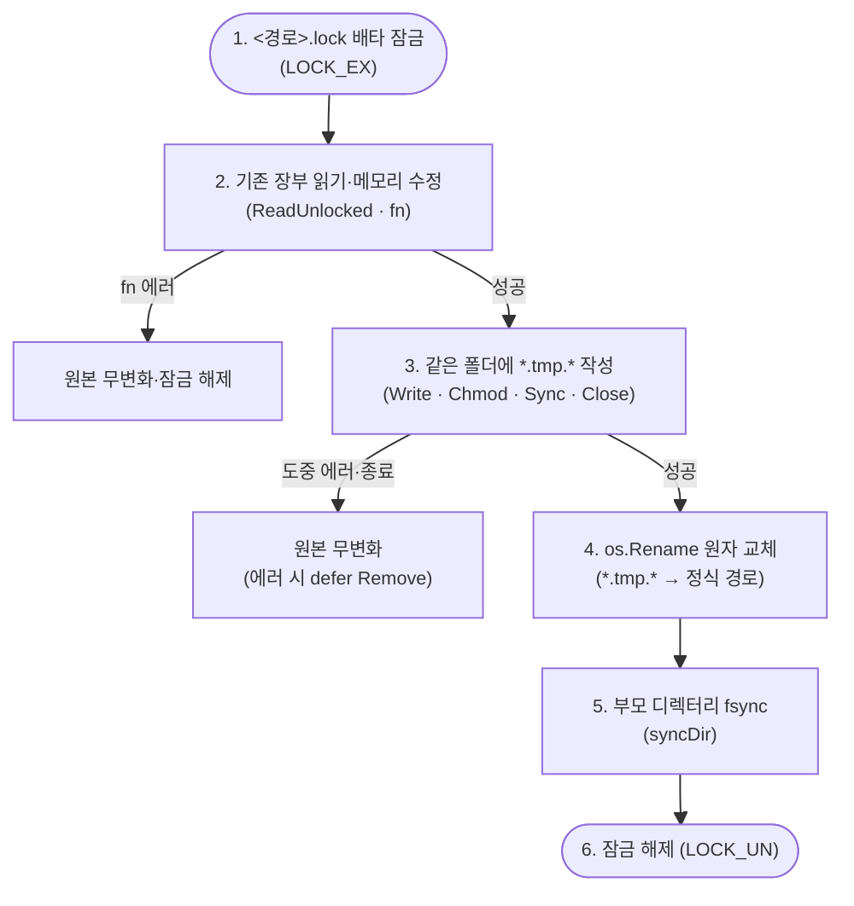
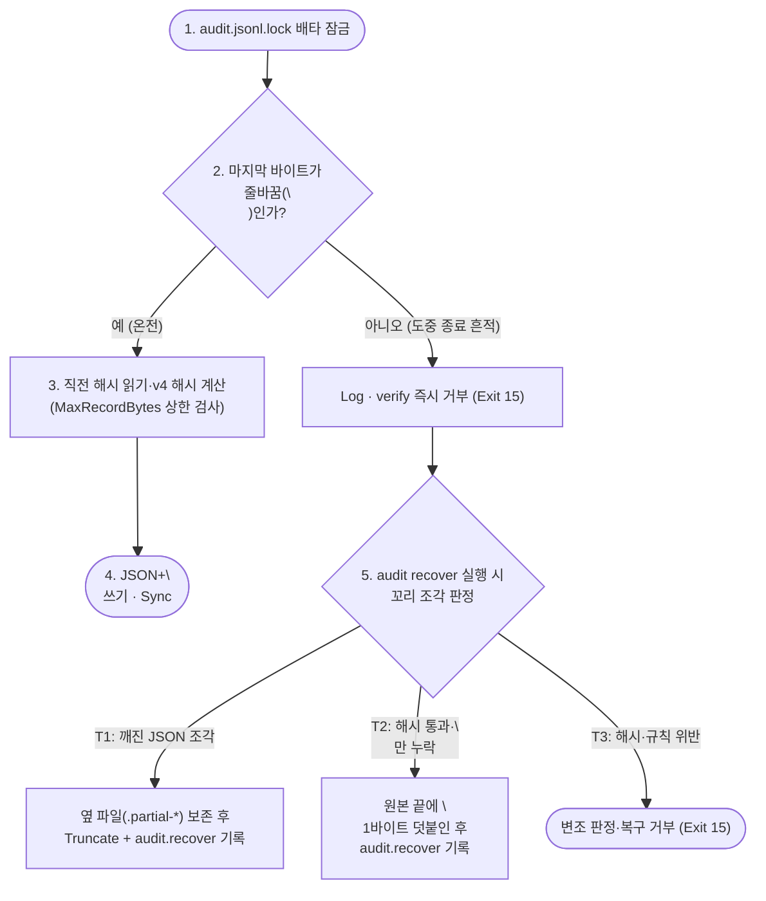

# 010. 파일 잠금·원자 교체와 도중 종료 — 여러 프로세스가 동시에 같은 장부를 고치거나 쓰는 도중에 꺼지면 장부는 어떻게 되나

> **모드**: `[문서작업]` — 소스코드 수정 없이 현재 구현된 운영체제 파일 잠금(`syscall.Flock`), 원자적 파일 교체(`AtomicFileStore`·`AtomicWriteFile`·`syncDir`), 감사 덧붙이기(`JSONLWriter.Log`), 그리고 도중 종료로 생긴 잘린 꼬리(`AUDIT_TAIL_INCOMPLETE`의 `T1`·`T2` 구분) 진단과 수동 복구(`audit recover`)의 실제 동작과 이유(Why)를 해설합니다.  
> **기준일**: 2026-11-05 · **기준 커밋**: `5f0ab2a` (이 문서가 설명하는 `cmd/`와 `internal/`을 마지막으로 바꾼 커밋)  
> **검증 범위**: 동작·순서·소유자·시점을 코드와 대조한 결과와 「미확인」은 5부 ③에 있습니다.  
> **이 문서는 구현된 것만 적는다.** 계획·제안·미래형 약속은 적지 않으며, 현재 코드가 하지 않는 것은 「지금은 없다」고만 씁니다.  
> **이 문서의 규칙**: 본문(0~4부, Q&A, 그림, 5부 ①)은 쉬운 개념·설계·이유가 중심입니다. 파일·타입 이름 같은 고유 이름은 첫 등장에 한마디 설명과 함께 쓰고, 구현의 어디인지는 문단 끝 `(구현: 파일 · 함수, 5부 ② 번호)` 귀띔으로 보조합니다. 기준은 [프로그램 설명서 README의 「설명의 기준」과 「이름의 3층」](README.md)입니다.  
> **겹치는 주제**: 디스크에 놓이는 전체 파일 목록과 쓰는 쪽·읽는 쪽은 [001편 부록 A](001-전체요청여정과_5단계관문.md)가, 서명 키 회전·폐기 절차는 [002편](002-토큰발급_축소위임과_서명키회전.md) Q3이, 감사 해시 사슬 공식(v1~v4, v3부터 길이 접두)과 다중 프로세스 직렬화는 [003편](003-서브프로세스격리와_해시체인감사.md) Q3·Q4가, Ed25519 서명 체크포인트 생성·검증은 [006편](006-OS격리_관측성과_감사체크포인트.md) Q10·Q11이, 제네릭 저장소의 구조적 의미는 [007편](007-코드읽는순서와_의존방향.md) Q6 3번이 자세히 다룹니다.
>
> **다시 확인하는 법**
> ```bash
> git rev-parse --short HEAD
> git log -1 --format=%h -- cmd internal
> # 1. 원자적 파일 저장소 동시성·오류 롤백·디렉터리 fsync 시험 실행
> go test -v ./internal/storage/... -run "Plan008|Concurrent|TC_040_07|ErrorRollback"
> # 2. 감사 레코드 상한(MaxRecordBytes)·잘린 꼬리 탐지(T1/T2/T3)·복구(audit recover) 시험 실행
> go test -v ./internal/audit/... ./internal/cli/ -run "Recover|MaxRecord|AT_S1|TC_030_06"
> # 3. 잘린 꼬리(깨진 조각)와 audit recover CLI 재현 절차
> tmpsb=$(mktemp -d) && go run ./cmd/authz-harness -audit-file "$tmpsb/audit.jsonl" -state-file "$tmpsb/grants.json" grant create --sub w1 --action file:read --resource a.txt
> printf '{"broken":' >> "$tmpsb/audit.jsonl"
> go run ./cmd/authz-harness -audit-file "$tmpsb/audit.jsonl" audit verify || true
> go run ./cmd/authz-harness -audit-file "$tmpsb/audit.jsonl" audit recover
> go run ./cmd/authz-harness -audit-file "$tmpsb/audit.jsonl" audit verify && rm -rf "$tmpsb"
> # 4. 핵심 코드 위치 확인
> grep -n "func " internal/storage/atomic.go internal/storage/file.go internal/audit/audit.go internal/audit/recover.go
> # 5. 4부 「배척한 방식」의 과거 코드 (본문에는 옮기지 않는다)
> git grep -n "syscall.Flock" 36a76bc^ -- internal/authn internal/authz/state
> git show 575a895^:internal/storage/file.go | sed -n '35,75p'
> git show 8ef09dd^:internal/audit/audit.go | sed -n '140,190p'
> git show 0a7a9eb^:internal/audit/audit.go | sed -n '220,255p'
> ```

---

## 💡 사용자의 질문 (원문 보존)

> 설명서 3개 썼다. 더 쓰면 좋은 설명있나?

> 다른 에이전트가 보고서 쓰도록 계획서로 정리해서 만들어줘.

> 008 끝냈다. 확인하고 다음 계획 진행해라.

([계획 009 S1](../계획/009-설명서_010_011_신설_집필계획.md) 지시서에 따라 집필했습니다.)

---

## 0. 모든 설계 이전에 ‘사람’이 있다 — 동시에 깎고 쓰다가 꺼지면 장부는 어떻게 되나

부모 프로세스가 자식 일꾼 프로세스 여럿을 띄워 일을 시키면, 여러 프로세스가 같은 허가 장부(`grants_state.json`), 같은 재사용 원장(`replay_ledger.json`), 같은 예산 원장(`budget_ledger.json`), 같은 감사 장부(`audit.jsonl`)에 동시에 달려듭니다. 이때 사람이 품는 현실적인 걱정은 두 가지입니다.

- 「자식 둘이 동시에 예산 1회씩을 깎거나 1회용 토큰(`jti`)을 쓰면, 둘 다 옛 숫자를 읽어서 예산이 덜 깎이거나 1회용 토큰이 두 번 통과하지 않나?」
- 「장부나 감사 파일을 한창 디스크에 쓰는 도중에 프로세스가 강제 종료(`SIGKILL`)되거나 컴퓨터 전원이 나가면, 반쯤 적힌 쓰레기 파일이 남아서 다음부터 프로그램이 아예 안 돌아가는 것 아닌가?」

이 문서는 이 프로그램이 왜 별도 데이터베이스 대신 일반 파일을 쓰면서도 두 문제를 막기 위해 **잠금(`flock`) → 임시 파일 쓰기 → `Sync` → 이름 바꾸기(`rename`) → 부모 폴더 `fsync`** 순서(통째로 바꾸는 장부)와, **잠금 → 끝 바이트(`\n`) 확인 → 한 줄 덧붙이기 → `Sync` → 잘린 꼬리 수동 복구(`audit recover`)** 순서(덧붙이는 감사 기록)를 두었는지 처음부터 끝까지 설명합니다.

---

## 1부. 왜 파일을 잠그고, 왜 옆에 새로 써서 이름을 바꾸나

### 가장 밑바닥의 이유부터

1. **왜 상태를 데이터베이스(PostgreSQL, SQLite 등)에 두지 않고 일반 파일에 두나?** 이 저장소는 외부 서버나 서드파티 패키지(`go.mod` 외부 라이브러리 0개) 없이 Go 표준 라이브러리만으로 바로 빌드해 돌려보고, 사람이 `cat` 명령으로 모든 장부를 눈으로 직접 열어볼 수 있게 만든 로컬 권한 검증 하네스이기 때문입니다([마스터 로드맵](../로드맵/MASTER_ROADMAP.md) §3-1·§4-2, [ADR 0003](../adr/0003-차기-로드맵-범위-개정-비목표-조건부-해제.md) C-6).
2. **일반 파일을 여러 프로세스가 그냥 읽고 쓰면 왜 안 되나?** 프로세스 A와 B가 동시에 예산 원장을 열어 「남은 횟수 5」를 읽은 뒤 각자 1을 빼서 「4」를 덮어쓰면, 두 번 썼는데도 장부에는 4가 남습니다(잃어버린 갱신). 또한 고루틴 사이의 자물쇠(`sync.Mutex`)는 같은 프로세스 안에서만 통하고 별도 프로세스로 뜬 자식 일꾼(`subagent worker`)은 막지 못합니다. 그래서 운영체제 커널이 프로세스 사이에 걸어 주는 파일 잠금(`syscall.Flock`)이 필요합니다.
3. **잠금만 걸고 원본 파일을 바로 덮어쓰면 되지 않나?** 잠금을 걸었더라도, 원본 파일을 비우고 새 JSON을 절반쯤 쓰다가 프로세스가 강제 종료되거나 전원이 나가면 운영체제가 잠금은 풀어 주지만 디스크에는 반쯤 적힌 깨진 JSON이 남습니다. 그러면 다음 요청부터는 장부를 읽을 수 없어 전체 시스템이 멈춥니다.
4. **그래서 어떻게 쓰나?** 통째로 바꾸는 장부는 원본 파일을 건드리지 않고, 같은 폴더 옆에 임시 파일(`*.tmp.*`)을 만들어 새 내용을 다 적고 디스크에 밀어 넣은(`Sync`) 뒤에, 운영체제의 이름 바꾸기(`os.Rename`)로 원본 파일 이름 위에 한 번에 덮어씌웁니다(원자 교체). 쓰다가 도중에 죽어도 임시 파일만 남을 뿐 원본 파일은 바꾸기 전 상태 그대로 남습니다.
5. **이름을 바꿨으면 끝 아닌가? 왜 부모 폴더까지 또 `fsync`하나?** 파일 내용 자체는 `tmpFile.Sync()`로 디스크에 내려갔더라도, 「임시 파일 이름을 원본 파일 이름으로 바꿨다」는 디렉터리 항목 변경은 운영체제 메모리 캐시에만 머물러 있을 수 있습니다. 그 순간 전원이 나가면 이름 교체가 사라져 이미 소비한 토큰이나 예산이 쓰기 전 상태로 되돌아갈 수 있으므로, 이름 바꾸기 직후에 부모 디렉터리까지 열어 `Sync`합니다(`syncDir`).
6. **그러면 감사 장부(`audit.jsonl`)도 똑같이 임시 파일로 통째 교체하면 안 되나?** 감사 장부는 요청마다 한 줄씩 끝없이 늘어나는 기록입니다. 매번 파일 전체를 새로 복사해 쓰면 줄이 쌓일수록 급격히 느려지고, 무엇보다 앞선 감사 줄들을 매번 다시 쓰는 구조가 됩니다. 그래서 감사 장부는 기존 내용을 건드리지 않고 파일 끝에 새 줄만 덧붙입니다(`O_APPEND`).
7. **끝에 덧붙이다가 도중에 죽으면 어떻게 하나?** 마지막 줄이 줄바꿈(`\n`) 없이 끊긴 「잘린 꼬리」가 남습니다. 그 뒤에 다음 기록을 그냥 이어 쓰면 두 줄이 한 줄로 붙어 영구히 깨지므로, 기록기는 마지막 바이트가 `\n`이 아니면 즉시 쓰기를 거부(`AUDIT_TAIL_INCOMPLETE`, 종료 코드 `15`)합니다. 그리고 사람이 `audit recover` 명령을 내렸을 때만 잘린 꼬리가 깨진 조각(T1)인지 줄바꿈만 빠진 온전한 기록(T2)인지 가려내어 복구하고, 복구했다는 사실 자체를 새 감사 기록(`audit.recover`)으로 사슬에 남깁니다.
8. **더 내려가면?** 「외부 데이터베이스 없이 파일만 쓰면서도 동시 덮어쓰기와 반쪽짜리 파일 파손을 막고, 도중 종료 흔적까지 증거로 남긴다」는 요구에 닿습니다. 그 이상은 되물을 수 없습니다.

### 흔한 방식과 이 프로그램의 선택

| 구분 | 흔한 방식 (일반론, 이 저장소에서 확인하지 않음) | 이 프로그램의 선택 |
|---|---|---|
| 모양 | 외부 데이터베이스(SQLite·Redis 등)에 트랜잭션을 맡기거나, 반대로 파일에 `os.WriteFile`로 제자리 덮어쓰기를 하고 로그가 깨지면 사람이 편집기로 마지막 줄을 직접 지운다 | 외부 패키지 없이 표준 `syscall.Flock` 잠금과 임시 파일 작성 → `Sync` → `os.Rename` → 디렉터리 `fsync`(`AtomicFileStore`)를 쓰고, 감사 장부는 끝 바이트(`\n`) 검사 후 덧붙이며 잘린 꼬리는 `audit recover`로만 복구한다 |
| 얻는 것 | DB를 쓰면 동시성·복구를 직접 짜지 않아도 되고, 제자리 덮어쓰기는 코드가 한 줄이다 | 외부 의존성 0개를 유지하면서도 다중 프로세스 동시 갱신 손실과 장부 반쪽 파손을 막고, 감사 꼬리가 잘렸을 때 증거(`.partial-*` 또는 `newline-appended`)를 해시 사슬 안에 남긴다 |
| 포기하는 것 | DB는 외부 의존성과 바이너리 복잡도가 늘고, 제자리 덮어쓰기·수동 편집은 도중 종료 시 파일 파손과 해시 사슬 훼손을 부른다 | 장부를 고칠 때마다 파일 전체를 다시 직렬화하고 `Sync`·디렉터리 `fsync`를 수행해 디스크 쓰기 비용이 크며, 감사 꼬리가 잘리면 운영자가 `audit recover`를 실행하기 전까지 모든 요청이 거부(`15`)된다 |

---

## 2부. 질문과 답변으로 풀어보는 핵심 동작 (Q&A)

### Q1. 디스크에 두는 파일은 왜 「통째로 바꾸는 장부」와 「끝에 덧붙이는 기록」 두 가지로 나뉘나?

- **무슨 일이 일어나는가**: 이 프로그램이 다루는 상태 파일(전체 목록은 [001편 부록 A](001-전체요청여정과_5단계관문.md) 참고)은 저장 방식에 따라 두 부류로 갈립니다.
  1. **통째로 바꾸는 장부**: 서명 비밀키(`signing_keys.priv.json`), 공개키(`jwks.pub.json`), 허가·세대 번호·승인 장부(`grants_state.json`), 1회성 토큰 재사용 원장(`replay_ledger.json`), 예산 원장(`budget_ledger.json`), 감사 체크포인트 키와 체크포인트 파일(`audit_checkpoint.json`). 이 파일들은 안의 항목 상태가 바뀌거나 만료된 항목이 정리되므로, `storage.AtomicFileStore[T]` 또는 `storage.AtomicWriteFile`을 통해 파일 전체를 새 JSON으로 만들어 원자 교체합니다.
  2. **끝에 덧붙이는 기록**: 보안 감사 장부(`audit.jsonl`). 이 파일은 과거 줄을 고치거나 지우지 않고 `audit.JSONLWriter.Log`가 파일 끝에 한 줄씩 덧붙입니다. (구현: [`atomic.go`](../../internal/storage/atomic.go) · `AtomicFileStore`, [`file.go`](../../internal/storage/file.go) · `AtomicWriteFile`, [`audit.go`](../../internal/audit/audit.go) · `JSONLWriter.Log`, 5부 ② 1·2·5번)
- **왜 두 방식을 섞지 않나**:
  - 장부(`grants_state.json` 등)는 「지금 살아 있는 권한과 남은 예산이 얼마인가」라는 현재 상태 하나가 중요하므로, 만료된 줄을 쳐내고 최신 상태 한 벌만 깔끔하게 교체하는 편이 맞습니다.
  - 반면 감사 장부(`audit.jsonl`)는 「과거부터 지금까지 무슨 일이 어떤 순서로 일어났는가」라는 사슬 전체가 증거이므로, 앞선 줄을 다시 쓰지 않고 끝에 한 줄씩 덧붙여야 합니다.
- **근거**: 5부 ② 항목 1, 2, 3, 4, 5번

### Q2. 통째로 바꾸는 장부는 어떻게 읽고 고치나? 왜 「읽고 → 고치고 → 쓰기」 전체를 한 잠금 안에서 하나?

- **무슨 일이 일어나는가**:
  1. 네 가지 핵심 장부(`state.FileStore`, `token.FileReplayLedger`, `budget.FileLedger`, `keys.FileStore`)는 모두 제네릭 저장소인 `storage.AtomicFileStore[T]`를 안에 품고 있습니다(`NewAtomicFileStore`).
  2. **읽기 (`AtomicFileStore.Read`)**: `storage.WithFileLock(s.lockPath, syscall.LOCK_SH, ...)`를 불러 잠금 파일(`<파일경로>.lock`, 권한 `0600`)에 **공유 잠금(`LOCK_SH`)**을 건 뒤 `ReadUnlocked`로 파일을 읽어 JSON을 풉니다. 여러 프로세스가 동시에 읽는 것은 막지 않되, 누군가 쓰는 도중에는 읽지 못하게 기다립니다. 파일이 아직 없거나 `0`바이트이면 `WithDefault`로 등록해 둔 기본값 생성 함수(`defaultFn`)가 빈 초기 구조체를 돌려줍니다.
  3. **고치기 (`AtomicFileStore.Update`)**: `WithFileLock(s.lockPath, syscall.LOCK_EX, ...)`를 불러 잠금 파일에 **배타 잠금(`LOCK_EX`)**을 먼저 겁니다. 그 잠금을 쥔 채로 ① 기존 파일을 읽고(`ReadUnlocked`), ② 호출자가 넘긴 변경 함수 `fn(item)`을 실행해 메모리에서 값을 고치고(만약 `fn`이 에러를 내면 쓰지 않고 그대로 중단해 롤백), ③ 곧바로 `WriteUnlocked`를 불러 임시 파일 작성과 원자 교체를 끝낸 뒤에야 잠금을 풉니다(`LOCK_UN`). (구현: [`atomic.go`](../../internal/storage/atomic.go) · `AtomicFileStore`, `NewAtomicFileStore`, `WithPerm`, `WithLockPath`, `WithDefault`, `AtomicFileStore.Read`, `AtomicFileStore.ReadUnlocked`, `AtomicFileStore.Write`, `AtomicFileStore.WriteUnlocked`, `AtomicFileStore.Update`, [`file.go`](../../internal/storage/file.go) · `WithFileLock`, 5부 ② 1·2번)
- **왜 읽기와 쓰기를 따로 잠그지 않고 `Update` 한 잠금으로 묶나**:
  - 읽을 때 잠그고 풀고, 고친 뒤 쓸 때 다시 잠그면 두 잠금 사이의 틈에 다른 프로세스가 끼어들어 값을 바꿀 수 있습니다. 그러면 나중에 쓴 쪽이 앞선 프로세스의 변경(예: 방금 등록된 `jti`나 방금 차감된 예산)을 옛 상태로 덮어써 버립니다(`TestAtomicFileStore_Concurrent_Update`, `TestTC_040_07_ConcurrentAtomicFileUpdate`).
- **확인한 사실 (두 잠금을 동시에 잡는 경로는 없다)**:
  - 관문(`pep.Gateway`)과 관리 서비스(`papService`, `keys.Manager`, `Verifier`, `checkpoint.Create`)의 모든 호출 경로를 확인한 결과, **서로 다른 두 `.lock` 파일을 동시에 쥐는(중첩 잠금) 코드는 한 곳도 없습니다.** 예를 들어 `papService.CreateGrant`·`CreateApproval`은 `store.Update`(`grants_state.json.lock`)가 완전히 끝나 잠금을 푼 뒤에야 `audit.Log`(`audit.jsonl.lock`)를 부르고, `checkpoint.Create`도 `audit.jsonl.lock` 공유 잠금 안에서는 줄 읽기(`readLines`)만 하고 잠금을 푼 뒤에 키 파일과 체크포인트 파일을 다룹니다. 잠금을 늘 하나씩만 잡고 놓기 때문에 잠금 순서 역전으로 인한 교착(데드락)이 일어나지 않습니다(5부 ③).
- **근거**: 5부 ② 항목 1, 2, 3, 4, 7, 8번

### Q3. 원자 교체 한 번(`AtomicWriteFile`)은 어떤 순서로 일어나고, 도중에 죽으면 무엇이 남나?

- **무슨 일이 일어나는가**: `storage.AtomicWriteFile(dstPath, data, perm)`은 아래 여섯 단계를 순서대로 밟습니다.
  1. 대상 파일과 **같은 폴더(`dir := filepath.Dir(dstPath)`)** 안에 `os.CreateTemp(dir, filepath.Base(dstPath)+".tmp.*")`로 임시 파일을 만듭니다. 같은 폴더에 만들어야만 5단계의 `os.Rename`이 다른 파일시스템으로 복사되지 않고 커널 안에서 디렉터리 포인터만 바꾸는 원자적 연산이 됩니다.
  2. 함수가 끝날 때 임시 파일을 지우는 `defer os.Remove(tmpName)`을 걸어 둡니다.
  3. 임시 파일에 바이트 전체를 쓰고(`tmpFile.Write`), 파일 권한을 맞추고(`tmpFile.Chmod(perm)`), `tmpFile.Sync()`로 임시 파일 내용을 디스크에 밀어 넣은 뒤 닫습니다(`tmpFile.Close()`).
  4. 여기까지 어느 한 단계라도 실패하면 `os.Rename`으로 가지 않고 함수를 나가며, 2단계의 `defer os.Remove(tmpName)`가 임시 파일을 지웁니다. 원본 파일(`dstPath`)은 건드리지 않았으므로 이전 내용 그대로입니다.
  5. `os.Rename(tmpName, dstPath)`을 불러 임시 파일 이름을 원본 파일 이름으로 한 번에 바꿉니다. 성공하면 `tmpName`이라는 이름은 사라졌으므로 `defer os.Remove(tmpName)`는 아무 일도 하지 않습니다.
  6. 마지막으로 `syncDir(dir)`을 불러 부모 디렉터리를 열고 `d.Sync()`를 호출해 이름 교체 기록까지 디스크에 고정합니다. (구현: [`file.go`](../../internal/storage/file.go) · `AtomicWriteFile`, `syncDir`, 5부 ② 2번)
- **단계별로 죽었을 때 남는 상태와 임시 파일(`*.tmp.*`) 청소**:
  - 1~4단계 도중에 일반 에러가 나면 `defer os.Remove`가 임시 파일을 지우고 원본은 그대로 남습니다.
  - 만약 1~4단계 도중에 프로세스가 `SIGKILL`(`kill -9`)로 즉사하거나 전원이 나가면 `defer`가 실행되지 않아 폴더에 `*.tmp.*` 파일이 남을 수 있습니다. **확인 결과, 프로그램이 다시 시작될 때 이전에 남은 `*.tmp.*` 파일을 찾아 지우는 별도 청소 코드는 지금 없습니다**(5부 ①·③). 다만 읽는 쪽은 언제나 정식 파일 이름(`dstPath`)만 읽으므로, 옆에 남은 `*.tmp.*` 파일이 판정이나 장부 읽기를 오염시키지는 않습니다.
- **근거**: 5부 ② 항목 2, 9번

### Q4. 디렉터리 `fsync`(`syncDir`)가 실패하면 왜 실패로 처리하나?

- **무슨 일이 일어나는가**:
  1. `AtomicWriteFile`에서 5단계 `os.Rename(tmpName, dstPath)`이 성공하면, 현재 실행 중인 운영체제 메모리(페이지 캐시) 위에서는 이미 새 파일로 교체가 끝난 상태입니다.
  2. 그 직후 6단계 `syncDir(dir)`에서 에러가 나면, `AtomicWriteFile`은 경고만 찍고 넘어가지 않고 `storage: failed to sync dir ... after rename` 에러를 그대로 호출자에게 돌려줍니다. (구현: [`file.go`](../../internal/storage/file.go) · `AtomicWriteFile`, `syncDir`, 5부 ② 2번)
- **왜 교체는 이미 일어났는데도 호출자에게 실패를 돌려주나**:
  - 디렉터리 `fsync`가 실패했다는 것은 지금 당장 전원이 나가면 방금 바꾼 파일 이름이 디스크에 남는다고 보장할 수 없다는 뜻입니다.
  - 이때 성공으로 쳐 주면, 1회성 토큰 소비(`FileReplayLedger.CheckAndConsume`)나 예산 차감(`FileLedger.Consume`)이 디스크에 확정되지도 않았는데 관문이 다음 단계(실제 파일 쓰기 등)로 진행해 버립니다.
  - 반대로 에러를 돌려주어 호출자를 실패(거부)로 기울이면, 현재 운영체제가 살아 있는 동안에는 파일 교체가 이미 반영되어 **「토큰 소비나 예산 차감은 장부에 남았지만 이번 요청 실행은 거부」**되는 안전한 방향(Fail-Closed)으로만 기웁니다.
- **확인한 사실 (macOS에서의 `Sync`)**: Go 표준 라이브러리의 `(*os.File).Sync()`는 macOS(darwin)에서 내부적으로 `F_FULLFSYNC` `fcntl`을 호출하고(지원하지 않는 파일시스템에서 `ENOTSUP`이 날 때만 일반 `fsync`로 폴백), `syncDir`도 같은 `d.Sync()`를 씁니다([계획 008](../계획/008-감사기록_해시정규화_꼬리복구_내구성_줄길이_보강.md) S1 확인).
- **근거**: 5부 ② 항목 2, 4, 9번

### Q5. 서명 키 파일 두 개(Zone A 비밀키와 Zone B 공개키)는 왜 잠금 파일 하나를 함께 쓰나? 둘 사이가 어긋나는 순간이 있나?

- **무슨 일이 일어나는가**:
  1. 서명 키 저장소 `keys.FileStore`(`keys.NewFileStore`)는 Zone A 비밀키(`signing_keys.priv.json`, 권한 `0600`)를 다루는 `privStore`와 Zone B 공개키(`jwks.pub.json`, 권한 `0644`)를 다루는 `pubStore` 두 개의 `AtomicFileStore`를 가집니다.
  2. 이때 두 저장소에 각자 다른 잠금 파일을 주지 않고 `WithLockPath` 옵션을 써서 **하나의 잠금 파일(`privPath`가 있으면 `<privPath>.lock`, 검증 전용이라 `privPath == ""`이면 `<pubPath>.lock`)을 함께 쓰게** 묶습니다.
  3. 키를 회전하거나 폐기해 저장할 때 `keys.FileStore.Save`는 `withLock`으로 그 공통 잠금 파일을 배타 잠금(`LOCK_EX`)으로 잡은 뒤, ① `privStore.WriteUnlocked(priv)`로 Zone A 비밀키를 원자 교체하고, ② `priv.ToJWKS()`로 비밀 시드를 뺀 공개키 목록을 뽑아 `pubStore.WriteUnlocked(pubJWKS)`로 Zone B 공개키를 원자 교체한 뒤 잠금을 풉니다. (구현: [`keys/store.go`](../../internal/authn/keys/store.go) · `FileStore`, `NewFileStore`, `ZoneAPrivateState.ToJWKS`, `FileStore.withLock`, `FileStore.LoadPrivate`, `FileStore.LoadPublic`, `FileStore.Save`, 5부 ② 3번)
- **왜 잠금 하나를 같이 쓰고, 둘 사이가 어긋나는 순간은 언제인가**:
  - 비밀키와 공개키는 항상 같은 키 집합의 양면이어야 하므로, 한 프로세스가 키를 회전하는 도중에 같은 잠금 파일을 쓰는 다른 관리 프로세스가 끼어들어 반쪽만 바뀐 상태를 읽지 못하게 잠금 하나(`withLock`)로 묶었습니다.
  - **어긋날 수 있는 두 가지 경우**:
    1. **검증 전용 프로세스와의 잠금 경로 차이**: `VerifyOnly: true`로 조립된 자식 일꾼이나 `pep` 명령은 `privPath`가 빈 문자열(`""`)이라 `<pubPath>.lock`을 잠그고, 키를 회전하는 `keys` 명령은 `privPath`가 있어 `<privPath>.lock`을 잠급니다. 따라서 두 프로세스는 서로 다른 `.lock` 파일을 보지만, `pubStore.WriteUnlocked` 자체가 `AtomicWriteFile`(`os.Rename`)로 파일을 통째 교체하므로 자식 일꾼이 반쯤 쓰인 `jwks.pub.json`을 읽는 일은 없습니다.
    2. **1번 쓰기와 2번 쓰기 사이의 도중 종료**: `FileStore.Save`가 1번(`privStore.WriteUnlocked`)을 끝낸 직후 2번(`pubStore.WriteUnlocked`)을 하기 전에 전원이 나가거나 강제 종료되면, 운영체제에서는 서로 다른 두 파일을 한 번의 `os.Rename`으로 묶을 수 없으므로 Zone A 비밀키에만 새 키가 있고 Zone B 공개키(`jwks.pub.json`)에는 아직 반영되지 않은 상태가 남을 수 있습니다(Q10, 5부 ①).
- **근거**: 5부 ② 항목 1, 2, 3번

### Q6. 감사 기록(`audit.jsonl`)은 어떤 순서로 덧붙이나?

- **무슨 일이 일어나는가**: `audit.JSONLWriter.Log`는 감사 이벤트 하나를 기록할 때 아래 순서를 밟습니다.
  1. 같은 프로세스 안의 고루틴 경합을 막는 `w.mu.Lock()`을 먼저 잡고, 이어서 `<auditPath>.lock` 파일에 운영체제 배타 잠금(`syscall.Flock(..., syscall.LOCK_EX)`)을 겁니다.
  2. `appendLocked`로 들어가 이벤트를 정규화(`NormalizeEvent`)하고 `SchemaVersion`을 `CurrentSchemaVersion`(`3`)으로 찍습니다.
  3. **끝 바이트 확인 (`tailState`)**: 파일 크기가 `0`보다 큰데 맨 마지막 1바이트가 줄바꿈(`\n`)이 아니면, 이전 기록 도중에 끊긴 파일로 보고 **새 줄을 쓰지 않은 채 즉시 거부**합니다(앞선 사슬이 깨졌으면 `ReasonAuditIntegrityBroken`, 아니면 `ReasonAuditTailIncomplete`).
  4. **직전 해시 읽기 (`readLastEvent`)**: 파일 끝에서 최대 `MaxRecordBytes + 2`바이트(1MB + 2바이트)만큼만 읽어 마지막 `\n` 뒤의 직전 이벤트를 파싱하고, 그 이벤트의 `CurrHash`를 이번 이벤트의 `PrevHash`로 삼아 `ComputeEventHash`로 새 `CurrHash`를 계산합니다(해시 공식은 [003편](003-서브프로세스격리와_해시체인감사.md) Q4 참고).
  5. **길이 상한 확인 후 한 번에 쓰기**: `json.Marshal(event)` 결과가 `MaxRecordBytes`(`1 << 20`, 1MB)를 넘으면 파일에 쓰지 않고 `ReasonAuditLogFailed`(`15`)를 돌려줍니다. 상한 이내이면 바이트 슬라이스 끝에 `'\n'`을 붙여 `w.file.Write(data)` 한 번으로 파일 끝(`O_APPEND`)에 쓰고, `w.file.Sync()`로 디스크에 밀어 넣은 뒤 잠금을 풉니다. (구현: [`audit.go`](../../internal/audit/audit.go) · `MaxRecordBytes`, `CurrentSchemaVersion`, `JSONLWriter`, `NewJSONLWriter`, `readLastEvent`, `tailState`, `JSONLWriter.Log`, `JSONLWriter.appendLocked`, 5부 ② 5번)
- **근거**: 5부 ② 항목 5, 9번

### Q7. 감사 기록을 쓰다 죽으면 어떻게 되나? 잘린 꼬리(`T1`·`T2`)와 변조(`T3`)는 어떻게 가르고 어떻게 복구하나?

- **무슨 일이 일어나는가**:
  1. 감사 장부에 한 줄(`data` + `'\n'`)을 쓰다가 프로세스가 죽거나 전원이 나가면, 파일의 **마지막 바이트가 `\n`이 아닌 상태**(`tailState`의 `endsNL == false`)로 남습니다.
  2. 이 상태에서 다음 요청이 들어와 `JSONLWriter.Log`를 부르면 `appendLocked`가 `tailState`를 보고 즉시 `ReasonAuditTailIncomplete`(종료 코드 `15`)로 거부하여, 반쯤 적힌 줄 뒤에 새 줄이 들러붙는 일을 막습니다(`TestAT_S1_02_LogRefusesAndLeavesBytesUnchanged`).
  3. 검증기 `audit.VerifyHashChain`은 마지막 바이트가 `\n`이 아닌 파일을 만나면 마지막 `\n` 뒤의 꼬리 조각을 보고 세 가지(`T1`·`T2`·`T3`)로 가릅니다.

| 구분 | 어떤 상태인가 | `VerifyHashChain` 판정 | `audit recover` (`RecoverIncompleteTail`)의 동작 |
|---|---|---|---|
| **T1 (깨진 조각)** | 앞선 줄들은 해시 사슬 규칙을 모두 통과했고, 줄바꿈 없는 마지막 조각만 JSON으로 풀리지 않음(쓰다가 중간에 끊김) | `ReasonAuditTailIncomplete` (`15`, `incomplete tail`) | ① 잘린 바이트를 `<auditPath>.partial-<UTC시각>`(권한 `0600`) 옆 파일로 `AtomicWriteFile` 저장 → ② 원본을 마지막 `\n` 위치까지 잘라 냄(`Truncate` + `Sync`) → ③ 사슬 끝에 `audit.recover` 이벤트(`Resource`: 옆 파일 이름, `recovery_kind: "tail_moved"`, 잘린 바이트 수와 SHA-256 포함)를 기록 |
| **T2 (온전한 기록, 줄바꿈 누락)** | 앞선 줄들과 마지막 조각까지 모두 JSON으로 풀리고 해시 사슬·스키마 규칙을 통과했으나, 맨 끝 `\n` 1바이트만 못 쓰고 끊김 | `ReasonAuditTailIncomplete` (`15`, `complete record missing trailing newline`) | 정상 기록을 지우거나 옆 파일로 빼지 않고, ① 원본 끝에 `\n` 1바이트만 덧붙여(`Write` + `Sync`) 그 기록을 사슬 안에 살려 둔 뒤 → ② 사슬 끝에 `audit.recover` 이벤트(`Resource: "newline-appended:#<레코드번호>"`, `recovery_kind: "newline_appended"`)를 기록 |
| **T3 (변조)** | 줄바꿈 유무와 상관없이 앞선 줄이 깨졌거나, 마지막 조각이 JSON으로 풀리지만 해시 불일치·원시 토큰 노출·스키마 위반이 있음 | `ReasonAuditIntegrityBroken` (`15`) | **복구 거부 (`15`).** 원본 파일과 옆 파일 모두 건드리지 않고 에러를 반환 |

  4. 운영자가 `authz-harness audit recover`(`cli.AuditRunner.runRecover`)를 실행하면 `audit.RecoverIncompleteTail`이 `<auditPath>.lock` 배타 잠금을 잡고 위 표대로 복구한 뒤 결과를 `stdout`에 출력합니다. 이미 온전한 파일이나 빈 파일에서 실행하면 아무것도 바꾸지 않고 `OK: nothing to recover`(`0`)를 돌려줍니다. (구현: [`audit.go`](../../internal/audit/audit.go) · `tailState`, `VerifyHashChain`, [`recover.go`](../../internal/audit/recover.go) · `RecoveryResult`, `RecoverIncompleteTail`, `recoverNewline`, [`cli/audit.go`](../../internal/cli/audit.go) · `AuditRunner.runRecover`, 5부 ② 5·6·8번)
- **왜 `JSONLWriter`가 열릴 때 자동으로 복구하지 않고 운영자 명령(`audit recover`)으로만 복구하나**:
  - 기록기가 알아서 마지막 줄을 잘라 내고 넘어가면, 시스템이 도중 종료된 사실이나 공격자가 파일 끝을 건드린 사실이 운영자 모르게 덮일 수 있습니다. 그래서 일단 모든 요청을 `15`로 멈춰 세우고(Fail-Closed), 운영자가 직접 `audit recover`를 실행해 옆 파일 보존(`T1`) 또는 줄바꿈 보완(`T2`)과 `audit.recover` 감사 기록을 남기도록 강제했습니다.
  - 또한 복구 전에 찍어 둔 서명 체크포인트(`audit_checkpoint.json`)가 덮는 줄들은 `T1`·`T2` 복구 뒤에도 줄어들지 않고 그대로 남으므로, 복구 뒤에 `audit verify --checkpoint`를 돌려도 정상 통과합니다(`TestAuditRecover_T2WithCheckpoint`).
- **근거**: 5부 ② 항목 5, 6, 8, 9번

### Q8. 한 줄의 최대 크기(`MaxRecordBytes`)는 왜 쓰는 쪽, 검증하는 쪽, 체크포인트가 같아야 하나?

- **무슨 일이 일어나는가**:
  1. [`internal/audit/audit.go`](../../internal/audit/audit.go)에 공개 상수 `MaxRecordBytes = 1 << 20`(1MB, 줄바꿈 제외 JSON 바이트 수)이 정의되어 있습니다.
  2. **쓰는 쪽 (`JSONLWriter.appendLocked`)**: `json.Marshal(event)` 결과가 `MaxRecordBytes`보다 크면 파일에 한 바이트도 쓰지 않고 `ReasonAuditLogFailed`(`15`)를 돌려줍니다(`TestMaxRecord_OverLimitRejected`).
  3. **직전 줄 읽는 쪽 (`readLastEvent`)**: 파일 끝에서 `MaxRecordBytes + 2`바이트 창을 읽어 마지막 줄을 찾고, 그 창 안에 `\n`이 없는데 파일이 그보다 크면 상한 초과 에러를 돌려줍니다(`TestMaxRecord_ExactLimitAndLongLastLine`).
  4. **검증하는 쪽 (`VerifyHashChain`)과 체크포인트 읽는 쪽 (`checkpoint.readLines`)**: 두 곳 모두 `bufio.Scanner`의 버퍼 상한을 `MaxRecordBytes + 1`로 맞춥니다. 만약 누군가 바깥에서 1MB가 넘는 줄을 파일에 끼워 넣으면 `VerifyHashChain`은 `bufio.ErrTooLong`을 잡아서 단순 파일 읽기 실패가 아니라 무결성 훼손(`ReasonAuditIntegrityBroken`, `15`)으로 판정합니다(`TestMaxRecord_InjectedOversizeLineBroken`). (구현: [`audit.go`](../../internal/audit/audit.go) · `MaxRecordBytes`, `readLastEvent`, `JSONLWriter.appendLocked`, `VerifyHashChain`, [`checkpoint.go`](../../internal/audit/checkpoint/checkpoint.go) · `readLines`, 5부 ② 5·7번)
- **왜 세 곳의 한도가 같아야 하나**:
  - 쓰는 쪽은 한도가 없고 읽는 쪽(`bufio.Scanner`)만 1MB 한도가 있으면, 큰 메타데이터가 들어간 줄이 기록될 때는 성공해 놓고 나중에 `audit verify`나 `audit checkpoint`를 돌릴 때 `bufio.ErrTooLong`으로 감사 사슬 전체가 검증 불능에 빠지기 때문입니다.
- **근거**: 5부 ② 항목 5, 7, 9번

### Q9. 체크포인트를 만드는 동안(`checkpoint.Create`) 다른 프로세스의 기록은 어떻게 되나?

- **무슨 일이 일어나는가**:
  1. 운영자가 `authz-harness audit checkpoint`를 실행하면 `checkpoint.Create`는 먼저 `storage.WithFileLock(auditPath+".lock", syscall.LOCK_SH, ...)`으로 감사 잠금 파일에 **공유 잠금(`LOCK_SH`)**을 걸고 `readLines(auditPath)`로 현재 줄들을 메모리에 읽어들인 뒤 즉시 공유 잠금을 풉니다.
  2. 공유 잠금이 걸려 있는 짧은 순간 동안, 다른 프로세스의 `JSONLWriter.Log`는 배타 잠금(`LOCK_EX`)을 얻기 위해 대기하므로 줄을 읽는 도중에 반쪽짜리 줄이 섞이지 않습니다.
  3. 공유 잠금을 푼 뒤에는 `VerifyHashChain`으로 사슬을 검증하고, Zone A·B 감사 키 쌍을 확인(`EnsureKeyPair`)한 뒤, 줄 수(`LineCount`)와 마지막 해시(`HeadHash`)에 Ed25519 서명을 해 `storage.AtomicWriteFile`로 체크포인트 파일(`audit_checkpoint.json`)을 원자 교체합니다. (구현: [`checkpoint.go`](../../internal/audit/checkpoint/checkpoint.go) · `EnsureKeyPair`, `readLines`, `Create`, `Verify`, 5부 ② 7번)
- **근거**: 5부 ② 항목 2, 7번

### Q10. 이 방식이 지켜 주지 못하는 것은 무엇인가?

- **확인한 한계**:
  1. **강제 종료 시 남는 임시 파일 (`*.tmp.*`, `.tmp-jail-*`)**: `AtomicWriteFile`이나 `workspaceJail.WriteFile`이 임시 파일을 쓰는 도중 `SIGKILL`이나 전원 차단으로 죽으면 원본 장부는 안전하지만 임시 파일이 폴더에 남으며, 재시작 시 이를 자동으로 청소하는 코드는 지금 없습니다(Q3).
  2. **Zone A 비밀키와 Zone B 공개키의 2파일 교체 틈**: `keys.FileStore.Save`는 한 잠금 안에서 두 파일을 차례로 `AtomicWriteFile`하지만, 두 번의 `os.Rename` 사이에 전원이 나가면 Zone A 비밀키만 먼저 바뀐 상태가 남을 수 있습니다(Q5).
  3. **잠금을 거치지 않는 외부 프로세스의 직접 파일 수정**: `syscall.Flock`은 권고적 잠금(advisory lock)이므로, 이 프로그램의 규칙을 따르지 않는 외부 프로세스가 `.lock` 파일을 무시하고 장부나 감사 파일을 직접 덮어쓰는 것은 잠금만으로 막지 못합니다(감사 파일 변조는 사후에 `VerifyHashChain`과 체크포인트가 적발하며, 자식 워커의 직접 파일 접근은 [006편](006-OS격리_관측성과_감사체크포인트.md)의 운영체제 커널 격리가 막습니다).
  4. **디스크 가득 참 (`ENOSPC`) 또는 읽기 전용 파일시스템**: 임시 파일 쓰기나 감사 덧붙이기·`Sync`가 실패하여 모든 요청이 Fail-Closed(`15` 또는 `16`)로 멈춥니다.
  5. **Linux·Windows 및 네트워크 파일시스템(NFS 등)에서의 `flock`·`fsync` 동작**: macOS(darwin) 로컬 파일시스템에서만 실행해 확인했으며, 다른 운영체제나 네트워크 파일시스템에서의 잠금·내구성 동작은 직접 실행해 확인하지 못했습니다(**미확인**, 5부 ③).
- **근거**: 5부 ② 항목 2, 3, 5번

---

## 3부. 내부 지도 — 원자 교체와 감사 복구의 흐름

### 그림 1. 통째로 바꾸는 장부의 원자 교체 (`AtomicFileStore` · `AtomicWriteFile`)



1~3단계 어디서 중단되든 정식 경로의 원본 장부는 고치기 전 상태 그대로 남습니다. (구현: `atomic.go` · `AtomicFileStore.Update`, `AtomicFileStore.WriteUnlocked`, `file.go` · `WithFileLock`, `AtomicWriteFile`, `syncDir`, 5부 ② 1·2번)

### 그림 2. 감사 장부 덧붙이기와 잘린 꼬리 복구 (`JSONLWriter.Log` · `audit recover`)



(구현: `audit.go` · `tailState`, `JSONLWriter.Log`, `JSONLWriter.appendLocked`, `VerifyHashChain`, `recover.go` · `RecoverIncompleteTail`, `recoverNewline`, `cli/audit.go` · `AuditRunner.runRecover`, 5부 ② 5·6·8번)

### 어디에 무엇이 남나

| 무엇 | 어디에 | 언제 | 사람이 직접 여는 법 |
|---|---|---|---|
| 각 장부의 잠금 파일 | `<장부경로>.lock`, `audit.jsonl.lock` (권한 `0600`) | 해당 장부나 감사 파일을 처음 읽거나 쓸 때 생성되어 유지됨 | `ls -la .authz-state/public/*.lock audit.jsonl.lock` |
| 교체 중 임시 파일 | `<장부폴더>/<파일명>.tmp.*`, `workspace/.tmp-jail-*` | `AtomicWriteFile`·`WriteFile`이 쓰는 짧은 순간에만 존재(`os.Rename` 또는 에러 시 삭제, 강제 종료 시에만 잔류) | 정상 완료 뒤에는 남지 않는다 (`ls -la`로 확인) |
| T1 복구로 떼어 낸 깨진 꼬리 조각 | `<auditPath>.partial-<UTC시각>` (권한 `0600`) | `T1`(깨진 JSON 꼬리) 상태에서 `authz-harness audit recover`를 실행했을 때만 생성 (`T2`에서는 생성 안 됨) | `cat audit.jsonl.partial-*`로 도중 종료 당시 잘린 원본 바이트를 확인한다 |
| 복구 이력 감사 레코드 (`Action: "audit.recover"`) | `audit.jsonl` 마지막 줄 | `audit recover`가 `T1`(`recovery_kind: "tail_moved"`) 또는 `T2`(`recovery_kind: "newline_appended"`)를 복구한 직후 | `tail -n 2 audit.jsonl` 또는 머리 3번 명령 |

### 이상이 생기면

| 상황 | 일어나는 일 |
|---|---|
| 여러 프로세스가 동시에 같은 장부(`grants_state`, `replay_ledger`, `budget_ledger`)를 고친다 | `<경로>.lock` 배타 잠금(`LOCK_EX`)으로 한 번에 한 프로세스만 읽고 고치고 교체하므로 변경이 유실되지 않는다 |
| `AtomicFileStore.Update` 안에서 변경 함수(`fn`)가 에러(예: 예산 부족, 중복 `jti`)를 돌려준다 | `WriteUnlocked`를 부르지 않고 잠금을 풀어 디스크 파일은 1바이트도 바뀌지 않는다 |
| `AtomicWriteFile`이 임시 파일에 쓰는 도중에 에러가 난다 | `os.Rename`으로 가지 않고 `defer os.Remove`가 임시 파일을 지우며 원본 파일은 그대로 남는다 |
| `os.Rename`은 성공했으나 직후 디렉터리 `fsync`(`syncDir`)가 실패한다 | 교체는 일어났으나 전원 차단 내구성을 보장할 수 없으므로 에러를 반환해 호출자를 거부(Fail-Closed)로 처리한다 |
| 직렬화된 감사 이벤트 한 줄이 `MaxRecordBytes`(1MB)를 넘는다 | `JSONLWriter.Log`가 파일에 쓰지 않고 `ReasonAuditLogFailed`(`15`)를 돌려준다 |
| 누군가 1MB가 넘는 줄을 `audit.jsonl`에 직접 끼워 넣었다 | `VerifyHashChain`이 `bufio.ErrTooLong`을 감지해 `ReasonAuditIntegrityBroken`(`15`)으로 거부한다 |
| 감사 기록 도중 프로세스가 죽어 마지막 줄 끝에 `\n`이 빠졌다 (`T1` 또는 `T2`) | 이후 모든 `JSONLWriter.Log`와 `audit verify`가 `ReasonAuditTailIncomplete`(`15`)로 거부되어 파일이 더 망가지지 않는다 |
| `T1`(깨진 JSON 꼬리) 상태에서 `audit recover`를 실행한다 | 잘린 바이트를 `.partial-<시각>` 파일로 따로 저장하고 원본을 잘라 낸 뒤 `audit.recover` 이벤트를 이어 붙여 사슬을 살린다(`0`) |
| `T2`(해시까지 맞는데 `\n`만 빠진 꼬리) 상태에서 `audit recover`를 실행한다 | 그 줄을 지우지 않고 `\n` 1바이트만 덧붙인 뒤 `audit.recover`(`newline-appended:#N`) 이벤트를 이어 붙여 사슬을 살린다(`0`) |
| 마지막 줄에 `\n`이 있지만 JSON이 깨졌거나, 앞선 줄·해시가 변조된 상태(`T3`)에서 `audit recover`를 실행한다 | 충돌이 아니라 변조로 판정해 파일에 손대지 않고 `ReasonAuditIntegrityBroken`(`15`)으로 거부한다 |

---

## 4부. 배척한 방식과 그 이유

과거 코드는 본문에 옮기지 않았습니다. 머리의 「다시 확인하는 법」 5번 명령으로 볼 수 있습니다.

1. **외부 데이터베이스 서버나 서드파티 내장 DB 라이브러리를 쓰는 방식** ([마스터 로드맵](../로드맵/MASTER_ROADMAP.md) §3-1·§4-2):
   - **택했다면 무슨 일이 생기는가**: 외부 프로세스 설정이나 `go.mod` 서드파티 의존성이 추가되고, 장부 파일을 `cat`으로 바로 열어볼 수 없게 됩니다.
   - **그 대신 포기한 것**: DB가 제공하는 트랜잭션 대신 `syscall.Flock` 잠금과 `AtomicFileStore`·`audit recover`를 직접 구현하고 관리합니다.
2. **프로세스 안 뮤텍스(`sync.Mutex`)만 쓰거나 저장소마다 잠금·교체 코드를 따로 짜는 방식** (`36a76bc^`의 `internal/authn`, `internal/authz/state`):
   - **택했다면 무슨 일이 생기는가**: `sync.Mutex`만 쓰면 부모와 자식 프로세스가 동시에 장부를 고칠 때 덮어쓰기가 일어나고, 저장소마다 잠금·임시 파일 코드를 따로 짜면 한 곳에서 고친 결함(예: 디렉터리 `fsync`)이 다른 저장소에는 빠집니다.
   - **그 대신 포기한 것**: 모든 장부를 `storage.AtomicFileStore[T]` 하나로 통일하고, `authn`과 `authz/state` 안에서 `syscall.Flock`을 직접 부르는 코드를 아키텍처 가드 `TC-081-01`로 금지했습니다([007편](007-코드읽는순서와_의존방향.md) Q6 3번).
3. **원본 파일을 제자리에서 덮어쓰거나 `os.Rename` 뒤 부모 디렉터리 `fsync`를 생략하는 방식** (`575a895^`의 `internal/storage/file.go`):
   - **택했다면 무슨 일이 생기는가**: 제자리 덮어쓰기 도중에 죽으면 반쯤 적힌 파일이 남아 장부가 깨지고, `os.Rename` 뒤 디렉터리 `fsync`를 생략하면 전원 차단 시 이름 교체가 사라져 이미 소비한 1회성 토큰이 다시 살아날 수 있습니다(근거: [계획 008](../계획/008-감사기록_해시정규화_꼬리복구_내구성_줄길이_보강.md) W3·D-04).
   - **그 대신 포기한 것**: 쓰기마다 임시 파일 `Sync`와 부모 디렉터리 `syncDir`을 모두 수행하는 디스크 동기화 비용을 감수합니다.
4. **감사 기록을 쓰는 쪽에는 크기 한도를 두지 않고 읽는 쪽(`bufio.Scanner`)에만 한도를 두는 방식** (`8ef09dd^`의 `internal/audit/audit.go`):
   - **택했다면 무슨 일이 생기는가**: 1MB를 넘는 기록이 쓰기는 성공해 놓고, 그 뒤 `VerifyHashChain`과 `checkpoint.Create`가 `bufio.ErrTooLong`으로 멈춰 감사 장부 전체를 검증할 수 없게 됩니다(근거: [계획 008](../계획/008-감사기록_해시정규화_꼬리복구_내구성_줄길이_보강.md) W4).
   - **그 대신 포기한 것**: `MaxRecordBytes`(1MB) 상수를 두고 쓰는 쪽(`Log`), 마지막 줄 읽는 쪽(`readLastEvent`), 검증기(`VerifyHashChain`), 체크포인트(`readLines`)가 모두 같은 한도를 강제합니다.
5. **잘린 꼬리를 기록기가 열릴 때 자동으로 잘라 내거나, 마지막 바이트가 `\n`인지 보지 않고 JSON 파싱만 확인하는 방식** ([계획 008](../계획/008-감사기록_해시정규화_꼬리복구_내구성_줄길이_보강.md) D-02, `0a7a9eb^`의 `internal/audit/audit.go`):
   - **택했다면 무슨 일이 생기는가**: 자동 복구는 도중 종료나 파일 끝 훼손을 운영자 모르게 덮어 버리고, 마지막 바이트가 `\n`인지 확인하지 않으면 JSON은 다 쓰고 마지막 `\n` 1바이트만 못 쓴 채 죽었을 때(`T2`) 다음 기록이 같은 줄 뒤에 붙어(`{...}{...}`) 정상 기록 두 개가 함께 깨지고 복구도 불가능해집니다(근거: [계획 010](../계획/010-감사기록_줄바꿈누락꼬리_V01_수정.md) 1.1절 V-01).
   - **그 대신 포기한 것**: `tailState`로 마지막 바이트가 `\n`이 아니면 무조건 `AUDIT_TAIL_INCOMPLETE`(`15`)로 멈춰 세우고, 운영자가 `audit recover`를 실행했을 때만 `T1`(옆 파일 분리)과 `T2`(`\n` 보완)를 가려 복구합니다.

---

## 5부. 한눈에 보는 대조표와 코드 정본

### ① 행동별 안에서 일어나는 일과 지금은 없는 것

| 행동 | 안에서 일어나는 일 | 지금은 없는 것 | 근거 |
|---|---|---|---|
| **장부 읽기 (`AtomicFileStore.Read`)** | `<경로>.lock`에 공유 잠금(`LOCK_SH`)을 걸고 JSON을 읽어 역직렬화한다. 파일이 없거나 비어 있으면 `WithDefault` 기본값을 돌려준다. | 파일 일부만 읽는 부분 조회(인덱스 조회) 기능은 지금 없다. | 5부 ② 1, 2번 |
| **장부 수정 (`AtomicFileStore.Update`)** | `<경로>.lock`에 배타 잠금(`LOCK_EX`)을 걸고 읽기 → `fn` 수정 → 임시 파일(`.tmp.*`) 쓰기·`Chmod`·`Sync`·`Close` → `os.Rename` → 부모 폴더 `syncDir`까지 마친 뒤 잠금을 푼다. | 강제 종료(`SIGKILL`)나 전원 차단으로 `defer os.Remove` 전에 남은 `*.tmp.*` 파일을 다음 기동 시 자동으로 찾아 지우는 청소 코드는 지금 없다. | 5부 ② 1, 2, 4번 |
| **서명 키 쌍 저장 (`keys.FileStore.Save`)** | 공통 잠금 파일 하나를 잡고 Zone A 비밀키(`0600`)와 Zone B 공개키(`0644`)를 차례로 `AtomicWriteFile`한다. | 서로 다른 두 파일(`signing_keys.priv.json`, `jwks.pub.json`)의 `os.Rename`을 단일 커널 트랜잭션으로 묶는 장치는 지금 없다(1번과 2번 교체 사이에 전원이 나가면 어긋날 수 있음). | 5부 ② 3번 |
| **감사 기록 덧붙이기 (`JSONLWriter.Log`)** | `audit.jsonl.lock` 배타 잠금을 잡고 `tailState`로 끝 바이트가 `\n`인지 확인한 뒤, 직전 해시를 잇고 `MaxRecordBytes` 이내인지 검사해 `JSON+\n`을 한 번에 쓰고 `Sync`한다. | 감사 파일이 커졌을 때 자동으로 파일을 나누는 회전(Log Rotation) 기능이나, 꼬리가 잘렸을 때 자동으로 잘라 내고 이어 쓰는 자동 복구 기능은 지금 없다(의도한 Fail-Closed). | 5부 ② 5번 |
| **감사 잘린 꼬리 복구 (`audit recover`)** | `AUDIT_TAIL_INCOMPLETE`일 때만 동작하며, 깨진 조각(`T1`)은 `.partial-<시각>` 파일로 옮긴 뒤 잘라 내고, 줄바꿈만 빠진 온전한 기록(`T2`)은 `\n`만 덧붙인 뒤 사슬에 `audit.recover` 이벤트를 남긴다. | 중간 줄이 변조되었거나(`\n`으로 끝난 깨진 줄 포함, `T3`) 해시가 어긋난 파일을 복구하는 기능은 지금 없다(`15`로 거부). | 5부 ② 5, 6, 8번 |

### ② 어디서 하나 (코드 정본 색인)

1. **제네릭 원자적 파일 저장소 (`storage`)**: [`internal/storage/atomic.go`](../../internal/storage/atomic.go) (`AtomicFileStoreOption`, `WithPerm`, `WithLockPath`, `WithDefault`, `AtomicFileStore`, `NewAtomicFileStore`, `AtomicFileStore.FilePath`, `AtomicFileStore.LockPath`, `AtomicFileStore.Read`, `AtomicFileStore.ReadUnlocked`, `AtomicFileStore.Write`, `AtomicFileStore.WriteUnlocked`, `AtomicFileStore.Update`) — 구현: `36a76bc`
2. **파일 잠금·원자 교체·디렉터리 `fsync` (`storage`)**: [`internal/storage/file.go`](../../internal/storage/file.go) (`WithFileLock`, `AtomicWriteFile`, `syncDir`) — 구현: `36a76bc`, 부모 디렉터리 `fsync` 계획008-S1 (`575a895`)
3. **Zone A·B 서명 키 저장소 (`keys`)**: [`internal/authn/keys/store.go`](../../internal/authn/keys/store.go) (`ZoneAPrivateKeyEntry`, `ZoneAPrivateState`, `ZoneAPrivateState.ToJWKS`, `Store`, `FileStore`, `NewFileStore`, `FileStore.withLock`, `FileStore.LoadPrivate`, `FileStore.LoadPublic`, `FileStore.Save`) — 구현: `36a76bc`
4. **Zone B 장부 저장소들 (`state`·`replay`·`budget`)**: [`internal/authz/state/store.go`](../../internal/authz/state/store.go) (`GrantsState`, `FileStore`, `NewFileStore`, `FileStore.Load`, `FileStore.Save`, `FileStore.Update`), [`internal/authz/state/approval.go`](../../internal/authz/state/approval.go) (`CreateApproval`, `ConsumeApproval`), [`internal/authn/token/replay.go`](../../internal/authn/token/replay.go) (`ReplayData`, `FileReplayLedger`, `NewFileReplayLedger`, `FileReplayLedger.CheckAndConsume`, `FileReplayLedger.IsConsumed`), [`internal/authn/budget/ledger.go`](../../internal/authn/budget/ledger.go) (`LedgerState`, `FileLedger`, `NewFileLedger`, `FileLedger.Init`, `FileLedger.Reserve`, `FileLedger.Consume`, `FileLedger.Refund`, `FileLedger.Get`) — 구현: `36a76bc`, P12, P15
5. **감사 기록기·상한·끝 바이트 검사·사슬 검증 (`audit`)**: [`internal/audit/audit.go`](../../internal/audit/audit.go) (`MaxRecordBytes`, `CurrentSchemaVersion`, `ComputeEventHash`, `computeHashV3`, `computeHashV4`, `JSONLWriter`, `NewJSONLWriter`, `readLastEvent`, `tailState`, `JSONLWriter.Log`, `JSONLWriter.appendLocked`, `JSONLWriter.Close`, `VerifyHashChain`), 사유 상수 [`internal/domain/constants.go`](../../internal/domain/constants.go) (`ReasonAuditTailIncomplete`, `ReasonAuditIntegrityBroken`, `ReasonAuditLogFailed`) — 구현: 상한 통일 계획008-S2 (`8ef09dd`), 잘린 꼬리 진단 계획008-S3 (`74ccd99`), 스키마 v3 계획008-S4 (`3b626fc`), 줄바꿈 누락 꼬리(`T2`) 탐지 계획010-S1 (`0a7a9eb`)
6. **잘린 꼬리 복구 (`audit recover`)**: [`internal/audit/recover.go`](../../internal/audit/recover.go) (`RecoveryResult`, `RecoverIncompleteTail`, `recoverNewline`) — 구현: 계획008-S3 (`74ccd99`), `T2` 줄바꿈 복구 계획010-S2 (`5f0ab2a`)
7. **감사 서명 체크포인트 (`checkpoint`)**: [`internal/audit/checkpoint/checkpoint.go`](../../internal/audit/checkpoint/checkpoint.go) (`Checkpoint`, `EnsureKeyPair`, `readLines`, `Create`, `Verify`) — 구현: P14-040 (`884167d`), 상한 통일 계획008-S2 (`8ef09dd`)
8. **감사 CLI (`audit verify` · `recover` · `checkpoint`)**: [`internal/cli/audit.go`](../../internal/cli/audit.go) (`AuditRunner`, `NewAuditRunner`, `AuditRunner.Run`, `AuditRunner.runVerify`, `AuditRunner.runCheckpoint`, `AuditRunner.runRecover`) — 구현: 계획008-S3 (`74ccd99`), 계획010-S2 (`5f0ab2a`)
9. **시험**: [`internal/storage/atomic_test.go`](../../internal/storage/atomic_test.go)의 `TestAtomicFileStore_Basic`·`TestAtomicFileStore_Options_And_Default`·`TestAtomicFileStore_Concurrent`·`TestAtomicFileStore_Concurrent_Update`·`TestAtomicFileStore_Update_ErrorRollback`, [`internal/storage/dirsync_test.go`](../../internal/storage/dirsync_test.go)의 `TestPlan008_AT_S1_01_SyncDirMissing`·`TestPlan008_AT_S1_02_AtomicWriteFileDurableRename`, [`internal/storage/file_test.go`](../../internal/storage/file_test.go)의 `TestTC_040_07_ConcurrentAtomicFileUpdate`, [`internal/audit/audit_test.go`](../../internal/audit/audit_test.go)의 `TestTC_030_06_ConcurrentFlockSafety`, [`internal/audit/maxrecord_test.go`](../../internal/audit/maxrecord_test.go)의 `TestMaxRecord_OverLimitRejected`·`TestMaxRecord_ExactLimitAndLongLastLine`·`TestMaxRecord_InjectedOversizeLineBroken`, [`internal/audit/tail_newline_test.go`](../../internal/audit/tail_newline_test.go)의 `TestAT_S1_01_CompleteTailMissingNewlineDetected`·`TestAT_S1_02_LogRefusesAndLeavesBytesUnchanged`·`TestAT_S1_03_TamperedTailWithoutNewlineIsIntegrityBroken`·`TestAT_S1_04_SingleLineWithoutNewline`·`TestAT_S1_05_NoFalsePositives`, [`internal/cli/audit_recover_test.go`](../../internal/cli/audit_recover_test.go) 및 [`internal/cli/audit_recover_t2_test.go`](../../internal/cli/audit_recover_t2_test.go)의 `TestAuditRecover_TornTail`·`TestAuditRecover_T2AppendsNewlineOnly`·`TestAuditRecover_T2WithCheckpoint`·`TestAuditRecover_T3Refused`·`TestAuditRecover_NewlineTerminatedGarbageRefused`·`TestAuditRecover_BrokenChainRefused`·`TestAuditRecover_NothingToDo` (개수는 `go test ./...`로 확인)

### ③ 검증 범위와 「미확인」

검증 방법: 5부 ②의 파일을 기준 커밋 `5f0ab2a`에서 직접 읽고 인용한 파일·타입·함수를 `grep -rn "<이름>" internal cmd`로 모두 확인했습니다. macOS(darwin)에서 머리의 「다시 확인하는 법」 1~3번 명령을 실제로 실행하여 통과와 복구 동작을 확인했습니다. 4부의 과거 코드는 머리 5번 명령(`git show`, `git grep`)으로 해당 커밋에서 확인했습니다. 2026-11-06 재대조: 감사 해시 표기를 v4로 맞췄습니다(`computeHashV4` 추가). 그 밖은 식별자 일괄 대조만 했습니다.

| 항목 | 동작 | 순서 | 소유자 | 시점 | 미확인 사항 |
|---|---|---|---|---|---|
| Q1 (두 종류의 상태 파일 구분, ② 1~5번) | 확인 | 해당 없음 | 확인 (`AtomicFileStore`, `JSONLWriter`) | 해당 없음 | 없음 |
| Q2 (`AtomicFileStore` 잠금과 비중첩 잠금 구조, ② 1~4·7·8번) | 확인 (`TestAtomicFileStore_Concurrent_Update`, 전 패키지 잠금 호출 추적) | 확인 (`LOCK_EX` → `ReadUnlocked` → `fn` → `WriteUnlocked` → `LOCK_UN`, 장부 잠금 해제 후 감사 기록 호출) | 확인 (`AtomicFileStore`, 각 서비스) | 확인 (두 `.lock` 파일을 동시에 잡는 중첩 잠금 경로 0건 확인) | 없음 |
| Q3 (`AtomicWriteFile` 순서와 `*.tmp.*` 청소 여부, ② 2·9번) | 확인 (`TestPlan008_AT_S1_02_AtomicWriteFileDurableRename`, `grep -rn "\.tmp\." internal cmd`) | 확인 (`CreateTemp` → `Write` → `Chmod` → `Sync` → `Close` → `Rename` → `syncDir`) | 확인 (`AtomicWriteFile`) | 확인 (`defer os.Remove`만 존재하며 재시작 시 잔류 `*.tmp.*` 청소 코드는 없음) | 실제 전원 차단 후 디스크 컨트롤러 수준의 내구성은 단위 시험으로 재현할 수 없음 |
| Q4 (`syncDir` 실패 시 Fail-Closed 처리, ② 2·4·9번) | 확인 (`TestPlan008_AT_S1_01_SyncDirMissing`) | 확인 (`os.Rename` 직후 `syncDir` 호출) | 확인 (`AtomicWriteFile`, `syncDir`) | 확인 | 없음 |
| Q5 (서명 키 2파일 공통 잠금과 경계, ② 1·2·3번) | 확인 (`keys/store.go` 코드 대조) | 확인 (`privStore.WriteUnlocked` → `pubStore.WriteUnlocked`) | 확인 (`keys.FileStore.Save`) | 확인 | 없음 |
| Q6 (`JSONLWriter.Log` 덧붙이기 순서, ② 5·9번) | 확인 (`TestTC_030_06_ConcurrentFlockSafety`) | 확인 (`mu.Lock` → `flock` → `tailState` → `readLastEvent` → `MaxRecordBytes` 검사 → `Write` → `Sync`) | 확인 (`JSONLWriter.Log`, `appendLocked`) | 확인 | 없음 |
| Q7 (잘린 꼬리 `T1`·`T2`·`T3` 진단과 `audit recover`, ② 5·6·8·9번) | 확인 (계획 010 V-01 수정 반영 확인: `TestAT_S1_01`~`05`, `TestAuditRecover_T2AppendsNewlineOnly`, 머리 3번 CLI 재현) | 확인 (`flock` → `VerifyHashChain` → `T1` 옆 파일 저장·`Truncate` 또는 `T2` `\n` 추가 → `appendLocked`로 `audit.recover` 기록) | 확인 (`VerifyHashChain`, `RecoverIncompleteTail`, `recoverNewline`) | 확인 | 없음 |
| Q8 (`MaxRecordBytes` 상한 통일, ② 5·7·9번) | 확인 (`TestMaxRecord_*`) | 확인 (쓰기 전 길이 검사, 스캐너 버퍼 `MaxRecordBytes+1`) | 확인 (`JSONLWriter`, `VerifyHashChain`, `checkpoint.readLines`) | 확인 | 없음 |
| Q9 (`checkpoint.Create` 공유 잠금, ② 2·7번) | 확인 (`checkpoint.go` 153행 확인) | 확인 (`LOCK_SH` 내 `readLines` → 잠금 해제 → `VerifyHashChain` → 서명 → `AtomicWriteFile`) | 확인 (`checkpoint.Create`) | 확인 | 없음 |
| Q10 (한계와 운영체제 범위, ② 2·3·5번) | 확인 (코드 대조) | 해당 없음 | 해당 없음 | 해당 없음 | Linux·Windows 및 네트워크 파일시스템(NFS 등)에서의 `syscall.Flock`·`fsync` 동작은 macOS 환경이라 직접 실행해 확인하지 못함 (**미확인**) |
| 4부 (배척한 방식 5건) | 확인 (`git show`, 마스터 로드맵·계획 008·계획 010 대조) | 해당 없음 | 해당 없음 | 해당 없음 | 없음 |
