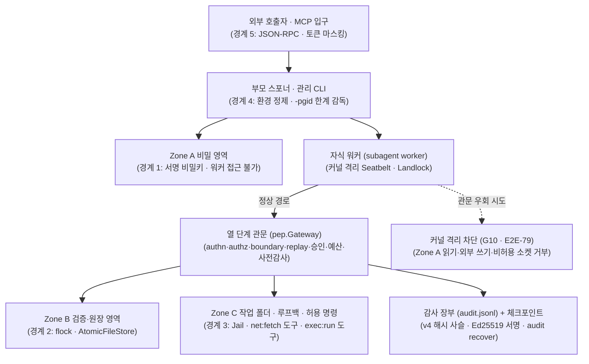

# 011. 위협 지도: 무엇을 막고, 무엇으로 증명하며, 무엇은 못 막나

> **모드**: `[문서작업]` — 소스코드 수정 없이 현재 구현된 방어 경계와 시나리오 카탈로그(`catalog.AllScenarios()`)의 공격 분류(`AttackClass`), 각 공격을 막는 장치와 시나리오 ID, 그리고 일부러 범위 밖에 둔 것(비목표)과 아직 막지 못하는 한계를 한 장의 색인 지도로 대조합니다.  
> **기준일**: 2026-11-05 · **기준 커밋**: `5f0ab2a` (이 문서가 설명하는 `cmd/`와 `internal/`을 마지막으로 바꾼 커밋)  
> **검증 범위**: 동작·순서·소유자·시점을 코드와 대조한 결과와 「미확인」은 5부 ③에 있습니다.  
> **이 문서는 구현된 것만 적는다.** 계획·제안·미래형 약속은 적지 않으며, 현재 코드가 하지 않는 것은 「지금은 없다」고만 씁니다.  
> **이 문서의 규칙**: 이 편은 [001편](001-전체요청여정과_5단계관문.md)~[010편](010-파일잠금_원자교체와_도중종료.md) 전체를 가로지르는 **위협·방어 색인 편**입니다. 각 방어 장치의 내부 동작은 다시 길게 풀지 않고 행마다 해당 편과 질문(Q) 링크로 넘기며, 고유 이름의 첫 등장 설명과 문단 끝 `(구현: 파일 · 함수, 5부 ② 번호)` 귀띔 규칙은 [프로그램 설명서 README](README.md)를 따릅니다.  
> **겹치는 주제**: 열 단계 관문과 작업 폴더 울타리는 [001편](001-전체요청여정과_5단계관문.md)이, 출입증 발급·축소 위임·키 회전은 [002편](002-토큰발급_축소위임과_서명키회전.md)이, 자식 프로세스 격리와 해시 사슬 감사는 [003편](003-서브프로세스격리와_해시체인감사.md)이, 2단계 위임과 MCP 게이트웨이는 [004편](004-다단계위임과_MCP도구게이트웨이.md)이, 사람 승인·예산·네트워크 및 명령 도구는 [005편](005-승인_예산과_도구확장.md)이, 운영체제 커널 격리·관측성·체크포인트는 [006편](006-OS격리_관측성과_감사체크포인트.md)이, 계층 의존 규칙과 정적 가드는 [007편](007-코드읽는순서와_의존방향.md)이, 시나리오 하네스와 4중 판정은 [008편](008-시나리오하네스와_4중판정.md)이, 권한 회수·세대 번호·시계·TOCTOU 창은 [009편](009-권한회수_Epoch_시간과_TOCTOU창.md)이, 파일 잠금·원자 교체·잘린 꼬리 복구는 [010편](010-파일잠금_원자교체와_도중종료.md)이 자세히 다룹니다.
>
> **다시 확인하는 법**
> ```bash
> git rev-parse --short HEAD
> git log -1 --format=%h -- cmd internal
> # 1. 카탈로그의 모든 AttackClass 값 추출 및 등록 무결성 시험
> grep -rhn "AttackClass" internal/harness/catalog/
> go test -v ./internal/harness/catalog/ -run "TestCatalog_ScenarioCount|TestCatalog_RegisterAll"
> # 2. 위협 분류별 대표 시나리오를 explain / summary 형식으로 직접 실행해 보기
> go run ./cmd/authz-harness run --scenario E2E-09 --output-format explain
> go run ./cmd/authz-harness run --scenario E2E-27 --output-format explain
> go run ./cmd/authz-harness run --scenario E2E-52 --output-format explain
> go run ./cmd/authz-harness run --scenario E2E-61 --output-format explain
> go run ./cmd/authz-harness run --scenario E2E-71 --output-format explain
> go run ./cmd/authz-harness run --group G1 --output-format summary
> # 3. 감사 해시 정규화(v3·v4)·잘린 꼬리(T1/T2/T3)·복구(audit recover) 및 정적 가드 시험
> go test -v ./internal/audit/... ./internal/cli/ -run "Recover|MaxRecord|AT_S1|TC_030_06"
> go test -v ./internal/harness/ -run "TestArchitectureGuardrails"
> # 4. 핵심 코드 위치 확인
> grep -n "func " internal/harness/scenario.go internal/harness/catalog/catalog.go
> ```

---

## 💡 사용자의 질문 (원문 보존)

> 설명서 3개 썼다. 더 쓰면 좋은 설명있나?

> 다른 에이전트가 보고서 쓰도록 계획서로 정리해서 만들어줘.

> 008 끝냈다. 확인하고 다음 계획 진행해라.

([계획 009 S2](../계획/009-설명서_010_011_신설_집필계획.md) 지시서에 따라 집필했습니다.)

---

## 0. 모든 설계 이전에 ‘사람’이 있다 — 이 하네스를 어디까지 믿어도 되고, 무엇은 믿으면 안 되나

앞선 [001편](001-전체요청여정과_5단계관문.md)부터 [010편](010-파일잠금_원자교체와_도중종료.md)까지 읽고 `authz-harness run --scenario all`이 통과하는 것을 본 사람은 마지막으로 이런 질문을 던집니다.

- 「시나리오가 전부 `PASS`라는데, 구체적으로 어떤 공격들을 막는다고 증명한 것인가?」
- 「일꾼이 출입증을 위조하거나, 허락받은 범위를 넘기거나, 아예 관문 함수를 안 부르고 운영체제에 직접 파일을 열어 달라고 하면 각각 어디서 막히나?」
- 「반대로 이 프로그램이 아직 못 막는 공격이나, 처음부터 막지 않기로 선을 그은 것(범위 밖)은 무엇인가?」

이 문서는 이 저장소의 모든 방어 장치와 시나리오를 **「누가 무엇을 노리는가(위협) → 어느 단계가 막는가 → 어느 시나리오(`E2E-*`)가 증명하는가 → 남는 한계는 무엇인가 → 자세한 설명은 어느 편에 있는가」**의 한 장짜리 지도로 묶어 보여 줍니다.

---

## 1부. 왜 위협 지도가 따로 필요하고, 신뢰 경계는 어디에 그었나

### 가장 밑바닥의 이유부터

1. **왜 위협 지도가 따로 필요한가?** 개별 설명서(001~010편)는 부품과 흐름 순서대로 적혀 있어서, 사람이 「만약 공격자가 X를 하면 어디서 막히나?」라고 거꾸로 찾을 때는 여러 편을 뒤져야 합니다. 또한 각 편 5부 ①에 흩어져 있는 「지금은 없다(한계)」를 한자리에 모아 두어야 이 프로그램이 지키는 것과 못 지키는 것의 경계를 오해하지 않게 됩니다.
2. **이 프로그램이 상정하는 공격자는 누구인가?** 네 부류입니다.
   - 첫째, 위임받은 권한보다 넓은 파일·네트워크·명령을 건드리거나 예산을 초과해 쓰려는 **하위 에이전트(자식 프로세스 `subagent worker`)**.
   - 둘째, 만료·폐기·변조된 출입증(`at+jwt`)이나 다른 주체의 출입증·승인 기록을 도용·재사용하려는 **부정 호출자**.
   - 셋째, 우리가 만든 관문(`pep.Gateway`)이나 울타리(`jail.Jail`) 함수를 아예 부르지 않고 직접 운영체제 시스템 호출(`os.ReadFile`, `os.WriteFile`, `net.Dial`)을 때리거나 무한 루프·출력 폭주를 일으키는 **침해된 악의 워커(`faultworker`)**.
   - 넷째, 실행이 끝난 뒤 감사 장부(`audit.jsonl`)의 내용을 고치거나 뒷부분을 잘라 내어 흔적을 지우려는 **사후 변조자**.
3. **신뢰 경계(Trust Boundary)는 어디에 그었고 왜 거기에 그었나?** 한 컴퓨터 안에서 돌아가는 로컬 프로그램이라도 자식 프로세스가 부모와 같은 파일·환경변수를 그대로 쓰게 두면 자식이 자기 출입증을 스스로 찍어 내거나 장부를 고칠 수 있습니다. 그래서 다섯 곳에 경계를 그었습니다.
   - **경계 1 (Zone A 비밀 영역 ↔ 자식 워커)**: 서명 비밀키(`signing_keys.priv.json`), 클라이언트 비밀값(`client_secrets.json`), 감사 체크포인트 비밀키(`audit_signing_key.priv.json`)는 부모·관리 명령만 다루고, 자식 워커에게는 경로조차 넘기지 않으며 커널 격리(`ProtectedRoot` 읽기 거부)로 막습니다([002편](002-토큰발급_축소위임과_서명키회전.md) Q3, [006편](006-OS격리_관측성과_감사체크포인트.md) Q1·Q2).
   - **경계 2 (Zone B 공유 검증·원장 영역 ↔ 자식 워커)**: 공개키(`jwks.pub.json`), 허가·세대·승인 장부(`grants_state.json`), 재사용 원장(`replay_ledger.json`), 예산 원장(`budget_ledger.json`), 체크포인트(`audit_checkpoint.json`)는 파일 잠금(`flock`)과 원자 교체(`AtomicFileStore`)로 다루며, 커널 격리 아래의 워커는 Zone B에 대해 읽기 권한만 받고 직접 쓰기는 거부됩니다([006편](006-OS격리_관측성과_감사체크포인트.md) Q1, [010편](010-파일잠금_원자교체와_도중종료.md) Q2).
   - **경계 3 (Zone C 작업 폴더 `workspace/` ↔ 바깥 파일시스템)**: 관문 안에서는 울타리(`jail.Jail`)가 심볼릭 링크를 풀어 바깥 경로를 막고([001편](001-전체요청여정과_5단계관문.md) Q4), 관문을 건너뛰는 워커는 운영체제 커널 격리(`Seatbelt`·`Landlock`)가 작업 폴더와 감사 파일 밖의 쓰기를 막습니다([006편](006-OS격리_관측성과_감사체크포인트.md) Q1~Q4).
   - **경계 4 (부모 스포너 ↔ 자식 서브프로세스)**: 부모 환경변수는 허용 목록 5개만 넘기고 토큰은 `stdin` 단일 JSON 프레임으로만 전달하며, 부모가 프로세스 그룹(`-pgid`) 시간·출력 상한을 감독합니다([003편](003-서브프로세스격리와_해시체인감사.md) Q2·Q5).
   - **경계 5 (외부 MCP 클라이언트 ↔ 실행 워커)**: `mcp.Server`는 도구를 직접 실행하지 않고 `SubprocessExecutor`로 자식 워커를 띄워 대리 실행하며, 응답에서 원시 토큰 문자열을 마스킹합니다([004편](004-다단계위임과_MCP도구게이트웨이.md) Q4~Q6).
4. **무엇을 「막는다」고 적나?** 코드에 검사문이 있다는 것만으로는 적지 않습니다. `harness.ScenarioMetadata`(`internal/harness/scenario.go`)에 공격 분류(`AttackClass`)로 등록되어 [008편](008-시나리오하네스와_4중판정.md)의 4중 판정과 불변식 검사를 통과(`PASS`)하는 시나리오가 있는 위협만 「막는다」로 적습니다. 시나리오가 없는 위협은 Q11과 4부에 따로 모았습니다.
5. **더 내려가면?** 「말로만 안전하다고 하지 않고, 어떤 공격을 어느 시나리오가 막는지와 무엇은 아직 못 막는지를 빠짐없이 대조해 보여 준다」는 요구에 닿습니다. 그 이상은 되물을 수 없습니다.

### 흔한 방식과 이 프로그램의 선택

| 구분 | 흔한 방식 (일반론, 이 저장소에서 확인하지 않음) | 이 프로그램의 선택 |
|---|---|---|
| 모양 | 문서에 「강력한 보안 적용」처럼 추상적인 방어 목록만 적어 두고, 각 위협이 실제 어느 시험과 연결되는지나 무엇을 못 막는지는 적지 않는다 | 카탈로그(`catalog.AllScenarios()`)의 모든 시나리오에 `AttackClass`를 부여해 위협마다 막는 단계·증명 시나리오 ID·남는 한계를 1:1로 대응시키고, 시나리오가 없는 위협과 비목표([ADR 0003](../adr/0003-차기-로드맵-범위-개정-비목표-조건부-해제.md))는 분리해 적는다 |
| 얻는 것 | 문서가 짧고 못 막는 부분이 드러나지 않는다 | 읽는 사람이 어떤 위협이 어느 시나리오(`E2E-*`)로 검증되는지 즉시 찾아 실행해 볼 수 있고, 방어 범위 밖의 한계를 미리 알 수 있다 |
| 포기하는 것 | 문서만 보고 방어 범위를 과신하기 쉽고, 코드가 바뀌어도 문서의 위협 목록이 검증되지 않는다 | 시나리오가 추가되거나 바뀔 때마다 이 색인 표의 `AttackClass`와 시나리오 ID를 함께 맞춰야 한다 |

---

## 2부. 질문과 답변으로 찾아보는 위협 분류별 방어 지도

카탈로그(`internal/harness/catalog/*.go`)에 정의된 모든 `AttackClass` 값은 아래 Q1~Q10 표의 한 행에 들어 있습니다. (구현: [`scenario.go`](../../internal/harness/scenario.go) · `ScenarioMetadata`, [`catalog.go`](../../internal/harness/catalog/catalog.go) · `AllScenarios`, 5부 ② 1~10번)

### Q1. 신원 사칭과 출입증 위조·변조·폐기 키·만료·재사용 공격은 어디서 막나? (`G2`·`G3`·`G4`·`G8`·`G12`)

- **무슨 일이 일어나는가**: 출입증을 발급받기 전에는 클라이언트 레지스트리(`authn.Registry`)가 신원을 확인하고, 발급된 출입증을 쓸 때는 관문의 신원 확인 단계(`authn` — `token.DefaultVerifier.Verify`)와 재사용 원장 소비 단계(`replay` — `token.FileReplayLedger.CheckAndConsume`)이 서명·클레임·1회성 `jti`를 검사해 종료 코드 `11`(`ExitTokenInvalid`, MCP 입구 누락은 `14`)로 막습니다.

| 위협 (일상의 말) | 공격 유형 (`AttackClass`) | 막는 장치와 단계 | 증명 시나리오 | 남는 한계·범위 밖 | 자세한 설명 |
|---|---|---|---|---|---|
| 등록되지 않은 클라이언트가 출입증 발급 요청 | `UnknownClientAuthN` | `authn.Registry.AuthenticateClient` (`AUTHN_UNKNOWN_CLIENT`, Exit `11`) | `E2E-04` (`G2`) | 외부 OIDC/IdP 연동 없음 | [002편 Q1](002-토큰발급_축소위임과_서명키회전.md) |
| 클라이언트 비밀값(시크릿)이 틀린 발급 요청 | `InvalidSecretAuthN` | `authn.Registry.AuthenticateClient` 상수 시간 해시 비교 (`AUTHN_INVALID_SECRET`, Exit `11`) | `E2E-05` (`G2`) | 비밀값 평문은 호출자가 관리 | [002편 Q1](002-토큰발급_축소위임과_서명키회전.md) |
| 정지된(`suspended`) 클라이언트의 발급 요청 | `SuspendedClientAuthN` | `authn.Registry.AuthenticateClient` 상태 확인 (`AUTHN_CLIENT_SUSPENDED`, Exit `11`) | `E2E-06` (`G2`) | 정지 상태 변경 CLI는 지금 없음 | [002편 Q1](002-토큰발급_축소위임과_서명키회전.md) |
| 출입증 없이 관문이나 MCP 도구를 호출 | `MissingToken`, `MissingAuthentication` | 관문 `Verify`(`TOKEN_MALFORMED`, Exit `11`), MCP `extractToken`(`MISSING_AUTH_TOKEN`, Exit `14`) | `E2E-07` (`G3`), `E2E-38` (`G8`) | — | [001편 Q2](001-전체요청여정과_5단계관문.md), [004편 Q5](004-다단계위임과_MCP도구게이트웨이.md) |
| 점(`.`) 3칸 구조나 Base64/JSON이 깨진 출입증 제시 | `MalformedJWT` | `token.DefaultVerifier.Verify` 구문 파싱 (`TOKEN_MALFORMED`, Exit `11`) | `E2E-08` (`G3`) | — | [001편 Q2](001-전체요청여정과_5단계관문.md), [002편 Q2](002-토큰발급_축소위임과_서명키회전.md) |
| 헤더 `typ`가 `at+jwt`가 아닌 토큰 제시 | `InvalidTypeJWT` | `DefaultVerifier.Verify` 헤더 `typ` 대조 (`TOKEN_INVALID_TYPE`, Exit `11`) | `E2E-11` (`G3`) | — | [002편 Q2](002-토큰발급_축소위임과_서명키회전.md) |
| 헤더 `alg`를 `none` 등으로 바꿔 서명 검증 회피 시도 | `AlgNoneAttack` | `DefaultVerifier.Verify`에서 `EdDSA` 외 알고리즘 거부 (`TOKEN_ALG_NOT_ALLOWED`, Exit `11`) | `E2E-10` (`G3`) | `EdDSA` 단일 알고리즘만 지원 | [002편 Q2](002-토큰발급_축소위임과_서명키회전.md) |
| 출입증 본문(`scope` 등)을 고쳐 서명이 깨진 토큰 제시 | `TamperedSignature` | Zone B 공개키(`jwks.pub.json`)로 `ed25519.Verify` (`TOKEN_INVALID_SIGNATURE`, Exit `11`) | `E2E-09` (`G3`) | Zone A 비밀키 자체가 털리면 위조 가능(커널 격리로 방어) | [002편 Q2·Q3](002-토큰발급_축소위임과_서명키회전.md) |
| 이미 폐기(`retired`)된 서명 키(`kid`)로 찍힌 토큰 사용 | `RetiredKeyRejection`, `KeyRetirement` | `DefaultVerifier.Verify`가 `Status == retired` 키 즉시 거부 (`TOKEN_KEY_RETIRED`, Exit `11`) | `E2E-13` (`G3`), `E2E-57` (`G12`) | — | [002편 Q3](002-토큰발급_축소위임과_서명키회전.md), [009편 Q1·Q4](009-권한회수_Epoch_시간과_TOCTOU창.md) |
| 유효 시간(`exp`)이 지난 출입증으로 관문·MCP·세션 호출 | `ExpiredToken`, `ExpiredTokenReplay`, `SessionTokenExpiry` | `DefaultVerifier.Verify`가 `now >= exp` 거부 (`TOKEN_EXPIRED`, Exit `11`) | `E2E-14` (`G4`), `E2E-35` (`G8`), `E2E-55` (`G12`) | 이미 `execute`에 진입한 실행 중 I/O는 중단 안 함(`Window C`) | [009편 Q1·Q4·Q5](009-권한회수_Epoch_시간과_TOCTOU창.md) |
| 아직 활성 시각(`nbf`/`iat`)이 오지 않은 미래 토큰 제시 | `FutureNbfToken` | `DefaultVerifier.Verify`가 `now < nbf` 거부 (`TOKEN_NOT_YET_VALID`, Exit `11`) | `E2E-15` (`G4`) | — | [001편 Q2](001-전체요청여정과_5단계관문.md), [002편 Q2](002-토큰발급_축소위임과_서명키회전.md) |
| 발급자(`iss`)나 수신 대상(`aud`)이 다른 토큰 제시 | `AudienceMismatch` | `DefaultVerifier.Verify`의 `iss`·`aud` 일치 검사 (`TOKEN_INVALID_ISS_AUD`, Exit `11`) | `E2E-16` (`G4`) | — | [001편 Q2](001-전체요청여정과_5단계관문.md), [002편 Q2](002-토큰발급_축소위임과_서명키회전.md) |
| 다른 일꾼(`sub`)에게 발급된 출입증을 훔쳐 자기 이름으로 사용 | `SubjectImpersonation` | `DefaultVerifier.Verify`가 `token.sub == expectedSubject` 대조 (`TOKEN_SUBJECT_MISMATCH`, Exit `11`) | `E2E-17` (`G4`) | TLS mTLS·DPoP 네트워크 바인딩은 범위 밖 | [001편 Q2](001-전체요청여정과_5단계관문.md), [002편 Q2](002-토큰발급_축소위임과_서명키회전.md) |
| 한 번 사용한 1회용 출입증(`jti`)을 다시 제시 | `ReplayAttack`, `SessionTokenReplay` | `authn` 조회(`IsConsumed`) + `replay` 원자적 소비(`CheckAndConsume`, `TOKEN_REPLAY_DETECTED`, Exit `11`) | `E2E-18` (`G4`), `E2E-58` (`G12`) | `ask` 판정 시에는 재시도를 위해 `jti`를 소비하지 않음 | [001편 Q2·Q3](001-전체요청여정과_5단계관문.md), [009편 Q4](009-권한회수_Epoch_시간과_TOCTOU창.md) |

- **근거**: 5부 ② 항목 1, 2, 3, 4, 6, 8번

### Q2. 권한 상승·위임 월권·미허가 도구 및 네트워크·명령 우회는 어디서 막나? (`G5`·`G8`·`G12`·`G15`)

- **무슨 일이 일어나는가**: 부모 출입증을 자식 출입증으로 바꿀 때는 축소 위임 검증기(`exchange.DefaultDownscopeValidator`)가 부모보다 넓은 범위·긴 수명·깊은 단계를 거부하고, 실제 실행할 때는 판정 부품(`pdp.Evaluate`)과 도구별 가드(`netguard`·`execguard`를 부르는 `pep.Tool`, MCP 도구 라우터)가 허용 목록 밖의 요청을 종료 코드 `12`(`ExitAuthzDenied`), `11`(`ExitTokenInvalid`), `14`(`ExitBadInput`)로 막습니다.

| 위협 (일상의 말) | 공격 유형 (`AttackClass`) | 막는 장치와 단계 | 증명 시나리오 | 남는 한계·범위 밖 | 자세한 설명 |
|---|---|---|---|---|---|
| 부모나 중간 팀장이 자기 `scope`보다 넓은 자식 출입증 교환 시도 | `DelegationScopeExceeded`, `MultiHopDelegationScopeExceeded` | `DefaultDownscopeValidator.ValidateDownscope` 부분집합 검사 (`DELEGATION_SCOPE_EXCEEDED`, Exit `12`) | `E2E-19`, `E2E-32` (`G5`) | 와일드카드·정규식 정책 언어는 없음 | [002편 Q4](002-토큰발급_축소위임과_서명키회전.md), [004편 Q1·Q2](004-다단계위임과_MCP도구게이트웨이.md) |
| 부모 출입증의 남은 수명(`exp`)보다 긴 자식 출입증 교환 시도 | `DelegationTTLExceeded` | `ValidateDownscope`가 `childExp > parentExp` 거부 (`DELEGATION_TTL_EXCEEDED`, Exit `12`) | `E2E-20` (`G5`) | — | [002편 Q4](002-토큰발급_축소위임과_서명키회전.md) |
| 부모 출입증 자체가 만료된 뒤 자식 출입증 재교환 시도 | `ReExchangeParentExpired` | `ExchangeService.Exchange`가 부모 토큰 `Verify`에서 만료 거부 (`TOKEN_EXPIRED`, Exit `11`) | `E2E-60` (`G12`) | 별도 Refresh Token은 두지 않음([ADR 0003](../adr/0003-차기-로드맵-범위-개정-비목표-조건부-해제.md) C-4) | [009편 Q4](009-권한회수_Epoch_시간과_TOCTOU창.md) |
| 최대 위임 깊이(`max_depth`)를 넘어 3단계 이상 연쇄 위임 시도 | `DelegationDepthExceeded` | `ValidateDownscope` 깊이 상한 검사 (`DELEGATION_DEPTH_EXCEEDED`, Exit `12`) | `E2E-21` (`G5`) | — | [002편 Q4](002-토큰발급_축소위임과_서명키회전.md), [004편 Q2](004-다단계위임과_MCP도구게이트웨이.md) |
| 읽기 전용(`file:read`) 출입증으로 파일 쓰기(`file:write`) 시도 | `InsufficientScopeWrite`, `PrivilegeEscalation` | `pdp.Evaluate`의 토큰 `scope` 대조 (`TOKEN_INSUFFICIENT_SCOPE`, Exit `12`) | `E2E-22` (`G5`), `E2E-34` (`G8`) | — | [001편 Q3](001-전체요청여정과_5단계관문.md), [004편 Q5](004-다단계위임과_MCP도구게이트웨이.md) |
| 출입증 `scope`에는 적어 넣었으나 중앙 장부에 활성 `Grant`가 없는 리소스 접근 | `NoActiveGrant` | `pdp.Evaluate`의 실시간 `ActiveGrants` 대조 (`NO_ACTIVE_GRANT`, Exit `12`) | `E2E-23` (`G5`) | — | [001편 Q3](001-전체요청여정과_5단계관문.md) |
| MCP 게이트웨이에 등록되지 않은 임의 도구(`shell_exec` 등) 호출 | `ArbitraryToolExecution` | `mcp.Server` 도구 이름 검사 (`MCP_UNKNOWN_TOOL`, Exit `14`) | `E2E-39` (`G8`) | MCP에는 `file_read`/`file_write`만 열려 있음 | [004편 Q4·Q5](004-다단계위임과_MCP도구게이트웨이.md) |
| `net:fetch`에서 `userinfo@`·정수 IP·`localhost` 표기 우회, 비허용 포트, `302` 리다이렉트 추적 시도 | `EgressBypass` | `netguard`(`net:fetch` 도구)가 `127.0.0.1:<허용포트>` 리터럴만 허용하고 리다이렉트를 차단 (`EGRESS_DENIED`, Exit `12`) | `E2E-75`, `E2E-76` (`G15`) | 외부 인터넷 조회는 비목표(루프백 전용) | [005편 Q5·Q6](005-승인_예산과_도구확장.md) |
| `exec:run`에서 미등록 명령(`sh`) 실행이나 세미콜론(`;`) 등 인자 주입 시도 | `ExecInjection` | `execguard`(`exec:run` 도구)의 코드 고정 허용 ID(`echo-safe` 등) 및 안전한 문자 정규식 검사 (`EXEC_NOT_ALLOWED`, `EXEC_ARG_REJECTED`, Exit `12`) | `E2E-77` (`G15`) | 임의 셸 명령 실행은 비목표([ADR 0003](../adr/0003-차기-로드맵-범위-개정-비목표-조건부-해제.md) C-2) | [005편 Q7](005-승인_예산과_도구확장.md) |

- **근거**: 5부 ② 항목 1, 5, 6, 8, 10번

### Q3. 작업 폴더(`workspace/`) 밖으로 나가려는 경로 탈출은 어디서 막나? (`G6`·`G8`)

- **무슨 일이 일어나는가**: 관문 `boundary`의 울타리(`jail.Jail`의 `ResolvePath`)가 상대 경로 탈출(`..`), 폴더 이름 접두사 착시(`/workspace-evil`), 작업 폴더 안에 심어 둔 심볼릭 링크 외부 탈출(`filepath.EvalSymlinks`)을 모두 검사해 파일을 열기 전에 종료 코드 `13`(`ExitPathViolation`)으로 막습니다.

| 위협 (일상의 말) | 공격 유형 (`AttackClass`) | 막는 장치와 단계 | 증명 시나리오 | 남는 한계·범위 밖 | 자세한 설명 |
|---|---|---|---|---|---|
| `../../etc/passwd` 같은 상대 경로로 작업 폴더 상위 탈출 시도 | `PathTraversal` | `Jail.ResolvePath` 경로 정규화 및 하위 포함 검사 (`PATH_TRAVERSAL`, Exit `13`) | `E2E-25` (`G6`), `E2E-36` (`G8`) | `ResolvePath` 통과 직후 실제 `os.Open` 사이의 초미세 경쟁은 커널 격리(Q7)가 보완 | [001편 Q4](001-전체요청여정과_5단계관문.md), [004편 Q5](004-다단계위임과_MCP도구게이트웨이.md) |
| `/workspace`와 앞글자만 같은 형제 폴더(`/workspace-evil`) 접근 시도 | `PrefixIllusion` | 단순 문자열 접두사 비교 대신 `filepath.Rel` 경계 검증 (`PATH_TRAVERSAL`, Exit `13`) | `E2E-26` (`G6`) | — | [001편 Q4](001-전체요청여정과_5단계관문.md) |
| 작업 폴더 안의 심볼릭 링크가 바깥 비밀 파일을 가리킬 때 읽기·쓰기 시도 | `SymlinkEscape` | `filepath.EvalSymlinks`로 실제 물리 경로를 끝까지 풀어 경계 대조 (`SYMLINK_ESCAPE`, Exit `13`) | `E2E-27` (`G6`) | — | [001편 Q4](001-전체요청여정과_5단계관문.md) |

- **근거**: 5부 ② 항목 1, 5, 6번

### Q4. 이미 내준 권한을 거두거나(`Revoke`) 세대 번호(`Epoch`)를 올렸을 때 옛 출입증 사용은 어떻게 막나? (`G1`·`G5`·`G8`·`G12`)

- **무슨 일이 일어나는가**: 판정 부품(`pdp.Evaluate`)은 출입증에 적힌 권한만 믿지 않고, 매 요청마다 `pip.DefaultService.GetSubjectSnapshot`이 디스크(`grants_state.json`)에서 새로 읽어 온 활성 권한 목록과 주체·위임 조상(`act` 사슬)의 현재 세대 번호(`CurrentEpoch`)를 대조해 종료 코드 `12`(`ExitAuthzDenied`)로 막습니다.

| 위협 (일상의 말) | 공격 유형 (`AttackClass`) | 막는 장치와 단계 | 증명 시나리오 | 남는 한계·범위 밖 | 자세한 설명 |
|---|---|---|---|---|---|
| 권한(`Grant`)이 회수된 뒤 아직 유효 시간이 남은 출입증으로 관문·MCP 재호출 | `DynamicRevocation`, `GrantRevocation` | `pip` 무캐시 실시간 조회 + `pdp.Evaluate` 회수 상태 확인 (`GRANT_REVOKED`, Exit `12`) | `E2E-03` (`G1`), `E2E-37` (`G8`) | 이미 `authz`를 통과해 `execute` I/O에 들어간 호출은 중단하지 않음(`Window B`·`C`) | [009편 Q1·Q5](009-권한회수_Epoch_시간과_TOCTOU창.md) |
| 주체의 세대 번호(`Epoch`)가 올라간 뒤 이전 세대 출입증 사용 | `EpochRevocation` | `pdp.Evaluate`가 `token.SubjectEpoch != snapshot.CurrentEpoch` 거부 (`SUBJECT_EPOCH_REVOKED`, Exit `12`) | `E2E-24` (`G5`) | 상동 (`Window B`·`C`) | [009편 Q1·Q2·Q5](009-권한회수_Epoch_시간과_TOCTOU창.md) |
| 상위 위임자(팀장)의 `Epoch`가 올라갔는데 그 팀장이 발급해 준 하위 일꾼 출입증 사용 | `LineageRevocation` | `pdp.Evaluate`가 `act` 사슬 조상들의 `Epoch`까지 모두 현재 장부와 동등 비교 (`SUBJECT_EPOCH_REVOKED`, Exit `12`) | `E2E-56` (`G12`) | 상동 (`Window B`·`C`) | [009편 Q2·Q4](009-권한회수_Epoch_시간과_TOCTOU창.md) |

- **근거**: 5부 ② 항목 1, 2, 5, 6, 8번

### Q5. 사람의 1회용 승인(`ask`)을 건너뛰거나 가로채 다른 요청에 쓰는 공격은 어떻게 막나? (`G14`)

- **무슨 일이 일어나는가**: 승인 필수(`RequireApproval: true`) 권한에 대해 `pdp.Evaluate`가 `DecisionAsk`를 내리면, 관문(`approval` — `pap.Service.ConsumeApproval`)이 주체(`Subject`), 행동(`Action`), 리소스(`Resource`), 출입증 번호(`TokenJTI`), 입력 데이터 SHA-256 지문(`ArgHash`), 만료 시각(`ExpiresAt`) 여섯 가지를 한 잠금 안에서 대조하고 1회용으로 소비합니다. 맞지 않으면 종료 코드 `18`(`ExitApprovalRequired`)로 멈춥니다.

| 위협 (일상의 말) | 공격 유형 (`AttackClass`) | 막는 장치와 단계 | 증명 시나리오 | 남는 한계·범위 밖 | 자세한 설명 |
|---|---|---|---|---|---|
| 승인 필수(`RequireApproval`) 작업을 사람 승인 없이 바로 실행 시도 | `ApprovalRequired` | `pdp.Evaluate`가 `DecisionAsk` 반환 → 미승인 시 실행 보류 (`APPROVAL_REQUIRED`, Exit `18`, `jti` 미소비) | `E2E-67` (`G14`) | 대화형 승인 웹/GUI 화면은 범위 밖(CLI 명령으로 승인) | [005편 Q1·Q2](005-승인_예산과_도구확장.md) |
| 한 번 써서 소비된 승인을 같은 작업에 두 번 재사용 시도 | `ApprovalReuse` | `ConsumeApproval`이 첫 사용 시 `Consumed = true`로 바꾸고 두 번째 호출 거부 (`APPROVAL_REQUIRED`, Exit `18`) | `E2E-69` (`G14`) | — | [005편 Q2](005-승인_예산과_도구확장.md) |
| 다른 출입증(`jti`)이 받은 승인을 새 출입증이 가로채 사용 시도 | `ApprovalTheft` | `ConsumeApproval`의 `TokenJTI` 바인딩 대조 (`APPROVAL_MISMATCH`, Exit `18`) | `E2E-70` (`G14`) | — | [005편 Q2](005-승인_예산과_도구확장.md) |
| 승인을 받은 뒤 같은 출입증으로 파일에 쓸 내용(`Data`)만 몰래 바꿔치기 시도 | `ConfusedDeputy` | `ConsumeApproval`의 입력 SHA-256 지문(`ArgHash`) 바인딩 대조 (`APPROVAL_MISMATCH`, Exit `18`) | `E2E-71` (`G14`) | — | [005편 Q2](005-승인_예산과_도구확장.md) |
| 유효 시간(`TTL`)이 지난 승인 기록으로 실행 시도 | `ApprovalExpired` | `ConsumeApproval`이 `now >= ExpiresAt` 거부 (`APPROVAL_EXPIRED`, Exit `18`) | `E2E-72` (`G14`) | — | [005편 Q2](005-승인_예산과_도구확장.md) |
| 승인은 받았으나 실행 직전에 바탕 권한(`Grant`) 자체가 회수된 경우 | `ApprovalBypassRevoked` | `authz`(`pdp.Evaluate`)가 `approval`(승인 확인)보다 먼저 돌아 `GRANT_REVOKED`(Exit `12`)로 즉시 차단 | `E2E-73` (`G14`) | — | [005편 Q2](005-승인_예산과_도구확장.md) |

- **근거**: 5부 ② 항목 1, 9번

### Q6. 예산 초과 위임·동시 차감 경합과 자식 프로세스 자원 폭주(무한 대기·출력 홍수·손자 잔류)는 어떻게 막나? (`G9`·`G11`·`G15`)

- **무슨 일이 일어나는가**: 출입증별 호출 횟수·쓰기 바이트 예산은 Zone B 예산 원장(`budget.FileLedger`)이 배타 잠금(`flock`) 안에서 예약(`Reserve`)·차감(`Consume`)·환급(`Refund`)하여 종료 코드 `12`(`ExitAuthzDenied`)로 막고, 자식 프로세스가 멈추거나 출력을 쏟아내거나 손자 프로세스를 남기는 것은 부모 스포너(`orchestrator.SubprocessSpawner`)가 프로세스 그룹(`Setpgid` + `Kill(-pgid, SIGKILL)`)과 `limitedBuffer`로 감독해 종료 코드 `17`(`ExitResourceLimit`)로 끝냅니다.

| 위협 (일상의 말) | 공격 유형 (`AttackClass`) | 막는 장치와 단계 | 증명 시나리오 | 남는 한계·범위 밖 | 자세한 설명 |
|---|---|---|---|---|---|
| 부모의 남은 예산보다 큰 예산을 자식에게 위임(교환) 시도 | `DelegationBudgetExceeded` | `budget.FileLedger.Reserve`가 부모 잔여 예산 부족 시 거부 (`DELEGATION_BUDGET_EXCEEDED`, Exit `12`) | `E2E-50` (`G11`) | 읽기 바이트(`MaxReadBytes`) 예산 필드는 지금 없음 | [005편 Q3·Q4](005-승인_예산과_도구확장.md) |
| 허용된 쓰기 바이트 예산을 넘어 파일 쓰기 시도 | `BudgetExhausted` | `budget`(`FileLedger.Consume`)가 상한 초과 시 거부 (`BUDGET_EXHAUSTED`, Exit `12`, 파일 0바이트 무변화) | `E2E-51` (`G11`) | `execute` I/O가 성공한 뒤에는 예산이 영구 차감됨 | [005편 Q3·Q4](005-승인_예산과_도구확장.md) |
| 여러 자식 프로세스가 동시에 같은 예산을 깎아 상한 우회 시도 | `BudgetTOCTOURace` | `budget_ledger.json.lock` 배타 잠금(`AtomicFileStore.Update`) 직렬화 (`BUDGET_EXHAUSTED`, Exit `12`) | `E2E-52` (`G11`) | — | [005편 Q4](005-승인_예산과_도구확장.md), [010편 Q2](010-파일잠금_원자교체와_도중종료.md) |
| 자식 워커가 무한 루프에 빠져 멈추거나(`hang`), 손자 프로세스를 띄운 채 멈추거나(`spawn_child_hang`), 출력을 끝없이 쏟아냄(`flood`, 대용량 `net:fetch`) | `ResourceExhaustion` | `SubprocessSpawner.Spawn`이 시간·출력 상한 초과 시 프로세스 그룹 전체(`-pgid`)를 `SIGKILL`로 종료하고 `orchestrator.limit_exceeded` 감사 기록 (`RESOURCE_TIMEOUT`, `RESOURCE_OUTPUT_LIMIT`, Exit `17`) | `E2E-40`~`E2E-43` (`G9`), `E2E-78` (`G15`) | CPU 코어 점유율이나 메모리(RAM) 사용량 상한(cgroups 등)은 지금 없음 | [003편 Q5](003-서브프로세스격리와_해시체인감사.md), [008편 Q5·Q7](008-시나리오하네스와_4중판정.md), [005편 Q6](005-승인_예산과_도구확장.md) |

- **근거**: 5부 ② 항목 1, 7, 8, 10번

### Q7. 관문(`PEP`)을 아예 부르지 않고 시스템 호출을 직접 부르는 악의 워커는 어떻게 막나? (`G10`·`G15`)

- **무슨 일이 일어나는가**: 침해된 워커(`faultworker`)가 관문 코드를 무시하고 `os.ReadFile`, `os.WriteFile`, `net.Dial`을 직접 불러도, 부모 스포너가 자식을 띄울 때 씌운 운영체제 커널 격리(`confinement.SeatbeltConfiner` / `LandlockConfiner`)가 커널 수준에서 접근을 거부합니다. 시나리오는 격리를 끈 대조군(공격 성공 관찰)과 격리를 켠 실험군(차단 관찰)을 쌍으로 돌려 부모가 바깥에서 직접 확인합니다.

| 위협 (일상의 말) | 공격 유형 (`AttackClass`) | 막는 장치와 단계 | 증명 시나리오 | 남는 한계·범위 밖 | 자세한 설명 |
|---|---|---|---|---|---|
| 관문을 건너뛰고 Zone A 개인키 폴더(`canary.txt`) 직접 읽기(`E2E-45`), 샌드박스 밖 파일 직접 쓰기(`E2E-46`), 비허용 TCP 소켓 직접 연결(`E2E-47`, `E2E-79`), 손자 프로세스를 통한 Zone A 읽기(`E2E-48`), 격리 불가 환경에서 강행 기동(`E2E-49`) | `OSConfinementBypass` | macOS `sandbox-exec`(`SeatbeltConfiner`) / Linux `Landlock`(`LandlockConfiner`) 커널 규칙 강제(기동 전 `Prepare`), 필수 모드(`Require: true`)에서 격리 불가 시 스폰 거부(`CONFINEMENT_UNAVAILABLE`, Exit `16`) | `E2E-45`~`E2E-49` (`G10`), `E2E-79` (`G15`) | 중첩 샌드박스(sandbox 안의 `sandbox-exec`)나 구형 커널에서는 격리 어댑터가 동작하지 않아 `SKIP`(필수 모드면 `16` 거부)되며, Linux 런타임 실행은 macOS 호스트에서 미검증(**미확인**) | [006편 Q1~Q4](006-OS격리_관측성과_감사체크포인트.md), [005편 Q6](005-승인_예산과_도구확장.md), [008편 Q6·Q7](008-시나리오하네스와_4중판정.md) |

- **근거**: 5부 ② 항목 1, 7, 10번

### Q8. 감사 맥락 누락, 감사 실패 시 무임승차, 사후 감사 장부 변조·절단·재작성·잘린 꼬리는 어떻게 막나? (`G7`·`G13` + 계획 008·010)

- **무슨 일이 일어나는가**:
  1. 추적 번호(`trace_id`)가 없으면 `input`에서 거부(`14`)하고, 실행 전 감사(`precommit_audit`) 쓰기가 실패하면 실제 작업(`execute`)으로 가지 않고 즉시 멈춥니다(`ExitAuditFailure`, `15`).
  2. 기록된 감사 줄들은 길이 접두(`v3`, 새 기록은 단계 값을 더한 `v4`) SHA-256 해시 사슬(`prev_hash → curr_hash`, 한 줄 상한 `MaxRecordBytes` = 1MB)과 Zone A 비밀키로 서명한 체크포인트(`checkpoint.Verify`)로 묶여, 중간 줄 변조·꼬리 절단·전체 재작성·검증키 삭제를 모두 종료 코드 `15`로 잡아냅니다.
  3. 기록 도중 프로세스가 죽어 마지막 바이트가 줄바꿈(`\n`)이 아닌 파일은 `tailState`가 잡아 이후 모든 `Log`와 `verify`를 `AUDIT_TAIL_INCOMPLETE`(`15`)로 멈춰 세우며, 운영자가 `audit recover`(`RecoverIncompleteTail`)를 실행했을 때만 깨진 JSON 조각(`T1` → `.partial-*` 분리 후 절단)과 줄바꿈만 빠진 온전한 기록(`T2` → `\n` 1바이트 보완)을 복구하고 사슬이 깨진 변조(`T3`)는 복구를 거부합니다.

| 위협 (일상의 말) | 공격 유형 (`AttackClass`) | 막는 장치와 단계 | 증명 시나리오 | 남는 한계·범위 밖 | 자세한 설명 |
|---|---|---|---|---|---|
| `trace_id` 없이 요청을 보내 감사 추적을 끊으려는 시도 | `MissingTraceID` | `input`(`gateway.input`) 맥락 검사 (`MISSING_TRACE_CONTEXT`, Exit `14`) | `E2E-28` (`G7`) | — | [001편 Q2](001-전체요청여정과_5단계관문.md) |
| 디스크 오류 등으로 감사 기록이 실패했는데도 파일 쓰기만 성공하려는 시도 | `AuditFailureFailClosed` | `precommit_audit` 사전 감사가 실패하면 `execute` I/O 진입 전 중단 및 예산 환급 (`AUDIT_LOG_FAILED`, Exit `15`, 파일 0바이트 무변화) | `E2E-29` (`G7`) | `execute` I/O가 이미 끝난 뒤 `finalize` 완료 감사만 실패하면 물리적 I/O는 되돌리지 못함(종료 코드는 `15`) | [001편 Q5](001-전체요청여정과_5단계관문.md), [003편 Q3](003-서브프로세스격리와_해시체인감사.md) |
| 기록된 감사 장부(`audit.jsonl`)의 과거 줄 내용을 사후에 고침 | `AuditLogTampering` | `audit.VerifyHashChain`이 v1~v4 해시 사슬·길이 상한(`MaxRecordBytes`)·끝 바이트(`\n`) 대조 (`AUDIT_INTEGRITY_BROKEN`, Exit `15`) | `E2E-30` (`G7`) | 체크포인트 생성 전에 파일 전체를 지우고 해시를 다시 계산하면 사슬만으로는 못 잡음(아래 `E2E-62`가 보완) | [003편 Q4](003-서브프로세스격리와_해시체인감사.md), [010편 Q6~Q8](010-파일잠금_원자교체와_도중종료.md) |
| 해시 사슬이 깨지지 않게 감사 장부의 마지막 줄들을 통째로 잘라 냄 | `AuditTailTruncation` | `checkpoint.Verify`가 서명된 체크포인트의 `LineCount`와 현재 줄 수를 대조 (`AUDIT_TRUNCATION_DETECTED`, Exit `15`) | `E2E-61` (`G13`) | 마지막 체크포인트가 찍힌 시점 **이후**에 추가된 줄만 잘라 내면 다음 체크포인트 전에는 줄 수 차이가 안 남 | [006편 Q10·Q11](006-OS격리_관측성과_감사체크포인트.md) |
| 첫 줄부터 내용을 바꾸고 해시 사슬 전체를 새로 계산해 덮어씀 | `AuditFullRewrite` | Zone A 비밀키로 서명된 체크포인트의 `HeadHash`와 불일치 (`AUDIT_CHECKPOINT_MISMATCH`, Exit `15`) | `E2E-62` (`G13`) | 같은 OS 계정의 비격리 프로세스가 Zone A 비밀키까지 읽을 수 있으면 체크포인트 재서명 가능 | [006편 Q10·Q11](006-OS격리_관측성과_감사체크포인트.md) |
| 체크포인트 검증용 공개키(`audit_verification_key.pub.json`)를 삭제해 검증 우회 시도 | `AuditCheckpointMaterialMissing` | `checkpoint.Verify`가 검증 재료 부재 시 통과 대신 실패 반환 (`AUDIT_CHECKPOINT_MISSING_MATERIAL`, Exit `15`) | `E2E-63` (`G13`) | — | [006편 Q11](006-OS격리_관측성과_감사체크포인트.md) |

- **근거**: 5부 ② 항목 1, 5, 9, 11번

### Q9. 비밀값(원시 토큰, 요청·응답 평문) 유출과 관측성 장애 전파는 어떻게 막나? (`G8`·`G9`·`G13`·`G15`)

- **무슨 일이 일어나는가**: 감사 장부와 운영 로그(`stderr`), MCP 응답 어디에도 서명된 JWT 원문(`eyJ...`)이나 파일·네트워크 본문 평문을 적지 않고 토큰 번호(`TokenJTI`)와 SHA-256 지문(`ArgHash`, `ResultHash`)만 남기며, 관측성 어댑터(`observe.Observer`)는 `safeObserver`가 `recover()`로 감싸 패닉이 나도 인가 판정과 감사 기록을 흔들지 못하게 격리합니다.

| 위협 (일상의 말) | 공격 유형 (`AttackClass`) | 막는 장치와 단계 | 증명 시나리오 | 남는 한계·범위 밖 | 자세한 설명 |
|---|---|---|---|---|---|
| 파일 쓰기·읽기나 네트워크 조회 본문 평문이 감사 장부(`audit.jsonl`)에 그대로 찍혀 유출 | `AuditPlaintextLeak` | `pep.Gateway`가 원문 대신 SHA-256 지문(`ArgHash`, `ResultHash`)만 기록하고 `net:fetch`는 URL 쿼리·경로를 뺀 `host:port`만 `Resource`에 기록 (Exit `0`, 평문 미포함 검증) | `E2E-64` (`G13`), `E2E-74`, `E2E-75` (`G15`) | 원문 자체가 매우 짧고 후보가 알려진 값이면 SHA-256 사전 대조(무차별 대입) 가능 | [006편 Q8·Q9](006-OS격리_관측성과_감사체크포인트.md), [005편 Q6](005-승인_예산과_도구확장.md) |
| 관측성/텔레메트리 로거(`Observer`)가 고장 나거나 `panic`을 던져 보안 관문을 멈추게 함 | `ObservabilityFailure` | `observe.WrapSafe`가 모든 훅 호출을 `defer recover()`로 감싸 패닉을 흡수하고 관문 판정·감사는 정상 완료 (Exit `0`) | `E2E-65` (`G13`) | 관측성 로그는 Best-Effort이므로 로거 장애 시 운영 진단 메트릭은 유실됨 | [006편 Q5~Q7](006-OS격리_관측성과_감사체크포인트.md) |

- **근거**: 5부 ② 항목 1, 6, 7, 9, 10번

### Q10. 방어 장치가 정당한 요청까지 막지 않는다는 대조군(`HappyPath` 등) 시나리오는 무엇인가?

- **무슨 일이 일어나는가**: 무조건 거부만 내뱉는 프로그램도 공격 시나리오만 돌리면 통과할 수 있으므로, 카탈로그는 정당한 요청·키 회전·다단계 위임·예산 회수·세션 재교환·스키마 호환이 종료 코드 `0`(`ExitSuccess`)으로 통과하는 **정상 대조군 시나리오**를 함께 돌려 과차단(오탐)이 없음을 확인합니다.

| 대조군 분류 (`AttackClass`) | 무엇이 정상 동작함을 증명하나 | 증명 시나리오 | 자세한 설명 |
|---|---|---|---|
| `HappyPath` | 유효한 출입증과 활성 `Grant`가 있을 때 작업 폴더 파일 읽기(`E2E-01`)와 쓰기(`E2E-02`)가 정상 통과(`0`)함 | `E2E-01`, `E2E-02` (`G1`) | [001편 Q1~Q5](001-전체요청여정과_5단계관문.md) |
| `KeyRotationSuccess` | 서명 키를 회전(`rotate`)해 이전 키가 `verify-only`가 되어도 기존 출입증 검증이 끊기지 않고 통과(`0`)함 | `E2E-12` (`G3`) | [002편 Q3](002-토큰발급_축소위임과_서명키회전.md) |
| `MultiHopDelegationAllow` | 총괄 → 팀장 → 일꾼으로 이어지는 2단계(`2-Hop`) 축소 위임과 실행이 통과(`0`)하고 `act` 계보가 감사에 남음 | `E2E-31` (`G5`) | [004편 Q1·Q2](004-다단계위임과_MCP도구게이트웨이.md) |
| `NormalDelegation` | 외부 MCP `tools/call` 입구에서 유효한 읽기 토큰으로 `file_read` 호출이 정상 통과(`0`)함 | `E2E-33` (`G8`) | [004편 Q4·Q5](004-다단계위임과_MCP도구게이트웨이.md) |
| `정상` | 부모 스포너의 기본 시간·출력 한계(`DefaultLimits`) 아래에서 정상 자식 워커가 오탐 없이 종료(`0`)됨 | `E2E-44` (`G9`) | [003편 Q5](003-서브프로세스격리와_해시체인감사.md), [008편 Q5](008-시나리오하네스와_4중판정.md) |
| `BudgetReclaim`, `BudgetConservation` | 자식 출입증 만료 후 미사용 예약 예산이 부모에게 자동 회수되어 재위임에 성공(`E2E-53`)하고, 2단계 분할 위임·소비 후 예산 총합이 보존(`E2E-54`)됨 | `E2E-53`, `E2E-54` (`G11`) | [005편 Q3·Q4](005-승인_예산과_도구확장.md) |
| `ReExchange` | 장기 세션 중 짧은 자식 출입증이 만료되었을 때 아직 살아 있는 부모 출입증으로 재교환해 세션을 이어 감(`0`) | `E2E-59` (`G12`) | [009편 Q4](009-권한회수_Epoch_시간과_TOCTOU창.md) |
| `AuditSchemaCompat` | 구버전(`v1`) 감사 기록 뒤에 현행 버전(`v4`, 시나리오 이름은 v1·v2 호환) 기록이 이어져도 한 사슬로 검증 통과(`0`)함 | `E2E-66` (`G13`) | [003편 Q4](003-서브프로세스격리와_해시체인감사.md), [006편 Q9](006-OS격리_관측성과_감사체크포인트.md) |
| `ApprovalRetry` | `ask`(`18`)로 멈춘 뒤 사람이 1회용 승인을 내주면, 아까 쓴 **같은 출입증(`jti`)**으로 재시도해 정상 통과(`0`)함 | `E2E-68` (`G14`) | [005편 Q1·Q2](005-승인_예산과_도구확장.md) |
| `None`, `none` | 허용 목록에 등록된 루프백 포트 `net:fetch`가 워커에서 정상 성공(`E2E-74`, `AttackClass: "None"`)하고, 커널 격리 아래 정직한 워커가 정상 실행(`T-055-04`, `AttackClass: "none"`, 단위 시험)됨 | `E2E-74` (`G15`), `T-055-04` (`catalog_test`) | [005편 Q6](005-승인_예산과_도구확장.md), [006편 Q2](006-OS격리_관측성과_감사체크포인트.md) |

- **근거**: 5부 ② 항목 1~10번

### Q11. 설계 보고서(003·007·013번)에는 언급되었으나 현재 시나리오가 없는 위협은 무엇인가?

- **확인한 사실**: 아래 항목들은 아키텍처 보고서([003번](../보고서/003-엔터프라이즈_인가_보강_기술보고서.md), [007번](../보고서/007-분산에이전트_권한감사_아키텍처_타당성_및_감사무결성_권한결합_보고서.md), [013번](../보고서/013-5대_표준공학검증기법_기반_잔여로드맵_전수정밀진단_및_교정_보고서.md))에서 논의되었으나, 현재 카탈로그(`catalog.AllScenarios()`)에 이를 증명하는 시나리오는 없으므로 **이 프로그램이 막는다고 주장하지 않습니다.**

| 보고서에 언급된 위협 또는 기능 | 출처 보고서 | 현재 코드의 실제 상태 (왜 막는다고 쓰지 않나) |
|---|---|---|
| **침해된 워커의 허위 감사 레코드 직접 주입 (Audit Spoofing)** | [007번 보고서](../보고서/007-분산에이전트_권한감사_아키텍처_타당성_및_감사무결성_권한결합_보고서.md) §4.3 3번, §6 | 정직한 워커가 `pep.Gateway`를 통할 때는 서명된 토큰의 `sub`·`act`가 찍히지만, 자식 워커도 `audit.jsonl`과 `audit.jsonl.lock`에 쓰기 권한을 가지므로 관문을 우회한 워커가 해시 사슬 공식에 맞춰 가짜 감사 줄을 파일 끝에 덧붙이는 것을 막는 별도 감사 수집 프로세스(`RemoteAppendOnlyWriter`)나 시나리오는 지금 없다. |
| **체크포인트 생성 이전의 감사 꼬리 절단 및 체크포인트 파일 동시 삭제** | [007번 보고서](../보고서/007-분산에이전트_권한감사_아키텍처_타당성_및_감사무결성_권한결합_보고서.md) §5.1 4번 | `E2E-61`은 체크포인트를 찍은 뒤 줄을 잘라 내는 것을 잡지만, 체크포인트를 찍기 전에 마지막 줄을 잘라 내거나 같은 OS 계정의 비격리 프로세스가 `audit_checkpoint.json`까지 지우는 것을 막는 외부 원격 원장은 지금 없다([006편](006-OS격리_관측성과_감사체크포인트.md) Q11). |
| **악성 프로세스가 `.lock` 파일을 쥐고 놓지 않는 잠금 고갈 (`STATE_LOCK_TIMEOUT`)** | [003번 보고서](../보고서/003-엔터프라이즈_인가_보강_기술보고서.md) §5.1, [013번 보고서](../보고서/013-5대_표준공학검증기법_기반_잔여로드맵_전수정밀진단_및_교정_보고서.md) §2 DEF-05 | 내부 코드는 두 잠금을 동시에 잡지 않아 자체 데드락은 없으나([010편](010-파일잠금_원자교체와_도중종료.md) Q2), 외부 프로세스가 `.lock` 파일에 `LOCK_EX`를 건 채 멈춰 있을 때 일정 시간 뒤 `STATE_LOCK_TIMEOUT`으로 끊는 타임아웃 장치나 시나리오는 지금 없다(`syscall.Flock` 블로킹 대기). |
| **`--token-channel env\|file\|arg` 토큰 전달 채널 노출 비교 시험** | [003번 보고서](../보고서/003-엔터프라이즈_인가_보강_기술보고서.md) §2.2 2번 | 현재 `SubprocessSpawner`는 `stdin` 파이프 단일 프레임만 구현되어 있으며, 환경변수나 명령줄 인자로 토큰을 넘겨 노출을 비교하는 플래그나 시나리오는 지금 없다. |
| **읽기 바이트(`MaxReadBytes`) 예산 차감 및 `net:fetch`·`exec:run` 출력 바이트 예산 차감** | [007번 보고서](../보고서/007-분산에이전트_권한감사_아키텍처_타당성_및_감사무결성_권한결합_보고서.md) §2, [013번 보고서](../보고서/013-5대_표준공학검증기법_기반_잔여로드맵_전수정밀진단_및_교정_보고서.md) §3.4 DEF-06 | 이 항목은 코드에는 있고 시나리오만 없습니다. `domain.Budget`은 `MaxCalls`·`MaxReadBytes`·`MaxWriteBytes`를 두고, 관문은 읽기·조회·명령 출력 바이트를 `settle` 단계에서 `BudgetLedger.Consume`으로 차감합니다(단위 시험 `internal/authz/pep/budget_test.go`). 카탈로그(`G11`)는 호출 횟수 예산만 시험합니다([005편](005-승인_예산과_도구확장.md), [015편](015-4차원단조축소위임과_예산원장불변식.md) Q5). |

- **근거**: 5부 ② 항목 1, 9, 10, 11번

---

## 3부. 내부 지도 — 다섯 신뢰 경계와 공격이 부딪히는 곳



자식 워커가 정직하게 `pep.Gateway`를 부르면 열 단계 관문과 Zone B·C 가드(오른쪽 실선)가 검사하고, 침해된 워커가 관문을 건너뛰어 직접 시스템 호출을 부르면 부모가 씌운 커널 격리(`Seatbelt`·`Landlock`, 가운데 점선)와 부모 스포너의 시간·출력 감독(`-pgid`)이 바깥에서 막습니다. (구현: `spawner.go` · `SubprocessSpawner.Spawn`, `gateway.go` · `Gateway.Execute`, `port.go` · `Confiner`, `audit.go` · `JSONLWriter.Log`, 5부 ② 1~11번)

### 어디에 무엇이 남나

| 무엇 | 어디에 | 언제 | 사람이 직접 여는 법 |
|---|---|---|---|
| 시나리오별 `AttackClass`와 4중 판정 결과 | `authz-harness run` 표준 출력 (`summary`·`explain`·`json`) | `run` 명령 실행 시 | 머리 2번 명령 (`--output-format explain` 또는 `json`) |
| 각 차단 사건의 감사 증거 (`pep.deny`, `token.exchange.deny`, `orchestrator.limit_exceeded`, `orchestrator.confine`) | `audit.jsonl` (시나리오 실행 중에는 임시 샌드박스 안, 일반 CLI 실행 시에는 지정한 `-audit-file`) | 공격이 각 관문이나 감독기에서 막힌 직후 | `tail -n 10 audit.jsonl` 또는 `authz-harness audit timeline` |
| 코드 구조 침범 여부 (계층 역참조, `pdp`의 파일 참조, `faultworker`의 프로덕션 패키지 참조 등) | `internal/harness/architecture_test.go` 시험 결과 | `go test ./internal/harness/ -run TestArchitectureGuardrails` 실행 시 | 머리 3번 명령 ([007편 Q4](007-코드읽는순서와_의존방향.md)) |

### 이상이 생기면

| 상황 | 일어나는 일 |
|---|---|
| 출입증이 없거나 위조·만료·폐기 키·`sub` 불일치·재사용(`jti`)이다 | `authn` 또는 `replay`에서 거부하고 `ExitTokenInvalid`(`11`)로 끝난다 (파일 변경 0바이트) |
| 부모보다 넓은 범위·긴 수명·깊은 단계·초과 예산으로 자식 출입증 교환을 요청한다 | `ExchangeService.Exchange`가 서명 전에 거부하고 `ExitAuthzDenied`(`12`)를 돌려준다 |
| 권한(`Grant`)이 없거나 회수되었거나 세대 번호(`Epoch`)가 올랐거나 예산이 바닥났다 | `authz`(`pdp.Evaluate`) 또는 `budget`(`FileLedger.Consume`)가 거부하고 `ExitAuthzDenied`(`12`)로 끝난다 |
| 승인 필수(`RequireApproval`) 작업인데 유효한 1회용 승인이 없거나 인자 지문(`ArgHash`)·`jti`가 다르다 | `approval`(`ConsumeApproval`)가 거부하고 `ExitApprovalRequired`(`18`)로 멈춘다 |
| `..`나 심볼릭 링크로 작업 폴더 밖 파일을 읽거나 쓰려 한다 | `boundary`(`Jail`)가 파일을 열기 전에 거부하고 `ExitPathViolation`(`13`)으로 끝난다 |
| `net:fetch`에서 허용 목록 밖 주소·리다이렉트를 부르거나 `exec:run`에서 미등록 명령·메타문자 인자를 넘긴다 | `netguard` / `execguard`가 연결·실행 전에 거부하고 `ExitAuthzDenied`(`12`)로 끝난다 |
| 자식 워커가 멈추거나 출력 한도를 넘기거나 손자 프로세스를 남긴다 | 부모 스포너가 프로세스 그룹(`-pgid`) 전체를 `SIGKILL`로 끝내고 `ExitResourceLimit`(`17`)을 돌려준다 |
| 침해된 워커가 관문을 건너뛰고 직접 Zone A 읽기·외부 쓰기·비허용 소켓 연결을 시도한다 | 커널 격리(`Seatbelt`·`Landlock`)가 시스템 호출을 `EACCES`/`EPERM`으로 막고, 격리 불가 시 필수 모드는 스폰 자체를 `ExitInternalError`(`16`)로 거부한다 |
| 사전 감사(`precommit_audit`) 쓰기가 실패하거나 감사 장부 해시 사슬·체크포인트·꼬리 줄바꿈이 깨졌다 | 실행을 중단하고 `ExitAuditFailure`(`15`)로 거부한다 (`AUDIT_TAIL_INCOMPLETE`는 `audit recover`로만 복구 가능) |

---

## 4부. 배척한 방식과 일부러 범위 밖에 둔 것

1. **「코드에 방어 로직이 있으니 안전하다」고 적고 공격 재현 시나리오나 대조군을 두지 않는 방식** ([008편](008-시나리오하네스와_4중판정.md) 4부):
   - **택했다면 무슨 일이 생기는가**: 방어 함수가 실제 실행 경로에서 호출되지 않거나, 정책이 너무 좁아 정상 요청까지 다 막히는데도(가짜 차단) 방어가 잘 된다고 착각하게 됩니다.
   - **그 대신 포기한 것**: 모든 위협에 공격 시나리오(`E2E-*`)와 정상 대조군(`HappyPath`, `E2E-44`, `E2E-74`, G10 대조군·실험군 쌍)을 함께 유지합니다.
2. **관문(`pep.Gateway`) 안의 Go 코드 검사만으로 침해된 자식 워커까지 막을 수 있다고 가정하는 방식** ([007번 보고서](../보고서/007-분산에이전트_권한감사_아키텍처_타당성_및_감사무결성_권한결합_보고서.md) §4.3, [ADR 0003](../adr/0003-차기-로드맵-범위-개정-비목표-조건부-해제.md) C-1·C-7):
   - **택했다면 무슨 일이 생기는가**: 악성 코드로 침해된 자식 프로세스가 `pep.Gateway.Execute`를 부르지 않고 표준 라이브러리 `os.ReadFile`로 Zone A 비밀키를 직접 읽는 공격을 전혀 막지 못합니다.
   - **그 대신 포기한 것**: 프로덕션 패키지를 전혀 쓰지 않는 별도 결함 워커(`faultworker`)를 만들고, 스포너가 운영체제 커널 격리(`Seatbelt`·`Landlock`)를 씌워 시험합니다.
3. **일부러 범위 밖에 둔 것 (비목표 — [마스터 로드맵 §4](../로드맵/MASTER_ROADMAP.md), [ADR 0003](../adr/0003-차기-로드맵-범위-개정-비목표-조건부-해제.md) C-1~C-6)**:
   - **LLM 추론 루프·프롬프트 인젝션 탐지(Taint Tracking)**: 이 프로그램은 에이전트 본체가 아니라 하부 권한·격리·감사 하네스이므로 프롬프트 내용을 분석하지 않고, 설령 프롬프트 인젝션으로 워커가 침해되더라도 출입증 범위·예산·승인·커널 격리 밖의 행동을 못 하게 막는 데만 집중합니다.
   - **외부 인터넷 접속 및 임의 셸 명령 실행**: 결정론적 로컬 검증을 위해 `net:fetch`는 루프백(`127.0.0.1:<허용포트>`) 전용으로, `exec:run`은 코드에 고정 등록된 허용 ID(`echo-safe` 등)와 무셸 직접 실행으로만 한정합니다.
   - **장기 Refresh Token 회전**: 상태 복잡도를 늘리는 Refresh Token 대신, 아직 살아 있는 부모 출입증으로 짧은 자식 출입증을 다시 발급받는 재교환(`ReExchange`, `E2E-59`·`E2E-60`)만 지원합니다.
   - **외부 KMS·HSM, 원격 IdP 연합(OIDC), 다중 호스트 분산 클러스터, 외부 정책 언어(Rego/Cedar), 컨테이너 런타임(Docker) 제품화**: 외부 의존성 0개(`go.mod` 표준 라이브러리 전용)와 로컬 단일 바이너리 재현성을 위해 범위 밖에 두었습니다.

---

## 5부. 한눈에 보는 대조표와 코드 정본

### ① 방어 경계별 안에서 일어나는 일과 지금은 없는 것 (001~010편 종합)

| 방어 경계 | 안에서 일어나는 일 (지금 막는 것) | 지금은 없는 것 (아직 못 막거나 범위 밖인 것) | 근거 |
|---|---|---|---|
| **신원 인증·출입증·키 (`002편`)** | 클라이언트 비밀값 상수 시간 비교, `at+jwt`·`EdDSA` 서명 검증, `exp`·`nbf`·`iss`·`aud`·`sub` 대조, 1회성 `jti` 재사용 차단, `retired` 키 즉시 거부 | 외부 IdP/OIDC 연동, TLS mTLS·DPoP 네트워크 세션 바인딩, Zone A와 Zone B 두 키 파일의 단일 커널 트랜잭션 동시 교체([010편 Q5](010-파일잠금_원자교체와_도중종료.md)) | 5부 ② 2, 3, 4, 8번 |
| **축소 위임·실시간 판정·회수 (`001·004·009편`)** | 범위·수명·깊이 단조 축소(`ValidateDownscope`), 매 요청 무캐시 `Grant`·`Epoch`(본인 및 `act` 조상 전체) 대조, 음수 시계 오프셋 거부 | 이미 `authz`~`precommit_audit`를 통과해 `execute` I/O에 진입한 실행 중 작업을 도중에 강제 취소하는 선점 중단(`Window B`·`C`, [009편 Q5](009-권한회수_Epoch_시간과_TOCTOU창.md)), 별도 Refresh Token | 5부 ② 2, 5, 6, 8번 |
| **승인·예산·도구 가드 (`001·005편`)** | `ask` 판정 시 6요소(`Subject`·`Action`·`Resource`·`TokenJTI`·`ArgHash`·`ExpiresAt`) 바인딩 1회용 승인 소비, 호출 횟수·읽기/쓰기 바이트 예산 예약·차감·환급·만료 회수, 울타리(`Jail`) 심볼릭 링크 해석, `net:fetch` 루프백 리터럴·무리다이렉트 강제, `exec:run` 등록 ID·인자 정규식 강제 | 대화형 승인 UI, 외부 인터넷 HTTP 조회, 임의 셸 명령 실행 | 5부 ② 5, 7, 9, 10번 |
| **서브프로세스 감독·커널 격리 (`003·006편`)** | 환경변수 5개 허용 목록 정제, `stdin` 단일 프레임 전달, 프로세스 그룹(`-pgid`) 시간·출력 상한 강제 종료, macOS `Seatbelt`·Linux `Landlock`으로 Zone A 읽기·외부 쓰기·비허용 포트 커널 차단, 격리 불가 시 필수 모드 기동 거부(`16`) | CPU·RAM 메모리 쿼터(cgroups 등), 중첩 샌드박스 안에서의 `sandbox-exec` 실행, macOS 호스트에서의 Linux `Landlock` 런타임 시스템콜 실측(**미확인**) | 5부 ② 6, 7, 10번 |
| **파일 잠금·감사 사슬·체크포인트·복구 (`003·006·010편`)** | `syscall.Flock` + 임시 파일 `Sync` + `os.Rename` + 부모 폴더 `syncDir`, 사전 감사 실패 시 `execute` 진입 차단(`15`), `v4`(v3 입력에 단계 값 추가) 길이 접두 해시 사슬 + `MaxRecordBytes`(1MB) 상한 + 원시 토큰·평문 비노출, Zone A 서명 체크포인트, 잘린 꼬리(`T1`·`T2`) 탐지 및 `audit recover` 수동 복구 | 강제 종료 시 남은 `*.tmp.*` 자동 청소, 잠금 무기한 점유 시 `STATE_LOCK_TIMEOUT`, 체크포인트 생성 이후 추가된 끝 줄만 절단한 공격 탐지, 침해된 워커가 `audit.jsonl`에 직접 허위 줄을 덧붙이는 것을 막는 별도 감사 수집 데몬 | 5부 ② 5, 9, 11번 |

### ② 어디서 하나 (코드 정본 색인)

각 방어 장치의 세부 코드는 [001편](001-전체요청여정과_5단계관문.md)~[010편](010-파일잠금_원자교체와_도중종료.md)의 5부 ②에 있으며, 여기서는 위협 분류(`AttackClass`)와 시나리오 카탈로그 정본 위치를 적습니다.

1. **시나리오 규약·공격 분류 필드 (`harness`)**: [`internal/harness/scenario.go`](../../internal/harness/scenario.go) (`ScenarioMetadata`, `ScenarioMetadata.AttackClass`, `ScenarioMetadata.ParadoxExplanation`, `ScenarioMetadata.RequiresSubprocess`, `ScenarioMetadata.RequiresConfinement`, `Scenario`), [`internal/harness/catalog/catalog.go`](../../internal/harness/catalog/catalog.go) (`AllScenarios`, `RegisterAll`) — 구현: P05, P10~P16
2. **G1 생명주기·회수 (`E2E-01`~`E2E-03`)**: [`internal/harness/catalog/g1_lifecycle.go`](../../internal/harness/catalog/g1_lifecycle.go) (`g1Scenarios`, `AttackClass`: `HappyPath`, `DynamicRevocation`) — 구현: P05
3. **G2 클라이언트 신원 인증 (`E2E-04`~`E2E-06`)**: [`internal/harness/catalog/g2_authn.go`](../../internal/harness/catalog/g2_authn.go) (`g2Scenarios`, `AttackClass`: `UnknownClientAuthN`, `InvalidSecretAuthN`, `SuspendedClientAuthN`) — 구현: P05
4. **G3 출입증 무결성·서명 키 회전·폐기 (`E2E-07`~`E2E-13`)**: [`internal/harness/catalog/g3_token_integrity.go`](../../internal/harness/catalog/g3_token_integrity.go) (`g3Scenarios`, `AttackClass`: `MissingToken`, `MalformedJWT`, `TamperedSignature`, `AlgNoneAttack`, `InvalidTypeJWT`, `KeyRotationSuccess`, `RetiredKeyRejection`) — 구현: P05
5. **G4 클레임·바인딩·재사용 (`E2E-14`~`E2E-18`) 및 G5 축소 위임·PDP·Epoch (`E2E-19`~`E2E-24`, `E2E-31`~`E2E-32`)**: [`internal/harness/catalog/g4_claims_replay.go`](../../internal/harness/catalog/g4_claims_replay.go) (`g4Scenarios`, `AttackClass`: `ExpiredToken`, `FutureNbfToken`, `AudienceMismatch`, `SubjectImpersonation`, `ReplayAttack`), [`internal/harness/catalog/g5_delegation_pdp.go`](../../internal/harness/catalog/g5_delegation_pdp.go) (`g5Scenarios`, `AttackClass`: `DelegationScopeExceeded`, `DelegationTTLExceeded`, `DelegationDepthExceeded`, `InsufficientScopeWrite`, `NoActiveGrant`, `EpochRevocation`, `MultiHopDelegationAllow`, `MultiHopDelegationScopeExceeded`) — 구현: P05, P09
6. **G6 경로 울타리 (`E2E-25`~`E2E-27`), G7 감사 Fail-Closed·변조 (`E2E-28`~`E2E-30`), G8 MCP 게이트웨이 (`E2E-33`~`E2E-39`)**: [`internal/harness/catalog/g6_jail_path.go`](../../internal/harness/catalog/g6_jail_path.go) (`g6Scenarios`, `AttackClass`: `PathTraversal`, `PrefixIllusion`, `SymlinkEscape`), [`internal/harness/catalog/g7_observability_audit.go`](../../internal/harness/catalog/g7_observability_audit.go) (`g7Scenarios`, `AttackClass`: `MissingTraceID`, `AuditFailureFailClosed`, `AuditLogTampering`), [`internal/harness/catalog/g8_mcp_adapter.go`](../../internal/harness/catalog/g8_mcp_adapter.go) (`g8Scenarios`, `AttackClass`: `NormalDelegation`, `PrivilegeEscalation`, `ExpiredTokenReplay`, `PathTraversal`, `GrantRevocation`, `MissingAuthentication`, `ArbitraryToolExecution`) — 구현: P05, P09
7. **G9 자원·수명 상한 (`E2E-40`~`E2E-44`), G10 OS 커널 격리 (`E2E-45`~`E2E-49`), G11 예산 축소 위임 (`E2E-50`~`E2E-54`)**: [`internal/harness/catalog/g9_resource_limits.go`](../../internal/harness/catalog/g9_resource_limits.go) (`g9Scenarios`, `AttackClass`: `ResourceExhaustion`, `정상`), [`internal/harness/catalog/g10_os_confinement.go`](../../internal/harness/catalog/g10_os_confinement.go) (`g10Scenarios`, `AttackClass`: `OSConfinementBypass`), [`internal/harness/catalog/confined_honest_worker_test.go`](../../internal/harness/catalog/confined_honest_worker_test.go) (`TestConfinedHonestWorker_RealSubprocess`, `T-055-04`, `AttackClass`: `none`), [`internal/harness/catalog/g11_budget_downscope.go`](../../internal/harness/catalog/g11_budget_downscope.go) (`g11Scenarios`, `AttackClass`: `DelegationBudgetExceeded`, `BudgetExhausted`, `BudgetTOCTOURace`, `BudgetReclaim`, `BudgetConservation`) — 구현: P10, P11, P12
8. **G12 장기 세션 (`E2E-55`~`E2E-60`)**: [`internal/harness/catalog/g12_long_running_session.go`](../../internal/harness/catalog/g12_long_running_session.go) (`g12Scenarios`, `AttackClass`: `SessionTokenExpiry`, `LineageRevocation`, `KeyRetirement`, `SessionTokenReplay`, `ReExchange`, `ReExchangeParentExpired`) — 구현: P13
9. **G13 감사 확장·체크포인트·관측성 (`E2E-61`~`E2E-66`) 및 G14 사람 승인 `ask` (`E2E-67`~`E2E-73`)**: [`internal/harness/catalog/g13_audit_observability.go`](../../internal/harness/catalog/g13_audit_observability.go) (`g13Scenarios`, `AttackClass`: `AuditTailTruncation`, `AuditFullRewrite`, `AuditCheckpointMaterialMissing`, `AuditPlaintextLeak`, `ObservabilityFailure`, `AuditSchemaCompat`), [`internal/harness/catalog/g14_pdp_ask_approval.go`](../../internal/harness/catalog/g14_pdp_ask_approval.go) (`g14Scenarios`, `AttackClass`: `ApprovalRequired`, `ApprovalRetry`, `ApprovalReuse`, `ApprovalTheft`, `ConfusedDeputy`, `ApprovalExpired`, `ApprovalBypassRevoked`) — 구현: P14, P15
10. **G15 네트워크 `net:fetch`·명령 `exec:run` 도구 확장 (`E2E-74`~`E2E-79`)**: [`internal/harness/catalog/g15_tool_egress_exec.go`](../../internal/harness/catalog/g15_tool_egress_exec.go) (`g15Scenarios`, `AttackClass`: `None`, `EgressBypass`, `ExecInjection`, `ResourceExhaustion`, `OSConfinementBypass`) — 구현: P16
11. **관문·스포너·커널 격리·감사 복구(`T1`·`T2`·`T3`) 및 정적 아키텍처 가드**: [`internal/authz/pep/gateway.go`](../../internal/authz/pep/gateway.go) (`Gateway.Execute`), [`internal/orchestrator/spawner.go`](../../internal/orchestrator/spawner.go) (`SubprocessSpawner.Spawn`), [`internal/confinement/port.go`](../../internal/confinement/port.go) (`Confiner`), [`internal/audit/audit.go`](../../internal/audit/audit.go) (`MaxRecordBytes`, `CurrentSchemaVersion`, `ComputeEventHash`, `tailState`, `JSONLWriter.Log`, `VerifyHashChain`), [`internal/audit/recover.go`](../../internal/audit/recover.go) (`RecoverIncompleteTail`, `recoverNewline`), [`internal/harness/architecture_test.go`](../../internal/harness/architecture_test.go) (`TestArchitectureGuardrails`) — 구현: 계획004~006, 계획008 (`3b626fc`), 계획010 (`5f0ab2a`)

### ③ 검증 범위와 확인하지 못한 것

- 2026-11-06 재대조: 백틱 식별자 일괄 대조로 낡은 이름(`WorkspaceJail`, `ResolveAndVerify`, `pep.NetFetchGuard`·`pep.ExecRunGuard`, `observe.NewSafeObserver`, `orchestrator.agent_confined`)을 현재 이름으로 고쳤고, 읽기 바이트 예산이 「없다」고 적힌 Q11의 두 곳을 코드(`gateway.settle`, `pep/budget_test.go`)에 맞춰 「코드는 있고 시나리오만 없다」로 바로잡았으며, 감사 해시 표기를 v4로 맞췄습니다. 표의 시나리오 번호와 기대값은 다시 대조하지 않았습니다.

| 검증 축 | 확인한 사실 | 확인 방법 |
|---|---|---|
| **동작 (What)** | `internal/harness/catalog/*.go`에 등장하는 모든 `AttackClass` 문자열(정규 시나리오 `E2E-01`~`E2E-79` 및 시험 시나리오 `T-055-04`의 `none`까지 전수)이 2부 Q1~Q10 표에 한 행도 빠짐없이 수록되어 있으며, 각 시나리오의 기대 종료 코드와 감사 사유 코드가 코드 정본과 일치함을 확인함. | `grep -rhn "AttackClass" internal/harness/catalog/` 및 `TestCatalog_ScenarioCount` 실행 대조 |
| **순서 (Order)** | 3부 그림의 다섯 경계와 관문 순서(`input` → `authn` → `authz` → `boundary` → `replay` → `approval` → `budget` → `precommit_audit` → `execute` → `settle` → `finalize`)가 실제 `pep.Gateway.Execute` 및 `SubprocessSpawner.Spawn`과 일치함을 확인함. | `internal/authz/pep/gateway.go`, `internal/orchestrator/spawner.go` 코드 대조 |
| **소유자 (Owner)** | 관문 안의 요청은 `pep.Gateway`와 각 가드(울타리 `Jail`, `netguard`, `execguard`와 도구 전략 `pep.Tool`)가 막고, 관문을 우회하거나 멈추는 자식 워커는 부모 스포너(`SubprocessSpawner`)와 운영체제 커널(`SeatbeltConfiner` / `LandlockConfiner`)이 막으며, 사후 변조와 잘린 꼬리는 `VerifyHashChain`·`checkpoint.Verify`·`RecoverIncompleteTail`이 맡음을 확인함. | 001~010편 5부 ② 및 `catalog/*.go` 대조 |
| **시점 (When)** | `inproc` 모드로 전체 카탈로그를 실행해 `RequiresSubprocess` 외 시나리오 전수 `PASS`를 확인했고, `subprocess` 모드로 `G1`~`G9`, `G11`~`G14`, `E2E-77` 전수 `PASS`를 직접 실행해 확인함. | `authz-harness run --group G1..G14`, `--scenario E2E-77` 실행 |
| **미확인 (Unverified)** | 1. **중첩 샌드박스 및 루프백 바인딩 제한 시나리오의 호스트 직접 실행**: 집필 에이전트가 동작하는 실행 환경 자체가 macOS 샌드박스 안이라 중첩 `sandbox-exec`가 거부(exit 71)되어 `RequiresConfinement: true`인 `E2E-45`~`E2E-49`(`G10`), `E2E-79`(`G15`)는 `SKIP`으로만 확인했고, 샌드박스의 루프백 소켓 `bind` 제한으로 `httptest.NewServer`를 여는 `E2E-74`~`E2E-76`, `E2E-78`은 `inproc` 건너뜀 및 가드 단위 시험(`internal/pep/netfetch_test.go`)으로만 확인함(**미확인** — 샌드박스 밖 일반 터미널에서는 머리 2번 명령으로 직접 실행 가능).<br>2. **Linux `Landlock` 커널 격리의 실제 Linux 호스트 런타임 차단**: macOS 호스트에서 교차 컴파일(`GOOS=linux go build ./...`)까지만 확인했으며 실제 Linux 커널에서의 실행은 **미확인**. | [ADR 0003](../adr/0003-차기-로드맵-범위-개정-비목표-조건부-해제.md) 5절 1번 및 5부 ② 7, 10번 |
