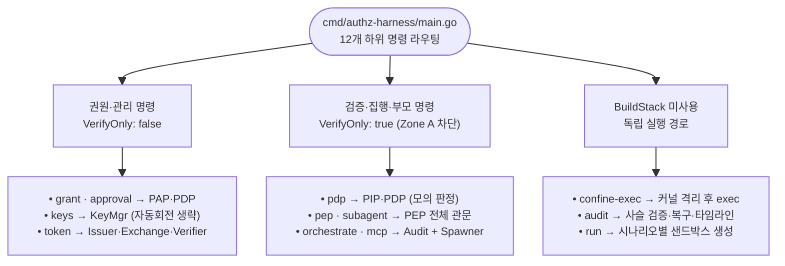
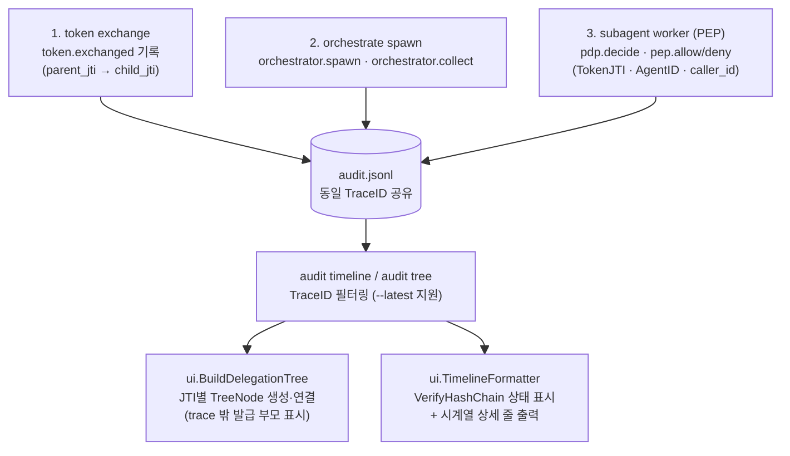

# 012. 명령줄 12종·합성 루트(`BuildStack`) 조건부 배선과 감사 추적 재구성 — 한 실행 파일이 어떻게 관리자와 일꾼으로 변신하며, 흩어진 흔적을 어떻게 한 화면으로 엮나

> **모드**: `[문서작업]` — 소스코드 수정 없이 현재 구현된 명령줄 12개 하위 명령(`cmd/authz-harness/main.go`, `internal/cli/`), 단일 합성 루트(`internal/app/builder.go` · `BuildStack`)의 경로·권한 모드별 조건부 배선, 그리고 다중 프로세스 감사 기록을 한 줄기 타임라인·위임 나무로 재구성하는 시각화기(`internal/ui/timeline.go`, `internal/ui/tree.go`)의 실제 동작과 이유(Why)를 해설합니다.  
> **기준일**: 2026-11-05 · **기준 커밋**: `5f0ab2a` (이 문서가 설명하는 `cmd/`와 `internal/`을 마지막으로 바꾼 커밋)  
> **검증 범위**: 동작·순서·소유자·시점을 코드와 대조한 결과와 「미확인」은 5부 ③에 있습니다.  
> **이 문서는 구현된 것만 적는다.** 계획·제안·미래형 약속은 적지 않으며, 현재 코드가 하지 않는 것은 「지금은 없다」고만 씁니다.  
> **이 문서의 규칙**: 본문(0~4부, Q&A, 그림, 5부 ①)은 쉬운 개념·설계·이유가 중심입니다. 파일·타입 이름 같은 고유 이름은 첫 등장에 한마디 설명과 함께 쓰고, 구현의 어디인지는 문단 끝 `(구현: 파일 · 함수, 5부 ② 번호)` 귀띔으로 보조합니다. 기준은 [프로그램 설명서 README의 「설명의 기준」과 「이름의 3층」](README.md)입니다.  
> **겹치는 주제**: 전체 설계 철학과 3중 분리 배선의 큰 그림은 [000편](000-전체설계철학과_내부지도.md)이, 열 단계 관문(`pep.Gateway`) 내부의 검사는 [001편](001-전체요청여정과_5단계관문.md)이, 토큰 발급·교환과 키 회전의 암호학적 세부는 [002편](002-토큰발급_축소위임과_서명키회전.md)이, 부모-자식 프로세스 기동과 해시 체인 공식은 [003편](003-서브프로세스격리와_해시체인감사.md)이, MCP 서버 프로토콜은 [004편](004-다단계위임과_MCP도구게이트웨이.md)이, 패키지 의존 방향과 정적 가드는 [007편](007-코드읽는순서와_의존방향.md)이 자세히 다룹니다.
>
> **다시 확인하는 법**
> ```bash
> git rev-parse --short HEAD
> git log -1 --format=%h -- cmd internal
> # 1. 합성 루트(BuildStack)의 VerifyOnly·부분 경로·자동 키 회전·워크스페이스 누락 거부 시험 실행
> go test -v ./internal/app/... -run "TestBuildStack"
> # 2. CLI 직접 조립 금지 가드(TC-170-02) 및 전 CLI 러너 시험 실행
> go test -v ./internal/harness -run "TestArchitectureGuardrails/TC-170-02"
> go test -v ./internal/cli/... ./internal/ui/...
> # 3. main.go의 12개 서브커맨드 라우팅과 BuildStack 호출부 전체 확인
> grep -n "case \"" cmd/authz-harness/main.go
> grep -rn "app.BuildStack" internal/cli/
> ```

---

## 💡 사용자의 질문 (원문 보존)

> 배선시험도 이 프로그램의 한축이었다. 실무에도 쓸수 있는 파이프라인과 배선을 만들었고 그 위에서 작동하는 권한시스템이 있다. 몇가지 옵션을 제공한다. 시험해서 결과를 볼수 있게 제동한다. 내 말이 맞나? 설명서를 만들어라.

> 이런 문서는 꼭 필요하다고 할만한 거 있으면 그 역시 설명서로 만들어라. 만들고 나서 readme 수정도 해라.

---

## 0. 모든 설계 이전에 ‘사람’이 있다 — 실행 파일은 딱 하나인데 어떻게 관리자도 되고 갇힌 일꾼도 되나

이 저장소를 빌드하면 `authz-harness`라는 실행 파일이 딱 하나 나옵니다(시나리오 시험용 `faultworker` 제외). 그런데 이 똑같은 실행 파일이 어떤 때는 비밀 금고(Zone A)를 열어 서명 키를 회전하고(`keys rotate`), 어떤 때는 부모가 되어 자식 프로세스를 띄우고(`orchestrate spawn`), 또 어떤 때는 부모에게 불려 나온 갇힌 자식 일꾼(`subagent worker`)이나 Linux 커널 격리 런처(`confine-exec`)가 되어 돌아갑니다.

코드를 깊게 들여다보는 사람은 여기서 꼭 알아야 할 세 가지 의문을 품습니다.

- *「같은 실행 파일을 자식 일꾼(`subagent worker`)으로 띄웠는데, 왜 그 자식은 부모처럼 비밀 금고(Zone A)나 권한 부여기(`PAP`)를 열어보지 못하나? 어디서 그 배선을 끊어 놓았나?」*
- *「권한만 고치는 `grant` 명령을 쳤을 때는 왜 열쇠 파일이나 재사용 원장 파일이 디스크에 안 생기나? 조립 함수(`app.BuildStack`)는 넘겨받은 인자에 따라 무엇을 만들고 무엇을 `nil`로 비워 두나?」*
- *「명령줄에 있는 `pdp decide`, `pdp explain`, `pep read`, `orchestrate spawn`, `mcp serve`는 다 비슷해 보이는데 각각 어느 부품까지만 돌려 보고 멈추는가? 그리고 여러 프로세스가 남긴 감사 기록을 `audit timeline`과 `audit tree`는 어떤 규칙으로 다시 꿰어 맞추나?」*

이 설명서는 `authz-harness` 실행 파일 하나가 들어온 명령에 따라 **어떻게 서로 다른 배선 지도(`AppStack`)를 조립하는지**, 왜 똑같은 부품도 명령에 따라 다르게 제동하는지, 그리고 흩어진 흔적을 어떻게 한 화면의 타임라인과 위임 나무로 복원하는지를 밝힙니다.

---

## 1부. 왜 실행 파일 하나에 열두 명령을 담고, 왜 조립 함수를 한 곳으로 모았나

### 가장 밑바닥의 이유부터

1. **왜 관리자용 프로그램, 부모 프로그램, 자식 워커 프로그램을 따로 빌드하지 않고 실행 파일 하나로 묶었나?**
   - 부모 프로세스(`orchestrate spawn` 또는 `mcp serve`)가 자식 워커를 띄울 때나 Linux 커널 격리 런처(`confine-exec`)가 자기 자신에게 Landlock 규칙을 걸고 재실행할 때, 별도 바이너리를 찾아다니면 경로 설정이 어긋나거나 엉뚱한 바이너리가 실행될 수 있습니다.
   - 표준 라이브러리 함수 `os.Executable()`로 **지금 돌고 있는 자기 자신의 파일 경로**를 찾아 하위 명령(`subagent worker` 또는 `confine-exec`)만 바꿔 띄우면, 배포와 시험 환경 어디서든 실행 파일 하나로 부모·자식·런처가 일관되게 맞물립니다.
2. **같은 실행 파일이면 자식 워커도 비밀 금고(Zone A)를 여는 코드가 안에 들어 있지 않나? 어떻게 막나?**
   - 실행 파일 안에 코드가 들어 있더라도, 자식 워커가 시작될 때 받는 명령줄 인자에는 비밀 금고 경로(`-priv-key-file`) 자체가 없고, 조립 함수 `app.BuildStack`을 부를 때 **`VerifyOnly: true`(검증 전용 모드)**를 못 박아 호출합니다.
   - `VerifyOnly: true`가 켜지면 `BuildStack`은 설령 누군가 비밀키 경로를 넘겼더라도 내부에서 빈 문자열(`privPath = ""`)로 지워 버리고, 토큰 발급기(`TokenIssuer`)·교환기(`ExchangeService`)·권한 관리기(`PAP`)는 아예 만들지 않고 `nil`로 비워 둡니다. 게다가 정적 가드 시험(`TC-060-02`)이 `internal/subagent` 패키지에서 `keys`·`pap`·`state` 패키지를 `import`하는 것조차 막습니다.
3. **그러면 각 명령(`grant`, `keys`, `pep` 등)이 자기한테 필요한 부품만 직접 `New...`로 만들어 쓰면 더 간단하지 않나? 왜 굳이 `app.BuildStack` 한 함수를 거치게 했나?**
   - 예전(`ba42aa7^`)에는 실제로 각 명령 파일이 저장소와 감사 기록기를 직접 만들었습니다. 그랬더니 어떤 명령에서는 감사 파일을 닫는 `Close()`를 빼먹고, 어떤 명령에서는 예산 원장 경로(`budget_ledger.json`) 규칙이 달라지는 배선 누수가 생겼습니다([007편 4부 4번](007-코드읽는순서와_의존방향.md)).
   - 그래서 모든 조립을 `app.BuildStack` 한 곳으로 모으고, 대신 **넘겨받은 파일 경로 조합과 `VerifyOnly` 스위치에 따라 필요한 부품만 조건부로 조립**하게 만들었습니다.
4. **조건부로 조립할 때 가장 조심해야 할 함정은 무엇인가?**
   - 두 가지입니다. 첫째, 권한 장부만 고치는 `grant` 명령을 실행했는데 쓰지도 않을 빈 열쇠 파일이나 재사용 원장(`replay_ledger.json`)이 디스크에 생겨나면 안 됩니다(부분 경로 무공해 원칙). 둘째, 반대로 실제 관문(`PEP`)을 조립해야 하는데 작업 폴더(`WorkspaceDir`) 경로가 빠져 있으면 조용히 넘어가서도 안 됩니다(누락 시 Fail-Closed 거부).
5. **더 내려가면?** 「실행 파일은 하나로 유지하되, 누가 불렀는지에 따라 배선 자체가 최소 권한으로만 연결되고, 쓰지 않는 파일은 건드리지 않으며, 필수 부품이 빠지면 시작조차 거부한다」는 요구에 닿습니다.

### 흔한 방식과 이 프로그램의 선택

| 구분 | 흔한 방식 (이 저장소에서 확인하지 않은 일반론) | 이 프로그램(`authz-harness`)의 선택 |
|---|---|---|
| **모양** | 명령마다 `main`이나 핸들러에서 전역 변수로 모든 저장소와 키를 무조건 초기화하거나, 반대로 명령마다 각자 `NewFileStore`를 호출해 조립한다. | 모든 CLI 러너가 `app.BuildStack(cfg)` 단일 합성 루트만 부르도록 강제(`TC-170-02`)하되, `cfg`의 경로 유무와 `VerifyOnly`에 따라 조립 범위를 5단계로 정밀하게 가른다. |
| **얻는 것** | 무조건 다 만들면 분기가 없고, 각자 만들면 `builder.go`가 필요 없다. | 자식 워커에서 Zone A 접근과 발급·권한 변경 부품이 배선 수준에서 제거(`nil`)되고, 부분 명령 실행 시 불필요한 파일이 생성되지 않으며, `stack.Close()` 한 번으로 감사 파일 핸들이 정리된다. |
| **포기하는 것** | 검증 전용 경로에서도 비밀키 파일을 요구하거나, 명령마다 조립 실수가 반복된다. | `BuildStack` 안에 경로 조합별 조건문(`if !cfg.VerifyOnly`, `if cfg.PubJWKSPath != "" && cfg.ReplayPath != ""` 등)이 들어가 조립 함수의 규칙을 정확히 이해해야 한다. |

---

## 2부. 질문과 답변으로 풀어보는 핵심 동작 (Q&A)

### Q1. 명령줄의 12개 하위 명령은 각각 어떤 역할을 하며, `BuildStack`을 어떻게 부르나?

- **무슨 일이 일어나는가**: [`cmd/authz-harness/main.go`](../../cmd/authz-harness/main.go)의 `main` 함수는 전역 플래그(`-audit-file`, `-state-file`, `-priv-key-file`, `-pub-jwks-file`, `-replay-file`, `-workspace`, `-verbose`)를 파싱한 뒤, 첫 번째 인자(`subcmd`)에 따라 열두 갈래로 분기합니다. 각 명령이 `app.BuildStack`을 어떻게 쓰는지 한눈에 정리하면 아래 표와 같습니다. (구현: [`main.go`](../../cmd/authz-harness/main.go) · `main`, [`builder.go`](../../internal/app/builder.go) · `BuildStack`, 5부 ② 1·2번)

| 분류 | 하위 명령 | 담당 러너 (`internal/cli`) | `BuildStack` 사용 여부 및 모드 | 조립되는 핵심 부품 (`nil`이 아닌 것) | 건드리는 구역(Zone) |
|---|---|---|---:|---|---|
| **정책·승인 관리 (PAP)** | `grant`<br/>(`create`/`revoke`/`bump-epoch`/`list`) | `GrantRunner` ([`grant.go`](../../internal/cli/grant.go)) | 사용 (`VerifyOnly: false`, `StatePath`+`AuditPath`만 전달) | `AuditWriter`, `StateStore`, `PAP`, `PIP`, `PDP` (`KeyManager`·`TokenIssuer`·`PEP`는 `nil`) | Zone B (`grants_state.json`), `audit.jsonl` |
| **정책·승인 관리 (PAP)** | `approval`<br/>(`grant`/`list`) | `ApprovalRunner` ([`approval.go`](../../internal/cli/approval.go)) | 사용 (`VerifyOnly: false`, `StatePath`+`AuditPath`만 전달) | `AuditWriter`, `StateStore`, `PAP`, `PIP`, `PDP` | Zone B (`grants_state.json`), `audit.jsonl` |
| **서명 키 관리** | `keys`<br/>(`list`/`rotate`/`revoke`) | `KeysRunner` ([`keys.go`](../../internal/cli/keys.go)) | 사용 (`VerifyOnly: false`, `PrivKeyPath`+`PubJWKSPath`+`AuditPath`만 전달, **`ReplayPath` 미전달**) | `AuditWriter`, `KeyStore`, `KeyManager` (초기 자동 회전 안 함, `TokenIssuer`·`PEP`는 `nil`) | **Zone A** (`signing_keys.priv.json`), Zone B (`jwks.pub.json`), `audit.jsonl` |
| **토큰 발급·교환·검증** | `token`<br/>(`issue`/`inspect`/`verify`/`exchange`) | `TokenRunner` ([`token.go`](../../internal/cli/token.go)) | 사용 (`VerifyOnly: false`, `PrivKeyPath`+`PubJWKSPath`+`ReplayPath`+`AuditPath` 전달) | `AuditWriter`, `KeyManager`(활성 키 없으면 자동 회전), `BudgetLedger`, `ClientReg`, `TokenIssuer`, `ReplayLedger`, `TokenVerifier`, `ExchangeService` | **Zone A** + Zone B (`jwks`, `replay`, `budget`), `audit.jsonl` |
| **순수 판정 모의실험** | `pdp`<br/>(`decide`/`explain`) | `PDPRunner` ([`pdp.go`](../../internal/cli/pdp.go)) | 사용 (**`VerifyOnly: true`**, `StatePath`+`AuditPath`만 전달) | `AuditWriter`, `StateStore`, `PIP`, `PDP` (**`PAP`는 `nil`**) | Zone B (`grants_state.json` 읽기), `audit.jsonl` |
| **직접 관문 집행** | `pep`<br/>(`read`/`write`) | `PEPRunner` ([`pep.go`](../../internal/cli/pep.go)) | 사용 (**`VerifyOnly: true`**, `WorkspaceDir`+`StatePath`+`PubJWKSPath`+`ReplayPath`+`AuditPath` 전달) | `AuditWriter`, `KeyManager`(공개키만), `BudgetLedger`, `ReplayLedger`, `TokenVerifier`, `PIP`, `PDP`, `Jail`, **`PEP` (`NetGuard`·`ExecRunner`·`ApprovalConsumer` 포함)** | Zone B (`jwks`, `grants`, `replay`, `budget`), Zone C (`workspace`), `audit.jsonl` (**Zone A 차단**) |
| **자식 워커 프로세스** | `subagent worker` | `SubagentRunner` ([`subagent.go`](../../internal/cli/subagent.go)) | 사용 (**`VerifyOnly: true`**, `pep`과 동일 + `-net-allow`, `-verbose` 지원) | `pep`과 동일 (`stack.PEP`를 `subagent.NewWorker`에 주입) | Zone B, Zone C, `audit.jsonl` (**Zone A 차단**) |
| **부모 스포너** | `orchestrate spawn` | `OrchestrateRunner` ([`orchestrate.go`](../../internal/cli/orchestrate.go)) | 사용 (**`VerifyOnly: true`**, `AuditPath`만 전달해 부모용 `AuditWriter`만 획득) | 부모 프로세스에서는 `AuditWriter`만 쓰고 `SubprocessSpawner`로 자식 `subagent worker`를 기동 | 부모는 `audit.jsonl`만 기록, 자식이 Zone B·C 접근 |
| **외부 AI 도구 서버** | `mcp serve` | `MCPRunner` ([`mcp.go`](../../internal/cli/mcp.go)) | 사용 (**`VerifyOnly: true`**, `AuditPath`만 전달해 스포너용 `AuditWriter` 획득) | `AuditWriter` + `SubprocessSpawner` + `mcp.SubprocessExecutor` + `mcp.Server` | 부모는 `stdin`/`stdout` JSON-RPC 중계 및 `audit.jsonl`, 자식이 Zone B·C 접근 |
| **커널 격리 런처 (숨김)** | `confine-exec` | `RunConfineExec` ([`confine_exec.go`](../../internal/cli/confine_exec.go)) | **미사용** (규칙 적용 전 어떤 파일도 열지 않음) | base64 정책 해독 → `confinement.ApplySelf`(Landlock) → `syscall.Exec` | 파일 미접근 (커널 시스템 콜만 호출 후 대상 바이너리로 교체) |
| **감사 검증·복구·시각화** | `audit`<br/>(`verify`/`checkpoint`/`recover`/`timeline`/`tree`) | `AuditRunner` ([`audit.go`](../../internal/cli/audit.go)) | **미사용** (깨진 감사 파일도 열어야 하므로 직접 파일·체크포인트 패키지 호출) | `audit.VerifyHashChain`, `checkpoint.Create`/`Verify`, `audit.RecoverIncompleteTail`, `ui.TimelineFormatter`, `ui.TreeFormatter` | `audit.jsonl`, 체크포인트 시 Zone A(`audit_signing_key.priv.json`)·Zone B |
| **시나리오 하네스** | `run` | `RunRunner` ([`run.go`](../../internal/cli/run.go)) | 러너 자체는 미사용 (각 시나리오가 임시 샌드박스 안에서 `BuildStack` 호출) | `harness.DefaultRunner`, `catalog.RegisterAll`, `ui.Formatter`(`summary`/`explain`/`json`) | 운영체제 임시 폴더(`authz-harness-sandbox-*`) |

- **근거**: 5부 ② 항목 1, 2, 3, 4, 5, 6, 7, 8, 9, 10, 11번

### Q2. `app.BuildStack` 안에는 어떤 조립 규칙과 안전장치(Fail-Closed)가 들어 있나?

- **무슨 일이 일어나는가**: [`internal/app/builder.go`](../../internal/app/builder.go)의 `BuildStack`과 이를 검증하는 [`internal/app/builder_test.go`](../../internal/app/builder_test.go)에는 다섯 가지 정교한 배선 규칙이 들어 있습니다.
  1. **규칙 1 — `VerifyOnly: true`일 때 Zone A 물리 차단 (`TestBuildStack_VerifyOnlyMode`)**:
     - `cfg.VerifyOnly`가 참이면, 호출자가 실수로 `cfg.PrivKeyPath`에 값을 채워 넘겼더라도 `BuildStack`이 디렉터리 생성 목록에서 `PrivKeyPath`를 빼고 `privPath = ""`로 덮어쓴 뒤 `keys.NewFileStore("", cfg.PubJWKSPath)`를 부릅니다.
     - 또한 `TokenIssuer`, `ClientReg`, `ExchangeService`, `PAP` 생성 블록을 모두 건너뛰어 `nil`로 남겨 둡니다. 따라서 검증 전용 스택에서는 새 토큰을 찍어내거나 권한 장부에 새 권한을 추가할 방법이 코드 구조상 존재하지 않습니다.
  2. **규칙 2 — 부분 경로 호출 시 불필요한 파일 생성 금지 (`TestBuildStack_PartialPaths_NoStrayFiles`)**:
     - `grant`나 `approval` 명령처럼 `StatePath`와 `AuditPath`만 넘기고 `PubJWKSPath`·`ReplayPath`를 비워 두면, `BuildStack`은 `BudgetPath`를 파생하지도 않고 열쇠 폴더나 `replay_ledger.json`, `budget_ledger.json`을 디스크에 만들지 않습니다. 오직 넘겨받은 경로의 부모 폴더만 `os.MkdirAll`로 준비합니다.
  3. **규칙 3 — 서명 키 자동 회전은 ‘토큰 발급 스택’에서만 수행 (`TestBuildStack_RotationOnlyForIssuingStack`)**:
     - 처음 프로그램을 돌릴 때 활성 서명 키가 없으면 자동으로 첫 키를 만들어 회전(`keyMgr.RotateKey`)해 주면 편리합니다.
     - 하지만 관리자가 `keys revoke`로 마지막 활성 키를 일부러 폐기한 뒤 `keys list`로 상태를 보려는데, `BuildStack`이 무조건 새 활성 키를 자동 생성해 버리면 「활성 키가 0개인 상태」를 유지하거나 확인할 수 없게 됩니다.
     - 그래서 `BuildStack`은 **`if !cfg.VerifyOnly && keyMgr != nil && cfg.ReplayPath != ""`** 조건을 걸어, 단순 키 관리 명령(`keys`, `ReplayPath`가 비어 있음)에서는 기존 키를 폐기한 뒤 다시 불러도 새 키를 자동 회전하지 않고, 실제 토큰을 발급·교환하는 `token` 스택(`ReplayPath`가 있음)에서만 활성 키가 없을 때 자동 회전하도록 구분했습니다.
  4. **규칙 4 — 예산 원장 경로 자동 파생과 공유 (`TestBuildStack_BudgetPathDerivedFromReplayPath`)**:
     - `BudgetPath`를 따로 지정하지 않아도 `ReplayPath`가 있으면 같은 폴더(`filepath.Dir(cfg.ReplayPath)/budget_ledger.json`)로 자동 설정되어, 부모(`token exchange`)가 예약한 예산 원장을 자식(`subagent worker`, `VerifyOnly: true`)이 똑같은 경로에서 공유해 차감합니다.
  5. **규칙 5 — 관문(`PEP`) 조립 시 작업 폴더(`WorkspaceDir`) 누락 거부 (`TestBuildStack_MissingWorkspace_FailsClosed`)**:
     - `PDP`와 `TokenVerifier`가 모두 조립되어 `pep.NewGateway`를 만들어야 하는 상황인데 `WorkspaceDir`가 비어 있어 `workspaceJail`이 `nil`이면, `pep.NewGateway`가 `pep: jail is required` 에러를 내고 `BuildStack`은 열었던 감사 파일을 닫은(`_ = auditWriter.Close()`) 뒤 즉시 에러를 반환합니다. 반대로 `pdp` 명령처럼 `TokenVerifier`가 없는 부분 스택에서는 `PEP`를 조용히 `nil`로 둡니다(`TestBuildStack_VerifyOnlyWithoutGateway_StaysNil`). (구현: [`builder.go`](../../internal/app/builder.go) · `BuildStack`, [`builder_test.go`](../../internal/app/builder_test.go) · `TestBuildStack_VerifyOnlyMode`~`TestBuildStack_VerifyOnlyWithoutGateway_StaysNil`, 5부 ② 2·13번)
- **근거**: 5부 ② 항목 2, 13번

### Q3. `pdp` 명령, `pep` 명령, `orchestrate spawn`, `mcp serve`는 똑같이 판정을 내리는데 무엇이 어떻게 다른가?

- **무슨 일이 일어나는가**: 네 명령은 시험하거나 실행하려는 **범위(어느 단계까지 돌리는가)**와 **프로세스 경계(한 프로세스인가, 부모-자식 두 프로세스인가)**가 다릅니다.

| 명령 | 어디서 도나 | 어느 부품까지 거치나 | 토큰 서명·`jti` 소비 여부 | 실제 파일·네트워크·명령 실행 여부 | 거부 시 종료 코드 특징 |
|---|---|---|---|---|---|
| **`pdp decide`** | 단일 프로세스 | `PIP`(`grants_state.json` 읽기) → `PDP`(`Evaluate` + `pdp.decide` 감사 기록) | **안 함** (토큰 문자열 대신 `--sub`, `--scope`, `--epoch` 값을 플래그로 직접 입력받아 모의실험) | **안 함** (`Jail` 미조립) | 거부 사유에 따라 `12`(`ExitAuthzDenied`) 또는 `18`(`ExitApprovalRequired`) 반환 |
| **`pdp explain`** | 단일 프로세스 | `pdp decide`와 동일 + 파이프라인 검증 보고서(`authz` 단계 합격/불합격)와 회수 시각(`RevokedAt`) 상세 출력 | **안 함** (모의실험) | **안 함** | **거부(`DENY`)가 나와도 항상 `0`(`ExitSuccess`) 반환** (사람이 설명 보고서를 읽는 조회 명령이기 때문) |
| **`pep read` / `write`** | 단일 프로세스 | `pep.Gateway.Execute` 전 단계 (`input` → `authn` 토큰 검증 → `authz` `PDP` → `boundary` `Jail` → `replay` `jti` 소비 → `approval` 승인 → `budget` 예산 → `precommit_audit` 사전 감사 → `execute` 파일 I/O → `settle` 정산 → `finalize`) | **함** (실제 서명 검증 및 모든 검사 통과 시 `jti` 소비) | **함** (`file:read` / `file:write` 실제 수행) | 실패한 단계에 따라 `11`~`18` 반환 |
| **`orchestrate spawn`** | **부모 → 자식 2프로세스** | 부모가 환경변수를 정제하고 `stdin` 파이프로 `subagent worker` 자식 프로세스를 기동 → 자식이 `pep.Gateway.Execute` 전 단계 수행 → 부모가 종료 코드·출력·시간 초과(`17`) 수거 및 감사 기록 | **함** (자식 안에서 수행) | **함** (자식 안에서 `file:read` / `file:write` 수행) | 자식의 종료 코드(`0`, `11`~`18`)를 부모가 그대로 반환 |
| **`mcp serve`** | **부모(상주) → 호출마다 자식 프로세스** | `stdin`/`stdout`으로 JSON-RPC 2.0 `tools/call` 수신 → `_meta.authz_token` 추출 → 호출마다 `SubprocessSpawner`로 자식 `subagent worker` 기동 → 응답에서 원시 토큰 마스킹 후 JSON-RPC 응답 반환 | **함** (자식 안에서 수행) | **함** (자식 안에서 수행) | 서버 자체는 `0`으로 종료하되, 각 도구 호출의 거부 사유와 종료 코드를 JSON-RPC 에러 객체(`code`, `data.reason`, `data.exit_code`)로 변환해 반환 |

- **왜 이렇게 네 단계의 입구를 따로 두었나**:
  - 토큰을 발급하지 않고도 장부 상태와 `Epoch`·`Scope` 계산만 빠르게 확인하고 싶을 때는 `pdp decide`/`explain`을 쓰고, 자식 프로세스를 띄우지 않고 관문 5단계만 시험할 때는 `pep`을 쓰며, 프로세스 격리와 시간 초과 감독까지 볼 때는 `orchestrate spawn`을, 외부 AI 에이전트 프로토콜 연동까지 볼 때는 `mcp serve`를 쓰도록 **시험 사다리**를 만들어 둔 것입니다. (구현: [`pdp.go`](../../internal/cli/pdp.go) · `PDPRunner.runDecide`, `PDPRunner.runExplain`, [`pep.go`](../../internal/cli/pep.go) · `PEPRunner.Run`, [`orchestrate.go`](../../internal/cli/orchestrate.go) · `OrchestrateRunner.Run`, [`mcp.go`](../../internal/cli/mcp.go) · `MCPRunner.runServe`, 5부 ② 6·7·8·9번)
- **근거**: 5부 ② 항목 6, 7, 8, 9번

### Q4. 왜 `--clock-offset` 옵션이 `token verify`/`exchange`에서는 음수(`-10m`)를 허용하는데, `pep`과 `subagent worker`에서는 음수를 거부하나?

- **무슨 일이 일어나는가**:
  1. [`internal/cli/token.go`](../../internal/cli/token.go)의 `runVerify`와 `runExchange`는 `--clock-offset` 문자열을 표준 `time.ParseDuration`으로만 파싱합니다(주석에도 `예: +2h, -10m`이 적혀 있음). 따라서 토큰 단독 검증이나 교환 시뮬레이션에서는 과거 시점(`-10m`, 예: `nbf` 미래 토큰 실험 등)을 넣어 시험할 수 있습니다.
  2. 반면 실제 파일 작업을 집행하는 [`internal/cli/pep.go`](../../internal/cli/pep.go)의 `parseNonNegativeClockOffset`과 [`internal/subagent/worker.go`](../../internal/subagent/worker.go)의 `SubagentWorker.Execute`는 **오프셋이 0보다 작으면(`d < 0` 또는 `req.ClockOffsetSeconds < 0`) `--clock-offset must not be negative (만료 토큰 부활 방지)` 에러와 함께 `ExitBadInput`(종료 코드 `14`)으로 즉시 거부**합니다. (구현: [`token.go`](../../internal/cli/token.go) · `TokenRunner.runVerify`, `TokenRunner.runExchange`, [`pep.go`](../../internal/cli/pep.go) · `parseNonNegativeClockOffset`, [`worker.go`](../../internal/subagent/worker.go) · `SubagentWorker.Execute`, 5부 ② 5·7·8번)
- **왜 집행 관문(`pep`·`subagent worker`)에서만 음수 오프셋을 막았나**:
  - 집행 관문은 실제로 파일을 읽고 고치는 곳입니다. 만약 집행 관문에서 시계를 과거로 되돌리는 음수 오프셋을 허용하면, 이미 유효 기간이 끝난 옛날 토큰을 들고 와서 시계만 과거로 돌려 파일을 고치는 「만료 토큰 부활」이 가능해지기 때문입니다([009편 Q5](009-권한회수_Epoch_시간과_TOCTOU창.md)).
- **근거**: 5부 ② 항목 5, 7, 8번

### Q5. 여러 프로세스가 남긴 감사 기록(`audit.jsonl`)을 `audit timeline`과 `audit tree`는 어떻게 한 화면으로 다시 엮나?

- **무슨 일이 일어나는가**:
  1. 부모가 토큰을 교환하고(`token.exchanged`) 자식을 띄우면(`orchestrator.spawn`), 자식이 관문에서 판정·실행하고(`pdp.decide`, `pep.allow`/`pep.deny`), 부모가 종료 결과를 수거(`orchestrator.collect`)하기까지 여러 프로세스가 같은 `audit.jsonl` 파일에 각자 줄을 남깁니다. 이때 모든 줄을 하나로 묶어 주는 끈이 바로 **`TraceID`**입니다.
  2. **`audit tree` (`ui.BuildDelegationTree` — 토큰 `jti` 기준 위임 나무 재구성)**:
     - [`internal/ui/tree.go`](../../internal/ui/tree.go)의 `BuildDelegationTree`는 같은 `TraceID`를 가진 감사 이벤트들을 훑으며 나무의 마디(`ui.TreeNode`)를 만듭니다.
     - 여기서 아주 중요한 설계 규칙은 **나무의 마디(노드)가 사람/일꾼 이름(`Subject`)이 아니라 개별 출입증 번호(`TokenJTI`)**라는 점입니다. 같은 일꾼(`worker-01`)이라도 서로 다른 위임 경로에서 두 번 출입증을 받았으면 두 개의 별도 마디로 그려집니다.
     - 부모-자식 연결선(간선)은 오직 `Action == "token.exchanged"`(또는 `Step == "token.exchanged"`) 기록의 `Metadata["parent_jti"]` → `Metadata["child_jti"]`로만 잇습니다.
     - 그 밖의 관문·판정 기록(`ev.TokenJTI != ""`)은 해당 `TokenJTI` 마디 아래의 사건 목록(`Events`)으로 매달립니다.
     - 만약 어떤 부모 토큰(`parent_jti`)이 이번 `TraceID` 바깥에서 미리 발급된 토큰이라 이번 추적 기록 안에는 자식 교환 기록의 부모로만 등장하고 자체 사건이 하나도 없다면(`len(n.Events) == 0 && len(n.Children) > 0`), `n.External = true`로 표시해 화면에 **`[jti: ...] <주체> (trace 밖에서 발급)`**이라고 정직하게 밝혀 줍니다.
     - 또한 머리말에 `DELEGATION TREE: <traceID> (view only; edge fields are not hash-protected)`라고 찍어, 나무의 간선 재료인 `metadata` 칸은 해시 사슬 계산 대상이 아니므로 보기 전용임을 알립니다([006편 Q11](006-OS격리_관측성과_감사체크포인트.md)).
  3. **`audit timeline` (`ui.TimelineFormatter.RenderTimeline` — 무결성 상태 + 위임 나무 + 시간순 표 결합)**:
     - [`internal/cli/audit.go`](../../internal/cli/audit.go)의 `runTimeline`은 먼저 파일 전체에 대해 `audit.VerifyHashChain`을 돌려 해시 사슬이 온전한지(`VALID` vs `BROKEN / TAMPERED`) 판정합니다.
     - 이어서 [`internal/ui/timeline.go`](../../internal/ui/timeline.go)의 `RenderTimeline`이 ① 머리말에 해시 사슬 무결성 상태를 찍고, ② 위에서 설명한 `BuildDelegationTree`를 불러 위임 계보 나무를 먼저 그린 뒤, ③ 모든 사건을 시간순(`Chronological Timeline`)으로 나열하면서 `Step`/`Action`, `Actor`, `AgentID`, `Resource`, 거부 시 `Reason`, `Metadata`의 `delegation_depth`·`caller_id`·`exit_code`, 최종 `ALLOW`/`DENY` 태그를 한 줄씩 정렬해 보여 줍니다. (구현: [`cli/audit.go`](../../internal/cli/audit.go) · `AuditRunner.runTimeline`, `AuditRunner.runTree`, [`ui/tree.go`](../../internal/ui/tree.go) · `TreeNode`, `BuildDelegationTree`, `TreeFormatter.Render`, [`ui/timeline.go`](../../internal/ui/timeline.go) · `TimelineFormatter.RenderTimeline`, 5부 ② 10·12번)
- **왜 `TreeNode`를 주체(`Subject`)가 아니라 출입증 번호(`TokenJTI`)로 묶었나**:
  - 주체 이름으로 묶어 버리면, 한 세션 안에서 `worker-01`이 첫 번째 토큰으로 거부당한 뒤 두 번째 축소 토큰을 새로 받아 성공했을 때 두 토큰의 사건과 위임 깊이가 한 마디에 뒤섞여 어느 토큰으로 무엇을 했는지 구분할 수 없기 때문입니다.
- **근거**: 5부 ② 항목 10, 12번

---

## 3부. 내부 지도 — 12개 명령의 배선 분기점과 추적 재구성 흐름

**그림 1. `main.go` 12개 하위 명령이 `app.BuildStack`에서 갈라지는 배선 지도**



(구현: [`main.go`](../../cmd/authz-harness/main.go) — `main`이 하위 명령을 분기하고, [`builder.go`](../../internal/app/builder.go) — `BuildStack`이 `VerifyOnly`와 파일 경로 유무에 따라 조립 범위를 결정합니다, 5부 ② 1·2번)

**그림 2. 여러 프로세스가 남긴 `audit.jsonl`을 `audit timeline`·`tree`가 재구성하는 흐름**



(구현: [`cli/audit.go`](../../internal/cli/audit.go) — `AuditRunner.runTimeline`과 `runTree`가 `TraceID`로 이벤트를 모으고, [`ui/tree.go`](../../internal/ui/tree.go) — `BuildDelegationTree`와 [`ui/timeline.go`](../../internal/ui/timeline.go) — `TimelineFormatter.RenderTimeline`이 계보와 시계열을 복원합니다, 5부 ② 10·12번)

### 어디에 무엇이 남나

| 무엇 | 어디에 | 언제 | 사람이 직접 여는 법 |
|---|---|---|---|
| **명령별 조립된 컴포넌트 묶음 (`AppStack`)** | 각 프로세스 메모리 안 (종료 직전 `Close()`로 해제) | 각 하위 명령 러너 생성(`New...Runner`) 또는 `Run` 시작 시점 | `go test -v ./internal/app/...`으로 모드별 `nil`/비`nil` 상태 확인 |
| **다중 프로세스 추적 타임라인** | 표준 출력 (`stdout`) | `authz-harness audit timeline [--trace-id <ID> \| --latest]` 실행 시 | 터미널 화면에서 해시 사슬 상태(`VALID`/`BROKEN`), 위임 나무, 시계열 표를 한 번에 확인 |
| **토큰(`jti`) 단위 위임 계보 나무** | 표준 출력 (`stdout`) | `authz-harness audit tree [--trace-id <ID>]` 실행 시 | 터미널 화면에서 부모 `jti` → 자식 `jti` 연결과 각 토큰이 수행한 액션·결정을 확인 |

### 이상이 생기면

| 상황 | 일어나는 일 |
|---|---|
| **`VerifyOnly: true`로 조립된 스택(`pep`, `subagent`, `pdp`)에 `PrivKeyPath`가 전달됨** | `BuildStack`이 내부에서 `privPath = ""`로 지워 Zone A 비밀키 파일을 열지도 만들지도 않으며, `TokenIssuer`·`ExchangeService`·`PAP`는 `nil`로 남는다. |
| **`PEP` 관문을 조립해야 하는데(`PDP != nil && TokenVerifier != nil`) `WorkspaceDir`가 비어 있음** | `workspaceJail`이 `nil`이 되어 `pep.NewGateway`가 거부하고, `BuildStack`이 감사 파일을 닫은 뒤 즉시 에러를 반환한다(Fail-Closed). |
| **CLI 러너 파일(`internal/cli/*.go`)에서 `BuildStack`을 거치지 않고 `state.NewFileStore`나 `audit.NewJSONLWriter`를 직접 호출함** | 아키텍처 가드 시험 `TC-170-02`가 해당 파일과 호출 위치를 지목하며 즉시 실패한다. |
| **`audit timeline` 또는 `audit tree`를 실행할 때 `--trace-id`를 생략함** | 에러로 멈추지 않고 `audit.jsonl`의 맨 마지막 줄부터 거꾸로 탐색해 가장 최근 기록된 `TraceID`를 자동으로 골라 그려 준다. 파일이 비어 있거나 일치하는 `TraceID`가 없을 때만 종료 코드 `15` 또는 `14`를 반환한다. |
| **`audit timeline` 실행 시 `audit.jsonl`의 해시 사슬이 깨져 있음** | 타임라인 출력을 막지 않고 화면 상단 머리말에 `(Hash Chain: BROKEN / TAMPERED)` 경고를 명시한 뒤 사건 목록을 보여 주어 사후 분석을 돕는다(엄격한 차단 검증은 `audit verify`가 담당). |

---

## 4부. 배척한 방식과 그 이유

1. **명령줄 러너마다 필요한 저장소·키 매니저·감사 기록기를 직접 생성해 쓰는 방식** (`ba42aa7^`의 `internal/cli/`):
   - **택했다면 무슨 일이 생기는가**: 열 개가 넘는 명령마다 조립 코드가 중복되어, 한 곳에서 감사 파일 핸들 닫기(`Close`)를 빠뜨리거나 검증 전용 명령에 비밀키 경로를 연결하는 실수가 생깁니다.
   - **그 대신 포기한 것**: 모든 조립을 `app.BuildStack`으로 일원화하고 `TC-170-02` 가드로 직접 생성을 막는 대신, `BuildStack` 안에 부분 경로와 `VerifyOnly` 분기를 두었습니다.
2. **`BuildStack`이 호출될 때마다 무조건 모든 경로의 폴더와 빈 장부 파일(`replay_ledger.json`, `budget_ledger.json`)을 생성하고 서명 키를 자동 회전하는 방식**:
   - **택했다면 무슨 일이 생기는가**: 권한만 조회하는 `grant list`를 쳤는데 엉뚱한 폴더에 빈 원장 파일들이 생겨나고, `keys revoke`로 마지막 활성 키를 폐기하자마자 다음 `keys list` 호출 때 `BuildStack`이 멋대로 새 활성 키를 만들어 버립니다.
   - **그 대신 포기한 것**: 무조건 초기화하는 단순함을 포기하고, 전달된 경로만 준비하며 키 자동 회전은 `ReplayPath`가 있는 토큰 발급 스택에서만 돌아가도록 조건을 정밀화했습니다(`TestBuildStack_PartialPaths_NoStrayFiles`, `TestBuildStack_RotationOnlyForIssuingStack`).
3. **`os.Exit` 전에 `defer stack.Close()`만 믿고 별도 정리 호출을 하지 않는 방식**:
   - **택했다면 무슨 일이 생기는가**: Go 언어의 `os.Exit`는 걸려 있는 `defer` 함수를 실행하지 않고 프로세스를 즉시 종료하므로, `main.go`에서 `os.Exit(int(exitCode))`를 부르기 직전에 명시적으로 `runner.Close()`를 부르지 않으면 열린 감사 파일 디스크립터가 정리되지 않은 채 종료됩니다.
   - **그 대신 포기한 것**: [`cmd/authz-harness/main.go`](../../cmd/authz-harness/main.go)의 각 하위 명령 분기마다 `runner.Run` 직후、`os.Exit` 직전에 명시적으로 `runner.Close()`를 호출합니다.
4. **위임 계보 나무(`audit tree`)의 마디(노드)를 토큰 `jti`가 아니라 주체 이름(`Subject`)으로 묶는 방식**:
   - **택했다면 무슨 일이 생기는가**: 같은 일꾼(`worker-01`)이 한 작업 흐름(`TraceID`) 안에서 여러 번 토큰을 교환받아 썼을 때, 어느 토큰이 어느 부모 토큰에서 나왔고 어느 토큰이 거부되었는지 계보가 하나로 뭉개집니다.
   - **그 대신 포기한 것**: 마디를 `TokenJTI` 단위로 만들고(`ui.TreeNode`), `token.exchanged`의 `parent_jti → child_jti`로만 간선을 연결합니다.

---

## 5부. 한눈에 보는 대조표와 코드 정본

### ① 행동별 안에서 일어나는 일과 지금은 없는 것

| 행동 | 안에서 일어나는 일 | 지금은 없는 것 | 근거 |
|---|---|---|---|
| **명령줄 진입 및 종료 (`main.go`)** | 전역 플래그를 파싱해 `stderr` `slog` 로거와 `stdout` 포매터를 세우고 12개 하위 명령으로 분기하며, `os.Exit` 직전에 `runner.Close()`로 감사 파일 핸들을 닫는다. | 서브커맨드 없이 실행하면 부팅 감사 이벤트(`harness.startup`) 1건을 기록하고 배너만 출력한다(대화형 셸 모드는 지금 없다). | 5부 ② 1번 |
| **합성 루트 조건부 배선 (`app.BuildStack`)** | `VerifyOnly: true`이면 Zone A 비밀키 경로를 차단하고 `TokenIssuer`·`ExchangeService`·`PAP`를 `nil`로 비우며, 부분 경로만 주어지면 해당 부품만 조립해 불필요한 파일 생성을 막는다. | `SubprocessSpawner`와 커널 격리 어댑터(`confinement.Confiner`)까지 `BuildStack` 안에서 조립하는 배선은 지금 없다(`orchestrate.go`, `mcp.go`, 하네스에서 별도 생성). | 5부 ② 2, 8, 9, 13번 |
| **판정 모의실험 (`pdp decide` / `explain`) vs 실제 집행 (`pep read` / `write`)** | `pdp`는 토큰 없이 장부(`PIP`)와 `PDP`만 돌려 결과를 보여 주고(`explain`은 항상 종료 코드 `0`), `pep`은 토큰 검증·`jti` 소비·`Jail`·사전 감사·실제 파일 I/O까지 전 관문을 집행한다. | 명령줄 `pep` 하위 명령에서 `net:fetch`나 `exec:run`을 직접 호출하는 서브커맨드는 지금 없다(`subagent worker`와 하네스를 통해 실행). | 5부 ② 6, 7, 8번 |
| **감사 타임라인 및 위임 트리 재구성 (`audit timeline` / `tree`)** | 같은 `TraceID`의 감사 줄들을 모아 `token.exchanged`의 `parent_jti → child_jti`로 토큰 단위 위임 나무(`BuildDelegationTree`)를 그리고 시간순 사건표를 출력한다. | `audit tree`의 간선 필드(`metadata` 내부 `parent_jti`·`child_jti`)에 대한 SHA-256 해시 사슬 보호는 지금 없다(보기 전용 명시). | 5부 ② 10, 12번 |

### ② 어디서 하나 (코드 정본 색인)

1. **CLI 진입점 및 12개 하위 명령 라우터**: [`cmd/authz-harness/main.go`](../../cmd/authz-harness/main.go) (`main`, `Version`) — 구현: P00~P16
2. **단일 합성 루트(`BuildStack`) 및 조건부 조립 규칙**: [`internal/app/builder.go`](../../internal/app/builder.go) (`AppConfig`, `AppStack`, `AppStack.Close`, `BuildStack`) — 구현: P08-010 (`98aafbc`), P17-030 (`ba42aa7`)
3. **정책·승인 관리 CLI 러너 (`grant`, `approval`)**: [`internal/cli/grant.go`](../../internal/cli/grant.go) (`GrantRunner`, `NewGrantRunner`, `GrantRunner.Run`), [`internal/cli/approval.go`](../../internal/cli/approval.go) (`ApprovalRunner`, `NewApprovalRunner`, `ApprovalRunner.Run`) — 구현: P01, P15, P17-030 (`ba42aa7`)
4. **서명 키 관리 CLI 러너 (`keys`)**: [`internal/cli/keys.go`](../../internal/cli/keys.go) (`KeysRunner`, `NewKeysRunner`, `KeysRunner.Run`, `KeysRunner.runList`, `KeysRunner.runRotate`, `KeysRunner.runRevoke`) — 구현: P02, P17-030 (`ba42aa7`)
5. **토큰 발급·교환·검증 CLI 러너 (`token`)**: [`internal/cli/token.go`](../../internal/cli/token.go) (`TokenRunner`, `NewTokenRunner`, `TokenRunner.Run`, `TokenRunner.runIssue`, `TokenRunner.runInspect`, `TokenRunner.runVerify`, `TokenRunner.runExchange`) — 구현: P02, P17-030 (`ba42aa7`)
6. **순수 PDP 모의실험 CLI 러너 (`pdp`)**: [`internal/cli/pdp.go`](../../internal/cli/pdp.go) (`PDPRunner`, `NewPDPRunner`, `PDPRunner.Run`, `PDPRunner.runDecide`, `PDPRunner.runExplain`) — 구현: P01, P17-030 (`ba42aa7`)
7. **PEP 직접 집행 CLI 러너 (`pep`)**: [`internal/cli/pep.go`](../../internal/cli/pep.go) (`PEPRunner`, `NewPEPRunner`, `PEPRunner.Run`, `PEPRunner.runRead`, `PEPRunner.runWrite`, `PEPRunner.renderResult`, `parseNonNegativeClockOffset`) — 구현: Step 3 (`b5049c5`)
8. **부모 오케스트레이터·자식 워커·런처 CLI 러너 (`orchestrate`, `subagent`, `confine-exec`)**: [`internal/cli/orchestrate.go`](../../internal/cli/orchestrate.go) (`OrchestrateRunner`, `NewOrchestrateRunner`, `OrchestrateRunner.Run`, `renderSpawnResult`), [`internal/cli/subagent.go`](../../internal/cli/subagent.go) (`SubagentRunner`, `NewSubagentRunner`, `SubagentRunner.Run`), [`internal/cli/confine_exec.go`](../../internal/cli/confine_exec.go) (`RunConfineExec`) — 구현: P03, P11, P16, P17-030 (`ba42aa7`)
9. **MCP 게이트웨이 서버 CLI 러너 (`mcp`)**: [`internal/cli/mcp.go`](../../internal/cli/mcp.go) (`MCPRunner`, `NewMCPRunner`, `MCPRunner.Run`, `MCPRunner.runServe`, `orchestrator.WorkerArgs`) — 구현: P06, P16
10. **감사 검증·복구·타임라인·트리 CLI 러너 (`audit`)**: [`internal/cli/audit.go`](../../internal/cli/audit.go) (`AuditRunner`, `NewAuditRunner`, `AuditRunner.Run`, `AuditRunner.runTimeline`, `AuditRunner.runVerify`, `AuditRunner.runTree`, `AuditRunner.runCheckpoint`, `AuditRunner.runRecover`) — 구현: P03, P14, 계획 008·010 (`5f0ab2a`)
11. **시나리오 하네스 CLI 러너 (`run`)**: [`internal/cli/run.go`](../../internal/cli/run.go) (`RunConfig`, `RunRunner`, `NewRunRunner`, `RunRunner.Run`) — 구현: P05
12. **감사 타임라인 및 위임 계보 트리 렌더러 (`ui`)**: [`internal/ui/timeline.go`](../../internal/ui/timeline.go) (`TimelineFormatter`, `NewTimelineFormatter`, `TimelineFormatter.RenderTimeline`), [`internal/ui/tree.go`](../../internal/ui/tree.go) (`TreeNode`, `BuildDelegationTree`, `TreeFormatter`, `TreeFormatter.Render`, `TreeFormatter.RenderNodes`) — 구현: P03, P14-030
13. **합성 루트 및 CLI 배선 시험**: [`internal/app/builder_test.go`](../../internal/app/builder_test.go) (`TestBuildStack_ValidationAndClose`, `TestBuildStack_VerifyOnlyMode`, `TestBuildStack_BudgetPathDerivedFromReplayPath`, `TestBuildStack_PartialPaths_NoStrayFiles`, `TestBuildStack_RotationOnlyForIssuingStack`, `TestBuildStack_MissingWorkspace_FailsClosed`, `TestBuildStack_VerifyOnlyWithoutGateway_StaysNil`), [`internal/harness/architecture_test.go`](../../internal/harness/architecture_test.go) (`TC-170-02`), [`internal/ui/tree_test.go`](../../internal/ui/tree_test.go), [`internal/ui/timeline_test.go`](../../internal/ui/timeline_test.go)

### ③ 검증 범위와 「미확인」

검증 방법: 기준 커밋 `5f0ab2a`에서 위 5부 ②의 1~13번 소스 파일을 직접 읽고 대조했으며, `go test ./internal/app/... ./internal/cli/... ./internal/ui/...`를 통해 동작을 확인했습니다. 2026-11-06: 감사 단계 값 어휘 정규화(`ORCHESTRATE_*` → `orchestrator.*`)만 반영했고, 나머지는 다시 대조하지 않았습니다.

| 항목 | 동작 | 순서 | 소유자 | 시점 | 미확인 사항 |
|---|---|---|---|---|---|
| **Q1 (12개 하위 명령 라우팅과 `BuildStack` 사용 구분, ② 1~11번)** | 확인 | 확인 | 확인 (`main` → 각 `*Runner` → `app.BuildStack`) | 확인 (명령 기동 및 `Close` 시점) | 없음 |
| **Q2 (`BuildStack`의 5대 조건부 조립 규칙과 `builder_test.go` 검증, ② 2·13번)** | 확인 | 확인 | 확인 (`app.BuildStack`) | 확인 (스택 생성 시점) | 없음 |
| **Q3·Q4 (`pdp`·`pep`·`orchestrate`·`mcp` 차이 및 `--clock-offset` 음수 정책 차이, ② 5~9번)** | 확인 | 확인 | 확인 (`PDPRunner`, `PEPRunner`, `TokenRunner`, `SubagentWorker`) | 확인 (플래그 파싱 및 실행 시점) | 없음 |
| **Q5 (`audit timeline`·`audit tree`의 `TokenJTI` 기반 위임 트리 재구성, ② 10·12·13번)** | 확인 | 확인 | 확인 (`AuditRunner`, `ui.BuildDelegationTree`, `ui.TimelineFormatter`) | 확인 (`audit timeline`/`tree` 실행 시점) | 없음 |
