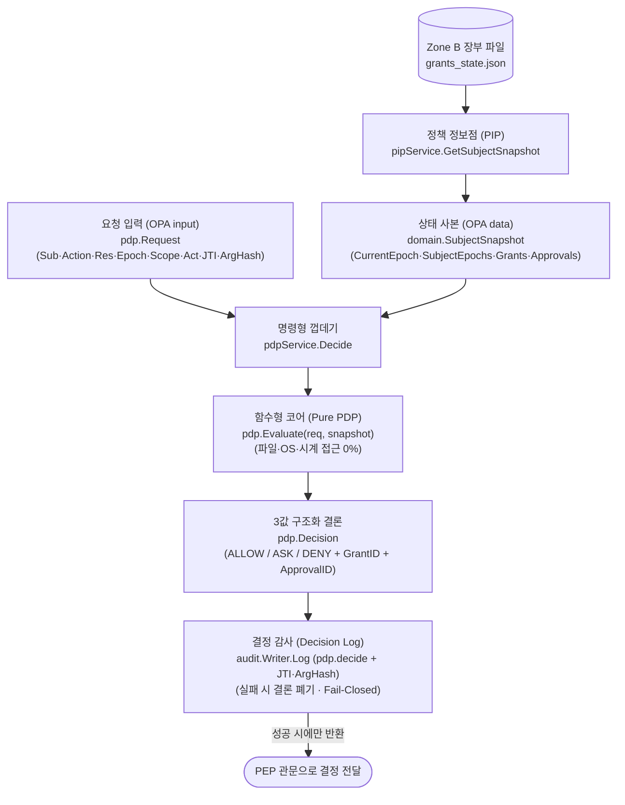
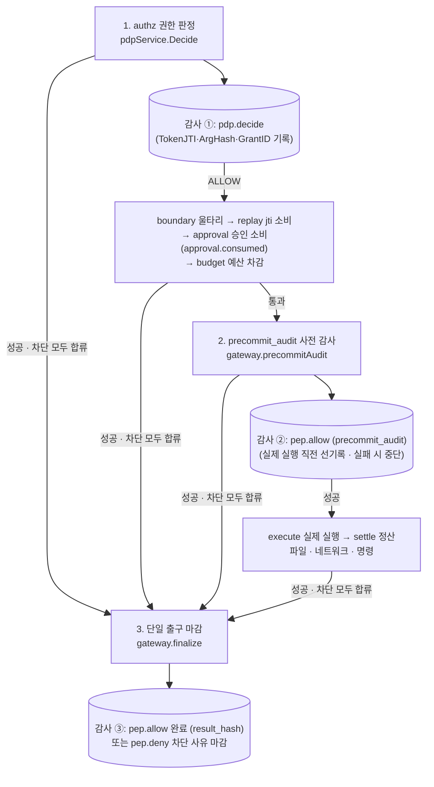

# 013. 정책 결정(PDP·OPA 모델)과 감사(Audit) 결합의 교과서적 설계 — 왜 판정 두뇌는 순수 함수로 가두고, 판정 감사는 집행 감사와 두 겹으로 묶었나

> **모드**: `[문서작업]` — 현재 구현된 정책 결정기(`internal/authz/pdp`), 정책 정보 조회기(`internal/authz/pip`), 정책 관리기(`internal/authz/pap`), 집행 관문(`internal/authz/pep`), 그리고 감사 기록기(`internal/audit`)가 어떻게 **OPA(Open Policy Agent)의 핵심 설계 원리(Input + Data → Pure Evaluation + Decision Log)**를 최소 기능(MVP) 코드로 구현하고 있는지, 어디가 교과서적인 강점이고 어디가 트레이드오프인지를 해설합니다.  
> **기준일**: 2026-11-06 · **기준 커밋**: `bf00fca` (이 문서가 설명하는 `cmd/`와 `internal/`을 마지막으로 바꾼 커밋)  
> **검증 범위**: 동작·순서·소유자·시점을 코드와 대조한 결과와 「미확인」은 5부 ③에 있습니다.  
> **이 문서는 구현된 것만 적는다.** 계획·제안·미래형 약속은 적지 않으며, 현재 코드가 하지 않는 것은 「지금은 없다」고만 씁니다.  
> **이 문서의 규칙**: 본문(0~4부, Q&A, 그림, 5부 ①)은 쉬운 개념·설계·이유가 중심입니다. 파일·타입 이름 같은 고유 이름은 첫 등장에 한마디 설명과 함께 쓰고, 구현의 어디인지는 문단 끝 `(구현: 파일 · 함수, 5부 ② 번호)` 귀띔으로 보조합니다. 기준은 [프로그램 설명서 README의 「설명의 기준」과 「이름의 3층」](README.md)입니다.  
> **겹치는 주제**: 전체 설계 철학과 3중 분리 배선은 [000편](000-전체설계철학과_내부지도.md)이, 관문 열 단계 흐름은 [001편](001-전체요청여정과_5단계관문.md)이, 사람 승인(`ask`)과 인자 바인딩은 [005편](005-승인_예산과_도구확장.md)이, 패키지 의존 방향과 정적 가드는 [007편](007-코드읽는순서와_의존방향.md)이, 세대 번호(`Epoch`)와 회수 시점 경계는 [009편](009-권한회수_Epoch_시간과_TOCTOU창.md)이 다룹니다. 이 편은 그중 **「권한 판정(PDP/OPA 모델)과 감사(Audit)가 왜, 어떻게 한 몸으로 묶여 돌아가는가」**라는 교과서적 구조에 초점을 맞춥니다.
>
> **다시 확인하는 법**
> ```bash
> git rev-parse --short HEAD
> git log -1 --format=%h -- cmd internal
> # 1. Track A(순수 인메모리 결정표 시험) 및 Track B(PDP 감사 실패 시 Fail-Closed 차단·WithEvaluator 주입·JTI·ArgHash 바인딩 시험) 실행
> go test -v ./internal/authz/pdp/... -run "TestPDP_StrictNoOSImports|TestTrackA_PureDomainDecisionTable|TestPDP_Service_Audit_FailClosed|TestPDP_Service_WithEvaluatorAndAuditBinding|TestTC_020"
> # 2. PAP(늘림은 감사를 저장 앞에 기록하는 처리 포함) 및 PEP(사전 감사·단일 출구 마감) 시험 실행
> go test -v ./internal/authz/pap/... -run "TestPAP_AuditFailureRollbacks|TestApprovalAuditFailure|TestPAP"
> go test -v ./internal/authz/pip/... ./internal/authz/pep/...
> # 3. PDP의 OS·인프라 무의존 및 감사 에러 무시 금지 정적 가드 확인
> go test -v ./internal/harness -run "TestArchitectureGuardrails/TC-060-01|TestArchitectureGuardrails/TC-170-01|TestArchitectureGuardrails/TC-170-04|TestArchitectureGuardrails/TC-080-01"
> ```

---

## 💡 사용자의 질문 (원문 보존)

> 억지로 만들 필요는 없다. 더 만들만한 주제 있나? 권한과 배선, 감사에서 교과서적인 코드를 작성하고 싶다. 교과서를 쓰고 싶다. mvp수준에서 기본기 탄탄한 프로그램 말이다. 내 코드에서 주목할 부분이 있으면 주제 정해서 써라. 핵심은 opa이니까 그게 부족하면 쓰고 opa와 감사audit는 함께 가는게 국룰이니까 내 코드에 그런 부분 있으면 써라. 그런 부분이 없다면 제안이나 트레이드오프 언급정도만 하고 다른 걸 써도 좋다. 쓸게 있으면 바로 설명서 파일로 만들어서 넣어라.

> 제안 승인한다. 모두 보강해라

---

## 0. 모든 설계 이전에 ‘사람’이 있다 — 왜 권한 엔진(OPA)과 감사(Audit)는 늘 한 몸으로 다뤄지나

실무에서 권한 시스템을 만들거나 OPA(Open Policy Agent) 같은 정책 엔진을 도입할 때, 기본기가 탄탄한 엔지니어들이 반드시 지키는 불문율이 하나 있습니다. **「정책 결정(PDP)과 결정 감사(Decision Audit)는 떨어지지 않는다」**는 것입니다.

권한과 배선, 감사의 교과서 같은 기본기를 코드로 확인하고 싶은 사람은 이런 질문을 던집니다.

- *「외부 OPA 서버를 띄우지 않고도 OPA의 가장 핵심적인 설계 원리(요청 `Input` + 상태 `Data` → 순수 계산 → 결정 로그 `Decision Log`)를 코드 안에 어떻게 구현했나?」*
- *「왜 판정 함수(`pdp.Evaluate`)와 판정 서비스(`pdpService.Decide`)를 둘로 나누어, 안쪽은 디스크를 아예 모르게 만들고 바깥쪽은 감사 기록이 실패하면 판정 결과 자체를 폐기하게 만들었나?」*
- *「판정 단계(`pdp.decide`)에서 이미 감사 기록을 남겼는데, 왜 집행 관문(`pep.Gateway`)에서 파일을 열기 직전(`precommit_audit`)과 끝난 직후(`finalize`)에 감사를 또 남기나?」*
- *「권한을 부여하거나 회수하는 관리 명령(`PAP`)에서 감사 쓰기가 실패하면, 이미 바뀐 권한 장부(`grants_state.json`)는 어떻게 되돌리나?」*

이 설명서는 `authz-harness` 코드 안에 들어 있는 **권한(NIST 4각 분리 + OPA 평가 모델)·배선(함수형 코어와 명령형 껍데기)·감사(정책 변경 감사 · 판정 감사 · 집행 감사의 3단 Fail-Closed 결합)**의 설계 원리를 해부합니다.

---

## 1부. 왜 권한 판정과 감사는 한 몸이어야 하고, 왜 이런 모양인가

### 가장 밑바닥의 이유부터

1. **왜 권한 코드는 흔히 스파게티가 되나?**
   - 처음 권한 검사를 짤 때는 파일 열기 함수 맨 위에 `if user.Role != "admin" { return err }` 한 줄을 넣습니다. 그러다 토큰 만료, 권한 회수, 예외 승인, 감사 로그가 추가되면 비즈니스 로직과 파일 읽기, 로그 찍기가 한 함수 안에서 뒤엉킵니다.
   - *그게 왜 문제인가?* 「누가 어떤 규칙 때문에 거부되었는가」를 파일 시스템 없이 시험할 방법이 사라지고, 누군가 실수로 검사 순서를 바꾸거나 감사 로그 호출을 빼먹어도 아무도 모른 채 코드가 배포됩니다.
2. **그래서 업계 표준(NIST SP 800-162 및 OPA 모델)은 권한을 어떻게 쪼개나?**
   - 권한에 관한 네 가지 역할을 칼같이 나눕니다.
     - **PAP (정책 관리점 — `internal/authz/pap`)**: 장부에 권한(`Grant`)을 적고, 취소(`Revoke`)하고, 세대 번호(`Epoch`)를 올리고, 1회용 승인(`Approval`)을 내줍니다.
     - **PIP (정책 정보점 — `internal/authz/pip`)**: 판정에 필요한 주체의 현재 상태(세대 번호, 활성·회수 권한, 승인 목록)를 장부에서 한 번에 읽어 **불변 사본(`SubjectSnapshot`)**으로 떠 옵니다.
     - **PDP (정책 결정점 — `internal/authz/pdp`)**: 요청(`Request`)과 사본(`SubjectSnapshot`) 두 가지만 놓고 **허용(`ALLOW`)·사람 승인 필요(`ASK`)·거부(`DENY`)**를 계산합니다.
     - **PEP (정책 집행점 — `internal/authz/pep`)**: PDP의 결정을 받아 실제로 통과시키거나 문 앞에서 막아섭니다.
3. **여기서 왜 「OPA(PDP)와 감사(Audit)는 함께 간다」가 국룰인가?**
   - 재판관이 판결(`ALLOW` 또는 `DENY`)을 내렸는데 판결문이 법원 장부에 적히지 않았다면, 나중에 사고가 났을 때 **「그때 왜 열어 주었는가(어느 Grant ID, 어느 토큰 `jti`, 어떤 입력 지문 `arg_hash` 때문이었는가)」**를 증명할 길이 없습니다.
   - 반대로 판결문(`pdp.decide`)만 남기고 실제 집행관(`PEP`)이 파일을 열었는지, 아니면 경로 탈출(`Jail`)이나 예산 부족 때문에 문 앞에서 막았는지를 적지 않으면 **「허락은 났는데 실제로 파일이 바뀌었는가」**를 알 수 없습니다.
   - 그래서 기본기가 탄탄한 권한 시스템은 **① 정책을 바꿀 때(PAP 감사 — 늘림은 저장 전에 기록해 실패하면 저장하지 않고, 줄임은 저장 뒤 기록하며 실패해도 유지) ② 판정을 내릴 때(PDP 결정 감사 — 실패 시 판정 폐기) ③ 실제로 집행하기 직전과 직후(PEP 사전·완료·차단 감사 — 실패 시 실행 중단)** 세 곳의 감사를 하나의 추적 번호(`TraceID`)·토큰 번호(`TokenJTI`)·해시 사슬로 묶고, 어느 한 곳이라도 감사 기록에 실패하면 작업 전체를 멈춰 세웁니다(Fail-Closed).

### 상용 OPA 서버 방식과 이 프로그램(`authz-harness`)의 선택

| 구분 | 외부 OPA(Open Policy Agent) 데몬 방식 (일반론) | 이 프로그램(`authz-harness`)의 내장 교과서 모델 |
|---|---|---|
| **입력과 데이터의 분리 (`input` vs `data`)** | 요청 JSON(`input`)과 메모리에 동기화된 외부 상태 JSON(`data`)을 Rego 엔진에 넣어 평가한다. | `pdp.Request`(`input` 역할)와 `pipService.GetSubjectSnapshot`이 떠 온 `domain.SubjectSnapshot`(`data` 역할)을 순수 함수 `pdp.Evaluate`에 넣어 평가한다. |
| **판정 결과의 모양** | 규칙에 따라 `true`/`false` 또는 사용자 정의 객체를 반환한다. | 단순 불리언이 아니라 3값 결정(`ALLOW` / `ASK` / `DENY`), 표준 사유(`Reason`), 매칭된 권한 번호(`GrantID`), 소비할 승인 번호(`ApprovalID`), 설명(`Details`)을 담은 구조체(`pdp.Decision`)를 반환한다. |
| **결정 감사 (`Decision Log`)** | OPA 내부 버퍼에 판정 로그를 모았다가 원격 서버로 비동기 전송한다(기본 설정은 버퍼가 차면 로그를 버리고 판정은 진행하는 Fail-Open). | `pdpService.Decide`가 판정 직후 동기적으로 `audit.Writer.Log`(`pdp.decide`, 최상위 `TokenJTI`·`ArgHash` 바인딩 포함)를 호출해 파일 잠금(`flock`)과 SHA-256 해시 사슬로 디스크에 밀어 넣는다. **감사 기록 실패 시 `ALLOW` 판정을 폐기하고 즉시 에러를 반환한다(Strict Fail-Closed).** |
| **얻은 것** | 코드를 다시 빌드하지 않고도 Rego 정책 파일을 배포해 복잡한 규칙을 바꿀 수 있다. | 외부 서버 없이도 **「순수 함수 코어(`Evaluate`) + Fail-Closed 감사 껍데기(`Decide`)」**라는 교과서적 패턴을 100줄 남짓한 Go 코드로 명확히 구현했고, 디스크 없이 1ms 미만(100ms 상한 검증)에 전 조합 표 시험(`Track A`)을 돌릴 수 있다. |
| **포기한 것** | 별도 데몬 관리·네트워크 지연이 생기고, 비동기 감사 유실 시 무증거 허용이 일어날 수 있다. | 런타임에 동적으로 정책 언어를 해석하는 기능은 없다(고정 6단계 우선순위 공식). |

---

## 2부. 질문과 답변으로 파고드는 코드 속 ‘교과서적 설계’ 6가지 (Q&A)

### Q1. [교과서 포인트 1] 왜 `pdp` 패키지 안에 `Evaluate`와 `Decide` 두 함수를 따로 두었나? (함수형 코어와 명령형 껍데기)

- **무슨 일이 일어나는가**: [`internal/authz/pdp/service.go`](../../internal/authz/pdp/service.go) 하나를 열어 보면, 성격이 완전히 다른 두 층이 한눈에 보입니다.
  1. **안쪽 — 함수형 코어 (`pdp.Evaluate(req Request, snapshot *domain.SubjectSnapshot) Decision`)**:
     - 이 함수는 인터페이스도 아니고 메서드도 아닌 **순수 패키지 함수**입니다.
     - 파일도 열지 않고, 네트워크도 쓰지 않고, 감사 로그도 찍지 않으며, 심지어 운영체제 시계(`time.Now()`)조차 부르지 않습니다(승인 만료를 비교할 시각도 `req.Now`나 `snapshot.Timestamp`에서 꺼내 씁니다).
     - 오직 건네받은 `req`(OPA의 `input`)와 `snapshot`(OPA의 `data`)만 보고 6단계 우선순위 공식(① 입력 무결성 → ② 주체 `Epoch` 킬스위치 → ②-b 위임 조상 `act` 사슬 `Epoch` 연쇄 검증 → ③ 토큰 `Scope` 매칭 → ④ 활성 `Grant` 및 1회용 `Approval` 바인딩 대조 → ⑤ 회수된 `Grant` 이력 대조 → ⑥ 기본 거부)을 계산해 `Decision` 값 하나를 돌려줍니다.
  2. **바깥쪽 — 명령형 껍데기 (`pdpService.Decide(ctx context.Context, req Request) (*Decision, error)`)**:
     - 이 메서드는 바깥 세계와의 배선(PIP 조회, 디스크 감사 기록)을 전담합니다.
     - 먼저 `s.pipSvc.GetSubjectSnapshot(ctx, req.Subject)`을 불러 디스크 장부에서 사본을 떠 오고 → 순수 함수 `Evaluate(req, snapshot)`를 호출해 결론을 얻은 뒤 → 디스크 감사기(`s.audit.Log`)에 `pdp.decide` 기록을 남기고 → 감사 기록이 성공했을 때만 `&decision`을 반환합니다. (구현: [`pdp/service.go`](../../internal/authz/pdp/service.go) · `Evaluate`, `pdpService.Decide`, 5부 ② 1번)
- **왜 이것이 교과서적인가**:
  - 소프트웨어 공학에서 가장 이상적으로 꼽는 **Functional Core, Imperative Shell(함수형 코어, 명령형 껍데기)** 패턴의 정석이기 때문입니다.
  - 이 분리 덕분에 [`internal/authz/pdp/pdp_test.go`](../../internal/authz/pdp/pdp_test.go)는 디스크나 모의 객체(Mock)조차 없이 15가지 권한·위임·회수 조합표를 순수 메모리에서 돌리는 **Track A 시험(`TestTrackA_PureDomainDecisionTable`)**과, 모의 감사기에 디스크 풀 에러를 주입해 판정 폐기를 검증하는 **Track B 시험(`TestPDP_Service_Audit_FailClosed`)**을 깔끔하게 나누어 검증합니다.
- **근거**: 5부 ② 항목 1, 2, 10번

### Q2. [교과서 포인트 2] OPA와 감사가 함께 가듯, `pdpService.Decide`는 어떻게 판정과 감사를 원자적 운명으로 묶었나?

- **무슨 일이 일어나는가**:
  1. `pdpService.Decide`에서 순수 함수 `Evaluate`가 `DecisionAllow`(정상 허용)를 내렸더라도, 아직 호출자(`PEP` 등)에게는 그 결론이 전달되지 않은 상태입니다.
  2. 바로 다음 줄에서 `s.audit.Log(event)`를 불러 `Step: "pdp.decide"`, `Action: "pdp.decide"`, `Decision: "allow"|"ask"|"deny"`, `Reason`, **최상위 `TokenJTI: req.TokenJTI`, `ArgHash: req.ArgHash`**, 그리고 `Metadata`에 **판정의 근거가 된 증거(`grant_id`, `approval_id`, `caller_id`, `requested_epoch`, `current_epoch`, `details`)**를 담아 기록합니다.
  3. 최상위 `TokenJTI`와 `ArgHash`가 `pdp.decide` 감사 레코드에도 그대로 찍히기 때문에, 결정 감사 레코드 자체가 길이 접두 SHA-256 해시 사슬(새 기록은 스키마 v4)(`ComputeEventHash`) 안에서 출입증 번호·요청 데이터 지문과 암호학적으로 묶이고 `audit tree` 위임 나무 마디에도 곧바로 연결됩니다.
  4. 만약 `s.audit.Log(event)`가 에러를 반환하면, `pdpService.Decide`는 방금 계산해 둔 `decision`을 버리고 **`return nil, fmt.Errorf("pdp: audit logging failed (fail-closed): %w", err)`**를 반환합니다.
  5. 이를 호출한 관문(`pep.Gateway`)의 `authz` 단계는 `decideErr != nil`을 받아 그 자리에서 관문을 멈추고 `finalize`로 넘어가 종료 코드 `15`(`ExitAuditFailure`)로 차단합니다. (구현: [`pdp/service.go`](../../internal/authz/pdp/service.go) · `pdpService.Decide`, [`pep/gateway.go`](../../internal/authz/pep/gateway.go) · `gateway.authz`, [`pdp_test.go`](../../internal/authz/pdp/pdp_test.go) · `TestPDP_Service_Audit_FailClosed`, 5부 ② 1·6·10번)
- **왜 그렇게 했나**:
  - **「감사 장부에 적히지 않은 허락(`ALLOW`)은 세상 밖으로 나갈 수 없다」**는 규칙을 코드로 강제한 것입니다.
  - 예전에는 `ctx` 안에 인메모리 이벤트 버퍼를 넣으면 판정 사건을 메모리에도 내보냈지만, 비시험 코드에서 쓰는 곳이 없어 로드맵 19 지시서 050에서 코드째 제거했습니다([ADR 0009](../adr/0009-감사-스키마-v4-단계-보호.md)). 이제 판정 사건은 디스크 감사 `pdp.decide` 한 곳에만 남습니다. (구현: [`pdp/service.go`](../../internal/authz/pdp/service.go) · `pdpService.Decide`, 5부 ② 1번)
- **근거**: 5부 ② 항목 1, 6, 10번

### Q3. [교과서 포인트 3] 왜 판정 결과를 단순 `bool`(`true`/`false`)이 아니라 3값(`ALLOW`·`ASK`·`DENY`) + 바인딩 증거(`GrantID`·`ApprovalID`)로 설계했나?

- **무슨 일이 일어나는가**:
  1. 초보적인 권한 함수는 `IsAllowed(req) bool`처럼 참/거짓만 돌려줍니다. 그러면 호출자는 *「왜 거부되었는지」*, *「어느 권한 규칙이 매칭되었는지」*, *「사람 승인만 받으면 되는 상태인지」*를 알 수 없습니다.
  2. [`internal/authz/pdp/service.go`](../../internal/authz/pdp/service.go)의 `pdp.Decision` 구조체는 다섯 가지를 돌려줍니다:
     - `Decision` (`ALLOW` / `ASK` / `DENY` 3값 — [ADR 0005](../adr/0005-pdp-3값-결정-및-일회성-승인-바인딩.md))
     - `Reason` (`domain.Reason` 표준 사유 상수 — 종료 코드 `0`, `12`, `18`과 1:1 대응)
     - `GrantID` (허용 또는 회수 판정의 근거가 된 권한 ID)
     - `ApprovalID` (사람 승인으로 `ALLOW`가 났을 때, 관문 `approval` 단계가 장부에서 찾아 지워야 할 1회용 승인 ID)
     - `Details` (사람이 읽을 수 있는 판정 해설 문장)
  3. 특히 같은 주체·행동·대상에 대해 여러 개의 활성 `Grant`가 있을 때, `pdp.Evaluate`는 첫 번째 것만 대충 고르지 않고 **하나라도 `RequiresApproval: true`인 권한이 있으면 가장 엄격한 쪽(승인 필수)을 우선 적용**합니다(`if matched == nil || (g.RequiresApproval && !matched.RequiresApproval)`). (구현: [`pdp/service.go`](../../internal/authz/pdp/service.go) · `DecisionType`, `Decision`, `Evaluate`, [`approval.go`](../../internal/domain/approval.go) · `ApprovalBinding`, `SelectApproval`, 5부 ② 1·5번)
- **왜 이것이 교과서적인가**:
  - PDP가 단순히 「통과 여부」만 말하지 않고 **「다음에 PEP가 무엇을 소비해야 하는가(`ApprovalID`)」와 「감사 장부에 어떤 근거 번호(`GrantID`, `Reason`)를 남겨야 하는가」를 결정값 자체에 실어 보내기 때문**입니다. 덕분에 관문(`PEP`)은 정책 규칙을 다시 뒤질 필요 없이 `state.approvalID = decision.ApprovalID`만 받아 `approval` 단계에서 정확히 그 승인 하나만 원자적으로 소비합니다.
- **근거**: 5부 ② 항목 1, 5, 6번

### Q4. [교과서 포인트 4] 왜 거부 사유에도 엄격한 ‘우선순위 공식’이 있나? (`Epoch` 킬스위치 > `Scope` > `Grant`)

- **무슨 일이 일어나는가**:
  1. 어떤 요청이 동시에 두 가지 이유로 잘못되었을 때(예: 세대 번호 `Epoch`도 이미 철회되었고, 토큰 `Scope`도 부족할 때), 어느 사유로 거부할지는 대충 정하면 안 됩니다.
  2. `pdp.Evaluate`는 항상 **① 입력 검증 → ② 본인 및 위임 조상 `Epoch`(비상 킬스위치) → ③ 토큰 `Scope` → ④ 활성 `Grant` 및 `Approval` → ⑤ 회수된 `Grant` 이력 → ⑥ 기본 거부(`NO_ACTIVE_GRANT`)** 순서를 엄격히 지킵니다.
  3. [`internal/authz/pdp/pdp_test.go`](../../internal/authz/pdp/pdp_test.go)의 `TC-020-06`(`Epoch 불일치와 Scope 부족 동시 발생 시 킬스위치 우선`)과 `TC-13`은 이 우선순위가 깨지지 않는지 직접 시험합니다.
  4. 또한 [`internal/domain/scope.go`](../../internal/domain/scope.go)의 `ScopeMatches`는 `"*"`나 `"admin"` 같은 암묵적 만능 문자열을 일절 인정하지 않고(`TC-020-04`, `TC-11`), 오직 `<action>` 또는 `<action>:<resource>` 완전 일치만 허용합니다. (구현: [`pdp/service.go`](../../internal/authz/pdp/service.go) · `Evaluate`, [`scope.go`](../../internal/domain/scope.go) · `ScopeMatches`, [`pdp_test.go`](../../internal/authz/pdp/pdp_test.go) · `TestTC_020_Scenarios`, 5부 ② 1·5·10번)
- **왜 그렇게 했나**:
  - 관리자가 비상 상황이라 `grant bump-epoch`로 킬스위치를 당겼다면, 감사 장부에는 부차적인 스코프 부족이 아니라 **`SUBJECT_EPOCH_REVOKED`(킬스위치에 의해 차단됨)**가 명확히 찍혀야 보안 관제에서 공격자의 킬스위치 우회 시도를 즉시 알아차릴 수 있기 때문입니다.
- **근거**: 5부 ② 항목 1, 5, 10번

### Q5. [교과서 포인트 5] 왜 감사 기록이 `PAP(늘림은 저장 전 감사)` → `PDP(판정 폐기)` → `PEP(사전·마감)`의 3단 사슬로 이어져 있나?

- **무슨 일이 일어나는가**: 권한과 감사가 함께 간다는 원칙은 `pdp.decide` 한 줄에서 끝나지 않고, 권한의 일생 전체를 따라가며 **어느 단계에서든 감사 기록이 실패하면 상태 변경이나 실행 자체가 무효화**됩니다.
  1. **정책 변경 감사와 방향별 순서 (`PAP`, [ADR 0010](../adr/0010-관리-변경의-감사-실패-처리.md))**: [`internal/authz/pap/service.go`](../../internal/authz/pap/service.go)의 `CreateGrant`, `RevokeGrant`, `BumpEpoch`, `CreateApproval`은 방향에 따라 순서가 다릅니다. 권한을 **줄이는** `RevokeGrant`·`BumpEpoch`는 장부 파일 잠금(`s.store.Update`) 안에서 상태를 고치고 **잠금을 푼 직후** `s.audit.Log`로 기록하고, 권한을 **늘리는** `CreateGrant`·`CreateApproval`은 저장 **앞에** 기록합니다. 기록하는 사건은 `grant.created`, `grant.revoke`, `epoch.bump`, `approval.granted`(최상위 `TokenJTI`·`ArgHash` 포함)입니다. 이때 장부 잠금과 감사 잠금을 동시에 쥐지 않아 데드락을 막으면서도, **만약 `s.audit.Log`가 실패하면 `ReasonAuditLogFailed`(`15`)를 반환**합니다. ① 권한을 **늘리는** `CreateGrant`·`CreateApproval`은 감사가 먼저이므로 실패하면 저장하지 않아 지울 것이 없고 감사에 남지 않은 유령 권한이 생기지 않습니다(`TestAF_P7_*`, `TestOrder_O1`~`O6`). 감사는 성공했는데 저장이 실패하면 `INTERNAL_ERROR`를 돌려주고 같은 `grant_id`·`approval_id`를 담은 `*.create.deny`를 뒤에 남깁니다(계획 021). ② 권한을 **줄이는** `RevokeGrant`·`BumpEpoch`는 되돌리지 않습니다. 옛 값을 덮어쓰면 그 사이 성공한 다른 요청의 회수·세대 증가까지 지워 회수한 권한이 되살아나기 때문입니다. 오류 문구에 「적용되었으나 감사에 실패했다」고 적고, 운영자는 감사를 복구한 뒤 같은 명령을 다시 실행합니다(`TestAF_P1_*`~`P6_*`, `TestPAP_AuditFailureRollbacks`).
  2. **결정 감사 (`PDP`)**: `authz`에서 `pdpService.Decide`가 `pdp.decide`를 기록하며, 실패 시 결정을 폐기합니다.
  3. **승인 소비 감사 (`PEP approval`)**: 사람 승인으로 통과한 경우 `gateway.logApprovalConsumed`가 `approval.consumed`를 기록합니다.
  4. **집행 직전 사전 감사 (`PEP precommit_audit`)**: 실제 파일·네트워크·명령을 건드리기 직전에 `precommit_audit` 단계가 `pep.allow`(`pre-commit audit check passed`)를 먼저 디스크에 동기화(`Sync`)합니다.
  5. **단일 출구 마감 감사 (`PEP finalize`)**: 어느 단계에서 막혔든(`pep.deny`) 끝까지 성공했든(`pep.allow`, 결과 데이터 지문 `result_hash` 포함), `gateway.finalize` 단 한 곳에서 최종 결과를 기록합니다. (구현: [`pap/service.go`](../../internal/authz/pap/service.go) · `CreateGrant`~`CreateApproval`, [`pdp/service.go`](../../internal/authz/pdp/service.go) · `pdpService.Decide`, [`pep/gateway.go`](../../internal/authz/pep/gateway.go) · `gateway.precommitAudit`, `gateway.finalize`, 5부 ② 1·3·6·7번)
- **왜 `PDP` 감사만으로는 부족하고 `PEP` 사전·마감 감사가 함께 있어야 하나**:
  - `PDP`가 `ALLOW`를 내렸더라도, 그 뒤에 있는 `boundary`(작업 폴더 심볼릭 링크 탈출 검사)나 `budget`(예산 차감)에서 막힐 수 있습니다.
  - 따라서 **`pdp.decide`(`ALLOW`: 장부상 권한은 있었음) 뒤에 `pep.deny`(`SYMLINK_ESCAPE`: 그러나 물리 경로가 작업 폴더 밖이라 집행 관문이 막았음)**가 나란히 같은 `TraceID`와 `TokenJTI`로 찍혀야만, 「정책 결정은 통과했으나 물리 울타리에서 차단되었다」는 사건의 전모가 빈틈없이 증명됩니다.
- **근거**: 5부 ② 항목 1, 3, 6, 7, 10번

### Q6. [트레이드오프] 현재 코드에서 상용 OPA 대비 의도적으로 덜어낸 것과 확장점(`WithEvaluator`)은 무엇인가?

1. **정책 표현력 vs 무의존 순수 함수 (OPA Rego 미사용 트레이드오프와 `WithEvaluator` 전략 주입점)**:
   - 상용 OPA는 정책을 Rego 스크립트나 Wasm 번들로 밖에서 주입하지만, 이 코드는 외부 의존성 0개와 컴파일 타임 안전성을 위해 `pdp.Evaluate` Go 함수를 기본값으로 씁니다.
   - 다만 실무에서 외부 OPA/Cedar 어댑터나 커스텀 정책 함수를 끼워 넣더라도 `pdpService.Decide`의 **PIP 스냅샷 조회 + Fail-Closed 결정 감사(`pdp.decide`) 결합 구조**를 그대로 재사용할 수 있도록, 순수 평가 함수 타입 `pdp.EvaluatorFunc`(`func(req Request, snapshot *domain.SubjectSnapshot) Decision`)와 옵션 `pdp.WithEvaluator(fn)` 전략 주입점을 열어 두었습니다(`TestPDP_Service_WithEvaluatorAndAuditBinding`).
2. **최상위 불변 해시 필드(13개)와 `Metadata` 맵의 역할 분리**:
   - `pdp.decide`, `pep.allow`, `pep.deny`, `approval.granted`, `approval.consumed`의 핵심 바인딩 값(`TraceID`, `Actor`, `Action`, `Resource`, `Decision`, `Reason`, `Success`, `TokenJTI`, `AgentID`, `ArgHash`, `ResultHash`)은 모두 최상위 필드에 배치되어 [`internal/audit/audit.go`](../../internal/audit/audit.go)의 `ComputeEventHash`(길이 접두 SHA-256 해시 사슬, 새 기록은 스키마 v4로 단계 값도 포함)가 직접 보호합니다.
   - 반면 `Metadata` 맵(`grant_id`, `approval_id`, `caller_id`, `requested_epoch`, `current_epoch`, `parent_jti` 등)은 `json.Marshal` 역직렬화 시 숫자 타입 변환(`int64` vs `float64`)으로 인한 가짜 변조 오탐(False Positive)을 막기 위해 해시 입력에서 제외하고 설명·시각화 보조 정보로 씁니다([006편 Q10](006-OS격리_관측성과_감사체크포인트.md)). (구현: [`audit/audit.go`](../../internal/audit/audit.go) · `ComputeEventHash`, `computeHashV3`, 5부 ② 8번)
- **근거**: 5부 ② 항목 1, 8, 10번

---

## 3부. 내부 지도 — OPA 대응 구조와 판정·집행 감사의 2중 고리

**그림 1. OPA 표준 모델과 `authz-harness`(`PIP` · `Pure PDP` · `Audit`)의 1:1 대응 지도**



(구현: [`pip/service.go`](../../internal/authz/pip/service.go) — `pipService.GetSubjectSnapshot`이 장부 사본을 뜨고, [`pdp/service.go`](../../internal/authz/pdp/service.go) — `pdpService.Decide`가 순수 함수 `Evaluate`를 호출한 뒤 감사 기록에 성공해야만 결정을 반환합니다, 5부 ② 1·2·8번)

**그림 2. 한 번의 요청에서 일어나는 ‘판정 감사(`PDP`) + 집행 감사(`PEP`)’의 3점 결합**



(구현: [`pdp/service.go`](../../internal/authz/pdp/service.go) — `pdpService.Decide`, [`pep/gateway.go`](../../internal/authz/pep/gateway.go) — `gateway.precommitAudit`과 `gateway.finalize`가 동일 `TraceID`·`TokenJTI` 아래 세 지점의 감사를 사슬로 엮습니다, 5부 ② 1·6·7번)

### 어디에 무엇이 남나

| 무엇 | 어디에 | 언제 | 사람이 직접 여는 법 |
|---|---|---|---|
| **정책 변경 감사 (`grant.created`, `grant.revoke`, `epoch.bump`, `approval.granted`)** | `audit.jsonl` | 늘림은 `grants_state.json` 저장 앞, 줄임은 저장 직후 (감사 실패 시 늘림은 저장하지 않고 줄임은 유지) | `grep -E "grant\.|epoch\.|approval\." audit.jsonl` |
| **정책 결정 감사 (`pdp.decide`)** | `audit.jsonl` (최상위 `token_jti`, `arg_hash` 및 `Metadata`의 `grant_id`, `approval_id`, `requested_epoch`, `current_epoch`, `caller_id` 포함) | `pdpService.Decide`가 `Evaluate`를 마친 직후 (`PEP`로 결과를 돌려주기 전) | `grep "pdp.decide" audit.jsonl` |
| **집행 사전 감사 (`precommit_audit`) 및 단일 출구 마감 감사 (`pep.allow` / `pep.deny`)** | `audit.jsonl` (최상위 `token_jti`, `agent_id`, `arg_hash`, 완료 시 `result_hash` 포함) | `execute` 실행 직전 및 `finalize` 종료 직전 | `authz-harness audit timeline --latest` |

### 이상이 생기면

| 상황 | 일어나는 일 |
|---|---|
| **`pdp.Evaluate`가 `ALLOW`를 계산했으나 직후 `pdp.decide` 감사 쓰기가 실패함** | `pdpService.Decide`가 `ALLOW` 결정을 폐기하고 에러를 반환하며, `pep.Gateway`는 파일에 손대지 않고 종료 코드 `15`(`ExitAuditFailure`)로 멈춘다(`TestPDP_Service_Audit_FailClosed`). |
| **`pdp.Decide`는 `ALLOW`와 `pdp.decide` 감사를 남겼으나, 뒤따르는 `boundary`(`Jail`)에서 심볼릭 링크 탈출이 적발됨** | `audit.jsonl`에는 같은 `TraceID`·`TokenJTI`로 `pdp.decide`(`allow`) 뒤에 `pep.deny`(`SYMLINK_ESCAPE`, 종료 코드 `13`)가 찍혀, 「장부 권한은 있었으나 물리 경로 울타리에서 차단됨」이 정확히 남는다. |
| **주체의 `Epoch` 불일치와 토큰 `Scope` 부족이 동시에 발생함** | `pdp.Evaluate`의 우선순위 공식에 따라 항상 킬스위치 사유인 `SUBJECT_EPOCH_REVOKED`(`12`)가 먼저 반환된다(`TC-020-06`). |
| **토큰 `Scope`에 `"admin"`이나 `"*"`를 넣어 모든 파일 접근을 시도함** | `domain.ScopeMatches`가 만능 문자열을 인정하지 않고 `TOKEN_INSUFFICIENT_SCOPE`(`12`)로 거부한다(`TC-020-04`). |
| **`papService`(`CreateGrant`, `RevokeGrant`, `BumpEpoch`, `CreateApproval`)가 `grants_state.json`을 고친 직후 감사 기록(`s.audit.Log`)에 실패함** | `CreateGrant`·`CreateApproval`은 방금 추가한 항목을 지우고(지우기 실패 시 두 오류를 함께 반환), `RevokeGrant`·`BumpEpoch`는 변경을 유지한 채 `AUDIT_LOG_FAILED`(`15`) 에러를 반환한다(`TestAF_*`, `TestPAP_AuditFailureRollbacks`). |

---

## 4부. 배척한 방식과 그 이유

1. **판정 함수(`pdp`) 안에서 장부 파일을 직접 열거나 감사 로그를 직접 찍는 방식**:
   - **택했다면 무슨 일이 생기는가**: 판정 계산(`Evaluate`)을 시험할 때마다 임시 파일과 감사 파일을 만들어야 하고, 디스크 읽기 에러와 정책 거부 사유가 뒤섞입니다.
   - **그 대신 포기한 것**: 한 함수로 합치는 대신 순수 함수 `Evaluate`와 서비스 껍데기 `pdpService.Decide`로 나누고, `pdp`가 `domain` 외의 내부 패키지나 `os`를 가져다 쓰지 못하게 아키텍처 가드(`TC-060-01`, `TC-170-01`, `TC-170-04`)로 잠갔습니다.
2. **OPA 기본 설정처럼 결정 감사(`Decision Log`)를 비동기 버퍼에 넣고 실패해도 판정은 통과시키는 방식 (Fail-Open Decision Log)**:
   - **택했다면 무슨 일이 생기는가**: 디스크가 가득 차거나 감사 파일이 깨진 상태에서 허락(`ALLOW`)만 나가고 감사 증거는 사라지는 무증거 실행이 일어납니다.
   - **그 대신 포기한 것**: 비동기 로깅의 처리량(Throughput)을 포기하고, `pdpService.Decide`와 `pep.Gateway`(`precommit_audit`), `papService` 모두 감사 기록이 디스크에 동기화(`Sync`)되어야만 결과를 확정하는 동기식 Fail-Closed를 택했습니다.
3. **판정 결과를 `bool`(`true`/`false`)로만 돌려주고 관문(`PEP`)이 거부 사유나 승인 여부를 다시 계산하는 방식**:
   - **택했다면 무슨 일이 생기는가**: 판정 두뇌(`PDP`)와 집행 관문(`PEP`) 두 곳에 정책 코드가 흩어져 서로 다른 결론을 내리게 됩니다([007편 4부 2번](007-코드읽는순서와_의존방향.md)).
   - **그 대신 포기한 것**: `pdp.Decision` 구조체에 3값(`ALLOW`/`ASK`/`DENY`), `Reason`, `GrantID`, `ApprovalID`를 모두 담아 돌려주고, 관문은 그 결정을 그대로 집행만 합니다.

---

## 5부. 한눈에 보는 대조표와 코드 정본

### ① 행동별 안에서 일어나는 일과 지금은 없는 것

| 행동 | 안에서 일어나는 일 | 지금은 없는 것 | 근거 |
|---|---|---|---|
| **상태 사본 준비 (`PIP`)** | `pipService.GetSubjectSnapshot`이 `grants_state.json`을 한 번 읽어 주체의 `CurrentEpoch`, 전체 주체 `SubjectEpochs` 사본, `ActiveGrants`, `RevokedGrants`, `Approvals`를 담은 `domain.SubjectSnapshot`을 만든다. | 스냅샷을 메모리에 캐시해 재사용하는 TTL 캐시는 지금 없다(회수 즉시 반영을 위해 매번 읽음). | 5부 ② 2, 5번 |
| **순수 정책 평가 (`pdp.Evaluate` / `EvaluatorFunc`)** | 파일·OS·시계 접근 없이 `pdp.Request`와 `SubjectSnapshot`만 대조해 6단계 우선순위(입력 → 본인 `Epoch` → 조상 `Epoch` → `ScopeMatches` → `ActiveGrants` & `SelectApproval` → `RevokedGrants` → 기본 거부)로 `pdp.Decision`을 계산하며, `WithEvaluator`로 교체할 수 있다. | 외부 OPA/Rego 스크립트 파일 동적 로드나 와일드카드(`*`) 스코프 규칙은 지금 없다. | 5부 ② 1, 5, 9번 |
| **결정 감사 결합 (`pdpService.Decide`)** | `eval` 직후 `audit.Writer.Log`(`pdp.decide`, 최상위 `TokenJTI`·`ArgHash` 바인딩 포함)를 호출하며, 감사 기록 실패 시 결정을 폐기하고 에러를 반환한다(Fail-Closed). | `Metadata` 맵 내부 보조 필드(`grant_id` 등)의 해시 사슬 포함은 지금 없다(역직렬화 타입 차이 오탐 방지를 위해 최상위 13개 불변 필드만 해시). | 5부 ② 1, 8번 |
| **정책 변경 감사 순서 (`PAP`) + 집행 2중 감사 (`PEP`)** | `PAP`는 늘림(Grant·승인 생성)은 감사를 저장 앞에 기록해 실패하면 저장하지 않고, 줄임(회수·Epoch 증가)은 감사 실패 시에도 유지한 채 `15`를 반환하고, `PEP`는 `execute` 직전 `precommit_audit` 사전 감사와 `finalize` 단일 출구 완료·차단 감사를 남긴다. | `execute` 파일 쓰기가 이미 성공한 뒤 `finalize` 완료 감사만 실패했을 때 이미 쓴 파일을 되돌리는 롤백은 지금 없다. | 5부 ② 3, 6, 7, 8, 10번 |

### ② 어디서 하나 (코드 정본 색인)

1. **순수 판정 함수(`Evaluate`), 전략 주입(`WithEvaluator`), 감사 결합 서비스(`Decide`)**: [`internal/authz/pdp/service.go`](../../internal/authz/pdp/service.go) (`DecisionType`, `DecisionAllow`, `DecisionDeny`, `DecisionAsk`, `Request`, `Decision`, `Evaluate`, `EvaluatorFunc`, `Service`, `pdpService`, `WithClock`, `WithEvaluator`, `NewService`, `pdpService.Decide`) — 구현: 계획002-S1 (`519005c`), P13·P15, `TokenJTI`·`ArgHash` 바인딩 (`9ec60a6`), `WithEvaluator` (`b947e1f`)
2. **정책 정보 조회기 (`PIP`)**: [`internal/authz/pip/service.go`](../../internal/authz/pip/service.go) (`SubjectSnapshot`, `Service`, `pipService`, `NewService`, `pipService.GetSubjectSnapshot`) — 구현: P01, P13-040 (`f70aafa`), P17-010 (`cef8fd5`)
3. **정책 관리기 (`PAP`) 및 감사 실패 처리**: [`internal/authz/pap/service.go`](../../internal/authz/pap/service.go) (`Service`, `papService`, `NewService`, `papService.CreateGrant`, `papService.RevokeGrant`, `papService.BumpEpoch`, `papService.CreateApproval`) — 구현: P01, P15, 감사 실패 처리 (`9ec60a6`, 늘림 쪽 순서는 계획 021 S5)
4. **(삭제됨) 인메모리 도메인 이벤트 포트 및 버퍼**: `domain.DomainEvent`·`EventBuffer`·`WithEventRecorder`는 로드맵 19 지시서 050에서 제거했습니다([ADR 0009](../adr/0009-감사-스키마-v4-단계-보호.md)). 번호는 본문의 `5부 ②` 참조를 보존하려고 남겨 둡니다.
5. **도메인 스냅샷·스코프·승인 바인딩 순수 규칙**: [`internal/domain/snapshot.go`](../../internal/domain/snapshot.go) (`SubjectSnapshot`, `SnapshotProvider`), [`internal/domain/scope.go`](../../internal/domain/scope.go) (`ScopeMatches`), [`internal/domain/approval.go`](../../internal/domain/approval.go) (`Approval`, `ApprovalBinding`, `SelectApproval`) — 구현: P07-020 (`1cff084`), P15, P17-010 (`cef8fd5`)
6. **PEP 관문 파이프라인 및 사전 감사 (`precommit_audit`)**: [`internal/authz/pep/gateway.go`](../../internal/authz/pep/gateway.go) (`gateway.Execute`, `gateway.assemble`, `stageHook`, `gateway.authz`, `gateway.approval`, `gateway.precommitAudit`, `gateway.execute`), [`internal/pipeline/pipeline.go`](../../internal/pipeline/pipeline.go) (`Engine.Run`) — 구현: 계획002-S1 (`519005c`), P15, 로드맵 19 지시서 020·040
7. **PEP 단일 출구 마감 및 최상위 감사 필드 바인딩**: [`internal/authz/pep/gateway.go`](../../internal/authz/pep/gateway.go) (`gateway.finalize`, `gateway.logEvent`, `gateway.logApprovalConsumed`, `decisionLabel`) — 구현: 계획002-S1 (`519005c`), P14·P15
8. **감사 스키마 및 v3·v4 길이 접두 해시 체인**: [`internal/domain/audit.go`](../../internal/domain/audit.go) (`AuditEvent`, `AuditWriter`), [`internal/audit/audit.go`](../../internal/audit/audit.go) (`ComputeEventHash`, `computeHashV3`, `JSONLWriter.Log`) — 구현: P07-030, 계획 008 (`3b626fc`)
9. **아키텍처 가드레일 (순수성 및 감사 에러 무시 금지)**: [`internal/harness/architecture_test.go`](../../internal/harness/architecture_test.go) (`TestArchitectureGuardrails` — `TC-060-01`, `TC-060-04`, `TC-080-01`, `TC-170-01`, `TC-170-04`, `TC-170-06`) — 구현: P07, P17, 계획 004·006 (`38fecfa`)
10. **PDP Track A(순수 결정표)·Track B(감사 Fail-Closed·전략 주입) 및 PAP 감사 실패 시험**: [`internal/authz/pdp/pdp_test.go`](../../internal/authz/pdp/pdp_test.go) (`TestPDP_StrictNoOSImports`, `TestPDP_Evaluate_TableDriven`, `TestPDP_Service_Audit_FailClosed`, `TestPDP_Service_WithEvaluatorAndAuditBinding`, `TestTC_020_Scenarios`, `TestTrackA_PureDomainDecisionTable`), [`internal/authz/pap/approval_test.go`](../../internal/authz/pap/approval_test.go) (`TestApprovalAuditFailure`, `TestPAP_AuditFailureRollbacks`), [`internal/authz/pap/audit_failure_test.go`](../../internal/authz/pap/audit_failure_test.go) (`TestAF_P1_*`~`TestAF_P7_*`), [`internal/authz/pap/audit_before_store_test.go`](../../internal/authz/pap/audit_before_store_test.go) (`TestOrder_O1`~`O6`)

### ③ 검증 범위와 「미확인」

검증 방법: 위 5부 ②의 1~10번 소스 파일을 직접 읽고 대조했으며(2026-11-06 개정, 로드맵 19 지시서 100-3에서는 PEP 단계 서술을 `bf00fca`의 `gateway.go`·`pipeline.go`와 다시 대조하고 나머지는 기준 커밋 `b947e1f` 대조 그대로), `go test -v ./internal/authz/pdp/... ./internal/authz/pap/...` 실행으로 Track A 결정표 시험, Track B 감사 Fail-Closed·`WithEvaluator`·`TokenJTI`·`ArgHash` 바인딩 시험, PAP 감사 실패 시 원장 자동 롤백 시험이 모두 통과함을 확인했습니다. 2026-11-06 재대조: 감사 해시 표기(새 기록은 스키마 v4)를 고쳤고(3곳), 식별자 일괄 대조에서 삭제된 이벤트 버퍼 외 누락은 없었습니다. PDP·PAP 서술은 `pdp.Evaluate`를 읽어 대조했으나 PAP는 의미까지 다시 읽지는 않았습니다. 2026-11-06 재검증([계획 016](../계획/016-설명서_본편_재대조_및_DEMO_GUIDE_재검증.md), 기준 코드 커밋 `64ae8db`): 본문의 식별자·링크(`DomainEvent`·`EventBuffer`·`WithEventRecorder`는 본문이 제거했다고 밝힌 이름)와 머리의 시험 명령 `pdp`·`pap`·`pip` 지정 시험, `TestArchitectureGuardrails/TC-060-01·TC-170-01·TC-170-04·TC-080-01`을 다시 실행해 통과를 확인했습니다. 위 확인으로 본문에서 고친 곳은 없습니다. 확인하지 못한 범위: 「왜」 서술과 일반론 비교표는 코드로 증명할 수 없어 대조하지 않았습니다. 판정 표의 개별 행은 줄 단위로 읽지 않았습니다.

| 항목 | 동작 | 순서 | 소유자 | 시점 | 미확인 사항 |
|---|---|---|---|---|---|
| **Q1 (함수형 코어 `Evaluate`와 명령형 껍데기 `Decide` 분리, ② 1·2·10번)** | 확인 | 확인 | 확인 (`pdp.Evaluate`, `pdpService.Decide`) | 확인 (`authz` 판정 시점) | 없음 |
| **Q2 (`pdp.decide` 감사 Fail-Closed 폐기, `TokenJTI`·`ArgHash` 최상위 바인딩, ② 1·10번)** | 확인 | 확인 | 확인 (`pdpService.Decide`) | 확인 (`Evaluate` 직후, 결과 반환 직전) | 없음 |
| **Q3·Q4 (3값 `Decision` + `ApprovalID`/`GrantID` 반환 및 6단계 우선순위 공식, ② 1·5·10번)** | 확인 | 확인 | 확인 (`pdp.Evaluate`, `domain.ScopeMatches`, `domain.SelectApproval`) | 확인 (`Evaluate` 내부 단계 순서) | 없음 |
| **Q5·Q6 (`PAP` 저장 전 감사→`PDP` 폐기→`PEP` 사전·마감 감사 사슬, 최상위 해시 보호 필드와 `Metadata` 분리, ② 1·3·6·7·8·10번)** | 확인 | 확인 | 확인 (`papService`, `pdpService.Decide`, `gateway.logEvent`, `audit.ComputeEventHash`) | 확인 (장부 갱신 직후, 판정 직후, `precommit_audit`, `finalize`) | 없음 |
