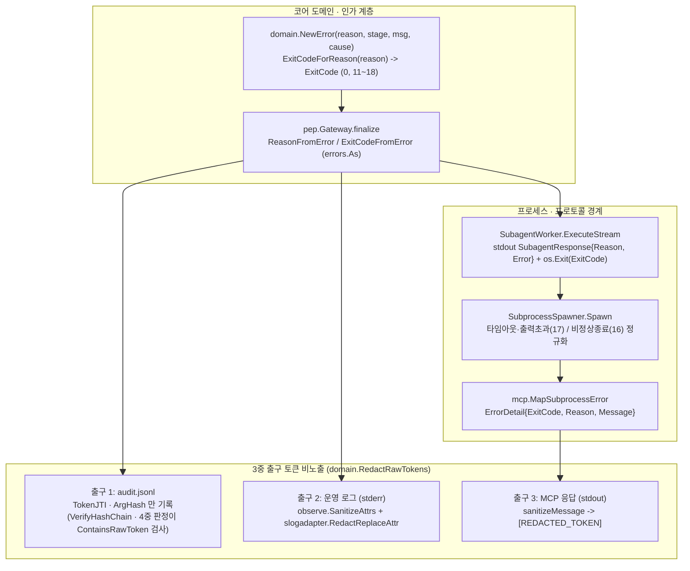

# 014. 도메인 에러·사유 번역과 토큰 비노출(Zero-Leakage) 배선 — 에러 문구를 바꾸어도 판정이 안 흔들리고 원시 출입증이 어디에도 새지 않는 이유

> **모드**: `[문서작업]` — 소스코드 수정 없이 현재 구현된 구조화 도메인 에러(`domain.Error`), 사유 코드(`domain.Reason`)와 종료 코드(`domain.ExitCode`)의 결정론적 매핑(`ExitCodeForReason`), 문자열 에러 파싱 금지 가드(`TC-060-03`), 경계 간 에러 번역(`SubagentWorker`·`Orchestrator`·`mcp.MapSubprocessError`), 그리고 3중 출구 토큰 비노출(`domain.RedactRawTokens`·`observe.SanitizeAttrs`·`slogadapter.RedactReplaceAttr`) 배선의 실제 동작과 이유(Why)를 해설합니다.  
> **기준일**: 2026-11-05 · **기준 커밋**: `b947e1f` (이 문서가 설명하는 `cmd/`와 `internal/`을 마지막으로 바꾼 커밋)  
> **검증 범위**: 동작·순서·소유자·시점을 코드와 대조한 결과와 「미확인」은 5부 ③에 있습니다.  
> **이 문서는 구현된 것만 적는다.** 계획·제안·미래형 약속은 적지 않으며, 현재 코드가 하지 않는 것은 「지금은 없다」고만 씁니다.  
> **이 문서의 규칙**: 본문(0~4부, Q&A, 그림, 5부 ①)은 쉬운 개념·설계·이유가 중심입니다. 파일·타입 이름 같은 고유 이름은 첫 등장에 한마디 설명과 함께 쓰고, 구현의 어디인지는 문단 끝 `(구현: 파일 · 함수, 5부 ② 번호)` 귀띔으로 보조합니다. 기준은 [프로그램 설명서 README의 「설명의 기준」과 「이름의 3층」](README.md)입니다.  
> **겹치는 주제**: 전체 설계 철학 4원칙과 감사·로그 분리는 [000편](000-전체설계철학과_내부지도.md)이, 열 단계 관문 단일 출구(`finalize`)는 [001편](001-전체요청여정과_5단계관문.md)이, 부모-자식 프로세스 실행과 `ExitCode` 전달은 [003편](003-서브프로세스격리와_해시체인감사.md)이, MCP JSON-RPC 게이트웨이 프로토콜은 [004편](004-다단계위임과_MCP도구게이트웨이.md)이, 운영 관측성(`observe`)과 감사 해시 체인은 [006편](006-OS격리_관측성과_감사체크포인트.md)이 자세히 다룹니다.
>
> **다시 확인하는 법**
> ```bash
> git rev-parse --short HEAD
> git log -1 --format=%h -- cmd internal
> # 1. 도메인 에러 생성·사유 추출·메시지 독립성 및 전체 Reason -> ExitCode 매핑 시험
> go test -v ./internal/domain -run "TestTC_010|TestExitCodeForReason"
> # 2. internal/ 전체 문자열 에러 파싱(strings.Contains) 0% 아키텍처 가드 시험
> go test -v ./internal/harness -run "TestArchitectureGuardrails/TC-060-03"
> # 3. MCP 에러 번역(MapSubprocessError) 및 원시 토큰 마스킹(Zero-Leakage) 시험
> go test -v ./internal/mcp -run "TestMapSubprocessError|TestTokenRedaction"
> # 4. 관측성 포트(SanitizeAttrs) 및 slog ReplaceAttr 원시 토큰 마스킹 시험
> go test -v ./internal/observe/... -run "TestSanitizeAttrs|TestRedactReplaceAttr|TestAdapter"
> # 5. 4중 판정(Quad-Assertion)의 원시 토큰 유출 탐지 시험
> go test -v ./internal/harness -run "TestQuadAssertion_RawTokenLeakDetection"
> # 6. 핵심 코드 위치 확인
> grep -n "func " internal/domain/error.go internal/domain/rawtoken.go internal/mcp/errors.go internal/observe/port.go internal/observe/slogadapter/redact.go
> ```

---

## 💡 사용자의 질문 (원문 보존)

> 권한과 배선, 감사에서 교과서적인 코드를 작성하고 싶다. 교과서를 쓰고 싶다. mvp수준에서 기본기 탄탄한 프로그램 말이다.

> 나의 기본 철학에 비추어 더 추가할만한 구조나 구현, 개념, 실무에서 가장 원하는 기술 중에서 설명서로 만들만 한거 제안해줘.

> 추천으로 한다. 모두 진행해라

---

## 0. 모든 설계 이전에 ‘사람’이 있다 — 왜 에러 문구 수정이 장애를 부르고, 왜 에러 로그에서 출입증이 털리나

권한 시스템을 실무에서 운영하다 보면 가장 흔하게 겪는 두 가지 사고가 있습니다.

1. **에러 문구 한 줄 고쳤더니 종료 코드와 분기가 깨지는 사고**: 하위 함수가 `fmt.Errorf("token expired at %v", exp)`를 돌려주고, 상위 호출자가 `strings.Contains(err.Error(), "expired")`로 만료 여부를 판별하던 코드에서는 누군가 에러 메시지를 `"token has timed out"`이나 한글 안내문으로 친절하게 바꾸는 순간 만료 에러가 일반 내부 오류(`500` 또는 `Exit 16`)로 둔갑합니다.
2. **거부 에러 로그에 찍힌 원시 출입증(`eyJ...`)이 외부로 유출되는 사고**: 검증 실패 원인을 친절하게 남기려고 에러 메시지나 디버그 로그에 요청 인자(`failed to parse token: eyJhbGci...`)를 그대로 끼워 넣으면, 중앙 로그 수집기나 MCP 클라이언트 응답 창에 살아 있는 부모·자식 토큰 원문이 고스란히 노출됩니다.

이 문서는 이 두 가지 실무 사고를 구조적으로 막기 위해 **① 모든 실패에 사유 상수(`Reason`)와 종료 코드(`ExitCode`)를 구조체로 묶어 나르는 도메인 에러 파이프라인**과, **② 감사 장부·운영 로그·MCP 외부 응답 세 출구에서 원시 토큰 문자열(`eyJ...`)을 걸러내는 비노출(Zero-Leakage) 배선**이 어떻게 설계되어 있는지 안내합니다.

---

## 1부. 왜 문자열 파싱을 금지하고, 왜 토큰 마스킹을 출구 배선에 심었나

### 가장 밑바닥의 이유부터

1. **왜 에러를 문자열(`string`)로 구분하면 안 되나?** 에러 메시지(`Message`)는 사람이 읽는 설명문이고, 판정 사유(`Reason`)는 기계가 분기하는 규약입니다. 두 가지를 한 문자열에 섞어 두고 `strings.Contains(err.Error(), ...)`로 분기하면, 설명문을 다듬는 작업이 곧바로 보안 분기 규칙을 건드리는 작업이 됩니다.
2. **그래서 어떤 그릇을 만들었나?** 가장 안쪽 패키지(`internal/domain`)에 사유 코드(`Reason`), 발생 단계(`Stage`), 프로세스 종료 코드(`ExitCode`), 설명 문구(`Message`), 원인 에러(`Cause`) 다섯 칸을 가진 구조체 `domain.Error`를 두었습니다. `domain.NewError`로 에러를 만들면 순수 매핑 함수 `domain.ExitCodeForReason(reason)`이 즉시 결정론적 종료 코드(`0`, `11`~`18`)를 채워 넣습니다(Q1).
3. **누군가 실수로 `strings.Contains(err.Error(), ...)`를 쓰면 어떻게 막나?** 사람에게 「조심하자」고 당부하는 대신, AST 정적 분석 가드(`TC-060-03`)가 `internal/` 아래 모든 Go 파일을 구문 트리로 스캔해 `.Error()` 결과나 그 결과를 담은 지역 변수에 `strings.Contains`·`HasPrefix` 등을 호출하는 코드가 한 줄이라도 있으면 테스트를 실패시킵니다(Q2).
4. **자식 프로세스(`subagent worker`)가 죽고 나면 Go 에러 객체도 사라지는데, 부모와 MCP 서버는 어떻게 사유를 아나?** 프로세스 경계를 넘을 때는 Go 포인터를 넘길 수 없으므로, 자식 워커가 표준 출력(`stdout`) JSON 응답 프레임(`SubagentResponse.Reason`)에 사유 상수를 적고 OS 종료 코드(`os.Exit(exitCode)`)로 종료합니다. 부모 스포너(`SubprocessSpawner`)와 MCP 에러 번역기(`mcp.MapSubprocessError`)는 이 종료 코드와 사유 상수를 받아 다시 구조화된 결과(`ErrorDetail`)로 복원합니다(Q3).
5. **에러 메시지에 실수로 원시 JWT 토큰(`eyJ...`)이 섞여 들어오면 어떻게 하나?**
   - **첫째(감사 장부)**: `audit.Event`는 애초에 원시 토큰 칸을 두지 않고 `TokenJTI`(`jti`)와 `ArgHash`(`sha256:...` 지문)만 받습니다.
   - **둘째(운영 로그와 MCP 응답)**: 사람이 자유롭게 문장을 넣을 수 있는 운영 로그 속성(`observe.Attr`, `slog.Attr`)과 MCP 에러 응답 문구(`mcp.MapSubprocessError`)에는 **공통 정규식 필터(`domain.RedactRawTokens`)**를 출구 배선에 장착해, 호출자가 마스킹을 깜빡하더라도 `eyJ...` 패턴이 `[REDACTED_TOKEN]`으로 자동 치환되게 했습니다(Q4, Q5).

### 흔한 방식과 이 프로그램의 선택

| 구분 | 흔한 방식 (일반론) | 이 프로그램의 선택 (`authz-harness`) |
|---|---|---|
| **에러 분기 방식** | `strings.Contains(err.Error(), "expired")`처럼 에러 메시지 부분 문자열로 사유를 추정한다 | `domain.NewError(reason, stage, msg, cause)`로 구조화하고 `errors.As` 기반의 `domain.ReasonFromError`·`ExitCodeFromError`로만 꺼낸다 (`TC-060-03` 가드로 문자열 파싱 금지) |
| **종료 코드 결정** | 각 CLI 명령이나 핸들러마다 `if/else`로 종료 코드를 제각각 정한다 | `domain.ExitCodeForReason(reason)` 단일 순수 함수가 40여 개 `Reason` 상수를 9개 표준 `ExitCode`(`0`, `11`~`18`)로 결정론적으로 매핑한다 |
| **프로세스·프로토콜 경계 번역** | 자식 프로세스의 `stderr` 텍스트를 긁어와 그대로 사용자에게 보여준다 | `SubagentResponse` JSON 프레임의 `Reason`·`Error`와 OS `ExitCode`를 분리 수집하고, `mcp.MapSubprocessError`가 `StructuredContent`(`ErrorDetail`)와 마스킹된 텍스트로 번역한다 |
| **원시 토큰 비노출(Zero-Leakage)** | 각 개발자가 로그를 찍을 때마다 수동으로 토큰 변수를 빼거나 마스킹 함수를 부른다 | `domain.RedactRawTokens` 단일 규칙을 `observe.SanitizeAttrs`, `slogadapter.RedactReplaceAttr`, `mcp.MapSubprocessError` 세 출구 배선에 일괄 장착하고, 하네스 4중 판정이 `audit.jsonl`을 전수 검사한다 |

---

## 2부. 질문과 답변으로 풀어보는 핵심 동작 (Q&A)

### Q1. `domain.Error`는 어떤 구조이고, 사유(`Reason`)에서 종료 코드(`ExitCode`)는 어떻게 결정되나?

- **무슨 일이 일어나는가**:
  1. `internal/domain/error.go`의 `domain.Error` 구조체는 다섯 필드를 가집니다:
     - `Reason`(`domain.Reason`): 기계가 읽는 판정 사유 상수 (예: `TOKEN_EXPIRED`, `NO_ACTIVE_GRANT`, `PATH_TRAVERSAL`)
     - `Stage`(`string`): 에러가 발생한 관문이나 부품 이름 (예: `"gate1_authn"`, `"downscope_validator"`, `"budget_ledger"`)
     - `ExitCode`(`domain.ExitCode`): 프로세스 종료 코드 (`0`, `11`~`18`)
     - `Message`(`string`): 사람이 읽는 상세 설명
     - `Cause`(`error`): 하위 원인이 되는 내부 에러 (`Unwrap()`으로 `errors.Is`/`errors.As` 체인 탐색 지원)
  2. 어느 계층에서든 `domain.NewError(reason, stage, message, cause)`를 부르면, 생성자 내부에서 즉시 `domain.ExitCodeForReason(reason)`을 호출해 `ExitCode` 칸을 자동으로 채웁니다.
  3. 상위 호출자(예: `pep.Gateway.finalize`, `cli.TokenRunner`, `exchange.ExchangeService`)는 에러 체인에서 사유나 종료 코드를 꺼낼 때 문자열을 읽지 않고 `domain.ReasonFromError(err, fallback)`와 `domain.ExitCodeFromError(err, fallback)`를 부릅니다. 두 함수는 내부에서 표준 라이브러리의 `errors.As(err, &domainErr)`만 사용합니다.
  4. `TestTC_010_02_MessageIndependence` 단위 시험은 에러의 `Message`를 완전히 다른 임의의 문자열로 바꾸어도 `ReasonFromError`와 `ExitCodeFromError`가 돌려주는 값이 변하지 않음을 검증하며, `TestTC_010_04_AllReasonsMappedToExitCode`는 등록된 모든 `Reason` 상수가 빠짐없이 유효한 `ExitCode`로 매핑됨을 검증합니다. (구현: [`error.go`](../../internal/domain/error.go) · `Error`, `Error.Error`, `Error.Unwrap`, `NewError`, `WrapError`, `ReasonFromError`, `ExitCodeFromError`, `ExitCodeForReason`, [`constants.go`](../../internal/domain/constants.go) · `ExitCode`, `Reason`, [`error_test.go`](../../internal/domain/error_test.go) · `TestTC_010_01_ErrorCreationAndExtraction`, `TestTC_010_02_MessageIndependence`, `TestTC_010_04_AllReasonsMappedToExitCode`, 5부 ② 1·2번)

| 종료 코드 (`ExitCode`) | 상수 이름 | 의미 | 매핑되는 대표 `Reason` 상수 |
|:---:|---|---|---|
| **`0`** | `ExitSuccess` | 인가 허용 및 실행 완료 | `AUTHORIZED` |
| **`11`** | `ExitTokenInvalid` | 인증·출입증 검증 실패 (`authn`) | `AUTHN_UNKNOWN_CLIENT`, `AUTHN_INVALID_SECRET`, `AUTHN_CLIENT_SUSPENDED`, `TOKEN_INVALID_TYPE`, `TOKEN_ALG_NOT_ALLOWED`, `TOKEN_EXPIRED`, `TOKEN_NOT_YET_VALID`, `TOKEN_INVALID_ISS_AUD`, `TOKEN_SUBJECT_MISMATCH`, `TOKEN_REPLAY_DETECTED`, `TOKEN_MALFORMED`, `TOKEN_KEY_RETIRED`, `TOKEN_KEY_NOT_FOUND`, `TOKEN_INVALID_SIGNATURE`, `INVALID_TOKEN` |
| **`12`** | `ExitAuthzDenied` | 인가·위임·예산·도구 정책 거부 (`authz` 등) | `NO_ACTIVE_GRANT`, `GRANT_REVOKED`, `SUBJECT_EPOCH_REVOKED`, `TOKEN_INSUFFICIENT_SCOPE`, `DELEGATION_SCOPE_EXCEEDED`, `DELEGATION_TTL_EXCEEDED`, `DELEGATION_DEPTH_EXCEEDED`, `DELEGATION_SELF_LOOP`, `DELEGATION_SCOPE_EMPTY`, `DELEGATION_BUDGET_EXCEEDED`, `BUDGET_EXHAUSTED`, `EGRESS_DENIED`, `EXEC_NOT_ALLOWED`, `EXEC_ARG_REJECTED`, `TOOL_LIMIT_EXCEEDED` |
| **`13`** | `ExitPathViolation` | 파일 작업장 울타리(`Jail`) 경계 위반 (`boundary`) | `PATH_VIOLATION`, `PATH_TRAVERSAL`, `SYMLINK_ESCAPE`, `INVALID_PATH` |
| **`14`** | `ExitBadInput` | 명령줄 플래그·입력 인자·추적 ID 누락 (`input`) | `INVALID_ARGUMENTS`, `MISSING_TRACE_CONTEXT` |
| **`15`** | `ExitAuditFailure` | 감사 기록 실패(Fail-Closed) 또는 해시 사슬·체크포인트 훼손 | `AUDIT_LOG_FAILED`, `AUDIT_INTEGRITY_BROKEN`, `AUDIT_TAIL_INCOMPLETE`, `AUDIT_TRUNCATION_DETECTED`, `AUDIT_CHECKPOINT_MISMATCH` |
| **`16`** | `ExitInternalError` | 시스템·저장소 I/O 오류, 격리 불가, 비정상 종료 | `INTERNAL_ERROR`, `SUBPROCESS_ABNORMAL_EXIT`, `CONFINEMENT_UNAVAILABLE` (및 미분류 기본값) |
| **`17`** | `ExitResourceLimit` | 부모 스포너가 강제한 시간·출력 바이트 한계 초과 | `RESOURCE_TIMEOUT`, `RESOURCE_OUTPUT_LIMIT` |
| **`18`** | `ExitApprovalRequired` | 사람 승인 필요(`ask`) 또는 승인 만료·불일치 | `APPROVAL_REQUIRED`, `APPROVAL_EXPIRED`, `APPROVAL_MISMATCH` |

- **근거**: 5부 ② 항목 1, 2번

### Q2. 문자열 에러 파싱 금지(`TC-060-03`)는 어떻게 강제되나?

- **무슨 일이 일어나는가**:
  1. `internal/domain/error_test.go`의 `TestTC_010_10_NoStringContainsOnErrors`와 `internal/harness/arch_guard_test.go`의 `TestArchitectureGuardrails`(`TC-060-03`)는 Go 표준 파서(`go/parser`, `go/ast`)로 `internal/` 아래의 모든 프로덕션 `.go` 파일(`_test.go` 제외)을 분석합니다.
  2. AST 순회 중 `strings.Contains(arg0, ...)` 호출을 만나면 첫 번째 인자(`arg0`)를 검사합니다.
     - `arg0`이 `err.Error()` 형태의 메서드 호출이거나,
     - `arg0`이 `errMsg`, `errStr`처럼 에러 문자열을 담은 식별자이면,
     그 자리에서 파일 경로와 줄 번호를 찍고 테스트를 실패시킵니다.
  3. 덕분에 하위 패키지(`jail`, `token`, `exchange`, `pdp`, `netguard`, `execguard`)가 에러 문구를 바꾸더라도 상위 계층은 오직 `domain.ReasonFromError` 또는 `errors.Is`로만 사유를 판별하므로 분기가 깨지지 않습니다. (구현: [`error_test.go`](../../internal/domain/error_test.go) · `TestTC_010_10_NoStringContainsOnErrors`, [`architecture_test.go`](../../internal/harness/architecture_test.go) · `TestArchitectureGuardrails`, 5부 ② 2·7번)
- **근거**: 5부 ② 항목 2, 7번

### Q3. 자식 프로세스(`subagent worker`)에서 발생한 에러는 부모(`orchestrator`)와 MCP 서버(`mcp`)까지 어떻게 번역되나?

- **무슨 일이 일어나는가**: 하나의 거부 사유가 프로세스와 프로토콜 경계를 건너는 3단계 번역 파이프라인은 다음과 같습니다.
  1. **1단계 — 자식 워커 (`SubagentWorker.Execute` → `ExecuteStream`)**:
     - 자식 프로세스 안의 관문(`pep.Gateway.Execute`)이 요청을 거부하면 `pep.Result{Allowed: false, ExitCode: 12, Stage: "gate2_authz", Reason: "NO_ACTIVE_GRANT", Details: "..."}`를 돌려줍니다.
     - `SubagentWorker.Execute`는 이를 받아 `SubagentResponse{Status: "denied", Stage: "gate2_authz", Reason: "NO_ACTIVE_GRANT", Error: "..."}` 구조체와 정수 종료 코드 `12`로 바꿉니다.
     - `SubagentWorker.ExecuteStream`은 이 JSON 한 줄을 표준 출력(`stdout`)에 쓰고, `cmd/authz-harness`가 `os.Exit(12)`로 프로세스를 종료합니다.
  2. **2단계 — 부모 스포너 (`SubprocessSpawner.Spawn`)**:
     - 부모 프로세스는 자식의 `stdout`에서 `SubagentResponse` JSON을 읽고 OS 종료 코드(`ExitCode`)를 회수해 `orchestrator.SpawnResult`에 담습니다.
     - 만약 자식이 시간 제한(`Timeout`)을 넘겨 부모가 강제로 끊었으면 `ExitCode: 17`(`ExitResourceLimit`), `Reason: ReasonResourceTimeout`(`RESOURCE_TIMEOUT`)을 직접 채우고, 자식이 출력 한도(`MaxStdoutBytes`)를 넘겼으면 `ExitCode: 17`, `Reason: ReasonResourceOutputLimit`(`RESOURCE_OUTPUT_LIMIT`)을 채웁니다.
     - 자식이 JSON 응답도 못 남기고 비정상 종료했거나 표준 범위(`0`, `11`~`18`) 밖의 종료 코드로 죽었으면 `ExitCode: 16`(`ExitInternalError`), `Reason: ReasonSubprocessAbnormalExit`(`SUBPROCESS_ABNORMAL_EXIT`)로 정규화합니다([003편](003-서브프로세스격리와_해시체인감사.md) Q4).
  3. **3단계 — MCP 게이트웨이 (`SubprocessExecutor.ExecuteTool` → `mcp.MapSubprocessError`)**:
     - `SubprocessExecutor.ExecuteTool`은 `spawnRes.ExitCode != 0`이거나 `Response.Status != "ok"`이면 `mcp.MapSubprocessError(spawnRes.ExitCode, string(spawnRes.Response.Reason), rawErrMsg)`를 호출합니다.
     - `MapSubprocessError`는 `rawReason`이 비어 있을 때 `exitCode`(`11`~`18`)로부터 기본 `domain.Reason`(예: `11` → `TOKEN_INVALID`, `12` → `NO_ACTIVE_GRANT`, `13` → `PATH_VIOLATION`, `14` → `INVALID_ARGUMENTS`, `15` → `AUDIT_LOG_FAILED`, `16` → `INTERNAL_ERROR`, `17` → `RESOURCE_TIMEOUT`, `18` → `APPROVAL_REQUIRED`)을 복원하고, 이미 구체적인 `rawReason`(예: `TOKEN_EXPIRED`, `APPROVAL_EXPIRED`, `RESOURCE_OUTPUT_LIMIT`)이 들어 있으면 그대로 보존합니다.
     - 최종적으로 MCP `tools/call` 결과인 `ToolExecutionResult`에 `IsError: true`, 사람이 읽는 `Content[0].Text`(`"[REASON] sanitizedMsg (exit code N)"`), 그리고 기계가 읽는 `StructuredContent`(`&ErrorDetail{ExitCode, Reason, Message}`)를 함께 담아 돌려줍니다. (구현: [`worker.go`](../../internal/subagent/worker.go) · `SubagentWorker.Execute`, `SubagentWorker.ExecuteStream`, [`spawner.go`](../../internal/orchestrator/spawner.go) · `SubprocessSpawner.Spawn`, [`executor.go`](../../internal/mcp/executor.go) · `SubprocessExecutor.ExecuteTool`, [`mcp/errors.go`](../../internal/mcp/errors.go) · `ErrorDetail`, `MapSubprocessError`, `sanitizeMessage`, 5부 ② 3·4·5번)
- **근거**: 5부 ② 항목 3, 4, 5번

### Q4. 원시 토큰 비노출(Zero-Leakage) 배선은 어디에서 어떻게 작동하나?

- **무슨 일이 일어나는가**: 서명된 JWT 원문(`eyJ...`)이 외부로 새지 않도록 막는 규칙은 `internal/domain/rawtoken.go` 한 곳에 정의되어 있고, 세 갈래 출구에서 동시에 작동합니다.
  1. **단일 검출·치환 규칙 (`internal/domain/rawtoken.go`)**:
     - `rawTokenPattern`(`eyJ[A-Za-z0-9_\.\-]{10,}`) 정규식이 Base64URL로 인코딩된 JWT 헤더(`{"alg":...` → `eyJ...`) 패턴을 찾습니다.
     - `domain.ContainsRawToken(s)`은 원시 토큰 포함 여부를 판정하고, `domain.RedactRawTokens(s)`는 일치하는 모든 구간을 `domain.RedactedToken`(`"[REDACTED_TOKEN]"`)으로 치환합니다.
  2. **출구 1 — 감사 장부 (`audit.jsonl`)**:
     - `domain.AuditEvent`(`audit.Event`) 구조체는 원시 토큰 문자열 필드를 아예 가지지 않으며, 토큰의 고유 식별자인 `TokenJTI`(`jti`)와 입력 데이터 지문인 `ArgHash`(`sha256:<hex>`)만 기록합니다.
     - 시나리오 하네스의 4중 판정(`harness.VerifyQuadAssertions` 4단계)과 `audit.VerifyHashChain`은 기록된 `audit.jsonl`의 모든 줄을 읽어 `domain.ContainsRawToken`으로 검사하고, 단 한 줄이라도 `eyJ...` 패턴이 발견되면 즉시 무결성 실패(`raw token leaked in audit log`)로 판정합니다.
  3. **출구 2 — 운영 관측성 로그 (`observe` 포트와 `slogadapter`)**:
     - 관문(`pep.Gateway`) 등이 `observe.Observer`를 부를 때 `slogadapter.adapter`는 먼저 `observe.SanitizeAttrs(attrs)`를 호출해 모든 문자열(`string`)과 에러(`error`) 속성 값에 `domain.RedactRawTokens`를 적용합니다.
     - 여기에 더해 `slog.Logger` 핸들러 자체에도 `slogadapter.RedactReplaceAttr`(`slog.HandlerOptions{ReplaceAttr: slogadapter.RedactReplaceAttr}`)을 등록할 수 있어, `observe` 포트를 거치지 않고 `slog.Logger`에 직접 찍는 로그 메시지와 속성까지 핸들러 직렬화 직전에 다시 한 번 `domain.RedactRawTokens`로 걸러냅니다.
  4. **출구 3 — MCP 외부 응답 (`internal/mcp/errors.go`)**:
     - `mcp.MapSubprocessError` 내부의 `sanitizeMessage`는 자식 프로세스 에러 문자열을 `domain.RedactRawTokens(msg)`로 세탁한 뒤 `Content[0].Text`와 `StructuredContent.Message`에 담습니다. (구현: [`rawtoken.go`](../../internal/domain/rawtoken.go) · `RedactedToken`, `ContainsRawToken`, `RedactRawTokens`, [`observe/port.go`](../../internal/observe/port.go) · `SanitizeAttrs`, [`slogadapter/adapter.go`](../../internal/observe/slogadapter/adapter.go) · `args`, [`slogadapter/redact.go`](../../internal/observe/slogadapter/redact.go) · `RedactReplaceAttr`, [`mcp/errors.go`](../../internal/mcp/errors.go) · `MapSubprocessError`, `sanitizeMessage`, `ContainsRawToken`, 5부 ② 1·5·6번)
- **왜 출구 배선에서 한 번 더 마스킹하나**:
  - 코어 로직이 원시 토큰을 에러 메시지에 넣지 않도록 조심하더라도, 외부 라이브러리 에러나 예기치 않은 입력 파싱 에러 문구 안에 원시 토큰이 섞여 들어올 수 있습니다. 출구 어댑터(`SanitizeAttrs`, `RedactReplaceAttr`, `MapSubprocessError`)에 마스킹 필터를 배선으로 박아 두면 개별 호출처의 실수가 곧바로 토큰 유출로 이어지지 않습니다.
- **근거**: 5부 ② 항목 1, 5, 6, 7번

---

## 3부. 내부 지도 — 에러 번역과 토큰 마스킹 배선도



모든 실패는 `domain.Error`에서 출발해 문자열 파싱 없이 `Reason`과 `ExitCode`를 유지한 채 프로세스 경계를 건너며, 외부로 나가는 세 출구(감사 장부, 운영 로그, MCP 응답)는 `domain.RedactRawTokens`·`ContainsRawToken` 단일 규칙으로 원시 토큰 노출을 감시·치환합니다. (구현: `domain/error.go` · `NewError`, `ExitCodeForReason`, `domain/rawtoken.go` · `RedactRawTokens`, `pep/gateway.go` · `gateway.finalize`, `mcp/errors.go` · `MapSubprocessError`, 5부 ② 1·3·4·5·6번)

### 어디에 무엇이 남나

| 무엇 | 어디에 | 어떤 모양으로 남나 | 사람이 직접 확인하는 법 |
|---|---|---|---|
| **감사 장부의 판정 사유와 토큰 식별자** | `audit.jsonl` | `"reason":"TOKEN_EXPIRED"`, `"token_jti":"..."`, `"arg_hash":"sha256:..."` (원시 토큰 없음) | `cat audit.jsonl` |
| **운영 로그의 차단 사유와 마스킹된 속성** | 표준 에러(`stderr`) | `WARN pep stage blocked trace_id=... stage=gate1_authn reason=TOKEN_EXPIRED` (원시 토큰이 섞이면 `[REDACTED_TOKEN]`) | `go test -v ./internal/observe/...` |
| **자식 워커의 구조화 응답 프레임** | 자식 프로세스 `stdout` | `{"status":"denied","stage":"gate2_authz","reason":"NO_ACTIVE_GRANT","error":"..."}` + 종료 코드 `12` | `go test -v ./internal/subagent -run TestSubagentWorker` |
| **MCP 클라이언트가 받는 에러 응답** | MCP 서버 `stdout` | `result.isError: true`, `structuredContent: {"exit_code":12,"reason":"NO_ACTIVE_GRANT","message":"..."}` | `go test -v ./internal/mcp -run TestMapSubprocessError` |

### 이상이 생기면

| 상황 | 일어나는 일 |
|---|---|
| 누군가 `internal/` 코드에서 `strings.Contains(err.Error(), "...")`를 작성한다 | `TestTC_010_10_NoStringContainsOnErrors` 및 `TestArchitectureGuardrails/TC-060-03` 정적 분석 가드가 파일·줄 번호를 지목하며 실패한다 |
| 에러 설명 문구(`Message`)를 영문에서 한글로 바꾸거나 포맷을 수정한다 | `Reason`과 `ExitCode`는 구조체 필드로 분리되어 있으므로 종료 코드와 감사 사유가 바뀌지 않는다 (`TestTC_010_02_MessageIndependence`) |
| 에러 메시지나 관측 속성에 실수로 `eyJhbGci...` 원시 JWT 문자열이 들어간다 | 운영 로그(`SanitizeAttrs`·`RedactReplaceAttr`)와 MCP 응답(`MapSubprocessError`)에서 자동으로 `[REDACTED_TOKEN]`으로 치환된다 |
| 만약 감사 장부(`audit.jsonl`)에 원시 JWT 문자열이 한 줄이라도 기록된다 | `audit.VerifyHashChain` 및 시나리오 하네스 4중 판정(`TestQuadAssertion_RawTokenLeakDetection`)이 즉시 유출 에러를 내며 실패한다 |
| 자식 워커가 `Reason` 없이 종료 코드 `17`(`ExitResourceLimit`) 또는 `18`(`ExitApprovalRequired`)로 종료된다 | `mcp.MapSubprocessError`가 종료 코드에 대응하는 기본 사유(`RESOURCE_TIMEOUT`, `APPROVAL_REQUIRED`)를 복원해 빈 사유가 나가지 않게 한다 |

---

## 4부. 배척한 방식과 그 이유

1. **`strings.Contains(err.Error(), ...)`로 에러 문자열을 파싱해 종료 코드를 분기하는 방식**:
   - **택했다면 무슨 일이 생기는가**: 하위 패키지의 에러 문구를 조금만 다듬어도 상위 패키지의 분기문이 매칭에 실패해 인가 거부(`12`)나 토큰 만료(`11`)가 엉뚱한 내부 오류(`16`)로 바뀝니다.
   - **그 대신 포기한 것**: 에러를 만들 때마다 `domain.NewError(reason, stage, msg, cause)`로 사유 상수를 명시해야 하며, `TC-060-03` AST 가드로 문자열 에러 파싱을 금지했습니다.
2. **패키지마다 제각각 정규식을 만들어 원시 토큰을 마스킹하는 방식**:
   - **택했다면 무슨 일이 생기는가**: 어느 패키지는 `eyJ...` 3단 점 구조만 잡고 어느 패키지는 다른 길이 기준을 써서, 한쪽 필터를 통과한 토큰이 다른 출구에서 유출되거나 검출 규칙이 어긋납니다.
   - **그 대신 포기한 것**: 검출(`domain.ContainsRawToken`)과 치환(`domain.RedactRawTokens`) 규칙을 `internal/domain/rawtoken.go` 한 곳에 모아 감사 검증기, 관측성 포트, `slog` 핸들러, MCP 에러 번역기가 모두 같은 함수를 부르도록 일원화했습니다.
3. **MCP 도구 실행 거부를 JSON-RPC 프로토콜 레벨 에러(`error.code: -32603`)로만 뭉뚱그려 돌려주는 방식**:
   - **택했다면 무슨 일이 생기는가**: 호출자(에이전트나 오케스트레이터)가 JSON-RPC 프레임 오류인지, 토큰 만료(`11`)인지, 권한 부족(`12`)인지, 사람 승인 대기(`18`)인지 구분할 수 없어 재시도나 승인 요청 전략을 세울 수 없습니다.
   - **그 대신 포기한 것**: JSON-RPC 파싱·프레임 오류만 프로토콜 에러(`-32700`~`-32602`)로 돌려주고, 인가·실행 거부는 `result.isError: true`와 `structuredContent`(`ErrorDetail{ExitCode, Reason, Message}`)로 구조화해 돌려줍니다([004편](004-다단계위임과_MCP도구게이트웨이.md) Q6).

---

## 5부. 한눈에 보는 대조표와 코드 정본

### ① 행동별 안에서 일어나는 일과 지금은 없는 것

| 행동 | 안에서 일어나는 일 | 지금은 없는 것 | 근거 |
|---|---|---|---|
| **도메인 에러 생성 (`domain.NewError` / `WrapError`)** | `Reason`, `Stage`, `Message`, `Cause`를 담고 `ExitCodeForReason(reason)`으로 `ExitCode`(`0`, `11`~`18`)를 즉시 결정한다. | 에러 메시지 문자열을 파싱해 사유를 역추적하는 로직은 금지되어 있다(`TC-060-03`). | 5부 ② 1, 2, 7번 |
| **에러 사유·종료 코드 추출 (`ReasonFromError` / `ExitCodeFromError`)** | `errors.As(err, &domainErr)`로 체인을 탐색해 구조체 필드만 꺼내고, 없으면 `fallback`을 돌려준다. | 미등록 커스텀 종료 코드(표준 `0`, `11`~`18` 외의 숫자)를 외부로 그대로 내보내는 기능은 없다(`16`으로 정규화). | 5부 ② 1, 4번 |
| **MCP 서브프로세스 에러 번역 (`mcp.MapSubprocessError`)** | 자식 종료 코드(`11`~`18`)와 `rawReason`을 조합해 `ErrorDetail{ExitCode, Reason, Message}`와 텍스트를 만들고, 메시지를 `domain.RedactRawTokens`로 세탁한다. | 원시 토큰이나 세탁되지 않은 `stderr` 전문을 MCP 클라이언트에 그대로 노출하는 기능은 없다. | 5부 ② 5번 |
| **관측성 및 로그 토큰 마스킹 (`SanitizeAttrs` / `RedactReplaceAttr`)** | `observe.Attr`과 `slog.Attr`의 `string`·`error` 값에서 `eyJ...` 패턴을 찾아 `[REDACTED_TOKEN]`으로 치환한다. | JWT(`eyJ...`) 형태가 아닌 임의 형식의 비밀 문자열을 문맥으로 추측해 마스킹하는 기능은 지금 없다(고정 프리픽스 패턴만 치환). | 5부 ② 1, 6번 |

### ② 어디서 하나 (코드 정본 색인)

1. **도메인 에러·사유 상수·원시 토큰 규칙 (`internal/domain`)**:
   - [`internal/domain/error.go`](../../internal/domain/error.go) (`Error`, `Error.Error`, `Error.Unwrap`, `NewError`, `WrapError`, `ReasonFromError`, `ExitCodeFromError`, `ExitCodeForReason`)
   - [`internal/domain/constants.go`](../../internal/domain/constants.go) (`ExitCode`, `ExitSuccess`, `ExitTokenInvalid`, `ExitAuthzDenied`, `ExitPathViolation`, `ExitBadInput`, `ExitAuditFailure`, `ExitInternalError`, `ExitResourceLimit`, `ExitApprovalRequired`, `Reason` 상수 전체)
   - [`internal/domain/rawtoken.go`](../../internal/domain/rawtoken.go) (`RedactedToken`, `ContainsRawToken`, `RedactRawTokens`)
2. **도메인 에러 단위 시험 (`internal/domain`)**:
   - [`internal/domain/error_test.go`](../../internal/domain/error_test.go) (`TestTC_010_01_ErrorCreationAndExtraction`, `TestTC_010_02_MessageIndependence`, `TestTC_010_03_SentinelCompatibility`, `TestTC_010_04_AllReasonsMappedToExitCode`, `TestTC_010_10_NoStringContainsOnErrors`)
3. **관문 단일 출구와 자식 워커 응답 (`internal/authz/pep`, `internal/subagent`)**:
   - [`internal/authz/pep/gateway.go`](../../internal/authz/pep/gateway.go) (`Result`, `gateway.Execute`, `stageHook`, `gateway.finalize`)
   - [`internal/subagent/protocol.go`](../../internal/subagent/protocol.go) (`SubagentRequest`, `SubagentResponse`)
   - [`internal/subagent/worker.go`](../../internal/subagent/worker.go) (`SubagentWorker`, `NewWorker`, `SubagentWorker.Execute`, `SubagentWorker.ExecuteStream`)
4. **부모 스포너 종료 코드·자원 한계 정규화 (`internal/orchestrator`)**:
   - [`internal/orchestrator/spawner.go`](../../internal/orchestrator/spawner.go) (`SpawnResult`, `Spawner`, `SubprocessSpawner`, `SubprocessSpawner.Spawn`)
5. **MCP 에러 번역과 토큰 마스킹 (`internal/mcp`)**:
   - [`internal/mcp/errors.go`](../../internal/mcp/errors.go) (`ErrorDetail`, `MapSubprocessError`, `sanitizeMessage`, `ContainsRawToken`)
   - [`internal/mcp/executor.go`](../../internal/mcp/executor.go) (`SubprocessExecutor`, `SubprocessExecutor.ExecuteTool`)
   - [`internal/mcp/errors_test.go`](../../internal/mcp/errors_test.go) (`TestMapSubprocessError`, `TestTokenRedaction_ZeroLeakage`, `TestMapSubprocessError_StructuredContent`)
6. **관측성 포트 및 `slog` 어댑터 마스킹 (`internal/observe`)**:
   - [`internal/observe/port.go`](../../internal/observe/port.go) (`Attr`, `Observer`, `NoopObserver`, `WrapSafe`, `SanitizeAttrs`)
   - [`internal/observe/slogadapter/adapter.go`](../../internal/observe/slogadapter/adapter.go) (`New`, `args`)
   - [`internal/observe/slogadapter/redact.go`](../../internal/observe/slogadapter/redact.go) (`RedactReplaceAttr`)
7. **정적 아키텍처 가드와 감사 유출 검증 (`internal/harness`, `internal/audit`)**:
   - [`internal/harness/architecture_test.go`](../../internal/harness/architecture_test.go) (`TestArchitectureGuardrails` 중 `TC-060-03`)
   - [`internal/audit/audit.go`](../../internal/audit/audit.go) (`VerifyHashChain`)
   - [`internal/harness/assertion.go`](../../internal/harness/assertion.go) (`DefaultEvaluator.Evaluate`)

### ③ 검증 범위와 「미확인」

- **확인한 것**:
  - `domain.ExitCodeForReason`이 `constants.go`의 모든 `Reason` 상수를 `0` 및 `11`~`18`로 결정론적으로 매핑하고(`TestTC_010_04_AllReasonsMappedToExitCode`), `Message` 변경이 `Reason`·`ExitCode` 추출에 영향을 주지 않음을 코드와 테스트로 확인했습니다.
  - `internal/mcp/errors.go`가 별도 정규식을 두지 않고 `domain.RedactRawTokens`와 `domain.ContainsRawToken`을 직접 호출하며, `ExitResourceLimit`(`17`)에 대해 기본 사유 `ReasonResourceTimeout`을 복원함을 코드와 `TestMapSubprocessError`로 확인했습니다.
  - `observe.SanitizeAttrs`와 `slogadapter.RedactReplaceAttr`가 문자열과 `error` 속성 모두에서 원시 토큰을 `[REDACTED_TOKEN]`으로 치환함을 확인했습니다.
- **미확인**:
  - JWT(`eyJ...`) 외에 향후 다른 포맷의 비밀값(예: 클라이언트 시크릿 평문)까지 `RedactRawTokens` 정규식에 포함할 계획이 있는지는 현재 코드에서 확인하지 못했습니다(현재 클라이언트 시크릿은 토큰 발급·교환 요청 구조체 내부에서만 대조되고 로그·감사 필드에 전달되지 않음).
