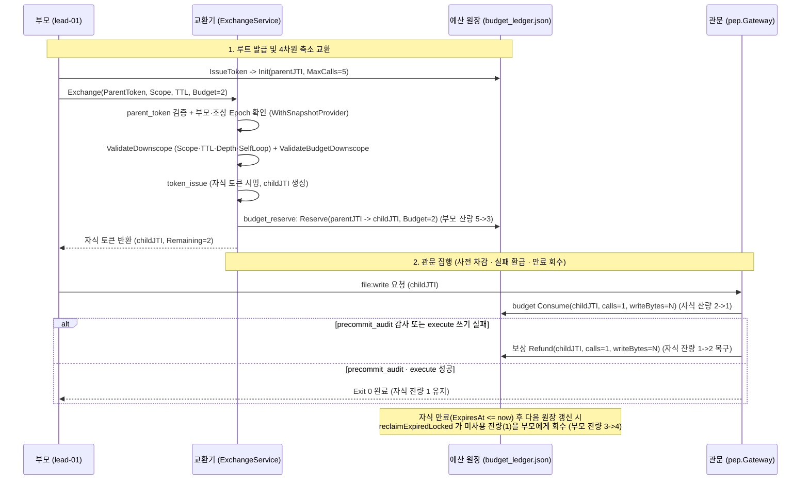

# 015. 4차원 단조 축소 위임(Monotonic Attenuation)과 예산 원장 불변식 — 자식 출입증은 왜 어떤 차원에서도 부모보다 커질 수 없나

> **모드**: `[문서작업]` — 소스코드 수정 없이 현재 구현된 4차원 단조 축소 위임(권한 범위 `Scope`, 수명 `TTL`, 위임 깊이 `Depth`·순환 금지 `Self-Loop`, 소비 예산 `Budget`), 교환 시점의 부모·조상 세대 번호(`Epoch`) 조기 검증(`WithSnapshotProvider`), 그리고 예산 원장(`budget_ledger.json`)의 예약(`Reserve`)·만료 회수(`reclaimExpiredLocked`)·사전/사후 차감(`Consume`)·실패 환급(`Refund`) 불변식의 실제 동작과 이유(Why)를 해설합니다.  
> **기준일**: 2026-11-06 · **기준 커밋**: `bf00fca` (이 문서가 설명하는 `cmd/`와 `internal/`을 마지막으로 바꾼 커밋)  
> **검증 범위**: 동작·순서·소유자·시점을 코드와 대조한 결과와 「미확인」은 5부 ③에 있습니다.  
> **이 문서는 구현된 것만 적는다.** 계획·제안·미래형 약속은 적지 않으며, 현재 코드가 하지 않는 것은 「지금은 없다」고만 씁니다.  
> **이 문서의 규칙**: 본문(0~4부, Q&A, 그림, 5부 ①)은 쉬운 개념·설계·이유가 중심입니다. 파일·타입 이름 같은 고유 이름은 첫 등장에 한마디 설명과 함께 쓰고, 구현의 어디인지는 문단 끝 `(구현: 파일 · 함수, 5부 ② 번호)` 귀띔으로 보조합니다. 기준은 [프로그램 설명서 README의 「설명의 기준」과 「이름의 3층」](README.md)입니다.  
> **겹치는 주제**: 열 단계 관문의 전체 흐름은 [001편](001-전체요청여정과_5단계관문.md)이, 토큰 서명·발급과 키 회전은 [002편](002-토큰발급_축소위임과_서명키회전.md)이, 다단계 위임(`act`)과 MCP 게이트웨이는 [004편](004-다단계위임과_MCP도구게이트웨이.md)이, 사람 승인과 도구 가드(`net:fetch`·`exec:run`)는 [005편](005-승인_예산과_도구확장.md)이, 권한 회수와 `Epoch`·`TOCTOU` 창은 [009편](009-권한회수_Epoch_시간과_TOCTOU창.md)이 자세히 다룹니다. 이 문서는 그중 **「위임 시 권한과 예산이 단조 감소(Monotonic Attenuation)하는 수학적·원장적 불변식」**을 한데 모아 교과서로 정리합니다.
>
> **다시 확인하는 법**
> ```bash
> git rev-parse --short HEAD
> git log -1 --format=%h -- cmd internal
> # 1. 4차원 단조 축소 위임(Scope, TTL, Depth, Self-Loop) 및 조상 Epoch 조기 거부 시험
> go test -v ./internal/authn/exchange -run "TestExchange|TestReExchange"
> # 2. 예산 도메인(Within) 및 예산 원장(Init, Reserve, Consume, Refund, 만료 회수) 단위 시험
> go test -v ./internal/domain -run "TestBudget"
> go test -v ./internal/authn/budget -run "Test"
> # 3. 관문(PEP)의 쓰기 사전 차감·감사 실패 시 환급·읽기 사후 차감 시험
> go test -v ./internal/authz/pep -run "TestBudget"
> # 4. G11 예산 축소 위임 시나리오 그룹 실행
> go run ./cmd/authz-harness run --group G11 --output-format explain
> # 5. 핵심 코드 위치 확인
> grep -n "func " internal/authn/exchange/validator.go internal/authn/exchange/service.go internal/domain/budget.go internal/authn/budget/ledger.go
> ```

---

## 💡 사용자의 질문 (원문 보존)

> 권한과 배선, 감사에서 교과서적인 코드를 작성하고 싶다. 교과서를 쓰고 싶다. mvp수준에서 기본기 탄탄한 프로그램 말이다.

> 나의 기본 철학에 비추어 더 추가할만한 구조나 구현, 개념, 실무에서 가장 원하는 기술 중에서 설명서로 만들만 한거 제안해줘.

> 추천으로 한다. 모두 진행해라

---

## 0. 모든 설계 이전에 ‘사람’이 있다 — 하위 일꾼에게 일을 맡길 때 왜 「내 출입증」을 그대로 주면 위험한가

총괄 에이전트(`lead-01`)가 하위 일꾼(`worker-01`)에게 파일 하나만 읽어 오라고 시킬 때, 총괄이 가진 만능 출입증을 그대로 복사해 건네주면 무슨 일이 벌어질까요?

- **권한 범위가 넓다**: 일꾼이 읽으라던 파일 말고 다른 설정 파일까지 읽거나 쓸 수 있습니다.
- **수명이 너무 길다**: 1분이면 끝날 일인데 1시간짜리 출입증을 주면, 남은 59분 동안 그 출입증이 탈취당했을 때 막기가 어렵습니다.
- **끝없이 재하청을 준다**: 일꾼이 또 다른 일꾼에게, 그 일꾼이 다시 자기 자신에게 출입증을 돌려가며 위임 사슬을 무한히 늘릴 수 있습니다.
- **예산을 다 써 버린다**: 총괄이 10번 호출할 수 있는 예산을 가지고 있는데, 하위 일꾼 하나가 10번을 다 써 버리거나 자기가 쪼개 준 자식들의 예산 합계가 원래 총괄 예산을 넘어설(Double-Spending) 수 있습니다.

그래서 이 프로그램은 부모가 자식에게 출입증을 쪼개 줄 때(`token exchange`), **어떤 차원에서도 자식이 부모보다 커질 수 없고 오직 같거나 작아지기만 하는 「4차원 단조 축소 위임(Monotonic Attenuation)」과 「예산 보존 법칙(Conservation of Budget)」**을 강제합니다.

---

## 1부. 왜 4차원 단조 축소와 원장 예약 방식을 택했나

### 가장 밑바닥의 이유부터

1. **왜 위임 조건을 한 가지(권한 범위)만 보지 않고 네 가지 차원으로 묶었나?** 권한 범위(`Scope`)만 줄여도 수명(`TTL`)이 부모보다 길면 부모가 죽은 뒤에도 자식이 살아남고, 위임 깊이(`Depth`)와 순환(`Self-Loop`)을 막지 않으면 위임 사슬이 끝없이 길어지며, 호출 횟수·바이트 한도(`Budget`)를 줄이지 않으면 하위 일꾼이 자원을 독점합니다. 네 차원이 동시에 줄어들어야만 하위 위임이 항상 부모의 안전 테두리 안에 갇힙니다(Q1).
2. **예산(`Budget`)은 왜 토큰 안에 남은 숫자를 적지 않고 별도 원장(`budget_ledger.json`)에 적나?** 토큰(JWT)은 한 번 발급되면 내용을 고칠 수 없는 종이 표와 같습니다. 토큰 안에만 `MaxCalls: 5`라고 적어 두면, 부모가 같은 부모 토큰으로 자식 A에게 5회, 자식 B에게 또 5회를 쪼개 주는 「이중 지불(예산 뻥튀기)」을 막을 방법이 없습니다. 그래서 토큰에는 **처음 부여받은 상한(`domain.Budget`)**만 적고, 실제로 남은 수량(`Remaining`)은 Zone B의 중앙 예산 원장(`budget.FileLedger`)에서 배타 잠금(`flock`)으로 깎아 나갑니다(Q3).
3. **자식에게 예산을 떼어 줄 때 왜 부모 잔량에서 미리 빼 두나(`Reserve`)?** 자식이 쓰는 그때그때 부모 잔량을 깎으면, 여러 자식이 동시에 달릴 때 부모 잔량을 놓고 경쟁하다가 약속받은 예산을 못 쓰게 됩니다. 반대로 교환 시점에 부모의 남은 예산에서 자식 몫을 미리 떼어 자식 전용 계좌로 옮겨 두면(`Reserve`), 부모와 자식들의 남은 예산 총합이 처음 루트 예산을 넘지 않으면서도 각 자식은 자기 몫 안에서 독립적으로 일할 수 있습니다(Q3).
4. **자식이 예산을 다 안 쓰고 만료되면 그 남은 예산은 날아가나?** 아닙니다. 원장이 갱신될 때마다 만료 시각(`ExpiresAt <= now`)이 지난 자식들을 **가장 깊은 손자부터 부모 쪽으로(Bottom-Up)** 정렬해, 미사용 잔량을 부모 계좌(`Remaining`, 단 부모의 `Initial` 상한 이내)로 자동 회수(`reclaimExpiredLocked`)합니다(Q4).
5. **파일을 쓰러 들어갔다가 감사 기록(`precommit_audit`)이나 디스크 쓰기(`execute`)가 실패하면 아까 깎은 예산은 어떻게 되나?** 관문(`pep.Gateway`)은 실행 전에 호출 1회와 쓰기 바이트를 먼저 차감(`budget`)하지만, 단계가 실패하면 파이프라인 엔진이 `budget` 단계의 보상(`gateway.refund`)을 불러 차감했던 호출 수와 바이트를 원장에 즉시 환급(`Refund`)합니다(Q5).

### 흔한 방식과 이 프로그램의 선택

| 구분 | 흔한 방식 (일반론) | 이 프로그램의 선택 (`authz-harness`) |
|---|---|---|
| **위임 시 권한 검증** | `Scope` 문자열 포함 여부만 검사하거나, 프리픽스(`file:read` → `file:read:a.txt`) 확장을 암묵적으로 허용한다 | 4차원(`Scope` 완전 일치 부분집합, `exp` 상한, `Depth <= 3` 및 `act` 순환 금지, `Budget.Within`)을 동시에 검증하고, 스냅샷 공급자가 배선되면 부모·조상의 `Epoch`까지 교환 시점에 즉시 대조한다 |
| **예산(Rate/Quota) 관리** | 주체(`sub`) 단위의 분당 호출 수(Rate Limit)만 세거나, 자식에게 위임할 때 부모 잔량을 차감하지 않는다 | 토큰(`jti`) 단위로 호출 수·읽기 바이트·쓰기 바이트 3종 예산을 두고, 위임 시 부모 잔량에서 자식 계좌로 원자적 예약(`Reserve`)하며 만료 시 깊은 자식부터 부모로 자동 회수(`reclaimExpiredLocked`)한다 |
| **실행 중 실패 시 예산 처리** | 호출이 들어오면 성공·실패와 무관하게 무조건 차감하거나, 실행이 끝난 뒤에야 사후 차감한다 | 호출 1회와 쓰기 바이트는 `budget`에서 사전 차감하되 `precommit_audit`·`execute` 실패 시 엔진의 보상 호출로 자동 환급(`Refund`)하고, 읽기·조회·명령의 출력 바이트는 크기를 알게 되는 `execute` 직후 `settle`에서 사후 차감(부족 시 데이터 미반환)한다 |

---

## 2부. 질문과 답변으로 풀어보는 핵심 동작 (Q&A)

### Q1. 4차원 단조 축소 위임(Monotonic Attenuation)의 네 가지 부등식은 무엇인가?

- **무슨 일이 일어나는가**: `exchange.DefaultDownscopeValidator.ValidateDownscope`와 `exchange.ValidateBudgetDownscope`는 부모 토큰 클레임(`parentClaims`)과 자식 요청을 대조해 다음 네 가지 단조 축소 불변식을 순서대로 검사합니다.

| 차원 | 수학적 불변식 | 위반 시 반환되는 `domain.Reason` (`ExitCode`) | 핵심 규칙 |
|---|---|---|---:|
| **① 권한 범위 (`Scope`)** | $\emptyset \neq S_{\text{child}} \subseteq S_{\text{parent}}$ | 빈 스코프: `DELEGATION_SCOPE_EMPTY` (`12`)<br/>범위 초과: `DELEGATION_SCOPE_EXCEEDED` (`12`) | 공백 분리 후 토큰 문자열 **완전 일치**만 허용 (프리픽스 확장 불허) |
| **② 수명 (`TTL` / `exp`)** | $\text{now} + \text{TTL}_{\text{child}} = \text{exp}_{\text{child}} \le \text{exp}_{\text{parent}}$ | `DELEGATION_TTL_EXCEEDED` (`12`) | 자식의 만료 시각은 부모의 남은 만료 시각을 넘을 수 없음 |
| **③ 위임 깊이·비순환 (`Depth` / `act`)** | $\text{depth}_{\text{parent}} + 1 \le 3$ 및 $\text{sub}_{\text{child}} \notin \{\text{sub}_{\text{parent}}\} \cup \text{act}$ | 깊이 초과: `DELEGATION_DEPTH_EXCEEDED` (`12`)<br/>순환 위임: `DELEGATION_SELF_LOOP` (`12`) | 최대 3단계까지만 위임 가능하며, 직전 부모나 조상(`act`)에 이미 등장한 주체로는 재위임 불가 |
| **④ 소비 예산 (`Budget`)** | $B_{\text{child}} \preceq B_{\text{parent}}$ (`child.Within(*parent)`) | `DELEGATION_BUDGET_EXCEEDED` (`12`) | 호출 횟수·읽기 바이트·쓰기 바이트 모두 부모 상한 이하여야 하며, 부모에 한도가 있는데 자식이 무제한(`0`)으로 격상하는 것도 거부 |

- **왜 교환(`Exchange`)에서는 `file:read` 부모로 `file:read:docs/a.txt` 자식을 만드는 것을 막았나 (`D-08`)**:
  - 관문(`authz`의 `domain.ScopeMatches`)에서는 2단 스코프(`file:read`)가 해당 액션의 모든 리소스를 포괄하지만, 토큰 교환(`ValidateDownscope`)에서는 문자열 집합의 **완전 일치 부분집합**만 허용합니다(`TestExchange_Deny_NoPrefixCoverage`). 처음 루트 토큰을 발급할 때부터 허용할 파일 목록(`file:read:docs/a.txt file:read:docs/b.txt`)을 명시적으로 나열하게 유도하고, 교환 단계에서는 그 목록에서 항목을 덜어내는(Subset) 연산만 수행해 경로 정규화 해석 차이로 인한 권한 확장을 막기 위해서입니다. (구현: [`validator.go`](../../internal/authn/exchange/validator.go) · `MaxDelegationDepth`, `DownscopeValidator`, `DefaultDownscopeValidator`, `ParseScopes`, `DefaultDownscopeValidator.ValidateDownscope`, `ValidateBudgetDownscope`, [`domain/budget.go`](../../internal/domain/budget.go) · `Budget`, `Budget.Validate`, `Budget.HasReadLimit`, `Budget.HasWriteLimit`, `Budget.Within`, 5부 ② 1·2번)
- **근거**: 5부 ② 항목 1, 2번

### Q2. 교환 시점에 부모나 조상의 세대 번호(`Epoch`)가 이미 취소되었으면 어떻게 되나? (`WithSnapshotProvider`)

- **무슨 일이 일어나는가**:
  1. `exchange.ExchangeService`는 선택 옵션인 `exchange.WithSnapshotProvider(sp domain.SnapshotProvider)`를 지원하며, 합성 루트 조립기(`app.BuildStack`)는 `pip.Service`가 준비된 경우 자동으로 `exchange.WithSnapshotProvider(pipSvc)`를 주입합니다.
  2. `ExchangeService.Exchange`는 부모 토큰의 서명과 만료 시각을 검증하는 `parent_token` 단계 바로 다음의 `lineage_epoch` 단계에서, `snapshots`가 주입되어 있으면 `GetSubjectSnapshot(ctx, parentClaims.Subject)`를 호출해 중앙 장부(`grants_state.json`)의 최신 세대 번호를 읽습니다.
  3. **직계 부모의 세대 번호(`parentClaims.Epoch != snap.CurrentEpoch`)**가 장부와 다르거나, **위임 사슬(`parentClaims.Actor`)을 따라 올라간 조상 중 한 명이라도 장부의 세대 번호(`snap.SubjectEpochs.Get(a.Subject) != a.Epoch`)와 다르면**, 자식 토큰을 발급하지 않고 그 자리에서 `ReasonSubjectEpochRevoked`(종료 코드 `12`)로 거부하며 감사 장부에 `token.exchange.deny`를 남깁니다(`TestExchange_WithSnapshotProvider_EarlyEpochRejection`).
  4. 설령 단위 테스트 등에서 `WithSnapshotProvider` 없이 `ExchangeService`만 단독 생성해 교환이 통과하더라도, 발급된 자식 토큰이 실제 관문(`pep.Gateway`)의 `authz`에 도착하면 `pdp.Evaluate`가 본인과 `act` 사슬 전체의 `Epoch`를 다시 검사하므로 이중으로 방어(Defense-in-Depth)됩니다([009편](009-권한회수_Epoch_시간과_TOCTOU창.md) Q3). (구현: [`exchange/service.go`](../../internal/authn/exchange/service.go) · `Option`, `WithSnapshotProvider`, `ExchangeService.Exchange`, [`app/builder.go`](../../internal/app/builder.go) · `BuildStack`, [`reexchange_test.go`](../../internal/authn/exchange/reexchange_test.go) · `TestExchange_WithSnapshotProvider_EarlyEpochRejection`, 5부 ② 3·4번)
- **근거**: 5부 ② 항목 3, 4번

### Q3. 예산 원장(`budget_ledger.json`)은 어떻게 부모 예산을 자식에게 예약(`Reserve`)해 주나?

- **무슨 일이 일어나는가**:
  1. **루트 토큰 발급 (`token.Service.IssueToken` → `Ledger.Init`)**:
     - 예산(`IssueRequest.Budget`)이 지정된 루트 토큰을 발급할 때는 서명을 마친 뒤 감사 기록 전에 `budgetLedger.Init(claims.JWTID, *req.Budget, claims.ExpiresAt)`를 호출합니다.
     - `FileLedger.Init`는 `budget_ledger.json`을 배타 잠금(`storage.AtomicFileStore.Update`)으로 열고, `Initial`과 `Remaining`이 모두 초기 예산 `b`인 루트 엔트리(`ParentJTI: ""`)를 등록합니다.
  2. **자식 토큰 교환 (`ExchangeService.Exchange` → `Ledger.Reserve`)**:
     - 부모 토큰이 예산을 가지고 있으면 자식도 반드시 그 이하의 예산을 요청해야 합니다(`ValidateBudgetDownscope`).
     - 정적 상한 검사를 통과하고 자식 토큰을 서명(`token_issue` 단계)하면, 마지막 `budget_reserve` 단계가 `budgetLedger.Reserve(parentClaims.JWTID, childJTI, *req.Budget, childExp)`를 호출합니다.
     - `FileLedger.Reserve`는 배타 잠금 안에서 먼저 만료된 다른 자식들의 예산을 회수(`reclaimExpiredLocked`)한 뒤, **부모의 현재 잔량(`parent.Remaining`)이 자식이 요청한 예산(`req`) 이상인지** 동적으로 확인합니다.
     - 충분하면 부모의 `Remaining`에서 `req`만큼 즉시 차감하고, 자식 `childJTI` 이름으로 새 엔트리(`ParentJTI: parentJTI, Initial: req, Remaining: req, ExpiresAt: childExp`)를 생성합니다. 부족하면 아무것도 바꾸지 않고 `ReasonDelegationBudgetExceeded`(`12`)를 돌려줍니다.
     - 따라서 어느 시점에나 **「부모의 남은 예산 + 살아 있는 자식들의 남은 예산 + 이미 소비된 예산 = 루트 초기 예산」**이라는 예산 보존 법칙이 깨지지 않습니다. (구현: [`token/issuer.go`](../../internal/authn/token/issuer.go) · `WithBudgetLedger`, `Service.IssueToken`, [`exchange/service.go`](../../internal/authn/exchange/service.go) · `WithBudgetLedger`, `ExchangeService.Exchange`, [`authn/budget/ledger.go`](../../internal/authn/budget/ledger.go) · `Entry`, `LedgerState`, `Ledger`, `FileLedger`, `FileLedger.Init`, `FileLedger.Reserve`, 5부 ② 2·3·5·6번)
- **근거**: 5부 ② 항목 2, 3, 5, 6번

### Q4. 자식이 예산을 다 안 쓰고 만료되면 어떻게 부모에게 돌아오나? (`reclaimExpiredLocked`)

- **무슨 일이 일어나는가**:
  1. `FileLedger`의 모든 상태 변경 메서드(`Init`, `Reserve`, `Consume`, `Refund`)는 내부 헬퍼 `FileLedger.update`를 통해 실행되며, `update`는 사용자 함수를 실행하기 직전에 항상 `reclaimExpiredLocked(st, l.clock.Now().Unix())`를 먼저 호출합니다.
  2. `reclaimExpiredLocked`는 원장에 있는 모든 엔트리 중 부모가 있고(`ParentJTI != ""`), 아직 회수되지 않았으며(`!Reclaimed`), 만료 시각이 현재 시각 이하(`ExpiresAt <= nowUnix`)인 엔트리를 모두 찾습니다.
  3. **왜 깊은 손자부터(`depth` 내림차순) 정렬해서 회수하나**:
     - 만약 1단계 자식(`mid-01`)과 2단계 손자(`worker-01`)가 동시에 만료되었는데 1단계 자식을 먼저 루트(`lead-01`)로 회수해 버리면, 직후에 2단계 손자가 1단계 자식에게 돌려준 미사용분이 이미 회수 끝난 1단계 자식 계좌에 갇혀 루트까지 올라가지 못합니다.
     - 그래서 `depthOf(st, jti)`로 위임 깊이를 계산해 **가장 깊은 손자(Depth 3 → 2 → 1) 순서로 정렬**한 뒤, 자식의 `Remaining`을 부모의 `Remaining`(`Initial` 상한 이내)에 더하고 자식의 `Remaining`은 `0`, `Reclaimed`는 `true`로 표시합니다.
  4. 한 번 `Reclaimed: true`가 된 자식 토큰으로는 이후에 `Consume`이나 `Refund`를 호출해도 각각 소진 거부(`ReasonBudgetExhausted`) 및 무시(No-op) 처리되어 이중 계상이 일어나지 않습니다. (구현: [`authn/budget/ledger.go`](../../internal/authn/budget/ledger.go) · `FileLedger.update`, `reclaimExpiredLocked`, `depthOf`, 5부 ② 6번)
- **근거**: 5부 ② 항목 6번

### Q5. 관문(`pep.Gateway`)에서는 왜 호출 1회와 쓰기 바이트는 먼저 깎고(`budget`), 읽은 바이트는 나중(`settle`)에 깎으며, 실패하면 어떻게 환급(`Refund`)하나?

- **무슨 일이 일어나는가**:
  1. **1회성 재생 방지(`replay`)와의 관계**: 예산이 없는 일반 토큰은 1회용이어서 `replay`에서 `jti`가 즉시 소멸하지만, 예산이 있는 토큰(`claims.Budget != nil`)은 `Verifier.ConsumeReplay`가 그냥 통과시켜 예산이 남는 동안 여러 번 호출할 수 있게 합니다.
  2. **호출 1회와 쓰기 바이트 — 사전 차감(`budget`)**:
     - 예산 토큰이면 모든 행동이 `budget` 단계에서 `BudgetLedger.Consume(tokenJTI, 1, 0, n)`을 불러 **호출 1회를 먼저 차감**합니다. 쓰기(`file:write`)와 명령 실행(`exec:run`)은 입력 데이터 길이(`len(req.Data)`)를 미리 알고 있고 실제 부작용을 일으키므로 이 `n`에 **쓰기 바이트도 함께** 담습니다(읽기·조회는 `n = 0`). 이 단계는 `precommit_audit`와 `execute`에 들어가기 전입니다.
     - 만약 뒤이은 `precommit_audit` 사전 감사나 `execute` 파일 쓰기가 실패하면, 파이프라인 엔진이 이미 끝낸 단계의 보상을 거꾸로 부릅니다. `budget` 단계의 보상인 `g.refund`가 `state.consumed == true`를 확인하고 `BudgetLedger.Refund(tokenJTI, 1, 0, refundWriteBytes)`를 호출해 차감했던 예산을 원상 복구합니다.
     - 단, `exec:run`은 자식 명령 실행(`ExecRunner.Run`)이 일단 시작되면 외부 부작용이 이미 발생했을 수 있으므로 `execute` 단계 시작에서 `state.consumed = false`로 내려 실패하더라도 환급하지 않습니다(보수적 차감). 이 차이는 도구 전략의 `BudgetPlan.RefundAfterStart`(`exec:run`만 `false`)가 정합니다.
  3. **읽기·조회·명령의 출력 바이트 — 사후 정산(`settle`)**:
     - 파일 읽기나 웹 조회, 명령의 출력은 실제로 실행해 보기 전에는 몇 바이트인지 알 수 없습니다(`BudgetPlan.PostCharge`).
     - 따라서 `execute` 직후 `settle` 단계가 호출자에게 데이터를 돌려주기 전에 `BudgetLedger.Consume(tokenJTI, 0, len(data), 0)`를 호출합니다. 만약 읽기 바이트 한도를 초과해 `Consume`이 실패하면 읽은 데이터(`res.Data`)를 결과에 담지 않고 버린 채 `ReasonBudgetExhausted`(`12`)로 거부합니다. 이때 읽기·조회는 앞서 깎은 호출 1회분을 엔진의 보상으로 돌려받고, 이미 실행된 `exec:run`은 돌려받지 못합니다. (구현: [`gateway.go`](../../internal/authz/pep/gateway.go) · `gateway.budget`, `gateway.settle`, `gateway.refund`, `pipelineState`, [`tool.go`](../../internal/authz/pep/tool.go) · `BudgetPlan`, [`token/verifier.go`](../../internal/authn/token/verifier.go) · `Verifier.ConsumeReplay`, 5부 ② 5·6·7번)
- **근거**: 5부 ② 항목 5, 6, 7번

---

## 3부. 내부 지도 — 4차원 단조 축소와 예산 생애주기



교환 시점에는 4차원 정적 검증과 원장 예약(`Reserve`)이 일체로 작동하고, 관문 실행 시점에는 사전 차감·실패 환급(`Refund`)과 만료 시 역순 회수(`reclaimExpiredLocked`)가 예산 보존 법칙을 지킵니다. (구현: `exchange/validator.go` · `DefaultDownscopeValidator.ValidateDownscope`, `ValidateBudgetDownscope`, `exchange/service.go` · `ExchangeService.Exchange`, `authn/budget/ledger.go` · `FileLedger.Init`, `FileLedger.Reserve`, `FileLedger.Consume`, `FileLedger.Refund`, `reclaimExpiredLocked`, `pep/gateway.go` · `gateway.budget`·`gateway.settle`·`gateway.refund`, 5부 ② 2·3·6·7번)

### 어디에 무엇이 남나

| 무엇 | 어디에 | 언제 | 사람이 직접 확인하는 법 |
|---|---|---|---|
| **토큰에 적힌 위임 상한과 계보** | JWT 페이로드 (`scope`, `exp`, `delegation_depth`, `act`, `budget`) | `token issue`, `token exchange` 실행 시 | [002편](002-토큰발급_축소위임과_서명키회전.md) / `go test -v ./internal/authn/exchange` |
| **토큰별 초기 예산·잔여 예산·회수 여부** | Zone B `.authz-state/public/budget_ledger.json` | `Init`, `Reserve`, `Consume`, `Refund` 호출 시마다 원자적 갱신 | `cat .authz-state/public/budget_ledger.json` |
| **교환 성공·거부 감사 증거** | `audit.jsonl` (`token.exchanged`, `token.exchange.deny`) | `ExchangeService.Exchange` 성공·거부 시 | `cat audit.jsonl` |
| **예산 소진으로 인한 관문 차단 감사 증거** | `audit.jsonl` (`pep.deny`, `reason: "BUDGET_EXHAUSTED"`) | `budget` 또는 `settle`에서 `BudgetLedger.Consume` 실패 시 | `go run ./cmd/authz-harness run --group G11 --output-format explain` |

### 이상이 생기면

| 상황 | 일어나는 일 |
|---|---|
| 자식이 부모에 없는 스코프를 요청하거나 빈 스코프를 요청한다 | `ValidateDownscope`가 `DELEGATION_SCOPE_EXCEEDED` 또는 `DELEGATION_SCOPE_EMPTY`(종료 코드 `12`)로 거부한다 |
| 자식의 만료 시각(`now + TTL`)이 부모의 `ExpiresAt`을 넘는다 | `ValidateDownscope`가 `DELEGATION_TTL_EXCEEDED`(종료 코드 `12`)로 거부한다 |
| 위임 깊이가 `3`(`MaxDelegationDepth`)을 넘거나, 부모·조상(`act`)에 이미 있던 주체로 다시 위임한다 | `ValidateDownscope`가 `DELEGATION_DEPTH_EXCEEDED` 또는 `DELEGATION_SELF_LOOP`(종료 코드 `12`)로 거부한다 |
| 부모나 조상의 `Epoch`가 장부에서 올라간(`BumpEpoch`) 뒤 그 토큰으로 교환(`Exchange`)을 시도한다 | `WithSnapshotProvider`가 배선된 `ExchangeService`가 `lineage_epoch` 단계에서 `SUBJECT_EPOCH_REVOKED`(종료 코드 `12`)로 즉시 거부한다 |
| 부모에 읽기·쓰기 바이트 한도가 있는데 자식이 `0`(무제한)으로 요청하거나 부모 잔량보다 큰 예산을 요청한다 | `ValidateBudgetDownscope` 또는 `FileLedger.Reserve`가 `DELEGATION_BUDGET_EXCEEDED`(종료 코드 `12`)로 거부한다 |
| 자식 토큰 서명(`token_issue`)이 실패한다 | 예약(`budget_reserve`) 전이라 장부는 바뀌지 않고, 거부 감사(`token.exchange.deny`)를 남기며 자식 토큰은 돌려주지 않는다 |
| 서명은 됐는데 예약(`budget_reserve`)이 거부된다(부모 잔량 부족, 부모 엔트리 없음) | 장부에 자식 엔트리가 생기지 않고, 거부 감사를 남기며, 이미 서명된 자식 토큰은 호출자에게 돌려주지 않는다. 다만 발급 단계(`IssueToken`)의 발급 감사는 서명 직후 이미 기록된 뒤다 |
| 예약까지 마친 뒤 성공 감사(`token.exchanged`) 기록이 실패한다 | `AUDIT_LOG_FAILED`로 거부하고 토큰을 돌려주지 않는다. 이미 예약한 자식 예산을 되돌리는 보상은 두지 않으므로(교환은 `Compensate`를 쓰지 않음), 만료 시각이 지난 뒤 부모에게 자동 회수(`reclaimExpiredLocked`)된다 |
| 파일 쓰기 요청이 `budget`에서 예산을 깎은 뒤 `precommit_audit` 감사 실패나 `execute` 쓰기 실패를 겪는다 | 파이프라인 엔진이 `budget` 단계의 보상 `refund`를 불러 차감했던 호출 1회와 쓰기 바이트를 즉시 환급(`Refund`)한다 |

---

## 4부. 배척한 방식과 그 이유

1. **토큰 페이로드 안에만 예산을 적고 중앙 예산 원장(`budget_ledger.json`)을 두지 않는 방식**:
   - **택했다면 무슨 일이 생기는가**: 서명된 토큰은 상태를 바꿀 수 없으므로, 같은 토큰으로 몇 번을 호출했는지 추적할 수 없고 부모가 여러 자식에게 원래 예산보다 많은 예산을 중복해서 나눠 주는(Double-Spending) 것을 막을 수 없습니다.
   - **그 대신 포기한 것**: 토큰에는 불변 상한(`domain.Budget`)만 적고, 실제 잔량은 Zone B의 `budget_ledger.json`(`storage.AtomicFileStore[LedgerState]`)에서 `flock` 배타 잠금으로 관리합니다.
2. **자식이 호출할 때마다 부모 계좌를 실시간으로 거슬러 올라가 차감하는 방식**:
   - **택했다면 무슨 일이 생기는가**: 호출마다 위임 사슬 깊이에 비례해 여러 엔트리를 수정해야 하고, 형제 에이전트들이 동시에 실행될 때 한 자식이 부모 잔량을 다 써 버려 다른 자식이 약속받은 예산을 쓰지 못합니다.
   - **그 대신 포기한 것**: 교환 시점에 `FileLedger.Reserve`로 부모 잔량에서 자식 몫을 미리 떼어 내고, 자식이 만료되면 `reclaimExpiredLocked`가 깊은 손자부터 역순으로 미사용분을 부모에게 돌려줍니다.
3. **바이트 한도 `0`("한도 없음")을 숫자 크기 비교(`0 <= parent.MaxReadBytes`)로만 단순 처리하는 방식**:
   - **택했다면 무슨 일이 생기는가**: `0`은 "0바이트 허용"이 아니라 "한도 없음(무제한)"을 뜻하므로, 단순 숫자 비교(`0 <= 1024`)를 쓰면 부모의 1024바이트 한도를 자식이 `0`(무제한)으로 격상하는 우회가 뚫립니다.
   - **그 대신 포기한 것**: `Budget.Within`과 `FileLedger.Reserve`는 `upper.HasReadLimit()`이 참일 때 하위도 반드시 `HasReadLimit()`(`> 0`)이어야 하며 값도 작거나 같아야만 통과시킵니다(`TestBudget_Within/읽기_한도_격상`).

---

## 5부. 한눈에 보는 대조표와 코드 정본

### ① 행동별 안에서 일어나는 일과 지금은 없는 것

| 행동 | 안에서 일어나는 일 | 지금은 없는 것 | 근거 |
|---|---|---|---|
| **4차원 정적 축소 검증 (`ValidateDownscope` / `ValidateBudgetDownscope`)** | `Scope` 완전 일치 부분집합, `childExp <= parentExp`, `Depth <= 3`, `act` 사슬 순환 금지, `childBudget.Within(parentBudget)`을 검사한다. | 교환 시점에 와일드카드(`*`)나 프리픽스(`file:read` → `file:read:a.txt`) 확장을 허용하는 기능은 없다. | 5부 ② 1, 2번 |
| **교환 시점 부모·조상 `Epoch` 검증 (`WithSnapshotProvider`)** | `ExchangeService`의 `lineage_epoch` 단계에서 `SnapshotProvider.GetSubjectSnapshot`으로 직계 부모와 모든 `act` 조상의 `Epoch`를 장부와 동등 비교해 다르면 `SUBJECT_EPOCH_REVOKED`(`12`)로 거부한다. | `SnapshotProvider`가 주입되지 않은 단독 `ExchangeService`에서는 교환 시점 `Epoch` 조회를 건너뛴다(`authz`에서 차단). | 5부 ② 3, 4번 |
| **예산 초기화·예약·회수 (`Init` / `Reserve` / `reclaimExpiredLocked`)** | 루트 발급 시 `Init`로 등록하고, 교환 시 `Reserve`로 부모 잔량에서 자식 몫을 떼어 주며, 갱신 시마다 만료된 자식을 깊은 순서대로 정렬해 부모에게 미사용분을 돌려준다. | 루트 토큰에는 예산이 없는데 자식 교환에서 새로 예산을 만들어 붙이는 기능은 없다(`DELEGATION_BUDGET_EXCEEDED`로 거부). | 5부 ② 2, 3, 5, 6번 |
| **관문 예산 차감과 환급 (`budget` / `settle` / `Refund`)** | 호출 1회(쓰기·명령은 쓰기 바이트도)는 `budget`에서 사전 차감 후 `budget.consumed` 감사 기록을 남기고, 하위 단계 실패 시 엔진의 보상으로 `Refund`하며(`exec:run` 실행 진입 후는 제외), 이 기록이 실패하면 `budget` 단계가 직접 `Refund`한 뒤 감사 실패(`15`)로 멈추고, 읽기·조회·명령의 출력 바이트는 `settle`에서 읽은 바이트만큼 사후 차감한다. | 이미 `ExecRunner.Run`에 진입해 외부 프로세스가 실행된 뒤 실패한 `exec:run` 호출의 예산을 되돌려 주는 기능은 없다. | 5부 ② 6, 7번 |

### ② 어디서 하나 (코드 정본 색인)

1. **예산 도메인 모델 (`internal/domain`)**:
   - [`internal/domain/budget.go`](../../internal/domain/budget.go) (`Budget`, `Budget.Validate`, `Budget.HasReadLimit`, `Budget.HasWriteLimit`, `Budget.Within`)
   - [`internal/domain/budget_test.go`](../../internal/domain/budget_test.go) (`TestBudget_Validate_Invalid`, `TestBudget_Limits`, `TestBudget_ReasonExitCodes`, `TestBudget_Within`, `TestBudget_ClaimsValidate`)
2. **4차원 단조 축소 검증기 (`internal/authn/exchange`)**:
   - [`internal/authn/exchange/validator.go`](../../internal/authn/exchange/validator.go) (`MaxDelegationDepth`, `ErrScopeEmpty`, `ErrScopeExceeded`, `ErrTTLExceeded`, `ErrDepthExceeded`, `ErrSelfLoop`, `DownscopeValidator`, `DefaultDownscopeValidator`, `NewDownscopeValidator`, `ParseScopes`, `DefaultDownscopeValidator.ValidateDownscope`, `ValidateBudgetDownscope`)
3. **토큰 교환 서비스와 조기 `Epoch` 검증 (`internal/authn/exchange`)**:
   - [`internal/authn/exchange/service.go`](../../internal/authn/exchange/service.go) (`ExchangeRequest`, `ExchangeResult`, `Service`, `ExchangeService`, `Option`, `WithBudgetLedger`, `WithSnapshotProvider`, `NewExchangeService`, `ExchangeService.Exchange`, `ExchangeService.assemble`, `ExchangeService.finalize`)
   - [`internal/authn/exchange/reexchange_test.go`](../../internal/authn/exchange/reexchange_test.go) (`TestReExchange_EpochSeparation`, `TestReExchange_Lifecycle`, `TestExchange_WithSnapshotProvider_EarlyEpochRejection`)
   - [`internal/authn/exchange/budget_exchange_test.go`](../../internal/authn/exchange/budget_exchange_test.go)
4. **합성 루트 배선 (`internal/app`)**:
   - [`internal/app/builder.go`](../../internal/app/builder.go) (`AppConfig`, `AppStack`, `BuildStack`)
5. **루트 토큰 발급과 재사용 원장 (`internal/authn/token`)**:
   - [`internal/authn/token/issuer.go`](../../internal/authn/token/issuer.go) (`IssueRequest`, `ServiceOption`, `WithBudgetLedger`, `Service.IssueToken`)
   - [`internal/authn/token/verifier.go`](../../internal/authn/token/verifier.go) (`Verifier.VerifyToken`, `Verifier.ConsumeReplay`)
6. **Zone B 예산 원장 (`internal/authn/budget`)**:
   - [`internal/authn/budget/ledger.go`](../../internal/authn/budget/ledger.go) (`Entry`, `LedgerState`, `Ledger`, `FileLedger`, `NewFileLedger`, `FileLedger.update`, `classify`, `FileLedger.Init`, `FileLedger.Reserve`, `FileLedger.Consume`, `FileLedger.Refund`, `FileLedger.Get`, `reclaimExpiredLocked`, `depthOf`, `minInt64`)
   - [`internal/authn/budget/ledger_test.go`](../../internal/authn/budget/ledger_test.go)
7. **관문 예산 집행과 시나리오 카탈로그 (`internal/authz/pep`, `internal/harness/catalog`)**:
   - [`internal/authz/pep/gateway.go`](../../internal/authz/pep/gateway.go) (`gateway.budget`, `gateway.settle`, `gateway.refund`, `pipelineState`, `pep.BudgetPlan`)
   - [`internal/authz/pep/budget_test.go`](../../internal/authz/pep/budget_test.go)
   - [`internal/harness/catalog/g11_budget_downscope.go`](../../internal/harness/catalog/g11_budget_downscope.go)

### ③ 검증 범위와 「미확인」

- **확인한 것**:
  - `ValidateDownscope`와 `ValidateBudgetDownscope`가 4차원 단조 축소 불변식을 검증하고, `app.BuildStack`이 `exchange.WithSnapshotProvider(pipSvc)`를 연결해 부모·조상의 `Epoch` 불일치를 교환 시점(`lineage_epoch` 단계)에 즉시 차단함을 코드와 단위 테스트로 확인했습니다.
  - `FileLedger`가 `reclaimExpiredLocked`에서 깊이(`depthOf`) 내림차순으로 만료 자식의 미사용 예산을 부모에게 회수하고, `pep.Gateway`가 쓰기 사전 차감 뒤 단계가 실패하면 파이프라인 엔진이 부르는 `budget` 단계의 보상(`gateway.refund`)으로 `Refund`함을 확인했습니다.
  - 2026-11-06 재대조: 교환이 파이프라인 위로 옮겨진 뒤의 순서(서명 `token_issue` 다음에 `budget_reserve`), 거부 감사의 단일 기록 지점(`finalize`), 관문 환급이 `defer`가 아니라 단계 보상이라는 점을 `exchange/service.go`·`gateway.go`·`pipeline.go`를 읽어 반영했고, 식별자 일괄 대조에서 낡은 이름 3곳(`logDenyAndWrap`, `StackConfig`, `Stack`)을 고쳤습니다. 서명 직후 예약이 거부될 때 발급 감사가 남는다는 서술은 코드(`IssueToken`의 감사 위치)로만 확인했고 시험으로 재현하지는 않았습니다.
  - 2026-11-06 재검증([계획 016](../계획/016-설명서_본편_재대조_및_DEMO_GUIDE_재검증.md), 기준 코드 커밋 `64ae8db`): 본문의 식별자·링크(`logDenyAndWrap`·`StackConfig`는 낡은 이름 정정으로 언급된 것), 머리의 시험 명령(`exchange`·`budget`·`domain TestBudget`·`pep TestBudget`)과 `grep -n "func "` 대상 파일 4개 실재를 다시 확인했습니다. 위 확인으로 본문에서 고친 곳은 없습니다. 확인하지 못한 범위: 「왜」 서술, 불변식 증명 서술은 줄 단위로 읽지 않았습니다.
- **미확인**:
  - 만료되어 `Reclaimed: true`가 된 자식 엔트리들을 `budget_ledger.json` 맵에서 영구 삭제(GC/Compaction)하는 주기적 정리 정책은 현재 코드에 없으며, 왜 엔트리를 계속 보존하는지는 감사·추적 목적 외에 별도 문서를 확인하지 못했습니다.
