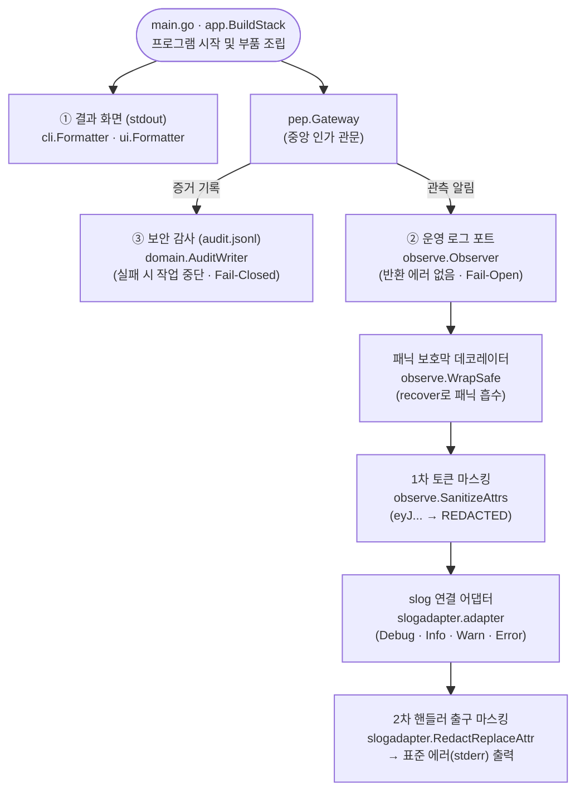
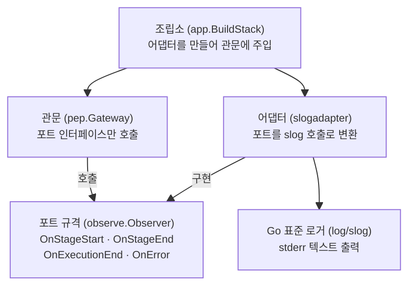
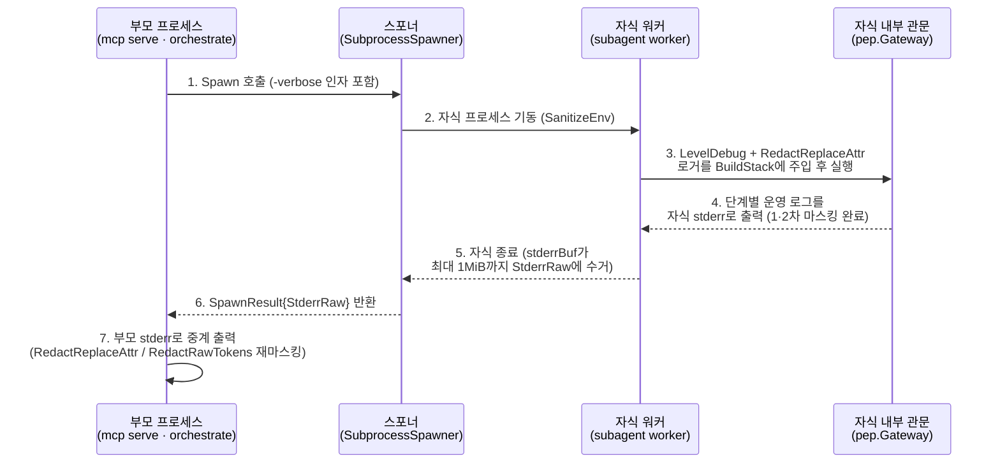

# 017. 운영 로그 처리 구현과 작동 방식 [쉽게 풀어쓴 해설서] — 포트·어댑터 분리, 단계 계측 훅, WrapSafe 고장 격리, 그리고 토큰 마스킹

> **이 문서의 역할**: 이 프로그램(`authz-harness`)이 운영 로그(`stderr`)를 어떻게 남기는지—특히 **① 포트·어댑터 패턴(`observe.Observer`와 `slogadapter`), ② 옛 단계 감싸개 함수를 대체한 파이프라인 엔진(`pipeline.Engine`)과 단계 계측 훅(`pep.stageHook`), ③ 로거 고장을 막아 주는 보호막(`observe.WrapSafe`), ④ 살아 있는 토큰을 가리는 이중 마스킹(`observe.SanitizeAttrs` · `slogadapter.RedactReplaceAttr`)**—을 구조 다이어그램과 순서도를 곁들여 쉬운 말로 풀어쓴 해설서입니다.  
> **작성 기준**: [프로그램 설명서 README](README.md)의 「설명의 기준」, 「이름의 3층」, 「Mermaid 그림 규칙」, 「텍스트 도표 5종」을 따릅니다.

---

## 0. 모든 설계 이전에 ‘사람’이 있다 — 그냥 로그 한 줄 찍으면 되는데, 왜 부품을 나누어 만들었나

프로그램이 돌아갈 때 개발자나 운영자는 지금 요청이 어느 단계를 지나고 있는지, 시간은 얼마나 걸렸는지(`duration_ms`), 막혔다면 어떤 사유(`domain.Reason`)로 막혔는지 화면(`stderr`)으로 보고 싶어 합니다.

가장 단순한 방법은 관문(`pep.Gateway`) 코드 여기저기에 Go 기본 로그 함수(`slog.Info`)를 직접 적어 넣는 것입니다. 하지만 그렇게 짜면 네 가지 문제가 생깁니다.

1. **로그 도구를 바꾸기 어렵다**: 관문 코드 곳곳에 특정 로거(`log/slog`)가 직접 적혀 있으면, 나중에 다른 로그 도구로 바꿀 때 보안 판정 코드를 전부 고쳐야 합니다.
2. **검사 코드와 로그 코드가 뒤섞인다**: 열 개나 되는 관문 단계(`input` ~ `settle`)마다 시작 시각을 재고 끝날 때 걸린 시간을 계산해 로그를 찍는 코드를 매번 넣으면, 정작 중요한 권한 검사 코드가 눈에 잘 들어오지 않습니다.
3. **로거 오류가 보안 관문까지 멈추게 한다**: 운영 로그는 사람이 참고하려고 보는 기록일 뿐입니다. 그런데 로거 안에서 오류나 패닉(`panic`)이 났다고 해서 멀쩡히 처리되어야 할 파일 읽기·쓰기까지 멈추면 안 됩니다.
4. **로그에 비밀 출입증(원시 토큰)이 그대로 찍힌다**: 에러 메시지나 디버그 정보 안에 사용자가 보낸 출입증 원문(`eyJ...`)이 섞여 있을 때 이를 그대로 화면에 찍으면, 로그를 본 사람이 그 출입증을 복사해 권한을 도용할 수 있습니다.

이 해설서는 위 네 가지 문제를 해결하기 위해 현재 코드가 사용하는 네 가지 구현 방식을 구조 그림과 순서도로 하나씩 펼쳐 보입니다.

---

## 1부. 운영 로그를 지탱하는 4가지 핵심 구조와 원리 (끝까지 되묻는 Why)

### 1. 한눈에 보는 전체 구조 다이어그램 — 3중 출력 분리와 운영 로그 배선도

먼저 프로그램 시작점(`main.go`, `app.BuildStack`)에서 관문(`pep.Gateway`)을 거쳐 화면(`stderr`)과 감사 파일(`audit.jsonl`)로 글자가 나가는 전체 구조를 그림으로 봅니다.

**그림 1. 3중 출력 분리 및 포트(`observe.Observer`) · 보호막(`WrapSafe`) · 어댑터(`slogadapter`) 구조도**



(구현: [`main.go`](../../cmd/authz-harness/main.go) · `main`, [`builder.go`](../../internal/app/builder.go) · `BuildStack`, [`observe/port.go`](../../internal/observe/port.go) · `Observer`, `WrapSafe`, `SanitizeAttrs`, [`slogadapter/adapter.go`](../../internal/observe/slogadapter/adapter.go) · `New`, [`slogadapter/redact.go`](../../internal/observe/slogadapter/redact.go) · `RedactReplaceAttr`)

- **왜 보안 감사(`audit.jsonl`)와 운영 로그(`stderr`)를 한 로거에 합치지 않고 아예 따로 만들었나?**
  - **기록에 실패했을 때 해야 하는 행동이 정반대이기 때문입니다.**
  - 보안 감사(`domain.AuditWriter`)는 증거가 남지 않으면 파일 작업도 해서는 안 됩니다(`Fail-Closed`). 그래서 기록 함수(`Log(event) error`)가 에러(`error`)를 돌려주면 즉시 작업을 멈추고 감사 실패 종료 코드(`ExitAuditFailure`, `15`)로 끝납니다.
  - 반대로 운영 로그(`observe.Observer`)는 화면 표시가 고장 나더라도 본래의 권한 판정과 파일 작업은 그대로 진행되어야 합니다(`Fail-Open`). 그래서 운영 로그 함수들은 아예 에러를 돌려주지 않게(반환값 없음) 만들어져 있습니다. (구현: [`domain/audit.go`](../../internal/domain/audit.go) · `AuditWriter`, [`observe/port.go`](../../internal/observe/port.go) · `Observer`)

---

### 2. 왜 관문(`pep.Gateway`)은 로거(`slog`)를 직접 부르지 않고 포트(`observe.Observer`)와 어댑터(`slogadapter`)로 나누었나?

**그림 2. 포트(`internal/observe`)와 어댑터(`internal/observe/slogadapter`)의 의존 방향 다이어그램**



(구현: [`observe/port.go`](../../internal/observe/port.go) · `Observer`, [`slogadapter/adapter.go`](../../internal/observe/slogadapter/adapter.go) · `New`, [`builder.go`](../../internal/app/builder.go) · `BuildStack`)

- **화살표 방향이 왜 중요한가?**
  - 위 **그림 2**에서 보듯, 관문(`pep.Gateway`)에서 나가는 화살표는 오직 포트 규격(`observe.Observer`)만 가리키고, `slogadapter`나 `log/slog`를 가리키지 않습니다.
  - 반대로 바깥의 `slogadapter`가 안쪽의 `observe.Observer` 규격을 가져다 맞춰 구현합니다(의존성 역전 · DIP).
- **관문이 보내는 네 가지 알림(`observe.Observer`의 메서드 4개)**:
  1. **단계 시작 알림 (`OnStageStart`)**: 단계에 막 들어갈 때 부릅니다. 어댑터는 이를 디버그 레벨(`slog.LevelDebug`, 메시지 `"pep stage entering"`)로 찍으며, 평소에 안 보이다가 `-verbose` 옵션을 켰을 때만 출력됩니다.
  2. **단계 종료 알림 (`OnStageEnd`)**: 단계가 끝났을 때 통과 여부(`allowed`), 걸린 시간(`duration_ms`), 막혔다면 거부 사유(`reason`)를 담아 부릅니다. 통과(`allowed=true`)면 일반 정보 레벨(`slog.LevelInfo`, `"pep stage passed"`), 차단(`allowed=false`)이면 경고 레벨(`slog.LevelWarn`, `"pep stage blocked"`)로 찍힙니다.
  3. **전체 실행 종료 알림 (`OnExecutionEnd`)**: 관문 전체가 끝났을 때 최종 통과 여부(`allowed`), 종료 코드(`exit_code`), 읽고 쓴 바이트 수(`bytes_read`, `bytes_wrote`)를 담아 부릅니다. 성공이면 `slog.LevelInfo`(`"pep execution succeeded"`), 실패면 `slog.LevelWarn`(`"pep execution denied or failed"`)으로 찍힙니다.
  4. **내부 오류 알림 (`OnError`)**: 예산 환급(`gateway.refund`) 중 파일 오류가 났거나 차단 감사 기록이 실패했을 때처럼, 원래의 거부 판정을 바꾸지는 않지만 운영자가 알아야 하는 오류를 에러 레벨(`slog.LevelError`)로 찍습니다.
- **이 경계는 무엇이 지키나?**
  - 핵심 패키지(`domain`, `authn`, `authz`, `jail`, `audit`, `storage`, `observe`, `pipeline`, `netguard`, `execguard`, `orchestrator`, `subagent`)가 실수로 `log/slog`를 가져다 쓰면(`import`), 아키텍처 검사 시험(`TestArchitectureGuardrails`의 `TC-140-01`)이 즉시 실패합니다. (구현: [`architecture_test.go`](../../internal/harness/architecture_test.go) · `TC-140-01`)

---

### 3. 왜 단계마다 로그를 따로 안 찍고 파이프라인 엔진(`pipeline.Engine`)과 계측 훅(`pep.stageHook`)으로 분리했나?

- **예전 방식과 최신 버전의 차이**:
  - 예전에는 관문(`pep/gateway.go`) 안에 단계를 감싸서 실행하는 내부 함수를 두고, 각 단계를 부를 때마다 그 함수를 거쳐 시간을 재고 로그를 찍었습니다.
  - 최신 버전([ADR 0008](../adr/0008-범용-파이프라인-엔진과-도구-전략.md))에서는 단계를 순서대로 돌리는 일을 **범용 파이프라인 엔진(`internal/pipeline`의 `Engine.Run`)**으로 떼어 내고, 시간을 재서 로그를 쏘는 일은 엔진에 끼워 넣는 **단계 계측 훅(`pipeline.Hook` 인터페이스를 구현한 `pep.stageHook`)**으로 완전히 분리했습니다.

- **왜 이렇게 세 역할(엔진 · 계측 훅 · 단계 함수)로 나누었나?**
  1. **열 개 단계 함수(`gateway.input` ~ `gateway.settle`)가 깨끗해진다**: 각 단계 함수 안에는 운영 로그를 찍거나 시간을 재는 코드가 단 한 줄도 없습니다. 오직 자기 검사(토큰 확인, 권한 확인, 경로 확인 등)만 하고 에러(`*domain.Error`)만 돌려줍니다.
  2. **실행하지 않고 건너뛴 단계는 로그를 찍지 않는다**: 승인 소비(`approval`), 예산 차감(`budget`), 사후 정산(`settle`) 세 단계는 해당 조건(`Step.Applies`)이 맞을 때만 실행됩니다. 엔진(`Engine.Run`)은 조건이 맞지 않아 건너뛰는 단계에서는 계측 훅(`OnStepStart`, `OnStepEnd`)을 아예 부르지 않으므로, 실행되지도 않은 단계가 로그에 찍히지 않습니다.
  3. **시간 측정도 테스트용 가상 시계(`domain.Clock`)를 따른다**: 엔진(`pipeline.Engine`)은 시계를 아예 읽지 않습니다. 대신 관문의 계측 훅(`stageHook.OnStepStart`)이 관문에 주입된 시계(`g.clock.Now()`)로 시작 시각(`pipelineState.stepStart`)을 적어 두고, 단계가 끝날 때(`stageHook.OnStepEnd`) 같은 시계로 경과 시간(`duration_ms`)을 계산해 `Observer.OnStageEnd`에 넘깁니다. (구현: [`pipeline.go`](../../internal/pipeline/pipeline.go) · `Step`, `Hook`, `Engine.Run`, [`gateway.go`](../../internal/authz/pep/gateway.go) · `assemble`, `stageHook.OnStepStart`, `stageHook.OnStepEnd`)

---

### 4. 왜 로거를 보호막(`observe.WrapSafe`)으로 감싸며, 토큰은 왜 두 번(`SanitizeAttrs` · `RedactReplaceAttr`) 가리나?

- **`observe.WrapSafe` 고장 격리 (데코레이터 패턴)**:
  - 관문을 만들 때(`pep.NewGateway`)는 밖에서 전달받은 로거(`cfg.Observer`)를 반드시 `observe.WrapSafe(cfg.Observer)` 함수로 한 번 감싸서 저장합니다.
  - 로거 자리에 빈값(`nil`)이 들어오면 아무 동작도 하지 않는 빈 로거(`observe.NoopObserver`)로 바꿔 주고, 이미 감싸진 로거(`safeObserver`)가 들어오면 중복으로 감싸지 않고 그대로 돌려주며, 일반 로거가 들어오면 보호 구조체(`safeObserver`)로 감쌉니다.
  - `safeObserver`는 네 가지 로그 함수를 부를 때마다 첫 줄에서 패닉 복구(`defer func() { _ = recover() }()`)를 걸어 둡니다. 그래서 로거 안에 버그가 있어 패닉(`panic`)이 터져도 그 자리에서 조용히 삼켜지고, 관문의 권한 판정과 감사 기록(`audit.jsonl`)은 중단 없이 끝까지 실행됩니다(`E2E-65`).
  - 단, `WrapSafe`는 같은 스레드에서 순서대로(동기식으로) 함수를 부르므로 패닉만 막아 주며, 로거가 멈춰서 시간을 끌면(블로킹) 관문 실행도 함께 느려집니다([ADR 0002 §7](../adr/0002-관측성-포트-분리-및-오픈텔레메트리-전환.md)).
- **원시 토큰(`eyJ...`) 이중 마스킹 (`domain.RedactRawTokens`)**:
  - 서명된 JWT 출입증 문자열은 항상 `eyJ`로 시작합니다. `internal/domain/rawtoken.go`의 `RedactRawTokens` 함수는 정규식(`rawTokenPattern`)으로 `eyJ...` 문자열을 찾아 모두 `"[REDACTED_TOKEN]"`(`domain.RedactedToken`)으로 바꿉니다.
  - 실수로라도 토큰이 새어 나가지 않도록 **두 군데**에서 거릅니다:
    1. **1차 세탁 (`observe.SanitizeAttrs`)**: `slogadapter`가 관문에서 넘어온 속성 목록(`[]observe.Attr`)을 받을 때, 문자열(`string`)이나 에러(`error`) 값 안에 든 `eyJ...` 토큰을 먼저 `"[REDACTED_TOKEN]"`으로 바꿉니다.
    2. **2차 세탁 (`slogadapter.RedactReplaceAttr`)**: 관문을 거치지 않고 `slog` 로거를 직접 부르는 곳(`main.go`, `cli/mcp.go`, `mcp/server.go`, 자식 워커 로그 중계)에서도 토큰이 찍히지 않도록, `slog` 핸들러 자체의 출력 필터(`HandlerOptions.ReplaceAttr`)에 `RedactReplaceAttr`을 달아 마지막 출력 직전에 한 번 더 모든 문자열·에러 속성을 검사해 가립니다. (구현: [`observe/port.go`](../../internal/observe/port.go) · `NoopObserver`, `WrapSafe`, `SanitizeAttrs`, [`domain/rawtoken.go`](../../internal/domain/rawtoken.go) · `RedactRawTokens`, [`slogadapter/redact.go`](../../internal/observe/slogadapter/redact.go) · `RedactReplaceAttr`)

---

## 2부. 전체 실행 순서도와 다중 프로세스 로그 전달 다이어그램

### 1. 관문 한 건이 실행될 때의 운영 로그 작동 순서도

요청 한 건이 `gateway.Execute`에 들어온 순간부터 파이프라인 엔진(`Engine.Run`), 계측 훅(`stageHook`), 그리고 단일 출구(`gateway.finalize`)를 거쳐 로그가 찍히는 전체 순서도입니다.

**그림 3. 파이프라인 엔진(`Engine.Run`) · 계측 훅(`stageHook`) · 단일 출구(`finalize`) 로그 실행 순서도**

```mermaid
%%{init: {"themeVariables": {"fontSize": "11px"}, "flowchart": {"nodeSpacing": 30, "rankSpacing": 30}}}%%
flowchart TD
    Start(["gateway.Execute 진입<br/>요청 상태(pipelineState) 생성"]) --> Loop["pipeline.Engine.Run<br/>다음 단계(Step) 확인"]
    Loop -->|조건 불일치<br/>Applies == false| Skip["단계 건너뜀<br/>(계측 훅 호출 안 함)"]
    Skip --> Next{"다음 단계가<br/>남았는가?"}
    Loop -->|실행 대상| HookStart["stageHook.OnStepStart<br/>시작 시각(stepStart) 기록<br/>→ OnStageStart (DEBUG)"]
    HookStart --> StepRun["Step.Run 실행<br/>(input ~ settle 단계 본체)"]
    StepRun --> HookEnd["stageHook.OnStepEnd<br/>경과 시간(duration_ms) 계산"]
    HookEnd -->|통과 (err == nil)| PassLog["OnStageEnd(allowed=true)<br/>→ INFO 'pep stage passed'"]
    PassLog --> Next
    Next -->|예| Loop
    Next -->|아니오 (완주)| Fin["단일 출구 gateway.finalize<br/>감사 기록 및 OnExecutionEnd<br/>(성공 INFO / 거부 WARN)"]
    HookEnd -->|차단 (err != nil)| BlockLog["OnStageEnd(allowed=false)<br/>→ WARN 'pep stage blocked'<br/>(거부 사유 Reason 포함)"]
    BlockLog --> Comp["완료 단계 역순 보상(Compensate)<br/>gateway.refund (환급 실패 시 OnError)"]
    Comp --> Fin
```

(구현: [`pipeline.go`](../../internal/pipeline/pipeline.go) · `Engine.Run`, [`gateway.go`](../../internal/authz/pep/gateway.go) · `Execute`, `stageHook.OnStepStart`, `stageHook.OnStepEnd`, `refund`, `finalize`)

위 **그림 3**의 흐름을 단계별로 풀면 다음과 같습니다:

```text
관문 실행 입구 (gateway.Execute) — 요청 상태(pipelineState)를 만들고 파이프라인 엔진(engine.Run)을 시작한다
  1. 단계별 반복 실행 (pipeline.Engine.Run) — input부터 settle까지 열 개 단계(Step)를 순서대로 확인한다
    1-1. 조건 확인 (st.Applies) — 승인(approval)·예산(budget)·정산(settle) 중 이 요청에 해당 없는 단계는 계측 훅을 부르지 않고 건너뛴다
    1-2. 단계 시작 로그 (stageHook.OnStepStart) — 시작 시각(stepStart)을 저장하고 g.obs.OnStageStart를 호출한다
      - WrapSafe 통과 → slogadapter.OnStageStart → SanitizeAttrs(1차 토큰 가리기) → slog.DebugContext("pep stage entering") → RedactReplaceAttr(2차 토큰 가리기) → stderr 출력 (-verbose일 때만 표시)
    1-3. 단계 검사·실행 본체 (st.Run) — 해당 단계 함수(g.input, g.authn, g.authz, g.boundary, g.replay, g.approval, g.budget, g.precommitAudit, g.execute, g.settle)를 실행한다
    1-4. 단계 종료 로그 (stageHook.OnStepEnd) — 걸린 시간(duration_ms)을 계산해 g.obs.OnStageEnd를 호출한다
      - 통과(err == nil) 시: allowed=true와 duration_ms를 담아 보냄 → slog.InfoContext("pep stage passed") 출력
      - 차단(err != nil) 시: domain.ReasonFromError로 거부 사유(reason)를 꺼내 allowed=false로 보냄 → slog.WarnContext("pep stage blocked") 출력 후 엔진 반복 중단
  2. 실패 시 예산 환급 보상 (gateway.refund) — 앞선 budget 단계에서 예산을 깎았는데 뒤 단계가 실패했으면 환급(BudgetLedger.Refund)을 부른다 (만약 환급 파일 쓰기가 실패하면 원래 거부 사유는 유지하고 g.obs.OnError로 ERROR 로그만 남긴다)
단일 출구 마감 (gateway.finalize) — 성공이든 중간 차단이든 모두 이 함수 하나로 모인다
  3. 감사 파일 기록 및 오류 로그 — audit.jsonl에 결과를 기록하다가 실패하면 g.obs.OnError("failed to record ... audit event")로 ERROR 로그를 남긴다
  4. 전체 실행 종료 로그 (g.obs.OnExecutionEnd) — 성공이면 slog.InfoContext("pep execution succeeded"), 거부면 slog.WarnContext("pep execution denied or failed")를 stderr에 찍고 최종 결과(pep.Result)를 반환한다
```

---

### 2. 부모(`mcp serve` · `orchestrate`)와 자식 워커(`subagent worker`) 사이의 로그 전달 다이어그램

자식 워커는 별도 프로세스로 실행되며, 보안상 환경변수를 비우고(`SanitizeEnv`) 띄우기 때문에 로그 설정도 명령줄 옵션(`-verbose`)과 표준 에러 수집 버퍼(`StderrRaw`)로 주고받습니다.

**그림 4. 부모 프로세스와 자식 워커(`subagent worker`) 간 `-verbose` 전파 및 `stderr` 수거·중계 시퀀스**



(구현: [`cli/mcp.go`](../../internal/cli/mcp.go) · `runServe`, `orchestrator.WorkerArgs`, [`cli/subagent.go`](../../internal/cli/subagent.go) · `SubagentRunner.Run`, [`orchestrator/spawner.go`](../../internal/orchestrator/spawner.go) · `Spawn`, [`mcp/executor.go`](../../internal/mcp/executor.go) · `ExecuteTool`, [`cli/orchestrate.go`](../../internal/cli/orchestrate.go) · `renderSpawnResult`)

---

## 3부. 화면(`stderr`)에 찍히는 로그 요약표와 이상 상황 대처

### 1. 상황별 `stderr` 운영 로그 출력 정리

| 상황 (`Observer` 호출 메서드) | 로그 레벨 (`slog.Level`) | 출력 문구 (`msg`) | 함께 찍히는 주요 값 (`observe.Attr`) |
|---|:---:|---|---|
| **단계 진입 직전** (`OnStageStart`) | `DEBUG` (`-verbose` 시) | `"pep stage entering"` | `trace_id`, `stage`, `resource`, `subject` |
| **단계 통과 직후** (`OnStageEnd`, `allowed=true`) | `INFO` | `"pep stage passed"` | `trace_id`, `stage`, `duration_ms`, `resource`, `subject` |
| **단계 차단 직후** (`OnStageEnd`, `allowed=false`) | `WARN` | `"pep stage blocked"` | `trace_id`, `stage`, `reason`, `duration_ms`, `resource`, `subject` |
| **관문 전체 성공** (`OnExecutionEnd`, `allowed=true`) | `INFO` | `"pep execution succeeded"` | `trace_id`, `resource`, `subject`, `agent_id`, `caller_id`, `bytes_read`, `bytes_wrote` |
| **관문 전체 거부** (`OnExecutionEnd`, `allowed=false`) | `WARN` | `"pep execution denied or failed"` | `trace_id`, `stage`, `reason`, `exit_code`, `subject`, `agent_id`, `caller_id` |
| **환급·감사 부수 오류** (`OnError`) | `ERROR` | `"failed to refund budget"` 등 | `trace_id`, `token_jti` (환급 실패 시), `error` |

### 2. 이상이 생겼을 때 어떻게 동작하나

| 이상 상황 | 프로그램 안에서 일어나는 실제 동작 |
|---|---|
| **로거(`Observer`)를 안 넣어 주었거나 `nil`임** | `observe.WrapSafe`가 빈 로거(`NoopObserver{}`)로 바꾸어 아무 로그도 찍지 않고 정상 실행된다. |
| **로거 안에서 `panic` 오류가 터짐** | `WrapSafe`(`safeObserver`) 안의 `defer recover()`가 패닉을 잡아 삼키므로, 관문 판정과 파일 실행·감사 기록은 멈추지 않고 끝까지 진행된다(`E2E-65`). |
| **로그 속성이나 에러 문구에 원시 토큰(`eyJ...`)이 들어감** | 포트 입구의 `observe.SanitizeAttrs`와 핸들러 출구의 `slogadapter.RedactReplaceAttr`이 `domain.RedactRawTokens`를 불러 `"[REDACTED_TOKEN]"`으로 바꿔 찍는다. |
| **예산 환급(`gateway.refund`) 도중 파일 쓰기 오류가 남** | 원래 요청이 거부된 사유(`Reason`)와 종료 코드는 그대로 유지하고, 환급 실패 내용만 `OnError`(`ERROR` 레벨)로 `stderr`에 남긴다. |
| **실제 작업(`execute`)은 성공했는데 완료 감사(`pep.allow`) 쓰기만 실패함** | 이미 실행된 파일 작업을 되돌릴 수 없으므로 결과는 성공(`ExitSuccess`, `0`)으로 돌려주고, 감사 기록 실패 사실만 `OnError`로 `stderr`에 남긴다(단, 실행 전 사전 감사 `precommit_audit`이나 거부 시 차단 감사가 실패하면 종료 코드 `15`로 즉시 실패 처리함). |

---

## 4부. 코드 정본 색인 (어디를 열어 보면 되나)

| 번호 | 부품 역할 | 파일 경로 | 핵심 타입 · 함수 이름 |
|:---:|---|---|---|
| **1** | 관측 포트 규격, 무동작 로거, 패닉 보호막, 1차 토큰 세탁 | [`internal/observe/port.go`](../../internal/observe/port.go) | `Attr`, `Observer`, `NoopObserver`, `safeObserver`, `WrapSafe`, `SanitizeAttrs` |
| **2** | `slog` 연결 어댑터 및 2차 핸들러 출구 토큰 마스킹 | [`internal/observe/slogadapter/adapter.go`](../../internal/observe/slogadapter/adapter.go)<br/>[`internal/observe/slogadapter/redact.go`](../../internal/observe/slogadapter/redact.go) | `New`, `OnStageStart`, `OnStageEnd`, `OnExecutionEnd`, `OnError`<br/>`RedactReplaceAttr` |
| **3** | 파이프라인 단계 실행 엔진 및 계측 훅 인터페이스 | [`internal/pipeline/pipeline.go`](../../internal/pipeline/pipeline.go) | `Step`, `Hook`, `Engine`, `New`, `Engine.Run` |
| **4** | 관문의 `WrapSafe` 적용, `stageHook` 시간 측정·로그 호출, `finalize` 마감 | [`internal/authz/pep/gateway.go`](../../internal/authz/pep/gateway.go) | `NewGateway`, `Execute`, `stageHook.OnStepStart`, `stageHook.OnStepEnd`, `refund`, `finalize` |
| **5** | 원시 JWT 토큰(`eyJ...`) 정규식 탐지 및 치환 함수 | [`internal/domain/rawtoken.go`](../../internal/domain/rawtoken.go) | `RedactedToken`, `ContainsRawToken`, `RedactRawTokens` |
| **6** | 진입점 로거 생성, 스택 조립, 자식 워커 `-verbose` 전달 및 `stderr` 중계 | [`cmd/authz-harness/main.go`](../../cmd/authz-harness/main.go)<br/>[`internal/app/builder.go`](../../internal/app/builder.go)<br/>[`internal/cli/subagent.go`](../../internal/cli/subagent.go)<br/>[`internal/cli/mcp.go`](../../internal/cli/mcp.go)<br/>[`internal/mcp/executor.go`](../../internal/mcp/executor.go) | `main`<br/>`BuildStack`<br/>`SubagentRunner.Run`<br/>`MCPRunner.runServe`, `orchestrator.WorkerArgs`<br/>`SubprocessExecutor.ExecuteTool` |
| **7** | 코어 로거 참조 금지 가드(`TC-140-01`) 및 운영 로그 단위 시험 | [`internal/harness/architecture_test.go`](../../internal/harness/architecture_test.go)<br/>[`internal/observe/port_test.go`](../../internal/observe/port_test.go)<br/>[`internal/observe/slogadapter/adapter_test.go`](../../internal/observe/slogadapter/adapter_test.go)<br/>[`internal/observe/slogadapter/redact_test.go`](../../internal/observe/slogadapter/redact_test.go)<br/>[`internal/authz/pep/observer_test.go`](../../internal/authz/pep/observer_test.go) | `TestArchitectureGuardrails` (`TC-140-01`)<br/>`TestWrapSafe_SwallowsPanics`, `TestWrapSafe_NilAndIdempotent`, `TestSanitizeAttrs`<br/>`TestAdapter_MessagesLevelsAndRedaction`<br/>`TestRedactReplaceAttr`<br/>`TestObserver_PanicDoesNotStopVerdict` |
