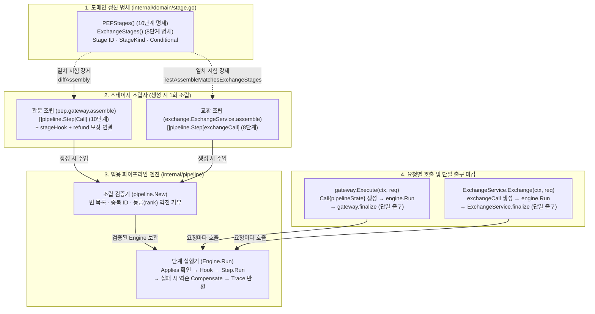
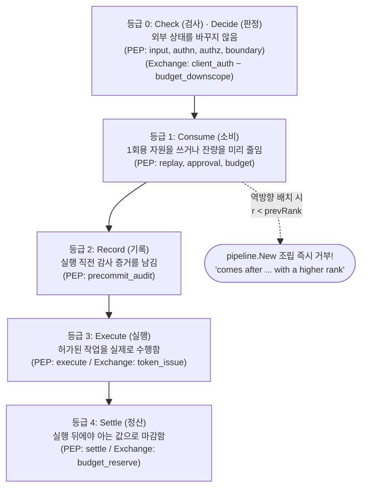
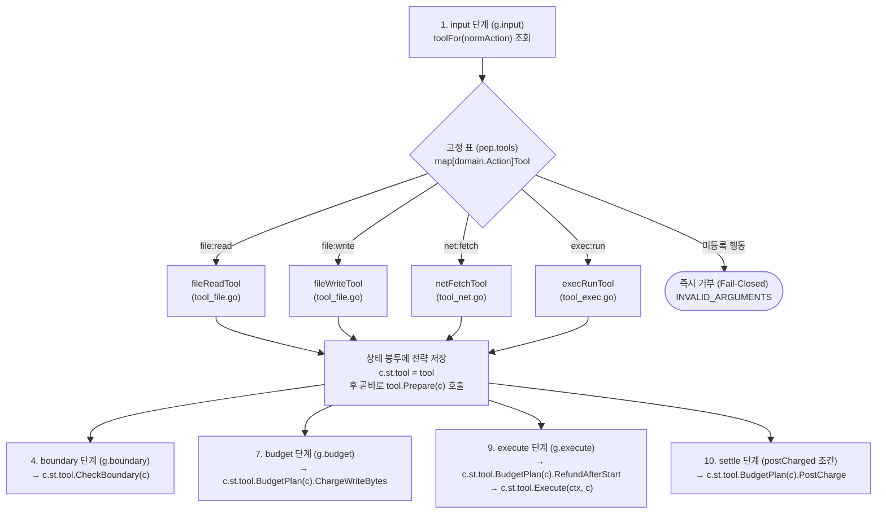
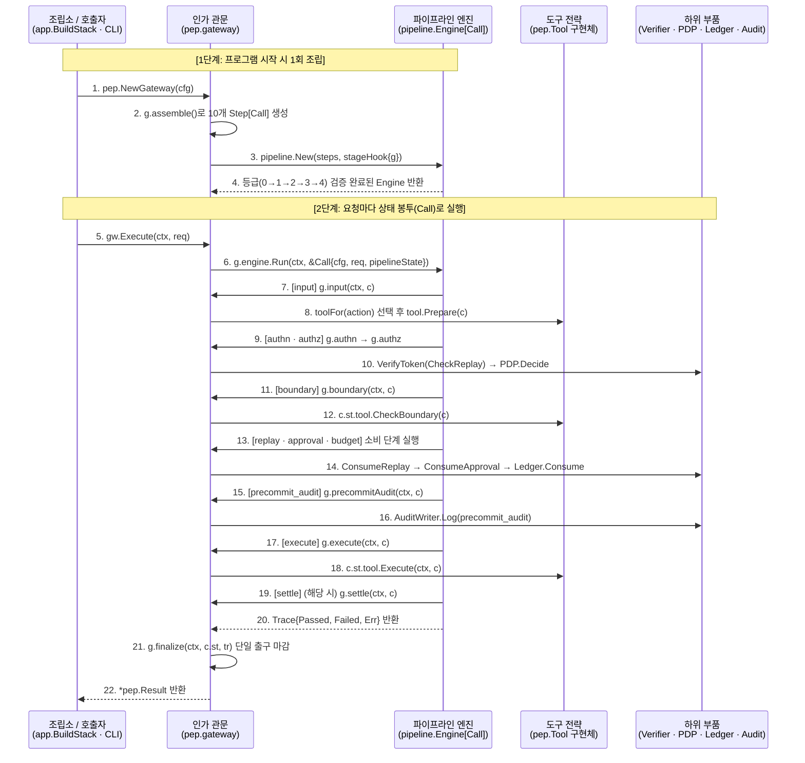
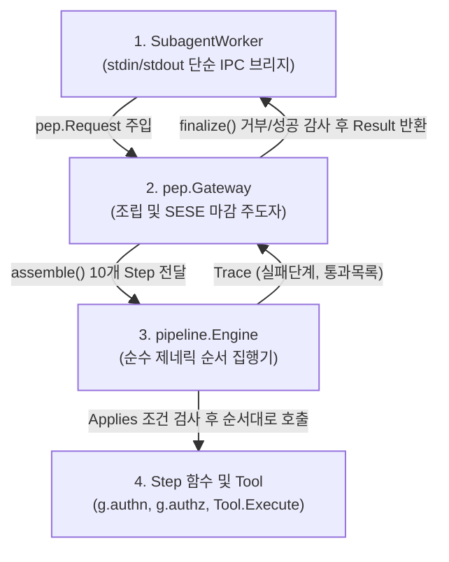

# 018. 파이프라인 스테이지 조립과 호출 구조 [쉽게 풀어쓴 해설서] — 범용 엔진, 선언적 단계 조립, 도구 전략, 역순 보상과 단일 출구

> **이 문서의 역할**: 이 프로그램(`authz-harness`)이 여러 검사·실행 단계(스테이지)를 어떻게 조립하고 순서대로 호출하는지—특히 **① 범용 파이프라인 엔진(`pipeline.Engine[S]`)과 부작용 등급 검증(`pipeline.New`), ② 선언적 단계 조립(`gateway.assemble` · `ExchangeService.assemble`), ③ 요청별 상태 봉투(`Call` · `pipelineState` · `exchangeCall`), ④ 도구별 차이를 캡슐화한 도구 전략 패턴(`pep.Tool`), ⑤ 조건부 건너뛰기(`Applies`)·역순 보상(`Compensate`)·단일 출구 마감(`finalize`)**—을 구조 다이어그램과 순서도를 곁들여 쉬운 말로 풀어쓴 해설서입니다.  
> **작성 기준**: [프로그램 설명서 README](README.md)의 「설명의 기준」, 「이름의 3층」, 「Mermaid 그림 규칙」, 「텍스트 도표 5종」을 따릅니다.

---

## 0. 모든 설계 이전에 ‘사람’이 있다 — 그냥 함수들을 차례대로 부르면 되는데, 왜 ‘조립’과 ‘엔진’으로 나누었나

권한 관문(`pep.Gateway`)은 요청 하나를 처리할 때 입력 검사(`input`)부터 사후 정산(`settle`)까지 최대 열 단계를 거치고, 토큰 교환기(`exchange.ExchangeService`)도 클라이언트 인증(`client_auth`)부터 예산 예약(`budget_reserve`)까지 최대 여덟 단계를 거칩니다.

가장 단순하게 짜려면 한 함수 안에 `if err := step1(); err != nil { ... }` 코드를 위에서 아래로 열 번 나열하면 됩니다. 하지만 그렇게 짜면 네 가지 문제가 생깁니다.

1. **단계 순서를 잘못 배치해도 코드가 알아채지 못한다**: 보안 관문에서는 모든 검사(`input`, `authn`, `authz`, `boundary`)가 끝난 뒤에야 1회용 토큰(`replay`)이나 승인(`approval`)·예산(`budget`)을 써야 하고, 실행 전 감사 증거(`precommit_audit`)를 남긴 뒤에야 실제 작업(`execute`)을 해야 합니다. 그냥 함수 호출만 나열해 두면 누군가 실수로 소비 단계를 검사 단계 앞으로 옮겨도 컴파일러가 막아 주지 못합니다.
2. **도구(`file:read`, `file:write`, `net:fetch`, `exec:run`)마다 다른 처리 코드가 여러 단계에 흩어진다**: 입력 준비(`input`), 경계 검사(`boundary`), 예산 차감(`budget`), 실제 실행(`execute`), 사후 정산(`settle`) 다섯 군데마다 `switch action` 분기문을 넣으면, 새 도구를 하나 추가할 때 다섯 함수를 전부 찾아 고쳐야 합니다.
3. **중간에 실패했을 때 앞 단계를 되돌리는(보상) 코드와 감사 기록 코드가 중복된다**: 단계마다 실패 처리 코드를 따로 적으면, 앞 단계에서 깎은 예산을 돌려주는 환급(`gateway.refund`)을 빼먹거나 거부 감사 로그(`audit.jsonl`)를 두 번 찍는 실수가 생기기 쉽습니다.
4. **조건부로 건너뛰는 단계의 통과 기록(`Result.Passed`)이 어긋난다**: 승인이나 예산이 필요 없는 요청은 해당 단계를 건너뛰어야 하는데, 이를 단계 함수 안의 `if` 문으로 숨겨 버리면 실제로는 실행하지도 않은 단계가 통과 목록이나 운영 로그에 찍히게 됩니다.

이 해설서는 위 네 가지 문제를 해결하기 위해 현재 코드가 스테이지를 어떻게 구성(조립)하고 호출하는지 다섯 가지 구현 패턴과 다이어그램으로 하나씩 펼쳐 보입니다.

---

## 1부. 스테이지를 조립하고 호출하는 5가지 핵심 설계와 구현 패턴 (끝까지 되묻는 Why)

### 1. 한눈에 보는 전체 구조 다이어그램 — 정본 명세(`domain`) · 범용 엔진(`pipeline`) · 두 조립자(`pep`, `exchange`)

먼저 스테이지 이름과 순서의 기준점인 도메인 명세(`internal/domain`)부터, 실제로 단계를 돌리는 범용 엔진(`internal/pipeline`), 그리고 이 엔진을 가져다 쓰는 두 조립자(`internal/authz/pep`, `internal/authn/exchange`)의 관계를 그림으로 봅니다.

**그림 1. 스테이지 정본 명세(`domain`) · 범용 엔진(`pipeline.Engine`) · 조립 및 호출자(`pep.Gateway`, `exchange.ExchangeService`) 전체 구조도**



(구현: [`domain/stage.go`](../../internal/domain/stage.go) · `StageSpec`, `PEPStages`, `ExchangeStages`, [`pipeline/pipeline.go`](../../internal/pipeline/pipeline.go) · `Step`, `Engine`, `New`, `Engine.Run`, [`pep/gateway.go`](../../internal/authz/pep/gateway.go) · `NewGateway`, `assemble`, `Execute`, `finalize`, [`exchange/service.go`](../../internal/authn/exchange/service.go) · `NewExchangeService`, `assemble`, `Exchange`, `finalize`)

- **왜 범용 엔진(`internal/pipeline`)은 `internal/domain`조차 가져다 쓰지 않고(`import` 없음) 표준 라이브러리만 쓰나?**
  - 엔진의 역할은 오직 **「단계 목록(`[]Step[S]`)을 규칙대로 검증하고 앞에서부터 순서대로 실행하는 것」**뿐이기 때문입니다.
  - 엔진이 토큰이나 권한, 감사 같은 도메인 개념을 몰라야 엔진 코드가 작고 단순하게(약 120줄) 유지되며, 관문(`pep.Gateway`)과 토큰 교환(`exchange.ExchangeService`) 두 곳에서 똑같은 엔진을 그대로 재사용할 수 있습니다([ADR 0008](../adr/0008-범용-파이프라인-엔진과-도구-전략.md)).
  - 이 순수성은 아키텍처 자동 시험(`TestArchitectureGuardrails`의 `internal/pipeline` 허용 목록)이 감시하여, 표준 라이브러리(`context`, `errors`, `fmt`) 외의 패키지를 `import`하면 즉시 실패합니다. (구현: [`architecture_test.go`](../../internal/harness/architecture_test.go) · `pipelineAllowedImports`)

---

### 2. 패턴 ① 선언적 단계 조립과 부작용 등급 검증 패턴 (`pipeline.Step[S]` · `pipeline.Kind` · `pipeline.New`)

각 단계는 함수 호출문으로 흩어져 있지 않고, **`pipeline.Step[S]` 구조체 하나**로 깔끔하게 포장됩니다.

```go
type Step[S any] struct {
    ID         string                              // 단계 식별자 (예: "input", "authn", "budget")
    Kind       Kind                                // 부작용 성격 (Check, Decide, Consume, Record, Execute, Settle)
    Applies    func(s *S) bool                     // 실행 조건 (nil이면 항상 실행, false면 건너뜀)
    Run        func(ctx context.Context, s *S) error // 실제 단계 본체 함수
    Compensate func(ctx context.Context, s *S)     // 뒤 단계 실패 시 되돌리는 보상 함수 (nil이면 보상 없음)
}
```

- **왜 단계마다 6가지 부작용 성격(`pipeline.Kind`)과 등급(`rank`)을 매겨 놓았나? ([ADR 0007](../adr/0007-파이프라인-단계-분류-기준.md))**
  - 보안 파이프라인에서 가장 위험한 버그는 **「검사가 다 끝나기도 전에 일회용 토큰이나 예산을 써 버리는 것」**이나 **「감사 기록을 남기기도 전에 파일·네트워크 작업을 실행해 버리는 것」**입니다.
  - 이를 막기 위해 각 단계가 세상에 남기는 부작용(Side Effect)에 따라 0점부터 4점까지 등급(`Kind.rank()`)을 매겼습니다.

**그림 2. 6가지 단계 성격(`pipeline.Kind`)의 부작용 등급(`rank`)과 `pipeline.New` 조립 검증 규칙**



(구현: [`pipeline/pipeline.go`](../../internal/pipeline/pipeline.go) · `Kind`, `rank`, `New`)

- **조립 시점 검증(`pipeline.New`)은 무엇을 막아 주나?**
  - 프로그램이 켜질 때(`pep.NewGateway`, `exchange.NewExchangeService`) `pipeline.New(steps, hook)`를 한 번 부릅니다.
  - 이때 `pipeline.New`는 다음 다섯 가지를 검사해 하나라도 어기면 엔진 생성 자체를 거부합니다:
    1. 단계 목록이 비어 있음 (`len(steps) == 0`)
    2. 단계 이름(`st.ID`)이 비어 있거나 앞 단계와 중복됨 (`seen[st.ID]`)
    3. 실행 본체 함수(`st.Run`)가 빠져 있음 (`st.Run == nil`)
    4. 등록되지 않은 성격(`st.Kind`)이 들어옴 (`!ok`)
    5. **앞 단계보다 등급(`rank`)이 내려감 (`r < prevRank`)**: 예를 들어 소비(`replay`, 등급 1)를 경계 검사(`boundary`, 등급 0) 앞으로 옮기면 시작 시점에 즉시 에러가 납니다(`TC-040-10`).

---

### 3. 패턴 ② 요청별 상태 봉투(`Call` · `pipelineState` · `exchangeCall`)와 불변 엔진 재사용 패턴

- **왜 엔진(`pipeline.Engine[S]`)은 한 번만 만들고, 요청마다 상태 구조체(`s *S`)만 새로 만들어 넘기나?**
  - `pipeline.Engine[S]` 안에는 검증이 끝난 단계 배열(`steps []Step[S]`)과 계측 훅(`hook Hook[S]`)만 들어 있고, 요청마다 바뀌는 변수는 하나도 없습니다(불변 구조체).
  - 대신 요청이 들어올 때마다(`gateway.Execute` 또는 `ExchangeService.Exchange`) 그 요청 전용 **상태 봉투(`*pep.Call` 또는 `*exchange.exchangeCall`)**를 새로 하나 만듭니다.
  - 각 단계 함수(`func(ctx context.Context, s *S) error`)는 똑같은 시그니처를 가지며, 앞 단계가 상태 봉투(`s`)에 채워 놓은 값을 읽고 자기 단계의 결과를 다시 상태 봉투에 적어 다음 단계로 넘깁니다.

- **PEP 관문의 상태 봉투(`pep.Call`과 `pep.pipelineState`)는 어떻게 채워지나?**
  - `Call` 구조체는 관문 설정(`cfg *Config`), 원본 요청(`req Request`), 실행 상태(`st *pipelineState`), 네트워크 대상(`fetchTarget netguard.Target`)을 하나로 묶은 봉투입니다.
  - 앞 단계와 뒤 단계가 어떤 필드로 연결되는지 헷갈리지 않도록, `pipelineState`의 모든 필드 옆에는 **어느 단계가 그 값을 채우는지** 주석으로 명시되어 있습니다:

| `pipelineState` 필드 | 값을 채우는 시점·단계 | 값을 읽는 뒤 단계 | 역할 |
|---|---|---|---|
| `traceID`, `resource`, `argHash` | `Execute` 진입 시 (단, `net:fetch`는 `input`에서 정규화) | 전 단계 · `stageHook` · `finalize` | 요청 추적 ID, 대상 식별자, 입력 데이터 SHA-256 지문 |
| `normAction`, `tool` | `1. input` (`g.input`) | `authz`, `boundary`, `budget`, `execute`, `settle`, `finalize` | 정규화된 행동(`file:read` 등)과 선택된 도구 전략(`pep.Tool`) |
| `claims`, `subject`, `tokenJTI`, `callerID`, `budgeted` | `2. authn` (`g.authn`) | `authz` 이후 전 단계 · `finalize` | 검증된 토큰 클레임, 주체, 토큰 ID(`jti`), 위임자, 예산 토큰 여부 |
| `approvalID`, `evalNow` | `3. authz` (`g.authz`) | `6. approval` (`approved` 조건 및 `g.approval`) | PDP가 일회성 승인으로 허용했을 때 소비할 승인 ID와 판정 시각 |
| `safePath` | `4. boundary` (`fileReadTool` · `fileWriteTool`) | `9. execute` · `finalize` | 심볼릭 링크와 감옥 탈출 검증이 끝난 안전한 절대 경로 |
| `consumed`, `refundWriteBytes` | `7. budget` (`g.budget`) / `9. execute` | `g.refund` (보상 함수) | 사전 차감 완료 여부(실행 후 환급 불가 도구는 `execute` 진입 시 `false`로 변경)와 환급할 쓰기 바이트 수 |
| `out` (`Data`, `BytesRead`, `BytesWrote`) | `9. execute` (`g.execute`) | `10. settle` (`g.settle`) · `finalize` | 도구 실행 결과 데이터와 읽고 쓴 바이트 수 |

(구현: [`pep/tool.go`](../../internal/authz/pep/tool.go) · `Call`, `Output`, [`pep/gateway.go`](../../internal/authz/pep/gateway.go) · `pipelineState`, `Execute`)

---

### 4. 패턴 ③ 도구별 차이를 격리하는 도구 전략 패턴 (`pep.Tool` 인터페이스와 `tools` 고정 표)

관문(`pep/gateway.go`) 코드를 열어 보면 놀랍게도 파일 읽기(`ActionFileRead`), 파일 쓰기(`ActionFileWrite`), 네트워크 요청(`ActionNetFetch`), 명령어 실행(`ActionExecRun`)이라는 상수 이름이 단 한 번도 나오지 않습니다(이를 자동 시험 `TestGatewayHasNoActionConstants`가 강제합니다).

- **어떻게 관문 단계 함수에서 도구별 `switch` 문을 완전히 없앴나?**
  - 도구마다 달라지는 네 가지 질문만 뽑아 **`pep.Tool` 전략 인터페이스**로 정의하고, 네 개 도구 구현체(`fileReadTool`, `fileWriteTool`, `netFetchTool`, `execRunTool`)가 각자 자기 파일(`tool_file.go`, `tool_net.go`, `tool_exec.go`)에서 이를 구현하도록 분리했기 때문입니다.

**그림 3. `input` 단계의 도구 전략(`pep.Tool`) 선택과 이후 단계(`boundary` · `budget` · `execute` · `settle`)의 위임 호출 구조도**



(구현: [`pep/tool.go`](../../internal/authz/pep/tool.go) · `Tool`, `BudgetPlan`, `tools`, `toolFor`, [`pep/tool_file.go`](../../internal/authz/pep/tool_file.go) · `fileReadTool`, `fileWriteTool`, [`pep/tool_net.go`](../../internal/authz/pep/tool_net.go) · `netFetchTool`, [`pep/tool_exec.go`](../../internal/authz/pep/tool_exec.go) · `execRunTool`)

- **네 가지 도구 전략(`pep.Tool`)은 각 단계에서 어떻게 다르게 동작하나?**

| 행동 (`domain.Action`) | 구현 구조체 | `Prepare(c)` (`input` 단계) | `CheckBoundary(c)` (`boundary` 단계) | `BudgetPlan(c)` (`budget`·`execute`·`settle` 단계) | `Execute(ctx, c)` (`execute` 단계) |
|---|---|---|---|---|---|
| **`file:read`** | `fileReadTool` | 아무 작업 안 함 (`nil`) | 감옥 경로 검사 (`Jail.ResolvePath(resource, false)`) 후 `safePath` 저장 | `PostCharge: true`, `RefundAfterStart: true` (호출 1회 사전 차감, 읽은 바이트는 `settle`에서 사후 정산) | `Jail.ReadFile` 실행 후 읽은 바이트 반환 |
| **`file:write`** | `fileWriteTool` | 아무 작업 안 함 (`nil`) | 감옥 쓰기 경로 검사 (`Jail.ResolvePath(resource, true)`) 후 `safePath` 저장 | `ChargeWriteBytes: true`, `RefundAfterStart: true` (호출 1회 + 쓸 바이트를 `budget`에서 사전 차감, `settle` 건너뜀) | `Jail.WriteFile` 실행 후 쓴 바이트 수 반환 |
| **`net:fetch`** | `netFetchTool` | 요청 본문(`Data`) 금지 확인, URL 파싱(`netguard.ParseTarget`), `resource`를 `HostPort`로 정규화 | `NetGuard.Check(HostPort)`로 허용 목록·사설 IP 차단 검사 | `PostCharge: true`, `RefundAfterStart: true` (호출 1회 사전 차감, 응답 바이트는 `settle`에서 사후 정산) | `NetGuard.Fetch` 실행 후 응답 바이트 반환 |
| **`exec:run`** | `execRunTool` | 아무 작업 안 함 (`nil`) | `execguard.Validate(resource, Data)`로 허용 명령어·인자 검사 | `ChargeWriteBytes: true`, `PostCharge: true`, **`RefundAfterStart: false`** (입력·출력 모두 차감하되, **실행이 시작되면 실패해도 환급 안 함**) | `ExecRunner.Run` 실행 후 표준 출력 바이트 반환 |

---

### 5. 패턴 ④ 조건부 건너뛰기(`Applies`), 역순 보상(`Compensate`), 그리고 단일 출구 마감(`finalize`)

조립된 스테이지들을 호출할 때(`Engine.Run` → `finalize`) 작동하는 세 가지 핵심 제어 장치입니다.

1. **조건부 건너뛰기 (`Step.Applies`)**:
   - 단계 구조체(`Step[S]`)에 `Applies func(s *S) bool` 함수가 등록되어 있으면, 엔진(`Engine.Run`)은 단계 실행 전에 먼저 `st.Applies(s)`를 부릅니다.
   - 결과가 `false`이면 그 단계는 **계측 훅(`OnStepStart`, `OnStepEnd`)도 부르지 않고, `Run`도 부르지 않고, 통과 기록(`Trace.Passed`)이나 완료 목록(`done`)에도 넣지 않은 채** 조용히 다음 단계로 넘어갑니다.
   - 덕분에 화면 표시기(`ui/pipeline.go`, `cli/pep.go`)는 요청 결과에 담긴 `Result.Passed`만 읽으면 어떤 조건부 단계(`approval`, `budget`, `settle`)가 실제로 실행되었고 어떤 단계가 해당 없음(`SKIP`)으로 건너뛰었는지 추측 없이 정확히 그릴 수 있습니다.

2. **역순 보상 (`Step.Compensate` — Saga 보상 패턴)**:
   - 어떤 단계에서 에러(`err != nil`)가 나면, 엔진은 즉시 진행을 멈추고 **지금까지 통과한 단계 목록(`done`)을 맨 뒤에서부터 맨 앞으로(`for i := len(done) - 1; i >= 0; i--`) 거꾸로 돌면서** `Compensate` 함수가 있는 단계를 찾아 호출합니다.
   - **주의할 점 두 가지**:
     - **실패한 단계 자신은 엔진이 보상하지 않습니다**: 아직 완료 목록(`done`)에 들어가기 전에 실패했기 때문입니다. 그래서 `g.budget` 단계처럼 차감 직후 같은 단계 안에서 감사 기록(`logBudgetConsumed`)이 실패했을 때는 `g.budget` 함수가 직접 `g.refund(ctx, c)`를 불러 되돌립니다.
     - **부작용이 난 뒤에는 보상을 잠글 수 있습니다**: `exec:run`(`execRunTool`)은 외부 프로그램을 실행하므로 일단 `execute` 단계가 시작되면 실패하더라도 이미 부작용이 났을 수 있습니다. 그래서 `g.execute` 첫 줄에서 `!c.st.tool.BudgetPlan(c).RefundAfterStart`이면 `c.st.consumed = false`로 내려 버립니다. 그러면 직후에 `execute`나 `settle`이 실패해 엔진이 `g.refund`를 불러도 `if !st.consumed { return }`에 걸려 예산이 환급되지 않습니다.

3. **단일 입출구 마감 (`finalize` — SESE: Single-Entry Single-Exit 패턴)**:
   - 개별 단계 함수(`g.input` ~ `g.settle`, `s.clientAuth` ~ `s.budgetReserve`) 안에는 **거부 감사 로그(`pep.deny`, `token.exchange.deny`)를 기록하는 코드가 단 한 줄도 없습니다.**
   - 모든 단계는 실패하면 오직 사유가 담긴 에러(`*domain.Error` 또는 `*denial`)만 돌려주고, 엔진(`Engine.Run`)이 멈추면서 돌려준 성적표(`pipeline.Trace{Passed, Failed, Err}`)를 받아 **마지막 `finalize` 함수 단 한 곳**에서 차단 감사 기록, 감사 실패 시 `AUDIT_LOG_FAILED`(`15`) 승격, 성공 완료 감사 기록을 일괄 처리합니다.

---

## 2부. 엔진 호출 순서도와 두 조립자(`pep.Gateway` · `exchange.ExchangeService`)의 상세 흐름

### 1. 범용 파이프라인 엔진(`pipeline.Engine.Run`)의 스테이지 호출 순서도

엔진(`Engine.Run`)이 조립된 단계 배열(`e.steps`)을 앞에서부터 하나씩 꺼내 호출하고, 실패 시 역순 보상(`Compensate`)을 거쳐 성적표(`Trace`)를 돌려주는 내부 순서도입니다.

**그림 4. `pipeline.Engine.Run`의 단계 실행 · 조건부 건너뛰기 · 역순 보상 순서도**

```mermaid
%%{init: {"themeVariables": {"fontSize": "11px"}, "flowchart": {"nodeSpacing": 30, "rankSpacing": 30}}}%%
flowchart TD
    Start(["Engine.Run(ctx, s) 시작<br/>tr = Trace{}, done = []"]) --> NextStep{"e.steps에 다음 단계<br/>st가 있는가?"}
    NextStep -->|없음 (전 단계 완주)| ReturnOK(["Trace{Passed} 반환<br/>(Failed = '', Err = nil)"])
    NextStep -->|있음| CheckApp{"st.Applies != nil 이고<br/>!st.Applies(s) 인가?"}
    CheckApp -->|예 (조건 불일치)| Skip["단계 건너뜀 (continue)<br/>Hook · Run · Passed 모두 생략"]
    Skip --> NextStep
    CheckApp -->|아니오 (실행 대상)| Hook1["e.hook != nil 이면<br/>e.hook.OnStepStart(ctx, st.ID, s)"]
    Hook1 --> RunStep["err := st.Run(ctx, s)<br/>단계 본체 함수 실행"]
    RunStep --> Hook2["e.hook != nil 이면<br/>e.hook.OnStepEnd(ctx, st.ID, s, err)"]
    Hook2 --> CheckErr{"err != nil 인가?<br/>(단계 실패 여부)"}
    CheckErr -->|아니오 (통과)| RecordPass["tr.Passed에 st.ID 추가<br/>done 배열에 st 추가"]
    RecordPass --> NextStep
    CheckErr -->|예 (실패·차단)| SetFail["tr.Failed = st.ID<br/>tr.Err = err"]
    SetFail --> CompLoop["완료 목록(done) 역순 순회<br/>for i := len(done)-1; i >= 0; i--<br/>done[i].Compensate(ctx, s) 호출"]
    CompLoop --> ReturnFail(["Trace{Passed, Failed, Err} 반환<br/>→ 호출자의 finalize에서 마감"])
```

(구현: [`pipeline/pipeline.go`](../../internal/pipeline/pipeline.go) · `Engine.Run`)

---

### 2. 첫 번째 조립자: 중앙 인가 관문(`pep.Gateway`)의 10단계 조립과 호출 흐름

관문 생성자(`pep.NewGateway`)는 `g.assemble()`이 만든 10개 단계 목록과 계측 훅(`stageHook{g}`)을 `pipeline.New[Call]`에 넘겨 엔진(`g.engine`)을 조립합니다.

#### ① `pep.gateway.assemble()`의 10단계 조립 명세표

| 순서 | 단계 ID (`domain.Stage`) | 성격 (`Kind` · 등급) | 실행 조건 (`Applies`) | 실행 함수 (`Run`) | 보상 함수 (`Compensate`) | 단계에서 하는 핵심 일 |
|:---:|---|:---:|---|---|---|
| **1** | `input` | `Check` (0) | 항상 (`nil`) | `g.input` | `nil` | `RequireTraceID` 확인, 행동 정규화(`NormalizeAction`), 도구 전략 조회(`toolFor`), `tool.Prepare(c)` 실행 |
| **2** | `authn` | `Check` (0) | 항상 (`nil`) | `g.authn` | `nil` | `Verifier.VerifyToken`으로 서명·만료·수신자·주체·재사용 여부 확인(`RecordReplay: false`), 예산 토큰이면 `BudgetLedger` 존재 확인 |
| **3** | `authz` | `Decide` (0) | 항상 (`nil`) | `g.authz` | `nil` | `PDP.Decide` 호출(정책·토큰 Scope·Epoch 대조). `allow`가 아니면 즉시 거부, 승인 허가면 `st.approvalID` 저장 |
| **4** | `boundary` | `Check` (0) | 항상 (`nil`) | `g.boundary` | `nil` | `c.st.tool.CheckBoundary(c)` 호출(감옥 경로 확인, 네트워크 허용 목록 확인, 명령어 허용 목록 확인) |
| **5** | `replay` | `Consume` (1) | 항상 (`nil`) | `g.replay` | `nil` | 모든 검사(1~4단계) 통과 직후 `Verifier.ConsumeReplay`로 토큰 `jti`를 소비(재사용 방지 원장에 기록) |
| **6** | `approval` | `Consume` (1) | `approved` (`st.approvalID != ""`) | `g.approval` | `nil` | `ApprovalConsumer.ConsumeApproval`로 일회성 승인을 재검증·삭제하고 `approval.consumed` 감사 기록 |
| **7** | `budget` | `Consume` (1) | `budgeted` (`st.budgeted == true`) | `g.budget` | **`g.refund`** | `BudgetLedger.Consume`으로 호출 1회(및 `ChargeWriteBytes` 도구의 쓰기 바이트) 사전 차감 후 `budget.consumed` 감사 기록 |
| **8** | `precommit_audit` | `Record` (2) | 항상 (`nil`) | `g.precommitAudit` | `nil` | 실제 작업 직전에 `pep.allow` 사전 감사 증거를 `audit.jsonl`에 먼저 기록(실패 시 작업 중단 · `Fail-Closed`) |
| **9** | `execute` | `Execute` (3) | 항상 (`nil`) | `g.execute` | `nil` | `RefundAfterStart == false`이면 `st.consumed = false`로 환급 잠금 후 `c.st.tool.Execute(ctx, c)`로 실제 작업 수행 |
| **10** | `settle` | `Settle` (4) | `postCharged` (`budgeted && PostCharge`) | `g.settle` | `nil` | 실행 뒤에야 크기를 아는 출력 바이트(`len(st.out.Data)`)를 `BudgetLedger.Consume`으로 사후 정산 |

(구현: [`pep/gateway.go`](../../internal/authz/pep/gateway.go) · `assemble`, `approved`, `budgeted`, `postCharged`, `input` ~ `settle`, `refund`)

#### ② 관문 생성(`NewGateway`)부터 요청 실행(`Execute`)까지의 시퀀스 다이어그램

**그림 5. `pep.NewGateway` 조립과 `gateway.Execute` 요청 호출 시퀀스 다이어그램**



#### ③ 왜 `boundary`(경계 검사)와 `authz`(권한 판정)를 모두 통과한 뒤에야 `replay`(토큰 `jti` 소비)를 부르나? ("검사 후 소비" 원칙)
- 예전에는 `authn`이나 `authz` 직후에 토큰 `jti`를 소비했습니다. 그러다 보니 경로 오타나 감옥 탈출(`boundary`)로 요청이 거부되었을 때조차 일회용 토큰(`jti`)이 이미 소모되어 버려, 같은 토큰에 묶여 있던 일회성 승인(`ApprovalBinding.TokenJTI`)까지 영영 못 쓰게 되는 문제(승인 고립)가 있었습니다.
- 현재 조립 순서(`input` → `authn` → `authz` → `boundary` → `replay`)에서는 **4개의 무상태 검사·판정 단계(등급 0)가 모두 통과한 뒤에야** 5번째 단계인 `replay`(등급 1)에서 비로소 토큰 `jti`를 소비합니다.
- 따라서 권한 거부(`deny`), 승인 요청(`ask`), 경계 위반(`boundary`)으로 막혔을 때는 토큰 `jti`와 일회성 승인이 모두 그대로 살아 있어, 승인을 받은 뒤이거나 경로를 고친 뒤 같은 토큰으로 안전하게 재시도할 수 있습니다([ADR 0008 §2.5](../adr/0008-범용-파이프라인-엔진과-도구-전략.md)).

#### ④ 게이트웨이가 9단계(`execute`)에서 도구(`Tool.Execute`)를 직접 집행하는 이유: "안티패턴인가, 참조 모니터인가?"
일반 웹 API 아키텍처에서는 게이트웨이가 비즈니스 I/O 작업을 직접 수행하면 "Fat Gateway 안티패턴"으로 분류됩니다. 하지만 본 하네스의 `pep.Gateway`가 9단계(`StageExecute`)에서 도구(`Tool.Execute`)를 직접 호출하는 것은 **호스트 보안 참조 모니터(Reference Monitor)의 3대 보안 불변식을 지키기 위한 필수 설계**입니다:
1. **TOCTOU(검사와 사용 시점 간극) 0초 제거**:
   - PEP가 인가 판정만 내리고 실제 파일 쓰기나 명령 실행을 바깥의 워커에게 맡기면, PEP 검사 후 워커가 실행하기 직전 0.001초 사이에 공격자가 심볼릭 링크를 바꿔치기할 수 있습니다.
   - 격리 감옥(`Jail`) 안에서 경로를 검증한 직후 동일 함수 문맥에서 즉시 파일을 열고 써야만 검사(Check)와 사용(Use) 사이의 틈(Window)이 0이 됩니다.
2. **사전 감사(WAL) 통과 전 0바이트 부작용 사수 (Zero Side-Effects on Deny)**:
   - 디스크 풀 등으로 8단계 `precommit_audit`이 실패하면, 9단계 `execute`는 아예 진입하지 못하고 파이프라인이 즉시 중단됩니다. 따라서 대상 파일시스템에는 단 1바이트의 부작용도 남지 않습니다.
3. **원자적 예산 사전 차감 및 역순 환급 트랜잭션 (Refund)**:
   - 7단계 `budget`에서 호출 횟수를 사전 차감한 뒤, 8단계(사전감사)에서 에러가 발생하면 파이프라인 엔진의 역순 보상(`Compensate = g.refund`)이 즉시 실행되어 예산을 되돌려줍니다.
   - 이 모든 과정이 단일 파이프라인 트랜잭션 안에서 원자적으로 처리되어야 하므로 게이트웨이가 실행을 직접 품습니다.

#### ⑤ 파이프라인 주도권 4계층 구조: "주도권은 어디에 있는가?"
요청이 들어왔을 때 각 컴포넌트의 역할과 주도권은 다음과 같이 명확히 분리되어 있습니다:

- **`SubagentWorker` (주도권 0%)**: stdin JSON 역직렬화 → `gateway.Execute` 호출 → stdout JSON 직렬화만 수행하는 **수동적 어댑터(Passive Adapter)**입니다.
- **`pep.Gateway` (전체 수명주기 책임자)**: 10개 Step을 조립(`assemble`)하여 엔진에 넘기고, 엔진이 반환한 `Trace`를 받아 단일 출구(`finalize`)에서 최종 판정 감사(`pep.allow/deny`)를 확정하는 **마감 책임자(Lifecycle Owner)**입니다.
- **`pipeline.Engine` (순서 집행 상태머신)**: 도메인 로직 없이 `Applies` 조건 검사, Hook 호출, Step 실행, 실패 시 역순 롤백(`Compensate`)만 통제하는 **순수 제네릭 순서 집행기**입니다.
- **`Tool` (실행 전략)**: 게이트웨이가 9단계에서 호출하는 실제 파일/네트워크/명령 실행 구현체입니다.

---

### 3. 두 번째 조립자: 토큰 교환(`exchange.ExchangeService`)의 8단계 조립과 호출 흐름

토큰 교환기(`internal/authn/exchange/service.go`)도 똑같은 `pipeline.Engine`을 써서 부모 토큰으로부터 권한이 축소된 자식 토큰을 발급합니다.

#### ① `ExchangeService.assemble()`의 8단계 조립 명세표

| 순서 | 단계 ID (`domain.Stage`) | 성격 (`Kind` · 등급) | 실행 조건 (`Applies`) | 실행 함수 (`Run`) | 단계에서 하는 핵심 일 |
|:---:|---|:---:|---|---|---|
| **1** | `client_auth` | `Check` (0) | 항상 (`nil`) | `s.clientAuth` | `clients.AuthenticateClient`로 요청 클라이언트의 ID·비밀키 확인 |
| **2** | `delegation_subject` | `Check` (0) | 항상 (`nil`) | `s.delegationSubject` | 자식 주체(`ChildSubject`)가 비어 있지 않고 해당 클라이언트가 위임 가능한 대상인지 확인 |
| **3** | `parent_token` | `Check` (0) | 항상 (`nil`) | `s.parentToken` | 부모 토큰 서명·만료 검증(`RecordReplay: false`). 부모나 자식 요청에 예산이 있으면 `c.budgetInvolved = true` 설정 |
| **4** | `lineage_epoch` | `Check` (0) | `hasSnapshots` (`s.snapshots != nil`) | `s.lineageEpoch` | 부모 주체와 위임 조상(`Actor` 사슬)의 `Epoch`가 현재 스냅샷(`GetSubjectSnapshot`)의 `CurrentEpoch`와 일치하는지 실시간 대조 |
| **5** | `downscope` | `Decide` (0) | 항상 (`nil`) | `s.downscope` | `validator.ValidateDownscope`로 권한 범위(`Scope`)·수명(`TTL`)·위임 깊이 단조 축소 불변식 판정 |
| **6** | `budget_downscope` | `Check` (0) | `hasBudget` (`c.budgetInvolved`) | `s.budgetDownscope` | `ValidateBudgetDownscope`로 자식 예산이 부모 예산 이하인지 정적 검사 및 예산 원장(`s.budgets`) 존재 확인 |
| **7** | `token_issue` | `Execute` (3) | 항상 (`nil`) | `s.tokenIssue` | `ActorClaim` 위임 계보 사슬을 묶어 `issuer.IssueToken`으로 서명된 자식 토큰 발급 (`c.child`에 저장) |
| **8** | `budget_reserve` | `Settle` (4) | `hasBudget` (`c.budgetInvolved`) | `s.budgetReserve` | 발급된 자식 토큰의 `jti`와 만료 시각으로 부모 예산 원장에서 자식 몫을 예약(`budgets.Reserve`) |

(구현: [`exchange/service.go`](../../internal/authn/exchange/service.go) · `assemble`, `Exchange`, `finalize`, `clientAuth` ~ `budgetReserve`)

#### ② 토큰 교환(`ExchangeService`)과 인가 관문(`pep.Gateway`)의 조립·호출 방식 비교

두 조립자는 같은 엔진(`pipeline.Engine`)을 쓰면서도 각자의 도메인 특성에 맞게 옵션을 선택합니다:

| 비교 항목 | 인가 관문 (`pep.Gateway`) | 토큰 교환기 (`exchange.ExchangeService`) |
|---|---|---|
| **엔진 상태 봉투 타입 (`S`)** | `pep.Call` (내부에 `*pipelineState` 포함) | `exchange.exchangeCall` |
| **조립 단계 수 및 정본 명세** | 10단계 (`domain.PEPStages()`) | 8단계 (`domain.ExchangeStages()`) |
| **단계 계측 훅 (`pipeline.Hook`)** | `stageHook{g}` 주입 (`Observer.OnStageStart`·`OnStageEnd` 호출) | `nil` (단계별 운영 로그 없이 `finalize`에서 감사 기록) |
| **역순 보상 (`Compensate`)** | `budget` 단계에 `g.refund` 등록 | 사용 안 함 (`nil` — 마지막 `budget_reserve` 전에 되돌릴 사전 소비 단계가 없음) |
| **마지막 단계가 `Settle`(정산, 등급 4)인 이유** | `settle`: 파일을 읽거나 네트워크 응답을 받아 봐야 출력 바이트 크기를 알 수 있어서 `execute` 뒤에 정산함 | `budget_reserve`: 자식 토큰을 발급(`token_issue`, 등급 3)해야만 자식 `jti`와 만료 시각이 생겨 원장에 예약할 수 있으므로 소비(등급 1)가 아니라 정산(등급 4)으로 배치함 |
| **단일 출구 마감 (`finalize`)** | 실패 시 차단 감사(`pep.deny`), 성공 시 완료 감사(`pep.allow`) 및 `Result` 반환 | 실패 시 `recordAuditDenied`(`token.exchange.deny`), 성공 시 `token.exchanged` 감사 및 `ExchangeResult` 반환 |

---

## 3부. 스테이지 조립 규칙을 지키는 자동 검증 시험과 이상 상황 대처

누군가 나중에 코드를 고치면서 스테이지 순서를 바꾸거나 조립 규칙을 어기면, 다음 자동 시험들이 즉시 실패하여 잘못된 구성을 막아 줍니다.

| 검증 항목 | 자동 시험 함수 (`go test`) | 무엇을 어떻게 검사하나 |
|---|---|---|
| **관문 조립 목록과 도메인 명세 일치** | `TestAssemblyMatchesDomainStages`<br/>(`internal/authz/pep/tool_test.go`) | `(&gateway{}).assemble()`이 만든 10개 단계의 ID·순서·성격(`Kind`)·조건부 여부(`Applies != nil`)가 `domain.PEPStages()` 정본 표와 완전히 일치하는지 대조한다. |
| **교환 조립 목록과 도메인 명세 일치** | `TestAssembleMatchesExchangeStages`<br/>(`internal/authn/exchange/assembly_test.go`) | `ExchangeService.assemble()`이 만든 8개 단계의 ID·순서·성격·조건부 여부가 `domain.ExchangeStages()` 정본 표와 완전히 일치하는지 대조한다. |
| **부작용 등급 역전(소비→검사, 실행→소비) 차단** | `TestNewOrdering` (`pipeline_test.go`)<br/>`TestAssemblyConsumeBeforeCheckRejected` (`pep/tool_test.go`)<br/>`TestAssembleRejectsReserveAsConsume` (`exchange/assembly_test.go`) | 소비(`replay`, 등급 1)를 검사(`boundary`, 등급 0) 앞으로 옮기거나, 실행 뒤의 `budget_reserve`를 소비(등급 1)로 바꾸면 `pipeline.New`가 즉시 에러를 내는지 검증한다. |
| **관문 코드 내 행동 상수 참조 금지** | `TestGatewayHasNoActionConstants`<br/>(`internal/authz/pep/tool_test.go`) | `pep/gateway.go`의 AST(구문 트리)를 파싱해 `domain.ActionFileRead` 같은 개별 행동 상수가 한 번이라도 등장하면 실패한다(모든 도구별 지식은 `tool*.go`에만 있어야 함). |
| **실제 통과 단계(`Result.Passed`) 불변식** | `TestStageOrder_FullPathPassesEveryStage`<br/>`TestStageOrder_ConditionalStagesOmittedWhenNotApplicable`<br/>`TestStageOrder_FailurePathsKeepInvariant`<br/>(`internal/authz/pep/stage_order_test.go`) | `Result.Passed`가 항상 `domain.PEPStages()`의 부분 수열이고, 조건부 단계가 해당 없을 때는 정확히 빠지며, 실패한 단계는 `Passed`에 들어가지 않음을 검증한다. |
| **단일 출구 거부 감사 호출 유일성** | `TestRecordAuditDeniedCalledOnce`<br/>(`internal/authn/exchange/assembly_test.go`) | `exchange/service.go`의 AST를 파싱해 거부 감사 함수(`recordAuditDenied`)가 오직 `finalize` 한 곳에서만 호출되는지 확인한다. |

---

## 4부. 코드 정본 색인 (어디를 열어 보면 되나)

| 번호 | 부품 역할 | 파일 경로 | 핵심 타입 · 함수 이름 |
|:---:|---|---|---|
| **1** | 범용 파이프라인 엔진, 부작용 등급(`Kind`), 단계(`Step`), 계측 훅(`Hook`), 실행 성적표(`Trace`) | [`internal/pipeline/pipeline.go`](../../internal/pipeline/pipeline.go) | `Kind`, `Kind.rank`, `Step`, `Hook`, `Trace`, `Engine`, `New`, `Engine.Run` |
| **2** | PEP 10단계 · 토큰 교환 8단계의 정본 명세 및 한국어 이름표 | [`internal/domain/stage.go`](../../internal/domain/stage.go) | `Stage`, `StageKind`, `StageSpec`, `PEPStages`, `ExchangeStages` |
| **3** | 중앙 인가 관문(`pep.Gateway`)의 10단계 조립, 상태 봉투, 단계 본체, 예산 보상, 단일 출구 마감 | [`internal/authz/pep/gateway.go`](../../internal/authz/pep/gateway.go) | `NewGateway`, `pipelineState`, `assemble`, `Execute`, `stageHook`, `input` ~ `settle`, `refund`, `finalize` |
| **4** | 행동별 도구 전략(`pep.Tool`) 인터페이스와 4대 도구 구현체 | [`internal/authz/pep/tool.go`](../../internal/authz/pep/tool.go)<br/>[`internal/authz/pep/tool_file.go`](../../internal/authz/pep/tool_file.go)<br/>[`internal/authz/pep/tool_net.go`](../../internal/authz/pep/tool_net.go)<br/>[`internal/authz/pep/tool_exec.go`](../../internal/authz/pep/tool_exec.go) | `Tool`, `BudgetPlan`, `Output`, `Call`, `tools`, `toolFor`<br/>`fileReadTool`, `fileWriteTool`<br/>`netFetchTool`<br/>`execRunTool` |
| **5** | 토큰 교환(`exchange.ExchangeService`)의 8단계 조립, 상태 봉투, 단계 본체, 단일 출구 마감 | [`internal/authn/exchange/service.go`](../../internal/authn/exchange/service.go) | `NewExchangeService`, `exchangeCall`, `denial`, `assemble`, `Exchange`, `finalize`, `clientAuth` ~ `budgetReserve` |
| **6** | 파이프라인 단계 분류 기준 및 범용 엔진·도구 전략 설계 결정 문서(ADR) | [`docs/adr/0007-파이프라인-단계-분류-기준.md`](../adr/0007-파이프라인-단계-분류-기준.md)<br/>[`docs/adr/0008-범용-파이프라인-엔진과-도구-전략.md`](../adr/0008-범용-파이프라인-엔진과-도구-전략.md) | 6가지 단계 성격(`check` ~ `settle`)과 등급 단조 증가 규칙<br/>범용 엔진(`internal/pipeline`), `pep.Tool` 전략, 검사 후 소비 |
| **7** | 엔진 단위 시험 및 관문·교환 조립 일치·순서 불변식 시험 | [`internal/pipeline/pipeline_test.go`](../../internal/pipeline/pipeline_test.go)<br/>[`internal/authz/pep/tool_test.go`](../../internal/authz/pep/tool_test.go)<br/>[`internal/authz/pep/stage_order_test.go`](../../internal/authz/pep/stage_order_test.go)<br/>[`internal/authn/exchange/assembly_test.go`](../../internal/authn/exchange/assembly_test.go) | `TestNewOrdering`, `TestFailureCompensation`, `TestSkippedNotCompensatedAndNoHook`<br/>`TestAssemblyMatchesDomainStages`, `TestGatewayHasNoActionConstants`, `TestToolBudgetPlans`<br/>`TestStageOrder_FullPathPassesEveryStage`<br/>`TestAssembleMatchesExchangeStages`, `TestRecordAuditDeniedCalledOnce` |
