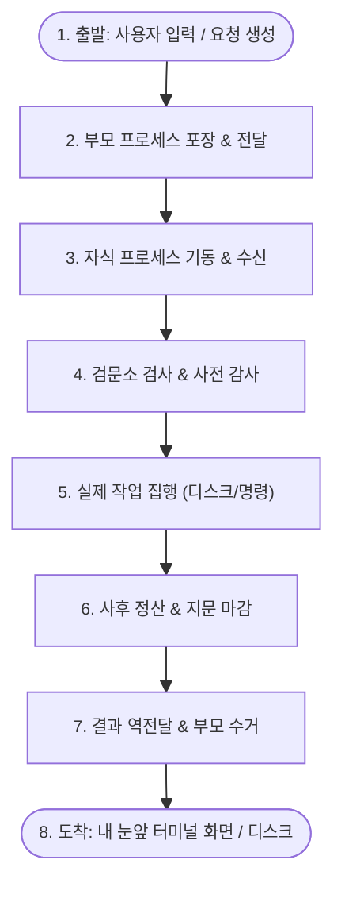

# [번호]. [주제명] — [읽는 사람이 품는 질문을 일상의 말 한 문장으로]

> **모드**: `[문서작업]` — 소스코드 수정 없이 현재 구현된 [주제]의 실제 동작과 이유(Why)를 해설합니다.  
> **기준일**: YYYY-MM-DD · **기준 커밋**: `xxxxxxx` (이 문서가 설명하는 `cmd/`와 `internal/`을 마지막으로 바꾼 커밋)  
> **다시 확인하는 법**: (직접 실행해 눈으로 결과를 확인할 수 있는 CLI 명령과 go test 명령)  
> ```bash
> git rev-parse --short HEAD
> git log -1 --format=%h -- cmd internal
> # 1. 해당 동작 확인 시험 실행
> go test -v ./internal/... -run "<시험 함수 이름>"
> # 2. CLI 명령 직접 실행 확인
> ./authz-harness ...
> ```

---

## 💡 사용자의 질문 (원문 보존)

> [이 문서를 쓰게 한 사용자의 질문이나 프롬프트 원문을 가감 없이 그대로 기록]

---

## 0. 모든 설계 이전에 ‘사람’이 있다 — [사람이 실제로 겪는 상황과 품는 의문]

- 이 프로그램을 쓰는 사람(또는 개발자)의 현실적인 상황에서 출발합니다.
- 기술 용어나 부품 이름을 나열하지 않고, 그 사람이 실제로 묻는 상식적인 질문에서 출발합니다.
- 이 문서가 그 의문에 어떻게 답하는지(용도와 전체 여정을 펼치고, 직접 열어볼 수 있는 곳을 알려 준다)를 밝힙니다.

---

## 1부. 이것은 무엇에 쓰는 장치이고, 왜 이런 모양인가 (용도와 Why)

### 1. 어디에 쓰는 물건인가 (자동차의 용도와 운전석 시점)
- 이 기능/부품이 전체 자동차(권한 하네스 시스템)에서 어떤 역할을 하는지 일상의 언어로 설명합니다.
- "엔진의 크랭크샤프트 볼트"를 설명하지 말고, "이 장치가 왜 차에 달려 있고, 운전자가 가속 페달을 밟거나 브레이크를 밟을 때 무슨 역할을 하는지"를 밝힙니다.

### 2. 가장 밑바닥의 이유부터 (끝까지 되묻는 Why)
1. **왜 필요한가?** ...
2. **그건 왜?** ...
3. **더 쉬운 일반적 방식(흔한 방식) 대신 왜 이렇게 만들었나?** ...
4. (스스로 「그건 왜?」를 더 되물을 수 없는 바닥까지 내려가고, 이유를 확인하지 못한 곳은 「확인하지 못했다」고 씁니다.)

### 3. 흔한 방식과 이 프로그램의 선택

| 구분 | 흔한 방식 (일반론) | 이 프로그램의 선택 |
|---|---|---|
| **모양** | ... | ... |
| **얻는 것** | ... | ... |
| **포기한 것 (비용)** | ... | ... |

---

## 2부. 처음부터 끝까지 따라가는 E2E 여정 (패킷 왕복 지도)

★ **필수 섹션**: 단편적인 Q&A로 넘어가기 전에, 입력이 들어와서 결과가 내 눈앞 화면에 찍히기까지의 **완결된 End-to-End 왕복 여정**을 끊김 없이 보여줍니다.



### 단계별 상세 여정과 데이터 변화
1. **[출발] 데이터 패킷 생성**: 사용자가 무엇을 넣고 어떤 패킷이 만들어지는가 (실제 CLI 인자 및 JSON 형태).
2. **[이동] 프로세스 간 전달 및 검문**: 어떤 통로(명령행, 파이프, 네트워크)로 이동하고 어느 검문소에서 무엇을 확인하는가.
3. **[집행] 실제 도구 동작**: 어떤 부작용(파일 읽기/쓰기, 명령 실행)이 실제로 일어나는가.
4. **[회수] 결과 반환과 마감**: 읽어온 결과 바이트가 어떻게 포장되어 부모에게 돌아오고 내 화면에 무엇이 찍히는가.

### 어디에 무엇이 남나 (사람이 직접 열어보는 법)

| 무엇 | 어디에 | 언제 | 사람이 직접 확인하는 법 |
|---|---|---|---|
| ... | ... | ... | `cat ...` 또는 `grep ...` |

### 이상이 생기면 (어디서 멈추고 무엇이 찍히나)

| 상황 | 일어나는 일 (어느 단계에서 멈추나) | 화면에 찍히는 종료 코드와 사유 |
|---|---|---|
| ... | ... | `11`~`18`, `Reason...` |

---

## 3부. 질문과 답변으로 파고드는 세부 동작 (Q&A)

2부의 E2E 여정을 읽은 독자가 자연스럽게 품는 세부 질문들에 대해 차례대로 답합니다.  
**주의**: 본문 문장의 주어는 사람, 프로세스, 패킷, 출입증, 장부여야 합니다. Go 타입·함수명은 문단의 주어가 될 수 없으며, 문단 끝 `(구현: 파일 · 함수)` 귀띔으로만 둡니다.

### Q1. [사람의 말로 쓴 질문]
- **무슨 일이 일어나는가**: (안에서 일어나는 일을 일상의 말로 순서대로)
- **왜 그렇게 하나**: (더 되물을 수 없는 곳까지 이유 제시)
- (구현: [`파일.go`](../../internal/...) — `함수명`, 5부 ② N번)

### Q2. [사람의 말로 쓴 질문]
- **무슨 일이 일어나는가**: ...
- **왜 그렇게 하나**: ...
- (구현: [`파일.go`](../../internal/...) — `함수명`, 5부 ② N번)

---

## 4부. 배척한 방식과 그 이유

1. **[택하지 않은 대안 1]**:
   - **택했다면 무슨 일이 생기는가**: ...
   - **그 대신 포기한 것**: ...
2. **[택하지 않은 대안 2]**:
   - **택했다면 무슨 일이 생기는가**: ...
   - **그 대신 포기한 것**: ...

---

## 5부. 한눈에 보는 요약표와 코드 정본 색인

### ① 핵심 요약 대조표

| 행동 / 단계 | 안에서 일어나는 일 | 지금은 없는 것 (한계) | 근거 (구현 위치) |
|---|---|---|---|
| [행동 1] | [일상의 말로 순서 요약] | [없는 것. 없으면 「—」] | 5부 ② N번 |

### ② 어디서 하나 (코드 정본 색인)

본문 귀띔이 가리키는 실제 Go 코드 위치의 정본 색인입니다.
1. **[기능 이름]**: [`internal/...`](../../internal/...) (`함수/타입명`)
2. **[기능 이름]**: [`internal/...`](../../internal/...) (`함수/타입명`)
3. **시험**: [`internal/.../xxx_test.go`](../../internal/...)의 `Test...` 함수
