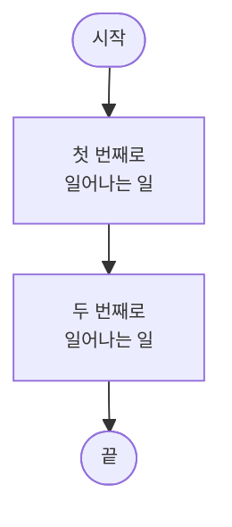

# [번호]. [주제명] — [읽는 사람이 품는 질문을 한 문장으로]

> **모드**: `[문서작업]` — 소스코드 수정 없이 현재 구현된 [주제]의 실제 동작과 이유(Why)를 해설합니다.  
> **기준일**: YYYY-MM-DD · **기준 커밋**: `xxxxxxx` (이 문서가 설명하는 `cmd/`와 `internal/`을 마지막으로 바꾼 커밋)  
> **검증 범위**: 동작·순서·소유자·시점을 코드와 대조한 결과와 「미확인」은 5부 ③에 있습니다.  
> **이 문서는 구현된 것만 적는다.** 계획·제안·미래형 약속은 적지 않으며, 현재 코드가 하지 않는 것은 「지금은 없다」고만 씁니다.  
> **이 문서의 규칙**: 본문(0~4부, Q&A, 그림, 5부 ①)은 쉬운 개념·설계·이유가 중심입니다. 파일·타입 이름 같은 고유 이름은 첫 등장에 한마디 설명과 함께 쓰고, 구현의 어디인지는 문단 끝 `(구현: 파일 · 함수, 5부 ② 번호)` 귀띔으로 보조합니다. 기준은 [프로그램 설명서 README의 「설명의 기준」과 「이름의 3층」](README.md)입니다.  
> **겹치는 주제**: [다른 편에서 자세히 다루는 주제와 링크. 없으면 이 줄을 지운다]
>
> **다시 확인하는 법**
> ```bash
> git rev-parse --short HEAD
> git log -1 --format=%h -- cmd internal
> # 1. 해당 동작을 확인하는 시험 실행
> go test -v ./internal/... -run "<시험 함수 이름>"
> # 2. 핵심 코드 위치 확인
> grep -n "func " internal/...
> ```

---

## 💡 사용자의 질문 (원문 보존)

> [이 문서를 쓰게 한 사용자의 질문이나 프롬프트 원문을 가감 없이 그대로 기록]

---

## 0. 모든 설계 이전에 ‘사람’이 있다 — [사람이 실제로 품는 의문]

- 이 프로그램을 쓰는 사람의 현실적인 상황을 먼저 펼칩니다.
- 기술 용어로 들어가지 않고, 그 사람이 실제로 묻는 질문(「자식 프로세스에게 파일 읽기만 시켰는데 왜 토큰도 보고 장부도 또 보나?」 같은)을 출발점으로 삼습니다.
- 이 문서가 그 질문에 어떻게 답하는지(안에서 일어나는 일을 순서대로 보이고, 직접 열어볼 곳을 알려 준다)를 밝힙니다.

---

## 1부. 왜 [주제]가 필요하고, 왜 이런 모양인가

### 가장 밑바닥의 이유부터

1. **왜 필요한가?** ...
2. **그러면 [더 쉬운 방법]이면 되지 않나?** ...
3. **그래서?** ...
4. (「그건 왜?」를 더 되물을 수 없을 때까지 이어 가고, 이유를 확인하지 못한 곳은 「확인하지 못했다」고 쓴다.)

### 흔한 방식과 이 프로그램의 선택

| 구분 | 흔한 방식 (일반론이면 「이 저장소에서 확인하지 않음」이라고 밝힘) | 이 프로그램의 선택 |
|---|---|---|
| 모양 | ... | ... |
| 얻는 것 | ... | ... |
| 포기하는 것 | ... | ... |

---

## 2부. 질문과 답변으로 풀어보는 핵심 동작 (Q&A)

읽는 사람이 실제로 물을 질문을 그 사람의 말로 적습니다. 개수는 정하지 않습니다. 다른 편에서 자세히 다룬 질문은 요약 한두 문단과 링크로 넘깁니다.

### Q1. [사람의 말로 쓴 질문]
- **무슨 일이 일어나는가**: (안에서 일어나는 일을 순서대로, 일상의 말로)
- **왜 그렇게 하나**: (필요할 때. 더 되물을 수 없는 곳까지)
- **근거**: 5부 ② 항목 [번호]

### Q2. [사람의 말로 쓴 질문]
- **무슨 일이 일어나는가**: ...
- **근거**: 5부 ② 항목 [번호]

---

## 3부. 내부 지도 — 한 번의 여정과 직접 확인하는 법



(그림 라벨도 본문입니다. 파일·타입 이름은 쓸 수 있고, 함수 이름은 라벨에 쓰지 않고 그림 아래 귀띔에 둡니다.)

### 어디에 무엇이 남나

| 무엇 | 어디에 | 언제 | 사람이 직접 여는 법 |
|---|---|---|---|
| ... | ... | ... | ... (구체 명령은 머리의 「다시 확인하는 법」에) |

### 이상이 생기면

| 상황 | 일어나는 일 |
|---|---|
| ... | ... (막지 못하는 경우는 막지 못한다고 쓴다) |

---

## 4부. 배척한 방식과 그 이유

1. **[택하지 않은 방식]**: 택했다면 무슨 일이 생기는가. 그 대신 포기한 것.
2. ...

---

## 5부. 한눈에 보는 대조표와 코드 정본

### ① 행동별 안에서 일어나는 일과 지금은 없는 것

| 행동 | 안에서 일어나는 일 | 지금은 없는 것 | 근거 |
|---|---|---|---|
| [행동 1] | [순서대로, 일상의 말로] | [없는 것. 없으면 「—」] | [5부 ② 번호] |

### ② 어디서 하나 (코드 정본 색인)

파일명·함수명의 정본은 여기에 모으고, 본문의 구현 귀띔과 ①의 「근거」가 같은 이름과 번호로 가리킵니다. 항목 끝에는 그 코드가 들어온 단계와 커밋을 적을 수 있습니다.
1. **[무엇]**: [`internal/...`](../../internal/...) (`심볼`) — 구현: P0N-0N0 (`xxxxxxx`)
2. **[무엇]**: [`internal/...`](../../internal/...) (`심볼`)
3. **시험**: [`internal/.../xxx_test.go`](../../internal/...)의 `Test...` 함수 (개수는 `go test ./...`로 확인)

### ③ 검증 범위와 「미확인」

검증 방법: [무엇을 직접 읽고 무엇을 실행했는지. 시험 개수는 적지 않는다]

| 항목 | 동작 | 순서 | 소유자 | 시점 | 미확인 사항 |
|---|---|---|---|---|---|
| [Q 또는 ② 항목 번호] | 확인/미확인 | 확인/미확인 | 확인/미확인 | 확인/미확인 | [확인하지 못한 내용. 없으면 「없음」] |
